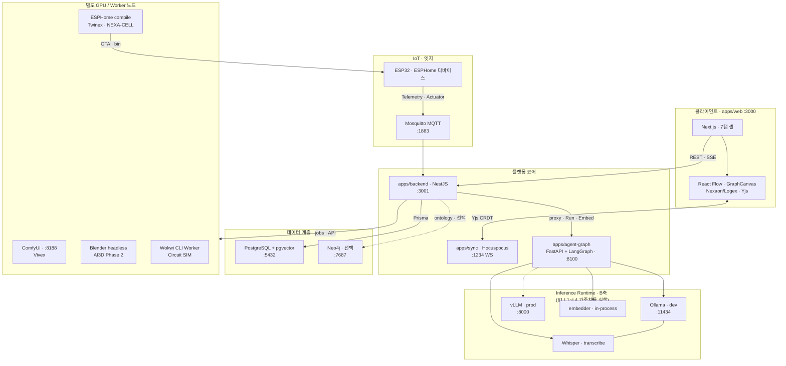

# AI 모델 · 런타임 · 엔진 배치 v1.0

> **doc_id:** TDD-066 · **상태:** published — 멀티모달 Capability Level · Inference Runtime(Ollama/vLLM) · **별도 서버/외부 엔진** · STT/TTS 선정 가이드.
> **워크플로 방침 (2026-06):** **Rivet 엔진 배제** — 로직·오케스트는 **React Flow (UI) + LangGraph (`agent-graph`)** 만 사용. 구 TDD 의 Rivet 언급은 **레거시**.
> **정본 보완:** [TDD-040 · 지능 위계 · 하드웨어 사양](./08_TDD_AI_지능위계및하드웨어사양.md) §5 등급별 권장 모델 (Hugging Face) 과 **역할 분담**을 함께 읽는다. 본 문서 = Ollama·vLLM·선정 가이드 · TDD-040 = 위계별 HF 정본.

---

## 0. 문서 목적 · 범위

| 항목 | 내용 |
| :--- | :--- |
| **목적** | AI 모델을 **처리 능력 (멀티모달 등급)** · **특화 용도** · **하드웨어·서버 배치** 기준으로 분류하고, NEXA 지능 위계·NEXIA 플랫폼·**별도 프로세스/외부 엔진**에 **어디에 무엇을 쓸지** 빠르게 판단할 수 있게 한다. |
| **범위** | Ollama·LangGraph·ComfyUI·ESPHome 등 **별도 서버/프로세스**, ESP32 엣지, PC/AI 서버. 클라우드 API 는 **비교·예외** 참고용. |
| **범위 밖** | LangGraph `StateGraph` 노드 상세 · Docker Compose 전체 Runbook — [TDD-007](../LangGraph/08_TDD_LangGraph_모노레포폴더구조_v1.0.md) · [TDD-019](../NEXIA/08_TDD_NEXIA_외부엔진및아키텍처.md). Fine-tuning — [TDD-036](./08_TDD_AI_RAG페르소나아카이브전략.md). |
| **운영 원칙** | [TDD-041 GOVERN](./08_TDD_AI_코일밸런스운영규범GOVERN.md) **Frugality** — 유료 클라우드 호출을 억제하고, 엣지·로컬 sLLM 비중을 우선한다. |
| **워크플로 SSOT** | **React Flow** (`apps/web` · GraphCanvas) + **LangGraph** (`apps/agent-graph`) — **Rivet ✗** ([§0.2](#02-워크플로-스택-react-flow--langgraph)) |

> **Ollama 태그 주의:** 아래 `ollama run …` 명령은 **2026-06 기준 라이브러리 예시**이다. 실제 태그는 `ollama list` · [ollama.com/library](https://ollama.com/library) 로 확인 후 고정한다.

### 0.1 용어 구분 — Capability Level vs Inference Runtime

본 문서는 **서로 다른 두 축**을 다룬다. 이름이 비슷해도 **혼동하지 않는다.**

| 축 | 기호·이름 | 뜻 | 본 문서 |
| :-- | :-- | :-- | :-- |
| **A. 멀티모달 능력** | **Capability Level L1~L4** | 모델 가중치가 **어떤 입력**을 처리하는지 (텍스트 → 옴니) | **§1** |
| **B. 추론 서빙** | **Inference Runtime** | 그 가중치를 **어디서·어떻게 실행**하는지 (dev/prod 엔진) | **§5** |

| 용어 | A 축 / B 축 | 설명 | 혼동 주의 |
| :-- | :--: | :-- | :-- |
| **LLM** (Large Language Model) | **A · L1 긱 용어** | 텍스트 전용 **모델 유형** | **vLLM 과 무관** |
| **VLM · LMM · Omni** | **A · L2~L4** | 멀티모달 **모델 유형** | Level 번호와만 대응 |
| **Ollama** | **B · dev** | 개발용 **추론 서빙** 런타임 (`:11434`) | L1 “LLM” 과 다른 층 |
| **vLLM** | **B · prod** | 운영용 **추론 서빙** 런타임 (`:8000`) | **Level 1~4 와 무관** — L1 모델도, L4 Omni 도 **동일 런타임**에 올릴 수 있음 |
| **agent-graph** | **B · 오케스트** | LangGraph — `LLM_BACKEND` 로 Ollama↔vLLM 전환 | [TDD-003](../NEXAOS/08_TDD_NEXAOS_플랫폼기술스택.md) SSOT |

```text
[선택] Capability Level L2 (VLM 가중치, 예: llava)
              ↓  올려서 실행
[Inference Runtime]  dev: Ollama  |  prod: vLLM   ← agent-graph adapter
              ↓
         Nest → web (추론 결과만)
```

> **암기:** **Level = 모델이 무엇을 “볼 수 있나”** · **Ollama/vLLM = 그 모델을 “어디서 돌리나”**

### 0.2 워크플로 스택 — React Flow + LangGraph

장기 아키텍처에서 **Rivet(Desktop/Embedded) 은 채택하지 않는다.** 그래프 편집·실행을 이원화하지 않고 아래 두 층만 유지한다.

| 층 | 기술 | 위치 | 역할 |
| :-- | :-- | :-- | :-- |
| **그래프 UI** | **React Flow** + Yjs | `apps/web` · Nexaon/Logex `GraphCanvas` | 노드·엣지 **시각 편집** · `ontology:draft` CRDT |
| **그래프 런타임** | **LangGraph** `StateGraph` | `apps/agent-graph` `graphs/` | Run · SSE · RAG · Extract · SHACL · 라우팅 **SSOT** |
| ~~Rivet~~ | — | **배제** | `.rivet-project` · `rivet-node` · Export JSON 중간층 **미사용** |

```text
[React Flow UI]  ←Yjs→  [Hocuspocus :1234]
       │ Run 요청
       ▼
[Nest :3001] ──proxy/SSE──▶ [agent-graph LangGraph :8100] ──▶ Inference Runtime
```

- **Nest:** 인증 · Run 프록시 · SSE 중계 — **LLM·그래프 실행 ✗**
- **정본 갱신 (2026-06-13):** TDD-003 · TDD-010 · TDD-019 · TDD-007 — Rivet 제거 · **React Flow + LangGraph** 확정.

---

## 1. 멀티모달 Capability Level (L1 → L4)

> **본 절 = A 축 (모델 능력)**. L1 의 **LLM** 은 “텍스트 모델 유형”이며, **§5 vLLM**(추론 서버) 과 **다른 개념**이다.

낮은 수준 (텍스트 전용) 에서 높은 수준 (옴니모달) 순.

| Level | 일반 명칭 | 모델 유형 (긱) | 입력 형식 | 대표 가중치 (참고) | Ollama 태그 예 (dev) |
| :-- | :-- | :-- | :-- | :-- | :-- |
| **L1** | 글만 읽는 AI | **LLM** | 텍스트·소스 코드 | GPT-4o mini, Llama 3.1, Qwen3 | `llama3.1` · `qwen3` |
| **L2** | 눈이 달린 AI | **VLM** | 텍스트 + 이미지 | LLaVA, Qwen2.5-VL | `llava` · `qwen2.5vl` |
| **L3** | 흐름을 보는 AI | **VLM(영상)** / 경량 LMM | 텍스트 + 이미지 + 비디오 | Gemini 1.5 Flash, Gemma 3 | `gemma3` · `llama3.2-vision` |
| **L4** | 모든 감각 통합 | **LMM / Omni** | 텍스트 + 이미지 + 비디오 + 오디오 | GPT-4o, Gemini 2.0, MiniCPM-o | `openbmb/minicpm-o2.6:8b` |

**NEXIA Ollama capability 매핑** ([PRD-007](../../05_PRD/NEXIA/05_PRD_NEXIA_음성미디어파이프라인7탭.md) §1.3):

| Ollama `capabilities` | Capability Level | NEXIA UI 반영 |
| :-- | :--: | :-- |
| `completion` | **L1** | 채팅·타이틀 생성 |
| `vision` | **L2** | 이미지 첨부·붙여넣기 |
| `audio` | **L4** (일부) | STT/TTS 는 **별도 transcribe 경로** — SDK 채팅과 분리 |

---

## 2. NEXA 지능 위계 × 모델 등급 매핑

[TDD-040](./08_TDD_AI_지능위계및하드웨어사양.md) §1·§5 와 정합.

| NEXA 계층 | HW 프로필 | 권장 Capability | 대표 모델·기술 | NEXA 역할 |
| :-- | :--: | :--: | :-- | :-- |
| **나노 센티널** | COLD | — (TinyML) | WakeNet/MultiNet, MobileNet, KWS | ms 급 Reflex, 키워드·모션 감지 |
| **마이크로 센티널** | WARM | **L1** (SLM) | Phi-3 mini, Whisper-tiny, YOLOv10 | 5W1H Fact 요약, **비식별화 게이트** |
| **키네틱 컨트롤러** | WARM | **L1~L2** | Phi-3 + TensorRT YOLO/MoViNet | 현장 복합 판단, JSON 제어 명령 |
| **제니스 인디케이터** | HOT | **L1~L4** | Llama-3-8B, Whisper-large-v3, VLM 7B | Why 해석, RAG, 장기 전략 |
| **NEXIA 워크스페이스** | HOT | **L1~L2** | `apps/agent-graph` 경유 | 채팅·Embed·Extract — **§5 Inference Runtime** |

**선택 규칙 (요약):**

1. **추측은 상위로** — 나노·마이크로는 Fact 만, 추론·Why 는 인디케이터.
2. **원본 미디어는 엣지에서 차단** — 영상·음성은 마이크로에서 5W1H 텍스트로 변환 후 상향.
3. **RAG·아카이브** — 인디케이터 출력·센티널 Fact 는 [TDD-036](./08_TDD_AI_RAG페르소나아카이브전략.md) 아카이브로 적재.

---

## 3. Ollama 특화 모델 분류 (실무 용도별)

> **번호 R1~R4** = 용도 분류 (§1 **L1~L4 Capability** 와 **별개**).

| # | 특화 영역 | 기술 | 권장 Ollama 모델 (dev 태그) | 최소 VRAM | Use Case |
| :-- | :-- | :-- | :-- | :-- | :-- |
| **R1** | 임베딩 & RAG | Dense · Hybrid Retrieval | `qwen3-embedding` · `bge-m3` · `nomic-embed-text` | 5GB / 600MB / 280MB | 사내 문서 검색, pgvector 인덱싱, CPU 저사양 fallback |
| **R2** | 오디오 & 옴니 | STT · Native Omni | `openbmb/minicpm-o2.6:8b` · `whisper` (large-v3 / turbo) | 5.5GB / 1.5GB~ | 실시간 음성 융합, 회의록, Scribx·Vivex 상류 |
| **R3** | 온디바이스 SLM | On-Device | `gemma3:2b` · `llama3.2:1b` · `qwen3:1.5b` | 1.2~1.6GB | RPi·Jetson·오프라인 현장 단말, GOVERN 오프라인 MVI |
| **R4** | 코드 & 에이전트 | Coding · Tool Calling | `qwen3-coder` · `deepseek-coder` · `llama3.1:8b` | ~5GB | 로컬 Copilot 대체, Function Calling 워크플로 |

**NEXIA 연동 포인트 (dev = Ollama · prod = vLLM — §5.0):**

- **Embed:** Nest → `apps/agent-graph` → Ollama embedding → `pgvector` ([PRD-013](../../05_PRD/NEXIA/05_PRD_NEXIA_파일메타데이터AI추출.md) 메타 추출과 동일 스택).
- **Chat/Stream:** `POST /ai/chat-stream` — completion·vision capability 모델만.
- **Transcribe:** Whisper 계열 — 채팅 SDK 와 **분리**된 `/ai/transcribe` 경로.

---

## 4. STT · TTS 하드웨어별 모델 비교

### 4.1 STT (Speech-to-Text)

| 배치 | 구현 방식 | 추천 모델 | 특징 | Use Case |
| :-- | :-- | :-- | :-- | :-- |
| **A** | ESP32 자체 (오프라인) | ESP-SR WakeNet · MultiNet | 3~5 키워드 KWS, ~10ms | NEXA-CELL 가전 제어, " 불 켜줘 " |
| **B** | ESP32 + 서버 (하이브리드) | Groq Whisper · Distil-Whisper | Wi-Fi 업링크 후 고속 STT | CELL + Zenith 연동 음성 비서 |
| **C** | PC / AI 서버 (로컬) | Whisper large-v3 · turbo | 다국어·잡음 내성 최고 | NEXIA Scribx, 실시간 자막, 인디케이터 WILL 포착 |

### 4.2 TTS (Text-to-Speech)

| 배치 | 구현 방식 | 추천 모델 | 특징 | Use Case |
| :-- | :-- | :-- | :-- | :-- |
| **A** | ESP32 자체 | eSpeak NG · Flite | 규칙 기반, 로봇 음색 | 공장 경보, 최소 안내 |
| **B** | ESP32 + 서버 | OpenAI Realtime · Wit.ai (클라우드 예외) | PCM 스트리밍 다운 | 대화형 키오스크·인형 (GOVERN Compliance 검토 필수) |
| **C** | PC / AI 서버 | Kokoro-82M · CosyVoice 2 | 82M 급 고음질 로컬 | 오디오북, 로컬 가상 비서 |

---

## 5. 플랫폼 · 별도 서버 · 외부 엔진 구성

NEXA/NEXIA 는 **단일 웹서버 하나**로 끝나지 않는다. AI 모델은 **어느 프로세스·어느 엔진**에 올릴지가 선행 결정이어야 한다.

> **정본:** [TDD-010 · NEXIA 스택](../NEXIA/08_TDD_NEXIA_구조기술스택운영방침.md) §2 · [TDD-019 · 외부 엔진](../NEXIA/08_TDD_NEXIA_외부엔진및아키텍처.md) · [TDD-007 · 모노레포·포트](../LangGraph/08_TDD_LangGraph_모노레포폴더구조_v1.0.md) §8

**핵심 금지:** 브라우저 → `localhost:11434` (Ollama) **직접 호출 ✗**. 모든 LLM·Embed·STT 는 **Nest → agent-graph → Inference Runtime** (dev Ollama · prod vLLM) 또는 전용 API 를 경유한다 ([TDD-019](../NEXIA/08_TDD_NEXIA_외부엔진및아키텍처.md) §1).

### 5.0 Inference Runtime — Ollama (dev) · vLLM (prod)

> **본 절 = B 축 (추론 서빙)**. [TDD-003](../NEXAOS/08_TDD_NEXAOS_플랫폼기술스택.md) SSOT · `LLM_BACKEND` env.

| 환경 | Inference Runtime | 포트 | 역할 |
| :-- | :-- | :--: | :-- |
| **dev** | **Ollama** | 11434 | 로컬 개발 · MVP · 가중치 pull·실험 |
| **prod** | **vLLM** | 8000 | 본격 서비스 · 동시 추론 · 대형 가중치 (7B~70B+) |

- **전환 지점:** `apps/agent-graph` `adapters/llm/` — `ollama.py` (dev) · `vllm.py` (prod). Nest·브라우저는 **직접 호출하지 않음** (LangGraph 경유만).
- **Capability 와의 관계:** L1 텍스트 LLM 이든 L4 Omni 이든 **동일 adapter**가 서빙 — Level 은 **가중치 선택**, Ollama/vLLM 은 **실행 엔진**.
- **Embed (예외):** prod 에서도 **`embedder` in-process** — Ollama Embed API 미사용 ([TDD-003](../NEXAOS/08_TDD_NEXAOS_플랫폼기술스택.md)).

### 5.1 프로세스·서버 맵 (로컬 dev 기준)



> **범례:** 실선 = MVP Phase 1 주 경로 · 점선 = 선택 (prod/Phase 2) · `sync` 는 Nest 와 **프로세스·포트 분리** ([TDD-007](../LangGraph/08_TDD_LangGraph_모노레포폴더구조_v1.0.md) §2-①).

### 5.2 필수 vs 선택 서비스

| 구분 | 프로세스 / 엔진 | 포트 (예) | 역할 | 연결 AI·모델 | MVP |
| :-- | :-- | :--: | :-- | :-- | :--: |
| **웹 UI** | `apps/web` (Next.js) | 3000 | 7 탭 셸 · Omnix | — (추론 ✗) | ● |
| **그래프 UI** | **React Flow** · GraphCanvas | (web) | Nexaon/Logex 노드 편집 · Yjs | — | ● |
| **API 게이트** | `apps/backend` (NestJS) | 3001 | REST · SSE 중계 · Run 프록시 | LangGraph 위임 | ● |
| **협업 WS** | `apps/sync` (Hocuspocus) | 1234 | Yjs CRDT · `ontology:draft` | — | ● |
| **워크플로 런타임** | **`apps/agent-graph` LangGraph** | 8100 | StateGraph SSOT · RAG · Extract · SHACL | `LLM_BACKEND` → Ollama/vLLM | ● |
| **관계 DB** | PostgreSQL + pgvector | 5432 | files · audit · 벡터 RAG | embedder (R1) | ● |
| **Inference · dev** | **Ollama** | 11434 | L1~L4 가중치 서빙 · transcribe | §1·§3 가중치 | ● (dev) |
| **Inference · prod** | **vLLM** sidecar | 8000 | L1~L4 가중치 서빙 · 동시 추론 | §1·§3 가중치 | prod |
| **IoT 버스** | Mosquitto | 1883 | Telemetry · Actuator | — (TinyML 은 ESP32) | ○ |
| **그래프 DB** | Neo4j | 7687 | promoted ontology · Cypher | — | ○ |
| **비주얼 생성** | **ComfyUI** | 8188 | Stable Diffusion 워크플로 | SD·Flux 계열 | Phase 2 |
| **IoT 펌웨어** | **ESPHome** compile/API | — | YAML → bin · OTA | — (엣지 Rule/TinyML) | Phase 2 |
| **3D 검수** | Blender (Docker) | — | STEP·시뮬 후처리 | — | Phase 2 |
| **회로 SIM** | Wokwi CLI Worker | — | ESP32 펌웨어 시뮬 | — | Phase 2 |

● = MVP Phase 1 · ○ = IoT/온톨로지 시 · Phase 2 = Vivex/Twinex 본격 연동 · **prod** = vLLM Inference Runtime ([TDD-019](../NEXIA/08_TDD_NEXIA_외부엔진및아키텍처.md) §8).

### 5.3 Docker Compose 프로필 (요약)

| Profile | 포함 서비스 | 적합 시나리오 |
| :-- | :-- | :-- |
| **`core`** | postgres · backend · sync | UI·에디터·Yjs 만 — IoT 없음 |
| **`iot`** | + mosquitto · edge-gateway-sim | MQTT · NEXA-CELL Telemetry 검증 |
| **`full`** | + web (:3000) | 원클릭 온보딩 |
| **`ontology`** (확장) | + agent-graph · neo4j · ollama | Nexaon Run · RAG · SHACL |

로컬 풀스택 dev: `web` + `backend` + `sync` + **`agent-graph`** + **Ollama** — 최소 5 프로세스 ([TDD-007](../LangGraph/08_TDD_LangGraph_모노레포폴더구조_v1.0.md) §8 `scripts/dev.sh`).

### 5.4 외부 엔진 × AI 모델 · 7 탭 매핑

[TDD-019](../NEXIA/08_TDD_NEXIA_외부엔진및아키텍처.md) §2·§4 정리.

| 외부 엔진                |      별도 서버 필요       | 주요 `tabId`                      | AI·모델 연계                                    | 호출 경로                                   |
| :------------------- | :-----------------: | :------------------------------ | :------------------------------------------ | :-------------------------------------- |
| **Ollama** | ● (dev Inference) | Omnix · Normex · Logex · Scribx | **L1~L4 가중치** · Whisper | Nest → **LangGraph** → Ollama adapter |
| **vLLM** | ● (prod Inference) | 동일 탭 | **L1~L4 가중치** (Ollama 와 **동일 역할**, prod 전용) | Nest → **LangGraph** → vLLM adapter |
| **LangGraph** | ● (`agent-graph`) | Logex · Nexaon · Omnix Run | RAG · Extract · `esphome_compose` · Chat | `POST /v1/runs/{graph_id}` · SSE |
| **React Flow** | ✗ (브라우저 UI) | Logex · Nexaon | 그래프 **편집** — 실행은 LangGraph | Yjs `GraphCanvas` · RunPanel |
| **ComfyUI** | ● (GPU 노드) | **Vivex** | SD/Flux 이미지·영상 | `/video/jobs` · workflow JSON |
| **ESPHome** | ● (compile job) | **Twinex** · NEXA-CELL | (AI 는 YAML **생성**만) | LangGraph `esphome_compose` → OTA |
| **Remotion/MoviePy** | ○ (CPU Worker) | Vivex | LLM 대본 → props | `/video/fast/render` |
| **Blender** | ● (Worker) | Scribx · AI3D | C3Dv0 코드 검수 | Docker headless API |
| **Wokwi CLI** | ● (Worker) | Scribx Circuit | 펌웨어 SIM | `/circuit/wokwi/jobs` |
| **Pyodide (Wasm)** | ✗ (브라우저) | Scribx · Generators | CAD·DSP **굽기** | 사용자 CPU — Inference Runtime 과 분리 |

### 5.5 연산 3 축 — 어디에 GPU·모델을 둘까

[TDD-019](../NEXIA/08_TDD_NEXIA_외부엔진및아키텍처.md) §11.

| 축 | 실행 위치 | AI 모델 | 비용 특성 |
| :-- | :-- | :-- | :-- |
| **A. 클라이언트** | 브라우저 Wasm (Pyodide) · Tone.js · R3F | 모델 없음 (연산만) | 사용자 CPU — **≈0** |
| **B. 플랫폼 LLM** | Ollama (dev) · **vLLM (prod)** · agent-graph | §1 L·§3 R 가중치 | **GPU·VRAM·토큰** (GOVERN Frugality) |
| **C. 미디어·IoT** | ComfyUI · ESPHome · MQTT · 스토리지 | ComfyUI 체크포인트 · (엣지 TinyML) | GPU + 트래픽 + OTA |

### 5.6 Zenith Indicator vs NEXIA 플랫폼 서버

| 배치 | 대상 | 서버 구성 | 모델 예 |
| :-- | :-- | :-- | :-- |
| **NEXIA dev/prod** | 7 탭 워크스페이스 | `apps/*` + **Ollama→vLLM** | **L1~L2** 가중치 · embedder · whisper |
| **Zenith (NAS/AI)** | Physical-AI · 다중 CELL · 장기 RAG | Docker Ollama · pgvector · (Neo4j) | 7B~70B · Whisper-large · VLM |
| **Micro/Kinetic** | 현장 엣지 | RPi · Jetson — **별도** from web | Phi-3 · YOLO · Whisper-tiny |
| **Nano (ESP32)** | NEXA-CELL | 펌웨어 only — **웹서버 없음** | WakeNet · MobileNet |

동일 Ollama 인스턴스를 Zenith 와 NEXIA 가 **공유**할 수 있으나, 프로세스 경계 (agent-graph 프록시 vs 직접 MQTT uplink) 는 유지한다.

---

## 6. 하이브리드 아키텍처 (ESP32 + 서버)

[NEXA-CELL](../../05_PRD/NEXIA/05_PRD_NEXIA_CELL_ESPHomeYAML제너레이터웹펌웨어.md) · [TDD-040](./08_TDD_AI_지능위계및하드웨어사양.md) §2-① 나노 센티널 음성 처리와 정합.

**권장 HW:** ESP32-S3 + INMP441(마이크) + I2S 앰프 (MAX98357) + 스피커.

```text
[ESP32-S3 · NEXA-CELL]  ──Wi-Fi/MQTT──▶  [Micro Sentinel 또는 Zenith]
       │                                          │
       │  PCM/WAV uplink                          ├─ 1. Whisper (STT)
       │                                          ├─ 2. Ollama SLM (추론)
       │                                          └─ 3. Kokoro (TTS)
       ◀────────────── PCM downlink ──────────────┘
```

| 단계 | 담당 | 지연 목표 | 비고 |
| :-- | :-- | :-- | :-- |
| 녹음·VAD | ESP32 (ESP-SR) | &lt;50ms | 상시 대기 전력 최소화 |
| STT | Micro/Zenith Whisper | 200~800ms | Distil-Whisper 로 단축 가능 |
| LLM | Ollama 1~8B | 300ms~2s | 토큰·코일 (GOVERN) 에 따라 가변 |
| TTS | Kokoro 등 | 100~500ms | 문장 길이·VRAM 의존 |
| **E2E** | — | **1~3s** (목표) | 네트워크·모델 크기에 따라 ± |

**설계 체크리스트:**

- [ ] ESP32 는 **원본 음성 장기 저장 금지** — STT 직후 버퍼 폐기 (개인정보·[TDD-040](./08_TDD_AI_지능위계및하드웨어사양.md) 보안 게이트).
- [ ] MQTT 토픽·페이로드는 NEXA-CELL Twinex 계약 준수.
- [ ] 오프라인 fallback: KWS 만 동작, 상위 연결 복구 시 큐 동기화.

---

## 7. 클라우드 vs 로컬 선택 기준

| 조건 | 권장 | 근거 |
| :-- | :-- | :-- |
| 사내 소스·PII | **로컬 Inference** (Ollama/vLLM) | GOVERN Compliance |
| ms 급 안전 Reflex | **나노 TinyML** | TDD-039 Safety Reflex |
| 다국어 STT 최고 정확도 | Whisper large (로컬) | TDD-040 §5 Zenith |
| 초저지연·대규모 batch | 클라우드 API (예외) | Frugality 위반 시 사전 승인 |
| NEXIA 7 탭 채팅 | **Ollama (dev) · vLLM (prod)** | PRD-007 · agent-graph · §5.0 |

---

## 8. 관련 문서

| doc_id | 문서 | 관계 |
| :--: | :-- | :-- |
| TDD-003 | [NEXA OS 플랫폼 기술 스택](../NEXAOS/08_TDD_NEXAOS_플랫폼기술스택.md) | **Ollama↔vLLM** · LLM_BACKEND SSOT |
| TDD-040 | [지능 위계 · 하드웨어 사양](./08_TDD_AI_지능위계및하드웨어사양.md) | **정본** — 계층별 HF 모델·HW |
| TDD-041 | [GOVERN · 코일 밸런스](./08_TDD_AI_코일밸런스운영규범GOVERN.md) | 로컬 우선·토큰 절감 |
| TDD-036 | [RAG · 페르소나 아카이브](./08_TDD_AI_RAG페르소나아카이브전략.md) | 임베딩·아카이브 |
| PRD-007 | [음성·미디어 파이프라인](../../05_PRD/NEXIA/05_PRD_NEXIA_음성미디어파이프라인7탭.md) | NEXIA STT·채팅 경로 |
| PRD-004 | [NEXA-CELL · ESPHome](../../05_PRD/NEXIA/05_PRD_NEXIA_CELL_ESPHomeYAML제너레이터웹펌웨어.md) | ESP32 펌웨어·YAML |
| PRD-013 | [파일 메타데이터 AI 추출](../../05_PRD/NEXIA/05_PRD_NEXIA_파일메타데이터AI추출.md) | Embed·pgvector |
| TDD-007 | [LangGraph 모노레포 · 포트](../LangGraph/08_TDD_LangGraph_모노레포폴더구조_v1.0.md) | agent-graph · dev 포트 |
| TDD-010 | [NEXIA 구조 · 스택](../NEXIA/08_TDD_NEXIA_구조기술스택운영방침.md) | 7 탭 · 레이어 SSOT |
| TDD-019 | [외부 엔진 · 아키텍처](../NEXIA/08_TDD_NEXIA_외부엔진및아키텍처.md) | Ollama·ComfyUI·ESPHome |

---

## 9. 승격 이력

- [x] `doc_id` **TDD-066** · `08_TDD/AI/` 승격 — 2026-06-13
- [x] [08_TDD/AI/README](./README.md) 인덱스 반영
- [x] TDD-040 §5 와 **역할 분담** — 본 문서=Ollama·vLLM·선정 가이드 · TDD-040=위계별 HF 정본
- [x] **Rivet 제거** — TDD-003 · TDD-010 · TDD-019 · TDD-007 등 **React Flow + LangGraph** 로 갱신 (§0.2)
