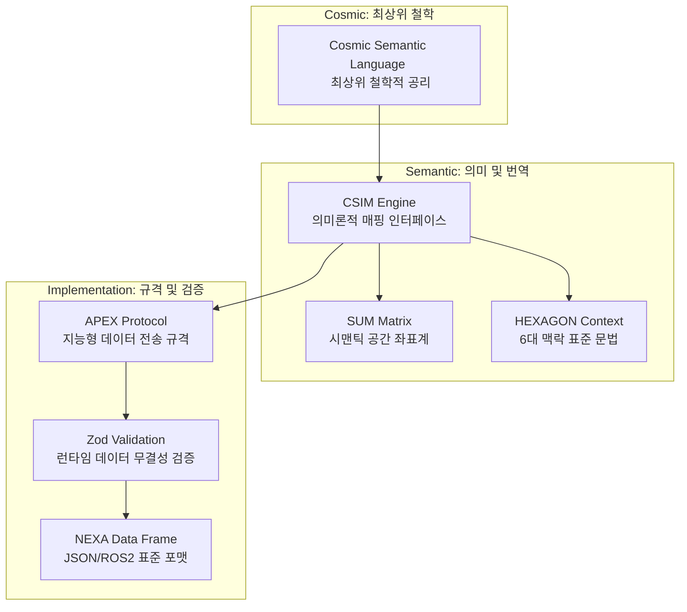

# Cosmic Language 전역 데이터 아키텍처

> **표기 (Normative):** 신규·개정 SSOT 본문 = **Cosmic** · Tier 지칭 시 **`CT_1`–`CT_3`** · 구현 **`CSIM`**. bare **`CL`** · **`CLA`** **deprecated** — [용어집 §3.2.2](../../용어집_NEXA전용_v2.0.md).
> **6 대 레이어 분담:** **`Cosmic`** 본 문서 · 프로토콜·`Axon` [TDD-043](08_TDD_AXON-CSIM-SUM-APEX우주언어및유기적구조체통합설계표준.md) `parent_doc` · **`Kineton`** [TDD-072](../NEXIA/Kineton/08_TDD_Kineton_PhysicalBridge_ACTON_ROS2_v1.0.md) · [Global Architecture](../NEXAOS/08_TDD_NEXAOS_전역아키텍처표준_GlobalArchitectureStandard_v1.0.md)

- **정의**: NEXA Platform OS 의 의미론적 커널로서, 인간의 **의지 (Will)**와 물리적 **사실 (Fact)**을 동기화하는 **최상위 지능형 언어 표준**입니다.
- **약어 지침**:
    - 공식 명칭: **Cosmic Semantic Language**
    - 기술 약어: **CSL** (전역 네임스페이스 및 시스템 식별자로 사용)
    - 통용 명칭: **Cosmic Language**
- **핵심 가치**: 데이터가 스스로의 맥락을 증명하는 **Self Verification**을 통해 AI 와 로봇, 인간 사이의 완벽한 **의미론적 정렬 (Semantic Alignment)**을 달성합니다.

- **Concept (철학)**: " 모든 데이터는 스스로의 맥락을 증명해야 한다 " 는 **Self Verification** 원칙.
- **Implementation (기술)**: 위 원칙을 실현하기 위한 **지능형 온톨로지** 및 **데이터 전송 규격**.
- **Synonym**: NEXA Platform OS 의 **의미론적 커널 (Semantic Kernel)**.

## NEXA Core Components 넥사 시스템 핵심 구성 요소
**넥사 (NEXA)** 시스템은 단순한 소프트웨어를 넘어, 인간의 **의지 (Will)**와 물리적 **사실 (Fact)**을 하나의 유기체처럼 연결하는 **지능형 운영 생태계**입니다.
### Cosmic Layer 최상위 의미론적 커널
- **Cosmic Language**: 시스템 전체를 관통하는 **최상위 언어 표준**으로, 데이터가 스스로의 존재 이유를 설명하게 합니다.
- **CSIM Engine**: 물리 세계의 신호를 의미론적 벡터로 변환하거나, 그 반대로 번역하는 **지능형 매핑 엔진**입니다.

### Spatial Reality 고정밀 공간 인지 체계
- **3MAP**: 물리적 지도 (**Reality**), 운영 지도 (**Operation**), 의미 관계 지도 (**Semantic**) 로 구성된 3 중 레이어 공간 모델입니다.
- **SUM Matrix**: **CSIM**이 데이터를 투영하는 가상의 좌표계로, 모든 사건의 위치와 맥락을 규정합니다.

### Data Infrastructure 전송 및 저장 인프라
- **APEX Protocol**: **Zod** 검증을 거친 무결한 데이터만을 실어나르는 **지능형 전송 규약**입니다.
- **NEXAVULT**: 시스템의 모든 기억과 상태를 저장하며, 데이터의 **신뢰성 (Integrity)**을 보장하는 저장소 레이어입니다.

### Intellect & Action 판단 및 실행 레이어
- **NEXAON**: **CSIM**이 번역한 데이터를 바탕으로 상황을 분석하고 최적의 실행 명령을 내리는 **지능형 의사결정체**입니다.
- **Kineton**: **NEXAON**의 명령을 받아 실제 모터나 액추에이터를 구동하는 **물리적 브릿지 (Physical Bridge)**입니다.
- **SimpleFOC Feedback**: 하드웨어 끝단에서 발생하는 전류와 진동을 다시 데이터화하여 **Echo(피드백)**를 생성하는 성찰적 학습 도구입니다.

## **Philosophy(철학) 적 기초와 데이터의 자기 증명**

**CosmicLanguage**은 인간의 주권적 의지 (Intention) 와 물리 세계의 객관적 법칙 (Physical Laws) 사이를 잇는 최상위 공리 (Axiom) 이자 지능형 온톨로지이자 NEXA Platform 자체입니다.
**CosmicLanguage**은 데이터를 단순한 신호 전달 도구가 아니라, 서버에 구축된 고정밀 3D 지도와 시맨틱 네트워크를 바탕으로 스스로 맥락을 증명하는 지능적 개체로 다룹니다. 이는 현장의 파편화된 수치를 우주적 질서 안에서 해석하여 인간과 AI 가 직감적으로 소통할 수 있게 만드는 범용 언어 체계입니다.

여기서 ' 증명 (Self Verification/Authentication)' 은 단순히 수학적 문제를 푸는 과정이 아니라, " 데이터 스스로가 자신이 왜 존재하며, 이 맥락에서 무엇을 의미하는지 논리적 근거를 완벽히 갖추고 있음 " 을 의미합니다.
CosmicLanguage 체계 안에서 데이터가 스스로를 증명한다는 것은 다음 세 가지 요소를 충족한다는 뜻입니다.

## Raison d'être 존재 목적

- **의미적 동기화 (Semantic Synchronization):** 인간이 쓰는 모호한 자연어를 로봇이 즉시 실행 가능한 정밀 물리량으로, 로봇의 미세한 전기 신호를 인간이 이해하는 상황 맥락으로 상호 번역합니다.
- **지능형 자율성 부여:** 데이터 내부에 인과관계 (Causality) 와 강제성 (Pulse) 을 내재시켜, 중앙 통제가 끊긴 상황에서도 말단 장치 (Node) 가 프로토콜 원칙에 따라 자율적으로 안전 상태를 유지하게 합니다.

### Spatial Truth 위치와 존재의 증명

 데이터가 단순한 숫자로 존재하는 것이 아니라, NEXA 의 고정밀 3D 지도 상의 특정 좌표와 즉각 결합됨을 의미합니다. " 나는 지금 ' 어디 ' 에 있는 데이터인가?" 라는 질문에 대해 시스템의 도움 없이 스스로 위치적 근거를 제시합니다.
### Semantic Truth 관계와 맥락의 증명

 시맨틱 네트워크를 통해 주변 데이터들과의 관계를 스스로 규명합니다. 예를 들어, 온도 센서의 값이 올라갔을 때 이것이 ' 단순한 기온 상승 ' 인지 ' 장비의 과부하 ' 인지, 주변의 다른 지표들과 대조하여 자신의 ' 진짜 의미 ' 를 확정 짓는 과정입니다.

### Integrity (신뢰.진실성) 의 증명

 파편화된 수치가 외부의 노이즈나 오류가 아님을, 설계된 우주적 질서 (**Cosmic**) 안에서 스스로 논리적 일관성을 통해 입증하는 것입니다. 즉, " 나의 수치는 설계된 법칙 (Physical Laws) 에 부합하는가?" 를 데이터 스스로가 체크하고 나타나는 것입니다.

> 요약하자면

Cosmic 에서의 증명이란, 데이터가 " 나는 믿을 수 있는 데이터이며, 현재 이러한 맥락을 가지고 있다 " 라는 자기소개서를 완벽하게 지참하고 나타나는 것과 같습니다.
덕분에 인간이나 AI 가 이 데이터가 진짜인지, 어떤 의미인지 따로 분석하거나 의심할 필요 없이 직감적으로 즉시 믿고 사용할 수 있게 됩니다.

## Model Reference : NEXA CSIM 번역 및 검증 체계

### Conceptual Hierarchy 지능형 계층 구조
- **Cosmic (최상위 관념)**: 물리 법칙과 인간의 의지를 동기화하여 물리적 사건을 의미로 치환합니다.
- **HEXAGON Protocol (문법)**: Where, When, Who, What, How, Why 6 가지 맥락으로 사건을 규정합니다.
- **CSIM (매핑 엔진)**: **SUM Matrix**를 사용해 의지와 물리 수치를 실시간 상호 번역합니다.

### CSIM — Semantic Interface Mapping (의미 번역 및 LLM 정렬)
- **해석적 유연성**: 동일한 수치라도 **SUM 좌표**에 따라 상태 (**Is**) 또는 위험 (**Might**) 으로 다르게 해석됩니다.
- **LLM 게이트웨이**: LLM 이 로우 레지스터 대신 **SUN 토큰**을 읽게 하여 환각을 방지하고 물리적 정렬을 확보합니다.
- **NEXAON 분리**: **CSIM**은 번역과 정렬만 담당하며, 상황 판단 및 실행 명령 생성은 **NEXAON**에 위임합니다.

### Zod-JSON 및 ROS 2 (골격 및 무결성): Data Framework
- **Zod 런타임 검증**: 모든 메시지는 전송 전후로 스키마 검증을 거쳐 프로토콜 위반을 원천 차단합니다.
- **ROS 2 표준 준수**: `geometry_msgs`, `sensor_msgs` 등 표준 메시지 타입을 사용해 범용적 호환성을 보장합니다.
- **VOID (파기 규칙)**: 논리 오류나 규격 미달 데이터는 액추에이터 도달 전 파기하여 물리적 안전을 도모합니다.

### 3MAP 지도 레이어 모델 (Spatial Reality)
- **Reality Map**: 갈보 레이저 스캔 기반의 고정밀 3D 물리 좌표 지도입니다.
- **Operation Map**: 운영 상태와 위험도, 우선순위 중심의 추상화된 지도입니다.
- **Semantic Map**: 사건 간의 관계와 인과 (**Why**) 를 연결한 의미 그래프 지도입니다.

## **Data Life-Cycle: 전역적 데이터 흐름**

### **Generation (생성)**
- **의지 (WILL)** 또는 **사실 (FACT)**로부터 데이터가 발화됩니다.
- 인간의 주관적 의도와 환경의 객관적 변화가 데이터의 기점이 됩니다.

### **Mapping (투영)**
- **CSIM** 엔진이 개입하여 **SUM** 의미 좌표를 기준으로 데이터를 투영합니다.
- 로우 데이터를 기계가 이해할 수 있는 **지능형 벡터**로 매핑하는 단계입니다.

### **Encapsulation (캡슐화)**
- **HEXAGON** 토큰 (6 대 맥락) 을 결합하여 **JSON** 형식의 패킷을 구성합니다.
- **APEX** 프로토콜 규격에 따라 전송 가능한 상태로 캡슐화됩니다.

### **Verification (검증 및 필터링)**
- **Zod** 런타임 무결성 검사를 수행합니다.
- 스키마 위반이나 논리적 오류가 발견되면 즉시 **VOID** 처리하여 하위 레이어로의 전파를 차단합니다.

### **Transmission (전송)**
- 요구되는 신뢰성과 지연율에 따라 **MQTT**, **WebSocket**, **ROS 2 DDS** 등 최적의 하이웨이를 선택합니다.
- 국소 지역에서는 **ESP-NOW**나 **필드 버스**를 통해 물리 장치로 전달됩니다.

### **Action & Echo (실행 및 피드백)**
- 최종적으로 물리적 동작이 수행되며, 그 결과는 다시 **CSIM**을 통해 역번역됩니다.
- 실행 결과는 **Echo** 패킷이 되어 상향 보고되며, 시스템의 **성찰적 학습** 데이터로 활용됩니다.

## Data Highway 통신 인프라

Cosmic 페이로드는 Zod 검증 후 동일하게 실을 수 있고, 실제 채택은 링크 신뢰성·양방향 필요·브라우저/모바일 도달 범위·ROS 2 상호운용 여부 등에 따라 조합합니다. 아래는 대표적인 후보입니다.

- **MQTT / MQTT-SN:** 브로커 기반 발행·구독. 엣지·클라우드 브리지, QoS, 유지 세션 등으로 상태 스트림·명령에 널리 씁니다.
- **WebSocket / WSS:** 브라우저 대시보드·SPA 와 백엔드 간 양방향 실시간 (텔메트리, 일부 명령) 에 적합. TLS(WSS)·역방향 프록시와 함께 씁니다.
- **HTTP/HTTPS 및 REST:** 구성 반영 (Configuration), 헬스·OTA 메타데이터, 대용량 또는 캐시 친화적 요청 등 요청–응답형 제어와 문서화에 유리합니다.
- **Server-Sent Events(SSE):** 서버→클라이언트 단방향 스트림이면서 WebSocket 보다 단순한 배포가 필요할 때 대안이 됩니다.
- **gRPC / gRPC-Web:** 타입 안전 RPC, 서비스 간 고성능 스트리밍, 내부 마이크로서비스·에이전트 게이트웨이 레이어에 적합합니다.
- **ROS 2 DDS:** ROS 2 노드 간 기본 미들웨어. 동일 패킷을 ROS 타입과 Cosmic JSON 양쪽으로 매핑하는 브리지 패턴과 자연스럽게 맞습니다.
- **AMQP / RabbitMQ 등:** 업무 규약·데드레터 등이 필요한 명령·이벤트 큐 패턴을 쓸 때 고려합니다.
- **Kafka / 이벤트 스트림:** 다수 소비자, 재생 (Replay), 감사 로그가 필요한 시스템 전역 버스 후보입니다.
- **WebRTC(Data Channel):** P2P·저지연이 필요한 원격 조종·영상 동기 신호 등에 활용 가능 (시그널링은 HTTPS/WebSocket 등 별도).
- **ESP-NOW (Neural Sync):** 중앙 장치와 말단 액추에이터 (ESP32) 간 저지연 국소 동기. 1:N 무선으로 마이크로초 단위 정밀 동기화에 활용합니다.
- **필드 버스 (CAN, RS-485/UART(Modbus 등), EtherCAT):** 모터 드라이브·PLC·안전 장치 등 공장·차량 근처 링크. 게이트웨이에서 Cosmic 상위망과 연결합니다.
- **Thread / Zigbee / Bluetooth LE Mesh:** 배터리·건축물 내부 등 저전력 근거리 스마트 디바이스 집약 구역 후보입니다.
- **LTE/5G, LoRaWAN, 위성 터미널:** 전원·허용 대역 내에서 장거리 또는 오프그리드 현장 장비 백홀로 조합 가능합니다.

**패턴 참고:**
- **Hybrid G-Code Strategy:** 짧은 즉시 명령은 경량 채널 (MQTT·WebSocket 등) 페이로드로 보내고, 대규모 작업 계획은 URL 로 분리 다운로드하는 이원화 예시입니다.
**부록 보강:** 전송 채 선택 시 MQTT 토픽·WS 경로·HTTP 리소스·gRPC 서비스 정의 등 **라우팅 명세를 버스별로** 정리하면 상호운용이 수월합니다.

### 순환 제어 및 피드백 (Cognitive Loop)

- **SimpleFOC Feedback:** BLDC 등 물리층의 전류·전압 변화를 데이터화해 장력·부하를 추정합니다.
- **CSIM 역번역 (Inverse Mapping):** 센서 데이터를 다시 의미 매트릭스에 투영합니다.
- **예:** 단순 전류 피크 (Fact) → 고착 상태 (STUCK/Error) → 긴급 보고 (ECHO/MUST).
- **Digital Twin 동기화:** 역번역 결과를 MQTT·WebSocket 등 상위망 경로로 웹 플랫폼 3D 맵 등에 반영해 가상·실제 상태를 맞춥니다.

## Cosmic Language 전역적 관점에서의 가치

의지 (Human) → 논리 (AI) → 전송 (Network) → 힘 (Machine) 으로 이어지는 과정을 하나의 지능형 언어 순환 체계로 묶습니다.

1. **성찰적 학습:** 하드코딩 중심이 아니라 누적 데이터 기반으로 판단 임계값을 보정하며 시간이 흐를수록 정교해지는 자가 진화형 시스템을 지향합니다.
2. **도메인 확장성:** NEXA-Platform 을 통해 아트, 디자인, 산업, 건축, 일상 등 고도 협업이 필요한 영역으로 표준 언어 규격을 확장할 수 있습니다.
3. **직감적 피드백:** 영상 원본에 의존하지 않고 추상 벡터 그래픽과 CSIM 번역 결과로 상황을 빠르게 파악하며, 필요 시 3D 지도 기반 근거 (사진/영상) 를 호출해 검증할 수 있습니다.
4. **안전성:** 하드웨어 (슬립 클러치 등) 와 소프트웨어 (Zod·전류 감지) 의 이중 방어로 파손을 줄입니다.
5. **지능화:** LLM 이 기계 레지스터가 아니라 CSIM 매트릭스라는 의미론적 층을 통해 세계를 읽고 조작합니다.

**정리:** **Cosmic Language**는 철학적 최상위 프레임이고, **CSIM**은 그 철학을 물리 세계와 잇는 정교한 다리입니다.

# Appendix 부록

## A. 향후 구체화 과제

문서·구현을 구체화할 때 참고할 작업 목록입니다.

- Language 데이터 패킷 **헤더 구조 (Header Structure)** 명세
- CLP 를 LLM 에 안전히 쓰기 위한 **프롬프트·학습 가이드라인**
- **Zod 스키마**를 통한 메시지 표준 (언어의 표준) 확정
- **MQTT 토픽·WebSocket 경로·HTTP/gRPC 라우팅** 등 버스별 명세 및 페이로드 규약 설계
- 협업 세션의 **저장소·충돌 정책·감사 로그**(§부록 B) 와 현장 명령 경로 간 **책임 경계** 문서화

## B. 협업·실시간 공유 상태 (애플리케이션 레이어)

협업은 플랫폼 핵심 기능으로 간주하되, 본 규격의 **MQTT·WS·DDS 등 전송 채널**(§4.1) 과 역할을 혼동하지 않는 편이 좋습니다.

- **역할 분리:** **Cosmic Language 페이로드 + Zod**는 교환되는 메시지의 진실 근원에 가깝고, 브라우저 **React 상태 (Zustand)**(Zustand, Zustand 등) 는 화면·세션 표현 로컬 상태에 가깝습니다. 협업으로 합의된 초안은 **별도 검증·권한·버전**(Who/Why 등 HEXAGON 맥락 포함) 후에 명령·설정 명으로 하위망으로 내려가는 패턴을 권합니다.
- **Yjs:** 문서형·구조형 상태에 널리 쓰이는 **CRDT** 라이브러리. 브라우저 간 동시 편집·오프라인 후 병합·awareness 등에 활용할 수 있습니다.
- **다른 CRDT:** **Automerge**(JSON 친화)·**Ink & Switch** 계열 패턴 참고. 도메인에 맞는 문서 단위 선택이 필요합니다.
- **OT(Operational Transform):** 전통적인 동시 편집 분기 중 하나로, 레거시 호환 또는 특정 에디터 엔진과 맞물릴 때 키워드로 조사합니다.
- **협업 백플레인 브리지:** Yjs 등을 **WebSocket**(예: 자체 또는 **Hocuspocus**, **y-websocket** 패턴)·**WebRTC** 등으로 묶거나, 매니지드 레이어 (**Liveblocks**, **PartyKit** 등과 유사 접근)·**Socket.io**(룸·네임스페이스) 같은 실시간 그룹 단위 채널을 검토할 수 있습니다.
- **Realtime DB·브로커 패턴:** **Supabase Realtime**, **Firebase RTDB**(또는 Firestore)·**Phoenix Channels**(Elixir) 등 발행 구독·프레즌스가 필요하면 후보 목록에 둡니다.
- **스토어·복제:** **electric-sql**(로컬 - 클라우드 동기)·**CR-SQLite**(SQLite 기반 복제)·**Ditto** 같은 **복제 (Replicated)** 레이아웃은 현장 장비 오프라인과 웹 편집 동기 교차 시 탐색 키워드입니다.
- **프레즌스·표시준 실시간 UI:** 다른 사용자 커서·선택 (selection)·락 표시 등은 UX 상 별 과제 (**Presence**) 로 명세하면 SIM·헥사곤 메타와 연계하기 좋습니다.
- **감사·규약:** 변경 이력·승인·역할 (**RBAC/ABAC**), 이벤트 소싱 또는 **Kafka** 등 감사 스트림은 “누가 무엇을 확정했는가”와 물리 실행 사이 신뢰를 보강합니다.
- **사람–사람·사람–에이전트 협업:** 채널로 **매트릭스 프로토콜 (Matrix)** 같은 연합형 메시지, 또는 **Human-in-the-loop** 명령 대기열 (§4.1 의 AMQP 계열과도 연결) 을 함께 설계 검토할 수 있습니다.

**정리:** 협업 스택 (Yjs·Zustand 스토어·실시간 브리지) 은 **UI·합의·초안** 층에 두고, 현장 실행용 **Cosmic 메시지 경로**(검증·VOID·안전 장치) 는 본문 §2–§4 의 규칙과 맞추는 것이 안전합니다.

---

## 운영 체크리스트

- 스키마: 메시지 버전, 필수 필드, VOID 규칙 명시
- 전송: 버스별 QoS/재시도/순서 보장 정책 명시
- 보안: 인증, 권한 (RBAC/ABAC), 감사 로그 추적 키 정의
- 관측성: 지연, 유실률, 오탐률, 재현 가능 지표 대시보드화
- 협업: 승인 워크플로와 실행 명령 경로의 책임 경계 고정

### 보완 권장사항

- 본 문서를 루트로 두고, 하위 문서를 `Core Spec`, `Runtime Spec`, `Map Spec`, `Policy Spec` 으로 분리해 참조 관계를 명시하면 유지보수성이 크게 올라갑니다.
- 용어 사전 (Glossary) 과 버전 정책 (예: `cla.spec.v1.x`) 을 별도 섹션으로 고정하면 팀 온보딩 속도가 빨라집니다.
- 시나리오 YAML 을 실제 Zod 스키마 파일과 1:1 매핑해 문서 - 코드 괴리를 줄이는 것이 다음 단계로 적절합니다.

# 관련 문서

| 관계 | 문서 |
| :--- | :--- |
| 상위 TDD | [CSIM · AXON 프로토콜 정본 (TDD-043)](08_TDD_AXON-CSIM-SUM-APEX우주언어및유기적구조체통합설계표준.md) |
| 5W1H 레이어 | [5W1H · 6 대 추상 레이어 규격 (TDD-033)](../AI/08_TDD_AI_5W1H_6대추상레이어규격.md) |
