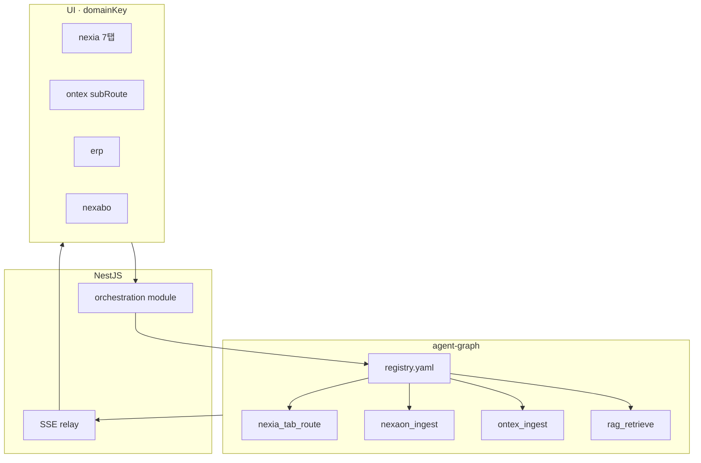
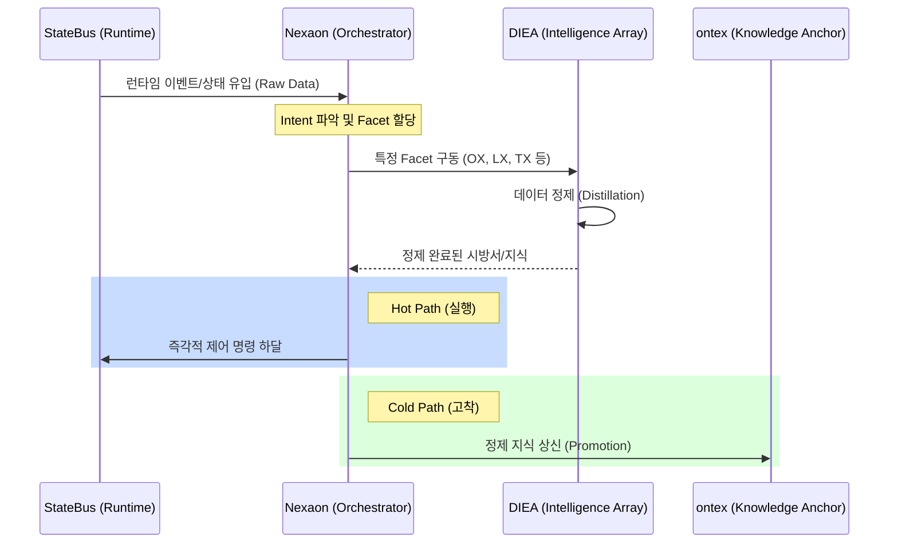

---
implements_doc:
doc_id: TDD-058
title: "LangGraph · 오케스트레이션 설계 v1.0"
category: "08_TDD"
domain: LangGraph
status: published
created: 2026-06-12
updated: 2026-06-14
parent_doc: TDD-008
see_also: [TDD-010, TDD-056, TDD-057, TDD-049]
terms_standard: ["langgraph", "sse", "fastapi", "zod", "state-graph"]
terms_nexa: ["agent-graph", "graph_id", "run_id", "Omnix", "tabId", "domainKey", "orchestration", "mint_surface"]
tags: ["doc/cat/08-tdd", "doc/domain/langgraph", "std/langgraph", "std/sse", "std/fastapi", "std/zod", "std/state-graph", "nexa/agent-graph", "nexa/graph_id", "nexa/run_id", "nexa/Omnix", "nexa/tabId", "nexa/domainKey", "nexa/orchestration", "nexa/mint_surface"]
---

# LangGraph · 오케스트레이션 설계 v1.0

> **한 줄:** NEXA 플랫폼 **전 도메인**의 의도·상태·승인·Run 을 **`apps/agent-graph` LangGraph StateGraph** 로 오케스트레이션하는 **공통 규격**. **1 차 Normative 예시**는 **nexia 7 탭** — `ontex`·`erp`·`nexabo` 등은 **동일 Envelope·`graph_id` 레지스트리**로 확장한다.

**역할 분리**

| 문서                                                                   | 범위                                                                           |
| :--------------------------------------------------------------------- | :----------------------------------------------------------------------------- |
| **본 문서 (TDD-058)**                                                  | **플랫폼 오케스트레이션** — graph 패밀리 · Run 계약 · 라우팅 · SSE · 확장 슬롯 |
| [`TDD-008`](./08_TDD_LangGraph_인간LLM협업형IoT온톨로지플랫폼_v1.0.md) | Nexaon·IoT 온톨로지 **Run·SHACL·저장 4 단계** (그래프 **소비자 중 하나**)      |
| [`TDD-010`](../NEXIA/08_TDD_NEXIA_구조기술스택운영방침.md)             | nexia **UI·탭·파이프라인** (무엇을 하는지)                                     |
| [`TDD-057`](../../Ontex/08_TDD_Ontex_기술스택운영방침_v1.0.md)            | Ontex **소비자** — ingest · explore                                            |

---

## 1. 목적과 원칙

### 1.1 목적

1. **단일 AI 런타임** — LLM·Streaming·Embed 는 **`apps/agent-graph` 만** (브라우저·Nest 직접 Ollama ✗).
2. **도메인 무관 Envelope** — `domainKey` · `tabId` · `subRoute` · `projectId` · `traceId` 공통.
3. **그래프 레지스트리** — `graph_id` → StateGraph 모듈 1:1 (`registry.yaml` SSOT).
4. **nexia 1 차 구현** — Omnix 분류 → 탭 위임 → 승인 게이트 StateGraph.
5. **확장 슬롯** — Ontex / erp / nexabo / platform 그래프를 **같은 규격**으로 추가.

### 1.2 설계 원칙

|  #  | 원칙                                                                                         |
| :-: | :------------------------------------------------------------------------------------------- |
|  1  | **UI 로직은 그래프 밖** — React·Zustand 는 `apps/web`; agent-graph 는 **판단·도구·게이트**만 |
|  2  | **Nest = 게이트웨이** — 인증 · Rate limit · SSE relay · DB persist · Neo4j write             |
|  3  | **그래프 = 순수 함수에 가깝게** — side effect 는 **명시 노드**·adapter 로만                  |
|  4  | **고위험 = Human interrupt** — IoT·배포·대량 mutation 은 `interrupt` · 승인 후 resume        |
|  5  | **관측 가능** — 모든 Run 에 `run_id` · `traceId` · `mint_surface=orchestration`              |

---

## 2. 아키텍처 (전 도메인)

```text
┌─ apps/web (모든 domainKey) ─────────────────────────────┐
│  nexia · ontex · erp · nexabo · …                        │
│  RunPanel · Omnix · Explore · (도메인별 트리거 UI)        │
└───────────────────────────┬─────────────────────────────┘
                            │ REST + SSE (Nest 경유만)
┌─ apps/backend (NestJS) ───▼─────────────────────────────┐
│  modules/orchestration/  ← 신규: Run 프록시·레지스트리   │
│  modules/nexaon/ · ontology/ · knowledge/ · …             │
│  POST /v1/runs/{graph_id}  ·  GET …/stream              │
└───────────────────────────┬─────────────────────────────┘
                            │ HTTP (내부)
┌─ apps/agent-graph ────────▼─────────────────────────────┐
│  graphs/registry.yaml  ← graph_id SSOT                    │
│  graphs/nexia_* · nexaon_* · ontex_* · platform_*       │
│  nodes/* · adapters/llm · adapters/neo4j_read           │
└───────────────────────────┬─────────────────────────────┘
                            │
         PostgreSQL · Neo4j · pgvector · specs/
```



---

## 3. Run Envelope (공통 계약)

> Zod SSOT: `packages/shared/src/schemas/agent-graph/`

### 3.1 `RunRequest` (최소)

```typescript
type RunRequest = {
  graph_id: string; // registry.yaml 키
  project_id: string;
  domain_key: string; // nexia | ontex | erp | …
  context: {
    tab_id?: string; // nexia 전용
    sub_route?: string; // ontex · erp
    room_id?: string; // Yjs room (선택)
    selection?: { node_ids?: string[]; asset_ids?: string[] };
    user_intent?: string; // Omnix 원문·요약
    hexagon?: Record<string, number>; // 5W1H 토큰 (선택)
  };
  inputs?: Record<string, unknown>; // graph별 Zod 검증
  trace_id?: string;
  parent_run_id?: string; // 체인 Run
};
```

### 3.2 `RunResponse` · SSE

| 필드/이벤트                     | 의미                                 |
| :------------------------------ | :----------------------------------- |
| `run_id`                        | Run 추적 SSOT                        |
| `run_started`                   | 그래프·graph_id·step budget          |
| `step`                          | LangGraph 노드 진입/완료             |
| `token`                         | LLM 스트림 chunk (UI 타임라인)       |
| `graph_diff`                    | Nexaon/Ontex 구조 제안               |
| `route_proposal`                | **nexia** — target `tabId` · payload |
| `shacl_violation`               | 온톨로지 검증 실패                   |
| `approval_required`             | Human interrupt — 승인 UI            |
| `run_completed` \| `run_failed` | 종료                                 |

Nest 는 SSE 를 **그대로 relay** — 변환 최소화.

---

## 4. `graph_id` 레지스트리 (확장 구조)

`apps/agent-graph/src/agent_graph/graphs/registry.yaml` — [`TDD-007`](../NEXAOS/08_TDD_NEXAOS_모노레포폴더구조_v1.0.md) §5 확장.

### 4.1 패밀리 (family) 분류

| `family`       | 소비 `domainKey`         | 설명                                         |
| :------------- | :----------------------- | :------------------------------------------- |
| **`nexia`**    | `nexia`                  | 7 탭 라우팅·탭별 서브 Run                    |
| **`nexaon`**   | `nexia` (Logex ontology) | IoT 온톨로지 Extract·Refine·Export — TDD-008 |
| **`ontex`**    | `ontex`                  | ingest · graph_explore · rag_retrieve        |
| **`erp`**      | `erp`                    | (Phase 2) 이벤트 enrich · parts 링크         |
| **`nexabo`**   | `nexabo`                 | (Phase 2) telemetry enrich · alarm correlate |
| **`platform`** | \*                       | embed batch · health · dev tools             |

**규칙:** `graph_id` = `{family}_{action}` snake_case · registry 에 **family·domain_keys[]·risk_level** 메타 필수.

### 4.2 registry 예시 (v1.0)

```yaml
graphs:
  # --- nexia · 오케스트레이션 (본 문서 1차) ---
  nexia_intent_classify:
    family: nexia
    module: nexia_intent_classify
    entry: build_graph
    domain_keys: [nexia]
    max_steps: 12
    risk_level: low

  nexia_tab_route:
    family: nexia
    module: nexia_tab_route
    entry: build_graph
    domain_keys: [nexia]
    max_steps: 24
    risk_level: medium
    emits: [route_proposal]

  nexia_tab_delegate:
    family: nexia
    module: nexia_tab_delegate
    entry: build_graph
    domain_keys: [nexia]
    max_steps: 32
    risk_level: medium
    interrupts: [approval_required]

  # --- nexaon (TDD-008 · 기존) ---
  nexaon_ingest:
    family: nexaon
    module: nexaon_ingest
    domain_keys: [nexia]
    max_steps: 32

  # --- ontex (TDD-057) ---
  ontex_ingest:
    family: ontex
    module: ontex_ingest
    domain_keys: [ontex]
    max_steps: 24

  rag_retrieve:
    family: ontex
    module: rag_retrieve
    domain_keys: [ontex, nexia]
    max_steps: 16

  graph_explore:
    family: ontex
    module: graph_explore
    domain_keys: [ontex]
    max_steps: 20
```

새 `domainKey` 추가 시: **registry 한 줄 + graphs/{module}.py + shared Zod** — UI·Nest 라우트 변경은 최소.

---


## 5. Nexia 오케스트레이션 메커니즘 시퀀스 다이어그램 (1 차 Normative)

> **핵심 메커니즘:** [[Nexaon]] 루프가 **DIEA** 패싯을 동적으로 구동하여 현장 데이터를 정제한다.

### 5.1 DIEA 정제 메커니즘 (Nexaon Loop)



### 5.2 DIEA 패싯 라우팅 전략
- **[[Nexaon]]**은 입력된 `user_intent` 와 `stateBus` 컨텍스트를 분석하여 최적의 **DIEA** 패싯 조합을 결정합니다.
- 정제 과정에서 **Human-in-the-loop (Interrupt)**가 발생할 경우, [[Nexaon]] 은 상태를 유지하며 승인을 대기합니다.

### 5.1 3 계층 (Omnix 3 단계 ↔ 그래프)

```text
[L1] nexia_intent_classify   — HEXAGON·키워드 → intent_kind · risk
[L2] nexia_tab_route         — intent → target tabId · sub-graph 후보
[L3] nexia_tab_delegate      — 탭별 graph_id 위임 · 승인 interrupt
     └── nexaon_* / tab별 micro-graph (별 graph_id)
```

| 레이어             | TDD-010 대응       | 그래프 역할                               |
| :----------------- | :----------------- | :---------------------------------------- |
| **L1 Omnix**       | 마스터 에이전트    | `nexia_intent_classify`                   |
| **L2 Normex 필터** | (선택 노드)        | 규범 스니펫 주입 · `normex_gate` 노드     |
| **L3 탭 실행**     | 탭별 서브 에이전트 | `nexia_tab_delegate` → `nexaon_ingest` 등 |

### 5.3 `tabId` 라우팅 매트릭스 (초안)

| `intent_kind` (예)   | 기본 `tabId`       | 위임 `graph_id` (예)                | `risk_level` |
| :------------------- | :----------------- | :---------------------------------- | :----------- |
| `chat` · `ask`       | `omnix`            | — (inline chat graph)               | low          |
| `policy` · `norm`    | `normex`           | —                                   | medium       |
| `logic` · `workflow` | `logex`            | `nexaon_refine` (ontology 시)       | medium       |
| `code` · `script`    | `scribx`           | —                                   | medium       |
| `media` · `render`   | `vivex`            | `comfy_queue` (Phase 2)             | medium       |
| `twin` · `device`    | `twinex`           | `esphome_compose`                   | **high**     |
| `explore` · `find`   | `navex`            | `rag_retrieve`                      | low          |
| `ontology_edit`      | `logex` (ontology) | `nexaon_ingest` / `nexaon_refine`   | medium       |
| `deploy` · `flash`   | `logex` (ontology) | `nexaon_export` + `esphome_compose` | **high**     |

고위험 (`high`) 은 `nexia_tab_delegate` 에서 **`approval_required` interrupt** 필수.

### 5.4 nexia StateGraph 흐름 (개념)

**UI 연동**

- Omnix 채팅 → `nexia_intent_classify` 분류 → `route_proposal` SSE 배당→ **TabBar 자동 전환 제안** (사용자 확인 권장)
- Logex/Nexaon Run → 기존 `nexaon_*` 그래프 — **L3 위임**으로만 호출 (중복 오케스트레이션 금지)

```mermaid
graph LR
    %% 💡 주석 1. 시작과 종료 노드를 가독성 좋게 변경하고 가로 흐름(LR)으로 구성
    Start("사용자") -->|user_intent| Classify["Classify"]
    Classify -->|intent_kind| Route["Route"]
    Route -->|tabId + graph_id| Delegate["Delegate"]
    
    Delegate -->|risk high| Approval["Approval"]
    Approval -->|human approve| SubRun["SubRun"]
    Delegate -->|risk low/medium| SubRun
    
    SubRun -->|child run_id| Complete["Complete"]
    Complete --> End("END")

    %% 스타일 통일
    style Start fill:#000,stroke:#none
    style End fill:#000,stroke:#none
    
```



#### 1. 기본 메인 워크플로우 (주 흐름)

- [시작] ➡️ 사용자의 프롬프트 (`user_intent`) 이도 입력
- [1 단계: Classify] 사용자의 의도가 무엇인지 분석 및 분류 [Classify=규칙 + 벡터 + 온톨로지 =LLM]
- [2 단계: Route] 분류된 의도의 종류 (`intent_kind`) 에 따라 알맞은 처리 경로 설정 [RabbitMQ] -> [[Redis Pub/Sub]
- [3 단계: Delegate] 해당 경로의 탭 ID 와 그래프 ID(`tabId + graph_id`) 를 부여하여 하위 에이전트에 작업 위임
- [4 단계: SubRun] 위임된 하위 그래프 실행 및 태스크 구동
- [5 단계: Complete] 실행 완료 후 자식 실행 ID(`child run_id`) 발행
- [종료] 흐름 마감

#### 2. 위험도 판단에 따른 서브 분기 (조건문 구조)

- [3 단계: Delegate] 상태에서 보안 및 인프라 위험도를 자체 검사
    - 🟢 위험도 낮음/보통 (risk low/medium) 일 경우:
        - `Delegate` ➡️ 즉시 `SubRun` (하위 실행) 단계로 다이렉트 통과
    - 🔴 위험도 높음 (risk high) 일 경우:
        - `Delegate` ➡️ `Approval` (인간 승인 요청) 단계로 강제 라우팅
        - 담당자가 승인 완료 (`human approve`) 처리 시 ➡️ `SubRun` (하위 실행) 단계로 진입

### 5.5 nexia 그래프 ↔ DIEA (7Tab) 매핑 (요약)

| `tabId` | 오케스트레이션 관심사 | 대표 `graph_id`                |
| :------ | :-------------------- | :----------------------------- |
| omnix   | 분류·승인·채팅        | `nexia_intent_classify` · chat |
| normex  | 규범 주입             | `normex_summarize` (◇ P2)      |
| logex   | 워크플로·ontology     | `nexaon_*`                     |
| scribx  | 코드 생성             | `scribx_assist` (◇ P2)         |
| vivex   | 미디어 큐             | `vivex_transcribe` (◇ P1)      |
| twinex  | 디바이스·YAML         | `esphome_compose`              |
| navex   | 검색·릴레이           | `rag_retrieve`                 |

---

## 6. 타 도메인 확장 슬롯

본 절은 **인터페이스만** 고정 — 상세는 도메인 TDD 에 위임.

### 6.1 Ontex ([`TDD-057`](../../Ontex/08_TDD_Ontex_기술스택운영방침_v1.0.md))

| 트리거        | `graph_id`                       | `sub_route` |
| :------------ | :------------------------------- | :---------- |
| ingest job    | `ontex_ingest`                   | \*          |
| explore 검색  | `rag_retrieve` · `graph_explore` | `explore`   |
| canvas 동기화 | (승격 API — 그래프 아님)         | `canvas`    |
| trace 집계    | `ontex_trace_aggregate` (◇ P2)   | `trace`     |

### 6.2 erp · nexabo (Phase 2)

| `domainKey` | 예정 `graph_id`          | 용도                          |
| :---------- | :----------------------- | :---------------------------- |
| `erp`       | `erp_event_enrich`       | 부품·재고 이벤트 → Ontex 링크 |
| `nexabo`    | `nexabo_alarm_correlate` | Telemetry → trace · NEXAVULT  |

### 6.3 platform

| `graph_id`        | 용도                 |
| :---------------- | :------------------- |
| `embed_batch`     | 백그라운드 embed job |
| `dev_graph_probe` | dev 도메인 헬스 (◇)  |

**확장 체크리스트 (신규 domainKey)**

1. `registry.yaml` — `family` · `domain_keys` · `risk_level`
2. `packages/shared` — `inputs` Zod 스키마
3. Nest `orchestration` — 라우트 권한·Grade
4. (선택) UI Run 트리거 — 도메인 Right Panel

---

## 7. Nest `orchestration` 모듈 (To-Be)

```text
apps/backend/src/modules/orchestration/
├── orchestration.controller.ts    # POST /v1/runs/:graph_id
├── orchestration.service.ts       # agent-graph HTTP client
├── sse-relay.service.ts           # stream proxy
├── graph-registry.service.ts      # registry.yaml mirror (캐시)
└── dto/                           # RunRequest Zod parse
```

| 책임          | Nest            | agent-graph       |
| :------------ | :-------------- | :---------------- |
| 인증·RBAC     | ●               | —                 |
| Run 시작·취소 | ● 프록시        | ● 실행            |
| SSE           | ● relay         | ● 생성            |
| Neo4j write   | ● ontology 모듈 | read-only adapter |
| LLM 호출      | —               | ●                 |

기존 `nexaon/` Run API 는 **orchestration 으로 통합**하되, 경로 alias `/nexaon/runs` → `/v1/runs` 유지 가능 (◇ deprecate).

---

## 8. 관측 · Identity

| 필드            | 값                                                                                  |
| :-------------- | :---------------------------------------------------------------------------------- |
| `mint_surface`  | `orchestration` ([`TDD-052`](../Identity/08_TDD_NEXA_ID_발급체계_및_설계원장.md))  |
| `trace_id`      | 탭·도메인 간 릴레이 ([`TDD-010`](../NEXIA/08_TDD_NEXIA_구조기술스택운영방침.md) §4) |
| `parent_run_id` | L3 위임 시 L1 Run 과 연결                                                           |

---

## 9. 금지 · 안티패턴

| 금지                                           | 이유                       |
| :--------------------------------------------- | :------------------------- |
| 도메인별 **별도 LLM 런타임**                   | 단일 agent-graph SSOT 위반 |
| nexia UI 상태를 **그래프 state 에 직접 저장**  | 관심사 분리 파괴           |
| `graph_id` 하드코딩 (registry 우회)            | 배포·권한·감사 불가        |
| 고위험 Run **interrupt 없이** 자동 완료        | TDD-008 · Grade 정책 위반  |
| Ontex·nexia **동일 Yjs room**을 그래프로 merge | TDD-057 · Nexaon room 분리 |

---

## 10. MVP Phase

| Phase  | 범위                                                                 |
| :----- | :------------------------------------------------------------------- |
| **P0** | `registry.yaml` · Run Envelope Zod · Nest orchestration 프록시 · SSE |
| **P0** | `nexia_intent_classify` · `nexia_tab_route` (Omnix → tab 제안)       |
| **P1** | `nexia_tab_delegate` · 승인 interrupt · `nexaon_*` 위임              |
| **P1** | `ontex_ingest` · `rag_retrieve` (Ontex explore)                      |
| **P2** | erp · nexabo family · normex/scribx micro-graph                      |

---

## 11. 변경 이력

| 날짜       | 버전 | 내용                                                                  |
| :--------- | :--- | :-------------------------------------------------------------------- |
| 2026-06-12 | v1.0 | 플랫폼 오케스트레이션 · nexia 7 탭 1 차 · registry family · 확장 슬롯 |

---

## 관련 문서

| 관계                | 문서                                                                                                   |
| :------------------ | :----------------------------------------------------------------------------------------------------- |
| 상위 플랫폼         | [LangGraph · IoT 온톨로지 플랫폼 (TDD-008)](./08_TDD_LangGraph_인간LLM협업형IoT온톨로지플랫폼_v1.0.md) |
| 모노레포 · registry | [LangGraph 모노레포 폴더 구조 (TDD-007)](../NEXAOS/08_TDD_NEXAOS_모노레포폴더구조_v1.0.md)                  |
| nexia 탭            | [NEXIA 구조 · 기술 스택 (TDD-010)](../NEXIA/08_TDD_NEXIA_구조기술스택운영방침.md)                      |
| nexia 범위          | [NEXIA · 7탭 범위 확정 (TDD-056)](../NEXIA/08_TDD_NEXIA_7탭범위확정_v1.0.md)                           |
| Ontex               | [Ontex · 기술 스택 (TDD-057)](../../Ontex/08_TDD_Ontex_기술스택운영방침_v1.0.md)                          |
| 지식 층위           | [Knowledge · 오케스트레이션 (TDD-049)](../Knowledge/08_TDD_Knowledge_지식층위와오케스트레이션.md)      |
