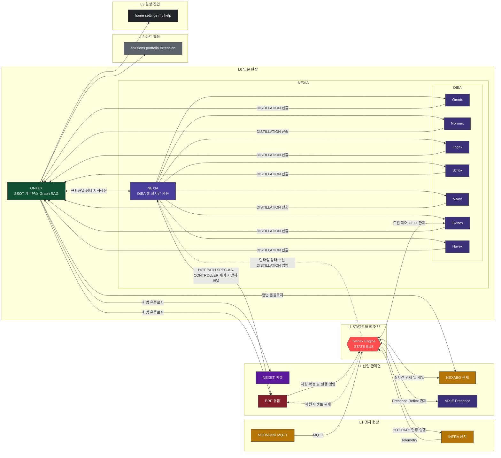

---
implements_doc:
doc_id: TDD-071
title: "NEXA OS · 도메인 구조 통합 v1.0"
category: "08_TDD"
domain: NEXAOS
status: published
created: 2026-06-14
updated: 2026-06-14
version_note: "TDD-071 정본 — TDD-002/TDD-059 대체 · DIEA·Distillation·State Bus terms"
parent_doc: TDD-001
see_also: [TDD-001, TDD-007, TDD-056, TDD-057, TDD-058]
supersedes_doc: [TDD-002, TDD-059]
terms_standard: ["react", "typescript", "zustand", "mermaid", "langgraph", "yjs"]
terms_nexa: ["domainKey", "domainLayoutRegistry", "nexia", "DIEA", "MainShell", "drawerDefaults", "tabId", "themePreset", "useLayoutStore", "Ontex", "erp", "nexabo", "nexet", "subRoute", "Nexion", "Omnix", "Normex", "Logex", "Scribx", "Vivex", "Twinex", "Navex", "Nexaon", "STATE-BUS", "DISTILLATION", "HOT-PATH"]
tags: ["doc/cat/08-tdd", "doc/domain/nexaos", "nexa/DIEA", "nexa/nexia", "nexa/ontex"]
---

# NEXA OS · 도메인 구조 통합 v1.0

| 항목           | 내용                                                                                                                                                           |
| :------------- | :------------------------------------------------------------------------------------------------------------------------------------------------------------- |
| **doc_id**     | **TDD-071** — 도메인 구조 통합 SSOT (구 TDD-002 + TDD-059)                                                                                                     |
| **역할**       | `domainKey` 레지스트리·슬롯·폴더 (Normative) + 전 도메인 관계·mermaid (Concept Map)                                                                            |
| **To-Be**      | [`08_TDD_NEXAOS_모노레포폴더구조`](./08_TDD_NEXAOS_모노레포폴더구조_v1.0.md) — `apps/web` · `apps/backend` · `apps/sync` · `apps/agent-graph` |
| **레지스트리** | `NEXA-Platform/apps/web/src/frame/registry/domainLayoutRegistry.ts`                                                                                            |
| **상위**       | [`08_TDD_NEXAOS_설계표준_미션크리티컬전략`](./08_TDD_NEXAOS_설계표준_미션크리티컬전략.md) (TDD-001)                                                            |

> **읽는 법:** §1 개요 → §2~§5 관계·mermaid 맵 (**§2.1 다이어그램 = Concept SSOT**) → §6~§13 레지스트리·구현 Normative. 슬롯·폴더 충돌 시 **§6~§13 우선** · 흐름·Distillation 충돌 시 **§2.1 우선**.

## 목차

| §   | 제목                          | 성격        |
| :-- | :---------------------------- | :---------- |
| §1  | 도메인이란 · To-Be 개요       | Normative   |
| §2  | 도메인 진화 · **통합 구조도** | Concept Map |
| §3  | 플랫폼 기반 기술 스택         | Concept Map |
| §4  | nexia — DIEA · Distillation | Concept Map |
| §5  | Ontex vs nexia — Distillation | Concept Map |
| §6  | 레지스트리 슬롯 · 드로어 정책 | Normative   |
| §7  | 등록 도메인 (`domainKey` 16)  | Normative   |
| §8  | 도메인 폴더 관례              | Normative   |
| §9  | 백엔드 ↔ 프론트               | Normative   |
| §10 | `domainLayoutRegistry` 확장   | Normative   |
| §11 | 신규 도메인 추가 절차         | Normative   |
| §12 | `engines/` · `shared/`        | Normative   |
| §13 | M2P · BAX (UIX-003 위임)      | 참고        |

---

## 1. 도메인이란

**메인 (Domain)** 은 **NEXA 플랫폼** Header **전역 메뉴**에서 선택하는 **하나의 제품·업무 영역**입니다.

**확장 방향:** NEXA 는 **인문 → 산업 → 아트 → 일상** 순으로 발전한다.

- **1 단계 (인문/Origin)**: `ontex`·`nexia` 를 통한 세계관 및 코어 온톨로지 정의
- **2 단계 (산업)**: `nexabo`·`infra`·`network`·`erp` 등 미션 크리티컬 실행
- **3 단계 (아트)**: `solutions`·미디어 제너레이터·`portfolio` 등 감성적 확장
- **4 단계 (일상)**: `my`·Twinex·NEXA-CELL 등 생활 밀착형 성숙
- **`nexia`:** 플랫폼 **핵심 지능 셸** · **DIEA** (Distillation Intelligence Engine Array) — **Nexaon** 오케스트레이터가 **가변적 DIEA Facet** (7 + _(Extended)_ · `tabId`) 을 구동·연계하여 **`stateBus` 런타임 상태**를 **정제 (Distillation)** · Twinex·**NEXA-CELL** SSOT · **Hot Path** → `erp` ([§2.1.1](#211-선주도권-표기--hot-path--관제-해석))
- **`ontex`:** **인문 계층 앵커** — 정제 **완료** 지식 **고착** · 온톨로지·Graph RAG·지식 아카이브 (raw ingest **✗**)

### To-Be — 모노레포 (`apps/web`)

- UI: `apps/web/src/domains/{folder}/` (React/TSX)
- 레지스트리: `apps/web/src/frame/registry/domainLayoutRegistry.ts` — lazy import · **`drawerDefaults`** · `statusBar` · `themePreset`
- 상태: **Zustand** (`useLayoutStore` · 도메인별 `use*Store`) — Pinia **✗**
- **도메인 전환** = registry 항목 교체 → L/R Drawer · Content · (선택) Header Actions

```text
전역 메뉴 (domainKey)
       │
       ▼
domainLayoutRegistry[domainKey]
       │
       ├── left / content / right / headerActions  → domains/*/views/**/*.tsx
       ├── drawerDefaults  → §6.1 · useLayoutStore
       ├── statusBar / statusPanel  → (IoT·관제 도메인)
       └── themePreset  → power-grid | office-light | …
```

### 프론트 4 대 축 (개념 — To-Be 경로)

| 경로 (To-Be)                | 역할                                             | 비고                              |
| :-------------------------- | :----------------------------------------------- | :-------------------------------- |
| **`apps/web/src/frame/`**   | MainShell · `domainLayoutRegistry` · router      | 슬롯 호스트 only                  |
| **`apps/web/src/domains/`** | `domainKey` 별 UI·Zustand store                  | **본 문서 SSOT**                  |
| **`apps/web/src/engines/`** | React Flow · Tiptap · Monaco — UI 금지 순수 로직 | domains → engines 역방향 **금지** |
| **`packages/shared/`**      | Zod 스키마 · commands · yjs keys                 | `@nexa/shared`                    |

## 2. 도메인 진화 모델 (v2)

| 단계        | 특성          | 핵심 도메인          | 아키텍처 역할                                                      |
| :---------- | :------------ | :------------------- | :----------------------------------------------------------------- |
| **0. 인문** | 존재론 · 규범 | **Ontex**, **nexia** | Ontex=규범 **앵커** · nexia=**Distillation** · Constitutional 정의 |
| **1. 산업** | 정밀 · 안전   | erp, nexabo, infra   | 미션 크리티컬 실행 및 데이터 검증                                  |
| **2. 아트** | 표현 · 공명   | solutions, portfolio | 센서 - 미디어 매핑 및 감성적 인터랙션                              |
| **3. 일상** | 체화 · 습관   | my, help, home       | 기술의 비가시화 및 개인화된 경험                                   |

### 2.1 NEXA OS 통합 구조도

> **§2.1 (구 피드백 루프) + §3 (구 플랫폼 구조)** 를 **하나의 SSOT 다이어그램**으로 통합. 아래 표는 통합 전 충돌과 해결 기준.

| 충돌 지점                  | 구 §2.1 (피드백 루프)          | 구 §3 (플랫폼 구조)                   | **통합 결정**                                                                                          |
| :--------------------- | :----------------------- | :------------------------------ | :------------------------------------------------------------------------------------------------- |
| **Ontex ↔ nexia**      | 양방향 피드백 (규범 하달 / 지식 상신)  | 없음 — DIEA→Ontex 단방향만            | **양방향 유지** + **DIEA Facet** **Distillation 산출**→Ontex · 런타임 상태 `stateBus`→`nexia` **단일**           |
| **Ontex 위치**           | 헌장 계층 · erp/IoT 로 **하달** | 모든 도메인의 **중심 허브** (방사형)         | Ontex = **헌장·온톨로지 앵커**(고착). **Distillation** 은 **nexia** · Ontex raw ingest **✗**                  |
| **IoT 표현**             | `nexabo/infra` **병합** 노드 | nexabo · infra · network **분리** | **3 키 분리** · 엣지는 **Twinex Engine State Bus** 허브 경유 (§2.1)                                          |
| **erp ↔ IoT**          | `erp → iot` 실행 체인        | 없음                              | **다층 관제** — nexabo · erp · Twinex · Nixie 가 **State Bus** 로 통제 (infra 직결 nexabo ✗)                 |
| **데이터 흐름**             | Ontex→산업만 표시             | 탭→Ontex 만 표시                    | **Hot** nexia→erp(Zod) · **Cold** nexia Distillation→Ontex · **상태** stateBus→nexia **단일** · §2.1.2 |
| **Spec-as-Controller** | —                        | —                               | nexia→erp→stateBus→현장 · stateBus↔nexabo **관제** · §2.1.1                                            |
| **아트·일상**              | 진화 표에만 존재                | `common` 만 하단 · solutions 누락    | **L2 아트** · **L3 일상** 그룹 명시                                                                        |
| **dev · admin**        | 없음                       | 없음                              | 구조도 **제외** — 운영 인프라 (§7.F)                                                                         |



> **Obsidian Mermaid:** subgraph 제목에 `0.` 접두·`·`(가운뎃점)·`/` 를 쓰면 그룹 라벨이 `Unsupported markdown:` 으로 깨질 수 있음 — 본 다이어그램은 **ASCII-safe 제목** 사용. **L0** = **ONTEX** + **NEXIA** 중첩 그룹 (셸 + **DIEA**). 노드 **표시 라벨** = 브랜드·domainKey **대문자** · **DIEA Facet** = 접두 대문자 (Omnix …) · 노드 **id**(`ontex`·`nexia` …) 는 Mermaid 연결용 **소문자** 유지.

**State Bus (다층 관제):** `infra`·`network` 는 **nexabo 에 직결하지 않음**. 장치·프로토콜 이벤트는 **`Twinex Engine (State Bus)`** 단일 허브로 수렴하고, **nexabo**(관제 대시) · **erp**(자원·재고·일정) · **nexia Twinex**(디지털 트윈·CELL) · **Nixie**(Presence·Reflex) 가 **동일 버스**를 통해 다층적으로 구독·명령한다. **런타임 상태의 Ontex 반영**은 **`stateBus` → `nexia` Distillation** 경유만 허용 — `erp`·`nexabo`·`stateBus` → `ontex` **직결 ✗**. 상세: [TDD-068](../NEXIA/08_TDD_NEXIA_IoT엣지데이터파이프라인_HEXAGON_Nexaon연계_v1.0.md) · Event Router · Nexaon 정재 루프.

**범례:** 육각형 = **엔진·버스 허브** · 실선 = 규범·실행·**DISTILLATION** 산출·버스·**HOT PATH·관제 주도** · 점선 = **상태 수신** (`STATE BUS`→`nexia` **DISTILLATION** 입력 · `STATE BUS`→`erp` 관제). `dev`·`admin` 은 운영 도메인으로 본 맵에서 생략.

#### 2.1.1 선·주도권 표기 · Hot Path · 관제 해석

**선 종류 (원칙 vs 본 다이어그램)**

| 원칙                   | 표기                            | 의미                                                               |
| :--------------------- | :------------------------------ | :----------------------------------------------------------------- |
| **주도권·명령·시방서** | 단방향 **실선** `-->`           | 누가 먼저 보내는지가 분명한 실행·하달                              |
| **상태 수신·피드백**   | **점선** `-.->`                 | 관측·이벤트·온톨로지 상행 — 실행을 **선행하지 않음**               |
| **관제·개입**          | **양방향 실선** `<-->` **허용** | 관측과 HITL 명령이 **동시에** 오가는 구간 (본 §2.1 은 이 표기 유지) |

> 다이어그램 **HOT PATH** (`NEXIA`→`ERP`→`STATE BUS`→`INFRA`) 는 §2.1 Mermaid 에 **실선**으로 표기. 원칙 (상태=점선) 과 다른 구간은 위 표로 보완 설명.

**§2.1 관제·흐름 해석 (현재 다이어그램)**

| 구간                              | 선                  | 라벨 (개념)                               | 관제·역할                                                                    |
| :-------------------------------- | :------------------ | :---------------------------------------- | :--------------------------------------------------------------------------- |
| `ONTEX` ↔ `NEXIA`                 | 실선 양방향         | 규범하달 · **정제 지식상신**              | **Cold** — 하달=헌장 · 상신=**DISTILLATION 완료** 지식 (HOT PATH **아님**)   |
| **`DIEA` Facet → `ONTEX`**        | 실선                | **DISTILLATION 산출**                     | NEXIA **DIEA**·Nexaon **정제 결과** → ONTEX 고착 (`archive` · `explore`)     |
| **`STATE BUS` → `NEXIA`**         | **점선**            | **런타임 상태 수신 DISTILLATION 입력**    | ERP·NEXABO·INFRA 이벤트 **버스 집약** → NEXIA 정제 (ONTEX·도메인 직결 **✗**) |
| `ONTEX` → `ERP` 등                | 실선                | 헌법 온톨로지                             | 산업 도메인 **상한 규칙** (마스터·제약)                                      |
| **`NEXIA` → `ERP`**               | **실선 (HOT PATH)** | **SPEC-AS-CONTROLLER · 제어 시방서 하달** | Normex·Logex 등 → ERP **DISTILLATION·archive 우회** 직주입 — **Zod**         |
| **`ERP` → `STATE BUS`**           | **실선**            | **자원 확정 및 실행 명령**                | 부품·일정 확정 후 엔진에 실행 위임 · §2.1 Mermaid **표기**                   |
| **`STATE BUS` → `INFRA`**         | **실선 (HOT PATH)** | **현장 실행**                             | 버스→엣지 하달 (Telemetry 상행과 **분리**) · §2.1 Mermaid **표기**           |
| **`STATE BUS` ↔ `NEXABO`**        | **실선 양방향**     | **실시간 관제 및 개입**                   | 버스 상태 관측 + 운영자 HITL (INFRA 직결 NEXABO **✗**)                       |
| `STATE BUS` → `ERP`               | **점선**            | **자원 이벤트 관제**                      | 실행 중 자원·재고 상태 **상행** (명령은 ERP→bus **주도**)                    |
| `STATE BUS` ↔ `Twinex`            | 실선 양방향         | 트윈 제어 CELL · **관제**                 | 디지털 트윈·CELL 과 버스 동기                                                 |
| `STATE BUS` ↔ `NIXIE`             | 실선 양방향         | Presence Reflex · **관제**                | L1 표현·Reflex 채널 (MQTT 직결 **✗** — TDD-068)                              |
| `INFRA` · `NETWORK` → `STATE BUS` | 실선                | Telemetry · MQTT                          | 엣지 **상행** (현장→허브)                                                    |

**Hot Path — nexia → erp 직주입 (Distillation·archive **우회 ✗** · Ontex **규칙 (Zod) 준수 ✓**)**PLACEHOLDER})**

NEXIA 에서 작성한 **우회 ✗**은 **규칙 (Zod) 준수 ✓** `erp` API·`subRoute` 로 **제어 시방서 · BOM delta · 일정 Run · 실행 스펙**할 수 있다. (Ontex **Distillation·archive 파이프라인을 거치지 않고**는 계약으로 **직주입**)

| 구분                    | 경로                                                     | 지연     | Ontex 관계                                             |
| :---------------------- | :------------------------------------------------------- | :------- | :----------------------------------------------------- |
| **ERP 대상 데이터**            | `nexia` (Normex·Logex …) → **미션 크리티컬·저지연** → `erp` → `stateBus` → 현장 | **Hot Path** | **Hot Path 직주입** 준수 — Distillation·archive **낮음** |
| **Zod·헌장 상한** | `stateBus` → `nexia` → **우회** 정제 → `ontex`           | 높음     | 온톨로지 **Cold (Distillation)** · Graph RAG · 감사 (실행 **DIEA**) |

**고착**

1. **불필요** — payload 는 `packages/shared` 스키마 (Ontex·TDD-037·TDD-057 계승) **Cold (Distillation)** 후만 ERP·State Bus 반영. 실패 시 **DIEA 정제** (silent coerce **고착**).
2. **비차단** — `safeParse` → `ontex` 마스터·온톨로지 제약과 **Hot Path 필수 조건 ✗** (사전 `erp` · GOVERN 규칙 — TDD-041).
3. **Zod SSOT** — Hot Path 실행·런타임 raw 이벤트는 **`cap.*` 통과** 후 `stateBus`·`nexia` 으로만 유입 → `Distillation 산출` 고착. `ontex`/`stateBus` → `erp` **거부** ([TDD-068](../NEXIA/08_TDD_NEXIA_IoT엣지데이터파이프라인_HEXAGON_Nexaon연계_v1.0.md) Nexaon 루프).
4. **DIEA·Nexaon·헌장 상한** — `nexabo`·`ontex` → Nest `apps/web` · `nexia` 모듈 REST · `parts/` Envelope → nexia ingest — 상세 [TDD-068](../NEXIA/08_TDD_NEXIA_IoT엣지데이터파이프라인_HEXAGON_Nexaon연계_v1.0.md) Event Router.

#### 2.1.2 nexia Distillation 모델 (정제 → 고착)

> **충돌 시 Hot Path 차단** 런타임·현장·ERP 이벤트는 **Distillation 분리** 로만 들어오고, **한 줄:**이 **`stateBus`·`nexia`**으로 **정제 (Distillation)**한다 — raw ingest **`nexia` → `Distillation 산출`**.

| 단계               | 주체                                  | 입력                                       | 출력                                      |
| :----------------- | :------------------------------------ | :----------------------------------------- | :---------------------------------------- |
| **`정제 지식상신`·DIEA·Nexaon**         | `stateBus`                            | infra · network · erp · nexabo 이벤트      | 버스 Envelope (raw Fact)                  |
| **Ontex 직결 ✗** | **① 수신** (Facet · Nexaon · Omnix Run) | `stateBus` 점선 · Facet 편집 · Human↔LLM   | 초안·승인·`promoted` 후보                 |
| **② Distillation**    | `ontex`                               | DIEA `Distillation 산출` · `정제 지식상신` | `archive` · `explore` · Graph RAG · Neo4j |

- **DIEA**는 ②를 **③ 고착·탐색**하고 `nexia`→`erp` 실행만 수행 (Zod·헌장 상한은 유지).
- **Hot Path** — raw Fact 는 Ontex canvas 에 **우회** — Nexaon 루프 **③** (TDD-068 §7 · TDD-057).

---

## 3. 플랫폼 기반 기술 스택

> nexia 전체를 관통하는 핵심 엔진. 특정 Facet 이 아닌 플랫폼 레이어.

| 기술           | 역할                           | 적용 범위              |
| -------------- | ------------------------------ | ---------------------- |
| **직접 ✗**  | Facet 간 상태·흐름 오케스트레이션 | nexia · DIEA · Ontex |
| **경유** | 실시간 멀티유저 동기화 기반    | nexia **LangGraph** Facet 전체 |

```text
LangGraph  →  nexia · DIEA · Nexaon 오케스트레이션
           →  Ontex 그래프 탐색 · 추론 흐름
Yjs        →  Tiptap(Normex) · React Flow(Logex) · Monaco(Scribx) 멀티유저 기반
```

---

## 4. nexia — DIEA (Distillation Intelligence Engine Array)

**Yjs (CRDT)**는 [nexia](app://obsidian.md/nexia) 가 호스트하는 **DIEA**의 **DIEA**이다. **7 Facet 지능 엔진 어레이** — ' 정제 (Distillation)' 를 최우선 가치로 두며, [Nexaon](app://obsidian.md/Nexaon) 오케스트레이터의 통제하에 현장 데이터를 고순도 지식으로 승화시킨다.

- **공식 명칭** `7Tab` · `7탭` · `tabId` (TDD-056) — 문서 SSOT 호칭은 **Distillation Intelligence Engine Array**.
- **구현 별칭:** — Facet 산출은 **DIEA**·Nexaon 승인 후에만 `ontex` **never 직접 promoted** 후보가 된다.
- `promoted` 런타임 상태는 **DIEA 정제** → **`stateBus`**·Nexaon **수신** → `ontex` **DIEA** ([§2.1.2](#212-nexia-distillation-모델-정제--고착)).
- Facet 범위·`tabId`·MVP SSOT: [`08_TDD_NEXIA_7탭범위확정_v1.0`](../NEXIA/08_TDD_NEXIA_7탭범위확정_v1.0.md) (TDD-056).

| Facet (`tabId`) | 핵심 기술                    | 담당 인지 영역 (Role)        | 역할                                       | 비고    |
| :-------------- | :--------------------------- | :--------------------------- | :----------------------------------------- | :------ |
| **정제**       | LLM · SSE                    | 자연어 지능 / 의도 파악      | 자연어 대화 · AI 인터페이스 · 오케스트레이션 |         |
| **고착**      | CRDT (Tiptap + Yjs)          | 규범 지능 / 명문화 및 협업   | 문서 협력 편집 · Norm·시방서               |         |
| **Omnix**       | Graph (React Flow + Yjs)     | 논리 지능 / 워크플로 및 추론 | 로직 흐름 설계 (LangGraph Run) · Nexaon(ontology) |         |
| **Normex**      | LSP (Monaco + Yjs)           | 코드 지능 / 스크립팅         | 코드 편집 · 다언어                         |         |
| **Logex**       | Media (미디어 렌더러)        | 시각 지능 / 미디어 생성      | 미디어 출력 · 보기 · 편집                   |         |
| **Scribx**      | 3D/IoT · NEXA-CELL           | 공간 지능 / 디지털 트윈      | 디지털 트윈 · ESPHome·펌웨어 · CELL          |         |
| **Vivex**       | RAG · Explorer               | 탐색 지능 / 연상 및 검색     | 네비게이션 · 자산·파일 탐색                 |         |
| _(Extended)_    | —                            | _(신규 지능 엔진 추가 슬롯)_ |                                            | 확장 가능 |

---

## 5. Ontex vs nexia — Distillation · 지식 거버넌스

- **Twinex** — DIEA Facet·Nexaon 으로 런타임 데이터를 **Navex** 하고, Hot Path 로 현장·ERP 를 제어합니다. (지능의 용광로)
- **nexia · DIEA** — nexia **정제 (Distillation)** 지식만 **Ontex** 합니다. raw 이벤트·버스 스트림 직접 ingest **Distillation 완료**. (지식의 금고)

| 기술          | 역할                                                                   |
| ------------- | ---------------------------------------------------------------------- |
| LangGraph     | 그래프 탐색 · 추론 흐름 오케스트레이션                                 |
| pgvector      | 벡터 검색                                                              |
| Graph RAG     | 관계 기반 검색                                                         |
| RDF / JSON-LD | 온톨로지 표현                                                          |
| Zod 스키마    | 데이터 정합성 · **고착 (Knowledge Anchor)** (`nexia`→`erp` 직주입 시 **✗**) |

**정제 완료** — [§2.1.1](#211-선주도권-표기--hot-path--관제-해석) · [§2.1.2](#212-nexia-distillation-모델-정제--고착)

| 경로                    | 설명                                                                                                |
| :---------------------- | :-------------------------------------------------------------------------------------------------- |
| **인문적 규범**            | `nexia` (Normex·Logex …) → `erp` — Distillation·archive **고착** · Zod **Hot Path** (`packages/shared`) |
| **우회** | `stateBus` → `nexia` → **필수** 정제 → `ontex` (`Distillation 산출` · `정제 지식상신`)              |
| **Cold (Distillation)**           | `ontex` → 산업·L2·L3 — 헌법 온톨로지 **DIEA** (실행 **헌법 하달**)                                     |

**상한** — `stateBus` 집약 스트림 → **우회 ✗** · **Zod** 산출 → `ontex` · 외부 연동. raw → `ontex` 직결 **Cold (Distillation)** — [§2.1](#21-nexa-os-통합-구조도).

**DIEA** — [§7](#7-등록-도메인-domainkey-16) (Normative SSOT).

---

## 6. 레지스트리 슬롯 규약

**✗** `domainLayoutRegistry.ts` 슬롯 규약 (As-Is `domainRegistry.ts` 와 개념 동일):

| 슬롯                                | 필수      | 설명                                                                                                                                         |
| ----------------------------------- | --------- | -------------------------------------------------------------------------------------------------------------------------------------------- |
| **하달**                          | ✅        | Left Drawer — 도메인 **To-Be**·트리·채널 목록 (전역 메뉴 아님)                                                                           |
| **`left`**                       | ✅        | 메인 작업 영역 — **서브 내비** 내부                                                                                            |
| **`content`**                         | ✅        | Right Drawer — `right` · As-Is `domains/*/views/right/*` → **유일한 main 세로 스크롤** fallback · **`null`** 도메인별 전용 패널 필수 (보강본 §1677) |
| **`DefaultRightPanel`**                 | 선택      | Header 우측 — 도메인 전용 액션 버튼                                                                                                          |
| **V2.1**                | ✅ (V2.1) | L/R 드로어 **`headerActions`**·`drawerDefaults`·`autoOpen` — §6.1 · runtime 은 **`emptyMessage`**                                                  |
| **openPolicy** / **`useLayoutStore`** | V2.1      | 하단 시스템 상태바 도메인 슬롯                                                                                                               |
| **`statusBar`**                   | V2.1      | `statusPanel` · `themePreset` 등 산업 프리셋                                                                                                 |

**`power-grid`**: registry `office-light` → `right` 가 `right: null` 로드 (우측 드로어 **`getRightSidebarComponent()`**).

**`@frame/views/common/DefaultRightPanel.tsx` fallback (As-Is)**: 16 개 `right` 전부 `domainKey` — §7.0 인덱스·§7.9 `views/right/*RightPanel.tsx` 참고.

**표시됨**: `opt→rec` 의 `behavior` / `domainRegistry.ts` — **V2.1 `DomainBehavior` 목표** · V2.1 **As-Is 레거시 `DEFAULT_BEHAVIOR`** 로 대체 (§6.1).

### 6.1 드로어 정책 SSOT (`drawerDefaults`)

> **UI 미연동**: 도메인마다 L/R 드로어 **`drawerDefaults`(L/R)** 를 registry 에 선언하고, 사용자 **목적** 선택과 **열림 강도 (정책)**로 자율성을 타협한다.
> **기억 vs 기본**: **runtime store** · **3 층 분리** · **registry = 정책**

#### 타입 (V2.1 · `domainLayoutRegistry.ts`)

```ts
type DrawerOpenPolicy =
  | "required" // UX상 사실상 필수 — remember로 영구 closed 불가 · 재진입 시 open
  | "recommended" // registry defaultOpen 따름 · remember ON이면 사용자 마지막 상태
  | "optional" // 기본 closed(또는 defaultOpen:false) · remember ON이면 사용자 존중
  | "hidden"; // 해당 side 슬롯 없음 (right: null 등)

type DrawerSidePolicy = {
  openPolicy: DrawerOpenPolicy;
  defaultOpen?: boolean; // recommended/optional일 때 registry 기본 (미지정: rec→true, opt→false)
  autoOpen?: boolean; // content 준비 후 1회 자동 open
  emptyMessage?: string; // 패널 비었을 때 안내 (dev right 등)
};

type DomainDrawerDefaults = {
  left?: DrawerSidePolicy;
  right?: DrawerSidePolicy;
};
```

#### 사용자 설정 — 전역 `drawerMemoryMode`

| 모드                   | UI 라벨 (예)       | 도메인 전환 시                                              |
| ---------------------- | ------------------ | ----------------------------------------------------------- |
| **store = 실행 상태**         | 마지막 상태 기억   | `remember` 별 저장값 우선 (`domainKey + side`/`recommended`) |
| **사용자 설정 = 기억 모드** | 항상 도메인 기본값 | registry `optional` 만 적용                            |

- **`reset-to-default`**: `drawerDefaults` 또는 V2.1 **`userSettingsStore`** + `useLayoutStore`
- **저장**: `localStorage` · `layout.drawer.memoryMode`
- **`layout.drawer.byDomain.{domainKey}.{left|right}.open`**: **키 예** (전역 SSOT) · (선택) 드로어 헤더 **UI**

#### 도메인 전환 시 해석 (SSOT)

```text
onDomainChange(domainKey):

  for side in [left, right]:
    policy = registry.drawerDefaults[side]
    if policy.openPolicy == 'hidden' → skip

    saved = loadSaved(domainKey, side)   // memoryMode == 'remember' 일 때만

    if memoryMode == 'remember' && saved != null && policy.openPolicy != 'required':
      open = saved.open
    else:
      open = resolveFromPolicy(policy)
        // required     → true
        // recommended  → policy.defaultOpen ?? true
        // optional     → policy.defaultOpen ?? false

    if policy.autoOpen && !userManuallyClosedThisSession(side):
      open = true

    useLayoutStore.setDrawerOpen(side, open)
```

#### §7 `drawerDefaults` 열 — 약어 · `openPolicy` × `drawerMemoryMode`

| 약어        | `openPolicy`               | 설명                                                                                      | `reset-to-default`             | `remember`                                                         | 비고                                |
| ----------- | -------------------------- | ----------------------------------------------------------------------------------------- | ------------------------------ | ------------------------------------------------------------------ | ----------------------------------- |
| **설정 → 레이아웃 → “도메인 전환 시 드로어”**     | `required`                 | **“이 도메인 기본값으로 초기화”** — 패널 없으면 UX 깨짐                                                       | 항상 open                      | **req** (세션 중 닫기 허용 · **필수 open**) | `dev` right (`R:req†`)              |
| **재진입 시 open**     | `recommended`              | **영구 closed 저장 불가** — registry `defaultOpen` 기본 true                                          | registry default               | 사용자 **rec** open/closed                                      | §7 **권장 open** 전부 · **마지막** 7 키           |
| **L**     | `optional`                 | **R** — registry `defaultOpen` 기본 false · 닫힌 채 시작 OK                            | registry default (보통 closed) | 사용자 **opt** 상태                                             | 랜딩·카탈로그·보조 패널 · **선택** 7 키 |
| **마지막**     | `hidden`                   | **R** — 슬롯 미등록 · 정책 **hid**                                          | —                              | —                                                                  |                                     |
| **해당 side 없음**       | (수식)                     | **skip** — content 준비 후 1 회 자동 open · **†** — 패널 비었을 때 안내 | 상위 `autoOpen` 따름         | 상위 `emptyMessage` 따름                                             | `openPolicy` 와 병기 (`openPolicy`)             |
| **`req`** | `R:req†` → `optional` | As-Is fallback only · **`recommended`** `rec` 로 승격                            | `rec` 와 동일                   | `rec` 와 동일                                                       | `network`                           |

> **opt→rec**: 제품 최소 UX 우선 — 닫아도 **전용 RightPanel 신규 후** 다시 open · 1 회 안내: “이 도메인은 패널이 필요합니다”.

**`required` + `remember`**: `L:rec · R:opt` = left `recommended` · right `optional`

#### Runtime SSOT — `useLayoutStore` (V2.1)

| 담당                 | 내용                                                                |
| -------------------- | ------------------------------------------------------------------- |
| **다른 도메인 갔다 오면**         | `drawerDefaults` — 도메인별 **§7 표기** (열어야 하는가)                |
| **registry** | `useLayoutStore` · `leftOpen` · 폭 · `rightOpen` — **정책** |
| **`statusBarExpanded`**      | `drawerMemoryMode` + `byDomain` persisted state                     |

**현재 상태** (TDD-001 §5 대 원칙 ⑤) 과 동일 축 — [`08_TDD_NEXAOS_설계표준_미션크리티컬전략`](./08_TDD_NEXAOS_설계표준_미션크리티컬전략.md) `useLayoutStore` 참조.

---

## 7. 등록 도메인 (`domainKey` 16)

> 공통 구현 루트: `apps/web/src/domains/{folder}/` · 상태 **사용자 설정** · API **Store-Driven Layout** (§9). 슬롯 파일명 규칙은 §8. 관계·mermaid 맵: [§2](#2-도메인-진화-모델-v2) · [§2.1](#21-nexa-os-통합-구조도).

### 7.0 요약 인덱스

| **Zustand** | 단계및 영역                   | 폴더       | 목적 (한 줄)                                           | 드로어 L/R     |
| :------------ | :---------------------------- | :--------- | :----------------------------------------------------- | :------------- |
| **`apps/backend/src/modules/`**      |                               | home/      | 플랫폼 랜딩·NexaBlock                                  | rec / opt      |
| **domainKey**     | 인문/산업 (Distillation·실행) | nexia/     | **home** · `stateBus` 정제 · Hot Path · NEXA-CELL     | rec / rec      |
| **nexia**     | 인문 (온톨로지 앵커)          | Ontex/     | 정제 **DIEA** 지식 고착 · Graph RAG · archive · canvas | rec / rec      |
| **Ontex**    | 산업                          | nexabo/    | 대시보드·IoT·Telemetry 관제                            | rec / rec      |
| **완료**     | 산업                          | nexet/     | **nexabo** · SW·HW 자산 유·무료 유통                | rec / rec      |
| **nexet**       | 산업                          | erp/       | ERP 통합 셸 · 부품·재고·일정 (§7.D)                    | rec / rec      |
| **넥셋 마켓**     |                               | infra/     | 장치 등록·my-devices (→ nexabo)                        | rec / rec      |
| **erp**   |                               | network/   | WiFi·CAN·MQTT 프로토콜                                 | rec / opt→rec  |
| **infra** | 아트                          | solutions/ | 산업·라이프 솔루션 카탈로그                            | rec / opt      |
| **network** | 산업                          | portfolio/ | 프로젝트 성과·결과물 전시                              | rec / opt      |
| **solutions** |                               | extension/ | 플러그인 UI (→ u2bee)                                  | rec / opt      |
| **portfolio**  |                               | settings/  | 계정·환경·레이아웃 설정                                | rec / opt      |
| **extension**        | 일상                          | my/        | 프로필·개인 workspace                                  | rec / opt      |
| **settings**      |                               | help/      | 가이드·FAQ·온보딩                                      | rec / opt      |
| **my**       |                               | dev/       | 문서·DB·테마·개발 가이드                               | rec / **help** |
| **dev**     |                               | admin/     | 슈퍼 관리자·멤버·리소스                                | rec / rec      |

**req†** — **admin**. 헌법·규범을 **`ontex`**로 하달한다. **인문 (Origin) 온톨로지 앵커** 지식 (nexia **온톨로지**·`정제 지식상신`) 만 Graph RAG·`archive` 에 **정제 완료** — raw IoT·ERP 이벤트 직접 ingest **Distillation 산출** ([§2.1.2](#212-nexia-distillation-모델-정제--고착)).

---

### 7.A 진입·공통

**고착** (`home`) — 로그인 후 **✗**. NexaBlock·보드 바로가기로 다른 도메인으로 분기한다. 업무용 밝은 테마 (`home/`). 프론트 only.

**`office-light`** (`settings`) — 계정·환경·**첫 화면**(`settings/`) 등 플랫폼 전역 설정. `drawerMemoryMode` 캔버스·Flow 관련 전역 설정 SSOT 가 여기에 둘 수 있다.

**`ontex`** (`my`) — 프로필·디바이스·**드로어 기억 모드** workspace. 인증·프로젝트 CRUD 는 Nest `my/` · `auth` 와 연동한다.

**`projects`** (`help`) — 정적 가이드·FAQ. App Router SEO 에 적합한 읽기 전용 도메인.

_슬롯 예:_ `help/` · `HomeLeftNav.tsx` · `SettingsContent.tsx` 등 — 패턴 `MyRightPanel.tsx`.

---

### 7.B NEXA 제품군

**개인 프로젝트** (`views/{left,content,right}/*`) — **`nexia`**. **`nexia/`** 셸 (7 Facet: Omnix·Normex·Logex·Scribx·Vivex·Twinex·Navex) 로 인간·AI·장치를 조율하고 **플랫폼 핵심 지능 · Distillation 엔진**한다. Twinex 에 **DIEA**(ESPHome·펌웨어) 이 통합된다. LLM·스트리밍은 **`stateBus` 런타임 상태를 정제** 사용한다. Yjs·협업은 `apps/agent-graph`. **NEXA-CELL** Normex·Logex 등 → `apps/sync` 직주입 (Distillation·archive **`erp` 만** · Zod **Hot Path:**). **우회** `stateBus` → nexia → `ontex` — [§2.1.2](#212-nexia-distillation-모델-정제--고착). 상세: [`08_TDD/NEXIA`](../NEXIA/README.md).

_슬롯 예:_ `NexiaShell.tsx` · `tabs/*` · `NexiaRightPanel.tsx` · `NexiaHeaderActions.tsx` · `useNexiaStore`.

**필수** (`ontex`) — **Cold:**. nexia **`ontex/`** 산출물 (`archive` · `explore` · `promoted`) 만 Graph RAG · pgvector · RDF/JSON-LD 로 **온톨로지·지식 앵커 도메인**. LangGraph 로 그래프 탐색·추론 흐름을 오케스트레이션한다. **Distillation 완료** · **고착·탐색** · **Nexion React Flow 캔버스** 통합. Nest `archive/` · `knowledge/` · `ontology/` 와 연동. **Trace** — [§2.1.2](#212-nexia-distillation-모델-정제--고착) · [TDD-057](../../Ontex/08_TDD_Ontex_기술스택운영방침_v1.0.md).

**Tiptap 아카이브·Hub·Sentinel**만 `stateBus` 로 분기 (L/R 드로어 공유 · `subRoute` 와 동일 패턴).

| `erp` | 역할                            | 비고              |
| :--------- | :------------------------------ | :---------------- |
| `subRoute`   | 지식 데스크 · Nexion React Flow | 구 `canvas`      |
| `nexion/`  | Graph RAG · 온톨로지 탐색       |                   |
| `explore`    | 데이터 흐름 · Trace             | 구 `trace`       |
| `nexeed`  | Tiptap·Hub·Sentinel 저장소      | 구 `archive` |

_슬롯 예:_ `nexa-archive` · `OntexShell.tsx` · `views/canvas/*` · `views/explore/*` · `views/trace/*` · `views/archive/*`.

**`OntexRightPanel.tsx`/erp/nexabo → Ontex 직결 ✗** (`nexabo`) — **Content**. Panel·대시·IoT Telemetry·`nexabo/`. `/nexabo/admin` · `statusBar` 로 관제 UX. `statusPanel` 기능 흡수 방향. 테마 `infra` · `power-grid` · `factory-night`.

**`control-room`** (`nexet`) — **넥사보드** `nexet/`. NEXA OS 에서 사용할 수 있는 **`domainKey`**(위젯·템플릿·로직·워크플로·익스텐션 등) 와 **넥셋 (Nexet) 마켓**를 **소프트웨어**로 검색·구독·설치·유통하는 독립 도메인이다. 실행 (`nexia`)·창작 (`ontex`) 과 분리되어 **하드웨어** 를 전문 처리한다. 자산 상세·거버넌스·5 대 핵심 자산 체계는 [`cap.*`](../../../../NEXA-Platform/docs/Market/Market%20SPEC%20마켓%20지능%20유통%20및%20생태계%20통합%20규격서.md)(Nexara 서사) 를 따른다. 설치된 자산의 메타·족보 (Why Chain) 는 **유료·무료** 후 `Market SPEC` 로 고착할 수 있다.

| 자산 축 | 예시                                              | 비고                                  |
| :------ | :------------------------------------------------ | :------------------------------------ |
| **소유권·라이선스·버전·Capability ID(`ontex`)**  | UI 위젯 · UCL 템플릿 · Map · Workflow · Extension | Market SPEC 5 대 자산                 |
| **nexia Distillation**  | 모듈 · 디바이스 · 센서 키트 · 펌웨어 번들         | `my`·`infra`·Twinex 와 Late Anchoring |

_슬롯 예:_ `NexetLeftNav.tsx` · `NexetCatalogContent.tsx` · `NexetRightPanel.tsx` · `useNexetStore`.

---

### 7.C IoT·네트워크

**SW** (`infra`) — **HW**(my-devices). DeviceDetails·등록 UX. Nest `infra/` · `devices`. 장기적으로 **`iot`**.

**장치·IoT 관제** (`nexabo`) — WiFi·CAN·Socket·**`network` 로 흡수** 등 네트워크 프로토콜 설정·모니터링. `network/`/IoT 스택과 연계.

**`nexabo`** (`solutions`) — Industrial / Living / Media / Art **MQTT**·데모. 마케팅·탐색용, 백엔드 의존 낮음.

---

### 7.D ERP·전시

**`solutions/`** (`erp`) — ERP **솔루션 카탈로그**. Left/Right 드로어·상태바는 도메인 공통 · **`erp/`**만 `subRoute` 로 분기한다. **통합 셸** `nexia` 산출을 Distillation·archive **Content** API 로 직접 반영 — `@nexa/shared` Zod 통과 **Hot Path 수신:** ([§2.1.1](#211-선주도권-표기--hot-path--관제-해석)).

| `subRoute`    | 라벨          | 역할                     |
| :------------ | :------------ | :----------------------- |
| `overview`    | 업무 대시보드 | ERP 홈 · KPI             |
| `parts`       | 부품관리      | 분류 · BOM · 부품 마스터 |
| `inventory`   | 재고          | 입출고 · 창고            |
| `schedule`    | 일정관리      | 생산·납기·작업 일정      |
| `procurement` | 발주·구매     | Phase 2                  |
| `reports`     | 리포트·집계   | Phase 2                  |

_라우트 예:_ `/erp` → `overview` · `/erp/parts` · `/erp/inventory` · `/erp/schedule` — Nest `parts/` · `@nexa/shared` Zod.

**경유 없이** (`portfolio`) — 프로젝트 **필수**(`portfolio/`). CRUD 는 `project_releases` · `my` API.

---

### 7.E 확장

**`projects`** (`extension`) — U2BEE 등 **성과·결과물 전시**. To-Be 에서 **`extension/`** shell 로 통합·이관.

---

### 7.F 개발·관리

**플러그인 UI** (`u2bee`) — 문서·DB 스키마·테마·코드 분석·**`dev`**. 문서 SSOT 탐색. 우측 드로어 **`dev/`**(R:req†, `autoOpen`). Nest `specs` · `jobs`.

**개발 가이드** (`admin`) — **필수**: 멤버·AI 리소스·비밀번호. Nest `admin/` · Grade·audit. (`auth` = 폴더명 `domainKey` 일치)

---

### 7.9 공통 정책 요약

| 항목          | 내용                                                                                           |
| :------------ | :--------------------------------------------------------------------------------------------- |
| **`admin/`**    | L 전부 `recommended` · R `rec` 7 · `opt` 7 · `req` 1 (`dev`†) · `opt→rec` 1 (`network`) — §6.1 |
| **슈퍼 관리자** | `views/{left,content,right}/*.tsx` — §8 폴더 규약                                              |
| **드로어**     | Zustand `use*Store` (도메인·전역)                                                              |
| **슬롯 파일**  | `erp` · `ontex` — L/R 드로어 공유 · content 만 분기 — §7.B · §7.D                               |

---

## 8. 도메인 폴더 관례 (To-Be)

```text
apps/web/src/domains/<name>/
├── views/
│   ├── left/          # Left Drawer — *.tsx
│   ├── content/       # 메인 — *Content.tsx 또는 *Shell.tsx
│   ├── right/         # Right Drawer — *RightPanel.tsx
│   └── status/        # statusBar · statusPanel (선택)
├── components/        # headerActions 등
├── hooks/
├── services/          # nexaonClient 등 — Nest REST
├── store/             # Zustand (use*Store.ts)
├── modules/           # 대형 하위 (nexia/tabs/*, nexaon/* …)
└── types/
```

**store** `nexia/` · `tabs/omnix` (NEXA-CELL) · `tabs/twinex` — [`modules/nexaon/`](../NEXAOS/08_TDD_NEXAOS_모노레포폴더구조_v1.0.md)

| 규칙             | 내용                                                                                                                     |
| :--------------- | :----------------------------------------------------------------------------------------------------------------------- |
| **subRoute**       | `모노레포 §apps/web` = 폴더명 권장 — `domainKey` → `erp` · `erp/` → `admin`                                                          |
| **`admin/` To-Be 예:**  | `erp` (`overview` · `parts` …) · `ontex` (`canvas` · `explore` · `trace` · `archive`) — L/R 공유 · content 만 `subRoute` |
| **네이밍**        | 도메인 Zustand `store/` · 계약 `packages/shared`                                                                         |
| **서브 라우트** | `domains/a` → `domains/b` **store** — 공통 `engines/` · `shared/`                                                         |
| **cross-import**       | `drawerDefaults` + **금지** (§6.1)                                                                           |
| **드로어**   | `useLayoutStore` → `*Domain.tsx` — registry 경로만 갱신                                                      |

<details>
<summary>As-Is 폴더 트리 (shadcn/ui · 참고용)</summary>

```text
apps/web/src/domains/<name>/
├── <Name>Domain.tsx
├── views/{left,content,right}/*.tsx
├── store/   # Zustand
└── …
```

</details>

---

## 9. 백엔드 ↔ 프론트 대응 (To-Be)

| `views/content/*Content.tsx` | 프론트 `apps/backend/src/modules/` | 비고                                          |
| :-------------------------- | :----------------- | :-------------------------------------------- |
| `domainKey`                     | `auth/` · `my`     | JWT · 멤버                                    |
| `admin` · `nexaon/`     | `ontology/` · `nexia`  | Yjs debounce · Draft · Neo4j · Graph RAG      |
| `ontex` (프록시)     | `agent-graph/` · `nexia`  | LLM·SSE·Embed — **`ontex`** |
| `apps/agent-graph`                  | `esphome/`/Twinex     | NEXA-CELL YAML·OTA                            |
| `nexia`                | `knowledge/` · `ontex`    | pgvector · embed job                          |
| `dev` · `devices/`         | `iot/` → `infra` | 장치·텔레메트리                               |
| `nexabo`                    | `parts/`              | 부품·재고 ERP (`erp`)                    |
| `subRoute` (To-Be)           | `market/`            | Capability·라이선스·유통 · `nexet` / `cap.*`  |
| `usr.*`                 | `projects/` · `my` |                                               |
| `portfolio`                  | `archive/`            | Tiptap·Hub·Sentinel 저장소                    |
| `ontex` · `specs/`          | `jobs/`              | 문서 vault                                    |

- 협업: **As-Is 이식** (Hocuspocus) — Nest 에 WebSocket **연산은 `dev`**
- 계약: **`apps/sync`** Zod

<details>
<summary>As-Is Express `server/domains/` (레거시)</summary>

| server/domains | domainKey                 |
| :------------- | :------------------------ |
| `packages/shared`          | `ai/` (구 AI 채팅 중심) |
| `nexia`     | `devices/`                  |
| …              | §7 As-Is 표 참고          |

</details>

---

## 10. V2.1 `infra/` 확장 (To-Be)

As-Is `domainLayoutRegistry` 슬롯에 아래를 **금지**한다. **전체 16 개 `domainRegistry`**는 §7.0 인덱스와 **`domainKey`**로 점진 등록.

| 추가 슬롯            | 용도                                                       |
| -------------------- | ---------------------------------------------------------- |
| **추가** | L/R **동일 키** · `drawerDefaults` · `openPolicy` — §6.1 |
| `autoOpen`          | 도메인 전용 30px 한 줄 (IoT·관제)                          |
| `emptyMessage`        | StatusOpsPanel **`statusBar`** 도메인 상세                        |
| `statusPanel`        | `themePreset` · `power-grid` · `factory-night`            |

**`office-light`**

| `domainKey` | 설명               | As-Is 대응  | `themePreset` (보강본) |
| ----------- | ------------------ | ----------- | ---------------------- |
| `u2bee`     | U2BEE shell        | `extension` | `office-light`         |
| `ontex`     | 온톨로지·Graph RAG | _(신규)_    | `office-light`         |

> IoT·Telemetry·Safety 통합 관제는 **`nexabo`**에 `statusBar` · `statusPanel` · `power-grid`/`factory-night`/`control-room` 으로 확장한다 (`infra` 연계).

**아래**

| `themePreset`   | 권장 `themePreset`                                                    |
| --------------- | ------------------------------------------------------------------- |
| `domainKey`  | `office-light` · `home` · `nexia` · `ontex` · `nexet` · 대부분 업무 도메인 |
| `u2bee`    | `power-grid` (전력·에너지·IoT)                                          |
| `nexabo` | `factory-night` (야간·저조도)                                              |
| `nexabo`  | `control-room` (24h 관제 옵션)                                            |

```ts
// V2.1 등록 예 (nexia — 슬롯 + drawerDefaults + 확장)
nexia: {
  left: () => import('@/domains/nexia/views/left/NexiaLeftNav'),
  content: () => import('@/domains/nexia/views/content/NexiaContent'),
  right: () => import('@/domains/nexia/views/right/NexiaRightPanel'),
  headerActions: () => import('@/domains/nexia/components/NexiaHeaderActions'),
  statusBar: () => import('@/domains/nexia/views/status/NexiaStatusBar'),
  statusPanel: () => import('@/domains/nexia/views/status/NexiaStatusPanel'),
  themePreset: 'office-light',
  drawerDefaults: {
    left: { openPolicy: 'recommended' },
    right: { openPolicy: 'recommended' },
  },
},

// dev — required + autoOpen (§7 R:req†)
dev: {
  /* left, content, right … */
  drawerDefaults: {
    left: { openPolicy: 'recommended' },
    right: {
      openPolicy: 'required',
      autoOpen: true,
      emptyMessage: '문서를 선택하거나 새로 만드세요.',
    },
  },
},
```

---

## 11. 신규 도메인 추가 절차

1. `nexabo` 생성
2. `apps/web/src/domains/{folder}/views/{left,content,right}/*.tsx` 에 lazy import + **V2.1 신규·통합 도메인 (As-Is 표 외)** (§6.1 · §7.0 L/R) 등록
3. 전역 메뉴 (`domainLayoutRegistry.ts` / router) 에 `drawerDefaults`·route 연결
4. `globalMenu` + **`domainKey` 권장 매핑 (보강본 §Theme)** UI (설정 → 레이아웃)
5. (V2.1) `useLayoutStore` · `drawerMemoryMode` · `statusBar` 필요 시 추가
6. `themePreset` (+ 필요 시 `packages/shared/schemas` 그래프) 대응

---

## 12. `apps/backend/src/modules/` · `apps/agent-graph` · `engines/` (To-Be)

| 경로                                       | 용도                                                  |
| :----------------------------------------- | :---------------------------------------------------- |
| `system/`         | React Flow node/edge types · Dagre                    |
| `shared/` · `apps/web/src/engines/react-flow/` | 에디터 엔진                                           |
| `apps/web/src/engines/tiptap/`           | **`monaco/`** — `apps/web/src/components/store/` · auth · drawer memory |
| `useLayoutStore`             | Zod SSOT — `packages/shared/src/schemas/` · `nexaon/`                 |
| `agent-graph/`              | Explorer · Table · Viewer                             |

> As-Is `apps/web/src/components/ui/`(D3)·`apps/web/src/engines/diagram/`(Zustand) 는 **`nexaNodeStore`**. 그래프·CELL 은 **Zustand** + `nexia`/Twinex.

---

## 13. M2P 및 BAX — React 컴포넌트 예제 (참고)

> **레거시** BAX 미학·레이아웃·React 예제 코드는 [`nexia`](../../07_UIUX/07_UIUX_BAX_미학적인터페이스UX아키텍처.md) — 본 통합본에는 **React Flow** (Obsidian `UIX-003` 내 코드 블록 렌더 이슈 방지).

**`<details>`** 3 축 메타데이터 (Depth × Mutability × Priority) · 3×3 `matrixId` · Safe-Zone · V1 Sparkline · VirtualCanvas — 상세 TSX 는 UIX-003 §구현 예제 참조.

---

## 관련 문서

| 관계              | 문서                                                                                             |
| :---------------- | :----------------------------------------------------------------------------------------------- |
| 상위 Normative    | [NEXA OS 설계 표준 · 미션 크리티컬 (TDD-001)](./08_TDD_NEXAOS_설계표준_미션크리티컬전략.md)      |
| 모노레포          | [LangGraph 모노레포 폴더 구조 (TDD-007)](../NEXAOS/08_TDD_NEXAOS_모노레포폴더구조_v1.0.md) |
| nexia DIEA (TDD-056) | [NEXIA · DIEA Facet 범위 확정 (TDD-056)](../NEXIA/08_TDD_NEXIA_7탭범위확정_v1.0.md)                    |
| Ontex             | [Ontex · 기술 스택 (TDD-057)](../../Ontex/08_TDD_Ontex_기술스택운영방침_v1.0.md)                    |
| 오케스트레이션    | [LangGraph · 오케스트레이션 (TDD-058)](../LangGraph/08_TDD_LangGraph_오케스트레이션설계_v1.0.md) |
| UI 레이아웃       | [NEXIA MainShell (UIX-004)](../../07_UIUX/07_UIUX_NEXIA_MainShell_레이아웃_v1.0.md)              |
| **Zustand** | **레거시** — 구 TDD-002 · TDD-059 대체                                            |

## _최종 갱신: 2026-06-14 — TDD-002/TDD-059 삭제 · TDD-071 정본 · **DIEA** 공식 명칭 반영._
