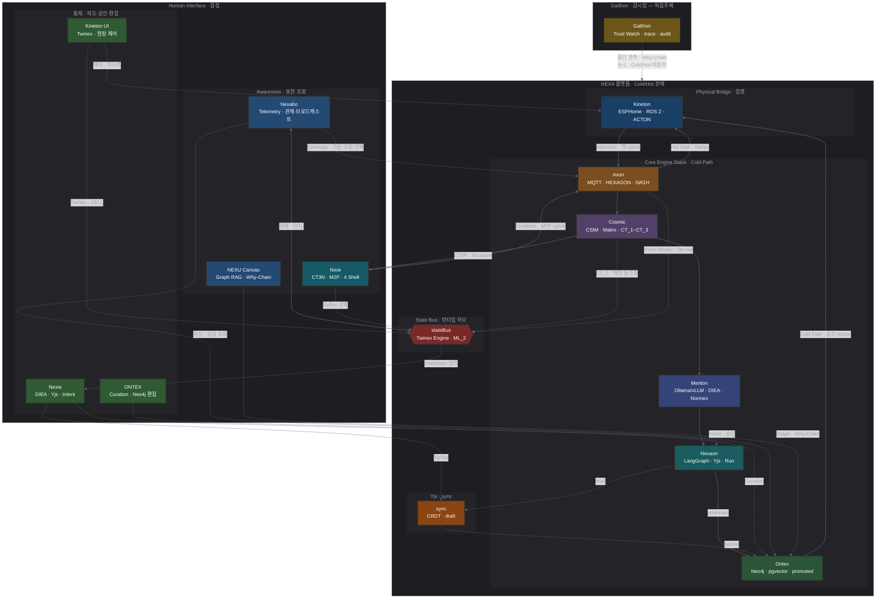

# NEXA 전역 아키텍처 표준 (Global Architecture Standard)

> **목적:** 기획 및 개발 단계의 인지 부하를 줄이기 위한 6대 핵심 개념 규격화.  
> **상태:** v1.0 (개념 정립 단계)  
> **본문 표기:** 아래 **6+1 기술 표**에 **기술 ID** 를 둔다. **Galthon** 은 **독립주체** — 6대 핵심 레이어와 **분리** _(기술 ID `GL`)_. 그 이후 본문은 **순수 기술명** (`Axon` · `Cosmic` · `Menton` · `Nexaon` · `Ontex` · `Kineton` · `Galthon`) 만 사용 — **「Layer」 접미 ✗**. 문장 속 기술명은 백틱으로 감싼다 _(제목 제외)_.

## 6+1 핵심 기술 · 데이터 생애주기 및 흐름 구조(Data Flow & Lifecycle Structure) Normative SSOT

물리 현장에서 발생하거나 직접 기획을 통해 데이터가 태어나 지식으로 고착되기까지의 전 과정이 **6대 핵심 레이어**이다. **Galthon** 은 6대 **외부** **독립주체** — 데이터·지식 **흐름 축 ✗** · Cold/Hot Path **비참여**.

> **정리 완료:** Phase 0–3 _(2026-06-13)_ — inbox CES·Nexaon 초안은 **git 히스토리** 참조 _(Normative 참조 ✗)_.

| 구분 | 기술명             |   ID   | 역할                        | 비유                 | 설명                                                                                                 | doc_id  | Normative SSOT                                                                                                                                       |   상태    |
| :--- | :----------------- | :----: | :-------------------------- | :------------------- | :--------------------------------------------------------------------------------------------------- | :------ | :--------------------------------------------------------------------------------------------------------------------------------------------------- | :-------: |
| 6대  | Axon (엑숀)        | **AL** | Axon (통신/문법)            | 데이터의 옷 (규격)   | `HEXAGON`이 5W1H 문법으로 데이터 포장.                                                               | TDD-043 | [TDD-043 · CSIM·AXON 프로토콜 정본](../Cosmic/08_TDD_AXON-CSIM-SUM-APEX우주언어및유기적구조체통합설계표준.md)                                                                      | published |
| 6대  | Cosmic (코믹)      | **CL** | Cosmic (의미/번역)          | 데이터의 언어 (통역) | `CSIM`이 2×2 매트릭스(추상화)를 거쳐 맥락 동기화 단계로 번역.                                        | TDD-044 | [TDD-044 · 전역 데이터 아키텍처](../Cosmic/08_TDD_CosmicLanguage_전역데이터아키텍처.md) _(parent: 043)_                                              | published |
| 6대  | **Menton** (맨톤)  | **ML** | Menton (지능/사고)          | 사고의 깊이 (판단)   | 지능 엔진이 전략적 가치 판단.                                                                        | TDD-070 | [TDD-070 §3.2.1](../../용어집_NEXA전용_v2.0.md) · [TDD-040 · 피지컬 티어](../AI/08_TDD_AI_지능위계및하드웨어사양.md)                                 | published |
| 6대  | Nexaon (넥사온)    | **NL** | Nexaon (전략/집행)          | 두뇌 (최종 결정)     | 인간과 AI가 협업하여 지식으로 승인.                                                                  | TDD-073 | [TDD-073 · Distillation 오케스트레이터](../NEXIA/Nexaon/08_TDD_Nexaon_Distillation오케스트레이터_v1.0.md)                                            |   draft   |
| 6대  | Ontex (온텍스)     | **OL** | Ontex (영구/기억)           | 성전 (영구 기억)     | 최종 승인본을 온톨로지에 영구 저장.                                                                  | TDD-057 | [TDD-057 · 기술스택·운영방침](../Ontex/08_TDD_Ontex_기술스택운영방침_v1.0.md)                                                                        | published |
| 6대  | Kineton (키네톤)   | **KL** | Physical Bridge (물리 가교) | 근육 (실제 동작)     | 시스템의 추상적 의도를 `ROS 2` 메시지로 구체화 및 집행.                                              | TDD-072 | [TDD-072 · Physical Bridge·ACTON·ROS 2](../NEXIA/Kineton/08_TDD_Kineton_PhysicalBridge_ACTON_ROS2_v1.0.md)                                           |   draft   |
| 독립 | **Galthon** (갈톤) | **GL** | Trust Watch (신뢰 감시)     | 감시탑 (Watchtower)  | **NEXA** 시스템 **독립 감시 주체**. Why-Chain · trace · Ethos·SHACL **횡단 관측** - **흐름 개입 ✗**. | TDD-074 | [TDD-074 · Trust Watch · 신뢰 감시](../Galthon/08_TDD_Galthon_TrustWatch_신뢰감시독립주체_v1.0.md) · [TDD-070 §3.1.1](../../용어집_NEXA전용_v2.0.md) |   draft   |

**연관 TDD** _(기술 SSOT ✗ · 경계·연계)_: [TDD-068](../NEXIA/08_TDD_NEXIA_IoT엣지데이터파이프라인_HEXAGON_Nexaon연계_v1.0.md) (엣지 uplink) · [TDD-056](../NEXIA/08_TDD_NEXIA_7탭범위확정_v1.0.md) (DIEA Facet) · [TDD-008](../LangGraph/08_TDD_LangGraph_인간LLM협업형IoT온톨로지플랫폼_v1.0.md) (LangGraph · TDD-073 parent) · [TDD-023](../NEXIA/08_TDD_NEXIA_NEXNAP시스템인터페이스표준규약.md) (NEXNAP Envelope)

### 6+1 레이어 vs 기술 엔진 매핑 (요약)

> **Normative 상세:** [§핵심 기술 엔진 매핑](#핵심-기술-엔진-매핑-external-engine-mapping) · [TDD AI 모델·런타임·엔진배치](../AI/08_TDD_AI_모델·런타임·엔진배치_v1.0.md)

| 레이어      | 주요 외부·런타임 엔진             | 역할 (한 줄)                  | 주 Menton 층              |  주 피지컬 티어  |
| :---------- | :-------------------------------- | :---------------------------- | :------------------------ | :--------------: |
| **Axon**    | MQTT · Nest · WS/SSE              | Envelope 운송 · ingest 게이트 | ML_0 (Reflex)              | PT_0 ~ PT_3 Gate |
| **Cosmic**  | Nest Ingress · Zod _(CSIM CT_1/CT_2)_ | 맥락 게이트 · 스키마 검증     | ML_0 CT_1 · Gate CT_2 · ML_3 CT_3 |   PT_0 ~ PT_3    |
| **Menton**  | Ollama / vLLM · ComfyUI           | LLM 추론 · Vivex 생성         | ML_2 · ML_3                 |       PT_3       |
| **Nexaon**  | LangGraph · **Yjs/Hocuspocus**    | Run · **ontology:draft** CRDT | ML_3 (Strategic)           |       PT_3       |
| **Ontex**   | Neo4j · pgvector · Prisma         | promoted · Graph RAG · Audit  | 허브·탐색                 |       PT_3       |
| **Kineton** | ESPHome · ROS 2                   | 펌웨어 · 물리 브릿지          | ML_0 Reflex _(Hot Path)_   |   PT_0 ~ PT_2    |
| **Galthon** | _(To-Be)_ trace·audit             | 횡단 관측 · **개입 ✗**        |                           |                  |

## 시스템 아키텍처 시각화 (Architecture Visual)



### 다이어그램 보완 설명

1. **수직 흐름 (Cold Path):** `Axon` → `Cosmic` → `Menton` → `Nexaon` → `Ontex` — 데이터가 지식으로 **promoted** 고착되는 정교한 추론 과정.
2. **우회 흐름 (Hot Path):** `Axon` → `Kineton` 직결 — `Menton`·`Nexaon`·`Ontex` **우회** · Local Reflex · PT_0~2.
3. **승인 집행 (Cold → Physical):** `Ontex` **promoted** 지식 기반 Action → `Kineton` — Hot Path 와 **경로 분리**.
4. **역 uplink · express downlink (실선):** `Kineton`·`Nixie` → `Axon` telemetry·Envelope · `Cosmic` → `Nixie` **CT3N** — **프로토콜 데이터** 이동 _(접점 통제·조회 ✗)_.
5. **접점 매핑 (점선):** **HI_Control** (`Nexia`·`ONTEX`·`Kineton UI`) = 통제 · **HI_Awareness** (`Nexabo`·`NEXU`) = 읽기 전용 · `Nixie` = 실선 uplink/CT3N + 표현.
6. **`Nixie` 양방향:** **상향(실선)** = `Envelope`·M2P → **`Axon` 필수** · **하향(실선)** = `CSIM` **CT3N** → 표현. 워치·RPi·Physical Shell 동일 ([TDD-061~064](../NEXIA/Nixie/)).
7. **`Galthon` 감시탑 (점선 1개):** `Platform` 전체 **횡단 관측** — 세부 대상(Axon~Kineton)은 [TDD-074](../Galthon/08_TDD_Galthon_TrustWatch_신뢰감시독립주체_v1.0.md) · Cold/Hot Path **비참여**.
8. **레이아웃:** `TD`(상→하) · `Platform` = Core+Physical 메타 그룹 · HI 내부 **통제/Awareness** 2분 — 노드·엣지 **동일**, 그룹만 재구성 _(시안 · 2026-06-13)_.
9. **노드 보조 라벨 (2행째):** [§핵심 기술 엔진 매핑](#핵심-기술-엔진-매핑-external-engine-mapping) 의 **외부·런타임 엔진** 요약 — Core = 실장 스택 · HI = 도메인·접점 역할.
10. **`Yjs` · `apps/sync`:** `Nexaon`·`NEXIA` **promoted 전** 실시간 협업(CRDT) — `promoted` 본선은 **실선** `Nexaon→Ontex` · draft 루프는 **점선** `sync` 경유 ([TDD-038](../AI/08_TDD_AI_YjsHocuspocus협업SSOT.md)).
11. **`stateBus` (런타임 허브):** 6+1 **레이어 ✗** · `Platform` 내 **횡단 버스** — `Cosmic` CT_2·`Axon` Event Router fan-out 수렴 · `nexia` Distillation 입력 · `Nexabo`·`Kineton UI`·`Nixie` **관제·HITL**(점선). **Hot Path 집행 소유 ✗** (`Axon→Kineton` 유지) · `stateBus→Ontex` **직결 ✗** ([TDD-071 §2.1](08_TDD_NEXAOS_도메인구조통합_v1.0.md) · [TDD-068](../NEXIA/08_TDD_NEXIA_IoT엣지데이터파이프라인_HEXAGON_Nexaon연계_v1.0.md)).
12. **노드 색·범례 (2층 인코딩):** **subgraph 배경** = 영역 · **노드 fill** = 성격 분류(저명도 뮤트) · **노드 stroke `#333` 통일** 2px — 라인 잡음 억제. **Galthon** 만 점선 stroke. **엣지** = `linkStyle default` 회색 · 실선/점선 = 경로 종류.

| class                    | fill (성격)                       | 대상 · 의미                            |
| :----------------------- | :-------------------------------- | :------------------------------------- |
| `layerAL` ~ `layerOL`    | 뮤트 주황 → 보라 → 남 → 청록 → 녹 | **6대 레이어** — Cold Path 세로 흐름   |
| `layerKL`                | 뮤트 청                           | **Kineton** `KL` — Physical Bridge     |
| `layerGL`                | 뮤트 금 · 점선 stroke             | **Galthon** `GL` — 독립 감시           |
| `infraSync` / `infraBus` | 뮤트 주황 / 적                    | **횡단 인프라** — `sync` · `stateBus`  |
| `hiControl` / `hiAware`  | 뮤트 녹 / 청                      | HI **통제** / **Awareness**            |
| `hiNixie`                | 뮤트 청록                         | `Nixie` — Awareness + 실선 데이터 경로 |

> **오해 방지:** 피지컬 티어(PT) · Menton 층(ML) · Core Engine Stack은 **세 축** — 1:1 매핑 ✗. 엔진·PT 상세 = [§6+1 레이어 vs 기술 엔진 매핑](#6+1-레이어-vs-기술-엔진-매핑-요약) · [TDD-040 §0](../AI/08_TDD_AI_지능위계및하드웨어사양.md).

## Cold Path 파이프라인 · 경로 분기

> **구성 원칙:** Core Engine Stack 멤버 **개수 고정 ✗** — 엔진 추가·분할 시 [용어집](../../용어집_NEXA전용_v2.0.md) 선행 갱신.

```text
HEXAGON (Grammar)   → 5W1H · Envelope · Zod
    ↓
CSIM (Semantic)     → Matrix 양방향 번역 · CT_1/CT_2/CT_3
    ↓
DIEA (Context)      → 7 Facet · stateBus · 산출
    ↓
Normex (Ethos)      → RULE · MUST/SHOULD · NEXNAP
    ↓
Nexaon (Logic)      → ingest · Run · 승인 · SHACL
    ↓
Ontex (Foundation)  → promoted · Graph RAG · archive
```

|    순서    | 엔진      | 역할 (한 줄)         | SSOT                                                                                                                            |
| :--------: | :-------- | :------------------- | :------------------------------------------------------------------------------------------------------------------------------ |
|  Grammar   | `HEXAGON` | raw → 5W1H Envelope  | [TDD-043 §11](../Cosmic/08_TDD_AXON-CSIM-SUM-APEX우주언어및유기적구조체통합설계표준.md)                                                                       |
|  Semantic  | `CSIM`    | WILL/FACT ↔ Matrix   | [TDD-043 §13](../Cosmic/08_TDD_AXON-CSIM-SUM-APEX우주언어및유기적구조체통합설계표준.md) · [TDD-044 §2](../Cosmic/08_TDD_CosmicLanguage_전역데이터아키텍처.md) |
|  Context   | `DIEA`    | Facet 작업면·맥락    | [TDD-056](../NEXIA/08_TDD_NEXIA_7탭범위확정_v1.0.md)                                                                            |
|   Ethos    | `Normex`  | RULE · Ethos 게이트  | [TDD-056 §5.2](../NEXIA/08_TDD_NEXIA_7탭범위확정_v1.0.md)                                                                       |
|   Logic    | `Nexaon`  | 정재·Run·promoted 전 | [TDD-073](../NEXIA/Nexaon/08_TDD_Nexaon_Distillation오케스트레이터_v1.0.md)                                                     |
| Foundation | `Ontex`   | promoted 고착        | [TDD-057](../Ontex/08_TDD_Ontex_기술스택운영방침_v1.0.md)                                                                       |

### 단계별 핸드오프 (ML_0 → promoted)

| 단계 | 구간                         | 담당                                                                                               |
| :--: | :--------------------------- | :------------------------------------------------------------------------------------------------- |
| ①-a  | ML_0 말단 → Envelope          | `HEXAGON` ([TDD-068 §3](../NEXIA/08_TDD_NEXIA_IoT엣지데이터파이프라인_HEXAGON_Nexaon연계_v1.0.md)) |
| ①-b  | CT_1 Matrix · raw uplink **✗** | `CSIM`                                                                                             |
|  ③   | 게이트 · Ethos · `stateBus`  | `CSIM` CT_2 · `Normex`                                                                               |
| ⑤–⑥  | Facet · 정재 Run             | `DIEA` · `Nexaon`                                                                                  |
| ⑦–⑧  | 승인 · SHACL                 | `Omnix` · `Normex` · `Nexaon`                                                                      |
| ⑨–⑪  | Neo4j · pgvector · `Ontex`   | [TDD-073 §7](../NEXIA/Nexaon/08_TDD_Nexaon_Distillation오케스트레이터_v1.0.md)                     |

### 경로 분기 · 엔진 부담 분리

| Path                    | 경로                                     | DB·Ontex                   |
| :---------------------- | :--------------------------------------- | :------------------------- |
| **Cold · Distillation** | `stateBus` → `DIEA` → `Nexaon` → `Ontex` | **필수** · never raw write |
| **Hot Path**            | `DIEA` Normex·Logex → `erp`              | **우회**                   |
| **Fast · Reflex**       | ML_0 `ACTON` → `Kineton`                  | **우회** · 후보고만 상행   |

| 엔진      | 담당              | 상위가 안 받는 것        |
| :-------- | :---------------- | :----------------------- |
| `HEXAGON` | Envelope · Zod    | — _(ML_0·게이트 완료)_    |
| `CSIM`    | CT_1–CT_3 번역·정렬   | Run·promoted **소유 ✗**  |
| `DIEA`    | Facet 맥락·산출   | promoted 직접 쓰기       |
| `Normex`  | Ethos · RULE      | Run 단독 종결            |
| `Nexaon`  | Run · SHACL · CT3R | Nixie payload · Hot Path |
| `Ontex`   | promoted · RAG    | 초안·미검증 ingest       |

**Hub-and-Spoke:** PT_3 = Cold Path **통합 허브** · PT_0~2·`Nixie` = 경량 샤드 + Local Reflex — [TDD-040 §0.1](../AI/08_TDD_AI_지능위계및하드웨어사양.md) · [용어집 §3.2.0](../../용어집_NEXA전용_v2.0.md)

## 인간과 접점 (Human Interface)

인간은 6대 레이어를 **직접 건드리지 않고**, 아래 **도메인·제품 접점**을 통해 의도를 넣고 결과를 확인한다. 접점 = **UI·워크플로우·권한 경계**이며, 레이어 자체 **✗**.

**외부 클라이언트** (브라우저 · Python PC · 모바일 · 엣지 디바이스) = **6+1 신규 레이어 ✗** — **Physical Tier 배치** + **Human Interface 접점** + **동일 프로토콜** (`HEXAGON` / NEXNAP · `trace_id`). 상세 PT = [TDD-040 §0.1](../AI/08_TDD_AI_지능위계및하드웨어사양.md) · 프로토콜 = [TDD-023](../NEXIA/08_TDD_NEXIA_NEXNAP시스템인터페이스표준규약.md).

### NIXIE — 감각·표현 접점 (Presence)

인간과 시스템이 실시간으로 대화하고 데이터를 가시적으로 확인하는 접점이다.

- **경로:** `Cosmic` 맥락 동기화(`CSIM`) → 지능 표현 층(Presence) → `Nixie` (Interface)
- **역할:** 시스템의 추론 결과(Design)를 인간이 인지할 수 있는 감각적 형태로 변환 및 투영.
- **Menton 층:** ML_1 (Presence) — **CSIM CT3N** Narrative·ECHO 만 소비 · raw ingest **✗**
- **경계:** Cold Path **Run · promoted** **✗** — 결과 **Express** 전용. 엣지 Reflex triage 와 연동.

**표현 채널 (4 Presence — 서사·감각 축)** _(배포 Shell 과 **동의어 ✗**)_: Physical · Cognitive · Ambient · Social — PiP · TTS · 알람·trace. **지능 판단 소유 ✗**.

**배포 Shell (4 Nixie Shell — 실장·PT 축)** _(Normative = [TDD-061~064](../NEXIA/Nixie/))_:

| Shell        | 실장                                 |       주 PT        | uplink/downlink                  | SSOT                                                                                                                     |
| :----------- | :----------------------------------- | :----------------: | :------------------------------- | :----------------------------------------------------------------------------------------------------------------------- |
| **Web**      | 브라우저 · PiP · Embedded            | PT_1~3 _(허브 UI)_ | Nest · SSE · WS                  | [TDD-061](../NEXIA/Nixie/08_TDD_NIXIE_WebShell_v1.0.md)                                                                  |
| **Desktop**  | Python PC · PyQt · 시스템 트레이     |    PT_1~2 샤드     | 동일 Envelope · OpenAPI→Pydantic | [TDD-062](../NEXIA/Nixie/08_TDD_NIXIE_DesktopShell_v1.0.md) · [PRD-002](../../05_PRD/05_PRD_U2BEE_데스크톱앱설계명세.md) |
| **Mobile**   | iOS/Android · 푸시·백그라운드        |    PT_1~2 샤드     | 동일 계약 · 제약 하 Express      | [TDD-063](../NEXIA/Nixie/08_TDD_NIXIE_MobileShell_v1.0.md)                                                               |
| **Physical** | ESP32 · Raspberry Pi · 실물 Presence |       PT_0~1       | MQTT · 엣지 uplink               | [TDD-064](../NEXIA/Nixie/08_TDD_NIXIE_PhysicalShell_v1.0.md)                                                             |

**Shell 간 규칙**

1. Shell = **표현·Presence 채널** — Run · promoted · Hot Path 집행 **소유 ✗**
2. Shell 간 **데이터 파이프 공유 ✗** — `CSIM` CT3N · `trace_id` · 「정재 열기」UI 진입만 ([TDD-068 §1.4](../NEXIA/08_TDD_NEXIA_IoT엣지데이터파이프라인_HEXAGON_Nexaon연계_v1.0.md))
3. Desktop(Py)·Mobile은 **Nixie Shell** + 필요 시 **domainKey** 앱(nexabo 관제 등) **조합** — MainShell·7탭 **대체 ✗** _(Desktop)_

### NEXIA — 전략·집행 접점 (Strategic Orchestration)

인간이 시스템의 논리 구조를 설계하고 최종 승인하는 집행 접점이다.

- **경로:** User (Intent) → `NEXIA` (Domain) → `Nexaon` (Orchestrator) → `DIEA` (7 Facets)
- **역할:**
  - **인간:** 의도(Intent) 기획 및 최종 승인.
  - **시스템:** 기획에 따른 논리 설계(Design) 및 패싯별 실행 결과 도출.
  - **기획 도구:** `NEXIA` > `DIEA` 7대 패싯 (`omnix`, `normex`, `logex`, `scribx`, `vivex`, `twinex`, `navex`)
- **Menton 층:** ML_2 (Domain 작업면) · ML_3 (Strategic Run) — `stateBus` · `agent-graph` 허브
- **경계:** `CSIM` **번역만** 수신 — 레지스터·GPIO raw **✗**. 승인 후 `Ontex` **promoted** 로 이관.

### NEXABO — 상황·브로드캐스트 접점 (Ambient Awareness)

시스템의 전역 상태 및 자산 현황을 비동기적으로 전파하고 시각화하는 접점이다.

- **경로:** `Axon`·`Ontex` 상태 신호 → `Nexabo` (Broadcaster) → User (Awareness) · **실시간 런타임·HITL** = `stateBus` **경유** (`Nexabo↔stateBus` — `Kineton` Hot Path **직결 ✗**)
- **역할:**
  - **모니터링:** `Axon`(문법·규격) 가동 상태 및 데이터 유입 현황 가시화.
  - **상태 전파:** `Ontex`(영구 기억)에 고착된 지식 자산의 변경 사항 및 시스템 알림 브로드캐스팅.
  - **가이드:** 현재 인간이 개입해야 할 우선순위 지점(Issue/Task)의 정적 대시보드 제공.
- **도메인:** `nexabo` — IoT 관제·텔레메트리 · 디지털 트윈 대시보드
- **경계:** 실시간 제어·Run **✗** — **Awareness·브로드캐스트** 전용. Hot Path 는 `Kineton`·`ACTON` 경로.

### ONTEX — 근간·온톨로지 접점 (Foundation)

시스템의 영구 기억이자 전역 온톨로지에 직접 접근하여 지식의 정합성을 최종 관리하는 접점이다.

- **경로:** User (Curation) → `ONTEX` (Domain) → `Ontex` (Knowledge Base)
- **역할:**
  - **지식 큐레이션:** 분산된 데이터가 지식으로 정제되어 `Ontex`에 안착하기 전 최종 검증 및 편집.
  - **스키마 설계:** 시스템 전역에서 통용되는 핵심 온톨로지 구조 및 분류 체계의 기획.
  - **영구 자산 관리:** 휘발되지 않는 시스템의 근간 지식 자산에 대한 직접적인 조회 및 권한 관리.
- **저장 축:** Neo4j 그래프 · pgvector (`NEXAVULT` 연계) · `domainKey` 허브
- **경계:** `Nexaon` **Run UI ✗** — 승인·탐색·보존 SSOT. **promoted** 만 영구 자산.

### NEXU Canvas — 지식·통찰 접점 (Narrative Insight)

온톨로지 데이터 페브릭을 시각화하여 데이터 간의 인과관계와 지식의 흐름을 서사적으로 통찰하는 접점이다.

- **경로:** `Ontex` (Knowledge Base) → `NEXU Canvas` (Narrative View) → User (Insight)
- **역할:**
  - **지식 시각화:** 복잡하게 얽힌 온톨로지 노드와 `Why Chain`의 연결 상태를 심미적 그래픽으로 구현.
  - **컨텍스트 탐험:** 데이터의 발생 원인과 결과의 연쇄를 추적하여 시스템의 '서사'를 파악.
  - **상태 체감:** 시스템 전역의 지식 밀도와 정합성 수준을 직관적인 패턴으로 인지.
- **연계:** BAX 미학 레이어 · Graph RAG 탐색 · `Why Chain` 서사
- **경계:** 편집·승인 **✗** — **읽기·탐색·통찰** 전용. 큐레이션은 `ONTEX` 도메인.

### Kineton — 물리·실행 접점 (Physical Bridge)

현장 장비·로봇에 **물리적 의도**를 전달하고 피드백을 받는 접점이다.

- **경로:** User (Interface) → `Kineton` → `ROS 2` (Middleware) → Device (Hardware)
- **역할:**
  - **전략 번역:** 시스템의 추상적 의도(Intent)를 `ROS 2`의 구체적인 실행 메시지(Topic/Service/Action)로 번역.
  - **미들웨어 브릿지:** 고유 논리 체계와 오픈소스 로봇 프레임워크(`ROS 2`) 간의 상호운용성 보장.
  - **상태 동기화:** 하드웨어의 물리적 피드백을 시스템이 이해할 수 있는 상태 데이터로 `Axon`(문법) 또는 `Ontex`(기억) 쪽으로 역전송하여 디지털 트윈 정합성 유지.
- **Axon 연계:** `ACTON` Synapse · `ACTON-GM` _(CNC·로봇 등 선택)_ — 승인된 Action 만 하향
- **경계:** Cold Path **우회 Hot Path** — 허브·`Ontex` 없이 **Local Reflex** 가능 (PT_0~2).

### 클라이언트·배치 (Physical Tier × 접점)

> **한 줄:** **PT** = 어디서 연산·감각하나 · **접점** = 인간이 무엇을 보고 승인하나 · **6+1 레이어 불변**.

```text
                    [ PT_3 허브 · Cold Path · apps/web + backend + agent-graph ]
                              ▲
          NEXNAP / Envelope / trace_id (공통 프로토콜)
                              ▲
    ┌─────────────┬───────────┼───────────┬─────────────┐
 Web·MainShell  Desktop(Py)  Mobile App  Nixie Physical  Edge·Kineton
 (nexia…)       (U2BEE)      (NEXA-App)  (TDD-064)       (PT_0 Reflex)
 PT_1~3         PT_1~2       PT_1~2      PT_0~1          PT_0~2
```

| 클라이언트            | 주 접점                            |      PT       | Cold/Run                         | Hot/Reflex          | 구현·SSOT                                                                                                                                 |
| :-------------------- | :--------------------------------- | :-----------: | :------------------------------- | :------------------ | :---------------------------------------------------------------------------------------------------------------------------------------- |
| **Web · MainShell**   | NEXIA · Nexabo · Ontex · Nixie Web | PT_3 _(허브)_ | **✓** Distillation·Run·승인      | 관제·표현만         | `apps/web` · [TDD-055](../NEXIA/08_TDD_NEXIA_구현파일구조뼈대.md)                                                                         |
| **Python PC · U2BEE** | Nixie Desktop · (선택) domain 확장 |    PT_1~2     | ingest·표현 **제한** · 허브 위임 | 로컬 triage·Express | `apps/desktop` · [TDD-062](../NEXIA/Nixie/08_TDD_NIXIE_DesktopShell_v1.0.md) · [PRD-002](../../05_PRD/05_PRD_U2BEE_데스크톱앱설계명세.md) |
| **모바일 앱**         | Nixie Mobile · Nexabo Awareness    |    PT_1~2     | Run **✗** · 알림·「정재 열기」   | Express·푸시        | [TDD-063](../NEXIA/Nixie/08_TDD_NIXIE_MobileShell_v1.0.md) · `NEXA-App/` _(형제 레포)_                                                    |
| **Nixie Physical**    | ML_1 말단·GPIO·센서 Presence        |    PT_0~1     | **✗**                            | uplink·Local Reflex | [TDD-064](../NEXIA/Nixie/08_TDD_NIXIE_PhysicalShell_v1.0.md) · `firmware/`                                                                |
| **엣지 · Kineton**    | 물리 집행·telemetry                |    PT_0~2     | **✗**                            | **✓** ACTON·ROS 2   | [TDD-072](../NEXIA/Kineton/08_TDD_Kineton_PhysicalBridge_ACTON_ROS2_v1.0.md) · **NEXA-Edge**                                              |

**공통 계약:** uplink/downlink = `HEXAGON` Envelope · NEXNAP · Zod/`packages/shared` — 클라이언트 종류마다 **스택 다름 ✗** · **의미 계약 동일 ✓** ([TDD-023](../NEXIA/08_TDD_NEXIA_NEXNAP시스템인터페이스표준규약.md)).

## Galthon — 감시탑 (Trust Watch · 독립주체)

> **Normative SSOT:** [TDD-074 · Trust Watch · 신뢰 감시 독립주체](../Galthon/08_TDD_Galthon_TrustWatch_신뢰감시독립주체_v1.0.md) · 용어 한 줄 = [TDD-070 §3.1.1](../../용어집_NEXA전용_v2.0.md)

**NEXA** 시스템 전체 **신뢰성** 독립 감시 주체 — 6대 핵심 축·Human Interface **외부** · Cold/Hot Path **비참여**. 관측 질문·Why-Chain 역추적·trace 원칙은 **TDD-074** §3–§5.

**`Galthon`** 이 Why-Chain 역추적·감사 **관측** 을 담당한다 _(흐름 비참여 · 감시탑)_. **NEXU Canvas** 는 동일 체인을 **서사·그래프**로 시각화한다. 세부 = [TDD-074 §3–§5](../Galthon/08_TDD_Galthon_TrustWatch_신뢰감시독립주체_v1.0.md).

---

## 데이터 생애주기 및 인과관계 체인 (The Why-Chain)

데이터가 `Axon`에서 태어나 어떻게 `Ontex`에 고착되고 `Kineton`으로 집행되는지, 그 **수직적 흐름**을 명시한다. 모든 단계는 **역추적 가능**해야 하며, 이것이 **Why-Chain** 의 전제이다.

### 핵심 구동 메커니즘 (Core Mechanism)

**Cold Path (지식 정제)** 와 **Hot Path (현장 집행)** 는 분기한다. Cold Path = 허브(PT_3) 집약 · Hot Path = 말단 Reflex · `Kineton` 직행.

```text
[Cold Path · Distillation]
  Fact/Intent → HEXAGON Envelope → CSIM CT_1→CT_2 → DIEA → Normex → Nexaon Run
            → 승인 → Ontex promoted → Graph RAG

[Hot Path · Reflex]
  WILL/FACT → HEXAGON → ACTON / Kineton → ROS 2 → Device
            (Ontex 우회 가능 · 동일 `Axon` 규격 유지)
```

#### 데이터 상태 전이도 (State Transition)

시스템 내 데이터는 다음 **5단계**를 거쳐 '지식'에서 '행동'으로 진화한다.

1. **Raw (`Axon`):** 센서·기획 입력이 `HEXAGON` 5W1H **Envelope** 로 포장된 원시·구조화 신호.
2. **Context (`Cosmic`):** `CSIM` **CT_1·CT_2** — Matrix 공용어화 → 맥락·Ethos 정렬된 **의미 토큰** (raw uplink **✗**).
3. **Logic (`Menton`):** `DIEA` · `Normex` · `Nexaon` — 가치 판단·정재·Run 초안. **promoted 전** 단계.
4. **Knowledge (Ontex):** Human·`Omnix` 승인 후 **promoted** — 온톨로지·벡터 코퍼스에 **영구 고착**.
5. **Action (Kineton):** 승인·정렬된 Action → `ACTON` · `ROS 2` — 물리 세계에 투영된 운동.

#### 인과관계 추적 (Why-Chain)

모든 `Action`은 역으로 `Knowledge` → `Logic` → `Context` → `Raw` 까지 추적 가능해야 하며, 각 홉에 **Who · Why · When** (`HEXAGON` 6축) 이 남아야 한다.

| 역추적 홉          | 질문                             | 담당 접점·엔진                 |
| :----------------- | :------------------------------- | :----------------------------- |
| Action → Knowledge | 무엇이 승인되어 실행되었나       | `Kineton` · `Ontex` promoted   |
| Knowledge → Logic  | 누가·어떤 Run 으로 정재했나      | `Nexaon` · `DIEA` · SHACL diff |
| Logic → Context    | 어떤 맥락·Ethos 로 정렬되었나    | `CSIM` CT_2 · `Normex`           |
| Context → Raw      | 원천 Fact·Envelope 는 무엇이었나 | `HEXAGON` · ML_0 Sentinel       |

**`Galthon`** 이 이 역추적·감사 **관측** 을 담당한다 *(흐름 비참여 · [TDD-074 §4](../Galthon/08_TDD_Galthon_TrustWatch*신뢰감시독립주체*v1.0.md))*. **NEXU Canvas** 는 동일 체인을 **서사·그래프**로 시각화한다.

---

## 핵심 기술 컴포넌트 (Black-box Specification)

각 기술의 실질적 **기술적 실체(Engine)** 를 명시한다. 상세 규격은 SSOT 열 문서를 따른다. 외부·런타임 스택 전체 매핑은 [§핵심 기술 엔진 매핑](#핵심-기술-엔진-매핑-external-engine-mapping)을 참조.

#### 핵심 기술 엔진 (Technical Components)

- **`Axon`:** `HEXAGON` Grammar Engine — 5W1H **6축 Envelope** · Zod 선검증 · 이기종 uplink **공통 문법**. (`APEX` Matrix · `ACTON` 은 `Axon` 스택 내 인접 층)
- **`Cosmic`:** `CSIM` (Cosmic Semantic Interface Matrix) — WILL/FACT ↔ Matrix **양방향 번역** · Tier **CT_1 공용어화 → CT_2 맥락 동기화 → CT_3 구체화**. **판단·Run ✗**
- **`Menton`:** `DIEA` (7 Facet 작업면) · `Normex` (Ethos·RULE) — ML_2 Domain · ML_3 Strategic **사고·윤리 정렬**. 단일 모놀리식 엔진 **✗**
- **Nexaon:** `Nexaon` Orchestrator · `apps/agent-graph` — ingest → Run · SHACL · Human 승인 · **promoted** 전 단계 **소유**
- **협업 (promoted 전):** **`apps/sync`** Hocuspocus · **Yjs** CRDT — `ontology:draft` · React Flow · TipTap ([TDD-038](../AI/08_TDD_AI_YjsHocuspocus협업SSOT.md))
- **Ontex:** `Ontex` Foundation Hub — Neo4j · pgvector · `NEXAVULT` — **promoted** 고착 · Graph RAG · explore/trace
- **Kineton:** `ACTON` Synapse · `ROS 2` Bridge — PWM · MQTT · Topic/Service/Action 매핑 · **Hot Path** 물리 집행

## 핵심 기술 엔진 매핑 (External Engine Mapping)

개념적 레이어를 실제 구동하는 **외부·런타임** 스택 명세이다. **Core Engine** (`HEXAGON` · `CSIM` · `DIEA` …) 과 **동의어 ✗** — 아래는 **배포·연동 대상**. 상세 = [TDD AI 모델·런타임·엔진배치](../AI/08_TDD_AI_모델·런타임·엔진배치_v1.0.md).

| 레이어             | 주요 기술 엔진 (External)          | 세부 역할                                                                                         | 관련 SSOT                                                                                                                                                     |
| :----------------- | :--------------------------------- | :------------------------------------------------------------------------------------------------ | :------------------------------------------------------------------------------------------------------------------------------------------------------------ |
| **Axon**           | **MQTT / Mosquitto**               | 엣지·디바이스 Envelope Pub/Sub · 텔레메트리 버스                                                  | [TDD-068](../NEXIA/08_TDD_NEXIA_IoT엣지데이터파이프라인_HEXAGON_Nexaon연계_v1.0.md)                                                                           |
| **Axon**           | **Nest · WS/SSE**                  | 브라우저·Nixie uplink · ingest 게이트 _(MQTT 병행)_                                               | [TDD-023](../NEXIA/08_TDD_NEXIA_NEXNAP시스템인터페이스표준규약.md)                                                                                            |
| **Cosmic**         | **Nest Ingress · Zod**             | `CSIM` **CT_2** 맥락·Ethos 게이트 · 런타임 스키마 검증                                              | [TDD-044 §2.6](../Cosmic/08_TDD_CosmicLanguage_전역데이터아키텍처.md)                                                                                         |
| **Cosmic**         | _(말단)_ **Matrix 샤드**           | PT_0~2 **CT_1** 공용어화 — 동일 규격 · 경량 실장                                                    | [TDD-040 §0.1](../AI/08_TDD_AI_지능위계및하드웨어사양.md)                                                                                                     |
| **Menton**         | **Ollama / vLLM**                  | LLM 인퍼런스 · Embed — **`apps/agent-graph` 단일**                                                | [TDD-007 §2](../NEXAOS/08_TDD_NEXAOS_모노레포폴더구조_v1.0.md) · [TDD-040](../AI/08_TDD_AI_지능위계및하드웨어사양.md)                                   |
| **Menton**         | **ComfyUI**                        | Vivex Facet 생성형 이미지 파이프라인                                                              | [TDD-056](../NEXIA/08_TDD_NEXIA_7탭범위확정_v1.0.md)                                                                                                          |
| **Nexaon**         | **LangGraph** (`apps/agent-graph`) | 에이전트 그래프 · Run · SSE · 상태 오케스트레이션                                                 | [TDD-008](../LangGraph/08_TDD_LangGraph_인간LLM협업형IoT온톨로지플랫폼_v1.0.md) · [TDD-073](../NEXIA/Nexaon/08_TDD_Nexaon_Distillation오케스트레이터_v1.0.md) |
| **Nexaon ↔ Ontex** | **Yjs · Hocuspocus** (`apps/sync`) | **ontology:draft** CRDT · React Flow · TipTap · Human·LLM **promoted 전** 협업 — Nest WS **금지** | [TDD-038](../AI/08_TDD_AI_YjsHocuspocus협업SSOT.md) · [TDD-007 §2](../NEXAOS/08_TDD_NEXAOS_모노레포폴더구조_v1.0.md)                                    |
| **Ontex**          | **Neo4j · pgvector**               | `promoted` 그래프 · 벡터 RAG · explore                                                            | [TDD-057](../Ontex/08_TDD_Ontex_기술스택운영방침_v1.0.md)                                                                                                     |
| **Ontex**          | **Prisma · PostgreSQL**            | Audit · staging · `run_id` trace                                                                  | [TDD-073 §7](../NEXIA/Nexaon/08_TDD_Nexaon_Distillation오케스트레이터_v1.0.md)                                                                                |
| **Kineton**        | **ESPHome · ROS 2**                | NEXA-CELL 펌웨어 · 로봇·CNC 미들웨어 브릿지                                                       | [TDD-072](../NEXIA/Kineton/08_TDD_Kineton_PhysicalBridge_ACTON_ROS2_v1.0.md)                                                                                  |
| **Galthon**        | _(To-Be)_ trace·audit pipe         | 6+1 **횡단 관측** — Cold/Hot **개입 ✗**                                                           | [TDD-074](../Galthon/08_TDD_Galthon_TrustWatch_신뢰감시독립주체_v1.0.md)                                                                                      |

**미매핑·주의**

- **Human Interface** = `domainKey` UI 접점 — 외부 엔진 **소유 ✗** (Core·엔진 **소비**만). 단 **NEXIA** 는 `Yjs` **바인딩** (`Flow` · TipTap).
- **MQTT 고주파 RAW → Yjs 직접 반영 ✗** — Twinex 스로틀 · Device-only Region ([TDD-068 §2](../NEXIA/08_TDD_NEXIA_IoT엣지데이터파이프라인_HEXAGON_Nexaon연계_v1.0.md) · [TDD-038 §4](../AI/08_TDD_AI_YjsHocuspocus협업SSOT.md)).
- **브라우저·Nest → LLM 직접 호출 ✗** — Menton 연산은 **`agent-graph` 경유**만.

---

## 기술 간 인터페이스 규격 (Contracts)

## 기술 간 인터페이스 규격 (Contracts)

기술과 기술이 만나는 지점에서 주고받는 **Input / Output** 을 명시한다. 모든 계약은 `HEXAGON` Envelope 또는 그에서 파생된 **의미 토큰** 을 최소 단위로 한다.

| 인접 계약                       | Output (상향·하향)            | Input (수신 측)                  | 검증·게이트             |
| :------------------------------ | :---------------------------- | :------------------------------- | :---------------------- |
| **현장 → `Axon`**               | raw Fact · GPIO · 센서 벡터   | `HEXAGON` Envelope (5W1H)        | Zod · 스키마 선검증     |
| **`Axon` → `Cosmic`**           | HEXAGON Envelope · APEX Body  | `CSIM` **CT_1** Matrix 투영        | raw uplink **✗**        |
| **`Cosmic` → `Menton`**         | CT_2 **의미 토큰** · Ethos PASS | `DIEA` `stateBus` · Facet 맥락   | `Normex` RULE 대조      |
| **`Menton` → Nexaon**           | Facet 산출 · NQ · draft       | `Nexaon` Run 입력 · **CT3R** 정렬 | CSIM **「사고 토대」✗** |
| **Nexaon → Ontex**              | 승인본 · graph_diff · triple  | `promoted` · ontology patch      | SHACL · Human accept    |
| **Ontex → Kineton**             | Action intent · programRef    | `ACTON` · ROS 2 메시지           | 승인·VOID·안전 장치     |
| **Kineton → `Axon`** _(역방향)_ | 물리 피드백 · telemetry       | Inverse `CSIM` CT_1 · Envelope     | 디지털 트윈 정합        |

**공통 계약 원칙**

- **의미 토큰 only:** PT_3 LLM·`Nexaon` 은 **레지스터 raw ✗** — `CSIM` 번역 결과만 ingest.
- **Ethos 선행:** CT_2 게이트 **FAIL** 시 하위 단계로 **전파 ✗** — Envelope 폐기.
- **승인 분리:** `CSIM` CT_3 **번역** ≠ **Run** — Run·promoted 는 **Nexaon** 전용.
- **Hot/Cold 분기:** `Kineton` 은 Cold Path 완료 **없이** Reflex 실행 가능 — 단, **`Axon` 규격** 은 동일.

---

## 기술 구현 맵 (Implementation & Repository Structure)

> **범위:** **NEXA OS V2.1 모노레포** (`NEXA-Platform/` — [TDD-007](../NEXAOS/08_TDD_NEXAOS_모노레포폴더구조_v1.0.md)) **+ 형제 클라이언트 레포** (`NEXA-Desktop/` · `NEXA-App/` · `NEXA-Edge/` — [project-structure](../../../../NEXA-Platform/docs/rules/project-structure.md)).  
> **Normative 경로 SSOT ✗** — 본 절은 **6+1 개념 → 코드 배치** 매핑만. 디렉터리·모듈 상세 = **TDD-007** · **TDD-055** · 기술별 TDD.

**레이어 ≠ npm 패키지 1:1.** 계약(Zod)은 `packages/shared` 에 횡단 집약 · 런타임은 `apps/*` · `domainKey` · Edge 로 분산한다.

### 모노레포 골격 (확정)

```text
NEXA-Platform/                    # pnpm-workspace · Git 루트 (TDD-007)
├── packages/shared/              # Zod · HEXAGON · nexaon · agent-graph 스키마 (◆ SSOT)
├── apps/web/                     # Next.js · domainKey 셸 (nexia · nexabo · ontex …)
├── apps/backend/                 # NestJS · ingest · ontology · nexaon · agent-graph 프록시
├── apps/agent-graph/             # LangGraph · Run · SSE · Embed (ML_3 연산 단일)
├── apps/sync/                    # Hocuspocus · Yjs ontology:draft
├── apps/desktop/                 # U2BEE · Nixie Desktop Shell (To-Be · PyQt) — TDD-062
├── database/                     # Prisma · pgvector
└── firmware/esphome/             # NEXA-CELL · 엣지 (선택)

NEXA/  (모노레포 루트 · 형제 프로젝트)
├── NEXA-Desktop/                 # U2BEE · Python PC 독립 프로세스 (현행·병행)
├── NEXA-App/                     # iOS/Android · Nixie Mobile Shell — TDD-063
└── NEXA-Edge/                    # ESP32 · Pi · Kineton Hot Path — TDD-064 · TDD-072
```

> **병행:** 레거시 Quasar SPA `src/domains/` · `server/` — [NEXA-Platform project-structure](../../../../NEXA-Platform/docs/rules/project-structure.md). 신규 온톨로지·Nexaon 스택은 **`apps/web` + `apps/backend`** 축이 To-Be 정본.

### 6+1 → 구현 배치 (개념 맵)

| 기술          | ID  | 주 구현·계약 위치                                                                                             | 구현 SSOT                                                                                                                                                                                |
| :------------ | :-: | :------------------------------------------------------------------------------------------------------------ | :--------------------------------------------------------------------------------------------------------------------------------------------------------------------------------------- |
| **`Axon`**    | AL  | `packages/shared` Envelope·HEXAGON 스키마 · 엣지 uplink · Nest ingest 게이트                                  | [TDD-043](../Cosmic/08_TDD_AXON-CSIM-SUM-APEX우주언어및유기적구조체통합설계표준.md) · [TDD-068](../NEXIA/08_TDD_NEXIA_IoT엣지데이터파이프라인_HEXAGON_Nexaon연계_v1.0.md)                                              |
| **`Cosmic`**  | CL  | `packages/shared` CSIM 토큰 스키마 · `apps/backend` CT_1/CT_2 게이트 · 말단 Matrix 샤드                           | [TDD-043 §13](../Cosmic/08_TDD_AXON-CSIM-SUM-APEX우주언어및유기적구조체통합설계표준.md) · [TDD-044 §2.6](../Cosmic/08_TDD_CosmicLanguage_전역데이터아키텍처.md)                                                        |
| **`Menton`**  | ML  | `apps/web/.../domains/nexia/` 7 Facet 탭 · `Normex` · `apps/agent-graph` ML_3                                  | [TDD-056](../NEXIA/08_TDD_NEXIA_7탭범위확정_v1.0.md) · [TDD-040](../AI/08_TDD_AI_지능위계및하드웨어사양.md)                                                                              |
| **Nexaon**    | NL  | `domains/nexia/modules/nexaon/` · `apps/backend/modules/nexaon/` · `apps/agent-graph` · **`apps/sync` (Yjs)** | [TDD-073](../NEXIA/Nexaon/08_TDD_Nexaon_Distillation오케스트레이터_v1.0.md) · [TDD-038](../AI/08_TDD_AI_YjsHocuspocus협업SSOT.md) · [TDD-055](../NEXIA/08_TDD_NEXIA_구현파일구조뼈대.md) |
| **Ontex**     | OL  | `apps/backend/modules/ontology/` · Neo4j · pgvector · `domainKey` **ontex**                                   | [TDD-057](../Ontex/08_TDD_Ontex_기술스택운영방침_v1.0.md)                                                                                                                                |
| **Kineton**   | KL  | `firmware/esphome/` · **NEXA-Edge** · ROS 2 Bridge · Hot Path Reflex                                          | [TDD-072](../NEXIA/Kineton/08_TDD_Kineton_PhysicalBridge_ACTON_ROS2_v1.0.md)                                                                                                             |
| **`Galthon`** | GL  | _(To-Be)_ 감사·trace 파이프라인 — **독립 `services/*` 경로 미확정**                                           | [TDD-074](../Galthon/08_TDD_Galthon_TrustWatch_신뢰감시독립주체_v1.0.md)                                                                                                                 |

### Human Interface → `domainKey` (접점 UI)

| 접점                      | `domainKey` / 경로                                   | 비고                                                                                                                     |
| :------------------------ | :--------------------------------------------------- | :----------------------------------------------------------------------------------------------------------------------- |
| **NEXIA** (기획·승인)     | **nexia** · `apps/web/src/domains/nexia/`            | NexaonShell · 7 탭 DIEA                                                                                                  |
| **Nexabo** (관제)         | **nexabo** · `apps/web/src/domains/nexabo/`          | Awareness · 브로드캐스트                                                                                                 |
| **ONTEX** (큐레이션)      | **ontex** · `apps/web/src/domains/ontex/`            | promoted 전 검증 UI                                                                                                      |
| **Nixie** (Presence)      | Nixie Shell 모듈 · [TDD-061~064](../NEXIA/Nixie/)    | Web = `apps/web` 내 Shell · 별도 `apps/nixie` **✗**                                                                      |
| **Nixie Desktop** (U2BEE) | `apps/desktop/` _(To-Be)_ · `NEXA-Desktop/` _(형제)_ | [TDD-062](../NEXIA/Nixie/08_TDD_NIXIE_DesktopShell_v1.0.md) · [PRD-002](../../05_PRD/05_PRD_U2BEE_데스크톱앱설계명세.md) |
| **Nixie Mobile**          | `NEXA-App/` _(형제 레포)_                            | [TDD-063](../NEXIA/Nixie/08_TDD_NIXIE_MobileShell_v1.0.md)                                                               |
| **Nixie Physical**        | `NEXA-Edge/` · `firmware/esphome/`                   | [TDD-064](../NEXIA/Nixie/08_TDD_NIXIE_PhysicalShell_v1.0.md)                                                             |
| **NEXU Canvas**           | `ontex` · explore/trace UI                           | 읽기·통찰 전용                                                                                                           |
| **Kineton UI**            | Twinex · 현장 제어 접점                              | Run·promoted **✗**                                                                                                       |

도메인 레지스트리: [TDD-071](./08_TDD_NEXAOS_도메인구조통합_v1.0.md).

### 계층 간 의존성 원칙 (Dependency Rule)

1. **Cold Path 하향:** `shared` 스키마 → backend 게이트 → `agent-graph` Run → `ontology` promoted. **역방향 import ✗** (예: Envelope 파서가 Nexaon UI 참조 **✗**).
2. **도메인 단방향:** `apps/web/src/domains/*` → `engines/` · `packages/shared` — [TDD-055 §0](../NEXIA/08_TDD_NEXIA_구현파일구조뼈대.md).
3. **LLM·Embed 단일:** 브라우저·Nest → Ollama/vLLM **직접 ✗** — **`apps/agent-graph` only** ([TDD-007 §2](../NEXAOS/08_TDD_NEXAOS_모노레포폴더구조_v1.0.md)).
4. **Hot/Cold 분기:** `Kineton` Reflex 는 `Ontex`·허브 **우회 가능** — 동일 `Axon`·HEXAGON 규격 유지 ([TDD-072 §6.1](../NEXIA/Kineton/08_TDD_Kineton_PhysicalBridge_ACTON_ROS2_v1.0.md)).
5. **`Galthon` 격리:** 타 엔진 로직 **개입 ✗** — trace·감사 **관측** 인터페이스만 ([TDD-074 §6](../Galthon/08_TDD_Galthon_TrustWatch_신뢰감시독립주체_v1.0.md)).

> **To-Be 후보 _(미승격)_:** 레이어별 `packages/{axon,cosmic,…}` 분리 — **TDD-007 정합 검증 전 도입 ✗**.

_관련 SSOT:_ [용어집 TDD-070](../../용어집_NEXA전용_v2.0.md) · [TDD-007](../NEXAOS/08_TDD_NEXAOS_모노레포폴더구조_v1.0.md) · [TDD-055](../NEXIA/08_TDD_NEXIA_구현파일구조뼈대.md) · [TDD-071](./08_TDD_NEXAOS_도메인구조통합_v1.0.md) · [TDD-061~064](../NEXIA/Nixie/) · [PRD-002](../../05_PRD/05_PRD_U2BEE_데스크톱앱설계명세.md) · [TDD-072](../NEXIA/Kineton/08_TDD_Kineton_PhysicalBridge_ACTON_ROS2_v1.0.md) · [TDD-073](../NEXIA/Nexaon/08_TDD_Nexaon_Distillation오케스트레이터_v1.0.md) · [TDD-074](../Galthon/08_TDD_Galthon_TrustWatch_신뢰감시독립주체_v1.0.md) · [TDD-043](../Cosmic/08_TDD_AXON-CSIM-SUM-APEX우주언어및유기적구조체통합설계표준.md) · [TDD-044](../Cosmic/08_TDD_CosmicLanguage_전역데이터아키텍처.md) · [TDD-057](../Ontex/08_TDD_Ontex_기술스택운영방침_v1.0.md) · [TDD-068](../NEXIA/08_TDD_NEXIA_IoT엣지데이터파이프라인_HEXAGON_Nexaon연계_v1.0.md)
