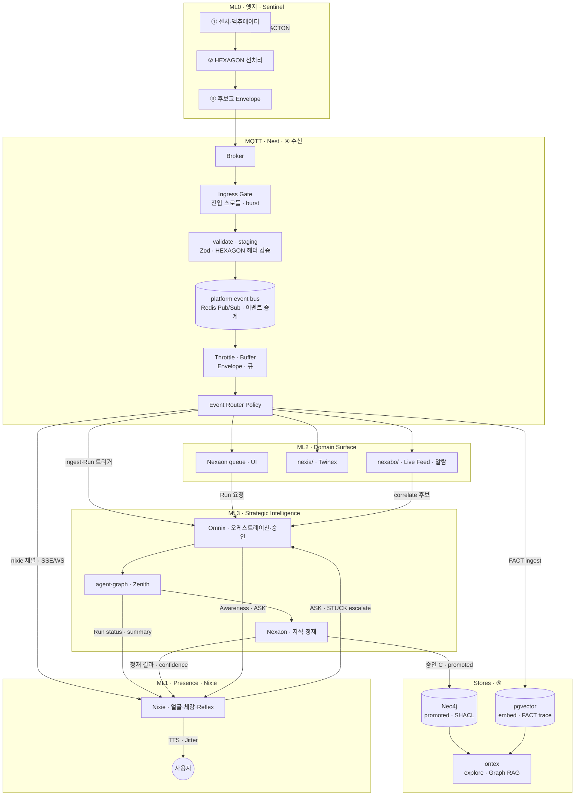
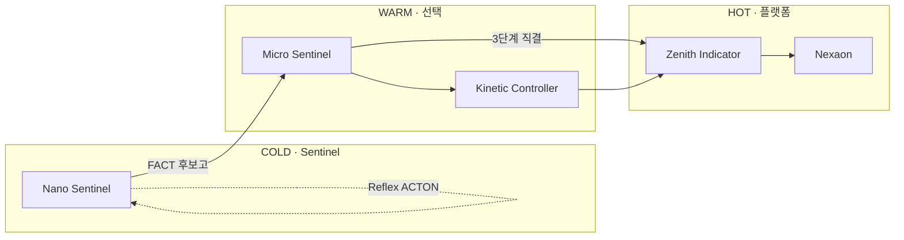
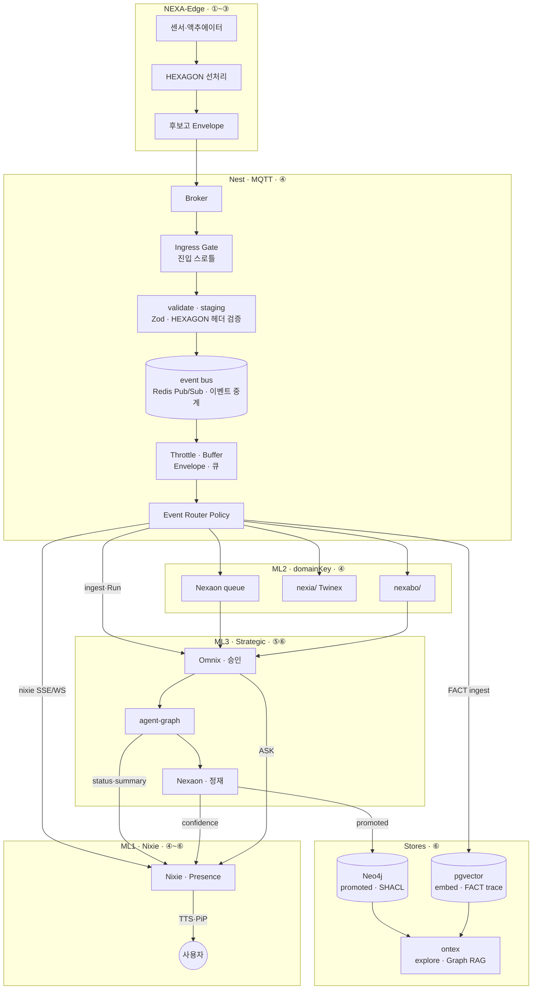
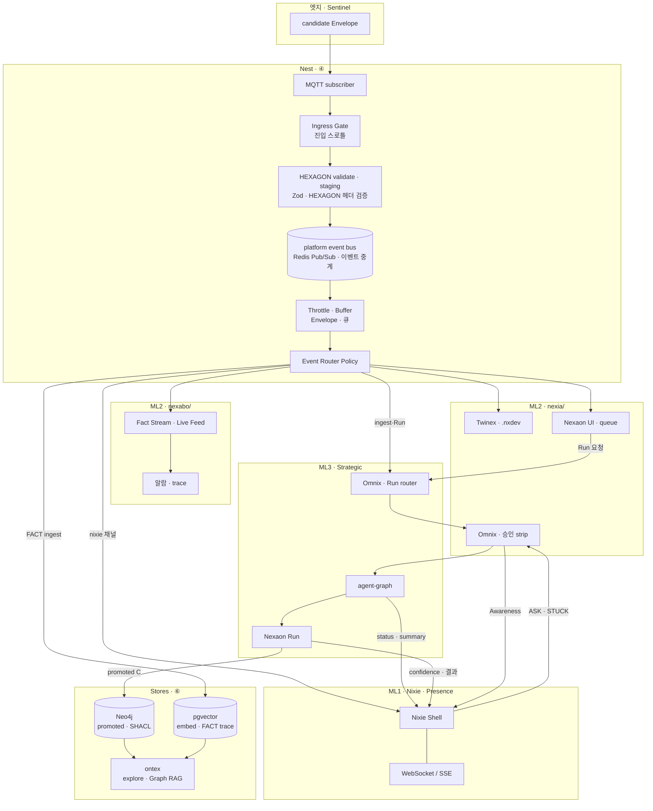
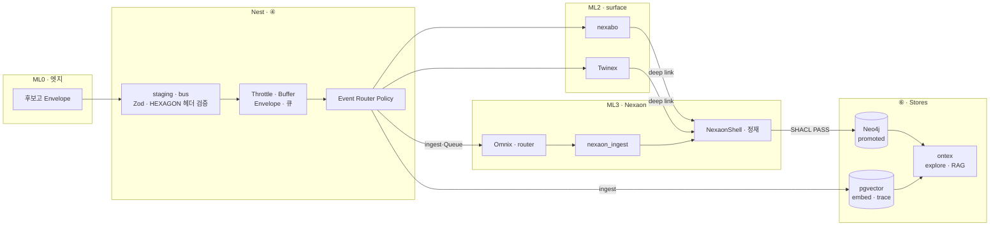
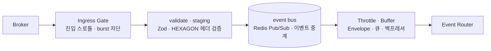
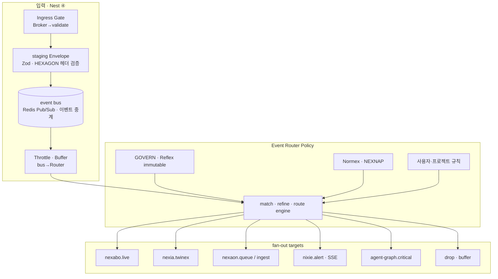
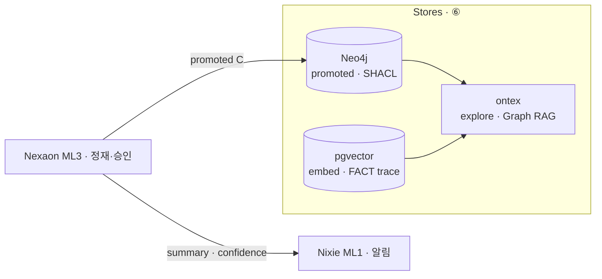

# IoT 엣지 데이터 파이프라인 · HEXAGON 선처리 · Nexaon 지식화 연계 v1.0

> **doc_id:** TDD-068 · **상태:** published — **클라우드·nexia 쪽** 4 단계 에이전트 파이프라인의 **엣지 상류 (upstream)** 를 정의한다.
> **짝 문서:** [TDD-067 · 에이전틱…](./08_TDD_NEXIA_에이전틱AI파이프라인_7탭플랫폼연계_v1.0.md) — Human·LLM · 7 탭 · Yjs · **§7.5 uplink** · **§7.6 downlink(펌웨어·USB/OTA·제어·피드백)**
> **NEXA AIS:** 6 종 **08_TDD/AI 정본 승격 완료** — [08_TDD/AI/README](../AI/README.md) · TDD-033~041
> **지능 위계 SSOT:** [TDD-040 · 지능 위계 · 하드웨어](../AI/08_TDD_AI_지능위계및하드웨어사양.md) — 본 문서 §1.5
> **지능 분업:** §1.4 — **Nexaon(ML3)** · **Event Router** · **Nixie(ML1)** = 표현 · **Menton Intelligence Stack** — [TDD-070 §3.2.1](../../용어집_NEXA전용_v2.0.md)
> **6대 레이어 SSOT:** 엣지·uplink = **본 문서** · Nexaon 오케스트레이터 = [TDD-073](./Nexaon/08_TDD_Nexaon_Distillation오케스트레이터_v1.0.md) · 물리 집행 = [TDD-072](./Kineton/08_TDD_Kineton_PhysicalBridge_ACTON_ROS2_v1.0.md)

---

## 0. 문서 범위

| 포함 | 제외 |
| :--- | :--- |
| 엣지 **데이터 발생** · HEXAGON **선처리** · **후보고** uplink | nexia 7 탭 **에이전트 4 단계** 상세 (짝 문서) |
| Nest · nexabo **수신·관제** · **IG·TB 2 단** (§1.6.7) | 펌웨어 C++ 구현 상세 (NEXA-CELL PRD) |
| **Nexaon 정재** · SHACL · Yjs draft · **Nixie 표현** · **Event Router** (§1.6.6) | Ontex **explore/canvas** UI (TDD-057) |
| **promoted** → Ontex 지식 허브 | ERP·nexet 비즈니스 트랜잭션 |

**분업 원칙 (BRD-002 Physical AI):** 엣지 = **Fact·Reflex·후보고** · 플랫폼 = **규범·추론·지식·승인**.
**지능 위계 (TDD-040):** **Sentinel**(COLD/WARM) → (선택) **Kinetic** → **Zenith Indicator**(HOT) — 계층마다 연산·지연·HEXAGON 깊이가 다름.

---

## 1.4 지능 분업 — Nexaon(지식) · Nixie(표현)

> **SSOT:** [TDD-045 · Knowledge · 닉시=지능의 얼굴](../Knowledge/08_TDD_Knowledge_디렉토리책임및기획자원경로.md) · [TDD-070 §3.2.1 · ML0–ML3](../../용어집_NEXA전용_v2.0.md) · [UIX-004 §4.6 · NIXIE 시각화](../../07_UIUX/07_UIUX_NEXIA_MainShell_레이아웃_v1.0.md)

본 IoT 파이프라인에서 **「지능」** 과 **「사용자 접점」** 을 분리한다. **Menton** (Intelligence Stack) — **≠** CPU cache L* · **≠** NISE-L* · **≠** `Axon`.

| ML | 별칭 | 주체 | 역할 | LangGraph Agent? |
| :--- | :--- | :--- | :--- | :---: |
| **ML3** | Strategic | **Nexaon** · **`apps/agent-graph`** · **Omnix** | 후보고 → Human↔LLM **정재** · Run · SHACL · 승인 · **promoted** | ✓ (agent-graph) |
| **ML2** | Domain | **nexabo/** · **nexia/** (Twinex · Nexaon UI) | 관제 · 트윈 · 정재 **작업면** | — |
| **ML1** | Presence | **Nixie (NIXIE)** | 지능 결과·알람·상태를 **표현** · PiP/TTS · **Reflex triage** | ✗ (Shell) |
| **ML0** | Edge | **Sentinel** | Fact · Reflex · 후보고 uplink | — |

**한 줄 정의**

- **Nexaon** — IoT·온톨로지 **지식 정재 루프의 핵심 두뇌** (Slow path · §5~§7). Run·`graph_diff`·승격은 **`agent-graph` + Omnix** 와 함께 수행.
- **Nixie** — **「하나의 지능의 얼굴·쉘 (Shell)」** ([TDD-045 §5](../Knowledge/08_TDD_Knowledge_디렉토리책임및기획자원경로.md)). Nexaon·Omnix·Sentinel·엣지 bus 가 만든 **상태·요약·confidence** 를 사용자에게 **직접 전달**. 필요 시 **Reflex 급 판단**(긴급도 · 말할지/조용할지 · 표면 선택) 만 수행 — **Run·SHACL·promoted ✗**.

**Nixie Reflex vs Nexaon Strategic (Normative)**

| 구분 | Nixie (ML1) | Nexaon / agent-graph (ML3) |
| :--- | :--- | :--- |
| bus 구독 · 알람 TTS | ✓ _(Router 가 `nixie` 채널로 보낸 것만)_ | — |
| HEXAGON **경량** 분류 (규칙 · 선택 sLLM) | ✓ _(표현·말할지/조용할지)_ | — |
| Fan-out **대상 결정** | ✗ | ✓ **Event Router Policy** (§1.6.6) |
| Fan-out **힌트** (nexabo / Twinex / TTS) | ✓ _(Router 결과 소비)_ | — |
| `graph_id` **Run 소유** | ✗ | ✓ |
| ingest · SHACL · **promoted** | ✗ | ✓ |
| ASK · STUCK **최종 승인** | ✗ → **Omnix** escalate | Omnix strip |

### 1.4.1 End-to-End 파이프라인 (지능 · 표현)



```text
[엣지] Sentinel ──후보고──► Broker ──► Ingress Gate ──► Nest staging ──► Throttle·Buffer ──► Event Router
                              │
              ┌───────────────┼───────────────┬──────────────┐
              ▼               ▼               ▼              ▼
         nexabo/          Nexaon 큐       Nixie (ML1)    agent-graph
         Twinex            · ingest         · TTS        (Run)
              │               │               │
              └─────── Omnix ─┴── Run ────────┘
                              │
                              ▼ promoted · ingest
                    Stores — Neo4j · pgvector · ontex explore
```

---

## 1.5 NEXA AI 지능 위계 · 파이프라인 매핑

> **정본:** [TDD-040 · 지능 위계 · 하드웨어 사양](../AI/08_TDD_AI_지능위계및하드웨어사양.md)
> **원칙:** 하위는 **「추측하지 말고 관찰 (FACT)」** · 상위는 **Why·전략·지식화**. 하드 도메인 **Reflex** 는 Nano/Kinetic 에서 끝 — Zenith 는 **실행하지 않음** ([TDD-039](../AI/08_TDD_AI_안전대책선조치로직.md)).

### 1.5.1 4 계층 ↔ 본 문서 6 단계

| 지능 계층 | HW 프로필 | 배치 | 본 파이프라인 단계 | HEXAGON · 산출 |
| :--- | :---: | :--- | :--- | :--- |
| **Nano Sentinel** | COLD | ESP32 · NEXA-CELL | ① 발생 · ② 선처리 · ③ 후보고 · **ACTON Reflex** | TICK · **FACT** · MOMENT · Listen |
| **Micro Sentinel** | WARM | RPi · 엣지 허브 | ①②③ (영상·음성 게이트) | ECHO(1 차) · INCIDENT 후보 · 비식별 5W1H |
| **Kinetic Controller** | WARM | Jetson _(생략 가능)_ | ②③ · 현장 Decision · critical MQTT | 복합 FACT · JSON 제어 · 에스컬레이션 판단 |
| **Zenith Indicator** | HOT | NAS · **`apps/agent-graph`** | ④⑤⑥ · Nexaon · RAG · 승인 | Why · GOVERN · promoted 지식 |

**배치 옵션 (TDD-040):**

| 구성 | 경로 | 본 문서에서 |
| :--- | :--- | :--- |
| **4 단계 (풀)** | Nano → Micro → Kinetic → Zenith | 영상·복합 제어·전략 모두 |
| **3 단계** | Nano → Micro → Zenith | Kinetic 생략 · Jetson JSON 제어 ✗ |
| **2 단계 (최소)** | Nano → Zenith | Micro 생략 · **비식별 게이트 부재** 주의 |

### 1.5.2 Fast / Slow Path

```text
[Fast · Reflex]  Nano (± Kinetic) ──ACTON──► 물리 제어 (<50ms)
                      └──► 후보고 uplink (선조치 Fact 포함)

[Slow · Reasoning]  MQTT ──► Zenith / agent-graph ──► Nexaon ──► ontex
                      (Critical 토픽은 agent-graph 가 1차 LLM · Nest 경유)
```

| Path | 지능 계층 | 본 문서 § |
| :--- | :--- | :--- |
| Fast | Nano · Kinetic | §3 Reflex · §4 Local Bypass |
| Slow | Zenith · Nexaon | §5~§7 |

**계층적 필터링:** Nano/Micro 가 5W1H FACT 로 요약 → 상위 (Zenith) 연산 **~90% 절감** (TDD-040 §3).



---

## 1. 전체 흐름 (한 눈에)

```text
[① 발생]  센서·GPIO·버스 · ESP32/NEXA-CELL · (선택) Nano-Sentinel
      │
      ▼
[② 선처리]  엣지 sLLM/규칙 — RAW → HEXAGON 헤더 + FACT 요약 (1ms급 인덱스)
      │
      ▼
[③ 후보고]  Candidate Report (ACTON/Envelope) — “지식 후보” · promoted ✗
      │
      ▼ MQTT (Normal / Critical 분기)
[④ 수신]  Broker ──► **Ingress Gate** ──► validate · staging ──► bus ──► **Throttle · Buffer** ──► **Event Router** ──► nexabo/ · nexia/ · …
      │
      ▼
[⑤ 정재]  **Nexaon**(ML3) — Run · graph_diff · Human·LLM · Yjs ontology:draft
      │         (트리거: Omnix · Nest 큐 — Nixie Run 소유 ✗)
      ▼ SHACL · 승인 A/B/C
[⑥ 지식화]  promoted → Neo4j · NEXAVULT · ontex ingest · pgvector
      │
      └──► Nixie — 사용자 **요약·알림·Jitter** (§1.4)
```



---

## 1.6 엣지↔플랫폼 소통 · nexabo/ · nexia/ · **Nixie**

> **역할:** 엣지 후보고는 **도메인 UI**(`nexabo/` · `nexia/`) 와 **지능 루프**(Nexaon · agent-graph) 로 흐르고, **Nixie** 는 그 **결과·알람·상태** 를 MainShell 에 **항상 -on** 으로 **표현**한다. Reflex triage 는 ML1 에서만.
> **SSOT:** §1.4 · [TDD-058 · 오케스트레이션](../LangGraph/08_TDD_LangGraph_오케스트레이션설계_v1.0.md) · [UIX BAX · NIXIE M2P](../../07_UIUX/07_UIUX_BAX_미학적인터페이스UX아키텍처_v1.0.md) §5.3 · [TDD-045 · 지능의 얼굴](../Knowledge/08_TDD_Knowledge_디렉토리책임및기획자원경로.md)

### 1.6.1 역할 분리 — Nixie · Nexaon · Omnix · Zenith

| 주체 | 층 | 상시 대기 | 역할 |
| :--- | :--- | :---: | :--- |
| **Nixie** | **ML1 Presence** · MainShell frame (domainKey **무관**) | **✓** | bus **구독** · Reflex **triage** · TTS·PiP·Jitter · **표현** — Run·promoted **✗** |
| **Nexaon** | **ML3 Strategic** · nexia Logex ontology | UI 탭 | 후보고 → **지식 정재** · Run · `graph_diff` · SHACL · promoted **전 단계** |
| **nexabo/** | **ML2 Domain** · IoT 관제 | UI 탭 | Fact Stream · 알람 · Telemetry ([ADM-001](../09_Admin/09_Admin_NEXA_SYNC커맨드센터.md)) |
| **nexia/** | **ML2 Domain** · 7 탭 | UI 탭 | Twinex · Nexaon UI · **Omnix** |
| **Omnix** | **ML3** · nexia 탭 | 탭 활성 시 강화 | Run **큐잉** · Human 승인 strip · 탭 위임 · Nixie **escalate** 수신 |
| **Zenith** | **ML3** · `apps/agent-graph` (HOT) | Run 단위 | LLM 추론 · Nexaon graph 실행 · RAG |
| **Event Router** | **Nest · Policy** | 상시 | staging 이벤트 **match · 정제 · fan-out** (§1.6.6) |
| **Ingress Gate** | **Nest · Broker 직후** | 상시 _(선택)_ | raw burst **진입 차단** — validate **앞** (§1.6.7 ①) |
| **Throttle · Buffer** | **event bus → Router** | 상시 | Envelope **큐·집계** — Router **앞** (§1.6.7 ②) |

**원칙:** **Event Router** 가 **어디로 보낼지** · **Nexaon(+agent-graph)** 이 **정재** · **Nixie** 가 **체감·전달** · **Omnix** 가 **승인·위임** · **Nixie·UI → MQTT 직결 ✗** · 엣지 **Reflex** 는 Sentinel **ACTON** 으로 Nixie/Omnix **이전**에 끝난다 (TDD-039).

### 1.6.2 소통 경로 (2 domainKey + 1 Presence)

```text
[엣지] Sentinel 후보고 (HEXAGON Envelope)
         │
         ▼ MQTT
[Nest] validate · staging · platform event bus
         │
         ▼
[Event Router Policy]  ← 사용자·Normex·GOVERN 규칙 (§1.6.6)
         │
         ├──────────┬──────────┬──────────┬──────────┐
         ▼          ▼          ▼          ▼          ▼
   nexabo/     nexia/    Nexaon 큐   nixie     agent-graph
   Live Feed   Twinex    · ingest    채널      Run 트리거
         │          │          │          │
         └──────────┴──── Omnix · Run router ──┘
                              │
                              ▼
            Nixie ◄── SSE/WS ──► 사용자 · Omnix strip
                              │
                              ▼ promoted · ingest
                    Stores — Neo4j · pgvector · ontex
```



### 1.6.3 Nixie 처리 루프 (ML1 · Normative)

| 단계 | Nixie 동작 | domainKey | 위임 대상 |
| :--- | :--- | :--- | :--- |
| **Listen** | Router **`nixie` 채널** · (선택) 음성 PiP | — | SSE/WS · `source: nixie-agent` (M2P) |
| **Classify** | Router 가 넘긴 이벤트 · Reflex | — | 말할지/조용할지 · Jitter (**표현**) |
| **Express** | Router 가 **`nexabo`/`nexia` 로 보낸** 알람 | **nexabo/** · **nexia/** | Live Feed · Twinex _(Nixie 가 라우팅 ✗)_ |
| **Request** | ingest · correlate **필요 시** | — | **Event Router → Omnix/router** → agent-graph |
| **Escalate** | ASK · STUCK · MUST | **nexia/** | **Omnix** Human-in-the-loop |
| **Speak** | Summary · TTS · Jitter/Lumina | frame | BAX · void_ratio · confidence 메타 |

**Downlink (플랫폼→엣지):** Omnix 승인 후 Nest → MQTT `cmd/*` · OTA · GOVERN 파라미터 하향. Nixie 는 **알림·확인 UX** 만 — downlink **소유 ✗** ([TDD-039 §6](../AI/08_TDD_AI_안전대책선조치로직.md) · TDD-040). **4 Phase · Generate·Push·Feedback 상세** → [짝 문서 **§7.6**](./08_TDD_NEXIA_에이전틱AI파이프라인_7탭플랫폼연계_v1.0.md).

### 1.6.4 파이프라인 6 단계 ↔ Nixie · Nexaon

| 본 문서 § | nexabo/ | nexia/ · Nexaon | Nixie (ML1) |
| :--- | :--- | :--- | :--- |
| ④ 수신 | Live Feed · staging mirror | Twinex 상태 · 큐 적재 | **Router `nixie` 채널 · TTS triage** |
| ⑤ 정재 | (선택) alarm correlate UI | **Nexaon Run · graph_diff** | Run **트리거 ✗** · 진행 **상태 표현** |
| ⑥ 지식화 | trace → Ontex | **promoted** (Nexaon) | **요약·알림·confidence → Jitter** |

### 1.6.5 Nexaon 진입 축 — UI · deep link · **엣지 후보고**

> **SSOT:** [`TDD-070` §3.4.1](../../용어집_NEXA전용_v2.0.md) · [`TDD-056` §4.1](./08_TDD_NEXIA_7탭범위확정_v1.0.md)

**원칙:** **후보고 = Nexaon 데이터 upstream ①번 축** · **Logex/ontology = UI canonical home** · 동일 `NexaonShell` · **`nexaon_ingest` Run**.

| 축 | 출발 | Nexaon 연결 | 본 파이프라인 § |
| :--- | :--- | :--- | :--- |
| **① 엣지 후보고** | Sentinel · §4 Envelope | Nest → **`nexaon_ingest`** (Logex **선행 ✗**) | ③④⑤ |
| **② nexabo** | Live Feed · 알람 | 큐 · correlate → ingest / deep link | ④⑤ |
| **③ Twinex** | `.nxdev` · MQTT 상태 | `device_id` 매핑 · ExplorerTree | ①~④ |
| **④ Logex** | ontology 서브모드 | canonical `/nexia/logex/ontology/{id}` | ⑤⑥ |
| **⑤ Omnix** | 승인 · `graph_diff` | RunPanel · Diff accept | ⑤ |
| **⑥ Navex** | 자산 선택 | class/asset/pin 컨텍스트 | ⑤ |



**ingest 모드 (Normative):** **Auto** (critical/STUCK) · **Queue** (Normal + Human) · **Buffer** (고빈도 TICK → Live Feed 만).

**Deep link 예:** `/nexia/logex/ontology/{projectId}?from=nexabo&trace_id=…` — mount 후 canonical URL normalize ([`TDD-056` §4.1](./08_TDD_NEXIA_7탭범위확정_v1.0.md)).

### 1.6.6 Event Router Policy — 플랫폼 라우팅·정제 설정층

> **위치:** Nest **staging · platform event bus** → **Throttle · Buffer (② Semantic · §1.6.7)** → **consumer** … **사이**의 **Policy**. **① Ingress Gate** 는 **Broker → validate** _(§1.6.7)_.
> **금지:** Nixie·브라우저·PiP → **MQTT 브로커 직결 ✗** — 모든 IoT uplink 는 **Nest → Router → SSE/WS** 만.

**역할:** 사용자·운영자가 **무엇을 · 어떻게 · 어디로** 보낼지 **선언형 규칙**으로 정의. Nixie 는 **라우팅 소유 ✗** · Router 가 **`nixie` 채널**로 보낸 이벤트만 **표현**.

| 차원 | 설정 내용 | 예 |
| :--- | :--- | :--- |
| **Match (무엇을)** | HEXAGON 축 · `device_id` · `project_id` · Nature Tag · critical | `How=STUCK` · `device_id=*.nxdev` |
| **Refine (어떻게)** | 필터 · dedupe · 윈도우 집계 · (선택) 경량 enrich | 5min DURATION rollup · VOID drop |
| **Route (어디로)** | fan-out **target** | `nexabo.live` · `twinex.state` · `nexaon.ingest` · `nixie.alert` · `agent-graph.critical` · `drop` |

**Route target (Normative)**

| target | consumer | 비고 |
| :--- | :--- | :--- |
| `nexabo.live` | Live Feed · 알람 | ADM-001 |
| `nexia.twinex` | Twinex · `.nxdev` | Yjs 고주파 ✗ |
| `nexaon.queue` | Nexaon ingest 큐 | §1.6.5 ① |
| `nexaon.ingest` | Omnix/router → `nexaon_ingest` | Auto ingest |
| `nixie.alert` | Nixie SSE/WS · TTS | ML1 표현만 |
| `agent-graph.critical` | Zenith 1 차 Run | critical MQTT 대응 |
| `drop` / `buffer` | — | 고빈도 · 정책 VOID |

**정책 계층 (우선순위)**

```text
① GOVERN · TDD-039 Reflex (immutable) — ACTON·interlock 우회 ✗
② Normex · NEXNAP 매트릭스 (플랫폼 헌법)
③ 프로젝트 기본 fan-out (SSOT default)
④ 사용자·운영자 오버레이 (nexabo · admin · Omnix 설정 UI)
```

**ingest 모드 ↔ Router 규칙**

| 모드 | Router 동작 |
| :--- | :--- |
| **Auto** | `critical`/`STUCK` match → `nexaon.ingest` + `nixie.alert` + (선택) `agent-graph.critical` |
| **Queue** | Normal → `nexaon.queue` + `nexabo.live` |
| **Buffer** | TICK 고빈도 → `nexabo.live` only · `drop` 또는 throttle |

**Downlink · promoted:** Router 는 __MQTT cmd/_ · promoted · Neo4j write 직접 ✗_rite 직접 ✗_rite 직접 ✗_rite 직접 ✗_* — **Omnix 승인 후** Nest downlink API 만.

### 1.6.7 Ingress Gate · Throttle · Buffer — 트래픽 2 단 (개념)

> **상세 TDD:** _MQTT cmd/_ · 짝 문서 [§8.2.1](./08_TDD_NEXIA_에이전틱AI파이프라인_7탭플랫폼연계_v1.0.md)
>
> **혼동 방지:** **Ingress Gate** ≠ **Semantic Throttle·Buffer** — 역할·위치·입력 단위가 다름.

```text
MQTT → Broker → [① Ingress Gate] → validate · staging → event bus
                        → [② Throttle · Buffer] → Event Router → consumers
```

| 층 | 노드 | 위치 | 입력 | 역할 |
| :--- | :--- | :--- | :--- | :--- |
| **① Ingress Gate** | `08_TDD_NEXIA_IoT수신스로틀버퍼…` | **Broker → validate** **사이** | raw MQTT · topic burst | **진입 한도** · burst cap · Nest **과부하 선차단** _MQTT cmd/_ |
| **② Semantic Buffer** | `IG` | **event bus → Router** **사이** | **검증된 Envelope** | dedupe · TICK 윈도우 · **BullMQ** · critical **우선 큐** |

| 금지 | 내용 |
| :--- | :--- |
| **IG** | VOID·미검증 패킷 **장기 버퍼 ✗** · match·route **✗** |
| **TB** | raw MQTT **직접 소비 ✗** · promoted · Router 정책 **소유 ✗** |

**MVP (Nest)**

| 층 | 용도 | 기술 |
| :--- | :--- | :--- |
| **① IG** | 구독·topic flood cap | 가벼운 rate limit · (선택) RxJS `TB` on ingress |
| **② TB** | Envelope 스트림·큐 | **RxJS** · **BullMQ** (Redis) |
| **공통** | HTTP·API | **NestJS Throttler** |

**차후 검토:** **RabbitMQ** · **Apache Kafka** — 다중 Nest·대량 fan-out·장기 보관 _MQTT cmd/_.

**Router `throttleTime` 모드와 관계:** **TB** = **물리·의미적 흡수** (validate **후**) · Router **`Buffer` target** = **정책** (Live Feed only 등 · [§1.6.6](#166-event-router-policy--플랫폼-라우팅정제-설정층)).





**설정 UI (초안):** **nexabo** 알람 규칙 · **admin/infra** · **Omnix** Agent Intelligence Config — 편집은 UI · **실행은 Nest Router** only · 변경 **Audit** (`buffer` · GOVERN 이력).

---

## 2. ① 데이터 발생 (Edge Origin)

> **지능 위계:** 본 단계 주 담당 = **Nano Sentinel** (COLD) · 보조 = **Micro** / **Kinetic** (WARM). SSOT [TDD-040 §1~2](../AI/08_TDD_AI_지능위계및하드웨어사양.md).

| 계층 | 지능 위계 · 주체 | 산출 | 비고 |
| :--- | :--- | :--- | :--- |
| **디바이스** | **Nano Sentinel** · ESP32 · ESPHome · NEXA-CELL | RAW telemetry · GPIO · bus | COLD · **Pub/Sub only** · TinyML·Rule |
| **엣지 게이트웨이** | **Micro Sentinel** · RPi · (선택) **Kinetic** · Jetson | 배치·압축 · YOLO/SLM 1 차 요약 | WARM · [`run_id`](./08_TDD_NEXIA_데이터분산처리하이브리드전략.md) |
| **센티널 Fact** | Nano / Micro | **5W1H 1 차 Fact 문장** | nexabo Live Feed · [ADM-001](../09_Admin/09_Admin_NEXA_SYNC커맨드센터.md) |

**Twinex 연계:** `TDD-024` · `.nxdev` 바인딩 — 디바이스 ID = 트윈 노드 SSOT ([`.nxgrp` §5.6](./08_TDD_NEXIA_7탭범위확정_v1.0.md)).

**Yjs 주의:** MQTT **고주파 RAW** 는 Yjs CRDT 에 **직접 반영하지 않는다** — Twinex 는 **스로틀·Device-only Region** ([`TDD-056` §3.3](../AI/08_TDD_AI_YjsHocuspocus협업SSOT.md)).

---

## 3. ② HEXAGON 선처리 (5W1H)

> **지능 위계:** 선처리 = **Nano**(규칙·TinyML) → **Micro/Kinetic**(SLM 보조). Zenith 는 **선처리 ✗** — uplink 후 §5.

엣지에서의 목표: **무거운 LLM 추론 없이** 패킷 헤더만으로 라우팅·우선순위·보존 정책을 결정 ([`TDD-038`](../AI/08_TDD_AI_5W1H_6대추상레이어규격.md)).

### 3.1 선처리 입력·출력

| 단계 | 입력 | 출력 |
| :--- | :--- | :--- |
| **정규화** | ADC·Modbus·CAN·이미지 프레임 | 단위·타임스탬프·`TDD-033` |
| **HEXAGON 부여** | 정규화 레코드 | 6 축 토큰 헤더 + (선택) FACT 한 줄 |
| **압축** | 연속 RAW | MOMENT 트리거 · DURATION 집계 · 임계치 초과만 uplink |

### 3.2 엣지에서 고정하는 HEXAGON (Normative)

| 레이어 | 엣지 기본 토큰 | 의미 |
| :--- | :--- | :--- |
| **Where** | `device_id` (현장) · `FIELD`(디바이스 주권) | DOMAIN 은 **플랫폼**에서만 승격 시 부여 |
| **When** | `SELF` (이벤트) · `MOMENT` (구간) | ERA = 패러다임 전환 시 플랫폼 |
| **Who** | `DURATION` (자동) · `TICK`(엣지 sLLM) · `ECHO`(Human 확인 필요) | WILL = 현장 HMI·Omnix 승인 |
| **What** | **`ASK`** (관측) · `FACT`(관계 후보) | **RULE** = Normex · 플랫폼 |
| **How** | `LINK` · `FLOW` · `STUCK` | STUCK → nexabo 알람 · Omnix strip |
| **Why** | `VOID`(추정) · `CAUSE`(목표) | 엣지 Why = **후보** — Nexaon 에서 검증 |

**No Token, No Action** — 헤더 누락 패킷은 브로커·Nest 에서 **VOID 거부** ([`TARGET` §4](./08_TDD_NEXIA_NEXNAP시스템인터페이스표준규약.md)).

### 3.3 선처리 알고리즘 (개념)

```text
on_raw_sample(sample):
  if not passes_spike_filter(sample): return  // VOID 로컬 폐기
  hex = assign_hexagon(sample, device_profile)
  if hex.What != FACT and not hex.Who == ASK: return
  if hex.How == STUCK: publish_critical(...)
  else: publish_normal(...)
```

| `TDD-023` | 엣지 동작 | SSOT |
| :--- | :--- | :--- |
| **1** | RAW 위주 · 최소 헤더 | TDD-024 |
| **2** | 로컬 에이전트가 critical MQTT 직접 처리 | |
| **3** | 전량 플랫폼 · 엣지는 TICK+FACT 만 | |

---

## 4. ③ 후보고 (Candidate Report)

> **후보고** = HEXAGON 헤더 + FACT 페이로드를 **NEXNAP Envelope** 로 감싼 uplink.
> **아직 지식 (promoted) 이 아니다** — Nexaon **정재·승인** 전 단계.

### 4.1 Envelope 최소 필드

```typescript
type EdgeCandidateReport = {
  envelope_version: 'nexnap/1'
  hexagon: {
    where: 'FIELD' | 'SELF'
    when: 'MOMENT' | 'DURATION'
    who: 'TICK' | 'ECHO' | 'ASK'
    what: 'FACT' | 'LINK'        // 엣지는 주로 FACT
    how: 'FLOW' | 'STUCK' | 'VOID'
    why?: { cause?: string; target?: string }
  }
  device_id: string              // .nxdev / Twinex 바인딩
  project_id: string
  capability_id?: string
  nature_tag?: string
  payload: {
    metric: string
    value: number | string | boolean
    unit?: string
    raw_ref?: string             // OPFS·blob pointer (선택)
  }
  trace_id: string
  emitted_at: string             // ISO8601
  candidate: true                  // ★ promoted ✗ 명시
}
```

### 4.2 MQTT 토픽 (후보고 uplink)

[`ai_execution_mode`](./08_TDD_NEXIA_MQTT토픽데이터라우팅.md) 컨벤션:

```text
{group}/{location}/{device_id}/report/candidate          ← Normal 후보고
{group}/{location}/{device_id}/report/candidate/critical ← STUCK·ASK·임계치
{group}/{location}/{device_id}/cmd/ota                   ← Downlink (별도)
```

| 구독자 | 패턴 | 처리 |
| :--- | :--- | :--- |
| **Nest** | `TDD-022` | DB staging · nexabo Live Feed · WebSocket |
| **agent-graph** | `+/+/+/report/#` | **Zenith Indicator** · 이상 감지 · (선택) 1 차 LLM |
| **Twinex** | device_id 매칭 | 트윈 상태·진단 반영 |

**Local Bypass (Reflex):** STUCK·안전 interlock 은 **엣지 ACTON** 으로 즉시 차단 — uplink 와 **병행** ([`+/+/+/report/+/critical` NEXA-Edge](../NEXAOS/08_TDD_NEXAOS_모노레포폴더구조_v1.0.md) — HEXAGON·ACTON only).

---

## 5. ④ 플랫폼 수신 · staging · Nixie · Nexaon

> **지능 위계:** **Zenith Indicator** (HOT) — `TDD-007`.
> **소통:** Nest staging → **Event Router Policy** → **`apps/agent-graph`** · **`nexabo/`** · Nexaon 큐 · **Nixie 채널** (§1.6.6).
> **Run 트리거:** **Omnix · Nest router** — Nixie 가 `nexia/` Run **소유 ✗**.

| `graph_id` | 층 | 역할 | 후보고 소비 |
| :--- | :--- | :--- | :--- |
| **nexabo** | ML2 | 관제·Telemetry·알람 | Live Feed · 5W1H 필터 UI |
| **nexia** · Twinex | ML2 | 디지털 트윈·`domainKey` | MQTT 상태 · 진단 → Logex |
| **nexia** · Nexaon | ML3 | **지식 정재** 작업면 | Run · `.nxdev` · SHACL |
| **nexia** · Omnix | ML3 | 오케스트레이션·승인 | Run 큐 · Nixie escalate 수신 |
| **infra** | — | 장치 등록·my-devices | `graph_diff` · capability SSOT |
| **Nest** | — | staging · **event bus** · **Event Router** | `device_id` → Policy → consumers |
| **Event Router** | **Policy** | match · refine · **route** | §1.6.6 · Normex·GOVERN·사용자 규칙 |
| **Nixie** _MQTT cmd/_ | **ML1** | **표현·Reflex** | Router **`edge_candidate_reports` 채널** · MQTT **✗** |

**NEXAVAULT:** FACT 계열 후보고는 **시계열 Fact 적재** 후보 — [`nixie.alert` §5](../../Ontex/08_TDD_Ontex_기술스택운영방침_v1.0.md).

---

## 6. ⑤ Nexaon 정재 (Human · LLM) — ML3 지능 루프

> **지능 위계:** Zenith(추론·Run) + **Nexaon**(Human·LLM 협업) — 엣지 Sentinel 이 올린 FACT/Why **후보**를 **검증·승격**.
> **Nixie 와의 경계:** 정재·Run·SHACL 은 **본 절 (Nexaon)** 에서만 — Nixie 는 진행 상태·결과를 **표현** (§1.4).
> **진입 축:** §1.6.5 — **엣지 후보고 ①번** 포함 6 축 · Logex = canonical UI · deep link 허용.

후보고 → **지식 초안** — **데이터 진입은 Logex 탭 선행 ✗** · UI canonical 은 Logex ontology (§1.6.5).

| 단계 | 담당 | 기술 | 산출 |
| :--- | :--- | :--- | :--- |
| **수집·매핑** | Nexaon · ExplorerTree | `TDD-057` → class/asset/pin | 그래프 노드 후보 |
| **Run 정재** | `device_id` · `nexaon_ingest` | LangGraph · [`nexaon_refine`](../LangGraph/08_TDD_LangGraph_인간LLM협업형IoT온톨로지플랫폼_v1.0.md) | Extract JSON · graph_diff |
| **Human 협업** | GraphCanvas · DiffOverlay | **Yjs** `TDD-008` | accept/reject |
| **규범 게이트** | Normex 스니펫 · NEXNAP 매트릭스 | WILL/ASK → Omnix 승인 | Authorized / Pending |
| **검증** | SHACL | SSE `ontology:draft` | violation outline |

```text
edge CandidateReport (candidate:true)
        │
        ▼ Nest 큐 / Event Router → Omnix Run router  ← Nixie 트리거 ✗
nexaon_ingest ──► Draft JSON (PostgreSQL)
        │
        ▼ Human + LLM (Yjs)
nexaon_refine ──► ontology:draft (Yjs CRDT)
        │
        ▼ 승인 A/B · SHACL PASS
promoted sync ──► Neo4j (운영 온톨로지)
        │
        └──► Nixie — 요약·confidence → 사용자 (§1.6.4)
```

**짝 문서와의 접점:** 클라우드 **② Reasoning · ③ Planning** = Nexaon Run + 승인 — [`shacl_violation`](./08_TDD_NEXIA_에이전틱AI파이프라인_7탭플랫폼연계_v1.0.md) §7 · §9.

---

## 7. ⑥ 지식화 (promoted → Ontex)

| 단계 | 저장소 | 내용 |
| :--- | :--- | :--- |
| **실시간 협업** | Yjs · [TDD-067 · 에이전틱 파이프라인](./08_TDD_NEXIA_에이전틱AI파이프라인_7탭플랫폼연계_v1.0.md) | Nexaon draft ([`project_yjs_updates` §2.4](../LangGraph/08_TDD_LangGraph_인간LLM협업형IoT온톨로지플랫폼_v1.0.md)) |
| **감사** | PostgreSQL Audit · `TDD-008` | 승인 A/B |
| **운영 그래프** | **Neo4j promoted** | SHACL PASS 후 |
| **허브 탐색** | **Ontex** explore · canvas | Graph RAG · 인용 |
| **벡터** | pgvector · embed job | `run_id` · MOC 후보 |

```text
nexia/Nexaon (정재·승인)  ──promoted──►  Neo4j + NEXAVULT
엣지 후보고 (staging)      ──ingest────►  pgvector + trace
                                         └── ontex explore / canvas
```

**Ontex vs Nexaon:** 엣지 후보고는 **never** Ontex canvas 에 직접 promoted ✗ — **Nexaon 루프 필수** ([`ontex_ingest` §7](../../Ontex/08_TDD_Ontex_기술스택운영방침_v1.0.md)).



_MQTT cmd/_

---

## 8. 단계 대응표 — 지능 위계 · 엣지 vs 클라우드 (짝 문서)

| 엣지·플랫폼 단계 | 지능 위계 (TDD-040) | ML1/ML3 | 클라우드 4 단계 (짝 문서) | 비고 |
| :--- | :--- | :--- | :--- | :--- |
| ① 발생 | Nano · Micro · Kinetic | — | — (upstream) | Physical AI · COLD/WARM |
| ② HEXAGON 선처리 | Nano · Micro (± Kinetic) | — | ① Gathering (일부) | 엣지 1 차 압축 |
| ③ 후보고 uplink | Sentinel → MQTT | — | ① Gathering | FACT → RAG **후보** |
| ④ nexabo·Twinex | Nest · **Event Router** | **Policy** · Nixie ML1 · ML2 UI | ① Gathering · Twinex | match·route · §1.6.6 |
| ⑤ Nexaon 정재 | Zenith · **Nexaon ML3** | Nixie **표현만** | ② Reasoning · ③ Planning | Run · SHACL · 승인 |
| ⑥ Ontex 지식化 | Zenith · Nexaon | Nixie **알림** | ④ Writing (장기) | promoted · 그래프 |

---

## 9. nexia 7 탭 · domainKey 연계

| 대상 | 층 | 엣지 파이프라인에서의 역할 |
| :--- | :---: | :--- |
| **Event Router** | Policy | ④ **match·refine·route** · Normex·GOVERN·사용자 규칙 (§1.6.6) |
| **Nixie** | ML1 | **Router `TDD-057` 채널** · TTS/PiP/Jitter · MQTT **✗** |
| **nexabo** | ML2 | ④ Live Feed · 알람 · trace |
| **Twinex** | ML2 | ①②③ · **nexia/** MQTT · `nixie.alert` |
| **Logex / Nexaon** | ML3 | ⑤⑥ **지식 정재·승격** · 진입 §1.6.5 (후보고·deep link) |
| **Omnix** | ML3 | Run 큐 · ASK·STUCK 승인 — Nixie **escalate** 수신 |
| **Navex** | ML2 | promoted 산출물·`.nxdev` 등록 · ingest 소스 |
| **Normex** | ML3 | RULE·가드레일 — 엣지 FACT 와 대조 |
| **Ontex** | ML3 | ⑥ explore · trace · archive (promoted 허브) |

> **nexabo** 상세 UI: [ADM-001 · NEXA-SYNC 커맨드 센터](../09_Admin/09_Admin_NEXA_SYNC커맨드센터.md)

---

## 10. 구현 체크리스트 (초안)

- [ ] **§1.4** ML1/ML2/ML3 분업 — Nixie Run·promoted ✗ · Nexaon ML3 정재
- [ ] **§1.6.6** Event Router Policy — match/refine/route · GOVERN immutable · Nixie MQTT ✗
- [ ] Nixie: Router **`.nxproj` 채널** · perpetual SSE/WS · Omnix escalate (§1.6)
- [ ] **§1.6.5** Nexaon 6 축 진입 · 후보고 → `nixie.alert` (Logex 선행 ✗)
- [ ] Run router: **Omnix/Nest** → agent-graph — Nixie `nexaon_ingest` 트리거 ✗
- [ ] 배치 옵션 (2/3/4 단계) 별 MQTT·Reflex 정책 — TDD-040 §1
- [ ] 엣지 펌웨어: HEXAGON 헤더 + `graph_id` Envelope 직렬화 (Protobuf/JSON)
- [ ] MQTT Normal/Critical 토픽 분기 · Nest·agent-graph 구독
- [ ] Nest staging → `candidate:true` Run 자동/수동 트리거
- [ ] Nexaon: `nexaon_ingest` → ontology class/asset/pin 자동 매핑 규칙
- [ ] SHACL·승인 후만 `device_id` · Neo4j upsert
- [ ] Twinex: 고주파 RAW Yjs 미반영 · 스로틀 정책

---

## 관련 문서 (SSOT)

| 주제 | 문서 |
| :--- | :--- |
| **짝 문서 (4 Phase · downlink · buffer)** | [TDD-067 · 에이전틱… §7.5 · §7.6 · §8.2.1](./08_TDD_NEXIA_에이전틱AI파이프라인_7탭플랫폼연계_v1.0.md) |
| **지능 위계** | [TDD-040 · Sentinel · Kinetic · Zenith](../AI/08_TDD_AI_지능위계및하드웨어사양.md) |
| 안전 Reflex | [TDD-039 · 선조치 · Bypass](../AI/08_TDD_AI_안전대책선조치로직.md) |
| HEXAGON · 5W1H | [TDD-033 · 6대 추상 레이어](../AI/08_TDD_AI_5W1H_6대추상레이어규격.md) |
| NEXNAP · Envelope | [TDD-023 · NEXNAP 규약](./08_TDD_NEXIA_NEXNAP시스템인터페이스표준규약.md) |
| MQTT | [TDD-022 · 토픽 라우팅](./08_TDD_NEXIA_MQTT토픽데이터라우팅.md) |
| 하이브리드·엣지 모드 | [TDD-024 · 데이터 분산](./08_TDD_NEXIA_데이터분산처리하이브리드전략.md) |
| LangGraph · Run | [TDD-058 · 오케스트레이션](../LangGraph/08_TDD_LangGraph_오케스트레이션설계_v1.0.md) |
| Nixie · Presence Shell | [TDD-045 · 지능의 얼굴](../Knowledge/08_TDD_Knowledge_디렉토리책임및기획자원경로.md) · [UIX BAX · NIXIE M2P](../../07_UIUX/07_UIUX_BAX_미학적인터페이스UX아키텍처_v1.0.md) §5.3 |
| Nexaon · 진입 · Run | [TDD-056 §4.1](./08_TDD_NEXIA_7탭범위확정_v1.0.md) · [TDD-070 §3.4.1](../../용어집_NEXA전용_v2.0.md) |
| Nexaon · Run · SHACL | [TDD-008 · IoT 온톨로지 플랫폼](../LangGraph/08_TDD_LangGraph_인간LLM협업형IoT온톨로지플랫폼_v1.0.md) |
| Ontex ingest | [TDD-057 · Ontex](../../Ontex/08_TDD_Ontex_기술스택운영방침_v1.0.md) |
| NEXA-CELL · Twinex | [PRD-004 · CELL](../05_PRD/NEXIA/05_PRD_NEXIA_CELL_ESPHomeYAML제너레이터웹펌웨어.md) |
| Physical AI 방향 | [BRD-002 · AI 혁신 포지셔닝](../01_BRD/01_BRD_AI혁신의물결_NEXA포지셔닝.md) |
| AIS 레거시 매핑 | [08_TDD/AI/README](../AI/README.md) |
