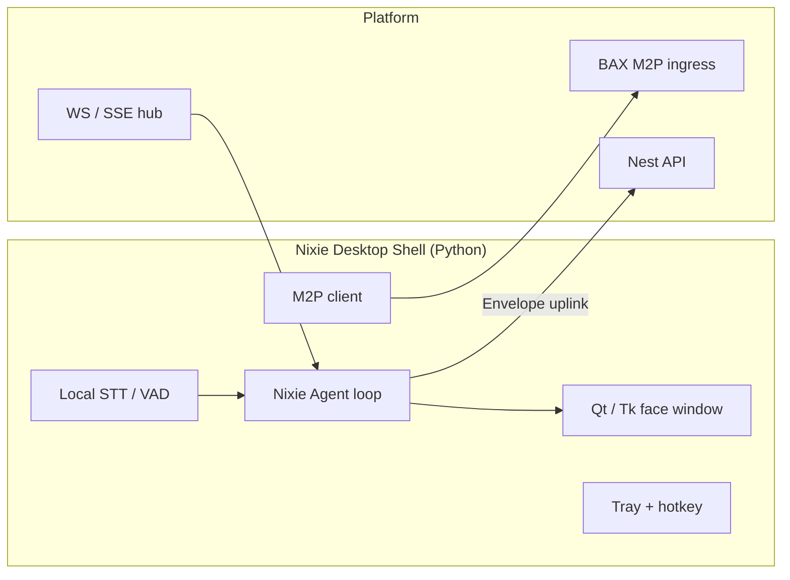

---
implements_doc:
doc_id: TDD-062
title: "NIXIE · Desktop Shell v1.0"
category: "08_TDD"
domain: NEXIA
status: published
created: 2026-06-10
updated: 2026-06-12
parent_doc: TDD-010
see_also: [TDD-070, UIX-003, TDD-023, TDD-061]
terms_standard: ["python", "websocket", "sse", "webrtc", "vad"]
terms_nexa: ["NIXIE", "Nixie", "NixieDesktopShell", "M2P", "Presence-Shell", "Envelope"]
tags: ["doc/cat/08-tdd", "doc/domain/nexia", "std/python", "std/websocket", "std/sse", "std/webrtc", "std/vad", "nexa/NIXIE", "nexa/Nixie", "nexa/NixieDesktopShell", "nexa/M2P", "nexa/Presence-Shell", "nexa/Envelope"]
---

# NIXIE · Desktop Shell v1.0

> **한 줄:** **Python** 기반 **PC 독립** Nixie 얼굴 — 브라우저 탭 **종속 ✗** · 트레이/전용 창 **always-on-top** · 플랫폼 **WS/SSE** · **BAX M2P** uplink · L1 **표현만**.

**채널 ID (Normative):** `channel_id: nixie-desktop`

**상위:** [`TDD-070` §3.6.2](../../../용어집_NEXA전용_v2.0.md) · [`UIX-BAX` M2P](../../../07_UIUX/07_UIUX_BAX_미학적인터페이스UX아키텍처.md)

---

## 1. 역할 · 경계

| 항목     | Desktop Shell                                    | 금지                              |
| :------- | :----------------------------------------------- | :-------------------------------- |
| **배치** | Windows/macOS/Linux **독립 프로세스**            | nexia 브라우저 탭 **필수 ✗**      |
| **UI**   | 전용 창 · 시스템 트레이 · optional always-on-top | MainShell·7 탭 **대체 ✗**         |
| **지능** | 플랫폼 SSE/WS **구독** · 로컬 Reflex triage      | LangGraph Run · Ollama 직접 **✗** |
| **입력** | 로컬 마이크/STT · **M2P v2** · 키보드 단축       | MQTT broker publish **✗**         |

---

## 2. 아키텍처



| 모듈          | 권장 스택                                     | 책임                                                                         |
| :------------ | :-------------------------------------------- | :--------------------------------------------------------------------------- |
| **Runtime**   | Python 3.11+                                  | 프로세스·설정·로깅                                                           |
| **UI**        | PyQt6 / PySide6 (또는 Dear PyGui)             | Rive 대체·캔버스·Jitter 연출                                                 |
| **Transport** | `websockets` · `httpx-sse`                    | 세션 · Envelope downlink                                                     |
| **Voice**     | `sounddevice` + VAD · 플랫폼 STT API fallback | 로컬 always-on                                                               |
| **M2P**       | WS → BAX ingress                              | [`UIX-BAX` §2.8](../../../07_UIUX/07_UIUX_BAX_미학적인터페이스UX아키텍처.md) |

**예상 repo 경로:** `apps/nixie-desktop/` (모노레포 루트 · [`TDD-007`](../../NEXAOS/08_TDD_NEXAOS_모노레포폴더구조_v1.0.md) 확장)

---

## 3. 플랫폼 계약

### 3.1 세션 등록

| 필드                   | 값                                           |
| :--------------------- | :------------------------------------------- |
| `channel_id`           | `"nixie-desktop"`                            |
| `device_fingerprint`   | OS·hostname hash                             |
| `capabilities`         | `tts`, `stt`, `m2p`, `always-on-top`, `tray` |
| `effective_project_id` | 사용자 선택 프로젝트                         |

인증: JWT · device token — [`TDD-016`](../08_TDD_NEXIA_보안및권한관리체계.md).

### 3.2 Downlink (Express)

| `payload.kind` | Desktop 동작                 |
| :------------- | :--------------------------- |
| `alert`        | 트레이 알림 · 창 flash · TTS |
| `summary`      | 말풍선·자막 overlay          |
| `run_state`    | Crew/Solo 아이콘·색          |
| `confidence`   | Jitter intensity · opacity   |

### 3.3 Uplink

| 경로               | 내용                                                            |
| :----------------- | :-------------------------------------------------------------- |
| **Omnix Envelope** | STT 텍스트 · wake · cancel — **Run 직접 ✗**                     |
| **M2P v2**         | `source: nixie-agent` · `void_ratio_delta` · `focus_blur_scale` |

```json
{
  "v": 2,
  "source": "nixie-agent",
  "ts": 1710000000000,
  "void_ratio_delta": 3,
  "focus_blur_scale": 0.8
}
```

### 3.4 Reflex triage

Web Shell 과 **동일 3 단** (Observe → Triage → Express). 추가 입력: **활성 창** · **트레이 only 모드** · Desktop 이 **유일 활성 채널** 일 때 Express 우선.

---

## 4. Web Shell 과의 관계

| 구분          | Web              | Desktop                         |
| :------------ | :--------------- | :------------------------------ |
| **브라우저**  | **필수** (nexia) | **불요**                        |
| **PiP**       | Document PiP     | OS always-on-top                |
| **M2P**       | Phase 2          | **P0 권장**                     |
| **동시 활성** | 가능             | Reflex 가 **한 채널**에 Express |

복수 채널 동시 등록 시 플랫폼 `nixie/sessions` 에 **primary** 플래그 · triage 정책 공유.

---

## 5. 오프라인 · degraded

| 상태                   | 동작                                              |
| :--------------------- | :------------------------------------------------ |
| **WS 끊김**            | 로컬 idle 애니메이션 · 재연결 backoff             |
| **플랫폼 unreachable** | 마지막 Self 스냅샷 캐시 · **Strategic Run ✗**     |
| **M2P only**           | BAX 로컬 버퍼 (p95 ≤ 50ms) — 플랫폼 복구 시 flush |

---

## 6. MVP 범위

| Phase  | In                                                | Out                 |
| :----- | :------------------------------------------------ | :------------------ |
| **P0** | 트레이 · WS Envelope · alert TTS · 세션 등록      | Rive 수준 연출      |
| **P1** | M2P v2 · Omnix STT uplink · Web 동시 triage       | 로컬 Ollama         |
| **P2** | always-on-top · 글로벌 hotkey · confidence Jitter | macOS 메뉴바 native |

---

## 7. 금지

- Desktop 에서 **agent-graph / LangGraph 직접 호출 ✗**
- Desktop 을 **Twinex 펌웨어 플래셔 ✗**
- Python 프로세스가 **MQTT broker role ✗**

---

## 관련 문서

| 관계        | 문서                                                                         |
| :---------- | :--------------------------------------------------------------------------- |
| 4 채널 개요 | [`Nixie/README`](./README.md) · [`TDD-070` §3.6.2](../../../용어집_NEXA전용_v2.0.md)  |
| M2P · BAX   | [`UIX-003` §2.8](../../../07_UIUX/07_UIUX_BAX_미학적인터페이스UX아키텍처.md) |
| Web Shell   | [`TDD-061`](./08_TDD_NIXIE_WebShell_v1.0.md)                                 |
| Envelope    | [`TDD-023`](../08_TDD_NEXIA_NEXNAP시스템인터페이스표준규약.md)               |
| 보안        | [`TDD-016`](../08_TDD_NEXIA_보안및권한관리체계.md)                           |
