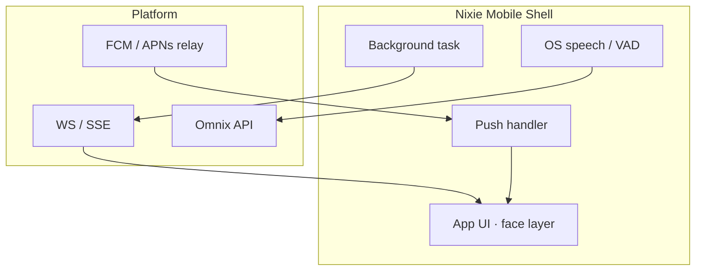

---
implements_doc:
doc_id: TDD-063
title: "NIXIE · Mobile Shell v1.0"
category: "08_TDD"
domain: NEXIA
status: published
created: 2026-06-10
updated: 2026-06-12
parent_doc: TDD-010
see_also: [TDD-070, TDD-023, TDD-061, TDD-062]
terms_standard: ["websocket", "sse", "push-notifications", "webrtc", "vad"]
terms_nexa: ["NIXIE", "Nixie", "NixieMobileShell", "Presence-Shell", "Envelope", "Omnix"]
tags: ["doc/cat/08-tdd", "doc/domain/nexia", "std/websocket", "std/sse", "std/push-notifications", "std/webrtc", "std/vad", "nexa/NIXIE", "nexa/Nixie", "nexa/NixieMobileShell", "nexa/Presence-Shell", "nexa/Envelope", "nexa/Omnix"]
---

# NIXIE · Mobile Shell v1.0

> **한 줄:** **iOS/Android** 네이티브·크로스플랫폼 **Nixie Mobile Shell** — 푸시·백그라운드 제약 하에서 **ML_1 Presence** · Envelope/SSE **동일 계약** · Run **소유 ✗**.

**채널 ID (Normative):** `channel_id: nixie-mobile`

**상위:** [`TDD-070` §3.6.2](../../../용어집_NEXA전용_v2.0.md)

---

## 1. 역할 · 경계

| 항목         | Mobile Shell                                 | 금지                                                 |
| :----------- | :------------------------------------------- | :--------------------------------------------------- |
| **배치**     | 독립 **앱** (App Store / Play)               | nexia 모바일 브라우저 **전용 ✗** (WebView 보조 가능) |
| **Presence** | 푸시 · 앱 내 floating face · OS PiP(지원 시) | 7 탭 전체 UI **✗**                                   |
| **지능**     | 플랫폼 WS/SSE · 푸시 relay                   | On-device LLM Run **✗**                              |
| **입력**     | 마이크 (포그라운드) · 텍스트 quick reply     | Event Router **✗**                                   |

---

## 2. 아키텍처

| 계층          | 권장 스택                                | 비고                                                |
| :------------ | :--------------------------------------- | :-------------------------------------------------- |
| **App**       | React Native (Expo) 또는 Kotlin/Swift    | `packages/nixie-mobile-contract` TS 타입 공유       |
| **Transport** | WebSocket + SSE polyfill · REST fallback | [`TDD-018`](../08_TDD_NEXIA_예외상황처리.md) 재연결 |
| **Push**      | FCM (Android) · APNs (iOS)               | `payload.kind: alert` relay                         |
| **Voice**     | OS Speech API · 포그라운드 only (MVP)    | 백그라운드 VAD OS 정책 준수                         |

**예상 repo 경로:** `apps/nixie-mobile/`

---

## 3. 플랫폼 계약

### 3.1 세션 · 디바이스

| 필드                   | 설명                                                         |
| :--------------------- | :----------------------------------------------------------- |
| `channel_id`           | `"nixie-mobile"`                                             |
| `push_token`           | FCM/APNs registration                                        |
| `os`                   | `ios \| android`                                             |
| `capabilities`         | `push`, `tts`, `stt_foreground`, `haptics`, `pip` (optional) |
| `effective_project_id` | 프로젝트 스코프                                              |

등록: `POST /api/v1/nixie/sessions` + `POST /api/v1/nixie/devices/push`

### 3.2 Downlink 우선순위

| 우선 | 채널                       | `payload.kind`                 |
| :--: | :------------------------- | :----------------------------- |
|  1   | **Push** (앱 background)   | `alert` · critical `run_state` |
|  2   | **WS/SSE** (앱 foreground) | 전체 kind                      |
|  3   | **In-app Express**         | summary · confidence · Jitter  |

### 3.3 Uplink

| 입력             | 경로                                                                  |
| :--------------- | :-------------------------------------------------------------------- |
| STT (foreground) | Omnix Envelope                                                        |
| Quick reply      | `POST /api/v1/omnix/messages`                                         |
| 승인 tap         | approval-gate deep link → nexia Web **위임** (앱 내 WebView optional) |

### 3.4 Reflex triage (모바일 특수)

| 조건              | Express                                          |
| :---------------- | :----------------------------------------------- |
| 앱 **background** | Push + haptic · TTS **✗** (OS 정책)              |
| 앱 **foreground** | Web/Desktop 과 동일 triage                       |
| **critical**      | Push priority high · 다른 채널 동시 Express 허용 |
| 저전력 / DND      | `nexa_self_*` · 6-COILS → **조용 모드**          |

---

## 4. 다른 채널과의 관계

| 시나리오                 | 정책                                                                |
| :----------------------- | :------------------------------------------------------------------ |
| Web + Mobile 동시 로그인 | `nixie/sessions` 다중 · triage 가 **primary** 선택                  |
| 승인·Graph 편집          | Mobile → **deep link** `/nexia/logex/...` 또는 WebView              |
| M2P                      | Mobile **Phase 2** (가속도·터치 void_ratio) — Desktop/Physical 우선 |

---

## 5. OS 제약 (Normative)

| 제약                  | 대응                                                   |
| :-------------------- | :----------------------------------------------------- |
| iOS 백그라운드 마이크 | 포그라운드 STT only · Push 로 wake                     |
| Android 배터리 최적화 | Foreground service (voice session 시)                  |
| PiP                   | Android 8+ · iOS 15+ optional — **Web Document PiP ✗** |

---

## 6. MVP 범위

| Phase  | In                                                      | Out            |
| :----- | :------------------------------------------------------ | :------------- |
| **P0** | Push alert · foreground face · Envelope WS · Omnix text | STT continuous |
| **P1** | critical triage · haptic Jitter · deep link 정재        | M2P            |
| **P2** | OS PiP · watch companion                                | 오프라인 Run   |

---

## 7. 금지

- Mobile 앱에서 **Neo4j·promoted 쓰기 ✗**
- Mobile 이 **MQTT broker ✗**
- Push payload 에 **전체 graph_diff** — deep link 로 위임

---

## 관련 문서

| 관계            | 문서                                                                                                                   |
| :-------------- | :--------------------------------------------------------------------------------------------------------------------- |
| 4 채널          | [`Nixie/README`](./README.md) · [`TDD-070` §3.6.2](../../../용어집_NEXA전용_v2.0.md)                                            |
| Web · Desktop   | [`TDD-061`](./08_TDD_NIXIE_WebShell_v1.0.md) · [`TDD-062`](./08_TDD_NIXIE_DesktopShell_v1.0.md)                        |
| Physical        | [`TDD-064`](./08_TDD_NIXIE_PhysicalShell_v1.0.md)                                                                      |
| Envelope · 승인 | [`TDD-023`](../08_TDD_NEXIA_NEXNAP시스템인터페이스표준규약.md) · [`TDD-056` §4.1](../08_TDD_NEXIA_7탭범위확정_v1.0.md) |
| 예외·SSE        | [`TDD-018`](../08_TDD_NEXIA_예외상황처리.md)                                                                           |
