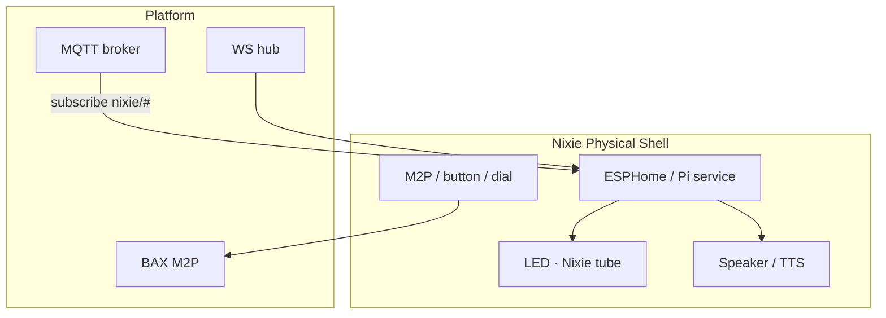

# NIXIE · Physical Shell v1.0

> **한 줄:** **ESP32 · Raspberry Pi** 등 **하드웨어 독립** Nixie 실물 — LED·닉시관·Ambient **L1 표현** · M2P/WS · 브라우저/PC **불요** · **Sentinel ACTON ✗**.

**채널 ID (Normative):** `channel_id: nixie-physical`

**상위:** [`TDD-045` §5~6](../../Knowledge/08_TDD_Knowledge_디렉토리책임및기획자원경로.md) · [`TDD-070` §3.6.2](..\..\..\용어집_NEXA전용_v2.0.md)

---

## 1. 역할 · 경계

| 항목 | Physical Shell | 금지 |
| :--- | :--- | :--- |
| **형태** | 실물 **얼굴·Ambient** (닉시관·LED 매트릭스·스피커) | 7 탭 UI · NEXU Canvas 전체 **✗** |
| **연결** | Wi-Fi/Ethernet · WS · MQTT **subscribe only** · M2P · Serial | Run · ingest · Router fan-out **✗** |
| **오프라인** | 로컬 Reflex **한정** (Ambient·ACTON 급) | Strategic·promoted **✗** |
| **Twinex** | `.nxdev` **face 프로파일** | 펌웨어 **편집 UI ✗** (Twinex 탭 역할) |

**Nano/Micro-Sentinel** 과 **역할 분리 (Normative):** 동일 ESP32 보드라도 **Sentinel** = L0 후보고·ACTON · **Physical Shell** = L1 **표현**. 펌웨어 **프로파일** 로 분리 ([`TDD-039`](../../AI/08_TDD_AI_안전대책선조치로직.md)).

---

## 2. 하드웨어 티어

| 티어 | SoC | 표현 | SSOT |
| :--- | :--- | :--- | :--- |
| **COLD** | ESP32 · ESP32-S3 | LED · 7-seg 닉시관 · buzzer | [`TDD-040`](../../AI/08_TDD_AI_지능위계및하드웨어사양.md) · [`TDD-006`](../../NEXAOS/08_TDD_NEXAOS_하드웨어프로파일러동적성능엔진.md) |
| **WARM** | ESP32-S3 + PSRAM | Rive-lite · RGB matrix | BAX Lumina |
| **HOT** | Raspberry Pi 4/5 · CM4 | 풀 Ambient · 로컬 TTS · multi-zone | [`TDD-045`](../../Knowledge/08_TDD_Knowledge_디렉토리책임및기획자원경로.md) |

**Zenith-Indicator** 계열: Physical Shell **표현 디바이스** 후보 — Sentinel **후보고 파이프라인 ✗** (얼굴만).

---

## 3. 아키텍처



| 프로파일 | 스택 | OTA |
| :--- | :--- | :--- |
| **ESP32** | ESPHome YAML · `nixie_face` component · NEXA-CELL | [`TDD-024`](../Cells/08_TDD_NEXIA_CELL_ESP32베이스라인디바이스등록.md) |
| **Raspberry Pi** | Python systemd · WS client · local Piper TTS | apt/image OTA (Phase 2) |

**Twinex 등록:** `device_role: nixie-physical` · `capability_profile: cold|warm|hot`

---

## 4. 플랫폼 계약

### 4.1 디바이스 identity

| 필드 | 설명 |
| :--- | :--- |
| `channel_id` | `"nixie-physical"` |
| `device_id` | NEXA-CELL anchor |
| `capabilities` | `led`, `nixie-tube`, `tts`, `m2p`, `ambient`, `offline-reflex` |
| `effective_project_id` | 바인딩 프로젝트 |

### 4.2 Downlink

| transport | topic / path | Express |
| :--- | :--- | :--- |
| **WS** | `nixie/devices/{device_id}` | Envelope → LED pattern · TTS text |
| **MQTT subscribe** | `nexa/nixie/{device_id}/express` | HEXAGON header + payload (경량) |
| **confidence** | 동일 | Jitter → flicker · brightness |

**MQTT publish (디바이스 → broker):** M2P · heartbeat · **후보고 Envelope ✗** (Sentinel 전용).

### 4.3 M2P · 로컬 입력

- **BAX M2P v2** — dial · proximity · `void_ratio_delta` ([`UIX-BAX` §5.3](../../../07_UIUX/07_UIUX_BAX_미학적인터페이스UX아키텍처_v1.0.md))
- Serial JSON line → `M2PPacketV2` (Desktop 과 동일 파서)

### 4.4 오프라인 Reflex (한정)

| 조건 | 로컬 동작 | 플랫폼 복구 |
| :--- | :--- | :--- |
| WS/MQTT **끊김** | 마지막 Ambient · slow breath | 상태 resync |
| **critical** 캐시 | pre-provisioned pattern · buzzer | uplink queue **✗** (Sentinel 역할) |
| **Strategic** | **정지** — promoted·Run **✗** | Human via Web |

---

## 5. ESPHome 프로파일 (COLD · Normative 스켈레 ton)

```yaml
# nixie_face profile — Twinex export
esphome:
  name: nixie-face-${device_id}
  platform: ESP32

nixie_face:
  channel_id: nixie-physical
  ws_url: !secret nexa_ws_url
  m2p_enabled: true
  profiles:
    cold: { glow: false, jitter_max_ms: 120 }
    warm: { glow: true, rive_sprite: optional }
```

커스텀 component 책임: WS Envelope parse · LED/nixie tube driver · **ingest ✗**.

---

## 6. Reflex triage (Physical)

| 입력 | Triage | Express |
| :--- | :--- | :--- |
| Envelope `alert` + critical | Physical **우선** (방 안) | LED flash · TTS |
| Web/Desktop **primary** active | defer to digital | Ambient only |
| M2P void spike | local BAX blur proxy | brightness dip |
| confidence < threshold | Jitter pattern | [`TDD-045`](../../Knowledge/08_TDD_Knowledge_디렉토리책임및기획자원경로.md) |

---

## 7. MVP 범위

| Phase | In | Out |
| :--- | :--- | :--- |
| **P0** | ESP32 COLD · WS alert · LED · M2P uplink | RPi TTS |
| **P1** | MQTT express subscribe · confidence Jitter · Twinex flash | HOT Rive |
| **P2** | RPi Piper TTS · multi-room sync | Sentinel dual-role |

---

## 8. 금지

- Physical Shell 펌웨어에서 **`nexaon_ingest` ✗**
- Physical 이 **Event Router ✗**
- Sentinel **ACTON** 과 **동일 펌웨어 이미지** (프로파일 분리 필수)

---

## 관련 문서

| 관계 | 문서 |
| :--- | :--- |
| 4 채널 | [`Nixie/README`](./README.md) · [`TDD-070` §3.6.2](..\..\..\용어집_NEXA전용_v2.0.md) |
| 지능의 얼굴 · 쉘 | [`TDD-045` §5~6](../../Knowledge/08_TDD_Knowledge_디렉토리책임및기획자원경로.md) |
| ESP32 · OTA | [`TDD-024`](../Cells/08_TDD_NEXIA_CELL_ESP32베이스라인디바이스등록.md) |
| Sentinel 경계 | [`TDD-039`](../../AI/08_TDD_AI_안전대책선조치로직.md) · [TDD-068 §1.4](../08_TDD_NEXIA_IoT엣지데이터파이프라인_HEXAGON_Nexaon연계_v1.0.md) |
| BAX M2P | [`UIX-003` §5.3](../../../07_UIUX/07_UIUX_BAX_미학적인터페이스UX아키텍처_v1.0.md) |
| Web · Desktop · Mobile | [`TDD-061`](./08_TDD_NIXIE_WebShell_v1.0.md) · [`TDD-062`](./08_TDD_NIXIE_DesktopShell_v1.0.md) · [`TDD-063`](./08_TDD_NIXIE_MobileShell_v1.0.md) |
