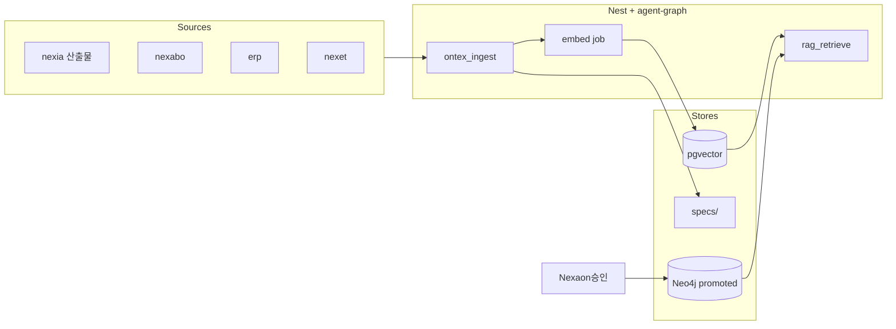

# Ontex · 기술 스택 운영 방침 v1.0

> **한 줄:** **`ontex`** 는 NEXIA·IoT·ERP·마켓에서 유입된 지식을 **Graph RAG · pgvector · 승인 그래프**로 통합·탐색·보존하는 **온톨로지·지식 허브 `domainKey`** 이다. Human↔AI **초안 편집·Run** 은 **nexia · Nexaon** — 본 도메인은 **승인 후 허브·탐색·아카이브** 를 담당한다.

**Normative 진입점:** Ontex 도메인 TDD · 하위 구현 뼈대·UIUX 는 본 문서를 선행한다.
**플랫폼 SSOT:** [`TDD-071`](../NEXAOS/08_TDD_NEXAOS_도메인구조통합_v1.0.md) §7.B · §5

---

## 1. 목적과 범위

### 1.1 Ontex 가 담당하는 것

| 축 | 내용 |
| :--- | :--- |
| **통합 허브** | NEXIA 7 탭 산출물 · nexabo Telemetry · erp 이벤트 · nexet 설치 자산 메타 **수집·인덱싱** |
| **Graph RAG** | 관계·MOC·wikilink 기반 **검색·추론** (`explore` subRoute) |
| **지식 데스크** | **Nexion** React Flow 캔버스 — 장기 지식 그래프 편집·시각화 (`canvas`) |
| **Trace** | 데이터·이벤트 **흐름·계보** 분석 (`trace`) |
| **Archive** | Tiptap·Hub·Sentinel **저장소·분류·VOID** (`archive`) |
| **승격 수신** | Nexaon SHACL PASS · `docs/specs/` 승인본 → **promoted** 미러 |

### 1.2 Ontex 가 담지 않는 것

| 대상 | 소유 | 비고 |
| :--- | :--- | :--- |
| IoT 온톨로지 **초안·Run·Deploy** | **nexia · Nexaon** | `ontology:draft` · SSE Run · ESPHome |
| 7 탭 생산·실행 셸 | **nexia** | [`TDD-056`](../NEXIA/08_TDD_NEXIA_7탭범위확정_v1.0.md) |
| 관제 대시보드 | **nexabo** | Telemetry 피드만 Ontex 로 |
| 마켓 유통·라이선스 | **nexet** | 설치 메타 → Ontex 인덱스 |
| LangGraph **런타임 구현** 상세 | **LangGraph TDD** | [`TDD-008`](../LangGraph/08_TDD_LangGraph_인간LLM협업형IoT온톨로지플랫폼_v1.0.md) |
| Knowledge OS **7 대 지층** 정의 | **Knowledge TDD** | [`TDD-049`](../Knowledge/08_TDD_Knowledge_지식층위와오케스트레이션.md) |

### 1.3 명칭

| 이름 | 정체 |
| :--- | :--- |
| **Ontex** | UI `domainKey` · `domains/ontex/` |
| **Nexion** | `subRoute: canvas` **UI 표시명** — 구 `nexion` 흡수 |
| **Nexaon** | nexia Logex **ontology 서브모듈** — Ontex 와 **분리** — SSOT [TDD-073](../NEXIA/Nexaon/08_TDD_Nexaon_Distillation오케스트레이터_v1.0.md) |
| **NEXAVULT** | pgvector·FACT **지식 데이터 허브** (온톨로지 SSOT 아님) |

---

## 2. 도메인 메타

| 항목 | 값 |
| :--- | :--- |
| **domainKey** | `ontex` |
| **폴더** | `apps/web/src/domains/ontex/` |
| **드로어** | L `rec` · R `rec` |
| **themePreset** | `office-light` (권장) |
| **분기** | **Content 만** `subRoute` — L/R·statusBar **도메인 공통** (`erp` 와 동일 패턴) |
| **백엔드** | Nest `ontology/` · `knowledge/` · `archive/` + `agent-graph` 프록시 |

### 2.1 `subRoute` SSOT

| `subRoute` | UI 라벨 | 역할 | 구 domainKey |
| :--- | :--- | :--- | :--- |
| `canvas` | **Nexion** | 지식 데스크 · React Flow · Yjs 장기 그래프 | `nexion` |
| `explore` | Explore | Graph RAG · 온톨로지·벡터 **탐색** | — |
| `trace` | Trace | 데이터 흐름 · 계보 · 이벤트 **추적** | `nexeed` |
| `archive` | Archive | Tiptap·Hub·Sentinel **저장·분류·VOID** | `nexa-archive` |

**기본 라우트**

```text
/ontex                    → explore (redirect 권장)
/ontex/canvas             → Nexion 캔버스
/ontex/canvas/[graphId]   → 그래프 스코프
/ontex/explore            → Graph RAG 탐색
/ontex/trace               → Trace 뷰
/ontex/archive             → Archive 허브
/ontex/archive/[collection] → 컬렉션·폴더
```

**설정 SSOT:** `domains/ontex/config/ontexSubRoutes.ts`

---

## 3. 지능 층위 (Ontex 관점)

```text
[수집] NEXIA · nexabo · erp · nexet
           ↓ ingest / embed job
[NEXAVULT] pgvector · project_knowledge · IoT FACT
           ↓ Graph RAG · MOC · wikilink
[OG-RAG]   관계·구조 보강 검색
           ↓
[OAG]      specs/ · planning · 구조화 생성
           ↓ Human 승인
[Promoted] Neo4j · RDF/TTL export · ontex canvas 동기화
```

| 층위 | Ontex 에서의 UI·API | 스택 |
| :--- | :--- | :--- |
| **RAG** | `explore` — 벡터 Top-K + 인용 | pgvector · `agent-graph` `rag_retrieve` |
| **OG-RAG** | `explore` — MOC·edge·wikilink 가중 | Neo4j read · 그래프 traverser |
| **OAG** | `canvas` — 구조화 편집·planning manifest | React Flow · Yjs · `docs/specs/` |
| **AIP** | 백그라운드 Run — 추출·검증·embed | LangGraph `apps/agent-graph` |

> 상세 용어: [`TDD-008`](../LangGraph/08_TDD_LangGraph_인간LLM협업형IoT온톨로지플랫폼_v1.0.md) §2.2 · Knowledge [`TDD-049`](../Knowledge/08_TDD_Knowledge_지식층위와오케스트레이션.md)

---

## 4. 기술 스택 (레이어별)

### 4.1 프레젠테이션 (`apps/web`)

| 레이어 | 기술 | Ontex 역할 |
| :--- | :--- | :--- |
| **셸** | Next.js App Router | `OntexShell` · subRoute 라우터 |
| **canvas** | React Flow + Dagre · Yjs | Nexion 지식 그래프 (장기 편집) |
| **explore** | React · 가상 스크롤 트리 | Graph RAG 결과·필터·인용 패널 |
| **trace** | React Flow 또는 타임라인 | 이벤트·릴레이·Why Chain 시각화 |
| **archive** | TipTap · 파일 트리 | Hub·Sentinel·VOID 분류 UI |
| **상태** | Zustand | `useOntexSubRouteStore` · `useOntexExploreStore` |
| **협업** | Yjs + Hocuspocus (`apps/sync`) | `canvas` CRDT · (선택) archive collab |

### 4.2 API·오케스트레이션

| 레이어 | 기술 | 역할 |
| :--- | :--- | :--- |
| **게이트** | NestJS (`apps/backend`) | 인증 · 프록시 · ingest 트리거 |
| **AI 런타임** | `apps/agent-graph` (LangGraph) | RAG · Extract · SHACL · Embed · SSE |
| **온톨로지** | `backend/modules/ontology/` | Neo4j promoted/draft · Cypher · 승격 sync |
| **지식** | `backend/modules/knowledge/` | `project_knowledge` · pgvector · embed job |
| **아카이브** | `backend/modules/archive/` | 분류 · VOID · Sentinel 라우팅 |

**금지:** 브라우저 → Ollama 직접 · Nest 내장 Yjs WS · Prisma 로 Neo4j 대체

### 4.3 저장소·표준

| 저장소 | 기술 | Ontex 데이터 |
| :--- | :--- | :--- |
| **벡터** | PostgreSQL **pgvector** | 청크·embed · RAG 코퍼스 |
| **관계 그래프** | **Neo4j** | promoted 온톨로지 · explore traverser |
| **정본 문서** | Git `docs/specs/` · wikilink | OAG SSOT — Neo4j 는 **미러** |
| **감사·초안** | PostgreSQL JSONB | Draft · Audit · `run_id` |
| **실시간** | Yjs BYTEA (`project_yjs_updates`) | canvas 협업 스냅샷 |
| **온톨로지 교환** | **RDF · RDFS · OWL · SKOS · SHACL** | export/import · 검증 게이트 |
| **계약** | **`packages/shared` Zod** | ingest · edge · citation · archive 엔티티 |

### 4.4 SSOT 우선순위 (Ontex 읽기·쓰기)

```text
① Git docs/specs/ + wikilink     ← 장기 정본
② Zod 승인 스냅샷 (Audit)        ← 게이트 통과본
③ Neo4j promoted                 ← 운영 그래프 미러 (탐색·RAG)
④ pgvector / project_knowledge   ← 검색 코퍼스 (≠ 트리플 SSOT)
⑤ Yjs canvas / ontology:draft    ← 협업 초안 (nexia Nexaon과 동기화 정책 별도)
⑥ AI JSON 초안                   ← 독 — 승인 전 promoted/write 금지
```

---

## 5. 데이터 소스 · Ingest

| 소스 `domainKey` | 유입 경로 | Ontex 반영 |
| :--- | :--- | :--- |
| **nexia** 7 탭 | `.nx*` · Navex 등록 · ingest API | embed · MOC 후보 · graph link |
| **nexia · Nexaon** | 승인 C 후 promoted sync | Neo4j · canvas 노드 갱신 |
| **nexabo** | MQTT · Telemetry · 알람 | NEXAVULT FACT · trace 이벤트 |
| **erp** | 부품·재고·일정 webhook | 엔티티 링크 · explore 필터 |
| **nexet** | 설치·Capability 메타 | 자산 족보 · Why Chain 앵커 |
| **외부** | API · 파일 drop | archive · ingest job |

**Ingest 파이프라인 (개념)**



---

## 6. `subRoute` 별 기술·범위

### 6.1 `canvas` (Nexion)

| 항목 | 확정 |
| :--- | :--- |
| **엔진** | React Flow · Yjs · (선택) TipTap 미리보기 |
| **범위 내** | 장기 지식 그래프 · MOC · wikilink 편집 · Dagre 레이아웃 |
| **범위 외** | IoT 핀맵 실시간 Deploy · SHACL Run UI (→ **Nexaon**) |
| **Yjs room** | `Ontex:canvas:{graphId}` — nexia `ontology:draft` 와 **room 분리** |
| **MVP** | 캔버스 뷰 · 노드/엣지 편집 · explore 로 jump |

### 6.2 `explore`

| 항목 | 확정 |
| :--- | :--- |
| **엔진** | pgvector + Neo4j hybrid · LangGraph `rag_retrieve` / `graph_explore` |
| **범위 내** | 자연어·키워드 검색 · 인용 · subgraph 하이라이트 · 필터 (도메인·타입) |
| **범위 외** | 실시간 온톨로지 편집 (→ `canvas` / Nexaon) |
| **MVP** | 벡터 검색 + 인용 카드 · promoted 노드 포커스 |

### 6.3 `trace`

| 항목 | 확정 |
| :--- | :--- |
| **엔진** | 이벤트 스트림 · `requestId`/`traceId` · (선택) React Flow sequence |
| **범위 내** | nexia↔Ontex ingest · MQTT · erp 이벤트 **계보** · Why Chain 조회 |
| **범위 외** | 실시간 관제 패널 (→ nexabo) |
| **MVP** | 타임라인 · 이벤트 상세 · canvas/explore deeplink |

### 6.4 `archive`

| 항목 | 확정 |
| :--- | :--- |
| **엔진** | TipTap · 파일 트리 · Sentinel · VOID 라우터 |
| **범위 내** | Hub 저장 · 분류 · soft delete · archive-sentinel 정책 |
| **범위 외** | Normex 규범 편집 SSOT (→ nexia) |
| **MVP** | 컬렉션 트리 · 문서 뷰 · explore 연동 |

---

## 7. nexia · Nexaon 과의 경계

| 작업 | 담당 | 완료 조건 |
| :--- | :--- | :--- |
| IoT 온톨로지 **초안 편집** | nexia **Nexaon** | Yjs `ontology:draft` |
| **Run · SHACL · 승인 A/B/C** | nexia **Nexaon** | SSE · Audit row |
| **promoted Neo4j upsert** | Nest `ontology/` | SHACL PASS |
| **허브 탐색·Graph RAG** | Ontex **explore** | 인용·subgraph |
| **장기 지식 그래프** | Ontex **canvas** (Nexion) | specs/wikilink 링크 |
| **문서·VOID 보존** | Ontex **archive** | 분류 완료 |

```text
nexia/Nexaon (산업 실행)  ──승인──►  promoted  ──►  ontex explore/canvas
nexia 산출물 (.nx*)       ──ingest──►  pgvector + MOC 후보
```

---

## 8. 구현 파일 뼈대 (To-Be)

> 상세 트리 확장: 후속 `08_TDD_Ontex_구현파일구조뼈대.md` (예정). 본 절은 **최소 골격**만 고정.

```text
apps/web/src/
├── app/(shell)/ontex/
│   ├── layout.tsx                 ■ OntexProvider
│   ├── page.tsx                   ■ → /ontex/explore
│   └── [subRoute]/
│       ├── page.tsx               ■ OntexContent
│       └── [[...slug]]/page.tsx   ○ graphId · collection
│
└── domains/ontex/
    ├── config/ontexSubRoutes.ts   ■
    ├── views/
    │   ├── left/OntexLeftNav.tsx  ■ subRoute별 내부 스왑
    │   ├── content/OntexContent.tsx
    │   └── right/OntexRightPanel.tsx
    ├── subroutes/
    │   ├── canvas/                ■ NexionCanvasView · Yjs
    │   ├── explore/               ■ ExploreView · RAG UI
    │   ├── trace/                 ◇ TraceTimelineView
    │   └── archive/               ◇ ArchiveHubView
    └── store/useOntexSubRouteStore.ts

apps/backend/src/modules/
├── ontology/                      ■ Neo4j · promoted sync
├── knowledge/                     ■ pgvector · embed
└── archive/                       ◇ VOID · Sentinel

apps/agent-graph/src/agent_graph/graphs/
├── ontex_ingest.py                ◇
├── rag_retrieve.py                ■
└── graph_explore.py               ◇

packages/shared/src/schemas/ontex/
├── ingest-payload.schema.ts
├── citation.schema.ts
└── archive-entry.schema.ts
```

**범례:** ■ MVP P0 · ◇ Phase 1~2

---

## 9. MVP Phase

| Phase | subRoute | 목표 |
| :--- | :--- | :--- |
| **P0** | `explore` | pgvector RAG · 인용 · Nest→agent-graph 경유 |
| **P0** | 셸 | subRoute 전환 · L/R 패널 · `/ontex` 라우트 |
| **P1** | `canvas` | Nexion React Flow · Yjs · explore deeplink |
| **P1** | ingest | nexia `.nx*` · nexabo 이벤트 → embed job |
| **P2** | `trace` | traceId 타임라인 · Why Chain |
| **P2** | `archive` | Hub·VOID · Sentinel 연동 |

---

## 10. 운영 원칙

1. **미검증 AI JSON 은 promoted·specs write 금지** — Nexaon 승인 게이트와 동일 Normex·Zod 정책.
2. **RAG 는 IoT 제어 루프에 직결하지 않는다** — 조언·기획·탐색만 (`TDD-008` §2.2).
3. **Graph RAG 시 MOC·wikilink·citation 필수** — 벡터 Top-K 만으로 explore 종료 금지 (OG-RAG).
4. **canvas Yjs room 과 Nexaon `ontology:draft` room 분리** — 동기화는 **승격 API**로만.
5. **Greenfield 만** — 레거시 Vue `nexion`/`nexeed`/`nexa-archive` 코드 **참조·마이그레이션 없음**.

---

## 11. 변경 이력

| 날짜 | 버전 | 내용 |
| :--- | :--- | :--- |
| 2026-06-12 | v1.0 | Ontex 스택·subRoute·nexia 경계 · 저장소 · MVP 최초 확정 |

---

## 관련 문서

| 관계 | 문서 |
| :--- | :--- |
| 상위 SSOT | [NEXA OS · 도메인 구조 통합 (TDD-071)](../NEXAOS/08_TDD_NEXAOS_도메인구조통합_v1.0.md) |
| nexia 경계 | [NEXIA · 7탭 범위 확정 (TDD-056)](../NEXIA/08_TDD_NEXIA_7탭범위확정_v1.0.md) |
| LangGraph·Nexaon | [LangGraph · IoT 온톨로지 플랫폼 (TDD-008)](../LangGraph/08_TDD_LangGraph_인간LLM협업형IoT온톨로지플랫폼_v1.0.md) |
| 오케스트레이션 | [LangGraph · 오케스트레이션 설계 (TDD-058)](../LangGraph/08_TDD_LangGraph_오케스트레이션설계_v1.0.md) |
| 지식 층위 | [Knowledge · 지식 층위 · 오케스트레이션 (TDD-049)](../Knowledge/08_TDD_Knowledge_지식층위와오케스트레이션.md) |
| 모노레포 | [LangGraph 모노레포 폴더 구조 (TDD-007)](../NEXAOS/08_TDD_NEXAOS_모노레포폴더구조_v1.0.md) |
