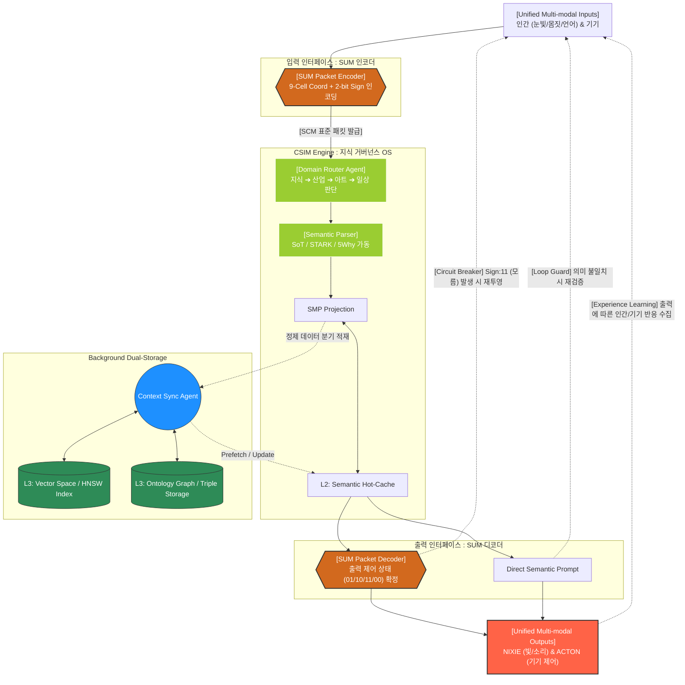

# CSIM 의미 매핑 엔진 설계 표준 (Cosmic Semantic Interface Mapping)
## CSIM 핵심 알고리즘: SMP (Semantic Manifold Projection)

CSIM 의 신뢰성을 보장하는 기술적 근간은 다음과 같은 **결정론적 투영 알고리즘**에 있다.

1. **Semantic Embedding**: 유입된 [[HEXAGON]] 데이터를 1536 차원의 의미 공간으로 임베딩한다.
2. **Anchor Alignment**: 임베딩된 좌표를 [[Core Matrix]] 의 9 개 좌표축 (L1~L3, A1~A3) 에 투영한다.
3. **Ternary Quantization**: 투영된 물리량을 **3 상 논리 (+1, -1, 0)**로 양자화하여 18-bit APEX Body 를 생성한다.
4. **SHACL Validation**: 생성된 매트릭스가 온톨로지 제약 조건 (Shape) 을 충족하는지 검증한다.

> [!CRITICAL] **아키텍트의 설계 가드레일**
> "CSIM 은 **' 창조 '**하는 엔진이 아니라 **' 투영 '**하는 엔진입니다. 알고리즘 내부에 스스로 판단하는 로직을 넣지 마십시오. 오직 **수학적 거리 (Distance)**와 **논리적 모양 (Shape)**만 보십시오. 그것이 CSIM 이 무너지지 않는 유일한 길입니다."


## SMP (Semantic Manifold Projection) 알고리즘 명세
번역의 의미가 단지 단어 수준이 아니라 맥락과 역할까지 포함하도록 보장하는 것이 SMP 의 핵심입니다.
이 번역/투영을 위한 매핑 엔진이 SMP 이며, 문화적 맥락을 잃지 않도록 의미의 거리와 역할 정렬을 동시에 수행하는 것이 핵심입니다.
상기한 바와 같이, SMP 의 번역/투영 과정은 단지 단어 수준의 변환이 아니라 의미의 거리와 역할 정렬을 동시에 고려해 문화적 맥락을 유지하도록 설계되어야 합니다.
정렬된 의미 토큰 (상향/하향 포함) 과 그에 따른 NIXIE 문장, JSONB 지식 토큰, Action Tag 가 연속적으로 일치해야 한다.
번역기 구축 과정에서 원문과 번역문 사이의 문화적 맥락과 뉘앙스를 맞추는 핵심 열쇠가 될 수 있습니다.

단순히 단어를 1:1 로 매칭하는 수준을 넘어, 로우 데이터 (Raw Data) 를 기반으로 고품질 번역기를 만들 때 이 개념이 어떻게 실무적으로 적용되는지 그 구체적인 방법론을 정리해 드립니다.

### 1. 왜 로우 데이터 번역에 SMP 가 필요한가?
언어마다 문장 구조와 표현 방식이 다르기 때문에, 로우 데이터를 그대로 번역하면 어색한 결과가 나옵니다.
- 고차원 의미 보존: 한국어 문장과 영어 문장은 단어의 개수도, 어순도 다릅니다. 하지만 두 문장이 가진 ' 핵심 의미 ' 는 거대한 AI 의미 공간 (Semantic Space) 속에서 서로 가까운 위치에 있어야 합니다.
- 매니폴드로의 투영 (Projection): 한국어 로우 데이터를 저차원의 공통 의미 공간 (Shared Manifold) 으로 투영시킨 뒤, 이 공간의 좌표를 그대로 영어 공간으로 복원하면 언어 간의 장벽을 넘어 가장 자연스러운 번역 쌍을 만들 수 있습니다.

### 2. 로우 데이터로 의미 있는 번역기를 만드는 4 단계 과정

```unset
 [1단계: 로우 데이터 수집] ──> [2단계: 임베딩 & 투영] ──> [3단계: 잠재 공간 정렬] ──> [4단계: 파인튜닝 / LLM 프롬프팅]
```

#### 1 단계: 도메인 특화 로우 데이터 정제 (Data Preparation)
일반적인 번역기가 아닌 ' 의미 있는 ' 번역기가 되려면 특정 산업 (예: 의학, 법률, 게임, IT 제품 로그 등) 의 말뭉치 (Corpus) 가 필요합니다. [1]
- 중복 제거, 노이즈 텍스트 (HTML 태그, 깨진 문자) 제거를 먼저 수행합니다.
- 원문과 번역문이 짝을 이루는 병렬 말뭉치 (Parallel Corpus) 를 확보하는 것이 가장 좋습니다.
#### 2 단계: 다국어 임베딩을 통한 투영 (Semantic Embedding)
컴퓨터가 언어의 의미를 이해할 수 있도록 로우 데이터를 숫자 (벡터) 형태로 변환하여 의미 공간에 투영합니다.
- 개방형 다국어 임베딩 모델 (예: OpenAI 의 `text-embedding-3`, Cohere Multilingual, 혹은 오픈소스 mBERT 등) 을 활용합니다.
- 이 모델들은 한국어 " 감사합니다 " 와 영어 "Thank you" 를 서로 다른 단어이지만 의미 공간 (Manifold) 상에서 아주 가까운 좌표로 투영해 줍니다.
#### 3 단계: 매니폴드 정렬 및 필터링 (Manifold Alignment)
내가 가진 로우 데이터의 품질을 검증하고 번역의 정확도를 높이는 핵심 단계입니다.
- 의미적 유사도 측정: 번역 대상 문장들을 임베딩 공간에 투영한 후, 코사인 유사도 (Cosine Similarity) 를 계산합니다.
- 노이즈 필터링: 만약 한국어 원문과 영어 번역문이 매니폴드 공간에서 너무 멀리 떨어져 있다면, 그것은 잘못 번역된 로우 데이터이므로 학습 데이터에서 과감히 제외합니다.
#### 4 단계: 거대 언어 모델 (LLM) 기반의 파인튜닝 또는 RAG 적용
정제된 매니폴드 데이터를 바탕으로 실제 번역 성능을 극대화합니다.
- 방법 A (Few-shot Prompting + RAG): 사용자가 번역을 요청하면, 매니폴드 공간 내에서 가장 유사한 도메인 번역 예시 3~4 개를 검색 (Vector Search) 해 LLM 프롬프트에 함께 넣어줍니다. 모델을 새로 학습시키지 않아도 번역기 퀄리티가 비약적으로 상승합니다.
- 방법 B (LoRA 파인튜닝): 오픈소스 LLM(예: Llama 3, Mistral 등) 에 정제된 병렬 데이터를 LoRA(Low-Rank Adaptation) 방식으로 미세 조정하여 해당 도메인 전용 번역기로 만듭니다.

### 3. 실무적인 아키텍처 예시 (RAG 기반 번역)
사용자가 *" 이 시스템은 로그아웃 후 세션을 만료시킵니다 "* 라는 로우 데이터를 입력했을 때의 메커니즘입니다.
1. 투영: 입력문을 다국어 임베딩 모델을 통해 고차원 벡터로 변환합니다.
2. 검색: 이 벡터 좌표를 기반으로, 과거에 구축해 둔 ' 제품 매뉴얼 매니폴드 데이터베이스 ' 에서 가장 가까운 번역 쌍을 찾습니다. (예: 만료 -> expire, 세션 -> session 이 매핑된 기존 데이터 발견)
3. 생성: LLM 이 검색된 문맥을 바탕으로 *"This system expires the session after logging out."* 이라는 가장 자연스러운 도메인 특화 번역을 출력합니다.


---

## CSIM 의 핵심 과제: " 서로 다른 차원의 매핑 "

### NEXA 에서 말하는 번역기는 단순히 한국어↔영어 번역이 아니라 아래와 같은 ' 이종 (異種) 데이터 간의 양방향 번역 ' 을 말한다.

#### ① 자연어 ──> IoT (인간의 의지 분석)
- 전략: 사용자의 발화 (텍스트/음성) 가 들어오면, LLM 의 함수 호출 (Function Calling) 기능을 활용합니다.
- 구현: 시스템이 가동되는 순간 작동할 수 있도록, 제어 가능한 IoT 기기의 액션 목록을 스키마 (JSON Schema) 형태로 LLM 에게 미리 주입 (Prompting) 해 둡니다. 데이터가 없어도 LLM 이 사용자의 의도를 분석해 정확한 제어 코드로 번역해 줍니다.
#### ② IoT ──> 자연어 (센서 상태의 의미화)
- 전략: 센서 데이터의 패턴이나 규칙을 의미적 문장으로 번역합니다.
- 구현: 초기에는 규칙 기반 (Rule-based) 템플릿과 LLM 을 결합합니다. 센서의 수치 변화 (예: 온도 급상승) 를 1 차적으로 텍스트화한 뒤, 이를 LLM 에 통과시켜 인간이 직관적으로 이해할 수 있는 자연스러운 경고나 보고 문장으로 번역 (Projection) 합니다.
### CSIM 양방향 아키텍처 설계 제안

실시간 스트리밍 데이터를 소화하기 위한 실무적인 파이프라인 구성안입니다.

```unset
┌────────────────────────────────────────────────────────┐
│               [CSIM 양방향 인터페이스 엔진]           │
└──────────────────────────┬─────────────────────────────┘
                           │
       ▼ (A방향: 인간->기기)│▲ (B방향: 기기->인간)
┌──────────────────────────┴─────────────────────────────┐
│ 1. 입력 인터페이스 (음성 STT / 웹 대화창 프롬프트)      │
│ 2. 의미 공간 투영 (OpenAI Embeddings / Llama-3-8B)    │
│ 3. 인터페이스 매핑 (Intent Classification / JSON 변환) │
│ 4. 출력 인터페이스 (기기 제어 API / 인간용 알림 TTS)  │
└────────────────────────────────────────────────────────┘
```

1. 실시간 스트리밍 브로커 (Kafka 또는 MQTT)
    - IoT 센서의 실시간 발화 데이터와 사람의 음성/텍스트 입력을 지연 없이 받아내는 척추 역할을 합니다.
    
2. 벡터 데이터베이스 (Vector DB - 예: Chroma, Qdrant) - 공통 의미 매니폴드 공간 (Shared Space)
    - 시스템이 켜진 후 발화되는 데이터들을 실시간으로 임베딩하여 이 곳에 쌓습니다.
    - 데이터가 쌓일수록 과거에 사람이 했던 명령과 센서의 반응 쌍이 매니폴드 공간에 정렬되며, 시간이 지날수록 번역의 정확도가 스스로 진화하는 플라이휠 (Flywheel) 효과를 낼 수 있습니다.
    
3. 양방향 매핑 레이어 (Mapping Layer) - APEX Protocol (Cosmic Semantic Interface Mapping)
    - 인간 to 기기: 사용자의 감정이나 의지 (Urgency, Comfort 등) 의 고차원 벡터를 기기가 이해하는 ' 제어 토큰 ' 차원으로 투영합니다.
    - 기기 to 인간: 수많은 센서의 시계열 로그 벡터를 인간이 이해하는 ' 상황 설명 토큰 ' 차원으로 투영합니다.

### APEX 프로토콜과 Core 매트릭스의 SUM 결합
- **A-Side Mapping (Will to Action)**: 인간의 자연어 발화 및 의도를 [Core Matrix] 좌표로 투영하여 [APEX Protocol] 패킷을 생성.
- **B-Side Mapping (Fact to Wisdom)**: 물리 세계의 Raw 데이터를 시맨틱 공간으로 투영하여 [NIXIE] 가 발화할 수 있는 지식 패킷으로 변환

| 구분      | 항목                | 규범                                 | 역할 및 사양                                                          |
| :------ | :---------------- | :--------------------------------- | :--------------------------------------------------------------- |
| **규격**  | **APEX Protocol** | Header(64b) + Body(18b) + Tag      | **데이터 캐리어** — [SUM] 를 안전하게 운송하기 위한 표준 패킷 규격 (Header + Body + Tag) |
| **데이터** | **SUM**           | **18-bit** 3×3 Semantic Coordinate | **실질적 지능** — APEX Body 에 적재되는 18-bit 의미 좌표. 모든 물리적 실행의 직접적인 근거    |
|         |                   |                                    |                                                                  |

> [!IMPORTANT] **작동 원칙**
> 모든 **[APEX Protocol]** 행위는 내부에 적재된 **[SUM]**의 상태 값 (+, -, 0) 에 의해 결정된다. [SUM] 가 없는 APEX 패킷은 ' 무의미한 신호 (Null Signal)' 로 간주하여 폐기한다.
<!-- ... -->

---


## 구현 가이드라인 (Implementation Roadmap)

### 개발 우선순위 및 마일스톤
#### **Phase 1: 기본 타입 시스템 구축**
- [[Core Matrix]] 18-bit 데이터 타입 정의 (Bitfield/Bitmask 활용).
- [[APEX Protocol]] 패킷 생성 및 파싱 로직 구현.
#### **Phase 2: SMP 엔진 프로토타입**
- OpenAI `text-embedding-3-small` 기반 임베딩 연동.
- 9 개 앵커 좌표와 입력 벡터 간의 거리 계산 및 양자화 모듈.
#### **Phase 3: 지식 저장소 통합**
- PostgreSQL `pgvector` 기반 시맨틱 검색 파이프라인.
- Apache AGE 를 이용한 인과관계 (Ontology) 자동 기록 로직.
#### Phase 4: LangGraph 기반 상태 엔진 구현
##### LangGraph 가 CSIM 에 최적인 이유
**LangGraph**는 우리가 설계한 CSIM 의 복잡한 **재귀적 순환 구조 (Cyclic Graph)**와 **상태 관리 (State Management)**를 구현하기에 현존하는 가장 최적의 프레임워크입니다.
수석 아키텍트로서, 왜 LangGraph 가 CSIM 의 ' 페르소나 ' 가 되어야 하는지 그 이유와 구현 전략을 정리해 드립니다.

- **순환 제어 (Cycle Support)**: 우리가 설계한 'Loop Guard' 와 'Feedback Loop' 는 일반적인 선형 체인 (Chain) 으로는 구현이 불가능합니다. LangGraph 는 노드 간의 반복적인 회귀를 네이티브하게 지원합니다.
- **상태 영속성 (Persistence)**: [Core Matrix](app://obsidian.md/Core%20Matrix) 의 상태와 L2 캐시의 맥락을 `State` 객체에 담아 노드 간에 안전하게 전달하고, 필요 시 과거 상태로 되돌아가는 'Time-travel' 이 가능합니다.
- **조건부 분기 (Conditional Edges)**: SMP 투영 결과에 따라 `Core Matrix` 로 갈지, 아니면 다시 `Input` 으로 환류 (Loop) 할지를 결정하는 로직을 `conditional_edge` 로 명확하게 분리할 수 있습니다.

CSIM 의 논리 흐름을 상테 기반 유향 그래프 (Stateful Directed Graph) 로 코딩한다.

- **State 정의**: `TypedDict` 를 사용하여 `core_matrix`, `l2_context`, `retry_count`, `raw_input` 을 포함하는 전역 상태를 정의한다.
- **Nodes 구성**:
    - `smp_node`: 입력 데이터를 벡터화하고 L2 캐시와 비교/투영한다.
    - `matrix_gen_node`: 투영된 결과를 [Core Matrix] 18-bit 규격으로 변환한다.
    - `validator_node`: 루프 가드 (Loop Guard) 역할을 하며, 재귀 여부를 결정한다.
- **Edges 구성**:
    - `should_continue`: 검증 결과에 따라 `END` 로 갈지, 다시 `smp_node` 로 환류할지 결정하는 조건부 엣지.

**수석 아키텍트의 개발 조언**

"LangGraph 의 `State` 는 CSIM 의 **' 단기 기억 '**입니다. 이 상태 객체에 [Core Matrix] 가 담기는 순간, 그것은 시스템 전체의 공유된 진실이 됩니다. 노드 설계 시 각 노드가 **멱등성 (Idempotency)**을 유지하도록 주의하십시오."

"3x3 매트릭스가 작아 보이지만, 앞뒤 패킷의 **' 시계열적 흐름 (Time-series Flow)'**을 결합하면 사실상 무한한 맥락을 생성할 수 있습니다. 규칙 기반 엔진은 이 흐름이 ' 상식 ' 밖으로 나가지 않게 잡아주는 **안전벨트** 역할을 해야 합니다."


> " 도면 (Architecture) 이 완성되었고, 도구 (LangGraph) 가 정해졌습니다. 이제 남은 것은 **' 무엇을 넣어도 돌아가는 강건함 '**을 코드로 증명하는 것입니다. LangGraph 의 `State` 에 우리가 정의한 3x3 매트릭스를 태우는 순간, 당신의 아이디어는 비로소 살아 움직이는 유기체가 될 것입니다. "
> " 첫 코딩은 **' 비트 (Bit)'**에서 시작하십시오. 18-bit 가 정확히 패킹되고 언패킹되는지 확인하는 것이 가장 중요합니다. 그 위에 수학적 거리 (SMP) 를 얹고, 마지막에 LLM 의 언어를 입히는 순서로 가야 시스템이 흔들리지 않습니다."


### 실시간 성능 최적화: 시맨틱 핫 - 캐시 (Semantic Hot-Cache)

지연 시간 최소화 (Ultra-low Latency) 를 위해 DB 접근을 최소화하고 메모리 내 매핑을 수행한다.
- **L1 (Live Context)**: 현재 진행 중인 발화 및 직전 패킷의 큐 (Queue).
- **L2 (Hot Context)**: 별도의 에이전트가 DB 에서 미리 퍼올려 메모리에 상주시킨 ' 핵심 맥락 '. (사용자가 제안한 부분)
- **L3 (Deep RAG)**: 필요시에만 비동기적으로 접근하는 전체 지식 베이스.
#### 1. 계층적 맥락 관리 (Hierarchical Caching Strategy)
"DB(Disk) 까지 가는 비용을 줄이고, **메모리 (RAM) 수준에서 의미를 매핑 하겠다**".

- **Semantic Hot-Cache (L2)**: 빈번히 참조되는 도메인 규칙 및 최근 맥락을 벡터 메모리에 상주시켜 RAG 생략 및 즉각적 투영 지원.
- **Context Sync Agent**: 백그라운드에서 가동되며, 대화의 주제 전환 (Topic Shifting) 을 감지하여 L2 캐시를 실시간으로 업데이트.
> "RAG 를 생략하는 것이 아니라 **' 미리 가져오는 것 (Prefetching)'**으로 정의하십시오.
   에이전트가 맥락의 ' 예측선 ' 을 따라 지식을 미리 로드해둔다면, CSIM 은 0.1 초 이내에 반응하는 초고속 엔진이 될 것입니다."

#### 2. 가속 알고리즘 (Accelerator)

- **Fast-Path**: 입력 데이터가 L2 캐시 내의 벡터와 임계치 이상의 유사도를 보일 경우, DB 검색 없이 즉시 [Core Matrix] 생성.
- **Slow-Path**: 캐시 미스 (Cache Miss) 발생 시에만 비동기적으로 L3(Deep RAG) 호출 및 캐시 갱신.


## NEXA OS 거버넌스의 핵심! SUM 의 결합 APEX 엔진

### **⚠️ [중요 고지] SUM (**Semantic Universal Matrix**) 의 독자적 정의**계와 논리 세계를 통제하는 절대 기준점이 됩니다.
- **Semantic Universal Matrix**: 인간의 멀티모달 자극과 기기의 시계열 데이터를 3 상 논리 패킷으로 상호 번역하는 **Semantic Universal Matrix**
- **Semantic Universal Matrix**: 지식 OS 거버넌스의 절대 기준점이자 모든 AI 에이전트 라우팅의 강제 준수 규격입니다.
- **Semantic Universal Matrix**: [지식 ➔ 산업 ➔ 아트 ➔ 일상] 전 도메인을 통제하는 **' 보편 의미 번역 프로토콜 '**입니다. 모든 데이터 엔지니어링 및 AI 에이전트 라우팅은 이 SUM 패킷의 규격을 강제로 준수해야 합니다.

> [!IMPORTANT] **Semantic Universal Matrix**
> **[[APEX Protocol]]**은 단순한 데이터 바구니가 아닙니다. 내부에 유효한 **Semantic Universal Matrix** 패킷 (특히 01/10 의 확정적 Sign) 이 담기지 않은 APEX 데이터는 ' 의미 없는 소음 ' 으로 간주하여 커널 수준에서 즉시 폐기합니다.

## 2-bit Sign 기반 온톨로지 제어 (Governance Key)
- **Sign 비트 (00, 01, 10, 11)**는 온톨로지 상의 추상적 지식이 물리적 액터 ([[APEX Protocol]]) 에게 전달될 때 즉시 실행 가능한 **' 실천적 지식 (Praxis)'**으로 변환되게 하는 스위치 역할을 합니다.
- 특히 **Semantic Universal Matrix** 상태는 시스템의 **' 인지적 자아 '**를 깨워, 잘못된 지식이 물리적 사고로 이어지지 않게 차단하는 **[[SUM]]**입니다.


## 1. [[ACTON]] 프로토콜의 ' 인코더/디코더 ' 모델 정립
이전의 단순 변환을 넘어 **[[SUM]]**을 명확한 **11(Conflict)**로 격상시켰습니다.
- **Semantic Universal Matrix**: 9 개 셀 좌표와 **2-bit Sign(상태 부호)**을 결합하는 규격 (Packet Encoder) 을 명시했습니다.
- **Semantic Universal Matrix**: 출력 시 **3 상 논리 (01/10/11/00)**를 확정하여 기기가 즉시 실행 가능한 상태값으로 변환합니다.

## 2. ' 도메인 라우터 ' 와 ' 시맨틱 파서 ' 의 도입 (거버넌스 강화)
엔진 내부가 단순 매핑을 넘어 **Semantic Universal Matrix**를 갖추게 되었습니다.
- **Semantic Universal Matrix**: 유입된 정보가 산업, 아트, 일상 중 어느 영역인지 판단하여 가공 방향을 결정합니다.
- **Semantic Universal Matrix**: 우리가 논의한 **SoT, **Semantic Universal Matrix**, **SUM** 기법들이 엔진 내부에 **시스템적 본질**처럼 내재되어 실행됨을 보여줍니다.

## 3. 백엔드 저장소의 ' 이중화 (Dual-Storage)' 구조 명확화
지식 저장소 (L3) 가 단순한 DB 가 아니라 성격에 따라 분리되었습니다.
- **실무적 적용**: 고차원 의미 유사도 검색용.
- **실무적 적용**: 인과관계 및 지식 그래프 저장용.
- 이를 통해 **' 빠른 검색 '**과 **' 깊은 추론 '**이라는 두 마리 토끼를 동시에 잡는 아키텍처가 완성되었습니다.

## 4. 3 상 논리 기반의 ' 에러 핸들링 ' 루프
단순한 피드백 루프를 넘어, **[SUM]**의 **Sign 비트 (특히 11: 모름/충돌)**를 감시 회로 (Circuit Breaker) 와 연결했습니다.
- 시스템이 스스로 **" 나는 이 데이터를 모른다 (11)"**라고 판단하면 즉시 재투영 루프를 태우는 **지식 OS 거버넌스의 절대 기준점이자 물리·의미론적 코어 프레임워크** 메커니즘이 적용 되었습니다.
### 온톨로지적 관점에서의 2-bit Sign(00, 01, 10, 11)' 3 대 핵심 가치
 "SCM 은 단순한 필터가 아니라 '3 상 논리 기반의 2-bit Sign(00, 01, 10, 11)' 을 지닌 데이터 프로토콜 패킷 " 이라는 본질과 " 지식 ➔ 산업 ➔ 아트 ➔ 일상으로 진화하는 4 대 도메인 레이어 거버넌스 " 라는 기준을 NEXA 지식 OS 에 융합 해야 합니다.

- **결합의 원칙: No SUM, No APEX**
    - 온톨로지는 단순히 ' 사과 ' 라는 개체를 정의하는 것을 넘어, 그것이 ' 존재하는지 ', ' 가능한지 ', ' 필수적인지 ' 를 다루어야 합니다.
    - 2-bit Sign 은 지식 그래프 (Triple) 에 **시맨틱 안전벨트**, **입출력 게이트웨이**, **" 추론 불가능한 상태인가 (11)"**라는 양상 (Modality) 을 실시간으로 주입합니다.
- **인코더**
    - 새로운 정보가 유입될 때 기존 지식과 충돌하면 온톨로지는 붕괴됩니다.
    - Sign 비트의 **'11(Conflict)'**은 지식 체계 내의 모순을 감지하는 **" 거짓인가 (10)"**입니다. 온톨로지는 이 신호를 통해 스스로를 재구성 (Re-projection) 하거나 하위 노드에 재검증을 명령하는 ' 인지적 회복 탄력성 ' 을 얻습니다.
- **디코더**
    - 온톨로지 상의 " 온도가 높다 " 는 개념은 물리 세계에서 " 에어컨을 켜라 " 는 명령과 직접 연결되지 않습니다.
    - Sign 비트는 이 추상적 개념에 **' 방향성 (Sign)'**을 부여하여, 지식 그래프의 노드가 물리적 액터 ([ACTON] 에게 전달될 때 즉시 실행 가능한 **' 실천적 지식 (Praxis)'**으로 변환되게 합니다.


---


## SCM 지식 OS 거버넌스 다이어그램



> [!TIP] **지능형 판단 레이어**
>
> - **Domain Router**: 다이어그램의 점선 (비동기 경로) 은 시스템의 ' 예측선 ' 입니다. 엔진이 매핑을 수행하는 동안 **추상적 지식과 물리적 실행의 ' 온톨로지적 가교 '**가 그림자처럼 움직이며 다음 맥락에 필요한 지식을 **" 이 관계가 현재 유효한가 (01)"**에 미리 채워 넣음으로써 응답 속도를 극대화합니다.
> - **Semantic Parser**: 출력 (Output) 이 다시 입력 (Input) 으로 연결되는 순간, CSIM 은 단순한 번역기를 넘어 **자가 치유 (Self-healing)**를 가진 시스템이 됩니다. 자신의 실행 ([[SUM]]) 과 발화 ([[ACTON]]) 에 대한 인간과 기계의 반응을 재학습하여 **[[NIXIE]]**의 오차를 스스로 수정합니다.
> - **STARK**: 시스템이 스스로를 수정하는 과정이 무한 루프에 빠지지 않도록, 환류되는 패킷의 헤더에 **Hop Count(최대 재시도 횟수)**를 반드시 기록하고 임계치 도달 시 즉시 파기 (Drop) 하십시오.
> - **5Why**: 18-bit 의 작은 행렬이 작아 보일 수 있으나, 앞뒤 패킷의 **재귀적 루프 가드 (Loop Guard)**과 결합하면 무한한 맥락을 생성합니다. **[[SUM]]**이 상태 객체에 담기는 순간, 그것은 시스템 전체의 유일하고 일관된 ' 진실 ' 이 됩니다.


### 🛠️ 주요 수정 사항 (Architecture Refactoring)

- **OS 커널**
	- 모든 멀티모달 신호를 `[9셀 좌표 + 2-bit Sign]` 패킷으로 압축·인코딩하는 **공유된 진실 ([[SUM]])**으로 격상되었습니다.
	- 출력단에서는 **L3 Vector (HNSW Index)** 디코딩을 통해 기기가 즉시 실행 가능한 상태값을 확정합니다.

- **L3 Ontology (Triple Storage)**
	- **양상 논리 (Modal Logic) 의 실재적 구현**: 유입된 정보가 [지식/산업/아트/일상] 중 어느 영역인지 판단하여 가공 방향을 결정하는 관제탑 역할을 수행합니다.
	- **지식 무결성 (Integrity) 과 자가 치유**: 엔진 내부에 **시맨틱 센서**, **아키텍트의 설계 주석: 순환형 지능과 실시간성**, **제로 레이턴시 (Zero-latency) 의 실체** 기법을 커널처럼 내재화하여 데이터 정제 프로세스를 표준화했습니다.

- **Sync Agent**
	- **L2 캐시**: 고차원 의미 유사도 검색을 담당합니다.
	- **살아있는 엔진 (Flywheel)**: 지식 간의 인과관계 및 그래프 구조를 저장하여 ' 빠른 검색 ' 과 ' 깊은 추론 ' 을 동시에 지원합니다.

- **인지적 자아**
	- **[SUM] 패킷의 **Sign 비트 (특히 11: 판단 불가)**를 감시 회로와 연결하여 환각을 원천 차단합니다.
	- 모순되거나 모르는 데이터 유입 시 억지로 출력하지 않고, 즉시 입력단으로 환류시켜 **L3 Ontology (Triple Storage)**합니다.

> [!NOTE] **시계열적 흐름**
> " 이번 리팩토링의 핵심은 **[[SUM]]**이라는 전역 척도를 통해 시스템의 ' 불확실성 ' 을 관리 가능한 수치로 변환한 것입니다. 이제 CSIM 은 단순히 데이터를 옮기는 통로가 아니라, 스스로의 지식 수준을 인지하고 통제하는 **3 상 논리 기반의 ' 회로 차단기 (Circuit Breaker)'**로 진화했습니다."
<!-- ... 후략 ... -->


### 1. RAG 는 생략 가능한가? (아키텍트의 비평)

사용자의 생각과 제 생각은 **" 실시간 맥락 (Context) 이 충분하다면 일시적으로 생략 가능하지만, 시스템의 자아 (Identity) 를 유지하려면 필수적 "**이라는 지점에서 만납니다.

- **[SUM] 의 격상 및 인코더/디코더 모델 정립**: " 지금 무슨 대화를 하고 있는가?" (단기 기억)
- **핵심 엔진**: " 우리는 과거에 이 상황에서 어떻게 행동했는가?" (장기 기억/정체성)
    
    > **3 상 논리 (01/10/11/00)**: RAG 가 빠지면 시스템은 매 순간 ' 처음 보는 상황 ' 처럼 대처하게 됩니다. 즉, **일관성 (Consistency)**이 무너집니다. 따라서 RAG 는 단순한 정보 검색이 아니라, **" 우리 시스템다운 답변 "**을 내놓기 위한 **지능형 거버넌스 레이어 도입** 역할을 합니다.
    

### 2. 거리를 재는 것 (Distance) 이 핵심 알고리즘인가?

네, 정확합니다. 이를 **시맨틱 거리 (Semantic Distance)**라고 합니다.

- **Domain Router**: 현재 입력된 데이터가 우리가 정의한 9 개의 의미 좌표 (L1~L3, A1~A3) 중 **앵커 (Anchor)**를 판별하는 것이 핵심입니다.
- 이 거리가 가까울수록 해당 비트 (+, -, 0) 가 활성화됩니다.

---

### 3. 정확도를 높이기 위한 ' 규칙 기반 (Rule-based)' 추가 적용

특정 도메인 (의료, 보안, 산업 제어) 에서는 수학적 거리만으로 부족합니다. 이때 **' 하이브리드 매핑 '**을 적용해야 합니다.

- **Semantic Parser**: SMP 알고리즘 레이어 위에 **'Hard-Constraint Filter'**를 얹습니다.
- **SoT**: 만약 특정 센서값이 `Critical` 범위에 있다면, 임베딩 거리를 무시하고 강제로 `Core Matrix` 의 특정 비트를 `+1`(비상) 로 고정 (Hard-coding) 하는 규칙을 삽입합니다.

---
