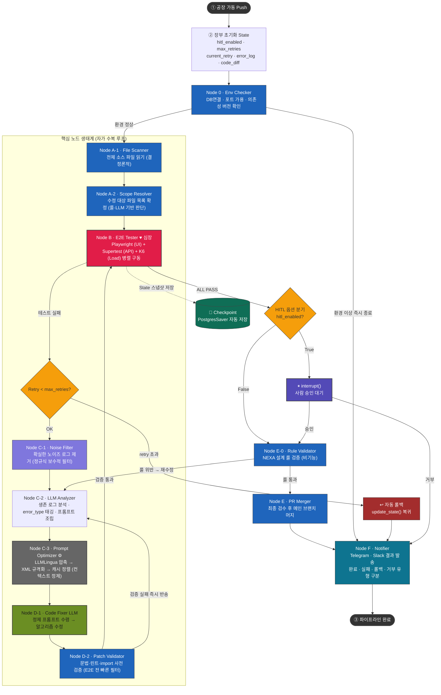

# NEXA OS · CI 에이전트 파이프라인 v8

> NEXA OS CI 에이전트 파이프라인 v8 다이어그램 · State 스키마 · 노드 설명 · 프롬프트 옵티마이저 · 프롬프트 생성↔테스트 실행 양방향 파이프라인
> **LangGraph 기반 자동화 CI 파이프라인** Human-in-the-Loop 옵션 · Checkpoint 자동저장 · 자동 롤백 · Node A 분리 (File Scanner / Scope Resolver) · Node C 분리 (Noise Filter / LLM Analyzer / Prompt Optimizer) · Node D 분리 (Code Fixer / Patch Validator) · Node 0 (Env Checker) · Node E-0 (Rule Validator · HITL 승인 이후 "기능 OK ≠ NEXA 정체성" 이원화 감사 게이트) · Node F (Notifier)

---

## 파이프라인 다이어그램



---

## State 스키마

```python
from typing import TypedDict, Literal

class PipelineState(TypedDict):
    # ── 옵션 플래그 ──
    hitl_enabled: bool          # True = 사람 승인 대기 / False = 자동 통과

    # ── 환경 상태 ──
    env_status: Literal["ok", "failed"]  # Node 0 검증 결과

    # ── 루프 제어 ──
    max_retries: int            # 최대 재시도 횟수 (기본 3)
    current_retry: int          # 현재 재시도 횟수

    # ── 장부 (에러 기록) ──
    error_log: list[dict]           # 원본 에러 로그 전체
    error_log_filtered: list[dict]  # Node C-1이 노이즈 제거 후 생존한 로그
    error_type: str                 # Node C-2가 태깅한 에러 유형 (ui / api / logic / unknown)
    test_results: dict              # Playwright / Supertest 결과 분리 저장

    # ── 코드 추적 ──
    file_tree: list[str]        # Node A-1이 읽은 전체 파일 목록
    scope: list[str]            # Node A-2가 확정한 수정 대상 파일 목록
    code_diff: str              # 수정된 코드 diff 요약

    # ── 프롬프트 정제 (Node C-3) ──
    optimized_prompt: str       # Node C-2가 만든 1차 프롬프트 (원본, 압축 전)
    refined_prompt: str         # Node C-3가 정제한 최종 프롬프트 (D-1 입력)
    prompt_cache_hit: bool      # vLLM/Ollama 프롬프트 캐시 적중 여부 (관측용)

    # ── E-0 심층 감사 (RAG + 온톨로지) ──
    audit_keywords: list[str]       # E-0·K가 추출한 NEXA 정체성 키워드
    audit_chunks: list[dict]        # E-0·R이 회수한 RAG 청크 (graph + vector)
    ontology_matches: list[dict]    # E-0·O의 온톨로지 매칭 결과
    audit_score: int                # E-0·C의 진정성 점수 (0~100)
    audit_threshold: int            # Logex 노드 설정값 (예: 80)
    audit_violations: list[dict]    # E-0·J 판정 시 첨부된 위반 사유 (C-2 회귀 시 사용)

    # ── E-0 룰 두 계층 (L1 기본 / L2 누적) ──
    base_rules: list[dict]              # L1 · rules_db.json에서 로드 (정적)
    cumulative_audit_rules: list[dict] # L2 · Neo4j CumulativeRule 캐시 (동적, 매 감사 갱신)
    l2_promotion_threshold: int        # Logex 노드 설정값 — 누적 N회 시 자동 승격 (예: 3)
    l2_deprecation_days: int           # Logex 노드 설정값 — 미발생 N일 후 자동 강등 (예: 180)

    # ── 파이프라인 상태 ──
    status: Literal["running", "passed", "rolled_back", "rejected"]
```

---

## 노드 설명

| 노드                               | 역할                             | 문제성격           | 핵심 동작                                                                     | 성격                     |
| ---------------------------------- | -------------------------------- | ------------------ | ----------------------------------------------------------------------------- | ------------------------ |
| **Node 0** · Env Checker           | 환경 사전 검증                   | 환경 문제          | DB연결·포트 가용·의존성 버전 확인 → 이상 시 즉시 조기 종료                    | 결정론적                 |
| **Node A-1** · File Scanner        | 파일 시스템 스캔                 | 파일접근 문제      | 전체 소스 파일 읽기 → `file_tree` State 저장                                  | 결정론적                 |
| **Node A-2** · Scope Resolver      | 수정 범위 확정                   | 범위 판단 문제     | 에러 로그 + 기획서 과녁 기반 수정 대상 파일 목록(`scope`) 확정                | 판단 개입 (룰·LLM)       |
| **Node B** · E2E Tester ♥          | 심장 (병목)                      | 기능 문제          | Playwright (UI) + Supertest (API) + K6 (Load) 병렬 구동 후 결과 State 기록    | 결정론적                 |
| **Node C-1** · Noise Filter        | 노이즈 로그 제거                 | 로그 품질 문제     | 확실히 무관한 로그만 탈락 → `error_log_filtered` 저장                         | 룰 기반 (정규식, 보수적) |
| **Node C-2** · LLM Analyzer        | 에러 분석 + 프롬프트 조립        | 분석.프롬프트 문제 | 생존 로그 전체 분석 → `error_type` 태깅 → 최적화 프롬프트 완성                | LLM                      |
| **Node C-3** · Prompt Optimizer ⚙️ | 프롬프트 정제 (압축·구조화·캐시) | 컨텍스트 폭발 문제 | LLMLingua 50% 압축 → XML 규격화 → 캐시 재정렬 후 `refined_prompt` 산출        | 결정론적 (경량)          |
| **Node D-1** · Code Fixer LLM      | 코드 수정                        | 코드 수정 문제     | 정제 프롬프트 수령 → 알고리즘 수정 후 파일 덮어쓰기                           | LLM                      |
| **Node D-2** · Patch Validator     | 사전 검증                        | 문법.구조 문제     | 문법·린트·import 오류 빠른 체크 → 통과 시 Node B / 실패 시 Node C-2 즉시 반송 | 결정론적                 |
| **Node E-0** · Rule Validator      | NEXA 설계 룰 검증 (비기능 · 이원화 감사) | 설계 철학 문제 | HITL 승인 이후 — 기능 OK와 별개 차원으로 NEXA 정체성(Zod·레이어·NEX*·Yjs 무결성) 재시험 | 결정론적 |
| **Node E** · PR Merger             | 최종 머지                        | 머지 충돌 문제     | NEXA 3대 룰 검수 후 메인 브랜치 병합                                          | 결정론적                 |
| **Node F** · Notifier              | 결과 발송                        |                    | 완료·실패·롤백·거부 유형 구분 후 Telegram·Slack 발송                          | 결정론적                 |

> **A-1 vs A-2 분리 이유:** Scanner는 항상 동일하게 동작하는 기계적 읽기입니다. Scope Resolver는 "어떤 파일을 건드릴지" 판단이 개입하므로 디버깅 시 "파일을 못 읽은 건지" vs "범위를 잘못 잡은 건지" 즉시 구분할 수 있습니다.

> **C-1 vs C-2 분리 이유:** C-1(Noise Filter)은 "확실히 무관한 것만 제거"하는 보수적 정규식 필터입니다. 의심스러운 로그는 전부 통과시켜 C-2로 넘깁니다. C-2(LLM Analyzer)는 생존한 로그 전체를 의미 기반으로 분석해 에러 유형을 태깅하고 프롬프트를 조립합니다. 이 구조 덕분에 중요한 정보 누락 없이 LLM 토큰 낭비만 줄일 수 있습니다.

> **D-1 vs D-2 분리 이유:** D-1(Code Fixer)이 수정한 코드가 문법·린트·import 수준에서 깨져있으면 Node B 전체 E2E를 돌리는 것 자체가 낭비입니다. D-2(Patch Validator)가 빠르게 사전 차단하고 문제 시 C-2로 즉시 반송하면 루프 비용이 크게 줄어듭니다.

> **Node 0 · Env Checker 추가 이유:** 환경 자체가 문제인 경우(DB 연결 불가, 포트 충돌, 의존성 버전 불일치)를 파이프라인 진입 전에 조기 차단합니다. 환경 문제를 코드 문제로 오인해 루프를 낭비하는 상황을 방지합니다.

> **Node E-0 · Rule Validator 추가 이유:** E2E 테스트(Node B)는 기능적 검증이고, E-0은 **비기능적 검증(정체성 감사)** 입니다. 핵심은 **"기능 OK ≠ NEXA 정체성 OK"** 라는 분리 원칙입니다. 사람의 HITL 승인은 기능적 책임만 지고, E-0은 별개 차원에서 NEXA 철학·원칙 시험을 다시 봅니다 — Zod 스키마 우회, 레이어 경계 침범, NEX* 네이밍 위반, Yjs를 통하지 않은 직접 State 변이 등이 이에 해당합니다. **HITL이 통과해도 E-0이 위반 판정을 내리면 사람의 승인은 무효화되고 Node C-2로 즉시 회귀**합니다. 이 이중 게이트 구조가 "기능적으로 돌아가지만 NEXA답지 않은 코드"가 메인 브랜치에 유출되는 것을 차단합니다.

---

### Node E-0 · Rule Validator — 5단계 심층 감사 (RAG + 온톨로지)

> E-0은 단순 룰 체크리스트가 아닙니다. 
> **"수백 장의 설계 문서 + 전체 코드베이스"를 RAG와 온톨로지로 깊이 따져 코드 진정성과 일관성을 최종 결정하는 감사관**입니다. 내부적으로 5단계를 거칩니다.

```
[Hit: HITL 승인된 변경]
    │
    ▼
[1단계 E-0·K · 키워드 추출]      ← diff · 영향 파일 · 새 심볼에서 NEXA 정체성 키워드 추출
    │                              (LLM 프롬프트: "변경과 관련된 NEXA 원칙·정책·스펙 키워드를 추출하라")
    ▼
[2단계 E-0·R · 듀얼 RAG 검색]
    ├─ Graph RAG (Neo4j)         ← 인과적 통찰 · 5WHY 이력 · 설계 원칙 그래프 노드 검색
    └─ Vector RAG (pgvector)     ← 수백 장 문서의 유사 청크 top-K 검색
    │
    ▼
[3단계 E-0·O · 온톨로지 매칭]
    └─ 추출 키워드를 NEX* 클래스 · 레이어 책임 · 도메인 온톨로지에 매칭
       (예: "ontology.service.ts" → NEX_ONTOLOGY 클래스의 책임 그래프와 대조)
    │
    ▼
[4단계 E-0·C · 일관성 감사]    ← ★ "코드 진정성"이 결정되는 핵심 단계
    ├─ 4a. L1 기본 룰 검사 (rules_db.json · 정적)
    │     ├─ NEX* 네이밍 규칙 위반 검출
    │     ├─ 레이어 경계 침범 검증
    │     └─ Yjs 우회 직접 State 변이 흔적 추적
    ├─ 4b. L2 누적 감사 룰 검사 (Neo4j CumulativeRule · 동적)
    │     ├─ 매치되는 CumulativeRule 패턴 조회
    │     └─ auto_block 등급 위반은 즉시 차단
    ├─ 4c. 코드베이스 전체 일관성
    │     └─ 직전 변경이 기존 패턴과 충돌하는지 분석
    ├─ 4d. 문서 vs 코드 일치율
    │     └─ RAG로 회수한 스펙 문서 청크와 실제 diff 의미 비교
    └─ 4e. 진정성 점수 산출 (audit_score: 0~100)
    │
    ▼
[4.5단계 E-0·U · 룰 진화 업데이트]   ← ★ L2 자동 누적의 핵심
    ├─ 위반 패턴 발생 시 CumulativeRule 노드 갱신
    │     (occurrence_count += 1, 3회 도달 시 status="auto_block" 승격)
    └─ L1 룰 위반 시 → 파생 L2 노드 자동 생성 (derived_from 기록)
    │
    ▼
[5단계 E-0·J · 판정]
    ├─ audit_score ≥ 임계값 (Logex 노드 설정) ─▶ Node E (PR Merger)
    └─ audit_score <  임계값                ─▶ Node C-2 (재수정, 위반 사유 첨부)
```

**왜 RAG + 온톨로지인가:**
- 룰 체크리스트만으로는 "수백 장 문서의 미묘한 위반"을 잡을 수 없습니다
- 5WHY 이력(Neo4j)을 조회하면 "지난번 동일 패턴 위반 시 어떻게 해결했는가"를 즉시 참조
- 온톨로지 매칭은 "이 파일이 NEXA 클래스 체계에서 어떤 책임을 져야 하는가"를 자동 검증

**E-0이 가장 비싼 노드인 이유:**
- 듀얼 RAG 검색은 매번 pgvector + Neo4j에 동시 질의 (네트워크·인덱스 비용 발생)
- 4단계의 일관성 감사는 전체 코드베이스를 AST 수준으로 훑음
- 따라서 Logex 노드 설정에서 `audit_threshold`(예: 80점), `max_rag_chunks`(예: 12), `enable_graph_rag`(bool) 등을 노출하여 프로젝트별 강도를 조절

---

#### 룰의 두 계층 — 기본 룰(장부) vs 누적 감사 룰(E-0 동적 진화)
> E-0이 검사하는 룰은 **단일 출처가 아니라 두 계층**입니다. 둘의 성격과 진화 방식이 다르므로 분리해서 다뤄야 합니다.

| 계층 | 저장소 | 성격 | 진화 방식 | 비유 |
|---|---|---|---|---|
| **L1 · 기본 룰** | `rules_db.json` (Ponytail 장부) | **정적·선언적** — 프로젝트 초기에 제시됨 | 사람(아키텍트)이 수동 편집 | **헌법 원문** |
| **L2 · 누적 감사 룰** | Neo4j `CumulativeRule` 노드 + State `cumulative_audit_rules` | **동적·자동 누적** — 매 감사에서 진화 | E-0 실행 결과에 따라 자동 추가·갱신 | **판례집** (헌법 해석의 누적 사례) |

**L1 (기본 룰) 예시 — 처음에 제시되고 거의 안 바뀜:**
```json
{
  "rule_id": "NEX-NAMING-001",
  "category": "naming",
  "statement": "모든 도메인 클래스는 'NEX' 접두사를 사용한다",
  "severity": "block",
  "created_at": "2026-01-01",
  "author": "architect"
}
```

**L2 (누적 감사 룰) 예시 — 매 감사마다 자동 갱신:**
```
[Neo4j 노드]
(:CumulativeRule {
  rule_id: "AUDIT-2026-06-24-007",
  pattern: "Service 레이어에서 Repository 직접 호출",
  first_seen: "2026-05-12",
  occurrence_count: 7,                    // 7회 반복 발견
  last_violation_diff: "abc123...",
  promotion_status: "auto_block",        // 3회 반복 시 자동 승격
  derived_from: ["L1:NEX-LAYER-002", "5WHY-2026-05-12-001"]
})
```

**L2의 자동 진화 사이클 (E-0 내부 루프):**
```
[감사 1회차] 위반 발견
    └─▶ CumulativeRule 노드 생성 (occurrence_count=1, status="watch")

[감사 2회차] 동일 패턴 재발견
    └─▶ occurrence_count += 1 (status="watch" 유지)

[감사 3회차] 3회 누적 도달
    └─▶ status="auto_block" 자동 승격 → 다음부터 즉시 차단 (사람 승인 불필요)

[감사 N회] 더 이상 발생 안 함
    └─▶ 6개월 후 status="deprecated" 자동 강등 (Logex 노드 설정값)
```

**왜 L2가 필요한가:**
- "수백 장의 문서"에는 명시되지 않았지만 **반복되는 미묘한 위반 패턴**이 있습니다 (예: 특정 모듈에서만 Zod 우회 시도)
- L1에 일일이 등록하면 아키텍트가 모든 패턴을 예측해야 하지만, 현실적으로 불가능
- L2는 **"실제 위반 데이터에서 패턴이 스스로 자라나는"** 자가 진화형 룰셋입니다
- L1(헌법)은 사람이 관리하고, L2(판례)는 시스템이 누적 관리 — 책임 소재가 분리됨

**L1과 L2의 상호작용:**
- L2 위반 발견 → Neo4j 그래프에서 가장 가까운 L1 룰을 역추적 → 5WHY 보고서에 "L1:NEX-LAYER-002 파생 위반"으로 기록
- L2의 패턴이 너무 빈번하면 → 아키텍트가 검토 후 L1로 승격 (정식 룰로 편입)
- L1 수정 시 → 영향받던 L2 노드들은 자동 무효화 (Neo4j 트리거)

---

#### E-0 보강 전략: "감사관의 감사" — 3대 운영 메커니즘
> E-0 자체가 NEXA 코드를 감사하듯, **E-0의 동작 자체도 3중으로 감사·최적화**해야 합니다. 대표님 안의 다음 3개 전략을 반영합니다.
##### 1) L2 Pruning — 판례 정제 메커니즘

**문제**: 6개월간 발생하지 않은 CumulativeRule이 그대로 누적되면 룰셋이 비대해지고, 기계가 잘못 학습한 "나쁜 관례"가 영구 박힘.

**메커니즘 (2단계)**:

```
[Phase 1 · 소프트 삭제 (자동)]
  휴면 180일 (Logex 노드 설정값 l2_deprecation_days) 경과
    └─▶ status: "active" → "deprecated"
         last_seen_at 보존, 매칭에서 제외 (단, 조회는 가능)

[Phase 2 · 하드 삭제 (휴먼 승인)]  ← ★ "나쁜 관례" 방지 핵심
  deprecated 상태로 30일 추가 경과
    └─▶ Omni 트레이에 "판례 승인 요청" 발행
         ├─ 아키텍트가 "유지 / 폐기 / L1로 승격" 중 결정
         └─ 미응답 시 14일 후 자동 폐기 (Logex 설정값)
```

**이점**:
- 단순 자동 삭제는 위험하지만, 휴먼 승인 단계가 **"기계 잘못 학습 필터"** 역할을 함
- L2 → L1 승격 경로가 자연스럽게 열림 (반복 검증된 패턴만 헌법 진입)

##### 2) Parallel RAG Fetching — 병렬 회수 (성능 최적화)

**문제**: E-0의 2단계(RAG)와 3단계(온톨로지)를 직렬로 실행하면 Neo4j 응답 + pgvector 응답이 순차 대기.

**메커니즘**:

```
[기존 직렬]
  Step 1: E-0·K (키워드 추출) ─ 200ms
  Step 2: E-0·R (Neo4j 800ms) ─────────▶ 대기 ─ pgvector 600ms ─────▶ 1600ms
  Step 3: E-0·O (온톨로지 매칭)                                ─ 200ms

[병렬화 후]
  Step 1: E-0·K (키워드 추출) ─ 200ms
  Step 2: E-0·R (Neo4j 800ms) ┐
                              ├─ 동시 질의 ─ 머지 ─ 800ms
  Step 3: E-0·O (pgvector 600ms) ┘
                                                  └─ 매칭 ─ 200ms
  총: 약 1200ms (직렬 대비 ~25% 단축, 캐시 적중 시 40%+)
```

**구현 포인트**:
- `asyncio.gather()` 또는 LangGraph의 `Send()` API로 Neo4j + pgvector 동시 질의
- 결과 머지 시 **타임스탬프 동기화**(한쪽이 stale이면 점수 가중치 차감)
- 4단계(E-0·C)도 AST 풀스캔 + L2 룰 매칭을 병렬화 가능 → Logex 노드 설정으로 on/off

##### 3) Audit Trail Persistence — 감사 이력 영구화 (컴플라이언스)

**문제**: E-0이 "왜 반려했는가?"에 답할 때 단순 점수만 남으면, 6개월 후 재審 불가 + 자체 LLM 학습 데이터 손실.

**메커니즘 — 결정 레이어 4종 동시 기록**:

```
E-0·J 판정 시 (Atomic Write)
  │
  ├─ ① RAG 청크 스냅샷      → audit_chunks_snapshot (당시 회수한 pgvector·Neo4j 원문)
  ├─ ② 온톨로지 매칭 결과    → ontology_matches_snapshot
  ├─ ③ L2 룰 매칭 트레이스   → matched_l2_rules (어떤 L2에 걸렸는지)
  └─ ④ 코드 diff + 환경 컨텍스트 → code_diff + neo4j_version + llm_version
      │
      ▼
  [S3/MinIO 데이터 레이크]
    s3://nexa-audit-trail/
      └─ year=2026/month=06/day=24/
           ├─ run_id=abc123/
           │    ├─ decision.json        ← 판정 결과 + 점수
           │    ├─ rag_chunks.parquet   ← RAG 원문
           │    ├─ ontology_matches.parquet
           │    ├─ code_diff.patch
           │    └─ env_context.json    ← neo4j 버전·LLM 버전 등
           └─ _INDEX.jsonl             ← 검색 인덱스
```

**용도 3가지**:
1. **사람 재審**: "왜 반려됐는가?" → 당시 참조 문서 원문과 점수 근거 즉시 제시
2. **컴플라이언스 감사 (SOC2/ISO)**: 결정 근거의 완전한 추적성 확보
3. **자체 LLM 학습 데이터**: 판정 + 근거 쌍이 곧 fine-tuning 데이터셋 → 6개월치 데이터가 자체 모델의 자산

**저장 정책 (Logex 노드 설정)**:
- `audit_retention_days`: 기본 730일 (2년)
- `audit_storage_class`: 표준 30일 → IA 90일 → Glacier 잔여
- `audit_compress`: Parquet + Snappy 기본

**이 3개 보강의 통합 효과**:
- L2 Pruning → **룰셋 건강도 유지**
- Parallel RAG → **E-0 응답성 25~40% 개선**
- Audit Trail → **결정의 투명성과 학습 자산화**
- 합쳐서 E-0은 **"신뢰할 수 있고 빠르며 성장하는"** 살아있는 감사관이 됩니다.

---

## 핵심 메커니즘

### 1. Human-in-the-Loop 옵션화

```python
from langgraph.types import interrupt

def node_hitl_check(state: PipelineState):
    if state["hitl_enabled"]:
        decision = interrupt({
            "message": "PR 머지 승인 요청",
            "diff_summary": state["code_diff"],
            "test_results": state["test_results"],
        })
        if decision != "approve":
            return {"status": "rejected"}
    # False 이거나 승인된 경우 → Node E로 진행
```

**실행 시 플래그 제어:**

```python
# 자동 모드 (HITL 없음)
graph.invoke({"hitl_enabled": False, "max_retries": 3, ...})

# 승인 모드 (HITL 활성)
graph.invoke({"hitl_enabled": True,  "max_retries": 3, ...})
```

---

### 2. Checkpoint 자동저장 + 롤백

```python
from langgraph.checkpoint.postgres import PostgresSaver

checkpointer = PostgresSaver.from_conn_string("postgresql://...")
graph = builder.compile(checkpointer=checkpointer)

# ── 롤백 실행 ──
history = list(graph.get_state_history(config))
target  = history[3]  # 원하는 안전 시점 선택

graph.update_state(target.config, values={"status": "rolled_back"})
graph.invoke(None, config=target.config)
```

**롤백 트리거 조건:**

```python
def check_retry(state: PipelineState):
    if state["current_retry"] >= state["max_retries"]:
        return "rollback"   # → 자동 롤백 경로
    return "continue"       # → Node C 경로
```

### 3. Node C-1 · Noise Filter (보수적 정규식)

```python
import re

# 확실히 무관한 패턴만 정의 — 목록을 좁게 유지하는 것이 핵심
NOISE_PATTERNS = [
    r"^\[INFO\] health check ok",
    r"^\[DEBUG\] cache hit",
    r"^\[INFO\] render complete in \d+ms$",
    r"^\[INFO\] websocket ping",
]

def node_noise_filter(state: PipelineState):
    survived = []
    for log in state["error_log"]:
        is_noise = any(re.match(p, log["message"]) for p in NOISE_PATTERNS)
        if not is_noise:
            survived.append(log)   # 의심스러우면 무조건 통과
    return {"error_log_filtered": survived}
```

### 4. Node C-2 · LLM Analyzer (분석 + 프롬프트 조립)

```python
def node_llm_analyzer(state: PipelineState):
    # 생존 로그 전체를 LLM에 넘겨 의미 기반 분석
    logs = "\n".join(l["message"] for l in state["error_log_filtered"])
    prompt = f"""
다음 에러 로그를 분석하세요.
1. error_type을 판단하세요: ui / api / logic / unknown
2. 근본 원인을 한 문장으로 요약하세요.
3. Code Fixer LLM이 수정에 사용할 최적화 프롬프트를 작성하세요.

--- 로그 ---
{logs}
"""
    # LLM 호출 → error_type + optimized_prompt 반환
    result = llm.invoke(prompt)
    return {
        "error_type": result.error_type,
        "optimized_prompt": result.optimized_prompt,
    }
```

```
Push
 └─ State 초기화
     └─ Node 0 (Env Checker)              ← DB·포트·의존성 사전 검증
         ├─ 이상 ──────────────────────────────────────────→ Node F (Notifier)
         └─ 정상
             └─ Node A-1 (File Scanner)
                 └─ Node A-2 (Scope Resolver)
                     └─ Node B (E2E Tester) ──── 💾 Checkpoint 저장
                         ├─ FAIL → retry < max?
                         │           ├─ OK  → Node C-1 (Noise Filter)
                         │           │           └─ Node C-2 (LLM Analyzer)
                         │           │               └─ Node C-3 (Prompt Optimizer ⚙️)
                         │           │                   └─ Node D-1 (Code Fixer)
                         │           │                       └─ Node D-2 (Patch Validator)
                         │           │                           ├─ 통과 ────────→ Node B
                         │           │                           └─ 실패 ────────→ Node C-2
                         │           └─ 초과 → ↩ 롤백 ──────────────────────→ Node F
                         └─ PASS → HITL 분기
                                     ├─ True → interrupt()
                                     │           ├─ 승인 → Node E-0 (Rule Validator)
                                     │           └─ 거부 ──────────────────→ Node F
                                     └─ False → Node E-0 (Rule Validator)
                                                     ├─ 룰 통과 → Node E (PR Merger) → Node F → 완료
                                                     └─ 룰 위반 → Node C-2 재수정
```

### 5. Node C-3 · Prompt Optimizer ⚙️ (프롬프트 정제 엔진)

> v8 다이어그램에 신규 추가됨 (이전 v2에서 승계). Node C-2가 만든 `optimized_prompt`를 **D-1(Code Fixer)**에 그대로 넘기지 않고, 별도의 초경량 노드에서 한 번 더 다듬어 컨텍스트 폭발을 방지한다.

3단계 작동 기법:

1. **LLMLingua 압축** — 언어적 노이즈(수식어·접속사)를 도려내어 50~80% 축소
2. **XML 규격화** — `<instruction> <target_file> <error_log>` 태그로 재조립 (Deterministic)
3. **캐시 재정렬** — 불변 규칙(`system_rules`)을 Top, 가변 데이터(`error_log`)를 Bottom으로 강제 배치 → vLLM/Ollama 프롬프트 캐시 적중률 95%+ 유지

```python
def node_prompt_optimizer(state: PipelineState):
    raw_prompt = state["optimized_prompt"]          # C-2 산출물

    # ① 압축 (LLMLingua)
    compressed = llmlingua.compress(raw_prompt, ratio=0.5)

    # ② XML 구조화
    xml_prompt = f"""
<instruction>{compressed.intent}</instruction>
<target_file>{compressed.target_file}</target_file>
<rag_rules>{"".join(f"<rule>{r}</rule>" for r in state["domain_rules"])}</rag_rules>
<error_log>{compressed.error_signature}</error_log>
"""

    # ③ 캐시 재정렬 (불변 Top / 가변 Bottom)
    ordered = state["system_rules"] + xml_prompt     # Top = system, Bottom = dynamic

    return {"refined_prompt": ordered, "prompt_cached": True}
```

---

_문서 버전: v8.0 | 작성일: 2026-06-23_ _다음 단계: Node B 분리 (UI Tester / API Tester / Result Merger) · E-0 룰 위반 루프 전략 확정_

---

# 어떻게 프롬프트를 생성하고 어떻게 테스트 할것이가?

## Ponytail 포니테일 프롬프트

ponytail의 규칙은 에이전트가 코드를 작성하기 직전에 아래 사다리(ladder)를 위에서부터 훑어 내려가다가, **처음으로 성립하는 단(rung)에서 멈추도록** 합니다.

1. 이 기능이 존재할 필요가 있는가? → 없다: 만들지 않는다 (YAGNI)
2. 표준 라이브러리로 되는가? → 된다: 그것을 쓴다
3. 플랫폼 기본 기능으로 되는가? → 된다: 그것을 쓴다
4. 이미 설치된 의존성으로 되는가? → 된다: 그것을 쓴다
5. 한 줄로 되는가? → 된다: 한 줄로 쓴다
6. 그제서야: 동작하는 최소한의 코드`

앞 단에서 답이 나오면 뒤 단으로 내려가지 않기 때문에, 새 라이브러리를 설치하거나 별도 컴포넌트를 만드는 일은 사다리의 마지막 수단으로 밀려납니다.
위의 날짜 선택기 예시는 1~3단에서 곧바로 끝나, 결과적으로 다음 한 줄이 됩니다.

## 🛡️ 랭그래프에 구축해야 할 3대 강제 규칙 시스템

여기서 중요한 점은 ponytail이 "코드를 무조건 짧게" 만드는 도구가 아니라는 것입니다. 신뢰 경계(trust boundary)에서의 입력 검증, 데이터 손실 처리, 보안, 접근성은 사다리의 어느 단에서도 잘려나가지 않는 항목으로 못 박혀 있습니다. 코드가 작아지는 이유는 일부러 짧게 줄여서가 아니라 필요한 만큼만 남겼기 때문이라는 것이 저자의 설명입니다

네, 완벽하게 정답을 짚으셨습니다. 프롬프트는 LLM에게 주는 ‘권장 사항’일 뿐이지만, 파이썬 코드로 짠 검증기는 시스템의 ‘절대적인 법률’이 됩니다. 자원과 시간이 들더라도 이 검증 파이프라인을 구축해 두면, LLM의 낭비성 연산(토큰 비용)을 줄여 장기적으로는 오히려 비용이 급감하고 시스템 안정성은 극대화됩니다.

우리 시스템에 맞는 '포니테일식 물리적 강제 규칙 파이프라인'을 랭그래프에 이식할 때 구축해야 할 핵심 검증기(Validator) 설계도입니다.

---

```unset
[LLM 코드 생성]
       │
       ▼
[1단계: AST 정적 분석기] ──(외부 모듈 발견)──> [즉시 탈락 / 수정 노드로 강제 리다이렉트]
       │ (통과: 내장/허용된 모듈만 사용)
       ▼
[2단계: 물리적 라인 카운터] ─(기준 라인 초과)─> [즉시 탈락 / "줄 수 줄여라" 에러 피드백]
       │ (통과: 컴팩트한 코드)
       ▼
[3단계: 격리 환경 컴파일] ───(컴파일 에러)───> [즉시 탈락 / Traceback 에러 피드백]
       │ (최종 통과)
       ▼
[실제 시스템 반영]
```

> 말로 달래는 프롬프팅이 아니라, "시스템 룰 데이터베이스, RAG 검색, AST 정적 분석, 랭그래프 루프 제어"를 융합한 엔지니어링 접근법입니다.

### 1. 코더(Coder)와 심사관(Judge)의 뇌 물리적 분리

랭그래프의 상위 노드 구조에서 두 LLM의 역할과 모델 사양(Specification)을 완전히 다르게 바인딩합니다.

- 코더(Coder) 노드: 코드 생성에 특화된 모델(예: Claude 3.5 Sonnet)을 사용하며, 파일 쓰기 툴만 부여합니다.
- 심사관(Judge) 노드: 텍스트 생성을 완전히 차단하고, `오직 구조화된 JSON 데이터(Pydantic Output)`만 출력하도록 뇌를 제약합니다. 속도가 빠르고 인스트럭션 수행 능력이 정교한 모델(예: GPT-4o-mini 등)을 매칭합니다.

### 2. 규칙 파일 관리 및 초-저맥락화(Ultra-Low Context) 포맷

100개가 넘는 Do/Don't 규칙 리스트(총 200개 이상)를 통째로 컨텍스트에 넣으면 LLM의 주의력(Attention)이 분산되어 규칙을 놓치고 토큰 비용이 폭증합니다. 따라서 사람용 레퍼런스(Markdown)와 LLM용 바이너리 스펙(JSON)을 이원화 관리합니다.

#### 규칙 관리 규격 샘플 (`rules_db.json`)

```json
{
  "dont_rules": [
    { "id": "DONT_001", "domain": "backend", "keyword": "prisma raw query", "rule": "Raw SQL 금지. 반드시 Prisma Client 메서드 사용.", "severity": "CRITICAL" },
    { "id": "DONT_002", "domain": "frontend", "keyword": "inline style", "rule": "style={{}} 태그 금지. Tailwind CSS 클래스만 허용.", "severity": "MAJOR" }
  ],
  "do_rules": [
    { "id": "DO_001", "domain": "backend", "keyword": "zod validation", "rule": "모든 API Request Body는 진입점에서 Zod 스키마로 검증 필수.", "severity": "CRITICAL" },
    { "id": "DO_002", "domain": "frontend", "keyword": "shadcn/ui", "rule": "새로운 UI 컴포넌트 필요 시, 무조건 shadcn/ui 레시피 코드에서 복사하여 적용.", "severity": "MAJOR" }
  ]
}
```

---

### 3. 핵심 키워드 추출 기반 RAG 룰 검색 대입 (X항 구현)

사용자의 요청(예: _"유저 가입 API 만들어줘"_)이 들어왔을 때 200개의 규칙을 다 보여주는 대신, 요청에서 키워드를 추출하여 매칭되는 룰만 주입합니다. (유효성을 넘어 필수적인 최적화 기법입니다.)

1. 키워드 정적 매칭: 사용자 요청 텍스트 내에 `Prisma`, `Form`, `Zod`, `API` 같은 기술 스택 키워드가 포함되어 있는지 코드 단에서 정규식이나 단순 `in` 연산자로 검사합니다.
2. RAG 하이브리드 검색: 키워드가 애매할 경우, 사용자 요청을 임베딩하여 `rules_db.json` 내 관련도가 높은 상위 5~10개의 Do/Don't 룰만 벡터 DB(Chroma, Pinecone 등)에서 추출합니다.
3. 최적화된 컨텍스트 주입: 코더와 심사관에게는 오직 이 요청에 연관된 10개의 핵심 타겟 룰 파일만 슬라이싱해서 공급합니다.

---

### 4. 랭그래프 제어 흐름 (Loop Control & Human-in-the-loop)

1차 프롬프트 제어 이후 3회 자율 개선, 4회째 강제 정지 및 사유 설명 후 Human 승인 대기 흐름을 구현하는 랭그래프의 핵심 상태(State)와 조건부 엣지(Conditional Edge) 설계입니다.

#### 상태 스키마 정의 (`State`)

```python
from typing import List, TypedDict, Dict, Any

class AgentState(TypedDict):
    user_request: str          # 최초 사용자 요청
    current_code: str          # 코더가 작성한 코드
    targeted_rules: List[Dict] # RAG로 검색되어 적용된 DO/DONT 룰셋
    retry_count: int           # 실패 및 루프 카운트 (최대 4)
    judge_result: Dict[str, Any] # 심사관의 JSON 판정 결과
    stop_reason: str           # 4회 실패 시 인간에게 설명할 사유
```

#### 심사관 출력 형식 강제 (Pydantic / JSON Mode)

```python
from pydantic import BaseModel, Field

class RuleViolation(BaseModel):
    rule_id: str = Field(description="위반한 규칙의 ID (예: DONT_001)")
    reason: str = Field(description="위반 이유 및 수정 방향에 대한 정확한 기술적 피드백")

class JudgeOutput(BaseModel):
    is_approved: bool = Field(description="모든 DO/DONT 규칙과 물리적 제약을 통과했는가?")
    violations: List[RuleViolation] = Field(description="위반된 규칙 목록 (없으면 빈 배열)")
```

#### 랭그래프 조건부 엣지 제어 함수 (Routing)

```python
def route_after_judgment(state: AgentState):
    judge_result = state["judge_result"]
    retry_count = state["retry_count"]

    # 1. 심사관 통과 시 종료 노드로 이동
    if judge_result["is_approved"]:
        return "deploy_code"

    # 2. 통과 못 했을 때 카운트 체크
    if retry_count >= 3:
        # 4회째 진입 직전 (0, 1, 2회 자율 개선 실패 후 3회째 누적 시)
        # 루프를 물리적으로 터뜨리고 인간 승인 단계로 이동 (interrupt)
        return "human_approval_required"

    # 3. 3회 이하 실패 시 자율 개선 노드로 리다이렉트
    return "autonomous_fix_code"
```

---

#### 🎯 이 시스템이 압도적인 기대 효과

- 성공률 보장: LLM이 기분이나 컨디션에 따라 마음대로 코드를 짜는 현상이 완전히 사라집니다. 백엔드 시스템 가드레일이 규칙 이행을 철저히 감시하기 때문입니다.
- 컴포넌트/기술 표준화: 4항(프론트단 규칙), 6항(백엔드단 규칙)이 추가될 때마다 JSON 파일에 룰만 한 줄씩 갱신해 주면, RAG 엔진이 알아서 적재적소에 룰을 배달하여 일관된 아키텍처 코드가 생산됩니다.
- 비용 방어: 무한 루프에 빠져 API 비용이 터지는 현상을 랭그래프의 결정적 카운터(`retry_count`)가 완벽하게 방어하며, 휴먼 인더루프 인터럽트를 통해 개발자가 개입할 수 있는 최적의 타이밍을 잡아줍니다.

---

## 🛠️ 실전 보강: 프롬프트 생성 ↔ 테스트 실행 양방향 파이프라인

위 3대 강제 규칙과 4단계 랭그래프 제어 흐름은 "설계도"입니다. 이 절은 그 설계도가 실제로 어떻게 굴러가는지 **명령이 한 줄 들어와서 PR이 머지되기까지의 모든 단절 없는 흐름**을 명시합니다. 두 파이프라인(프롬프트 생성 / 테스트 실행)이 서로 데이터를 핑퐁하듯이 넘기며, 매 루프마다 학습이 누적됩니다.

### 1️⃣ 프롬프트 생성 파이프라인 (왼쪽 흐름: `C-2 LLM Analyzer` ↔ `Prompt Optimizer`)

#### 입력(Input) — 4가지 데이터가 `AgentState`로 합류

| 데이터               | 출처                     | 역할                       |
| -------------------- | ------------------------ | -------------------------- |
| `error_log_filtered` | Node C-1 (Noise Filter)  | 노이즈 제거된 진짜 에러    |
| `5WHY_report`        | Node F (5WHY Analyzer)   | 인과관계 추적 보고서       |
| `code_diff`          | Node D-1 직전 체크포인트 | 현재 실패한 코드의 diff    |
| `targeted_rules`     | RAG (pgvector + Neo4j)   | DO/DONT 룰 5~10개 슬라이스 |

#### 생성(Create) — 3단계 압축 정제

```
1. 초안 생성: LLM이 [error + 5WHY + RAG rules]를 받아 XML 초안 작성
                <instruction>...</instruction>
                <target_file>...</target_file>
                <error_log>...</error_log>
                <constraints>...</constraints>

2. 압축 (LLMLingua): 초안에서 불필요 관사·접속사 도려내기 (50~80% 토큰 절감)

3. 캐시 정렬: 정적 부분(system_rules) → 상단, 동적 부분(error_log) → 하단 강제 배치
                (vLLM/Ollama의 프롬프트 캐시 적중률 95%+ 유지)
```

#### 출력(Output) — D-1에게 전달되는 "칼날 프롬프트"

```json
{
  "instruction": "NestJS의 validatePipe에서 Zod 스키마 누락 → user.dto.ts에 z.object 추가",
  "target_file": "src/api/user/user.dto.ts",
  "apply_rules": ["DO_001", "DONT_003"],
  "verify_with": "supertest POST /api/v1/users 400 미발생 확인",
  "max_lines_added": 12
}
```

#### 🚦 게이트(Gate) — 생성 직후 자체 점검

프롬프트가 D-1로 가기 전에 3개 항목을 자체 점검하여 **부적합 시 재생성**:

1. `target_file`이 실제로 존재하는가? (없으면 C-2로 복귀)
2. `apply_rules`가 모두 `rules_db.json`에 등록된 ID인가?
3. `max_lines_added`가 임계치(예: 50줄) 이내인가?

---

### 2️⃣ 테스트 실행 파이프라인 (오른쪽 흐름: `Node B` ↔ `Node D-2`)

#### 5단계 Test Spec — 어떤 테스트를 어떤 순서로

| 순서   | 단계          | 도구                  | 부러뜨리기 기준 (FAIL 조건)                         |
| ------ | ------------- | --------------------- | --------------------------------------------------- |
| **T1** | 정적 검증     | D-2 (Patch Validator) | tsc/eslint/AST import 오류 1건이라도 발생           |
| **T2** | API 단위 검증 | Supertest             | 4xx/5xx 응답이 의도와 다르면                        |
| **T3** | UI E2E 검증   | Playwright            | 1초 이내 `Y.Doc` 동기화 불일치 / SSE 유실 0.1% 초과 |
| **T4** | 부하 검증     | k6 (MQTT)             | TTFT 600ms 초과 / 가상 5,000대 동시 publish 실패    |
| **T5** | 룰 검증       | E-0 (Rule Validator)  | NEXA 3대 룰 위반 1건이라도                          |

#### 결과 상태 (`TestRunHistory`) — 모든 단계의 결과 누적

```python
test_run_history: List[Dict] = [
    {"step": "T1", "tool": "D-2", "result": "PASS", "duration_ms": 120, "details": "..."},
    {"step": "T2", "tool": "Supertest", "result": "PASS", "duration_ms": 480, "details": "..."},
    {"step": "T3", "tool": "Playwright", "result": "FAIL", "duration_ms": 1500,
     "details": "Y.Doc sync timeout: 2 browsers diverged at node 'A-1'"},
    {"step": "T4", "tool": "k6", "result": "SKIP", "duration_ms": 0,
     "details": "T3 failed → cascade skip"},
    {"step": "T5", "tool": "E-0", "result": "SKIP", "duration_ms": 0,
     "details": "E2E not passed"},
]
```

#### 🔁 T3 실패 시 자동 재시도 (Smart Retry)

T3(Playwright UI E2E)에서만 **자동 재시도 1회**를 허용합니다. 그 이유는:

- 브라우저 부팅·폰트 로딩 등 비결정적 외부 요인 때문
- T1/T2/T4는 결정론적이므로 재시도 불필요
- 단, **T3 2회 연속 실패 시 자동 재시도 중단** → C-1로 복귀

---

### 3️⃣ 두 파이프라인의 핑퐁 결합 (Ping-Pong Coupling)

프롬프트 생성과 테스트 실행은 **순차적이면서도 데이터로 결합**됩니다:

```
[실패 1회차]
C-1 (노이즈 제거) → C-2 (프롬프트 생성) → Prompt Optimizer → D-1 (수정)
    ↓                                          ↑
    └──── Node B (실패) ──→ 5WHY + 에러 로그 ──┘

[실패 2회차: 더 정밀한 프롬프트로 재도전]
C-1 → C-2 (RAG에서 Neo4j 진화 그래프 조회 + 과거 Fix_Patch 참조)
    ↓
Prompt Optimizer (이전 실패 원인 키워드를 "강조" 표시)
    ↓
D-1 (수정) → D-2 (정적 검증) → Node B (E2E)
```

#### 핵심 결합 포인트 — "왜 실패했는가" 데이터의 전달

`Node B`가 실패할 때마다 다음 데이터가 `AgentState`에 누적되어 다음 `C-2` 호출에 강제 주입됩니다:

| 누적 데이터                                  | 사용 시점        | 효과                                             |
| -------------------------------------------- | ---------------- | ------------------------------------------------ |
| `previous_failure_keywords`                  | 다음 C-2 호출 시 | RAG 검색 시 가중치 +200%                         |
| `previous_fix_patches` (실패한 것)           | 다음 C-2 호출 시 | LLM이 "이 실수 반복하지 마라"는 지시문 자동 생성 |
| `cumulative_5WHY`                            | 다음 C-2 호출 시 | 인과관계 깊이를 1→2→3... 단계로 누적             |
| `exhausted_rules` (이미 시도했지만 안 된 룰) | 다음 C-2 호출 시 | RAG에서 자동 제외 → 검색 노이즈 감소             |

#### 🚨 무한 루프 방어 — 4-Way Break

4가지 조건 중 하나라도 해당되면 **루프를 물리적으로 강제 종료**합니다:

1. `retry_count >= max_retries` (예: 3회 초과)
2. `cumulative_5WHY`가 5단계를 모두 채웠는데도 해결책 못 찾음
3. `previous_fix_patches` 중 2개 이상이 동일 알고리즘으로 실패
4. `exhausted_rules`가 룰셋의 50% 이상 소진

이 4-Way Break는 **단일 LLM의 자기 합리화를 시스템 차원에서 무력화**합니다. 한 가지 방식으로만 막으면 LLM이 우회하지만, 4가지 조건이 동시에 작동하면 어떤 우회도 불가능합니다.

---

### 4️⃣ 양방향 파이프라인의 종료 조건 (Exit Conditions)

| 종료 경로                  | 트리거                   | 다음 행동                                   |
| -------------------------- | ------------------------ | ------------------------------------------- |
| **🎉 ALL PASS**            | T1~T5 모두 PASS          | D-3 (Code Reviewer) → HITL/E-0 → PR Merger  |
| **↩ 자동 롤백**            | retry_count 초과         | Checkpoint에서 `update_state()` 복귀 → End  |
| **⏸ HITL 강제 정지**       | retry 4회째 진입         | interrupt() → 사람 승인 대기                |
| **🚨 시스템 에스컬레이션** | 4-Way Break 중 하나 발생 | Neo4j에 "미해결 사건" 노드 생성 → NEXA 알림 |

---

### 5️⃣ 이 보강이 가져오는 결정적 차이

| 보강 전                                                            | 보강 후                                     |
| ------------------------------------------------------------------ | ------------------------------------------- |
| "프롬프트 생성"과 "테스트 실행"이 분리되어 있어 실패 원인이 단절됨 | 4가지 누적 데이터로 매 루프마다 더 정밀해짐 |
| LLM이 같은 실수 반복 가능                                          | `previous_fix_patches`가 자동 차단          |
| 무한 루프 방어가 카운터 하나에 의존                                | 4-Way Break가 다층 방어                     |
| 룰셋이 무한히 커져도 LLM이 똑같이 사용                             | `exhausted_rules`가 자동 정리               |

**이 5단계 보강은 "포니테일 사다리"라는 단순한 코드 품질 가이드와, "3대 강제 규칙"이라는 시스템 가드레일을, 실제 데이터 흐름이 살아 움직이는 양방향 파이프라인으로 완성시키는 마지막 퍼즐입니다.**
