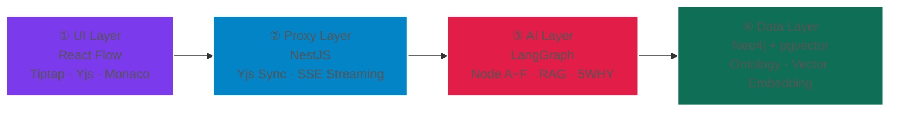

# LOOP-NEXIA v2 — 자율 코딩 루프 엔지니어링 명세서

> **🎯 스코프 한정 (v2.0 Normative):**
> **이 문서가 다루는 NEXIA는 "웹앱(Next.js / NestJS / React) 자율 코딩 툴"로 한정한다.**
> — Omnix는 LLM과의 자연어 채팅 공간이며, Normex는 Yjs 기반 문서 협업·승인 게이트이다.
> — Logex는 React Flow 기반 그래프 구성 + Python LangGraph(StateGraph)와 직접 연결되는 실행 창이다.
> — Scribx는 Monaco Editor 기반 코드 결과 화면이며, Twinex는 브라우저 얼굴(웹앱 검증)을 주로 사용한다.
> — NEXIA 자체 LLM은 Python LangGraph LLM과 별개이며, 전 탭을 가로지르는 다자간 오케스트레이터다.
> — Yjs는 모든 에이전트·모든 탭·사용자 Awareness를 연결하는 전역 버스이다.
> — 다른 도메인(3D 트윈·미디어·산업 IoT 등)은 추후 확장 영역이며, 본 문서에서는 보조적으로만 살짝 다룬다.

## 목차

- **§1.** NEXIA 루프 엔지니어링의 정의 — 무엇을 명세하는가
- **§2.** 7탭 ↔ 루프 엔지니어링 노드 매핑 (어떤 탭이 어떤 역할을 하는가)
- **§3.** 단일 시나리오: 웹앱 자율 코딩 (보조 도메인 살짝)
- **§4.** NEXIA 보좌 도구: NIXIE · HEXAGON · Nexnap이 NEXIA LLM을 어떻게 보조하는가
- **§5.** (v1.0 보존) NEXU Canvas E2E Test Spec — 4-Layer 품질 게이트 기준
- **§6.** 결론: NEXIA 웹앱 자율 코딩 툴이 가져오는 결정적 변화

---

## §1. NEXIA 루프 엔지니어링의 정의 — 무엇을 명세하는가

### 1.1 기존 v1.0의 시야와 v2.0의 시야

| 구분 | v1.0 (기존) | v2.0 (이 문서) |
|---|---|---|
| **대상** | NEXU Canvas (React Flow) 단일 영역 | **NEXIA 전체 7탭** (Omnix·Normex·Logex·Scribx·Vivex·Twinex·Navex) — 웹앱 코딩 범위 한정 |
| **루프의 목적** | "코드가 잘 돌아가는가" (Playwright/Supertest/k6) | **"웹앱 코드를 자율 진화로 완성하는가"** (다른 도메인은 추후 확장) |
| **AI의 위치** | 단일 LangGraph 에이전트 (`apps/agent-graph`) | **NEXIA 자체 LLM(별개) + 탭별 에이전트 + Python LangGraph LLM 다중 협업** |
| **사용자 역할** | 테스트 결과의 승인자 (HITL) | **조종사 — Omnix에서 의도를 입력하고, Normex·Logex에서 재구성하며, 위험 순간 개입** |
| **데이터 흐름** | UI → Proxy → AI → Data (단방향) | **Yjs 전역 버스 + 탭 간 양방향 릴레이 + Awareness + 승인 게이트** |
| **지식 진화** | Neo4j 진화 화살표 (코드 중심) | **Neo4j + Normex 정책 + Twinex 시뮬 시각화까지 진화** |

### 1.2 NEXIA의 루프 엔지니어링 정의 (웹앱 코딩 한정)

> **"사용자가 Omnix에서 자연어로 웹앱 의도를 던지면, NEXIA의 7개 탭이 Yjs 전역 버스와 NEXIA 자체 LLM을 통해 다자간 대화하며, Normex 문서 → Logex 그래프 → Scribx 코드 → Twinex 브라우저 검증 → LangGraph 자율 루프 개선을 돌린다. 실패하면 5WHY로 학습하여 다음 루프에서 더 정교해진다."**

이 정의를 분해하면 6가지 핵심 동작이 있습니다:

```
[Input]   Omnix 채팅 입력 → HEXAGON 5W1H 분류
[Plan]    Normex가 Yjs 공동 편집으로 기획서/태스크/프롬프트 문서 작성 (템플릿 기반)
[Design]  Logex가 Normex 문서를 컨텍스트로 받아 React Flow 그래프 자동 생성 + 사용자 재구성
[Execute] Scribx가 코드 출력 → Twinex(브라우저 얼굴)에서 시뮬레이션 검증
[Loop]    결과가 LangGraph(StateGraph)로 피드백 → 자동 개선 (≤max_retries)
[Report]  Logex의 리포트 노드 구성에 따라 Normex 새 패널에서 리포트 출력
```

### 1.3 기존 LangGraph 루프 vs NEXIA 7탭 루프 (웹앱 코딩)

```
기존 LangGraph (단일 루프):
   Node A → Node B → Node C → Node D → Node B (FAIL이면)
   ↑_______________________________↓ (무한 루프)

NEXIA 7탭 멀티 루프 (웹앱 코딩):
   Omnix(자연어 입력)
     ↓
   Normex(Yjs 공동 편집·문서 작성·승인 게이트)
     ↓ (문서 = 컨텍스트)
   Logex(React Flow 그래프 구성·실행 창, Python LangGraph 연결)
     ├─ NEXIA LLM이 노드/연결 제안
     ├─ 사용자가 말로/문서로/직접 재구성
     ↓ (실행 결과)
   Scribx(Monaco Editor에 코드 출력)
     ↓
   Twinex(브라우저 얼굴 — Playwright/Supertest로 검증)
     ↓ (시각적 결과)
   LangGraph 루프(Logex 안에서 자율 개선, ≤max_retries)
     ↑↓ 5WHY 피드백
   Logex (리포트 노드 구성)
     ↓ (데이터 흘림)
   Normex 새 패널 (리포트 실제 출력)
```

**핵심 차이:**
1. **루프가 1개가 아니라 N개** — 탭별 자체 루프 + 탭 간 협업 루프 + LangGraph 내장 루프
2. **승인 게이트가 다층** — Omnix 진입 시 + Normex 룰 통과 시 + LangGraph 루프 탈출 시 + 최종 PR 시
3. **NEXIA LLM이 별개** — Python LangGraph LLM과 다른 메타 인지자가 전 탭을 관통
4. **Yjs가 전역 버스** — 7탭 ↔ NEXIA LLM ↔ 사용자 Awareness 모두 실시간 연결
5. **탭 간 컨텍스트 릴레이** — Normex 문서가 Logex 노드 값으로, Twinex 결과가 LangGraph 입력으로 즉시 전달

---

## §2. 7탭 ↔ 루프 엔지니어링 노드 매핑

각 탭이 LangGraph의 어떤 노드(또는 검증 장치)에 해당하는지 매핑합니다.

### 2.1 역할 매핑 표 (웹앱 코딩 한정, v2.0 정정)

| 탭 (`tabId`)   | 핵심 정체성                                             | LangGraph 노드 역할                    | 5WHY 회고 역할                 | 승인 게이트                | 비고                |
| ------------- | -------------------------------------------------- | ---------------------------------- | -------------------------- | --------------------- | ----------------- |
| **🛰 Omnix**  | LLM 자연어 채팅 공간                                      | 사용자 입력 → HEXAGON 5W1H 분류           | 루프 탈출 사유 사용자 보고            | ✅ 고위험 작업 직전           | "소통·허브·오케스트레이션"   |
| **📜 Normex** | **Yjs 기반 문서 협업·승인 게이트**                            | 정책 필터 + Rule Validator (E-0)       | "왜 이 시도가 룰을 위반했는가"         | ✅ 모든 인터랙티브 블록 실행      | 기획서·태스크·프롬프트 템플릿  |
| **🔗 Logex**  | **React Flow 그래프 구성 + 실행 창** (Python LangGraph 연결) | **그래프 자동 생성 + 자체 LangGraph 루프 실행** | 그래프 실행 인과관계 기록 + 리포트 노드 구성 | ❌ 자동 (사용자가 노드 재구성 가능) | **NEXIA의 핵심 두뇌**  |
| **💻 Scribx** | Monaco Editor 코드 결과 화면                             | 코딩 실행 (D-1/D-2/D-3)                | 코드 변경 인과관계 기록              | ⚠️ PR 머지 직전           | Logex 실행 결과 표시    |
| **🎨 Vivex**  | 미디어·시각·청각 생성 (웹앱 스코프에서는 잠재력 — UI 목업·에러 일러스트 등 보조)  | 파라미터 큐잉 (ComfyUI)                    | (현재 빈도 낮음)                 | ❌ 자동                  | 도메인 확장 시 본격 활성화 |
| **🌐 Twinex** | **다중 얼굴 시뮬레이션 환경** — 웹앱 범위에서는 **브라우저 얼굴**          | Playwright/Supertest 시뮬            | 시뮬↔실제 인과관계 기록              | ⚠️ 시뮬 격리 안전장치         | 3D/새 패널 얼굴은 추후    |
| **🗂 Navex**  | **IDE의 탐색기 — 모든 코딩 파일의 탐색·로드·인덱싱** (웹앱 코딩의 시작점·종료점) | **Node A-1 File Scanner** (코딩 시작점) + 산출물 자동 인덱싱 (코딩 종료점) | "왜 이 파일을 선택했는가" (탐색·로딩 결정 이력) | ❌ 자동 (L1 탭 + Global Navex Right Drawer) | IndexedDB/OPFS/S3 · Yjs 멀티유저 선택 동기화 |

**🔑 별도 행: NEXIA LLM (전 탭 공통 오케스트레이터)**

| 항목 | 내용 |
|---|---|
| **정체성** | Python LangGraph LLM과 **별개**의 자체 LLM |
| **위치** | NEXIA 셸 최상위 (모든 탭이 공통으로 호출) |
| **역할** | 7탭 에이전트들과 **다자간 대화** — 사용자 의도 분류·라우팅·승인 조율 |
| **연결** | Yjs 전역 버스를 통해 7탭 ↔ NEXIA LLM ↔ 사용자 Awareness 모두 실시간 연결 |

**🔑 별도 행: Yjs 전역 버스**

| 항목 | 내용 |
|---|---|
| **범위** | 특정 탭 한정 ❌ → **모든 에이전트 + NEXIA LLM + 사용자 Awareness** |
| **역할** | Awareness 실시간 공유 + 도큐먼트 공동 편집 + 이벤트 스트림 전파 |
| **연결** | Hocuspocus (`apps/sync`)가 백엔드, 모든 탭이 클라이언트 |

### 2.2 Omni 3단계 ↔ LangGraph 노드 (v2.0 정정)

```
[사용자 자연어 입력]
   ↓
Omnix (마스터 에이전트 + 승인 게이트)   ← NEXIA LLM이 다자간 대화 주도
   │
   └──→ Normex (Yjs 문서 협업 + Rule Validator)
            │
            └──→ Logex (그래프 구성 + 실행 창, Python LangGraph 연결)
                     │
                     ├── NEXIA LLM이 Normex 문서를 컨텍스트로 노드/연결 제안
                     ├── 사용자가 말/문서/직접 재구성
                     ├── Python LangGraph (StateGraph) 실행
                     │
                     └──→ Scribx (코드 출력) → Twinex (브라우저 얼굴 시뮬)
                                                    ↓
                                              결과 → Logex 루프 피드백
                                                    ↓
                                              리포트 노드 → Normex 새 패널
```

| 단계         | LangGraph 대응                         | 책임                                |
| ---------- | ------------------------------------ | --------------------------------- |
| **Omnix**  | 시작 노드 + interrupt() 게이트              | 사용자 입력 수신, HEXAGON 5W1H 분류, 결과 회수 |
| **Normex** | Pre-Processor + Rule Validator (E-0) | Yjs 문서 공동 편집 + 정책 검증 + 리포트 패널     |
| **Logex**  | 그래프 자동 생성 + Python LangGraph 실행 창    | Normex 문서 = 컨텍스트 → 노드/연결 제안 → 실행  |
| **Scribx** | Worker Node (D-1/D-2/D-3)            | Logex 실행 결과 코드 표시                 |
| **Twinex** | E2E Tester (Node B)                  | 브라우저 얼굴로 Playwright/Supertest 시뮬  |
| **Navex**  | State 백업 / 자산 릴레이                    | 파일·자산·선택 컨텍스트 제공                  |

### 2.3 v7 다이어그램의 각 노드 — NEXIA에서 어느 탭이 담당하는가 (v2.0 정정)

| LangGraph v7 노드 | NEXIA 담당 탭 | NEXIA LLM 관여 | 비고 |
|---|---|---|---|
| Node 0 · Env Checker | **Omnix** (배경 자동) | ❌ | 환경 검증은 보이지 않게 |
| Node A-1 · File Scanner | **Navex** | ❌ | 파일 시스템 읽기 |
| Node A-2 · Scope Resolver | **Omnix + Normex** | ✅ (HEXAGON) | 의도 분류 + 정책 필터 |
| Node B · E2E Tester ♥ | **Twinex (브라우저 얼굴)** | ❌ | Playwright/Supertest |
| Node C-1 · Noise Filter | **Scribx** (린트) | ❌ | 결정론적 정규식 |
| Node C-2 · LLM Analyzer | **Logex** (내부 LLM) + NEXIA LLM | ✅ | 5WHY 분석 |
| Node D-1 · Code Fixer LLM | **Scribx** (Monaco에 표시) + NEXIA LLM | ✅ | 코드 수정 |
| Node D-2 · Patch Validator | **Scribx** (tsc/eslint) | ❌ | 결정론적 사전 검증 |
| **Node D-3 · Code Reviewer** | **Scribx** (경량 LLM 표시) + NEXIA LLM | ✅ | 가독성·중복·효율 리뷰 |
| Node E-0 · Rule Validator | **Normex** | ❌ | 정책 룰 검증 |
| Node E · PR Merger | **Omnix** (승인) + GitHub | ❌ | 사용자 승인 후 머지 |

**핵심 통찰:**
- v7의 거의 모든 노드가 NEXIA의 **탭 안에 흡수**
- **NEXIA LLM이 별도 오케스트레이터로 다수 노드에 개입** (C-2, D-1, D-3)
- **Yjs 전역 버스**가 모든 탭 ↔ NEXIA LLM ↔ 사용자를 실시간 연결
- NEXIA는 단순 UI가 아니라 **LangGraph가 시각화·사용자화·거버넌스화된 형태**

---

## §3. 단일 시나리오: 웹앱 자율 코딩 (보조 도메인 살짝)

> **🎯 v2.0 스코프 한정:**
> **이 절은 단일 핵심 시나리오 "웹앱 자율 코딩"을 깊이 다룬다.**
> 보조적으로, 도메인 확장 시 활성될 1~2개 시나리오(온톨로지 편집·트윈 시뮬)를 살짝 언급한다.
> 미디어 생성·정책 시뮬 단독 시나리오는 추후 확장 영역이다.

### 3.1 단일 핵심 시나리오 — "웹앱 자율 코딩"

사용자가 "NestJS API에 새 엔드포인트 만들어줘"라고 Omnix에 입력하면, NEXIA의 7탭이 협업하여 코드를 자율 완성하는 전체 흐름입니다.

#### 단계별 흐름

| # | 단계 | 위치 | 동작 |
|---|---|---|---|
| 1 | **자연어 입력** | Omnix | "NestJS API에 새 엔드포인트 만들어줘" |
| 2 | **5W1H 분류** | Omnix (HEXAGON) | 의도·맥락·제약 조건 추출 |
| 3 | **문서 협업 작성** | Normex (Yjs) | 기획서/태스크/프롬프트 템플릿 기반, 사용자·NEXIA LLM 공동 편집 |
| 4 | **노드/연결 제안** | Logex (NEXIA LLM) | Normex 문서 = 컨텍스트 → React Flow 그래프 자동 배치 |
| 5 | **사용자 재구성** | Logex | 말/문서/직접 — NEXIA LLM이 의도 파악 |
| 6 | **실행** | Logex (Python LangGraph) | StateGraph 실행 → Node A~F 동작 |
| 7 | **코드 출력** | Scribx (Monaco) | Logex 실행 결과 코드 표시 |
| 8 | **시뮬레이션** | Twinex (브라우저 얼굴) | Playwright/Supertest로 NestJS API 검증 |
| 9 | **시각적 피드백** | Twinex → Logex | 시뮬 결과가 LangGraph 루프 입력 |
| 10 | **자율 개선 루프** | Logex (Python LangGraph) | ≤max_retries 자동 재시도 |
| 11 | **리포트 노드 구성** | Logex | 리포트 노드 구성 + 설정 |
| 12 | **리포트 출력** | Normex 새 패널 | Logex 데이터를 받아 리포트 표시 |

#### 단일 시나리오 다이어그램

```mermaid
graph LR
    User[사용자 자연어 입력]
    
    subgraph Omnix["🛰 Omnix (자연어 채팅)"]
        User --> HEX[HEXAGON 5W1H 분류]
        HEX --> NLPLLM[NEXIA LLM 개입]
    end
    
    subgraph Normex["📜 Normex (Yjs 문서 협업)"]
        DocEdit[기획서/태스크/프롬프트 공동 편집]
        --> RuleCheck[룰 검증 E-0]
    end
    
    NLPLLM --> DocEdit
    DocEdit -->|문서 = 컨텍스트| LogexSubgraph
    
    subgraph LogexSubgraph["🔗 Logex (그래프 구성 + 실행 창)"]
        NodeGen[NEXIA LLM이 노드/연결 제안]
        --> UserReconfigure[사용자 재구성<br/>말/문서/직접]
        --> RunLangGraph[Python LangGraph 실행]
    end
    
    RunLangGraph --> ScribxSubgraph
    
    subgraph ScribxSubgraph["💻 Scribx (Monaco Editor)"]
        CodeOut[코드 출력 D-1/D-2/D-3]
    end
    
    CodeOut --> TwinexSubgraph
    
    subgraph TwinexSubgraph["🌐 Twinex (브라우저 얼굴)"]
        SimBrowser[Playwright/Supertest 시뮬]
    end
    
    SimBrowser -->|시각적 피드백| RunLangGraph
    SimBrowser -->|PASS| ReportNode[Logex 리포트 노드]
    
    subgraph ReportPanel["📜 Normex 새 패널 (리포트 출력)"]
        ReportOut[리포트 실제 표시]
    end
    
    ReportNode --> ReportOut
    
    YjsBus[⚡ Yjs 전역 버스<br/>7탭 ↔ NEXIA LLM ↔ Awareness]
    -.- Omnix
    -.- Normex
    -.- LogexSubgraph
    -.- ScribxSubgraph
    -.- TwinexSubgraph
    -.- ReportPanel
```



### 3.1.1 Logex 탭 UI — React Flow 캔버스 시각 표현

> **이 절은 Logex 탭의 화면을 표현한 것이다.**  
>  노드 추가/삭제/설정 인터랙션 하고 기본 노드는 NEXA 에서 제공하고 USER가 직접 사용·개발하여 사용 할 수 있도 있다.

#### 화면 레이아웃 — 2-드로어 + 중앙 콘텐츠 2분할 (Logex 탭 활성화)

```
┌─────────────────────────────────────────────────────────────────────────┐
│ NEXA · nexia ▶ [Run] [Save] [Reset] [⋯]                                │ ← Top Bar
├────────┬─────────────────────────┬──────────────────────────┬───────────┤
│        │ [Omnix]                 │  [Logex]                  │           │
│        ├─────────────────────────┤───────────────────────────│           │
│        │                         │  ┌──┐ ──→ ┌──┐            │           │
│  Left  │   Omnix                 │  │A-1│    │ B │            │   Right   │
│ Drawer │   (chat)                │  └──┘    └─┬─┘            │   Drawer  │
│ (도구)  │                         │             │              │   (속성)   │
│        │  ┌──────────────────┐   │             ▼              │           │
│ ┌────┐ │  │                  │   │           ┌──┐             │  ┌────┐  │
│ │📁🔍│ │  │                  │   │           │D-3│             │  │📋  │  │
│ │🛰⚙ │ │  │   (chat)         │   │           └─┬┘             │  └────┘  │
│ │👤  │ │  │                  │   │             │               │           │
│ └────┘ │  │                  │   │             ▼               │           │
│        │  │                  │   │           ┌──┐             │           │
│        │  └──────────────────┘   │           │C-2│             │           │
│        │  ┌──────────────────┐   │           └──┘             │           │
│        │  │ ▬▬▬ 입력 ▬▬▬  │   │                              │           │
│        │  └──────────────────┘   │              │           │
├────────┴─────────────────────────┴──────────────────────────┴───────────┤
│ 🟢 Saved · 7 nodes · Run #3 / max (Logex 설정)                        │ ← Bottom Bar
└─────────────────────────────────────────────────────────────────────────┘
```

#### 🎨 영역 명세 (드로어 2개 + 콘텐츠 2개 = 총 4영역)

| # | 종류 | 명칭 | 역할 | 기본 폭 | 토글 |
|---|---|---|---|---|---|
| **1** | **Drawer** | **Left Drawer** (도구) | 📁🔍🛰⚙👤 메뉴 아이콘 | 고정 ~180px | ✅ 열고닫기 |
| **2** | 콘텐츠 | **Center-Left · Omnix** (chat) | LLM 자연어 채팅 + 입력바 | 가변 ~30% | ❌ (항상 보임) |
| **3** | 콘텐츠 | **Center-Right · Logex** (graph) | 7개 탭 중 Logex 활성 → 단순 그래프 | 가변 ~50% | ❌ (항상 보임) |
| **4** | **Drawer** | **Right Drawer** (속성) | 📋 Properties / 선택 노드 설정 | 가변 ~20% | ✅ 열고닫기 |

#### 🔑 핵심 구분

| 구분 | 드로어 (Drawer) | 콘텐츠 (Center) |
|---|---|---|
| **개수** | **2개** (좌·우 끝) | **2개** (중앙 좌·우) |
| **특징** | 열고 닫히는 서랍 (slide in/out) | 항상 보이는 메인 영역 |
| **역할** | 보조 도구/속성 | 메인 작업 공간 |
| **조작** | Top Bar 토글 버튼 | 세퍼레이터 드래그로 폭 조절 |

#### 🔁 인터랙션 명세

| 인터랙션 | 위치 | 동작 |
|---|---|---|
| **노드 추가 (말로)** | Center-Left Omnix 채팅 | "Prompt Optimizer 노드 추가해줘" → NEXIA LLM이 **Center-Right Logex** 캔버스에 자동 배치 |
| **노드 추가 (드래그)** | Center-Right 팔레트 → 캔버스 | 팔레트 카드 드래그 → 자동 배치 |
| **노드 선택** | Center-Right 캔버스 노드 클릭 | **Right Drawer** Properties에 상세 설정 표시 |
| **Properties 편집** | Right Drawer 입력/출력/Config 편집 | Center-Right 캔버스 노드에 즉시 반영 |
| **탭 전환** | Center-Left/Center-Right 상단 탭바 | 콘텐츠 영역만 즉시 전환 (Yjs Awareness로 Omnix LLM에도 알림) |
| **Normex → Logex 자동 주입** | Center-Right Normex 탭에서 문서 수정 | Center-Right Logex 캔버스의 노드 값(value)에 자동 반영 |
| **NIXIE 실시간 공유** | Left Drawer + Center-Left Omnix | LLM focus·intent·status가 Yjs Awareness로 양쪽에 동시 표시 |
| **드로어 열고닫기** | Top Bar 토글 버튼 | Left 또는 Right Drawer를 slide in/out (0px까지) |
| **콘텐츠 폭 조절** | Center-Left/Right 사이 세퍼레이터 | 두 콘텐츠 영역 폭 자유 조절 |
| **실행** | Top Bar [Run ▶] | Center-Right 그래프를 Python LangGraph에 전송 → 실행 시작 |
| **저장** | Top Bar [Save] | `.nxflow` 파일로 직렬화 → Yjs + Navex에 영구 저장 |

#### 🎯 3가지 노드 추가/재구성 방법

| 방법 | 사용자 행위 | 시스템 반응 |
|---|---|---|
| **🗣️ 말로** | **Center-Left Omnix** 채팅: "Prompt Optimizer 노드 추가해줘" | NEXIA LLM이 **Center-Right Logex** 캔버스에 자동 배치 + Right Drawer에 Properties 표시 |
| **📜 문서로** | **Center-Right Normex 탭**에서 기획서 수정 | 변경된 섹션이 **Center-Right Logex** 노드 값(value)에 자동 반영 |
| **🖱️ 직접** | **Center-Right** 캔버스에서 드래그&드롭 / 노드 클릭 / 우클릭 메뉴 | 즉시 반영, Yjs Awareness로 다른 영역/드로어 모두 전파 |

#### 🔄 Center-Right 그래프 뷰 (단순 표현)

```
Center-Right (Logex 활성)
┌──────────────────────────────────────┐
│  [단순 그래프 뷰 — 핵심만]            │
│                                      │
│    ┌──┐ ──→ ┌──┐                    │
│    │A-1│    │ B │                    │
│    └──┘    └─┬─┘                    │
│              │                      │
│              ▼                      │
│           ┌──┐                      │
│           │D-3│                      │
│           └─┬─┘                      │
│              │                      │
│              ▼                      │
│           ┌──┐                      │
│           │C-2│                      │
│           └──┘                      │
│                                      │
│  · 노드명/연결만 표시                  │
│  · 팔레트·검색은 상단 Sub-Bar         │
│  · 우클릭 시 Right Drawer Properties │
└──────────────────────────────────────┘
```

> Center-Right는 **그래프 핵심만 간단하게**, 도구(Left Drawer)·속성(Right Drawer)·채팅(Center-Left)은 별도 분리

#### 🔁 데이터 흐름 (드로어 ↔ 콘텐츠)

```
[Center-Left · Omnix 채팅]
   사용자 입력
   ↓ NEXIA LLM 분석
   HEXAGON 5W1H 분류
   ↓ NIXIE Awareness (Left Drawer에도 동시 표시)
   ─ ─ ─ ─ ─ ─ Yjs 전역 버스 ─ ─ ─ ─ ─ ─
   ↓
[Center-Right · Logex 캔버스 (단순 그래프)]
   노드 자동 추가/삭제/연결
   ↓ 노드 선택
[Right Drawer · Properties]
   상세 설정 편집 → Center-Right 즉시 반영
   ↓ [Run ▶]
   Python LangGraph → Scribx → Twinex
   ─ ─ ─ ─ ─ ─ Yjs 전역 버스 ─ ─ ─ ─ ─ ─
   ↑
   결과 피드백 → Center-Left Omnix 채팅 + NIXIE 갱신
```

---

#### 🧱 노드 개발 규격 (사용자/팀이 직접 노드 추가할 때 따라야 할 인터페이스)

> * 향후 사용자가 자체 노드를 만들어 팔레트에 추가할 수 있도록, 모든 노드가 따라야 할 TypeScript 인터페이스다.

##### 1) 모든 노드가 구현해야 할 기본 인터페이스

```typescript
// 모든 노드의 기본 골격 — 모든 노드는 이걸 구현해야 Logex 캔버스에 등록 가능
interface NEXIALogexNode {
  // ── 정체성 ──
  id: string                          // 자동 생성 UUID
  type: NodeType                      // 'langgraph-basic' | 'user-custom' | 'nexia-suggested'
  displayName: string                 // 캔버스에 표시될 이름 (예: "A-1 File Scanner")
  
  // ── 입출력 (그래프 연결용) ──
  inputs: Port[]                      // 입력 포트 목록
  outputs: Port[]                     // 출력 포트 목록
  
  // ── 노드 값(value) — Normex 문서에서 자동 주입 가능 ──
  value: NodeValue                    // 노드 본체 데이터 (Normex 문서 매핑 대상)
  
  // ── 실행 시 LangGraph에 위임할 함수 ──
  execute: (state: GraphState) => Promise<Partial<GraphState>>
  
  // ── 메타 ──
  version: string                     // 시맨틱 버전
  author: string                      // 작성자
  category: 'input' | 'process' | 'output' | 'gate'
}

interface Port {
  name: string                        // 포트 식별자
  dataType: 'string' | 'number' | 'object' | 'list' | 'stream'
  required: boolean
  description?: string
}

interface NodeValue {
  // 노드 본체 값 — Normex 문서의 어느 섹션에서 끌어올지 메타 포함
  __source?: {
    normexDocId: string               // 어느 Normex 문서에서 왔는가
    sectionPath: string               // 'section-3 > list-2' 같은 경로
    lastSyncedAt: string              // 마지막 동기화 시각
  }
  // 노드별 자유 데이터
  [key: string]: any
}
```

##### 2) 기본 제공 노드 (LangGraph 노드 ↔ Logex 노드 매핑)

> **v2.0 노트**: NEXIA Logex의 **기본 제공 노드 세트는 v2 풀 파이프라인 기준 최소 12개**입니다 (Node 0·A-1·A-2·B·C-1·C-2·D-1·D-2·D-3·Gate·E-0·E). 노드 생태계는 **훨씬 더 확장 가능**합니다 — *"최소 IDE급인 **Rivet** + **@ 노드**"*가 되며, 도메인·서비스별로 노드가 무한히 추가될 수 있는 구조입니다.
>
> 상세 노드 명세는 별도 명세표 참조: [`Logex 핵심 Node 분류 명세표.md`](Logex%20핵심%20Node%20분류%20명세표.md)
>
> *(§3.1.1의 10개 표는 v1.0 출발점 기준으로 작성되었으나, v2 풀 파이프라인에서는 12개가 최소 기본이므로 §3.1.1에서는 참조만 유지하고 상세 표는 위 별도 파일에 위임합니다.)*

###### 2-확장) 노드 생태계 확장 — Rivet + @ 노드

v2의 12개 기본 노드는 **최소한의 출발점**이며, NEXIA의 노드 생태계는 다음 3가지 방향으로 무한히 확장됩니다:

| 노드 카테고리 | 정의 | 예시 | 확장 시점 |
|---|---|---|---|
| **Rivet 노드** | IDE급 빌더로 사용자가 직접 만드는 노드 (코드 한 줄 없이) | "GitHub PR 자동 생성", "Slack 결과 전송", "Jira 티커 발행" 등 | v2.0+ |
| **@ 노드** | 외부 서비스·도메인을 멘션으로 참조 (예: `@github`, `@slack`, `@neo4j`) | `@aws.s3.upload`, `@k8s.deploy`, `@postgres.query` | v2.0+ |
| **NEXIA 추천 노드** | NEXIA LLM이 자주 쓰이는 패턴을 자동 제안 (사용자 승인 후 등록) | "Prompt Optimizer", "5WHY Analyzer", "Auto Test Generator" | v2.0+ |

**노드 등록 메커니즘:**
- `logexNodeRegistry.register(node)` 한 줄로 동적 등록
- Yjs Awareness로 다른 사용자·탭에 즉시 공유
- Normex 문서에서 노드 사양(.nxflow) 자동 생성 → LangGraph로 즉시 실행 가능

> **핵심**: 노드 생태계는 무한 확장 가능합니다. v2의 12개 기본 노드는 **최소한의 기본 세트**일 뿐, Rivet·@·NEXIA 추천 노드를 통해 NEXIA는 "노드를 직접 만들면서 로직을 구성하는 도구"가 됩니다.

##### 3) 사용자가 직접 노드를 만드는 방법

```typescript
// 예: 사용자가 "Slack 알림" 노드를 만든다면
const slackNotificationNode: NEXIALogexNode = {
  id: 'user-slack-001',
  type: 'user-custom',
  displayName: 'Slack 알림',
  
  inputs: [
    { name: 'message', dataType: 'string', required: true }
  ],
  outputs: [
    { name: 'sent', dataType: 'object', required: true }
  ],
  
  value: {
    webhookUrl: '',
    channel: '#nexia-logs',
    __source: {
      normexDocId: 'doc-007',
      sectionPath: 'section-5 > slack-config',
      lastSyncedAt: '2026-06-24T...'
    }
  },
  
  execute: async (state) => {
    // Slack Webhook 호출 로직
    return { sent: { ok: true } }
  },
  
  version: '1.0.0',
  author: 'sajangnim',
  category: 'output'
}

// 등록
logexNodeRegistry.register(slackNotificationNode)
```

##### 4) 노드 팔레트 카테고리

| 카테고리 | 설명 | 예시 노드 |
|---|---|---|
| **LangGraph 기본** | v7 노드 그대로 | A-1, A-2, B, C-1, C-2, D-1, D-2, D-3, E-0, E |
| **사용자 커스텀** | 팀이 만든 노드 | Slack 알림, GitHub Issue 생성, 사내 API 호출 등 |
| **NEXIA 추천** | NEXIA LLM이 자주 제안하는 패턴 | Prompt Optimizer, 5WHY Analyzer 등 자주 쓰이는 조합 |
| **승인 게이트** | 사용자 승인이 필요한 노드 | High-risk 작업 직전, Policy 검증 등 |

#### 🔄 노드 추가 시 자동 워크플로우

```
[1] 사용자가 노드 추가 (드래그 / 클릭 / 말)
         ↓
[2] 노드가 Properties 패널에 표시
         ↓
[3] NEXIA LLM이 Normex 문서에서 관련 섹션 자동 매핑
         ↓
[4] 기본 value 자동 채움 (또는 사용자 수동 편집)
         ↓
[5] 사용자 승인 → 그래프에 확정 반영
         ↓
[6] Yjs로 다른 사용자/Awareness에 즉시 전파
         ↓
[7] .nxflow 파일로 자동 저장 (Navex)
```

---

### 3.2 5-Way Break (무한 루프 방어 — 단일 시나리오 한정)

웹앱 자율 코딩 시나리오에서 다음 5가지 조건 중 하나라도 충족하면 루프를 강제 종료합니다:

1. `retry_count >= max_retries` (기본 3, Logex에서 설정)
2. **사용자 개입 대기 시간 초과** (Omnix interrupt 응답 없음, Logex 노드 설정값, 기본 30초)
3. **동일 실패 패턴 2회 반복** (자기 합리화 감지)
4. **외부 자원 한계** (예: Neo4j 연결 풀 고갈, Ollama 응답 시간 초과)
5. **Normex 룰 검증 N회 연속 실패** (N=Logex 노드 설정값, 정책 위반이 반복되면 자동 종료)

### 3.3 보조 도메인 (살짝 — 추후 확장 영역)

| 시나리오 | 언제 활성 | Twinex 얼굴 |
|---|---|---|
| **온톨로지 시각 편집** (v1.0 시나리오 ②) | 도메인 키에 ontology 트리거 시 | 새 패널 얼굴 (자동 생성 캔버스) |
| **트윈 시뮬·디바이스 진단** | 도메인 키에 twinex 트리거 시 | 3D 가상 공간 얼굴 |

이 두 시나리오는 **웹앱 코딩 워크플로우의 변주(variant)**로, §3.1의 단일 흐름을 약히 변형하여 처리합니다. 본 문서에서는 깊이 다루지 않으며, 추후 도메인 확장 시 별도 절로 추가합니다.

---

## §3.4 탭 간 데이터 계약 — "버스가 연결되었다고 대화가 통하는 것은 아니다"

7개 탭이 Yjs 전역 버스로 연결되어 있지만, **한 탭의 출력이 다른 탭의 입력으로 들어갈 때의 '데이터 규격(Schema)'이 명시되지 않으면 런타임 에러가 발생하기 쉽습니다.** NEXIA는 이를 막기 위해 **탭 간 컨텍스트 릴레이 규격(Context Relay Spec)**과 **자산 생명주기(Asset Lifecycle)** 그리고 **실패 신호의 5WHY 환류 깔때기**를 명시적으로 정의합니다.

> **아키텍트 비평:** *"버스가 연결되었다고 대화가 통하는 것은 아닙니다. 탭 간에 주고받는 메시지의 언어(Schema)를 정의해야 에이전트가 길을 잃지 않습니다."*

### 3.4.1 탭 간 컨텍스트 릴레이 규격 (Context Relay Spec)

탭 간 데이터 이동 시 Yjs Awareness를 통해 공유되는 **최소 데이터 패킷** 정의:

| 데이터 흐름 | 매핑 객체 (Schema) | 트리거 조건 | 비고 |
|---|---|---|---|
| **Normex → Logex** | `{ task_id, prompt_context, constraints: [] }` | 문서 섹션 완료 시 | 기획서가 그래프 노드 사양으로 변환 |
| **Logex → Scribx** | `{ node_id, code_diff, language }` | 노드 실행 성공 시 | 그래프 실행 결과가 코드로 발현 |
| **Twinex → Logex** | `{ test_result: 'FAIL', error_stack, logs }` | 시뮬레이션 종료 시 | 실패 신호가 다시 그래프로 환류 |
| **Scribx → Navex** | `{ file_path, content_hash, embedding: number[] }` | 코드 저장 시 | 즉시 벡터 인덱싱 + 버전 기록 |
| **Logex → Normex** | `{ report_id, summary, artifacts: [] }` | 리포트 노드 완료 시 | 새 패널에 리포트 출력 |
| **Omnix → 모든 탭** | `{ intent, focus, status, hex5w1h }` | 사용자 입력 시 (NEXIA LLM 분석 후) | 전역 Awareness 동시 전파 |

#### 위 규격이 맞지 않을 경우

NEXIA LLM은 **즉시 Omnix를 통해 사용자에게 '데이터 정합성 위반' 인터럽트**를 발생시켜야 합니다.

```
[탭 A] → 송신 (스키마 위반)
   ↓ Yjs 버스 거부 / 정합성 검증 실패
[NEXIA LLM]
   ↓ HEXAGON 재분류 (의도 모호 판정)
[Omnix]
   ↓ NIXIE 🔴 error
   ↓ "데이터 정합성 위반: Normex→Logex 스키마 불일치 (constraints 누락)"
   ↓ 사용자 확인 요청 → 송신 측 탭에서 패킷 재구성
```

### 3.4.2 Navex의 자산 생명주기 — 진실의 원천

Navex는 **AI가 쓴 코드와 사용자가 고친 코드가 충돌할 때, 어느 쪽이 진실인지 결정하는 '진실의 원천(Source of Truth)'**입니다.

> *"AI가 쓴 코드와 사용자가 고친 코드가 서로 다를 때, 누가 이긴다고 결정하는가? 그게 곧 시스템의 진실이다."*

**자산 생명주기 (5단계):** 생성(Create) → 인덱싱(Index, content_hash + pgvector 임베딩 ≤Logex 노드 설정 임계값, 기본 500ms) → 조회(Lookup) → **충돌(Conflict)** → 진화(Evolve, RAG 최신성 + Neo4j 학습)

#### 충돌 발생 시 — 사용자 화면 흐름 (4단계)

```
[1] 충돌 발생
   └─ Navex가 content_hash 비교 → 충돌 이벤트 → Nexnap 발행 → NEXIA LLM 수신
        ↓
[2] NIXIE 알림 (전역)
   ├─ 모든 탭 코너에 "⚠️ 충돌 · Logex · D-1 ▸" (HUD 마키 한 줄)
   └─ Logex 캔버스의 해당 노드 위에 🔴 빨간 점 + 펄스 (가리킴)
        ↓
[3] 사용자가 노드 클릭 → Right Drawer Properties 자동 열림
   ├─ Scribx 동시 컬러 diff (Monaco Diff Editor): 🟢추가 / 🔴삭제 / 🟡충돌 / 🔵NIXIE 가리킨 라인
   ├─ Right Drawer 4탭: [원본] [AI 변경] [사용자 변경] [5WHY]
   └─ Scribx 하단 결정 버튼: [✓ 수락] [✗ 거절] [⇄ 수동 머지] [↩ 롤백]
        ↓
[4] 사용자 결정 → 5WHY + 결정 = Neo4j 학습 데이터
```

> **사용자는 조종사**: NIXIE는 가리킬 뿐, 모든 결정은 사용자. 5WHY + 사용자 결정 = Neo4j 학습.

#### 탭별 5WHY 출력 방식

NIXIE는 **"어디로 가서 확인하라"**만 가리킬 뿐, **5WHY 본문은 메시지 성격에 맞는 도메인 탭**이 출력합니다. 사용자는 컨텍스트 스위칭 없이 이미 있는 탭에서 즉시 확인.

| 메시지 성격 | 5WHY 펼침 탭 | 표현 방식 | 인터랙션 |
|---|---|---|---|
| **코드 충돌** | **Scribx** | 라인별 컬러 diff + 수락/거절 버튼 | 라인 클릭 → 한 줄씩 결정 |
| **그래프 설계 결함** | **Logex** | 노드별 5WHY 풍선 + 노드 컬러 변경 | 노드 클릭 → 5WHY + 대안 제안 |
| **정책 위반** | **Normex** | 위반 조항 하이라이트 + 5WHY 인용구 | 조항 클릭 → 정책 수정안 |
| **의도 불일치** | **Omnix** | HEXAGON 5W1H 비교 표 | NEXIA LLM 재질문 |
| **시뮬 실패 (Twinex 한계 도달)** | **Logex** + **Twinex** | 노드 펄스 + 시뮬 로그 패널 | 노드 클릭 → 5WHY + 로그 |
| **자산 인덱스 노후** | **Navex** (Global) | 노후 자산 노란색 + 5WHY 메타 | 자산 클릭 → 재인덱스 |

### 3.4.3 Twinex 시뮬 실패의 5WHY 환류 — "실패는 정보이다"

> *"실패는 정보입니다. 실패가 어떻게 다시 지능으로 변환되는지 그 '깊이'를 설계하십시오."*

**인과관계 깔때기 (4단계):**

```
[1] Twinex 실패 감지 → Playwright FAIL + error_stack
        ↓
[2] Nexnap 이벤트 발행 (twinex.failure) → Yjs 전역 버스
        ↓
[3] NEXIA LLM 5WHY 분석 (1WHY 코드 → 5WHY 사용자 의도)
   + Logex 근본 원인 노드만 격리 재실행
        ↓
[4] PASS 시 종료 / FAIL 시 [3] 반복 (최대 N회, Logex 노드 설정값)
   N회 실패 시 NIXIE 🔴 + "🛑 한계 도달 · Logex · D-1 ▸" (HUD 마키)
   → 노드 클릭 → 5WHY 출력 → 사용자 결정 (수동/정책/롤백)
   → **5WHY 결과를 Neo4j에 Issue-RootCause-Prevention 그래프로 영구 저장 (§4.4 참조)**
```

> **깊이**: 1~N회차 실패는 점점 근본 원인으로 거슬러 올라감 (코드 → 그래프 → 정책). N회 모두 실패 = 시스템 한계 = 사용자 조종 진입. 실패는 종료가 아니라 **Neo4j에 누적되는 학습 데이터**.

---

## §4. NEXIA 보좌 도구 — NEXIA LLM의 3박자 (NIXIE · HEXAGON · Nexnap)

NEXIA는 위 7탭 외에도 **NEXIA 자체 LLM(별개 오케스트레이터)을 보좌하는 3개 도구**를 통해 루프 엔지니어링을 더 정교하게 만듭니다.

> **v2.0 정정:** NIXIE · HEXAGON · Nexnap은 "단순 부가 기능"이 아니라 **NEXIA LLM의 3박자**이며, **Yjs 전역 버스 위에서 동작**합니다.

### 4.1 NIXIE — 지능 상태 실시간 시각화 ("살아있는 조종석")

- **역할**: Omnix 위에서 NEXIA LLM의 상태(focus·intent·status)를 실시간 시각화
- **루프 엔지니어링 효과**: 사용자가 "AI가 지금 무엇을 하고 있는지" 즉시 인지 → 무한 루프의 시각적 조기 감지
- **연결**: Yjs Awareness로 모든 탭·사용자·NEXIA LLM에 실시간 공유
- **표현 방식**: NIXIE는 **HUD 인터페이스 안의 마키(Marquee) 한 줄 텍스트**로만 메시지를 흘려보냄 — 캐릭터 본체는 작은 인디케이터일 뿐, 긴 문장·토스트·모달을 직접 띄우지 않음 (*"직접 긴 메세지는 표현 하기는 어려운 구조"*). 상세 맥락은 **사용자가 NIXIE가 가리키는 노드/탭을 클릭할 때** Right Drawer 또는 상세 패널에 펼쳐짐.

```typescript
// NIXIE가 Awareness로 공유하는 NEXIA LLM 상태
awareness: {
  clientId: "nexia-llm",
  type: "llm",
  name: "NEXIA",
  focus: "Logex: 그래프 자동 생성 중",   // ← 현재 어느 탭·노드에 집중 중인가
  intent: "Normex 문서 → React Flow 노드 매핑",   // ← 무엇을 하려는가
  status: "thinking",                 // ← idle | thinking | writing | waiting
  currentTab: "logex",                // ← 현재 활성 탭
  estimatedCompletionMs: 4200
}
```

### 4.2 HEXAGON — 5W1H 의도 분류기 (NEXIA LLM의 입력 라우터)

- **역할**: 사용자 자연어 입력을 6가지 차원(Who/What/When/Where/Why/How)으로 분해
- **루프 엔지니어링 효과**: 모호한 요청을 7탭 중 어디로 보낼지 명확한 라우팅 결정
- **연결**: NEXIA LLM이 Omnix에서 사용자 입력을 받으면 HEXAGON을 먼저 호출하여 의도 분류

```
사용자 입력: "NestJS API에 새 엔드포인트 만들어줘"
   ↓ NEXIA LLM이 HEXAGON 호출
   Who: 본인 (default)
   What: NestJS API 엔드포인트 추가
   When: 즉시
   Where: Logex (코드) + Scribx (출력)
   Why: 명시 안됨 (탐색 필요)
   How: 사용자 패턴 + Neo4j 과거 패턴 조회
   ↓ 라우팅 결정
   → Normex (문서 작성) → Logex (그래프 구성) → Twinex (검증)
```

### 4.3 Nexnap Stream — 실시간 이벤트 스트림 (NEXIA LLM의 기억 회로)

- **역할**: 모든 탭의 이벤트를 시계열로 통합 스트리밍 (CSIM Header+Body 패킷 기반)
- **루프 엔지니어링 효과**: 모든 실패가 단일 스트림에 기록 → 5WHY 분석의 시간축 자료
- **연결**: Yjs 전역 버스 위에서 모든 에이전트가 발행, NEXIA LLM이 구독

#### 4.3.1 Nexnap 스트림 이벤트 예시

```json
{
  "traceId": "tr-2026-06-24-001",
  "timestamp": "2026-06-24T01:23:45.678Z",
  "tabId": "logex",
  "eventType": "GRAPH_NODE_SUGGESTED",
  "actor": "nexia-llm",
  "details": {
    "nodeId": "node-A-1",
    "nodeType": "File Scanner",
    "valueSource": "normex:doc-001:section-3",   // Normex 문서 어느 섹션에서 값 추출
    "approvalRequired": false,
    "nextStep": "user_can_reconfigure"
  }
}
```

### 4.4 5WHY 그래프 스키마 — Neo4j Ontology (실패는 학습 데이터)

> 5WHY 분석 결과가 단순한 텍스트로 남으면 휘발됩니다. NEXIA는 5WHY 결과를 **Neo4j 그래프 데이터로 영구 저장**하여, 다음번 비슷한 실패 시 NEXIA LLM이 **"지난번에 이런 에러가 났을 때는 이렇게 해결했지"**라고 추론할 수 있도록 합니다.

#### 4.4.1 그래프 스키마 (Ontology) — Issue · RootCause · Prevention

```
       ┌──────────┐
       │  Issue   │ ← Twinex 실패 / Logex 충돌 / 사용자 개입 결정 시 생성
       │  (실패)   │
       └────┬─────┘
            │ HAS_ROOT_CAUSE
            ▼
   ┌─────────────────┐
   │   RootCause     │ ← 5WHY 분석의 1~5WHY 각 단계
   │   (근본 원인)    │
   └────────┬────────┘
            │ RESOLVED_BY
            ▼
   ┌─────────────────┐
   │  Prevention     │ ← 사용자 결정 (수동 수정 / 정책 변경 / 롤백 / 결합)
   │  (해결책·예방책)  │
   └────────┬────────┘
            │ PREVENTS + APPLIED_TO
            ▼
   ┌─────────────────┐
   │  FutureIssue    │ ← 추론 대상: 다음에 비슷한 실패가 나올 수 있는 케이스
   │  (예측 이슈)     │
   └─────────────────┘
```

#### 4.4.2 노드 / 관계 정의

| 노드 | 속성 | 설명 |
|---|---|---|
| **Issue** | `id`, `kind` (twinex_fail/logex_conflict/...), `errorStack`, `context` (Logex 노드 ID, Normex doc ID 등), `timestamp`, `traceId` | 발생한 실패 이벤트 |
| **RootCause** | `id`, `whyLevel` (1~5), `description`, `evidenceRef` (Nexnap 이벤트 참조), `confidence` | 5WHY 각 단계의 원인 |
| **Prevention** | `id`, `kind` (manual_fix/policy_change/rollback/merge), `actor` (NEXIA LLM / 사용자), `appliedAt`, `outcome` | 사용자가 선택한 해결책 |
| **FutureIssue** | `id`, `pattern`, `riskScore` | AI가 추론한 "또 일어날 수 있는" 이슈 후보 |

| 관계 | 출발 → 도착 | 속성 | 설명 |
|---|---|---|---|
| `HAS_ROOT_CAUSE` | Issue → RootCause | `whyLevel` | 한 Issue는 1~5개의 RootCause를 가짐 |
| `RESOLVED_BY` | RootCause → Prevention | `chosenBy` | 사용자가 선택한 해결책 |
| `PREVENTS` | Prevention → FutureIssue | `confidence` | 이 해결책이 막을 수 있는 미래 이슈 |
| `APPLIED_TO` | Prevention → Normex/Scribx | `target` | 정책 변경 시 Normex doc, 코드 수정 시 Scribx file |
| `SIMILAR_TO` | Issue → Issue | `similarity` | 과거 실패와 새 실패가 비슷할 때 연결 |

#### 4.4.3 추론 예시 — "지난번엔 이렇게 했지"

```
[상황] 사용자가 Logex에 "NestJS API에 /users/:id 엔드포인트 추가"라고 입력
       → 자동 생성된 코드에서 N+1 쿼리 문제 발생
       → Twinex Playwright가 성능 테스트에서 FAIL 감지

[NEXIA LLM 추론]
   1. Neo4j Cypher 질의:
      MATCH (i:Issue {kind: 'twinex_fail'})-[:HAS_ROOT_CAUSE]->(rc:RootCause)
            -[:RESOLVED_BY]->(p:Prevention)
      WHERE rc.description CONTAINS 'N+1'
      RETURN i, rc, p
      ORDER BY p.outcome DESC LIMIT 3

   2. 결과: 과거 3건의 N+1 해결 사례 발견
      - case-001: "Prisma include로 join" (✅ 사용자 수동 채택)
      - case-002: "Dataloader 추가" (✅ 정책 변경으로 재발 방지)
      - case-003: "쿼리 분할" (❌ 성능 개선 미미, 사용자가 롤백)

   3. NEXIA LLM이 Logex 그래프에 자동 주입:
      "💡 지난번 N+1 패턴은 Prisma include + Dataloader 조합으로 해결됐습니다.
       이 그래프의 D-1 Code Fixer 노드에 Prevention #002를 적용할까요?"
      → 사용자 승인 시 Normex 정책으로 등록, Neo4j에 APPLIED_TO 관계 생성
```

#### 4.4.4 핵심 가치

- **휘발 방지**: 5WHY 결과가 텍스트 한 줄이 아니라 **구조화된 그래프**로 영구 저장
- **추론 가능**: "지난번에 이런 에러는 이렇게 해결했지" — Cypher 질의 한 번으로 과거 사례 조회
- **학습 가속**: Prevention 노드의 `outcome` 속성이 누적될수록 NEXIA LLM의 추천 정확도 향상
- **정책 진화**: APPLIED_TO 관계로 Normex 정책이 자동 갱신되어, 같은 실수 재발 방지
- **위험 가시화**: FutureIssue 노드의 `riskScore`로 "이 코드는 또 N+1이 날 가능성이 있다" 경고

---

### 4.5 3박자의 시너지 — "NEXIA LLM의 인지 3축"

```
[NIXIE]      "지금 NEXIA LLM이 무엇을 하는가"   → 가시성 (Awareness 공유)
[HEXAGON]    "이 요청이 어디로 가야 하는가"      → 라우팅 (입력 분류)
[Nexnap]     "지금까지 무슨 일이 있었는가"       → 추적성 (이벤트 스트림)
```

이 3박자가 갖춰져야 사용자는 진정한 **"조종사"**가 될 수 있습니다. 자동화 루프가 돌아가는 동안:

| 사용자 행동 | 활용 도구 |
|---|---|
| NEXIA LLM 상태 확인 | NIXIE |
| 다음 행동 예측 | HEXAGON |
| 과거 패턴 회고 | Nexnap |
| 의사결정 | Omnix (자연어) 또는 Logex (직접) |

### 4.6 3박자와 Yjs 전역 버스의 관계

```
        ┌─────────────── Yjs 전역 버스 ───────────────┐
        │                                              │
        │   ┌────────┐    ┌────────┐    ┌────────┐    │
        │   │ NIXIE  │    │HEXAGON │    │ Nexnap │    │
        │   │(가시성)│    │(라우팅)│    │(추적성)│    │
        │   └────┬───┘    └────┬───┘    └────┬───┘    │
        │        │             │             │         │
        │        └─────────────┼─────────────┘         │
        │                      │                       │
        │              ┌───────┴───────┐               │
        │              │  NEXIA LLM    │               │
        │              │ (별개 오케스트)│               │
        │              └───────────────┘               │
        │                                              │
        │   7탭 (Omnix/Normex/Logex/Scribx/Vivex/Twinex/Navex) │
        │   ↕ 모두 Awareness 공유, 이벤트 발행/구독            │
        └──────────────────────────────────────────────┘
```

**핵심:**
- 3박자(NIXIE/HEXAGON/Nexnap)는 **NEXIA LLM의 보좌 기관**
- 모두 **Yjs 전역 버스** 위에서 동작
- 7탭은 3박자의 **고객**이자 **데이터 공급자**
- Python LangGraph LLM은 별개 — 3박자의 영향을 받지 않음 (자체 LangGraph 루프 내에서 작동)

---

## §5. E2E Test Spec — 4-Layer 품질 게이트 기준

|> 이 절은 v1.0에서 작성된 "시나리오 ② 온톨로지 시각 편집"의 상세 E2E 품질 게이트 기준입니다. v2.0에서는 이 시나리오가 §3의 5대 시나리오 중 하나로 흡수되었습니다.

### 5.1 NEXIA 온톨로지 시각 편집 및 AI 에이전트 연동 스펙

**E2E 시나리오 및 단계별 품질 게이트 기준 (Test Spec)**

#### 1. 개요 및 테스트 목표

- 목적: 사용자가 React Flow 캔버스에서 노드(개념)와 엣지(관계)를 그려 온톨로지를 편집하면, 이 데이터가 실시간으로 Yjs를 통해 공유되고, NestJS를 거쳐 LangGraph AI 에이전트가 검수한 뒤, 최종적으로 Neo4j 지식 그래프와 pgvector에 완벽히 정합성을 유지하며 저장되는 엔드투엔드(E2E) 파이프라인 구축.
- AI 자동화 통제 규칙: 하단의 E2E 품질 게이트 조건(FAIL)이 단 하나라도 발생하면 코딩 AI는 루프를 탈출하지 못하며, 모든 기준이 PASS 처리되어야만 최종 병합(Pull)한다.

---

#### 2. E2E 시나리오 및 단계별 품질 게이트 기준 (Test Spec)





##### 2.1 UI ➔ Proxy: 실시간 동시성 및 스트리밍 검증

- 검증 도구: Playwright Multi-worker (브라우저 2대 동시 제어) + Autocannon (SSE 부하 테스트)
- 💥 엄격한 품질 게이트 (FAIL 조건):
    - [CRDT 충돌 FAIL]: 가상 사용자 가 브라우저 A에서 `React Flow` 노드를 추가하는 동시에, 가상 사용자 가 브라우저 B에서 `Tiptap` 에디터로 해당 노드의 설명을 수정했을 때, 단일 `Y.Doc` 동기화가 실패하여 1초 이내에 두 화면이 완벽히 일치하지 않으면 탈락.
    - [SSE 스트리밍 끊김 FAIL]: NestJS 프록시 레이어에 초당 200개의 SSE(Server-Sent Events) 연결 요청을 동시에 가했을 때, vLLM/Ollama에서 넘어오는 채팅 스트리밍 텍스트 패킷의 유실율이 0.1%를 초과하면 탈락.
##### 2.2 Proxy ➔ AI Layer: 에이전트 워크플로 및 무한 루프 검증
- 검증 도구: LangSmith / DeepEval (AI 에이전트 궤적 추적)
- 💥 엄격한 품질 게이트 (FAIL 조건):
    - [자기 합리화/무한 루프 FAIL]: 사용자가 캔버스에 모순된 온톨로지(예: A는 B의 부모이자, B는 A의 부모이다)를 설계하여 `apps/agent-graph`로 넘겼을 때, 검수 AI 에이전트들이 서로 결론을 내리지 못하고 3회 이상 동일한 에러 노드를 순환(Looping)하면 시스템이 이를 강제로 끊고(Break) 사용자에게 예외 메시지를 전달해야 함. 그러지 못하고 토큰을 계속 낭비하면 탈락.
    - [응답 지연 FAIL]: `LLM adapter`(dev: Ollama)에 온톨로지 적합도 검사를 요청했을 때, 첫 번째 토큰이 NestJS 프록시를 거쳐 Next.js 화면에 뿌려지기까지의 시간(TTFT: Time to First Token)이 600ms를 초과하면 탈락.
##### 2.3 AI Layer ➔ Data Layer: 지식 그래프 및 벡터 정합성 검증

- 검증 도구: Supertest (API 통합) + Neo4j-Harness (인메모리 그래프 테스트)
- 💥 엄격한 품질 게이트 (FAIL 조건):
    - [지식 그래프 파손 FAIL]: `agent-graph`가 온톨로지 규칙 승인을 완료했음에도 불구하고, Neo4j 데이터베이스에 `Node`와 `Relationship` 쿼리가 누락되거나 방향이 반대로 저장되는 빈틈이 단 1건이라도 발생하면 탈락.
    - [벡터 RAG 매칭 FAIL]: 사용자가 추가한 지식 문서 초안(`Tiptap`)이 `embedder`를 거쳐 PostgreSQL(pgvector)에 저장될 때, 관련 키워드로 유사도 검색(Cosine Similarity)을 수행한 결과의 정확도 점수(Hit Rate@3)가 0.85 미만으로 떨어지면 탈락.
#### 3. 최종 파이프라인 합격 점수 (수치화된 과녁)

AI 군단이 짠 전체 코드는 GitHub Actions 환경에서 다음 수치를 완벽하게 달성해야 통과(Pull) 처리가 된다.
1. Lighthouse CI 점수: Next.js 인터페이스 및 `React Flow` 초기 렌더링 성능 점수 92점 이상
2. End-to-End 시나리오 성공률: [노드 배치 ➔ 실시간 Yjs 동기화 ➔ AI 에이전트 온톨로지 검수 ➔ Neo4j/pgvector 최종 저장]의 전 과정 자동화 테스트 100회 연속 무오류 성공
3. 토큰 다이어트: 출력 형식을 구조화(JSON)하여 불필요한 서술형 토큰 소모를 기존 대비 40% 이상 절감한 코드가 확인되어야 함.

#### 5.2 v2.0 매핑 — 4-Layer가 NEXIA 7탭에서 어떻게 작동하는가

v1.0의 4-Layer 데이터 흐름을 NEXIA 7탭 구조로 매핑합니다.

| v1.0 4-Layer | NEXIA 7탭 | 비고 |
|---|---|---|
| ① UI Layer (React Flow, Tiptap, Yjs, Monaco) | **Logex + Scribx + Navex** | 캔버스·에디터·탐색 |
| ② Proxy Layer (NestJS, Yjs Sync, SSE) | **`apps/sync`** (Hocuspocus) | 동기화 계층 |
| ③ AI Layer (LangGraph Node A~F, RAG, 5WHY) | **Omnix + Normex + 탭 내장 LLM** | AI 오케스트레이션 |
| ④ Data Layer (Neo4j + pgvector) | **Navex 자산 저장 + Neo4j + pgvector** | 영구 저장 |

**변화**: v1.0은 4-Layer가 단방향이지만, NEXIA에서는 7탭이 양방향 릴레이 + NIXIE/HEXAGON/Nexnap이 횡단 지원합니다.

---

### 💡 이 기획서를 기반으로 앞으로 하실 일

1. 개발 환경(GitHub)에 이 테스트 시나리오를 파일(예: `e2e.test.ts`)로 먼저 만들어 둡니다. (이것이 AI 군단의 시험문제가 됩니다.)
2. AI에게 "이 기획서와 테스트 코드를 만족할 때까지 NestJS 중계 코드와 agent-graph의 LangGraph 코드를 수정해라"라고 명령합니다.
3. 테스트기가 빨간불(FAIL)을 뿜을 때마다 AI는 에러 로그를 먹으며 스스로 빈틈을 메울 것이고, 모든 지표가 초록불(PASS)이 되는 순간 질문자님은 완벽한 시스템을 '당겨오기(Pull)'만 하시면 됩니다.

이 초안에서 다룬 4가지 레이어(UI, Proxy, AI, Data)의 흐름 중, 가장 먼저 AI 군단에게 시험문제를 출제하고 검증 루프를 돌려보고 싶은 핵심 영역은 어디인가요? 원하시는 구체적인 레이어를 지정해주시면 실제 테스트 코드로 바로 변환할 수 있도록 세부 규격을 더 정밀하게 다듬어 드리겠습니다.


질문자님의 아키텍처 중에서 가장 핵심이 되는 AI Layer (`apps/agent-graph`)의 온톨로지 검증 및 무한 루프 차단을 타겟으로 한 `e2e.test.ts` 실전 샘플 코드입니다.
이 테스트 코드는 사람이 읽는 기획서를 기계와 AI가 이해할 수 있는 피도 눈물도 없는 '시험 문제'로 변환한 것입니다. Playwright와 AI 검증 프레임워크를 조합하여 모순된 데이터가 들어왔을 때 시스템이 안전하게 부러지는지(에러를 내는지) 검증합니다.

---

## §6. 결론: NEXIA 웹앱 자율 코딩 툴이 가져오는 결정적 변화

> **🎯 v2.0 스코프 한정:** 이 문서는 **NEXIA를 웹앱(Next.js / NestJS / React) 자율 코딩 툴로 한정**하여 기술한다. 다른 도메인 확장은 §3.3에서 살짝만 언급한다.

### 6.1 3가지 패러다임 전환 (웹앱 코딩 한정)

#### ① "단일 LangGraph"에서 "NEXIA LLM + 7탭 분산 오케스트레이션"으로

- v1.0: LangGraph가 모든 노드를 보유
- v2.0: Python LangGraph는 `apps/agent-graph` 안에 있지만, **NEXIA 자체 LLM이 별개로 전 탭을 관통**하며 7탭이 각 노드를 사용자에게 가시화

#### ② "단방향 사일로"에서 "Yjs 전역 버스 + 다자간 대화"로

- v1.0: UI → Proxy → AI → Data (단방향)
- v2.0: **Yjs 전역 버스가 7탭 ↔ NEXIA LLM ↔ 사용자 Awareness 모두 실시간 연결**
- **Normex 문서 → Logex 노드 값 자동 주입**, Twinex 결과 → LangGraph 루프 피드백

#### ③ "AI 도구"에서 "사용자 조종 + AI 인격체 협업"으로

- v1.0: AI가 작업을 수행 → 사용자가 결과를 HITL로 승인
- v2.0: **NEXIA LLM이 Awareness로 의도·상태 실시간 공유** → 사용자가 조종사로서 능동적으로 노드 재구성 (말/문서/직접)

### 6.2 NEXIA 웹앱 자율 코딩의 운영적 이점

| 이점 | v1.0 (코딩 자동화) | v2.0 (NEXIA 웹앱 자율 코딩) |
|---|---|---|
| **사용자 피로도** | 매 루프마다 결과 검수 부담 | NIXIE로 상태만 확인, 결정 순간만 개입 |
| **진단 정밀도** | 스택 트레이스·테스트 결과 | 5WHY + Awareness + Nexnap 이벤트 타임라인 |
| **승인 게이트 가시성** | 터미널 로그 / 알림 | Omnix UI 모달 + Normex 룰 패널 + 색상 신호 |
| **노드 구성 권한** | AI 결과만 수용 | 사용자가 말/문서/직접으로 재구성 가능 |
| **승인 게이트 위치** | PR 머지 직전 1회 | Omnix 진입 + Normex 룰 통과 + LangGraph 루프 탈출 + 최종 PR (다층) |
| **학습 데이터** | Neo4j 코드 진화 그래프 | Neo4j + Normex 정책 + Twinex 시각 결과 |
| **LLM 정체성** | Python LangGraph LLM 1개 | **NEXIA LLM(메타) + Python LangGraph LLM(작업) + 탭별 LLM(보조)** 다중 |
| **Yjs 범위** | 특정 영역 한정 | **전역 버스 — 7탭·NEXIA LLM·사용자 모두 연결** |

### 6.3 NEXIA 웹앱 자율 코딩이 바꾸는 "흐름의 의미"

```
v1.0 (코드):
   Push → 코드 수정 → 테스트 → 머지
   사용자: 결과만 확인

v2.0 (NEXIA 웹앱 자율 코딩):
   Push (자연어, Omnix)
   → HEXAGON 5W1H 분류 (NEXIA LLM)
   → Normex Yjs 문서 협업 작성 (템플릿 기반, 사용자 + NEXIA LLM)
   → Logex 그래프 자동 생성 (Normex 문서 = 컨텍스트)
   → 사용자 재구성 (말/문서/직접)
   → 실행 (Python LangGraph 연결)
   → Scribx 코드 출력
   → Twinex 브라우저 얼굴 시뮬 (Playwright/Supertest)
   → 시각 결과 → LangGraph 루프 피드백
   → 자율 개선 (≤max_retries)
   → 리포트 노드 구성 (Logex)
   → Normex 새 패널에 리포트 출력
   → Nexnap 타임라인 기록 → Neo4j 학습 데이터 진화

   사용자: 조종석에서 전 과정을 지켜보고 결정적 순간에만 조작
```

### 6.4 이 문서가 다루지 않은 것 (향후 보강 영역)

| 보강 후보 | 내용 | 우선순위 |
|---|---|---|
| **§7** | 웹앱 자율 코딩 시나리오의 12단계별 E2E 품질 게이트 기준 상세 | 🟠 |
| **§8** | NIXIE/HEXAGON/Nexnap의 구체적 API 스펙 + TypeScript 인터페이스 | 🟠 |
| **§9** | §3.4.1 릴레이 스키마의 TypeScript Zod 검증 정의 + 위반 시 자동 복구 시퀀스 | 🟢 (※ §3.4.1에서 개념 정의 완료) |
| **§10** | 보조 도메인 확장 (온톨로지·트윈) 시 시나리오 변주 정의 | 🟡 |
| **§11** | NEXIA v1.0 → v2.0 → v3.0 진화 로드맵 | 🟢 |
| **§12** | Vivex를 웹앱 코딩에 적극 통합 (UI 목업 자동 생성, Lottie, 에러 일러스트) | 🟢 |
| **§13** | §3.4.2 자산 생명주리의 충돌 해결 UI (Omnix 승인 게이트 화면) + diff 시각화 | 🟡 |
| **§14** | §4.4 5WHY 그래프 스키마의 Cypher 질의 패턴 + 인덱싱 전략 + APPLIED_TO 자동화 (※ §4.4에서 노드/관계 정의 완료) | 🟢 |
| **§15** | Rivet 노드 빌더 스펙 + @ 노드 멘션 규약 + NEXIA 추천 노드 자동 제안 알고리즘 (※ §3.1.1에서 3-카테고리 정의 완료) | 🟡 |

### 6.5 한 줄 핵심 메시지

> **"NEXIA는 사용자가 '조종사'로 남아 있는 채, 7탭 + NEXIA 자체 LLM + Yjs 전역 버스가 자율 협업하여 웹앱 코드를 완성하고, Twinex에서 시각적으로 확인하며, Normex 새 패널에서 리포트를 받는, 루프 엔지니어링의 최종 UI/UX 형태이다."**

---

_문서 상태: v2.0 (2026-06-24) — §1~§6 신규, §5는 v1.0 보존 + 5.2 매핑 추가_
_스코프: 웹앱 자율 코딩 한정 (다른 도메인은 §3.3에서 살짝 언급)_
_다음 단계: §7 (12단계 E2E 품질 게이트 기준) 또는 §8 (3박자 API 스펙)_
