---
doc_id:
title: ""
category: ""
domain:
status: draft
created: 2026-06-25
updated: 2026-06-27
parent_doc:
implements_doc:
see_also: []
terms_standard: []
terms_nexa: []
---

# NEXA 아키텍처 ' 비전 (Vision)' 최종 선언문

## 아키텍처 개요 (Architecture Overview)

본 플랫폼은 `지식 ➔ 산업 ➔ 아트 ➔ 일상` 으로 확장되는 장기 로드맵의 인프라 비용과 개발 공수를 최소화하기 위해 **PostgreSQL 단일 엔진 기반의 ' 하이브리드 다중 모델 (Multi-Model) 데이터 플랫폼 '**을 구축한다.
외부 데이터베이스 분리로 인한 데이터 동기화 지연 및 파이프라인 결함 요소를 원천 차단하고, **[시계열 로그 ➔ 온톨로지 관계 지도 ➔ 구조화된 JSONB 패킷]**을 단일 데이터베이스 심장 (ACID) 내에서 통제하여 완벽한 ' 지식 플라이휠 ' 을 실현하는 것을 목적으로 한다.

### 지능 거버넌스 수직 레이어 정의표

| 계층 (Layer)    | 구성 요소         | 주요 역할 (Primary Role)                                                      | 핵심 특징 (Key Features)                                           |
| :-------------- | :---------------- | :---------------------------------------------------------------------------- | :----------------------------------------------------------------- |
| **L3 전략층**   | **Nexaon**        | 전체 시스템의 목적 (Goal) 설정 및 최상위 의사결정.                            | 인인간의 의도와 시스템의 방향성을 결합하는 오케스트레이터          |
| **L2 엔진층**   | **CSIM**          | **Nexaon**의 전략을 **SUM** 데이터로 변환하고 **APEX** 규격에 매핑 (Mapping). | 추상적 의지를 기계가 이해할 수 있는 지능 좌표로 번역하는 실무 엔진 |
| **L1 규격층**   | **APEX Protocol** | 지능 패킷의 이동 통로 및 데이터 포장 규격 정의.                               | **SUM** 이라는 화물을 안전하고 정확하게 전달하는 시스템의 신경망.  |
| **L0 데이터층** | **SUM**           | 지능의 최소 단위이자 가장 큰 보편적 의미 행렬.                                | 18 비트 좌표와 2 비트 사인을 통해 의미와 확신을 담는 지능의 본질   |

### NEXA 전용 용어 사전

| 구분       | 항목 (Name)  | 풀네임 / 규범 (Normative)                                    | 역할 및 사양 (Role / Spec)                                                 |
| :--------- | :----------- | :----------------------------------------------------------- | :------------------------------------------------------------------------- |
| **인프라** | **AXON**     | **A**utonomous e**X**change **O**perating **N**ode           | **신경망 아키텍처** — 7- 레이어 노드 체계 (`AL_1`~`AL_7`)                  |
| **논리**   | **CSIM**     | Cosmic Semantic Interface Mapping                            | 범용 의미 매핑 엔진 — WILL/FACT 를 최적의 출력 ([SUM]/SoT/ACTON) 으로 연결 |
| **데이터** | **SUM**      | Semantic Universal Matrix                                    | 전역 의미 행렬 — 9 셀 × 2-bit (3 상 논리: +, -, 0) 기반의 지능 척도        |
| **규격**   | **APEX**     | Adaptive Perception and Expression **Protocol**              | **패킷 구조** — Header + Body(SUM/SoT) + Tag                               |
| **실행**   | **ACTON-GM** | G/M Execution Bridge                                         | **물리 실행** — 패킷 내 `programRef` 참조 및 검증 실행                     |
| 사용자     | NIXIE        | atural **I**ntelligent e**X**change **I**nterface **E**ngine | 인격형 에이전트 [CSIM] 결과물을 인간의 언어와 감성으로 최종 번역           |

### 4-Tier Data Stack 상세 명세표

일반적인 AI 시스템이 3~4 개의 서로 다른 DB 를 유지하며 동기화에 허덕일 때, **NEXA**는 단일 엔진 내부의 메모리 버퍼를 공유하며 **SUM**과 **SoT**를 최단 거리에서 처리합니다. 특히 **pgvector**의 **HNSW** 인덱스와 **Apache AGE**의 **Cypher**가 만나는 지점에서 지능의 폭발이 일어납니다."

| 레이어             | 기술 스택       | 주요 역할                                 | 핵심 사양 및 특징 (Tech Spec)                                                             | 기술적 체크 사항 (Technical Check)                                                             |
| :----------------- | :-------------- | :---------------------------------------- | :---------------------------------------------------------------------------------------- | :--------------------------------------------------------------------------------------------- |
| **L0 Foundation**  | **PostgreSQL**  | 마스터 데이터 관리 및 트랜잭션 보장       | 표준 RDBMS, **ACID** 준수, **JSONB** 비정형 데이터 처리                                   | **Shared Buffers** 최적화, **WAL** 쓰기 성능, **Autovacuum** 튜닝 상태 확인                    |
| **L1 Time-Series** | **TimescaleDB** | IoT 센서 로그 및 스트리밍 데이터 수집     | **Hypertable** 자동 파티셔닝, **Compression** (90% 이상 압축), **Continuous Aggregation** | **Chunk Time Interval** 설정, 데이터 보존 정책 (**Retention Policy**) 및 자동 삭제 구성        |
| **L2 Vector**      | **pgvector**    | 지식의 의미론적 검색 및 **RAG** 소스 제공 | **HNSW** 인덱스 (초고속 근사 근접 이웃 검색), **IVFFlat**, 벡터 차원 (1536 등) 최적화     | **Index Build** 시간 및 메모리 (Maintenance Work Mem) 부하, 거리 측정 함수 (Cosine vs L2) 선택 |
| **L3 Graph**       | **Apache AGE**  | 온톨로지 (인과관계) 및 지식 지도 구축     | **Cypher** 쿼리 지원, 관계 중심 탐색, 노드/엣지 속성 그래프 모델                          | **Hybrid Query** (SQL + Cypher) 성능, 그래프 경로 깊이 (**Depth**) 제한, 대규모 관계 조인 비용 |

## APEX Protocol (APEX 프로토콜)

**APEX (Adaptive Perception and Expression Protocol)**는 **NEXA** 플랫폼의 모든 노드 간 통신을 관장하는 지능형 신경망 규격입니다. 단순한 데이터 전송을 넘어, 맥락 (Perception) 과 의도 (Expression) 를 패킷화하여 전달하는 시스템의 핵심 언어입니다.

| 항목              | 상세 내용                                  | 비고                         |
| :---------------- | :----------------------------------------- | :--------------------------- |
| **규격 명칭**     | **Adaptive Perception & Expression**       | 지능형 인지 및 표현 규격     |
| **패킷 구조**     | **Header + Body(SUM/SoT) + Tag**           | 메타데이터와 지능의 결합     |
| **주요 프로토콜** | **MQTT (실시간), gRPC (고속), WSS (교감)** | 도메인별 최적화 통신         |
| **보안 레이어**   | **TLS 1.3 + JWT 기반 노드 인증**           | 종단간 암호화 및 무결성 보장 |

- **메시지 브로커**: **Cosmic Message Broker (RabbitMQ / EMQX)**
- **라우팅 정책**: 패킷 헤더의 **Tag**를 식별하여 **L1(시계열)** 바이패스 또는 **AI 서버**로 즉시 분기
- **변동성 대응**: 네트워크 상태에 따라 패킷 크기를 조절하는 **Adaptive Windowing** 적용

> **수석 아키텍트의 설계 비평**
> " 프로토콜은 시스템의 **약속**입니다. **APEX**는 단순한 데이터 셔틀이 아니라, **SUM**이라는 지능의 화물을 가장 안전하고 빠르게 배달하는 전용 고속도로입니다. 특히 헤더의 **Tag** 기반 라우팅은 중앙 서버의 연산 부하를 획기적으로 줄이는 전략적 설계입니다. "


## HEXAGON (5W1H): 물리적 규격화 (Input Standard)

정제의 시작은 ' 데이터를 어떻게 담느냐 ' 입니다. 아무리 좋은 추론도 원천 데이터가 난잡하면 불가능합니다. **[HEXAGON](app://obsidian.md/HEXAGON)** 프로토콜 (5W1H) 은 세상의 혼돈스러운 사건들을 AI 가 읽을 수 있는 **최소 단위의 격자**로 쪼개어 정규화하는 역할을 합니다. 이것이 정제의 **' 입구 '**입니다.


## Ontology (온톨로지) 의 3 대 요소

- 클래스 (Class / 개념): 사물이나 정보들의 상위 카테고리 및 집합 _(예: 사람, 자동차, IoT 센서)_
- 인스턴스 (Instance / 개체): 클래스라는 틀 안에 존재하는 실제 데이터와 실체 _(예: 홍길동, 소나타, SENSOR_01)_
- 관계 (Relation / 속성): 클래스 간 또는 인스턴스 간을 이어주는 의미적 연결 고리 _(예: ~를 소유한다, ~에 속해있다)_

## SoT (Skeleton of Thought) 의 3 대 요소

- 질문 (Context / 단서): AI 가 해결해야 할 복잡한 문제와 초기 조건 _(예: " 어제 발생한 조명 장치 에러의 원인은?")_
- 추론 (Reasoning / 흐름): 정답에 도달하기 위해 거치는 단계별 사고 및 인과적 해결 과정 _(예: "1 단계: 로그 확인 ➔ 2 단계: 과열 감지 ")_
- 답변 (Answer / 매듭): 완성된 논리를 바탕으로 도출된 사용자가 읽을 최종 결론 _(예: " 냉각 펜 오작동으로 인한 과열이 원인이었습니다.")_


## 5 Why: 추론의 엔진 (Process Engine)

SoT 라는 그릇에 담길 내용을 만드는 실질적인 **' 정제 작업 '**입니다. 표면적인 현상 뒤에 숨겨진 근본 원인을 수직적으로 파고드는 과정입니다. 이 엔진이 돌아가지 않으면 SoT 는 단순한 문장 나열에 그치게 됩니다. 이것이 정제의 **' 동력 '**입니다.

## SoT (Skeleton of Thought): 논리의 결정체 (Output Format)

SoT 는 정제의 **' 핵심 '**입니다. **[질문 - 추론 - 답변]**이라는 인간의 사고 체계를 데이터 포맷으로 박제한 것입니다.

- **데이터 측면**: 비정형 문장을 AI 가 즉시 학습 가능한 **구조화된 패킷**으로 변환합니다.
- **아키텍처 측면**: LLM 의 **환각 (Hallucination) 을 방지**하는 가장 강력한 필터가 됩니다.

## **[NEW]** Distributed Intelligence Architecture : The Integrated Multiverse (V5.6)

## 🛣️ DB 로 저장되는 3 가지 다이렉트 경로

### 1 번 경로: 고속 바이패스 (Bypass) 경로 ⚡

- 흐름: `API_Gateway` ➔ `[L1: TimescaleDB (시계열 로그)]`
- 성격: 초고속/대용량 적재
- 설명: 백엔드 서버 (`NestJS`, `FastAPI`) 를 아예 거치지 않는 초고속 우회로입니다. 원시 로그 데이터나 대량의 네트워크 패킷처럼 연산이 필요 없고 빠르게 쌓기만 하면 되는 데이터는 게이트웨이에서 DB 로 다이렉트 바이패스 (`-.->` 점선 표시 구간) 하여 서버의 연산 병목을 원천 차단합니다.

### 2 번 경로: 코어 비즈니스 트랜잭션 경로 ⚖️

- 흐름: `NestJS Backend` ➔ `[L0: RDBMS Core (마스터 엔티티)]`
- 성격: 엄격한 정확성 (ACID 보장)
- 설명: 조금 전 대화에서 나누었던 경로입니다. 금융 결제, 사용자 계정 정보, 권한 등 데이터가 절대 꼬이면 안 되는 코어 데이터는 `NestJS` 가 직접 SQL 트랜잭션을 일으켜 RDBMS 코어에 안전하게 저장합니다.

### 3 번 경로: 지식 순환 루프 (Flywheel) 경로 🧠

- 흐름: `AI_LangGraph (SMP)` ➔ `Sync_Agent` ➔ `[L2: pgvector]` & `[L3: Apache AGE]`
- 성격: 비동기 지식 승격 및 동기화
- 설명: AI 엔진이 열심히 추론하고 정제한 고차원 지식 자산이 저장되는 경로입니다. `AI_LangGraph` 내부의 `SMP(좌표 투사)` 모듈이 비동기로 지식을 승격시키면, `Context Sync Agent` 라는 전용 중계기가 이를 받아 벡터 DB(`L2`) 와 지식 그래프 DB(`L3`) 에 정밀하게 나누어 동기화 (Upsert) 합니다.

#### 3 경로 요약 비교

| 경로           | 출발지       | 도착지 DB              | 데이터의 본질           | 핵심 가치                       |
| -------------- | ------------ | ---------------------- | ----------------------- | ------------------------------- |
| 1 번 (Bypass)   | API Gateway  | L1: TimescaleDB        | 원시 로그 / 패킷        | 극단적인 속도 (High Throughput) |
| 2 번 (Core)     | NestJS       | L0: RDBMS Core         | 회원 / 결제 / 마스터    | 완벽한 안정성 (ACID 무결성)     |
| 3 번 (Flywheel) | AI LangGraph | L2: pgvector / L3: AGE | 시맨틱 지식 / 관계 지도 | 도메인 인텔리전스 (자율 진화)   |
|                |              |                        |                         |                                 |

### Validated APEX : Trusted Intelligence Flow (검증된 지능 흐름)

#### 1. APEX 규격 준수성 검증 (Protocol Validation)

- 유입된 패킷이 **APEX Protocol**의 표준 헤더와 바디 구조 (SUM, SoT 등) 를 정확히 따르고 있는지 하드웨어 레벨에서 1 차 검증을 마쳤음을 의미합니다.

#### 2. 노드 인증 및 권한 확인 (Auth & Security)

- 해당 패킷을 보낸 **엣지 노드 (Edge Node)**나 클라이언트가 위조되지 않았음을 확인하고, 요청한 작업을 수행할 **권한 (ACL)**이 있음을 보증합니다. 이 과정이 완료되어야 비로소 **NestJS** 내부의 비즈니스 로직이 가동됩니다.

#### 3. 지능형 라우팅의 확정 (Decision Routing)

- 검증된 태그를 바탕으로 해당 데이터가 **L0 Foundation**으로 즉시 저장될지, 아니면 **FastAPI**의 지능 정제 라인으로 이동할지 결정되는 **분기점** 역할을 합니다.

#### 4. 양방향 신뢰 통로 (Bidirectional Trust)

- 다이어그램에서 양방향 화살표 (`<-->`) 로 표시된 것은, 서버의 응답 역시 **APEX** 규격에 맞춰 안전하게 반환됨을 보장하는 **풀 - 듀플렉스 (Full-Duplex)** 신뢰 구간임을 뜻합니다.

### 2 개의 보안 노드의 차이점

| 비교 항목            | 🛡️ Reverse Proxy / WAF                           | 🔑 API Gateway                                   |
| -------------------- | ------------------------------------------------ | ------------------------------------------------ |
| **비유**             | 아파트 단지 정문 경비 초소                       | 내 집 현관문 지문인식 도어락                     |
| **주요 임무**        | 무차별 대량 트래픽 (DDoS) 및 웹 해킹 차단 [2]     | 개별 유저 신원 확인 및 데이터 규격 검증          |
| **데이터 검사 깊이** | 겉포장 (IP, 요청 패턴, 트래픽 양) 만 신속 검사 [2] | 알맹이 (APEX 패킷 헤더, 바디, 토큰) 까지 정밀 검사 |
| **실패 시 조치**     | 해커로 간주하여 네트워크 연결을 즉시 끊어버림    | " 인증 토큰이 만료되었습니다 " 등 친절한 에러 반환 |

---



```mermaid
graph TD
    %% [Level 1-A] Client Interface Tier (Isolated)
    subgraph Client_Tier [사용자 계층 : Browser Interface]
       NIXIE["[NIXIE] 감성 교감  <br> SUM+Sign+SoT/ACTON"]
       Browser[" NEXA Platform UI<br> Next.js + TailwindCSS"]
    end

    %% [Security Border] Added for Inbound Protection
    Reverse_Proxy{{"[Reverse Proxy / WAF]<br>보안 인프라 경계 및 가용성 방어"}}

    %% [Level 1-B] Physical & Edge Layer (Isolated)
    subgraph Physical_Edge [물리 현장 및 자율 엣지 계층]
        direction TB
        Inputs["[Unified Inputs]<br>인간의 감각 및 기기 센서 데이터"]
        Outputs["[Unified Outputs]<br>NIXIE 교감 및 ACTON 실행"]

        subgraph Edge_Node [Edge Node : 자율 반사 신경]
            Local_Collector["[Data Collector]"]
            Edge_SUM_Engine{{"[Edge CSIM Engine] <BR> SUM+2-bit Sign + HEXAGON"}}
            Edge_Storage[("[Edge Local Storage]<br>SQLite / Offline Queue")]
            Edge_Actuator["[Local Actuator]"]

            Local_Collector -->|"Raw Sensing Stream<br>(Sensor / Stimulus)"| Edge_SUM_Engine
            Edge_SUM_Engine -->|"ACTON-Lite RPC<br>(SUM+Sign)"| Edge_Actuator
            Edge_SUM_Engine <-->|"장애시 로컬 큐잉<br>(Fault-Tolerance)"| Edge_Storage
        end
    end

    %% [Level 2] Communication Backbone
    APEX_Protocol(["
    [APEX_Protocol]
    Header: 64-bit Binary Metadata
    Body:SUM+Sign+SoT/ACTON
    TAG:Attachment
    "])

    API_Gateway{{"[API Gateway]<br>APEX 패킷 규격 검증 및 지능 브로커"}}

    %% [Traffic Buffer Layer] Added for Scalability
    Message_Queue[/"[Event Broker]<br>Kafka / RabbitMQ 완충 계층"\]

    %% [Level 3-A] Application Server Tier (Isolated)
    subgraph App_Server [어플리케이션 계층 : NestJS]
        NestJS["[NestJS Backend] <BR> 비즈니스 로직 / 인증 / L0 트랜잭션"]
    end

    %% [Level 3-B] Intelligence Governance Tier (Isolated)
    subgraph AI_LangGraph [AI LangGraph]
        direction TB
        FastAPI["[FastAPI Interface] <BR> 고속 비동기 AI 엔진 서빙"]

        subgraph Knowledge_Processing [Knowledge Processing ]
            direction TB
            Domain_Router["[Domain Router Agent] <BR> 지식 ➔ 산업 ➔ 아트 ➔ 일상 판단"]
            Semantic_Parser["[Semantic Parser Core] <BR> SoT / STARK / 5Why 가동"]

            L2_Cache["L2: Semantic Hot-Cache <BR> 실시간 지식 버퍼"]

            subgraph CSIM_Mapping_Engine [CSIM Mapping Engine ]
                direction TB
                SMP["[SMP Projection] <BR> 좌표 투사 & 기억 동기화"]
                APEX_Generator{{"[APEX Generator] <BR> SUM+Sign+SoT/ACTON <BR> 결합 패킷 생성"}}
            end

            Domain_Router -->|"Tagged Raw Context<br>(Domain-Classified)"| Semantic_Parser
            Semantic_Parser -->|"Refined SoT / 5Why Packets"| SMP
            SMP <-->|"Hot-Cache Read/Write<br>(SUM 좌표 ↔ Payload)"| L2_Cache
            L2_Cache -->|"Cached SUM Vectors"| APEX_Generator
        end

        FastAPI -->|"Inbound APEX Request"| Domain_Router
        APEX_Generator -->|"Outbound APEX Packet<br>(SUM+Sign+SoT/ACTON)"| FastAPI
    end

    %% [Level 4] Integrated Database Engine
    subgraph DB_Server [DB 서버 : PostgreSQL 통합 ]
        direction TB
        L0_Core[(L0: RDBMS Core <br> 마스터 엔티티)]
        L1_Time[(L1: TimescaleDB <br> 고속 시계열 로그)]
        L2_Vector[(L2: pgvector <br> 시맨틱 지식 자산)]
        L3_Graph[(L3: Apache AGE <br> 온톨로지 지식 지도)]
        Sync_Agent((Context Sync Agent))

        L0_Core <-->|"Master ID Mapping<br>(Entity ↔ Node)"| L3_Graph
        L1_Time -.->|"Async Log Stream<br>(Event-Driven)"| Sync_Agent
        Sync_Agent <-->|"Vector Sync<br>(Upsert/Invalidate)"| L2_Vector
        Sync_Agent <-->|"Graph Sync<br>(Triple Upsert)"| L3_Graph
    end

    %% --- 데이터 연결망 ---
    NIXIE <-->|"양방향 APEX 교감<br>(SCM 18-bit ↔ 자연어)"| APEX_Protocol
    Browser <-->|"HTTPS / WSS (Secure Route)"| Reverse_Proxy
    Reverse_Proxy <-->|"Proxy Pass"| API_Gateway
    Inputs -->|"원시 자극 / 센서값"| Local_Collector
    Edge_Actuator -->|"물리 제어 신호<br>(전원/조명/모터)"| Outputs
    Edge_SUM_Engine <-->|"Edge ↔ Cloud APEX<br>(MQTT / gRPC)"| APEX_Protocol

    APEX_Protocol <-->|"Tag 기반 라우팅<br>(Event vs Log)"| API_Gateway
    API_Gateway -->|"비동기 스트림 발행"| Message_Queue
    Message_Queue -->|"Consumer 패킷 수신"| NestJS
    API_Gateway <-->|"Validated APEX<br>(Auth + Routing)"| NestJS
    NestJS <-->|"Internal gRPC"| FastAPI

    %% DB 및 서비스 로직 연동
    API_Gateway -.->|"고속 바이패스<br>(Type:LOG 직접 적재)"| L1_Time
    NestJS <-->|"SQL 트랜잭션<br>(Master CRUD)"| L0_Core
    AI_LangGraph <-->|"RAG 검색<br>(Cosine / HNSW)"| L2_Vector
    AI_LangGraph <-->|"Cypher 추론<br>(Path / Relation)"| L3_Graph

    %% 지식 순환 루프 (Flywheel) 및 캐시 동기화 확장
    SMP -.->|"비동기 지식 승격<br>(Background Sync)"| Sync_Agent
    Sync_Agent -.->|"Prefetch / Cache Warm-up"| L2_Cache
    NestJS -.->|"Shared Cache Lookup"| L2_Cache

 %% === 클래스 공통 정의 (기존 유지) ===
classDef InfraOuter fill:#1a1a1a;
classDef DataCore fill:#008080;
classDef SyncAgent fill:#1e90ff;
classDef AppServer fill:#2e0000;
classDef Gateway fill:#FF0000;
classDef Protocol fill:#9acd32;
classDef APEX_Structure fill:#6b8e23;

classDef EdgeStorage fill:#008080;
classDef AddedQueue fill:#32cd32, stroke:#d3d3d3,stroke-width:2.5px;
classDef AddedProxy fill:#ff4500;


class Client_Tier,Physical_Edge,CSIM_Mapping_Engine InfraOuter;
class L0_Core,L1_Time,L2_Vector,L3_Graph,L2_Cache,DB_Server DataCore;
class Sync_Agent,AI_LangGraph SyncAgent;
class App_Server AppServer;
class API_Gateway Gateway;
class App_Server AppServer;
class API_Gateway Gateway;
class APEX_Protocol Protocol;
class Edge_SUM_Engine,APEX_Generator APEX_Structure;

 %% 신규 클래스 할당
class Reverse_Proxy AddedProxy;
class Message_Queue AddedQueue;
class Edge_Storage EdgeStorage;

 %% === 라인 레벨별 시각적 스타일 스타일링 (LinkStyle) ===
 %% Level 1: 실시간 동기 코어 트랜잭션 및 주요 흐름 (Red)
 linkStyle 14,15,22,23,25 stroke:#FF3333,stroke-width:3px;

 %% Level 2: 비동기 인프라 / 프로토콜 / 완충 큐 라인 (Orange)
 linkStyle 2,13,18,19,20,21,24 stroke:#FFA500,stroke-width:2px;

 %% Level 3: AI 인텔리전스 및 지식 연동/동기화 내부 루프 (Green)
 linkStyle 3,4,5,6,7,8,9,10,11,12,26,27,28,29,30 stroke:#32CD32,stroke-width:2px;

 %% Level 4: 원시 단말 센서 스트림 및 하드웨어 제어 (Blue)
 linkStyle 0,1,16,17 stroke:#1E90FF,stroke-width:1.5px;
```

# **[NEW]** FastAPI : 지능 서빙 관문 (Intelligence Serving Gateway)

**FastAPI**는 **지식 가공 및 생산 계층**의 엔트리 포인트로서, 파이썬 기반의 고차원 지능 로직을 **NestJS**와 연결하는 고속 인터페이스 역할을 수행한다.

- **역할**: **NestJS**의 요청을 받아 **지식 가공 및 생산 코어**를 가동시키고, 그 결과물인 **APEX 패킷**을 비동기적으로 반환함.
- **특징**: **Python**의 비동기 성능을 극대화하여 **LangGraph**의 복잡한 추론 노드들이 병렬적으로 작동할 수 있는 기반을 제공함.

**FastAPI**는 **지식 가공 및 생산 계층**의 최전방에서 고속 비동기 연산을 처리하는 **지능 서빙 관문 (Intelligence Serving Gateway)**입니다.

## 기술적 구현 상세

| 항목          | 상세 내용                                  | 비고                                 |
| :------------ | :----------------------------------------- | :----------------------------------- |
| **통신 방식** | **gRPC / High-Speed REST**                 | NestJS 와 AI 서버 간의 저지연 통신   |
| **주요 임무** | **LangGraph** 파이프라인 기동 및 결과 반환 | 지능 생산 공정의 시작과 끝 관리      |
| **성능 특징** | **Asynchronous I/O**                       | 다중 사용자의 AI 추론 요청 동시 처리 |

## FastAPI 의 핵심 역할과 사명

> **수석 아키텍트의 비평**
> "**FastAPI**는 시스템의 신경망에서 ' 고속 전송 선로 ' 와 같습니다. **NestJS**가 비즈니스라는 거대한 행정을 처리하는 동안, **FastAPI**는 파이썬 생태계의 강력한 AI 라이브러리들을 비동기적으로 호출하여 지능 추론의 병목 현상을 제거합니다. 이는 **가벼운 입구**와 **무거운 내부 로직 (LangGraph)**을 연결하는 가장 효율적인 설계입니다."

### 지능 공정의 고속 입구 (High-Speed Entry)

- **비동기 오케스트레이션**: LLM 추론이나 시맨틱 파싱처럼 시간이 소요되는 작업을 비동기 (Asynchronous) 로 처리하여 시스템 전체의 블로킹을 방지합니다.
- **NestJS 와의 가교**: **NestJS**로부터 전달받은 **APEX** 요청을 파이썬 기반의 **지식 가공 및 생산 코어**가 이해할 수 있는 형태로 즉시 변환하여 전달합니다.

### AI 엔진의 인터페이스 최적화 (AI Serving)

- **LangGraph 서빙**: **Domain Router**부터 **APEX Generator**까지 이어지는 복잡한 **LangGraph** 노드 흐름을 하나의 엔드포인트로 캡슐화하여 서빙합니다.
- **데이터 유효성 검사**: 유입되는 데이터가 **지식 가공**에 적합한 규격인지 **Pydantic** 등을 통해 고속으로 검증합니다.


# 🆕 Edge Node (엣지 노드)

**Edge Node**는 중앙 서버의 지연을 기다릴 수 없는 물리적 현장에서 **0.01 초의 척수 반사**를 수행하는 독립 지능체입니다. 현장의 감각을 즉시 실행으로 연결하며, 고차원적 판단이 필요할 때만 중앙 플랫폼과 교신합니다.

## 엣지 지능 구성 요소

| 구성 요소           | 역할                          | 핵심 알고리즘                     |
| :------------------ | :---------------------------- | :-------------------------------- |
| **Local Collector** | 현장 센서 및 사용자 자극 수집 | 초당 1,000 회 이상의 고속 샘플링  |
| **Edge SUM Engine** | 로컬 척수 반사 및 상태 판정   | **Micro-CSIM** (경량 임베딩 모델) |
| **Local Actuator**  | 물리 장치 즉시 제어           | **ACTON-Lite** (저지연 RPC 실행)  |

## 기술적 구현 사양

- **하드웨어**: **Jetson Orin** / **Raspberry Pi 5** 등 엣지 컴퓨팅 보드
- **로컬 캐시**: **Redis** 기반의 최근 상태값 보존
- **하강 패킷 수신**: 중앙 플랫폼에서 업데이트된 **SUM** 가중치를 실시간 반영

> **수석 아키텍트의 설계 비평**
> " 엣지는 시스템의 **손발이자 반사 신경**입니다. 모든 것을 중앙 대뇌 (**CSIM**) 에 물어보는 구조는 산업 현장에서 치명적입니다. 엣지에 부여된 **자율권 (Edge SUM Engine)**은 시스템의 생존성을 높이는 필수적인 분산 지능 설계입니다. "

# 🆕 Core API Gateway (핵심 API 게이트웨이)

**Core API Gateway**는 중앙 플랫폼의 유일한 관문이자, 수많은 엣지 노드와 사용자를 관리하는 **거대한 중개자**입니다. 모든 **APEX** 패킷의 정당성을 검증하고 최적의 지능 노드로 안내합니다.

## 게이트웨이 주요 기능

| 기능                 | 설명                                     | 기술 스택                      |
| :------------------- | :--------------------------------------- | :----------------------------- |
| **Packet Validator** | 유입된 **APEX** 패킷의 규격 및 권한 검증 | **Kong / Nginx** Custom Module |
| **Context Broker**   | 도메인별 서비스 노드 라우팅              | **Service Mesh (Istio)**       |
| **Traffic Manager**  | 대규모 엣지 연결 및 동시성 제어          | **Redis Shared State**         |

## 기술적 구현 사양

- **인증 메커니즘**: **노드 고유 ID + 비대칭 키 기반 서명 검증**
- **부하 분산**: **L4/L7 스위칭** 및 도메인 기반 서비스 배분
- **로그 집계**: **ELK Stack** 연동을 통한 실시간 통신 가시성 확보

> **수석 아키텍트의 설계 비평**
> " 게이트웨이는 시스템의 **철문**입니다. 여기서 보안과 효율이 동시에 확보되어야 합니다. 특히 **APEX Protocol**의 태그를 식별하여 **AI 서버**와 **DB 서버**로 데이터를 적절히 분배하는 ' 지능형 스위칭 ' 은 플랫폼 전체의 병목 현상을 해결하는 열쇠가 될 것입니다. "

<!-- ... 기존 내용 ... -->

# **[NEW]** Domain Router Agent (도메인 라우터 에이전트)

**CSIM Engine**의 입구에서 모든 데이터의 운명을 결정하는 **도메인 라우터 에이전트 (Domain Router Agent)**는 유입된 패킷을 분석하여 시스템의 4 대 핵심 레이어로 배분하는 관문 역할을 수행합니다.
이는 지능의 오염을 방지하고 각 도메인에 최적화된 정제 알고리즘을 가동시키기 위한 선결 조건입니다.

## 도메인 분류 기준 및 매핑 로직

| 도메인                | 대상 데이터 특성                 | 가동 프레임워크            | 비고                     |
| :-------------------- | :------------------------------- | :------------------------- | :----------------------- |
| **지식 (Knowledge)**  | 정의, 이론, 매뉴얼, 공리         | **SoT / 3A**               | 시스템의 영구 지능 구축  |
| **산업 (Industrial)** | 수치, 기기 제어, 장애 신호       | **STARK / 5Why**           | 실시간 관제 및 자동 복구 |
| **아트 (Art)**        | 감정, 시공간 연출, 미디어 피드백 | **ToT (Tree of Thoughts)** | 인간과의 감성적 교감     |
| **일상 (Daily)**      | 대화, 날씨, 개인 스케줄          | **5W1H / UI-IO**           | 정서적 교감 및 비서 기능 |

## 기술적 구현 사양

- **입력**: **APEX** 표준 패킷 (Raw Context)
- **처리**: **pgvector** 시맨틱 거리 측정 + **SLM** 가드레일 판정
- **출력**: 도메인 식별자가 포함된 **SUM** 초기 패킷

### 1. 주요 역할 및 책임 (Responsibilities)

- **도메인 식별**: 유입된 데이터를 **지식, 산업, 아트, 일상**의 4 대 도메인 중 하나로 확정합니다.
- **가드레일 적용**: 각 도메인별 보안 및 윤리 규정을 적용하여 부적절한 요청을 차단합니다.
- **SUM 좌표 초기화**: 분류된 도메인에 따라 **SUM** 행렬의 초기 가중치와 **Sign** 비트를 생성합니다.

### 2. 3 단계 분류 메커니즘 (Routing Logic)

- **하드 규칙 필터 (Hard-Rule)**: 데이터 소스 (장비 ID, 센서 종류) 와 프로토콜 타입을 기반으로 즉각적 분류를 수행합니다.
- 핵심 키워드 및 **임베딩 거리 필터 (Semantic)**: 어휘 매칭 및 **pgvector**에 저장된 각 도메인별 핵심 벡터와의 유사도를 측정하여 맥락을 파악합니다.
- **LLM 라우팅 (Reasoning)**: 규칙과 임베딩으로 판단이 모호한 경우, 소형 모델 (SLM) 을 활용하여 최종 의사결정을 내립니다.

### 3. 기술 스택 (Technical Stack)

- **연산 엔진**: **Router LLM** (Llama-3-8B 또는 Mistral-7B 등 경량 모델)
- **벡터 데이터베이스**: **pgvector** (HNSW 인덱스를 통한 고속 유사도 검색)
- **규칙 엔진**: **PostgreSQL** 기반의 메타데이터 매칭 테이블
- **연동 규격**: **APEX Protocol** (헤더 내 도메인 태그 삽입)

**수석 아키텍트의 설계 비평**
" 도메인 라우터는 시스템의 **전두엽**과 같습니다. 여기서 잘못된 도메인이 지정되면, **산업** 데이터에 **예술**용 알고리즘이 적용되는 치명적인 논리 오류가 발생합니다. 따라서 **하드 규칙**을 우선시하여 연산 비용을 아끼고, **LLM**은 오직 예외 상황에서만 개입하도록 설계하는 ' 결정형 라우팅 ' 정책을 강력히 권고합니다."

# **[NEW]** 세만틱 파서 (Semantic Parser)

**CSIM Engine**의 심층 추론 단계인 **세만틱 파서 (Semantic Parser)**는 도메인이 확정된 로우 데이터를 인간의 논리 체계인 **5W1H**, **5Why**, **SoT** 등의 프레임워크로 분해하고 재조립하는 ' 지능 정제소 ' 입니다.
여기서는 데이터가 단순한 정보에서 ' 살아있는 지식 ' 으로 승격됩니다.

## 정제 프레임워크 가동 규칙

| 가동 모델          | 핵심 로직                   | 최종 산출물                   | 적용 우선순위      |
| :----------------- | :-------------------------- | :---------------------------- | :----------------- |
| **5W1H (HEXAGON)** | 육하원칙 기반 사건 원자화   | 정규화된 사건 패킷            | 모든 도메인 (기본) |
| **5Why**           | 인과율의 수직적 심화 탐구   | 근본 원인 체인                | **산업 / 지식**    |
| **SoT (Skeleton)** | 질문 - 추론 - 답변의 구조화 | **SoT** 통합 패킷 (**JSONB**) | **지식 / 일상**    |
| **STARK**          | 표준 상태 및 규격 검증      | 실행 가능 명령 세트           | **산업 / 실행**    |

## 기술적 구현 사양

- **파이프라인**: **LangGraph**를 이용한 마이크로 노드 연결
- **품질 관리**: **3C Logic Check** (일관성, 간결성, 정확성) 적용
- **데이터 매핑**: 정제된 텍스트를 **pgvector** 임베딩 및 **SUM** 좌표로 변환 대기

### 도메인별 가동 프레임워크 매핑

- **산업 도메인 ➔ STARK & 5Why**: 상태 (State) 를 진단하고 5 단계의 깊은 질문을 통해 근본 원인 (Root Cause) 을 도출합니다.
- **지식 도메인 ➔ SoT (Skeleton of Thought)**: 복잡한 지식을 질문 - 추론 - 답변의 뼈대로 구조화하여 시스템의 영구 자산으로 만듭니다.
- **아트 도메인 ➔ ToT (Tree of Thoughts)**: 감성과 예술적 의도를 여러 가설로 분기하여 최적의 연출 시나리오를 선택합니다.
- **일상 도메인 ➔ HEXAGON (5W1H)**: 일상의 무정형 대화를 육하원칙 격자에 맞춰 정규화합니다.

### 핵심 기능 및 데이터 흐름

- **컨텍스트 분해 (Decomposition)**: 유입된 비정형 문장을 **HEXAGON** 규격에 맞춰 원자 단위로 쪼갭니다.
- **심층 추론 (Deep Reasoning)**: **5Why** 엔진을 가동하여 현상 이면의 인과율을 추적합니다.
- **논리 결정화 (Crystallization)**: 추론된 결과를 **SoT** 패킷 (JSONB) 으로 변환하여 **L2 Semantic Hot-Cache**에 투영할 준비를 합니다.

### 기술 스택 (Technical Stack)

- **추론 엔진**: **Claude 3.5 Sonnet** 또는 **GPT-4o** (고차원 논리 정제용), **SLM** (정규화 및 단순 파싱용)
- **프롬프트 관리**: **LangGraph** (노드 기반의 조건부 논리 흐름 제어)
- **임시 저장소**: **PostgreSQL Staging Schema** (정제 과정의 중간 상태 보존)

**수석 아키텍트의 설계 비평**
" 세만틱 파서는 환각 (Hallucination) 을 제어하는 가장 강력한 필터입니다. 데이터를 단순히 벡터화하는 것이 아니라, **인간의 사고 방식 (5Why, SoT)**을 거쳐 구조화함으로써 지능의 순도를 극대화합니다. 특히 모든 출력을 **JSONB** 단일 패킷으로 통일하여 하위 레이어의 연산 부하를 최소화하는 전략은 매우 탁월합니다."

# **[NEW]** SMP 프로젝션 (SMP Projection)

**CSIM Engine**의 핵심 전환점인 **SMP Projection (Semantic Mapping & Projection)**은 **세만틱 파서**에서 정제된 논리적 지능을 물리적 좌표인 **SUM**으로 변환하고, 이를 실시간 처리 계층과 영구 저장 계층으로 동시 사상하는 **지능 투영기**입니다.

## 지능 사상 및 분기 규칙

| 처리 공정          | 핵심 작업                      | 대상 목적지               | 비고               |
| :----------------- | :----------------------------- | :------------------------ | :----------------- |
| **SUM 결정화**     | 텍스트 맥락 ➔ 18-bit 좌표 변환 | **APEX Packet Body**      | 지능의 수치화      |
| **실시간 투영**    | 고빈도 접근 데이터 적재        | **L2 Semantic Hot-Cache** | 초고속 반응 대응   |
| **비동기 동기화**  | 영구 지식 승격 데이터 전송     | **Context Sync Agent**    | 지식의 영구 보존   |
| **Sign 비트 확정** | 논리적 확신도 (2-bit) 부여     | **SUM Sign Layer**        | 시스템 신뢰도 제어 |

## 기술적 구현 사양

- **변환 엔진**: **CSIM Matrix Encoder** (시맨틱 거리 기반 좌표 산출)
- **분기 로직**: 데이터의 유효 기간 (TTL) 및 중요도에 따른 자동 라우팅
- **출력 규격**: **SUM** 좌표가 포함된 **APEX** 표준 패킷 발급

## **[NEW]** SMP 프로젝션 (SMP Projection) 명세

**SMP Projection**은 추상적인 텍스트 지능을 **NEXA**의 공용 언어인 **SUM** 매트릭스로 결정화하는 최종 단계입니다.

### 1. 의미론적 사상 (Semantic Mapping)

- **좌표 변환**: 정제된 **SoT** 또는 **5Why** 패킷의 맥락을 분석하여 9 셀 기반의 18 비트 **SUM** 좌표로 변환합니다.
- **확신도 부여**: 논리적 일관성과 데이터 신뢰도를 기반으로 2 비트의 **Sign** (긍정/부정/모름/확정) 을 부여합니다.
- **도메인 보정**: 분류된 도메인에 따라 공간 좌표의 가중치를 조정하여 투영의 정밀도를 높입니다.

### 2. 데이터 분기 및 투영 (Projection)

- **L2 Hot-Cache 투영**: 즉각적인 반응과 실행이 필요한 데이터는 **L2 Semantic Hot-Cache**로 즉시 전송합니다.
- **L3 저장소 분기**: 영구 지식화가 필요한 데이터는 **Context Sync Agent**를 통해 **L3 Vector** 및 **L3 Ontology**로 비동기 전송합니다.
- **APEX 패킷 완성**: 최종적으로 **SUM** 좌표가 포함된 완벽한 **APEX** 패킷을 생성하여 출력 인터페이스로 보냅니다.

### 3. 기술 스택 (Technical Stack)

- **매핑 알고리즘**: **Coordinate Transformation Engine** (시맨틱 텍스트 ➔ 18-bit 벡터 매핑)
- **분기 제어**: **Redis** 또는 **In-memory Buffer** (L2 캐시 연동)
- **통신 규격**: **APEX Protocol Standard v2.0**

**수석 아키텍트의 설계 비평**
"SMP 프로젝션은 지능의 **상태 전이**가 일어나는 임계점입니다. 여기서 지능은 더 이상 읽기 쉬운 문장이 아니라, 시스템이 즉각 연산할 수 있는 **기하학적 좌표**로 변모합니다. 특히 **Hot-Cache**와 **Background Sync**로 데이터를 즉시 분리하는 전략은 실시간 응답성 (Latency) 과 데이터 무결성 (Integrity) 을 동시에 잡는 매우 영리한 설계입니다."

# **[NEW]** 백그라운드 동기화 및 이중 저장소

**NEXA OS**의 장기 기억과 지식의 위계화를 담당하는 **백그라운드 동기화 (Background Sync)** 계층은 실시간 연산 부하를 분산시키고, 휘발성 데이터를 영구적인 지식 자산으로 승격시키는 **데이터 아카이빙 엔진**입니다. 이곳에서 데이터는 비로소 시스템의 영혼인 **지식 별자리**로 새겨집니다.

## 저장소별 매핑 규칙 (Mapping Rules)

| 대상 저장소     | 데이터 형태               | 저장 목적                  | 핵심 쿼리 유형                  |
| :-------------- | :------------------------ | :------------------------- | :------------------------------ |
| **L3 Vector**   | **SoT** / **5Why** 임베딩 | 의미론적 유사도 검색       | 시맨틱 거리 측정 (Cosine)       |
| **L3 Ontology** | **Triple** (S-P-O) 구조   | 인과관계 및 지식 지도 구축 | 경로 탐색 및 관계 추론 (Cypher) |
| **L0 RDBMS**    | **JSONB** 패킷 원본       | 마스터 데이터 및 감사 로그 | 식별자 기반 직접 조회 (SQL)     |

## 기술적 구현 사양

- **동기화 방식**: **Event-Driven** 비동기 파이프라인
- **데이터 보존 정책**: **TTL(Time To Live)** 기반의 캐시 만료 및 **L3** 영구 승격 정책
- **일관성 보장**: **PostgreSQL**의 원자적 트랜잭션을 통한 벡터 - 그래프 간 식별자 동기화

### 1.컨텍스트 동기화 에이전트 (Context Sync Agent)

- **비동기 처리**: 실시간 서비스 레이턴시에 영향을 주지 않도록 **Message Queue**를 통해 데이터를 수신하고 백그라운드에서 처리합니다.
- **데이터 중복 제거 및 병합**: 유사한 맥락의 데이터가 유입될 경우, 기존 **L3** 지식을 업데이트하거나 강화하는 정제 작업을 수행합니다.
- **프리페칭 (Prefetching)**: 하위 계층에서 자주 호출될 것으로 예상되는 데이터를 미리 **L2 Hot-Cache**로 밀어 올려 시스템의 반응 속도를 높입니다.

### 2. L3 이중 저장소 구조 (Dual-Storage)

- **L3 Vector Space (pgvector)**: 지식의 의미론적 유사도를 저장합니다. **HNSW** 인덱스를 통해 수백만 건의 지식 중 가장 적절한 맥락을 초고속으로 추출합니다.
- **L3 Ontology Graph (Apache AGE)**: 지식 간의 인과관계를 저장합니다. **Cypher** 쿼리를 통해 노드와 엣지 사이의 복잡한 논리 구조를 관리하며, 지능의 **당위성**을 부여합니다.

### 3. 기술 스택 (Technical Stack)

- **메시지 브로커**: **Redis Streams** 또는 **RabbitMQ** (비동기 큐 관리)
- **데이터베이스**: **PostgreSQL** (단일 엔진 내 **pgvector** + **Apache AGE**)
- **배치 엔진**: **Python-based Worker** (데이터 정제 및 승격 배치 루틴)

**수석 아키텍트의 설계 비평**
" 백그라운드 동기화는 시스템의 **숙면**과 같습니다. 낮 동안 수집된 산발적인 데이터는 이 계층에서 **정리 (Vector)**되고 **해석 (Ontology)**되어 진정한 지능으로 거듭납니다. 특히 실시간 경로와 저장 경로를 물리적으로 분리하지 않고 **논리적 비동기**로 처리함으로써, 데이터 일관성과 성능이라는 두 마리 토끼를 잡았습니다."

# **[NEW]** 출력 인터페이스 (Output Interface)

**CSIM Engine**의 최종 단계인 **출력 인터페이스 (Output Interface)**는 기하학적 좌표인 **SUM**을 다시 인간이 이해할 수 있는 감성적 언어 (**NIXIE**) 와 기계가 실행할 수 있는 물리적 명령 (**ACTON**) 으로 복원하는 **지능 디코딩 센터**입니다.

## 출력 도메인별 디코딩 규칙

| 출력 타겟         | 입력 신호 (SUM)          | 최종 산출물                | 비고                   |
| :---------------- | :----------------------- | :------------------------- | :--------------------- |
| **NIXIE (언어)**  | **SoT** 기반 시맨틱 좌표 | 감성 공감 문장 및 음성     | 인간과의 정서적 교감   |
| **NIXIE (환경)**  | **SUM** 감성 매트릭스    | 조명 조도, 음악 테마, 색상 | 공간의 분위기 제어     |
| **ACTON (산업)**  | **STARK** 규격 좌표      | 기기 제어 명령 (RPC)       | 장비 자동 복구 및 가동 |
| **Internal Loop** | **Sign 11 / 00**         | 재질문 또는 재추론 요청    | 시스템 가드레일 작동   |

## 기술적 구현 사양

- **매핑 방식**: **Matrix-to-Action Look-up Table** + **LLM Rendering**
- **응답 속도**: **L2 Hot-Cache** 연동을 통해 50ms 이내의 실시간 반응 보장
- **검증 메커니즘**: 실행 전 **3A Action** 노드를 통한 최종 안전 권한 확인

### 1. 주요 구성 요소 및 역할

- **SUM Decoder**: **APEX** 패킷의 Body 에서 **SUM** 행렬을 추출하여 출력 도메인 (언어/행동/빛/소리) 을 결정합니다.
- **NIXIE (Natural Intelligent eXchange Interface Engine)**: 정제된 지능을 인간의 감성과 언어로 번역합니다. 단순한 텍스트 출력을 넘어 빛의 조도나 소리의 주파수를 제어하여 교감을 완성합니다.
- **ACTON-GM (Execution Bridge)**: 물리적 장치 제어를 담당합니다. 패킷 내의 **programRef**를 참조하여 실제 IoT 기기에 명령을 하달하고 실행 결과를 모니터링합니다.

### 2. 3 상 논리 기반 환류 루프 (Feedback Loop)

- **Circuit Breaker (Sign 11/00)**: **SUM**의 확신도가 낮거나 ' 모름 ' 상태일 경우, 출력을 즉시 차단하고 입력 단계로 재투영하여 논리적 오작동을 방지합니다.
- **Experience Learning**: 실행 후 발생하는 인간의 반응이나 기기의 상태 변화를 다시 **HEXAGON** 규격으로 수집하여 시스템의 지능을 강화합니다.

### 3. 기술 스택 (Technical Stack)

- **디코딩 엔진**: **CSIM Matrix Decoder** (좌표 ➔ 명령 매핑 엔진)
- **언어 모델**: **Fine-tuned SLM** (감성 문장 생성용)
- **제어 프로토콜**: **MQTT**, **gRPC** (ACTON 기기 제어용)
- **피드백 파이프라인**: **Kafka** 또는 **Redis Pub/Sub** (실시간 환류용)

**수석 아키텍트의 설계 비평**
" 출력 인터페이스는 **NEXA**의 **얼굴과 손발**입니다. 아무리 훌륭한 추론을 거쳤어도 여기서의 번역이 매끄럽지 못하면 사용자는 시스템의 지능을 체감할 수 없습니다. 특히 **Sign** 비트에 의한 **Circuit Breaker** 설계는 AI 의 통제 불능 상태를 막는 가장 원자적인 안전장치로서 매우 핵심적인 역할을 수행합니다."

---

## LangGraph 데이터 엔지니어링

각 노드는 단 하나의 책임 (Single Responsibility) 만 가지며, 조건부 엣지 (Conditional Edge) 를 통해 유기적으로 연결된다.
5W1H(육하원칙), 5Why(원인 분석), 그리고 SoT(Skeleton-of-Thought, 뼈대 기반 확장) 기법을 이미 고려 중이시군요. 데이터의 구조와 맥락을 미리 쪼개어 정제 (Decomposition) 한 뒤, 백터화와 온톨로지 그래프 (Knowledge Graph) 로 연결하려는 파이프라인 설계는 최신 AI 아키텍처 관점에서 매우 강력하고 정교한 접근입니다.

### CATE1: 유입 및 컨텍스트 보정 (Input & Patch)

- **[HEXAGON] Validation 노드**: 5W1H 형식을 검사한다.
- **Context Filler 노드**: 데이터가 누락된 경우 (예: 'Where' 부재), 시스템 로그를 뒤져 맥락을 보충하거나 사용자에게 재질문한다.

### CATE2: 사고의 확장과 수직 심화 (Reasoning)

- **ToT Branching 노드**: 발생 가능한 가설들을 트리 구조로 펼친다.
- **5 Why Deep Dive 노드**: 각 가설의 뿌리를 파고들어 **' 근본 원인 '**을 확정한다. -> 왜를 5 번 질문 한다.
- **Path Selector 노드**: 여러 가설 중 가장 논리적 점수가 높은 최적의 인과 체인을 선택한다. -> 온톨로지 최적화

### CATE3: 논리 및 규격 검열 (Quality Control)

- **3C Logic Check 노드**: 추론 과정에 모순이 없는지 (Consistency), 중언부언하지 않는지 검사한다.
- **STARK Standard 노드**: 결과물이 시스템 표준 지식 규격에 부합하는지 최종 확인한다.

### CATE4: 실행 및 사후 평가 (Execution & Feedback)

- **SoT Crystallization 노드**: 검증된 논리를 [SoT] 패킷 (JSONB) 으로 결정화한다.
- **3A Action 노드**: **[SUM]**에 실린 Sign 비트를 검증한 후 [ACTON-GM] 을 호출하여 실제 물리적 변화를 일으킨다.
- **3A Assessment 노드**: 실행 결과를 관측하여 ' 성공/실패 ' 를 판정하고, 실패 시 다시 **ToT 노드**로 환류 (Backtracking) 시킨다.

### CATE4: 영구 지식 각인 (Promotion)

- **Ontology Ingester 노드**: 모든 관문을 통과한 순도 100% 의 지식을 [온톨로지] 지도로 승격시킨다.

> [!INFO] 수석 아키텍트의 설계 조언: " 기계가 읽는 비트가 **[SUM]**이라면, 그 비트가 움직여야 할 ' 당위성 ' 을 부여하는 것이 **[APEX Protocol]**과의 결합입니다. 이 결합 엔진을 통해 우리는 데이터가 아닌 **' 의지 '**를 전송하게 됩니다."

## 핵심 요약

- \*\*HEXAGON: 입구 컷 (데이터가 자격을 갖췄는가?)
- **ToT + 5 Why**: 뇌 (논리가 타당한가?)
- **3C + STARK**: 검열관 (표현이 정확한가?)
- **3A**: 손발 (실행 결과가 좋은가?)
- **Ontologe**: 역사서 (기록할 가치가 있는가?)

## 실무 계층별 통신 및 데이터 처리 명세

> " 이 설계의 핵심은 **연산 부하의 격리**입니다. 무거운 AI 추론은 **파이썬 서버**에 맡기고, 대량의 입출력은 **백엔드**와 **엣지**가 담당하며, 이 모든 논리적 정합성은 **통합 DB 서버**가 단일 트랜잭션 내에서 보장합니다. 이는 확장성과 안정성을 동시에 잡는 가장 정석적인 구성입니다."

### 1. 지능형 단말 계층 (Client & Edge Tier)

- **사용자 브라우저 (NIXIE UI)**: **React/Next.js** 기반으로 구동되며, 사용자의 입력을 **APEX 규격**으로 포장하여 백엔드에 전달한다. **WebSocket**을 통해 서버의 실시간 추론 결과를 수신하여 감성적 시각화를 수행한다.
- **엣지 기기 (로봇/스마트팜)**: 현장의 물리적 데이터를 수집하고 **ACTON** 명령을 즉각 실행한다. 네트워크 지연을 방지하기 위해 **Micro-CSIM**을 탑재하여 로컬에서 **0.01 초 반사 신경**을 구현한다.

### 2. 애플리케이션 로직 계층 (Application Tiers)

- **백엔드 서버 (FastAPI)**: 시스템의 오케스트레이터로서 모든 **APEX 패킷**의 통행을 제어한다. 사용자 인증, 권한 관리, 그리고 **DB 서버**의 **L0 RDBMS** 영역과 직접 소통하며 서비스의 안정성을 관리한다.
- **파이썬 AI 서버 (LangGraph/SMP)**: 시스템의 **전두엽** 역할을 수행한다. **Semantic Parser**를 통해 비정형 데이터를 **SoT**로 구조화하고, **SMP Projection**을 통해 최종 **SUM** 좌표를 산출한다. **pgvector** 및 **Apache AGE**와 밀결합되어 고속 지식 검색을 수행한다.

### 3. 통합 데이터베이스 계층 (Integrated DB Engine)

- **지능형 저장소 (PostgreSQL Single Heart)**: 네 가지 특화 레이어가 단일 엔진 내에서 구동되어 데이터 복사 비용을 제로화한다.
  - **L0 (Standard RDBMS)**: 시스템의 근간. 사용자 정보, 장비 마스터, 권한 (ACL), 메타데이터를 관리하며 모든 데이터의 고유 식별자 (ID) 를 발행한다.
  - **L1 (TimescaleDB)**: 엣지로부터 유입되는 수백만 건의 센서 로그를 하이퍼테이블로 수용한다.
  - **L2 (pgvector)**: AI 서버가 산출한 지능의 맥락을 벡터 공간에 저장하고 초고속 유사도 검색을 지원한다.
  - **L3 (Apache AGE)**: 데이터 간의 인과관계를 그래프 형태로 저장하여 **온톨로지 지능**을 완성한다.

> **L0 RDBMS 레이어의 실무적 책무**

- **단일 신뢰 소스 (SSoT)**: **L1**의 로그, **L2**의 벡터, **L3**의 그래프 노드가 참조하는 실제 객체 (사람, 기기, 공간) 의 마스터 데이터를 보유합니다.
- **관계의 가교**: 일반 SQL 조인을 통해 비정형 지능 (**L2/L3**) 과 정형 데이터 (**L0**) 를 결합하여 사용자에게 최종적인 정보를 제공합니다.
- **거버넌스 제어**: 데이터의 생성 주기 (Lifecycle) 와 접근 권한을 관리하여 지능의 오남용을 방지합니다.

## <mark>[★IMPO]</mark> 엣지 데이터 흐름 제어 및 태깅 전략 (V3.3)

> " 중앙 서버가 모든 데이터를 분석하여 구분하는 것은 **비효율의 극치**입니다. 엣지가 현장에서 데이터의 ' 가치 ' 를 1 차적으로 판별하여 **태그 (Tag)**를 붙이고, **APEX Gateway**는 그 태그만 보고 즉시 분기하는 것이 가장 정석적인 아키텍처입니다."

### **엣지단 태깅 (Tagging) 및 APEX 라우팅 전략**

#### **엣지단의 역할: 지능형 필터링 (Micro-CSIM)**

- **정적 로그 (Raw)**: 변화가 없거나 단순 수치인 데이터는 `Type: LOG` 태그를 붙여 **L1(바이패스)**으로 직행시킵니다.
- **동적 이벤트 (Pattern)**: 급격한 수치 변화나 사전 정의된 중요 로직이 감지되면 `Type: EVENT` 태그를 붙여 **AI 서버**로 전송합니다.

#### **APEX 단의 역할: 고속 라우팅 (Traffic Control)**

- **식별**: 패킷 헤더의 **태그**를 0.001 초 내에 식별합니다.
- **분기**: `LOG` 는 백엔드를 거치지 않고 **L1(TimescaleDB)**로, `EVENT` 는 **AI 서버**의 큐 (Queue) 로 즉시 배정합니다.

---

---

## JSONB 단일 컬럼 통합 구조 (기종 방식의 혁신)

Apache AGE 에 그래프를 매번 노드를 새로 생성하고 연결 고리를 엮는 코딩과 연산이 추가되어 시스템이 복잡해질 우려가 있습니다.
반면, [질문 - 추론 (5 Why)- 답변] 전체를 하나의 `JSONB` 컬럼에 구조화된 데이터로 묶어 넣는 방식은 다음과 같은 압도적인 장점을 가집니다.

테이블 설계를 여러 컬럼으로 쪼개지 않고, 오직 `sot_payload` 라는 단 하나의 JSONB 컬럼에 온전한 SoT 구조를 패킷화하여 담습니다.

```sql
CREATE TABLE sot_knowledge (
    id SERIAL PRIMARY KEY,
    domain_class VARCHAR(50),     -- 온톨로지 매핑용 분류

    -- [SoT 통합 패킷] 딱 하나의 컬럼에 구조주의 형태로 저장
    sot_payload JSONB,

    context_vector VECTOR(1536)   -- pgvector 검색용 엔진
);
```

## 📦 `SoT_payload` 데이터 화물차에 들어갈 데이터의 실제 모습

```json
{
  "context_5w1h": {
    "who": "SENSOR_01",
    "what": "디스플레이 전원 꺼짐",
    "when": "2026-06-25 14:00:00",
    "where": "제1기획 전시실 미디어아트A"
  },
  "why_chain_5why": [
    { "step": 1, "why": "왜 전광판이 꺼졌는가?", "because": "메인보드 전원 공급이 차단됨." },
    { "step": 2, "why": "왜 전원 공급이 차단됨?", "because": "과전류 퓨즈가 끊어짐." },
    { "step": 3, "why": "왜 퓨즈가 끊어짐?", "because": "조명 장치와 전력을 공유하다 순간 부하가 걸림." }
  ],
  "resolution_how": {
    "action": "독립 전력망으로 라인 재배치 및 퓨즈 교체 완료",
    "status": "SOLVED"
  }
}
```

---

## JSONB 운영 방식을 말하다.

> 하나의 JSONB 통짜 컬럼 방식은 상황에 따라 카멜레온처럼 변신할 수 있습니다.

1. LLM 에게 참고서 (RAG) 로 통째로 줄 때:
   따라서 번거로운 가공 코딩 없이, 디비에서 긁어온 이 JSON 문자열을 LLM 프롬프트에 통째로 밀어 넣으면 됩니다. LLM 은 원래 구조화된 JSON 데이터 형식을 가장 완벽하게 읽고 이해합니다.
2. 필요에 따라 파싱해서 쪼개 줄 때 (파인튜닝 / UI 표현):
   PostgreSQL 의 JSONB 는 일반 텍스트 컬럼과 다릅니다. 디비 자체적으로 내부 키 값을 쪼개서 볼 수 있는 초강력 쿼리를 지원합니다.
   - _예: " 학습용 데이터셋을 위해 최종 조치 (How) 만 뽑아줘 " 할 때의 SQL:_

     ```sql
     SELECT sot_payload->'resolution_how'->>'action' FROM sot_knowledge;
     ```

   - 이처럼 컬럼을 따로 분리하지 않았음에도 불구하고, 필요할 때는 SQL 한 줄로 언제든 원하는 부품 (5W1H, 5Why, How) 만 번개처럼 파싱해서 추출할 수 있습니다.

## 💡 최종 아키텍처 매듭

HEXAGON(5W1H) 패킷 은 PostgreSQL 의 JSONB 라는 그릇을 만나 현대 AI 의 SoT(추론 사슬) 와 5 Why(원인 분석) 를 모두 품어내는 완벽한 프로토콜 포맷으로 완성되었습니다.
가장 단순하면서도 (테이블/컬럼 단순화) 가장 강력한 (내부 구조화) 실무 최적화 설계입니다.

### JSONB 단일 패킷 구조의 쿼리 효율성 검토

#### 미시적 쿼리 속도 비교

- 인덱스가 없는 순수 조회 시, 일반방식의 컬럼 분리 검색이 JSONB 내부 키 파싱 검색보다 약 1.5~3 배 구조적으로 빠릅니다. (JSONB 는 데이터 추출 시 CPU 의 내부 해체 연산이 추가되기 때문)

### NEXA 플랫폼 관점에서의 거시적 JSONB 채택 이유

- 실시간 부하 제로 (일반모드): 실시간 운영 (RAG) 시에는 내부 키를 파싱하지 않고 JSONB 전체를 LLM 참고서로 통째로 넘겨주므로 파싱 오버헤드가 0% 입니다.
- 비동기 배치 구동 (학습모드): 로컬 LLM 학습 데이터셋 추출을 위해 파싱 쿼리를 실행하는 유일한 순간은 백그라운드 배치 타임 (새벽 등) 입니다. 실시간 서비스 영역이 아니므로 미세한 연산 차이는 플랫폼 전체 성능에 영향이 없습니다.
- 데이터 관리 비용 절감: 컬럼을 파편화하여 쪼개는 구조 대비, 데이터 유연성 확보 및 파인튜닝 데이터셋 상시 대기 가치가 미미한 속도 차이를 압도합니다.

### Expression Index : 성능 최적화 및 소프트웨어적 스케일업 보장안

- **단일 서버 한계 돌파**: 지식 데이터가 수백만 건 누적되어 JSONB 내부 키 파싱 오버헤드가 발생할 경우, PostgreSQL 의 **' 표현식 인덱스 (Expression Index)'**를 적용한다.
- **최적화 메커니즘**: JSONB 내부의 특정 핵심 경로 (`sot_payload->'resolution_how'->>'action'`) 에 미리 색인을 생성하여, 데이터 추출 시 발생하는 CPU 연산 부하를 제거하고 일반 관계형 컬럼과 동일한 **밀리초 (ms) 단위** 성능을 강제한다.
- **차세대 확장성**: 이후 단일 인스턴스의 물리적 한계에 도달하면, 하드웨어 증설 (Scale-up) 이전에 **[TimescaleDB]**의 분산 하이퍼테이블 기능을 통한 읽기 분산 (Read Replica) 및 수평 확장 (Scale-out) 을 검토한다.

---

## NKFL (NEXA Knowledge Flywheel Loop)

완벽하고 우아한 AI 에이전트의 구동 시나리오.
일반모드와 학습모드로 이원화된 구조는 현대 LLM 아키텍처의 핵심인 RAG(검색 증강 생성) 의 실시간 운영과 SFT(지도 파인튜닝) 의 데이터 선순환 구조를 가장 직관적이고 효율적으로 풀어낸 마스터피스입니다.

### <mark>[★Runtime]</mark> 추론모드 (서비스 가동 및 RAG 운영)

> 상황발생 ➔ `sot_payload` 벡터 검색 ➔ `sot_payload` 책 참조 ➔ 답변 및 실행

사용자나 IoT 장비로부터 새로운 에러나 상황 (Context) 이 접수되었을 때 실시간으로 대응하는 모드입니다.

- 동작 원리:
  1. 발생한 상황을 임베딩하여 디비로 보냅니다.
  2. `pgvector` 인덱스 엔진이 `sot_payload` 를 대변하는 벡터를 초고속으로 검색합니다.
  3. 찾아낸 `sot_payload` JSON 전체 (책) 를 LLM 프롬프트의 컨텍스트로 통째로 밀어 넣습니다.
  4. LLM 은 과거에 5W1H 와 5 Why 로 완벽하게 정제된 팩트 구조를 참고하여, 환각 없이 정확한 답변을 생성하고 연동된 IoT 장치를 제어 (실행) 합니다.
- 최고의 장점: 백엔드에서 텍스트를 이리저리 오리고 붙이는 가공 코딩이 전혀 필요 없습니다. 검색된 JSON 을 그대로 LLM 에게 ' 참고서 ' 로 던져주면 끝납니다.

### <mark>[★Training]</mark> 훈련모드 (로컬 LLM 상시 파인튜닝 준비)

> `context_5w1h` 질문 ➔ `why_chain_5why` 추론 ➔ `resolution_how` 답변

오픈 AI 같은 외부 모델에 의존하지 않고, 우리 플랫폼만의 똑똑한 로컬 소형 모델 (SLM) 을 돈 안 들고 상시 학습시키기 위한 데이터 추출 모드입니다.

- 동작 원리:
  1. 파인튜닝 시점이 되면, PostgreSQL 쿼리를 통해 JSONB 내부에 파묻혀 있는 3 대 요소를 정확하게 파싱하여 꺼냅니다.
  2. 이를 현대 LLM 추론 학습 표준 포맷 (예: OpenAI, Llama-3 Instruction 포맷) 으로 한 줄씩 정렬하여 `JSONL` 파일로 추출합니다.
- 추출되는 학습 데이터셋 구조 예시:

  ```json
  {
    "instruction": "[상황] 2026-06-25 14:00:00 제1기획 전시실 미디어아트A 공간의 SENSOR_01 장비에서 디스플레이 전원이 꺼지는 현상이 발생했습니다. 원인을 분석하고 해결책을 제시하세요.",
    "input": "",
    "output": "[원인 추론]\n1단계: 메인보드 전원 공급 차단됨.\n2단계: 원인은 과전류 퓨즈 단선.\n3단계: 원인은 조명 장치와 전력 공유 중 순간 부하 발생.\n\n[최종 조치]\n독립 전력망으로 라인 재배치 및 퓨즈 교체 완료 (상태: SOLVED)"
  }
  ```

- 장점: 보통 AI 기업들이 파인튜닝을 할 때 가장 돈과 시간이 많이 드는 구간이 ' 원시 데이터를 학습용 질문/추론/답변 형태로 가공하는 전처리 작업 입니다.
- 아 아키텍처는 평소에 일반 모드로 쌓아둔 데이터 자체가 이미 완벽한 LLM 학습 포맷이므로, 데이터 정제 가공 비용이 0 원이 됩니다.

## 데이터 거버넌스 및 예외 정책 (Data Governance)

1. . **[비동기 숙성 승격]** 모든 원시 로그 (`TimescaleDB`) 는 실시간으로 그래프에 쓰지 않는다. 매일 새벽 비동기 배치를 통해 완료된 ' 종결 단위 ' 만 요약·파싱하여 `sot_knowledge` 테이블 및 AGE 지식 지도로 승격시킨다.
2. . \*[시계열 데이터 만료]\*\* 스토리지 용량 방어를 위해 `3개월` 이 지난 원시 시계열 데이터는 시간별 통계로 자동 요약 (Aggregation) 후 압축하며, `6개월` 이 지난 데이터는 자동 삭제 (Drop Chunk) 한다.
3. **[지식 무효화 트리거]** Apache AGE 지식 지도에서 중요한 관계망이 끊어지거나 바뀔 경우, PostgreSQL 내부 트리거가 작동하여 연관된 과거 pgvector 지식 행의 플래그를 즉시 만료 (`is_active = false`) 시켜 LLM 의 가짜 정보 참조를 방지한다.

---

## [부록] DB 기술스텍의 NEXA 장기 플랜

구상하신 `지식 ➔ 산업 ➔ 아트 ➔ 일상` 으로 확장되는 4 단계 로드맵에서, " 초기에는 PostgreSQL 기반 (TimescaleDB + Apache AGE) 으로 빌드업하고, 수익화 시점에 Neo4j 로 전환한다 " 는 시나리오는 엔지니어링 비용과 비즈니스 리스크를 모두 헤지 (Hedge) 하는 완벽한 현실적 타협안입니다.

오히려 초기 단계부터 무리하게 Neo4j 를 도입하는 것보다 구조적·비용적으로 엄청난 장점을 가져다줍니다. 단계별 로드맵에 따른 이 시나리오의 당위성을 분석해 드립니다.

### 초기 빌드업 (지식 ➔ 산업 단계)

#### [기술 스택: PostgreSQL + TimescaleDB + Apache AGE + pgvector]

초기 ' 지식 정제 및 산업용 IoT' 단계에서는 데이터의 안정적인 수집과 저비용 구조가 생명입니다.

- 비용 절감과 장기 영속성: 라이선스 비용이 $0 이므로, ' 산업 ' 단계에서 손익분기점 (BEP) 을 넘기 전까지 서버 유지비 외에 고정 지식 관리 비용이 전혀 들지 않습니다. 장기 프로젝트를 버텨낼 수 있는 든든한 맷집이 됩니다.
- IoT 데이터와 지식의 유기적 결합: 센서에서 초당 수천 건씩 들어오는 시계열 데이터 (`TimescaleDB`) 와, 정제 시스템이 골라낸 종결 단위의 `SoT(질문-추론-답변)` 구조를 하나의 DB 트랜잭션 안에서 묶어 처리할 수 있습니다.
- 이 단계의 장점: 데이터 파이프라인이 단순하므로 에러가 날 확률이 극도로 줄어들며, 소규모 팀이나 1 인 개발 상황에서도 DB 관리 리소스가 최소화됩니다.

---

### 미래 확장 및 Neo4j 마이그레이션 시나리오

1. 비용 효율적 스타트업: 프로젝트 초기 (`지식 및 산업 단계`) 에는 라이선스 비용 $0 인 PostgreSQL 다중 모델 통합 스택을 활용하여 고정비 리스크를 전면 헤지한다.
2. 쿼리 생태계 보존: Apache AGE 는 Neo4j 와 호한되는 `OpenCypher` 표준을 사용하므로, 플랫폼 초기에 개발된 백엔드 그래프 탐색 코드 및 LLM 추론 프롬프트를 이중 개발 없이 100% 재사용한다.
3. 선택적 하이브리드 확장: 향후 `일상 단계(B2C 대중화)` 진입으로 5-Hop 이상의 초대형 다중 추천 관계 연산이나 그래프 데이터 과학 (GDS) 분석이 요구될 시, 해당 특정 도메인 세그먼트 데이터만 골라 Neo4j 엔터프라이즈 서브 인스턴스로 동기화 및 마이그레이션을 실행하는 유연한 투트랙 (Two-Track) 아키텍처로 진화한다.

---

네, 구상하신 대로 PostgreSQL(with Apache AGE) 을 메인 기저 디비로 유지하면서, 특정 도메인이나 프로젝트에 따라 Neo4j 를 선택적으로 추가 (Hybrid) 하는 아키텍처는 기술적으로 매우 유연하고 훌륭한 전략입니다.

결론부터 말씀드리면, Neo4j 가 도입되더라도 Apache AGE 를 완전히 버리지 않고 상호보완적으로 함께 끌고 가는 것이 훨씬 이득입니다. 왜냐하면 두 그래프 엔진은 같은 ' 오픈시퍼 (OpenCypher)' 쿼리를 쓰지만, 구조적 장점이 발휘되는 도메인이 완전히 다르기 때문입니다.

Apache AGE 가 Neo4j 보다 더 강력한 장점을 가지는 도메인과, 두 DB 를 조화롭게 배치하는 하이브리드 전략을 정리해 드립니다.

## Apache AGE 가 Neo4j 보다 압도적 장점을 갖는 도메인

Neo4j 가 들어와도 Apache AGE 가 무조건 대장 역할을 해야 하는 3 가지 영역이 있습니다.

### ‘산업 (Industrial IoT)’ 및 ' 실시간 상태 관리 ' 도메인

- 이유: IoT 센서 데이터 (`TimescaleDB`) 와 장비 마스터 정보 (`Relational 테이블`), 그리고 장비 간의 연결망 (`Apache AGE`) 이 동일한 디비 안에서 단 하나의 SQL 조인 (Join) 문으로 해결됩니다.
- 장점: Neo4j 를 쓰면 센서가 들어올 때마다 외부 디비인 Neo4j 로 데이터를 쏘고 연동하는 오버헤드와 동기화 지연이 발생합니다. 반면 AGE 는 IoT 수치 데이터와 그래프를 단 1ms 의 지연도 없이 트랜잭션 단위로 묶어 처리하므로, 실시간 공정 제어나 장비 장애 전파 예측 도메인에서는 AGE 가 압승입니다.

### 초기 ' 지식 정제 및 스테이징 (Staging)' 도메인

- 이유: 산발적인 원시 데이터에서 노이즈를 제거하고 `SoT([질문-추론-답변])` 구조로 파싱하는 전처리 단계입니다.
- 장점: 정제 과정에서는 데이터의 수정, 삭제, 임시 저장이 수없이 일어납니다. Neo4j 는 이러한 대량의 휘발성·임시 데이터 적재에 취약합니다. 관계형 DB 테이블의 강력한 ACID 트랜잭션 위에서 안정적으로 정제를 끝낸 뒤, 바로 옆에 있는 AGE 그래프로 ' 정식 승격 ' 시키는 파이프라인이 안전합니다.

### ' 예술 (Arts)' 도메인의 경량/독립형 프로젝트

- 이유: 미디어 아트 아카이빙이나 특정 전시 전용 독립 플랫폼의 경우, 거대한 고비용 서버 (Neo4j) 를 매번 띄우는 것은 낭비입니다.
- 장점: PostgreSQL 인스턴스 하나에 AGE 를 얹어 패키징하면 단일 컨테이너 (Docker 등) 로 가볍게 배포할 수 있어, 개별 예술 프로젝트나 실험적 도메인을 파편화하여 독립 운영하기에 비용과 관리 면에서 최적입니다.

---

## Neo4j 가 전담해야 하는 킬러 도메인

반면, 플랫폼이 ‘일상 (B2C 대중화)’ 단계로 넘어가면서 다음과 같은 성격의 프로젝트가 생기면, 그때는 PostgreSQL 에서 데이터를 복사해 Neo4j 로 서브 파이프라인을 밀어주어야 합니다.

- 초대형 소셜/추천 네트워크 (일상 단계): 사용자가 수만 명을 넘어서고, " 내 친구의 친구가 좋아하는 예술 작품과 매핑된 IoT 장비 추천 " 처럼 5-Hop 이상의 복잡하고 깊은 다중 관계 탐색이 일어날 때 (Neo4j 의 포인터 체이싱 기법이 연산 속도 압승).
- 그래프 데이터 과학 (GDS) 연구: 지식 그래프 전체를 분석해 눈에 보이지 않는 ' 숨은 커뮤니티 ' 를 발견하거나, 노드의 영향력 순위 (PageRank 등) 를 대규모로 계산해야 하는 인공지능 분석 프로젝트.

### 🔀 가장 이상적인 ' 하이브리드 (Hybrid)' 시나리오 구조

시스템 내에서 두 디비는 경쟁 관계가 아니라 전반전 (수집/정제/IoT) 과 후반전 (대규모 서비스/분석) 을 나누어 뛰는 파트너가 됩니다.

```unset
[산발적 대량 데이터 / IoT 스트리밍]
               │
               ▼
┌────────────────────────────────────────┐
│         PostgreSQL Main Core           │
│ ┌────────────────────────────────────┐ │
│ │  TimescaleDB (IoT 시계열 수집)     │ │
│ └─────────────────┬──────────────────┘ │
│                   ▼                    │
│ ┌────────────────────────────────────┐ │
│ │  pgvector + SoT (임베딩 및 정제)    │ │
│ └─────────────────┬──────────────────┘ │
│                   ▼                    │
│ ┌────────────────────────────────────┐ │
│ │  Apache AGE (산업/지식 온톨로지)    │ │ ──► [산업용 실시간 관제 / RAG 최우선 참고서]
│ └─────────────────┬──────────────────┘ │
└───────────────────┼────────────────────┘
                    │ (특정 도메인/B2C 스케일업 시 데이터 싱크)
                    ▼
┌────────────────────────────────────────┐
│         Neo4j Sub-Instance            │
│  - 5-Hop 이상의 대규모 복잡 관계 탐색   │ ──► [일상 단계 B2C 서비스 / 글로벌 추천 엔진]
│  - GDS 지식 그래프 시각화 및 분석       │
└────────────────────────────────────────┘
```

### 하이브리드 아키텍처의 위력

1. 쿼리 파편화 방지: AGE 와 Neo4j 모두 공식적으로 `Cypher` 문법을 쓰기 때문에, 개발자는 디비가 두 개로 쪼개져도 추론 프롬프트나 백엔드 그래프 쿼리 코드를 이중으로 배울 필요가 없습니다.
2. 비용 효율적 확장: 기본 도메인은 무상 오픈소스인 AGE 로 다 커버하다가, 정말로 Neo4j 의 성능이 필요한 ' 특정 킬러 프로젝트 ' 나 'B2C 일상 서비스 부문 ' 에만 Neo4j 라이선스를 타겟팅하여 비용을 지불하면 됩니다.

따라서 지금 기획서에는 "PostgreSQL + Apache AGE 를 지식 플랫폼의 ' 글로벌 코어 (Global Core)' 로 유지하고, 향후 대규모 트래픽 및 딥 - 그래프 분석이 필요한 ' 특정 도메인 세그먼트 ' 에 한해 Neo4j 를 플러그인 형태로 확장 연결한다 " 고 정의하시는 것이 가장 정교하고 완벽한 답변입니다.
