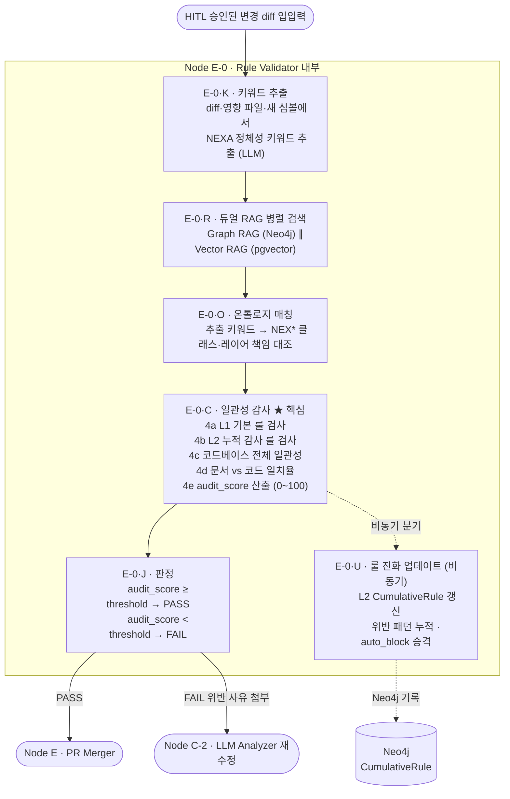

# Node E-0 · Rule Validator — 심층 설계 문서

> **NEXA OS CI 파이프라인 · 비기능 감사 노드** E2E 테스트 (Node B) 가 " 기능이 작동하는가 " 를 검증한다면, E-0 은 **"NEXA 답게 만들어졌는가 "** 를 검증하는 마지막 게이트입니다.

---

## 1. 역할 정의

|구분|Node B · E2E Tester|Node E-0 · Rule Validator|
|---|---|---|
|검증 성격|**기능적**|**비기능적**|
|질문|" 작동하는가?"|"NEXA 답게 만들어졌는가?"|
|대상|버튼·API·데이터 흐름|설계 철학·레이어 경계·네이밍·스키마|
|실패 시|코드 수정 루프|코드 수정 루프 (위반 사유 첨부)|

**E-0 이 잡아내는 대표 위반 유형:**

- Zod 스키마 우회 직접 타입 캐스팅
- 레이어 경계 침범 (예: UI 레이어에서 Repository 직접 호출)
- NEX* 네이밍 컨벤션 위반
- Yjs CRDT 를 통하지 않은 직접 State 변이
- Ontex/NEXIA 도메인 경계 위반


---

## 2. 내부 5 단계 구조



> **E-0·U 는 판정 (J) 과 비동기로 분리됩니다.** 룰 진화 업데이트가 판정 속도를 블로킹하지 않습니다. 판정 먼저 → 업데이트는 백그라운드에서 실행됩니다.

---

## 3. 듀얼 RAG 병렬 검색 (E-0·R)

직렬 실행 대비 약 25~40% 속도 단축을 목표로 합니다.

```json
[직렬 방식 — 기존]
  E-0·K (200ms) → Neo4j (800ms) → pgvector (600ms) → E-0·O (200ms)
  총: 약 1,800ms

[병렬 방식 — 채택]
  E-0·K (200ms)
      ├─ Neo4j  (800ms) ─┐
      └─ pgvector (600ms) ┴─ 머지 (800ms) → E-0·O (200ms)
  총: 약 1,200ms  ← 캐시 적중 시 추가 단축 가능
```

```python
import asyncio

async def step_r_dual_rag(keywords: list[str]) -> dict:
    graph_task  = asyncio.create_task(query_neo4j(keywords))    # 인과·5WHY 이력
    vector_task = asyncio.create_task(query_pgvector(keywords)) # 문서 유사 청크

    graph_result, vector_result = await asyncio.gather(
        graph_task, vector_task
    )

    # stale 판정: 두 결과의 타임스탬프 차이가 threshold 초 초과 시 가중치 차감
    STALE_THRESHOLD_SEC = 30
    ts_delta = abs(graph_result.ts - vector_result.ts)
    staleness_penalty = 5 if ts_delta > STALE_THRESHOLD_SEC else 0

    return {
        "graph":   graph_result.data,
        "vector":  vector_result.data,
        "staleness_penalty": staleness_penalty,
    }
```

---

## 4. 룰의 두 계층 — L1(헌법) vs L2(판례)

E-0 이 검사하는 룰은 단일 출처가 아닙니다. 성격과 진화 방식이 다른 두 계층입니다.

|계층|저장소|성격|진화 방식|비유|
|---|---|---|---|---|
|**L1 · 기본 룰**|`rules_db.json`|정적·선언적|아키텍트 수동 편집|헌법 원문|
|**L2 · 누적 감사 룰**|Neo4j `CumulativeRule` 노드|동적·자동 누적|E-0 실행 결과로 자동 갱신|판례집|

### L1 기본 룰 예시

```json
{
  "rule_id": "NEX-NAMING-001",
  "category": "naming",
  "statement": "모든 도메인 클래스는 'NEX' 접두사를 사용한다",
  "severity": "block",
  "created_at": "2026-01-01",
  "author": "architect"
}
```

### L2 누적 감사 룰 예시 (Neo4j 노드)

```json
(:CumulativeRule {
  rule_id:            "AUDIT-2026-06-24-007",
  pattern:            "Service 레이어에서 Repository 직접 호출",
  first_seen:         "2026-05-12",
  occurrence_count:   7,
  last_violation_diff: "abc123...",
  promotion_status:   "auto_block",     ← 3회 반복 시 자동 승격
  derived_from:       ["L1:NEX-LAYER-002", "5WHY-2026-05-12-001"]
})
```

### L2 자동 진화 사이클

```json
[1회차] 위반 발견
    └─▶ CumulativeRule 생성 (occurrence_count=1, status="watch")

[2회차] 동일 패턴 재발견
    └─▶ occurrence_count += 1  (status="watch" 유지)

[3회차] 누적 3회 도달
    └─▶ status="auto_block" 자동 승격 → 이후 즉시 차단

[N회차] 더 이상 발생 안 함
    └─▶ 180일 후 status="deprecated" 자동 강등
```

### L1 ↔ L2 상호작용

```json
L2 위반 → Neo4j에서 가장 가까운 L1 룰 역추적 → 5WHY 보고서에 기록
L2 패턴 빈발 → 아키텍트 검토 후 L1 정식 편입 (승격)
L1 수정 → 영향받는 L2 노드 자동 무효화 (Neo4j 트리거)
```

---

## 5. audit_score 산출 구조 (E-0·C 4e 단계)

점수는 100 점 만점에서 위반 항목별로 차감됩니다.

|위반 항목|차감|비고|
|---|---|---|
|L1 기본 룰 위반 (`block` 등급)|-40 점|단독으로 임계값 미달 가능|
|L2 `auto_block` 패턴 매칭|-30 점|3 회 누적 자동 승격된 패턴|
|코드베이스 일관성 충돌|-15 점|기존 패턴과 구조적 충돌|
|문서 vs 코드 일치율 저하|-10 점|RAG 회수 스펙과 diff 의미 불일치|
|staleness_penalty|-5 점|RAG 결과 타임스탬프 불일치 시|

```python
def calculate_audit_score(violations: list[dict], staleness_penalty: int) -> int:
    score = 100
    deduction_map = {
        "l1_block":        40,
        "l2_auto_block":   30,
        "codebase_conflict": 15,
        "doc_mismatch":    10,
    }
    for v in violations:
        score -= deduction_map.get(v["type"], 5)
    score -= staleness_penalty
    return max(score, 0)  # 음수 방지
```

**임계값 설정 (Logex 노드 설정):**

```python
AUDIT_CONFIG = {
    "audit_threshold":   80,    # 이 점수 미만 시 FAIL
    "max_rag_chunks":    12,    # RAG 회수 최대 청크 수
    "enable_graph_rag":  True,  # Neo4j RAG 활성 여부
    "l2_deprecation_days": 180, # L2 자동 강등 기준일
}
```

---

## 6. E-0·U 룰 진화 업데이트 — 비동기 처리 및 실패 처리

### 비동기 분리 이유

E-0·U(룰 업데이트) 를 판정 (J) 경로에 직렬로 넣으면 Neo4j 쓰기 지연이 판정 속도에 영향을 줍니다. 판정과 업데이트는 서로 독립적이므로 비동기로 분리합니다.

```python
async def node_e0(state: PipelineState):
    # 1. 감사 실행
    audit_result = await run_audit(state)

    # 2. 판정 (즉시)
    decision = judge(audit_result)

    # 3. 룰 진화 업데이트 (비동기 — 판정을 블로킹하지 않음)
    asyncio.create_task(update_cumulative_rules(audit_result))

    return decision
```

### E-0·U 실패 처리 전략

Neo4j 쓰기 실패 시 판정 결과는 유지하되 업데이트만 재시도합니다.

```json
Neo4j 쓰기 실패
    ├─ 판정(J) 결과: 영향 없음 (이미 반환됨)
    ├─ 1차: 즉시 재시도 (1회)
    ├─ 2차: 실패 시 → Redis 큐에 적재 (비동기 재처리)
    └─ 3차: Redis도 실패 시 → S3 감사 로그에 "update_pending" 플래그 기록
             └─ 다음 E-0 실행 시 pending 항목 일괄 처리
```

---

## 7. Audit Trail Persistence — 감사 이력 영구화

E-0 판정 시 4 종 데이터를 원자적으로 동시 기록합니다.

```json
E-0·J 판정 (Atomic Write)
  ├─ ① RAG 청크 스냅샷      → 당시 회수한 pgvector·Neo4j 원문
  ├─ ② 온톨로지 매칭 결과   → 어떤 NEX* 클래스와 대조했는지
  ├─ ③ L2 룰 매칭 트레이스  → 어떤 L2에 걸렸는지
  └─ ④ 코드 diff + 환경 컨텍스트 → neo4j_version, llm_version 포함
```

**S3 저장 구조:**

```json
s3://nexa-audit-trail/
  └─ year=2026/month=06/day=24/
       └─ run_id=abc123/
            ├─ decision.json          ← 판정 결과 + audit_score + 위반 목록
            ├─ rag_chunks.parquet     ← RAG 회수 원문 (pgvector + Neo4j)
            ├─ ontology_matches.parquet
            ├─ code_diff.patch
            └─ env_context.json       ← LLM 버전, Neo4j 버전, 임계값 설정
```

**저장 정책 (Logex 노드 설정):**

```python
AUDIT_STORAGE_CONFIG = {
    "audit_retention_days":  730,        # 기본 2년 보존
    "audit_storage_class":   "tiered",   # 표준 30일 → IA 90일 → Glacier 잔여
    "audit_compress":        "snappy",   # Parquet + Snappy
}
```

**감사 이력 3 가지 용도:**

```json
① 사람 재審     → "왜 반려됐는가?" 당시 근거 즉시 제시
② 컴플라이언스  → SOC2/ISO 감사 시 완전한 결정 추적성 확보
③ LLM 학습 자산 → 판정 + 근거 쌍 = fine-tuning 데이터셋 (6개월치 누적)
```

---

## 8. L2 Pruning — 판례 정제 메커니즘

비대해지는 룰셋을 건강하게 유지하는 2 단계 정리 프로세스입니다.

```json
[Phase 1 · 소프트 삭제 — 자동]
  휴면 180일 경과 (l2_deprecation_days 설정값)
    └─▶ status: "active" → "deprecated"
         last_seen_at 보존 · 매칭 제외 (조회는 가능)

[Phase 2 · 하드 삭제 — 휴먼 승인 필수]  ← 나쁜 관례 방지 핵심
  deprecated 상태로 30일 추가 경과
    └─▶ Omni 트레이에 "판례 승인 요청" 발행
         ├─ 아키텍트 결정: 유지 / 폐기 / L1 승격
         └─ 미응답 14일 → 자동 폐기
```

> **단순 자동 삭제를 하지 않는 이유:** 기계가 잘못 학습한 " 나쁜 관례 " 가 자동 삭제되면 기록이 사라집니다. 휴먼 승인 단계가 " 기계 학습 오류 필터 " 역할을 합니다.

---

## 9. 종합 성능 목표

|메커니즘|효과|
|---|---|
|듀얼 RAG 병렬화|E-0 응답 시간 25~40% 단축|
|E-0·U 비동기 분리|판정 속도 Neo4j 쓰기 지연으로부터 독립|
|L2 Pruning|룰셋 비대화 방지 · 나쁜 관례 차단|
|Audit Trail 영구화|결정 투명성 + fine-tuning 데이터 자산화|
|audit_score 가중치|임계값 설정의 명확한 의미 부여|

---

## 10. 미확정 사항 (다음 단계 결정 필요)

|항목|현재 상태|결정 필요 내용|
|---|---|---|
|E-0·C 4 단계 병렬화|옵션 수준|AST 풀스캔 + L2 매칭 동시 실행 여부|
|E-0 룰 위반 재수정 루프|C-2 로 반송|C-2 반송 vs HITL 상승 중 선택|
|`audit_threshold` 기본값|80 점 제안|프로젝트 초기 실전 데이터로 조정 필요|
|L2 `auto_block` 기준 횟수|3 회|실제 위반 빈도 보고 조정 가능|

---

_문서 버전: v1.0 | 작성일: 2026-06-24_ _상위 문서: NEXA OS CI 에이전트 파이프라인 v8_
