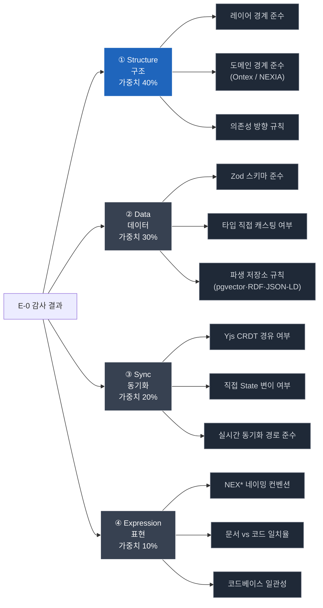

# Node E-0 · 감사 분류 체계 (Audit Dimensions)

> **NEXA OS CI 파이프라인 · E-0 Rule Validator 하위 문서** 통과/실패 이진 판정을 넘어, **" 어느 차원에서 얼마나 NEXA 다운가 "** 를 다차원으로 기록합니다. 이 데이터는 Retro Auditor 의 소급 재감사 우선순위와 LLM fine-tuning 데이터셋의 기반이 됩니다.

---

## 1. 설계 원칙

**왜 등급 (Grade) 이 아닌 분류 체계 (Dimensions) 인가:**

```json
등급제 (기존):  audit_score 82 → "B등급 통과"
               → "왜 B인가?" 알 수 없음
               → 다음 신기술 도입 시 어디를 먼저 볼지 알 수 없음

분류 체계 (신규): audit_score 82 → "구조 70 / 데이터 95 / 동기화 100 / 표현 85"
               → "구조가 약하다" 즉시 확인
               → 신기술 도입 시 구조 점수 낮은 파일 우선 재검토
               → 기술 부채의 성격이 정확히 추적됨
```

**핵심 철학:**

> 구조가 흔들리면 나머지는 전부 의미가 없다. 따라서 4 개 차원은 동등하지 않습니다. **구조 (Structure) 가 최우선**입니다.

---

## 2. 4 축 분류 체계



---

## 3. 각 차원 상세 정의

### ① Structure · 구조 (가중치 40%)

> NEXA OS 의 가장 근본적인 설계 원칙 준수 여부. 구조 위반은 기능 테스트를 통과해도 전체 시스템 일관성을 무너뜨립니다.

|세부 항목|설명|위반 예시|
|---|---|---|
|레이어 경계 준수|UI·Service·Repository·Infra 레이어 간 허용된 방향으로만 의존|UI 레이어에서 Repository 직접 호출|
|도메인 경계 준수|Ontex / NEXIA 7 탭 도메인 간 경계 침범 여부|Omnix 가 Ontex 내부 구현 직접 참조|
|의존성 방향 규칙|상위 레이어가 하위 레이어에만 의존 (역방향 금지)|Service 가 UI 컴포넌트를 import|

**Structure 점수 산출:**

```python
structure_score = 100
if layer_boundary_violated:    structure_score -= 50  # 즉시 FAIL 가능
if domain_boundary_violated:   structure_score -= 30
if dependency_direction_wrong: structure_score -= 20
```

> **Structure 점수 < 60 → 다른 차원 무관하게 즉시 FAIL** 구조가 흔들린 코드는 나머지 점수와 무관하게 통과시킬 수 없습니다.

---

### ② Data · 데이터 (가중치 30%)

> Zod 스키마를 canonical source of truth 로 삼는 NEXA 데이터 철학 준수 여부. 모든 파생 저장소 (pgvector, RDF, JSON-LD) 는 Zod 스키마에서 재생성 가능한 뷰여야 합니다.

|세부 항목|설명|위반 예시|
|---|---|---|
|Zod 스키마 준수|모든 데이터 정의가 Zod 를 통과하는가|`as any` 캐스팅으로 Zod 우회|
|타입 직접 캐스팅|타입 안전성 우회 여부|`(data as UserType)` 직접 캐스팅|
|파생 저장소 규칙|pgvector·RDF·JSON-LD 가 Zod 에서 파생되는가|pgvector 스키마를 Zod 외부에서 독립 정의|

**Data 점수 산출:**

```python
data_score = 100
if zod_bypassed:               data_score -= 40
if direct_type_casting:        data_score -= 30
if derived_store_independent:  data_score -= 30
```

---

### ③ Sync · 동기화 (가중치 20%)

> Yjs CRDT 를 실시간 동기화의 단일 경로로 삼는 원칙 준수 여부. 직접 State 변이는 협업 일관성과 LLM Awareness 참여를 파괴합니다.

|세부 항목|설명|위반 예시|
|---|---|---|
|Yjs CRDT 경유|모든 State 변경이 Yjs 를 통과하는가|Yjs 없이 직접 React state 변경|
|직접 State 변이|Yjs 우회 직접 변이 여부|`zustand.setState()` 직접 호출|
|동기화 경로 준수|LLM Awareness 참여 경로 유지 여부|LLM 을 Awareness 에서 배제한 구현|

**Sync 점수 산출:**

```python
sync_score = 100
if yjs_bypassed:              sync_score -= 50
if direct_state_mutation:     sync_score -= 30
if llm_awareness_excluded:    sync_score -= 20
```

---

### ④ Expression · 표현 (가중치 10%)

> 코드가 NEXA 의 언어와 문서 체계 안에서 읽히는가. 표현 위반은 기능에 영향을 주지 않지만 장기적으로 코드베이스 가독성과 문서 일치율을 저하시킵니다.

|세부 항목|설명|위반 예시|
|---|---|---|
|NEX* 네이밍 컨벤션|`-ex` / `-x` 접미사, 5 자 라벨 등 규칙 준수|`OmniTab` 대신 `OmnixTab` 미사용|
|문서 vs 코드 일치율|RAG 회수 스펙 문서와 실제 구현 의미 일치|기획서에 명시된 동작과 다른 구현|
|코드베이스 일관성|기존 유사 패턴과 구조적 일치 여부|동일 레이어 내 파일 간 패턴 불일치|

**Expression 점수 산출:**

```python
expression_score = 100
if naming_convention_violated: expression_score -= 40
if doc_code_mismatch:          expression_score -= 40
if codebase_inconsistency:     expression_score -= 20
```

---

## 4. 종합 audit_score 산출

```python
def calculate_audit_score(dimensions: dict, staleness_penalty: int = 0) -> dict:
    weights = {
        "structure":  0.40,
        "data":       0.30,
        "sync":       0.20,
        "expression": 0.10,
    }

    weighted_score = sum(
        dimensions[dim]["score"] * weight
        for dim, weight in weights.items()
    )

    audit_score = round(weighted_score - staleness_penalty)

    # 구조 점수 60 미만 → 즉시 FAIL (다른 차원 무관)
    structure_hard_fail = dimensions["structure"]["score"] < 60

    return {
        "audit_score":          audit_score,
        "passed":               audit_score >= 80 and not structure_hard_fail,
        "structure_hard_fail":  structure_hard_fail,
        "dimensions":           dimensions,
    }
```

---

## 5. 감사 결과 데이터 구조

E-0 판정 시 PASS·FAIL 무관하게 전체 차원 데이터를 보존합니다.

```python
{
  "file":             "ontex/service.ts",
  "run_id":           "abc123",
  "audit_score":      82,
  "passed":           True,
  "structure_hard_fail": False,

  # ── 4축 차원별 상세 ──
  "dimensions": {
    "structure": {
      "score":      70,
      "weight":     0.40,
      "violations": [
        {
          "type":      "layer_boundary",
          "severity":  "warning",        # block / warning / info
          "detail":    "Service에서 Repository 직접 참조 (경미)",
          "deduction": 30,
        }
      ]
    },
    "data": {
      "score":      95,
      "weight":     0.30,
      "violations": []
    },
    "sync": {
      "score":      100,
      "weight":     0.20,
      "violations": []
    },
    "expression": {
      "score":      85,
      "weight":     0.10,
      "violations": [
        {
          "type":      "naming_convention",
          "severity":  "info",
          "detail":    "NEX* 접미사 누락 1건",
          "deduction": 15,
        }
      ]
    }
  },

  # ── 소급 감사 우선순위 ──
  "ruleset_version":   "v3.2",          # 통과 당시 룰셋 버전
  "reaudit_priority":  "high",          # structure 약점 → high 자동 설정
  "weak_dimensions":   ["structure"],   # 임계값 이하 차원 목록
}
```

---

## 6. reaudit_priority 자동 산출 규칙

통과한 파일도 차원별 점수에 따라 소급 감사 우선순위가 자동으로 부여됩니다.

|조건|reaudit_priority|설명|
|---|---|---|
|Structure < 75|`critical`|구조 약점 → 신기술 도입 시 1 순위|
|Data < 75|`high`|데이터 철학 약점|
|Sync < 75|`high`|동기화 경로 약점|
|Expression < 75|`low`|표현 약점 → 기능 영향 없음|
|모든 차원 ≥ 75|`normal`|정기 주기 재감사면 충분|
|Structure < 60|즉시 FAIL|통과 불가|

```python
def calculate_reaudit_priority(dimensions: dict) -> str:
    s = dimensions["structure"]["score"]
    d = dimensions["data"]["score"]
    sy = dimensions["sync"]["score"]

    if s < 75:   return "critical"
    if d < 75:   return "high"
    if sy < 75:  return "high"
    return "normal"
```

---

## 7. Retro Auditor 연결

이 분류 체계가 Retro Auditor(별도 시스템) 와 연결되는 방식입니다.

```json
E-0 감사 완료
    └─▶ dimensions + reaudit_priority → S3 Audit Trail 저장
                                         └─▶ Retro Auditor 인덱스 갱신

신기술 도입 (L1 룰 변경)
    └─▶ Retro Auditor가 reaudit_priority="critical" 파일 우선 추출
         └─▶ 백그라운드 소급 재감사 실행
              └─▶ 결과 → Omni 대시보드 + Telegram 알림
```

> **E-0 은 현재 변경 코드만 감사합니다.** 기존 통과 코드의 소급 재감사는 전적으로 Retro Auditor 책임입니다. E-0 은 Retro Auditor 가 소비할 " 재감사 우선순위 데이터 " 를 생산하는 역할만 합니다.

---

## 8. 미확정 사항

|항목|현재 상태|결정 필요 내용|
|---|---|---|
|차원별 가중치|40/30/20/10 제안|실전 데이터 축적 후 조정 필요|
|Structure hard fail 임계값|60 점 제안|초기 운영 후 조정 가능|
|reaudit_priority 기준|75 점 제안|파일 재감사 빈도 보고 조정|
|weak_dimensions 임계값|75 점 제안|priority 기준과 동일하게 유지|
|차원 추가 가능성|현재 4 축|NEXA 도메인 확장 시 Security 등 추가 고려|

---

_문서 버전: v1.0 | 작성일: 2026-06-24_ _상위 문서: Node E-0 · Rule Validator 심층 설계_ _연관 문서: NEXA OS CI 에이전트 파이프라인 v8 · Retro Auditor (미작성)_
