---
doc_id:
title: "NEXA BEE — 브랜드·장비 네이밍 체계 및 생태계 구축 전략"
category: "전략서"
domain: "양봉"
status: draft
created: 2026-09-28
updated: 2026-10-02
parent_doc:
implements_doc:
see_also:
  - "내검 스케너 - 소초광 특성 및 관리 시스템.md"
  - "레일캠-GRC 외부 보안·생태 플랫폼.md"
  - "레일캠-허니왜건 말벌 레이저 요격 전략.md"
  - "시스템-전력_예산_마스터.md.md"
  - "시스템-군별 격리판 기능.md"
  - "운영장비-하이브리드 다목적 챔버.md"
  - "운영장비-중력 온열 채밀기 (Gravity-Thermal Extractor).md"
  - "스마트 무선 양봉 관리기 및 검진 시스템 기획서.md"
  - "운영-판매 전략.md"
terms_standard: []
terms_nexa:
  - "NEXA Platform"
  - "NEXA Core"
  - "NEXA Shop"
  - "NEXA BEE"
  - "NEXA BEE Shop"
  - "Honey Vanguard"
  - "Terra Shelter"
  - "Hive Mind"
  - "NEXA BEE Proof"
  - "NEXA BEE Keeper"
---

# NEXA BEE — 브랜드·장비 네이밍 체계 및 생태계 구축 전략

최상위는 **`NEXA Platform`** 이다. 그 아래에 분야 (생산) 브랜드와 샵 (유통) 이 **형제**로 놓인다.
양봉 분야의 브랜드는 **`NEXA BEE`**, 양봉 전문 샵은 **`NEXA BEE Shop`** 이다.
판매는 양봉 상품에 한정하지 않으므로, 통합 샵 `NEXA Shop` 을 부모로 두고 그 아래에 **분야별 전문 샵을 붙였다 떼었다 할 수 있는 구조**로 둔다.
플랫폼 → 분야 → 유닛 → 장비 → 서비스·상품까지 한 이름 체계로 묶어, 문서·펌웨어·DB·마케팅이 같은 이름을 쓰게 하는 것이 목적이다.

---

## 설계 진행 체크리스트

이 문서와 관련 문서의 설계 진행 상황을 한곳에서 관리한다.
**A**는 장비들이 하나의 시스템으로 맞물리는 방식 (구조 개념), **B**는 수치·부품·규칙을 정하는 세부 설계, **C**는 문서 정리·연계 작업이다. A 가 B 의 전제가 되므로 A 부터 하나씩 정리한다.

### A. 내부 시스템 개념

- [x] **A1. 공간 계층·ID 체계** — 유닛 → 셀 블록 → 복합군 → 군 (육아실 + 저밀실) → Comb Frame → Cell 카트리지 계층과 ID 규칙 (센서 노드·로트 ID 포함). Memory Map·디지털 트윈·Proof·Story 를 잇는 기준 → **§8**
- [x] **A2. 제어 계층·통신 버스 지도** — Hive Mind → 모듈 MCU → 센서·구동부, 모듈별 버스 (USB3 허브, 포고 버스, ESP-NOW 등). MQTT·무선 절제 원칙·링크 인지형 업링크 포함 → **§9**
- [ ] **A3. 판단 권한 계층** — 센서 1 차 필터 → Hive Mind 최종 판단 → Keeper 앱 관리자 확인 → 무응답 시 기본 로직
- [ ] **A4. 운영 모드 상태도** — 주행·정박·채밀·월동·비상 모드와 모드별 장비 동작
- [ ] **A5. 자원 조정·우선순위** — 갠트리·Air Core·전력 공유 시 충돌 규칙, 전력 부족 시 차단 순서
- [ ] **A6. 감각 레이어 통합** — 시각·청각·후각·열각 레이어별 출처 장비, 유닛 전체 디지털 트윈 레이어
- [ ] **A7. 모듈 의존 관계** — 장비 간 필수 의존, 고장 시 영향 범위

**미결 질문:** 공간 계층 확인 필요 6 건 → §8.8

### B. 세부 설계 과제

- [ ] **B1. Tender Scan 판독·Comb Frame 캘리브레이션** — 밀개 비율·여왕검수 판독 기준, 포고 센서 캘리브레이션
- [ ] **B2. 센서 노드 보안·로그** — 보안 칩 선정, 서명 포맷, 해시 체인, 로컬 버퍼 용량과 허용 공백 시간 (§7.3). 이미 정한 가정: 매일 해시 앵커링 (§9.7.1), 로컬 보관 최대 2 주 (§9.7.4)
- [ ] **B3. 교차 검증 규칙** — Hive Mind 이상 탐지 규칙과 불시 현장 확인 절차 (§7.3.1)
- [ ] **B4. Proof Score 기준** — 항목별 가중치, 등급 기준치, 혜택 비용 한도 (§7.4)
- [ ] **B5. Terra Shelter 가변 레이아웃** — 캠퍼 전환을 고려한 랙·침상·출입문

### C. 문서 정리·연계

- [ ] **C1. 구 명칭 치환** — 기존 문서 파일명·본문의 구 명칭을 본 체계로 치환 (부록 A)
- [ ] **C2. 기존 문서 정합** — 스캐너 전용 ESP32 유선화, Guard Rail RS485 유선 데이터 검토 (§9.6), 스캐너 `frame_id` → `comb_id` (§8.6)
- [ ] **C3. NEXA Core 데이터 모델** — 상품·주문·정산 데이터 모델 (`shop_id`·`domain`) 설계 — 별도 문서

---

## 0. 핵심 방향 — 농가와 고객의 직접 연결

**농가와 고객을 직접 연결하고 데이터를 공유한다. 투명성이 쌓이면 신뢰가 되고, 신뢰는 판매 안정과 생산력 증가·안정으로 돌아온다.**
이 문서의 네이밍, 데이터 무결성 게이트 (§7.3), Keeper 혜택 (§7.4) 은 모두 이 목표를 위한 수단이다.

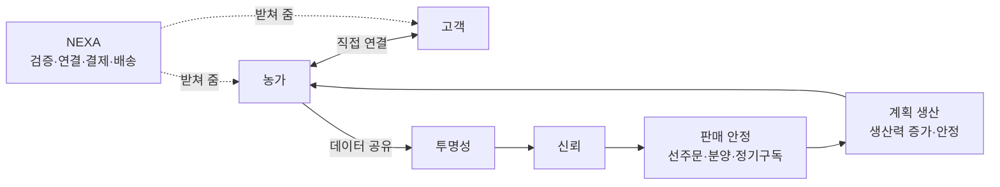

**NEXA 의 역할 = 신뢰 인프라.** 중간에서 마진을 떼는 유통업자가 아니라, 농가와 고객이 서로 믿을 수 있게 **검증·연결·결제·배송**을 제공한다.
NEXA 의 수익은 거래 마진이 아니라 **인증·구독·장비**에서 얻는다. 그래야 NEXA·농가·고객의 이해관계가 부딪히지 않는다.

---

## 1. 네이밍 원칙

| 계층                  | 규칙                                                                               | 예                                                          |
| :------------------ | :------------------------------------------------------------------------------- | :--------------------------------------------------------- |
| **플랫폼** (최상위)       | `NEXA Platform`. 모든 분야·샵이 공통 서비스 `NEXA Core` 를 공유                                | NEXA Platform                                              |
| **분야** (생산 브랜드)     | `NEXA` + 분야명 대문자. 양봉은 항상 `NEXA BEE`                                              | NEXA BEE, (확장 예) NEXA FARM                                 |
| **통합 샵** (전문 샵의 부모) | `NEXA Shop` — 모든 전문 샵을 묶고, 분야를 넘나드는 구매를 한곳에서 처리                                  | NEXA Shop                                                  |
| **전문 샵**            | 분야명 + `Shop`. NEXA Shop 의 자식. 섹션으로도, 독립 스토어로도 운영. **" 몰 " 대신 " 샵 " 으로 통일해 전문점 성격을 부각** | NEXA BEE Shop, (확장 예) NEXA FARM Shop                       |
| **유닛** (차량·거점)      | `NEXA BEE` + 두 단어 고유명                                                            | NEXA BEE Honey Vanguard                                   |
| **자율 장비** (움직이고 판단) | **꿀벌 역할명** — 보모벌·경비벌·선풍벌·건축벌·정찰벌·청소벌                                             | Tender, Guard, Fanner, Builder, Scout, Cleaner              |
| **인프라·부품**          | **벌집 재료·구조명** — 벽·문·소비·화밀·향                                                      | Hive Wall, Hive Gate, Comb Frame, Nectar Power, Scent Node |
| **두뇌**              | 군집 지능 은유                                                                         | Hive Mind                                                  |
| **서비스·상품**          | `NEXA BEE` + 일반 단어                                                               | NEXA BEE Keeper, NEXA BEE Cell                             |
| **코드**              | 플랫폼 `NX-{서비스}` · 분야 `NB-{유닛}-{모듈 3자}[-{하위 3자}]` · 샵 `SH-{분야}` · DB/펌웨어는 소문자 `nb.hv.tender`  | NX-CORE, NB-HV-GRD, NB-HV-GRD-STG, SH-BEE                  |
| **표기**              | 외부 영문. 내부 문서는 첫 등장 1 회 한글 병기                                                      | Tender Gantry(텐더 갠트리)                                       |

역할명은 “그 장비가 벌집 안에서 어떤 벌의 일을 대신하는가”로 고른다. 이름만 들어도 기능이 짐작되게 하는 것이 기준이다.

---

## 2. 브랜드 구조

### 2.1 브랜드 계층

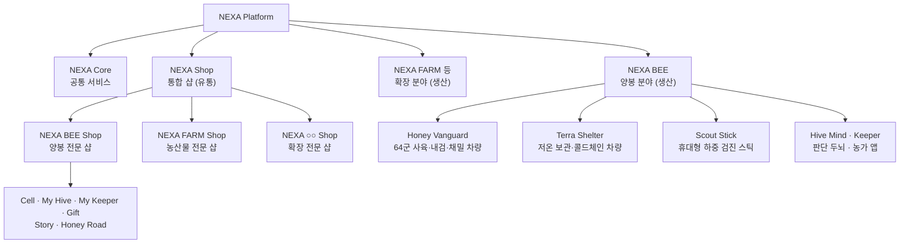

| 계층 | 형제 관계                                        | 부모–자식 관계            |
| :--- | :----------------------------------------------- | :------------------------ |
| 1 단  | NEXA Core · NEXA BEE · NEXA FARM · **NEXA Shop** | 모두 NEXA Platform 의 자식 |
| 2 단  | NEXA BEE Shop · NEXA FARM Shop · NEXA ○○ Shop    | 모두 **NEXA Shop 의 자식** |

장비 세부 구성은 §4·§5 표를 따른다.

### 2.2 생산 ↔ 전문 샵 연결 (인증)

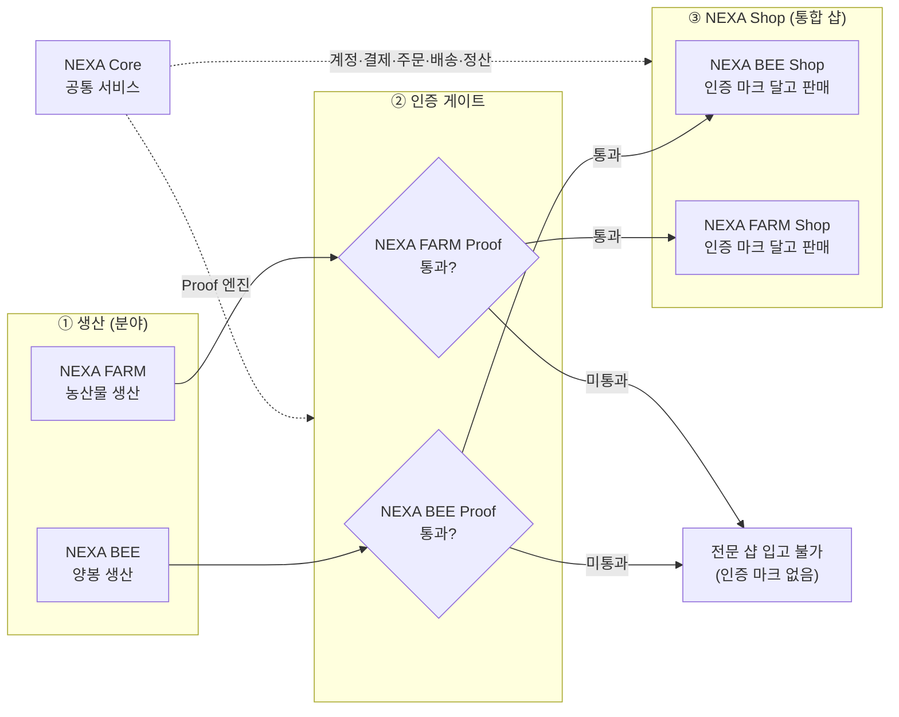

읽는 순서: **① 생산 → ② 분야별 인증 → ③ 해당 전문 샵**. 인증을 통과하지 못한 상품은 전문 샵에 들어가지 못한다.
`NEXA Core` 는 흐름의 한 단계가 아니라, 인증 엔진과 샵 운영 기능을 **밑에서 받쳐 주는 공통 기반**이다.

- **NEXA BEE(생산) 와 NEXA Shop(유통) 이 형제**이고, **NEXA BEE Shop 은 NEXA Shop 의 자식**이다.
- 생산 분야와 해당 전문 샵을 잇는 것은 분야별 Proof(인증) 하나다.
- 공통 기능은 `NEXA Core` 로 올려, 분야나 전문 샵이 늘어도 다시 만들지 않는다.

---

## 3. 유닛 (차량·거점)

| 코드        | 공식 명칭                                    | 구 명칭       | 정체성                                                |
| :-------- | :--------------------------------------- | :--------- | :------------------------------------------------- |
| **NB-HV** | **NEXA BEE Honey Vanguard** (허니 뱅가드) | 허니웨건 · 양봉카 | 64 군 사육·내검·채밀·카트리지 인출 + 정박 시 D2C 쇼룸                |
| **NB-TS** | **NEXA BEE Terra Shelter** (테라 쉘터)       | 냉장웨건       | 12V 펠티어 저온 보관·콜드체인 거점. 장래 트럭 캠퍼 전환 시 **이름 그대로 사용** |

두 유닛을 **기본 세트**로 부른다. (기존 기록 유지)

---

## 4. 장비 네이밍 표 — Honey Vanguard (NB-HV)

### 4.1 자율 장비 (꿀벌 역할명)

| 코드        | 공식 명칭                       | 구 명칭 / 원문서                   | 역할                                          | 이름 근거              |
| :-------- | :-------------------------- | :--------------------------- | :------------------------------------------ | :----------------- |
| NB-HV-TND | **Tender Gantry** (텐더 갠트리)   | 실내 스핀 - 갠트리                    | 몸체 1 대. 하위: Tender Arm · Tender Scan (§4.1.1)  | 보모벌 = 벌집 **안**을 돌봄 |
| NB-HV-GRD | **Guard Rail** (가드 레일)      | 가드 레일캠 (GRC) + M140 레이저      | 몸체 1 대. 하위: Guard Eye · Guard Sting (§4.1.1) | 경비벌 = 입구 **밖**을 지킴 |
| NB-HV-FAN | **Fanner** (패너)             | 히트펌프 / 펠티어 (신규)·급기 블로어·배기팬 (셀 블록당 2)·흡기 플랩 128 (갠트리 기계식)·역류 방지 플랩 128·챔버 연결 댐퍼 (평시 닫힘)·압력 샌드위치 공조 (제어 SW: Aero Profiler) | 냉난방·환기·제습·결로 수집                                   | 선풍벌 = 날갯짓으로 환기     |
| NB-HV-BLD | **Builder Chamber** (빌더 챔버) | 하이브리드 다목적 챔버                 | 밀랍 코팅, 왕대 코팅, 건열 소독, 해동, 화분 건조, 간이 채밀       | 건축벌 = 밀랍을 짓는 벌     |
| NB-HV-CLN | **Cleaner Tray** (클리너 트레이)  | 하단 슬라이딩 드로워                  | 노즐 A 로 떨어진 응애·부스러기 수거 → 별도 폐기                | 청소벌 = 사체·오물 반출     |

### 4.1.1 한 몸체 장비의 하위 모듈

**한 몸체 = 한 이름.** 전원·통신·정비·교체 단위가 같은 장비는 몸체 이름 하나로 부르고, 기능 부위는 하위 모듈로 둔다.
하위 코드는 `몸체 코드-{3자}` 로 붙인다.

| 몸체 | 하위 코드 | 하위 모듈 | 구 명칭 / 원문서 | 역할 | 비고 |
| :--- | :--- | :--- | :--- | :--- | :--- |
| Tender Gantry | NB-HV-TND-ARM | **Tender Arm** (텐더 암) | 스핀 - 갠트리 구동축·그리퍼 | 소초광 인출·재삽입, 포고 센싱, 소문 개폐 | 주간 작업 주체 |
| Tender Gantry | NB-HV-TND-SCN | **Tender Scan** (텐더 스캔) | 내검 스캐너 툴헤드 | USB 카메라 ×4, 8 채널 조명, UVC, 노즐 A/B, 마이크. 내검·여왕검수·표적 방제 | 야간 전수 내검 |
| Guard Rail | NB-HV-GRD-EYE | **Guard Eye** (가드 아이) | 레일캠 카메라·짐벌 | 순찰, 외부 보안·생태 센싱, 말벌 탐지·추적 | 기본 장착 |
| Guard Rail | NB-HV-GRD-STG | **Guard Sting** (가드 스팅) | M140 레이저 요격 | 말벌 조준·단펄스 요격. Guard Eye 추적 결과로만 발사 허가 | **옵션** — 규제·고객 선택에 따라 미장착 사양 가능 |

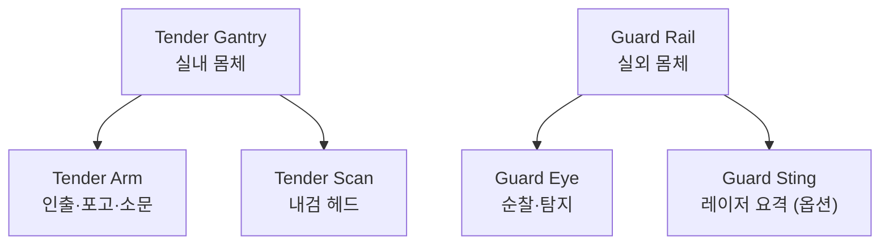

사양 표기 예: `Guard Rail (Sting 미장착)`, `Guard Rail + Sting`.

### 4.2 인프라·부품 (벌집 재료·구조명)

| 코드      | 공식 명칭                           | 구 명칭 / 원문서                            | 역할                                      |
| :-------- | :---------------------------------- | :------------------------------------------ | :---------------------------------------- |
| NB-HV-CMB | **Comb Frame** (콤 프레임)          | 커스텀 소초광 730×430                       | 매립 온도센서·포고 단자·광 ID             |
| NB-HV-WAL | **Hive Wall** (하이브 월)           | 군별 격리판                                 | 방별 온도, 개도 제어, 향 교환·합봉        |
| NB-HV-GAT | **Hive Gate** (하이브 게이트)       | 소문 시스템                                 | 도어 (5 단계 슬라이드: 닫힘·통풍 망·최소·축소·전개, Tender Gantry 조정·톱니 턱 고정), 마이크, IR 출입 카운터, 착륙 가이드 |
| NB-HV-SCN | **Scent Node** (센트 노드)          | BME688 + BSEC2                              | 후각·공기질 1 차 필터, 온습 보조           |
| NB-HV-HRV | **Harvest Drip** / **Harvest Spin** | 중력 온열 채밀기 / 2 매 저속 채밀기          | 채밀                                      |
| NB-HV-AIR | **Air Core** (에어 코어)            | 공압 컴프레서 + NC 솔밸브 팩                | 소초광 이격, 청소, 노즐 공급, 역류 방지 플랩 퍼지 (셀 블록별 퍼지 라인) |
| NB-HV-STN | **Stance Jack** (스탠스 잭)         | 수평 잭 ×4                                  | 정박 수평·하중 지지                       |
| NB-HV-PWR | **Nectar Power** (넥타 파워)        | DC 48V · 배터리 · 한전 농사용 · 발전기      | 전력                                      |
| NB-HV-BCN | **Hive Beacon** (하이브 비콘)       | 복합군 간판 LED · 군 ID 마커 LED · 착륙 LED | 귀소 유도·식별                            |
| NB-HV-SHD | **Shield** (실드)                   | 방재 · 비상 · 안전 인터록                   | E-stop, 화재, 챔버 잠금, 레이저 차단      |

### 4.3 두뇌

| 코드      | 공식 명칭                     | 구 명칭                                | 역할                                                               |
| :-------- | :---------------------------- | :------------------------------------- | :----------------------------------------------------------------- |
| NB-HV-MND | **Hive Mind** (하이브 마인드) | 메인 제어반 (라즈베리 파이 5 + 가속기) | Memory Map, 인간 판단 DB, 환경 매핑, 디지털 트윈, 최종 판단·제어권 |

---

## 5. 장비 네이밍 표 — Terra Shelter · Field

| 코드        | 공식 명칭                     | 구 명칭              | 역할                                    |
| :-------- | :------------------------ | :---------------- | :------------------------------------ |
| NB-TS-CLD | **Cold Rack** (콜드 랙)      | 저온 보관 랙           | 카트리지 슬롯별 ID 인식·입출고 시각·온도 서명 기록        |
| NB-TS-PLT | **Peltier Core** (펠티어 코어) | 12V 펠티어 공조        | 저온 유지·온도 로깅. 한계 초과 시 해당 카트리지 Proof 제외 |
| NB-FD-SCT | **Scout Stick** (스카우트 스틱) | NEXA 스마트 양봉 검진 스틱 | 휴대형 지렛대 로드셀·자이로 래치 하중 측정              |

Scout(정찰벌) 는 **밖에 나가 정보를 가져오는** 역할이라 휴대 장비에 붙인다.

---

## 6. 플랫폼·샵·서비스 네이밍

### 6.1 플랫폼 공통 (NEXA Core)

| 코드     | 공식 명칭                   | 내용                                                                    |
| :------- | :-------------------------- | :---------------------------------------------------------------------- |
| NX-CORE  | **NEXA Core**               | 계정 (통합 로그인), 결제, 주문, 배송, 정산, 상품 카탈로그, 데이터 저장소 |
| NX-STORY | **NEXA Story** (프레임워크) | QR 이력 페이지 엔진. 분야마다 인스턴스를 만든다 → `NEXA BEE Story`      |
| NX-PROOF | **NEXA Proof** (프레임워크) | 인증 규칙 엔진. 분야마다 인증 기준을 따로 둔다 → `NEXA BEE Proof`       |

### 6.2 생산 쪽 서비스 (NEXA BEE)

| 구분    | 공식 명칭           | 구 명칭 / 원문서   | 내용                                                  |
| :------ | :------------------ | :----------------- | :---------------------------------------------------- |
| 농가 앱 | **NEXA BEE Keeper** | 인간 판단 대시보드 | 알림, 터치·음성 수치 라벨, 무왕 대응 선택, 원격 관제  |
| 인증    | **NEXA BEE Proof**  | Proof of Quality   | 데이터 무결성·콜드체인 기준을 통과한 출하분 인증 마크 |
| 이력    | **NEXA BEE Story**  | 제품 출생 이력서   | QR → 탈거 시각·위치·당시 벌통 기후 타임라인           |

### 6.3 유통 쪽 — 샵 구조

| 코드      | 공식 명칭            | 구 명칭          | 내용                                                             |
| :-------- | :------------------- | :--------------- | :--------------------------------------------------------------- |
| SH-ALL    | **NEXA Shop**        | —                | 통합 샵 (전문 샵의 부모). 모든 분야 상품 교차 구매·통합 장바구니 |
| SH-BEE    | **NEXA BEE Shop**    | NEXA 꿀벌 팩토리 | 양봉 전문 샵. 라이브 대시보드 메인                               |
| SH-{분야} | **NEXA {분야} Shop** | —                | 확장 분야 전문 샵 (예: NEXA FARM Shop)                           |

### 6.4 전문 샵 분리 원칙

전문 샵은 아래 3 단계 중 어느 형태로도 운영할 수 있어야 한다. **어떤 형태든 같은 NEXA Core 위에서 돈다.**

| 운영 형태         | 모습                                                               | 쓰는 시점                  |
| :---------------- | :----------------------------------------------------------------- | :------------------------- |
| **① 섹션**        | NEXA Shop 안의 분야 카테고리                                       | 초기. 상품 수가 적을 때    |
| **② 독립 스토어** | 자체 도메인·디자인·메뉴를 가진 전문 샵. 계정·결제·주문은 Core 공유 | 분야 상품·팬층이 커졌을 때 |
| **③ 분리 운영**   | 파트너·별도 법인이 운영, Core API 만 사용, 정산 독립                | 프랜차이즈·지역 파트너     |

이 이동이 코드·데이터 재작업 없이 가능하려면 처음부터 다음을 지킨다.

1. **상품·주문 데이터에 `shop_id`·`domain` 필드 필수** — 섹션에서 독립 스토어로 옮겨도 데이터를 옮길 필요가 없다.
2. **정산 단위 = 샵** — 섹션 단계에서도 샵별 매출·수수료를 따로 집계한다.
3. **관리자 권한 = 샵 단위** — 분야 담당자는 자기 샵만 관리한다.
4. **디자인·메뉴는 샵별 테마** — 공통 컴포넌트 위에 분야별 테마만 바꾼다.
5. **분야 전용 기능은 샵에 둔다** — `My Hive`, `Honey Road` 는 양봉 전용이므로 NEXA BEE Shop 소속.
6. **인증·이력은 Core 프레임워크 + 분야 규칙** — 새 분야가 들어오면 인증 기준만 새로 정의한다.
7. **입고 조건** — 전문 샵은 해당 분야 Proof 를 통과한 상품만 인증 마크를 달고 판매한다.

### 6.5 NEXA BEE Shop 상품

| 공식 명칭         | 구 명칭                        | 내용                                               |
| :---------------- | :----------------------------- | :------------------------------------------------- |
| **NEXA BEE Cell** | 미니 통벌꿀 카트리지 250/500 g | 셀 (육각방) 단위 벌집꿀                             |
| **My Hive**       | 디지털 분양 상품               | 구역 지분 선매수, 시즌 중 실시간 관람 후 출하      |
| **NEXA BEE Gift** | 기업 커스텀 선물               | 기업 스토리 결합 전용 이력 페이지                  |
| **Honey Road**    | 채밀 경로                      | 남→북 이동 지도, 정박지 관광 연계 (기존 이름 유지) |
| **My Keeper**     | —                              | **특정 농가 정기구독**. 고객이 농가를 골라 시즌 물량을 정기 배송받음 (§7.5) |

`Comb Frame`(소초광) 과 상품명이 겹치지 않도록 상품은 **Cell**로 분리했다.

---

## 7. 생태계 구축 전략

### 7.1 구조 — 5 개 층

| 층        | 구성                                                       | 핵심 가치                           |
| :------- | :------------------------------------------------------- | :------------------------------ |
| **하드웨어** | Honey Vanguard, Terra Shelter, Scout Stick              | 무인·표준화된 사육 공정                   |
| **지능**   | Hive Mind + 인간 판단 DB                                     | 농가가 늘수록 판정 정확도가 오르는 데이터 자산      |
| **신뢰**   | NEXA BEE Proof (데이터 무결성·이력·콜드체인)                         | “농법은 자유, 데이터로 검증된 꿀만 인증”        |
| **유통**   | NEXA Shop → NEXA BEE Shop (My Hive, Gift, B2B) · 확장 전문 샵 | 오픈마켓 최저가 경쟁 탈피, 분야 추가 시 재구축 불필요 |
| **커뮤니티** | Keeper 등급 (농가), My Hive(분양자), Honey Road(방문객)            | 기준 준수 동기, 재방문·재구매               |

### 7.2 선순환

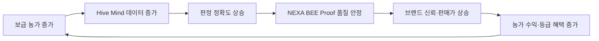

모델 성능보다 **샘플 양·질**이 병목이다. 그래서 Keeper 앱의 터치·음성 라벨 입력 UX 가 생태계 전체의 속도를 결정한다.

### 7.3 NEXA BEE Proof — 데이터 무결성 게이트

**원칙: 농법은 농가 자유, 데이터는 NEXA 가 검증.**
장비를 기계적으로 잠그지 않는다. 농가는 자기 농법대로 사육·채밀·자가 판매를 자유롭게 한다.
대신 **NEXA 가 검증할 수 있는 데이터 이력**이 이어진 생산분만 NEXA BEE Proof 를 받고 NEXA BEE Shop 에 입고된다.
측정 연결을 끊는 것은 농가의 선택이며, 그 기간 생산분은 **인증·혜택 대상에서 빠질 뿐 제재가 아니다.**
NEXA 의 역할은 통제가 아니라 **기준을 잘 지킬수록 더 큰 혜택을 주는 것**이다 (§7.4).

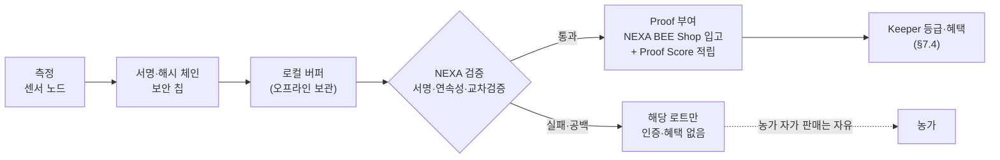

#### 7.3.1 변조하면 반드시 드러나는 구조

" 변조 불가 " 는 데이터 층에서만 가능하다. 센서 자체를 속이는 공격은 서명으로 못 막으므로 4 개 층으로 막는다.

| 층 | 방법 | 막는 것 |
| :--- | :--- | :--- |
| **디지털 서명** | 센서 노드 보안 칩 (기기 고유 키) 이 측정값마다 서명·시각을 붙이고, 각 기록에 이전 기록 해시를 포함 | 값 수정, 기록 삭제, 순서 조작 |
| **물리 봉인** | 케이스 개봉 감지 스위치, 봉인 라벨 | 기기 분해, 센서 교체 |
| **교차 검증** | 무게·온도·음향·영상·후각의 상호 일관성을 Hive Mind 가 이상 탐지 | 센서 앞 가짜 환경 조성 |
| **현장 확인** | 불시 검수, 샘플 성분·잔류 검사 | 데이터로 안 보이는 부정 |

#### 7.3.2 끊김 판정 — 통신 장애와 의도적 차단 구분

이동 양봉 특성상 통신 두절은 흔하다. 기기는 서명된 로그를 로컬에 보관하고, 재연결 시 일괄 업로드한다. **로그가 온전하면 이력은 연속으로 인정**한다.

| 판정 | 조건 |
| :--- | :--- |
| **정상** | 서명 일치 + 해시 체인 연속 + 봉인 정상 |
| **끊김** | 서명 불일치, 해시 체인 공백, 봉인 개봉, 허용 공백 시간 초과 중 하나 |
| **조작 의심** | 교차 검증 이상이 반복되거나 현장 확인에서 불일치 |

허용 공백 시간은 로컬 버퍼 용량과 실제 운영 데이터를 보고 정한다.

#### 7.3.3 로트 처리 — 제재는 조작뿐

| 상황 | 결과 |
| :--- | :--- |
| 끊김 | **끊긴 기간 생산분만** 인증·혜택 없음. 농가 자가 판매는 자유. 나머지 로트는 정상 |
| 끊김 반복 | Proof Score 하락 (등급 혜택 감소) + 원인 점검 지원 (장비·통신 문제인지 확인) |
| 조작 확인 | **유일한 제재** — 계정 단위 NEXA BEE Shop 연동 정지, 등급 박탈 |

#### 7.3.4 공통 판정 기준

농법은 자유지만 Proof 최소 기준은 모든 농가에 똑같이 적용한다.

| 기준 | 데이터 출처 | 비고 |
| :--- | :--- | :--- |
| **사육 이력** | Tender Gantry · Comb Frame · Hive Gate · Hive Wall | 농법 강제 아님. 이력이 끊김 없이 기록됐는지를 본다 |
| **숙성도** | Tender Scan · Hive Mind | 밀개 면적 비율 (초기 가설 95%, 현장 KPI 로 확정) |
| **콜드체인** | Cold Rack · Peltier Core | 한계 온도·시간 이내 보관 기록 |
| **약제 사용** | 자가 입력 + 사진 증빙 + 잔류 검사 | 자동 측정 불가 항목 |

이 기준을 충족하면 Proof 를 받고, 얼마나 잘 지켰는지는 Proof Score 로 환산해 등급·혜택에 반영한다 (§7.4).

#### 7.3.5 데이터 소유권

- 원데이터는 **농가 소유**. NEXA 는 인증·이력·익명 통계 목적의 이용권을 가진다.
- 탈퇴 시 농가는 자기 데이터를 내보낼 수 있다.
- 농법이 달라도 데이터 형식이 같으므로, 쌓인 데이터는 “어떤 농법이 어떤 결과를 내는가”를 비교하는 Hive Mind 의 자산이 된다.

### 7.4 Keeper 혜택 프로그램

**제재가 아니라 혜택으로 품질을 끌어올린다.** 데이터 이력은 인증의 최소 입장 조건이고, 그 위에서 기준을 잘 지킬수록 등급과 혜택이 커진다.
NEXA 는 “어떤 혜택을 더 줄 것인가”를 계속 개발하는 것을 핵심 과제로 삼는다.

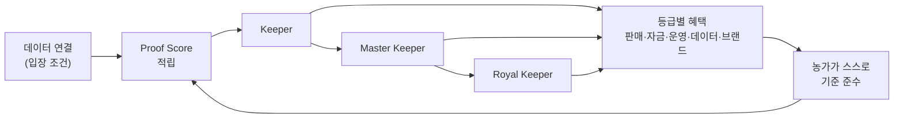

#### 7.4.1 Proof Score 산정 항목

| 항목 | 내용 | 데이터 출처 |
| :--- | :--- | :--- |
| **데이터 연속률** | 서명 로그가 끊김 없이 이어진 비율 | 센서 노드 서명·해시 체인 |
| **숙성도** | 밀개 면적 비율, 숙성 판독 결과 | Tender Scan · Hive Mind |
| **콜드체인 준수율** | 한계 온도·시간 이내 보관 비율 | Cold Rack · Peltier Core |
| **약제 기록 투명도** | 자가 입력·사진 증빙 완성도, 잔류 검사 결과 | Keeper 앱 · 현장 검사 |
| **교차 검증 청정도** | 이상 탐지 경보가 없는 기간 비율 | Hive Mind |
| **자동 측정 비율** | 자가 입력 대신 자동 측정으로 채운 항목 비율 | 장비 구성 |
| **판단 라벨 기여** | Keeper 앱 터치·음성 라벨 입력 수·품질 | Keeper 앱 → 인간 판단 DB |

**판단 라벨 기여**를 넣는 이유: 농가의 라벨이 Hive Mind 판정 정확도를 올리는 가장 비싼 자산이기 때문이다.
항목별 가중치와 등급 기준치는 직영·초기 파트너 농가 데이터로 정한다.

#### 7.4.2 등급

| 등급 | 조건 (초기안) | 성격 |
| :--- | :--- | :--- |
| **Keeper** | 데이터 연결 + Proof 최소 기준 충족 | 입장 등급 |
| **Master Keeper** | Proof Score 상위 구간을 한 시즌 유지 | 우수 농가 |
| **Royal Keeper** | 여러 시즌 최상위 + 조작 이력 없음 | 브랜드 대표 농가 |

등급 이름은 농가 앱 `NEXA BEE Keeper` 와 맞춘다 (앱 사용자 = Keeper).

#### 7.4.3 혜택 목록

| 분야 | 혜택 | NEXA 비용 | 대상 등급 (초기안) |
| :--- | :--- | :--- | :--- |
| **판매** | 샵 노출 우선, 메인 소개 | 낮음 | Master 이상 |
| **판매** | 상위 등급 전용 프리미엄 라벨 (예: Royal 라벨) | 낮음 | Royal |
| **판매** | My Hive 분양·B2B Gift 물량 우선 배정 | 낮음 | Master 이상 |
| **판매** | 판매 수수료 인하 | 높음 | 등급별 차등 |
| **판매** | NEXA 일정 물량 선매입 보장 | 높음 | Royal |
| **자금** | 정산 주기 단축 (빠른 정산) | 중간 | Master 이상 |
| **자금** | 장비 리스료·구독료 할인, 신형 장비 우선 교체권 | 중간 | 등급별 차등 |
| **운영** | 고급 AI 리포트 (여왕검수, 군세 예측) 무료 | 낮음 | Keeper 이상 |
| **운영** | 전문가 원격 상담 | 중간 | Master 이상 |
| **운영** | 소초·카트리지 틀·밀랍 자재 할인 | 중간 | 등급별 차등 |
| **데이터** | 라벨 기여 포인트 → 구독료 차감 | 낮음 | 전 등급 |
| **데이터** | “지역 평균 대비 내 벌통 성적” 리포트 | 낮음 | 전 등급 |
| **브랜드** | Story 페이지 농가 프로필·인증 배지 | 낮음 | 전 등급 (배지는 등급별) |
| **브랜드** | Honey Road 정박지 우선 선정, 관광 수익 공유 | 중간 | Royal |
| **커뮤니티** | 연간 시상, 신규 농가 멘토 수당, 교육 강사 기회 | 낮음 | Master 이상 |

#### 7.4.4 운영 원칙

1. **저비용 혜택부터** — 노출·배지·AI 리포트·빠른 정산으로 시작하고, 수수료 인하·선매입은 프리미엄 판매 수익이 확인된 뒤 연다.
2. **혜택 재원 = 인증 프리미엄** — 인증품과 비인증품의 가격 차이에서 나온다. 등급이 높을수록 판매가도 높아지는 구조여야 선순환이 된다.
3. **산식 공개 + 검증 유지** — Proof Score 산식은 공개해 “무엇을 잘하면 되는지” 알게 하고, 교차 검증·불시 현장 확인은 유지해 역이용을 막는다.
4. **혜택은 시즌 단위 재평가** — 등급은 시즌마다 다시 매긴다. 한 번 올라간 등급이 영구적이지 않아야 기준 준수가 지속된다.
5. **혜택 개발은 상시 과제** — 농가 설문·이용률 데이터로 효과 없는 혜택은 빼고 새 혜택을 추가한다.

### 7.5 농가–고객 직접 연결 운영

§0 핵심 방향을 실제로 돌리기 위한 장치다.

#### 7.5.1 직접 연결 수단

| 수단 | 내용 |
| :--- | :--- |
| **농가 프로필** | NEXA BEE Story 페이지에 농가 이름·농법·지역·Keeper 등급 표시 |
| **My Keeper** | 특정 농가 정기구독. 고객이 농가를 골라 시즌 물량을 정기 배송받음 |
| **My Hive** | 농가별 구역 분양. 시즌 내내 해당 벌통 데이터·영상 관람 |
| **농가 일지·라이브** | 농가가 Keeper 앱에서 작업 일지·사진·라이브를 고객에게 공유 |
| **Honey Road 방문** | 정박지에서 농가와 고객이 직접 만남 |

#### 7.5.2 데이터 공개 범위

원데이터를 그대로 보여주면 고객은 오히려 헷갈린다. **간단한 지표 먼저, 원하면 상세**로 보여준다.

| 층 | 공개 내용 | 공개 결정 |
| :--- | :--- | :--- |
| **1. 요약 지표** | Proof 통과 여부, 숙성도, 콜드체인 준수, Keeper 등급 | **필수 공개** (Proof 최소 항목) |
| **2. 시즌 타임라인** | 채밀 시각·위치, 벌통 기후 그래프, 이동 경로 | 기본 공개, 농가가 일부 비공개 가능 |
| **3. 상세 데이터** | 센서 원데이터, 내검 스틸컷, 농가 일지 | **농가 선택** |

#### 7.5.3 판매 안정 장치

| 장치 | 효과 |
| :--- | :--- |
| **선주문·My Hive 분양·My Keeper 구독** | 생산 전에 판매가 확정되어 가격과 물량이 안정됨 |
| **수요 데이터 환류** | 지역·상품별 수요를 농가에 돌려줘 다음 시즌 계획 생산에 활용 |
| **흉작 규칙 사전 고지** | 흉작 시 처리 규칙 (환불 / 대체 상품 / 다음 시즌 이월) 을 분양·구독 계약에 미리 명시 |

흉작도 데이터로 원인을 공유하면 고객이 이해하고 신뢰가 쌓인다. 투명성은 좋은 해뿐 아니라 나쁜 해에도 적용한다.

#### 7.5.4 운영 원칙

1. **머무를 이유로 붙잡는다** — 연결된 농가와 고객이 플랫폼 밖에서 거래하는 것을 규제로 막지 않는다. 인증·이력·결제·배송·Keeper 혜택이 플랫폼 안에서만 되고 수수료가 낮으면 떠날 이유가 없다.
2. **순위보다 성장** — 농가 간 비교 스트레스를 줄이기 위해, 고객·농가 화면에는 순위보다 “지난 시즌 대비 나의 변화”를 앞에 둔다.
3. **농가가 공개 범위를 정한다** — 필수 항목 외 공개는 농가 선택이며 언제든 바꿀 수 있다.

### 7.6 수익 구조

| 흐름     | 내용                                                                                             |
| :------- | :----------------------------------------------------------------------------------------------- |
| 하드웨어 | Honey Vanguard · Terra Shelter 판매 또는 리스                                                   |
| 구독     | Hive Mind 펌웨어·AI 판정·Keeper 앱                                                               |
| 샵       | NEXA BEE Shop 판매·My Hive 분양·B2B Gift, 확장 전문 샵·파트너 샵 (③ 분리 운영) 의 Core 이용 수수료 |
| 인증     | Proof 인증·이력 발급                                                                             |
| 소모품   | Cell 카트리지 틀, 소초, 밀랍 코팅 자재 (Builder Chamber 연계)                                    |

수치 (가격·수수료율) 는 직영 1 대 운영 실적이 나온 뒤 확정한다.
Keeper 혜택 (§7.4) 의 비용은 인증 프리미엄 수익 안에서 집행한다.
NEXA 는 **거래 마진을 수익 중심에 두지 않는다** (§0). 샵 수수료는 운영비를 덮는 낮은 수준으로 두고, 인증·구독·장비로 수익을 낸다.

### 7.7 단계 로드맵

| 단계               | 목표                                                                                                  | 완료 기준                                             |
| :----------------- | :---------------------------------------------------------------------------------------------------- | :---------------------------------------------------- |
| **0. 레퍼런스**    | 직영 Honey Vanguard + Terra Shelter 1 세트                                                            | 3 일 전수 내검·데이터 서명·콜드체인이 무인으로 한 시즌 가동 |
| **1. 브랜드 오픈** | NEXA Core + NEXA Shop 개설, NEXA BEE Shop 은 **① 섹션**으로 시작. Story · My Hive 개시                 | 직영 물량 판매, 라이브 대시보드 공개                  |
| **2. 농가 보급**   | Keeper 앱 + 하드웨어 패키지 + Proof 최소 기준. **Keeper 등급·저비용 혜택**, 농가 프로필·**My Keeper** 구독 시작 | 파트너 농가 소수 가동, 데이터가 Hive Mind 로 합류      |
| **3. 통합 유통**   | 다수 농가 물량을 Proof 인증으로 입고, NEXA BEE Shop **② 독립 스토어** 전환. Master·Royal 등급과 고비용 혜택 개방 | B2B·Gift 정기 납품                                    |
| **4. 확장**        | 다른 분야 전문 샵 추가 (①→②), 지역 파트너 샵 **③ 분리 운영**, Terra Shelter 캠퍼 전환, Honey Road 관광 | 양봉 외 매출원·비수기 매출원 확보                     |

### 7.8 리스크

| 리스크                 | 대응                                                                                                                                                |
| :--------------------- | :-------------------------------------------------------------------------------------------------------------------------------------------------- |
| 통신 두절              | 서명 로그 로컬 버퍼 + 재연결 일괄 업로드. 로그 온전하면 연속 인정 (7.3.2)                                                                           |
| 농가 반발              | 물리 통제 없음. 농법 자유 + 제재는 조작뿐 + 기준 준수 시 혜택 (7.3·7.4)                                                                             |
| 혜택 비용 과다         | 저비용 혜택부터, 고비용 혜택은 인증 프리미엄 수익 확인 후 개방 (7.4.4)                                                                              |
| 점수 역이용            | 산식 공개 + 교차 검증·불시 현장 확인 유지, 시즌 단위 재평가 (7.4.4)                                                                                 |
| 데이터 소유권          | 원데이터 농가 소유, NEXA 이용권, 탈퇴 시 내보내기 — 보급 계약에 포함 (7.3.5)                                                                        |
| 센서 속이기            | 서명만으로 못 막음 → 교차 검증 + 불시 현장 확인·잔류 검사 (7.3.1)                                                                                   |
| 상표                   | `NEXA` 단독은 타 업종 사용 사례가 있으므로, `NEXA Platform` · `NEXA Shop` · `NEXA BEE` 를 KIPRIS 검색 필요 (꿀·기계·소프트웨어·온라인 판매·SaaS 류) |
| 샵 분리 시 데이터 꼬임 | 초기부터 `shop_id`·샵별 정산·샵별 권한 적용 (6.4)                                                                                                   |
| 식품 규정              | 이력 표시·원산지·벌꿀 품질 기준을 Proof 기준과 정합                                                                                                 |
| 플랫폼 밖 직거래       | 규제 대신 머무를 이유 제공 — 인증·이력·결제·배송·혜택은 플랫폼 안에서만, 낮은 수수료 (7.5.4)                                                        |
| 흉작·분양 분쟁         | 흉작 처리 규칙 (환불·대체·이월) 계약 시 사전 고지, 원인 데이터 공유 (7.5.3)                                                                          |
| 농가 간 비교 스트레스  | 순위보다 “지난 시즌 대비 변화” 우선 표시, 공개 범위 농가 선택 (7.5.2·7.5.4)                                                                        |

---

## 8. 공간 계층·ID 체계

Memory Map, 디지털 트윈, Proof, Story, 샵 주문이 **같은 ID 하나로 이어지게** 하는 기준이다.

### 8.1 핵심 원칙

| 원칙 | 내용 |
| :--- | :--- |
| **위치 ID ≠ 개체 ID** | “어디에 있나”(위치 주소) 와 “무엇인가”(개체 ID) 를 분리한다. 소초광·카트리지·여왕은 움직이거나 바뀌므로 위치에 묶어 두면 이력이 끊긴다 |
| **개체 ID 는 영구·재사용 금지** | 폐기·사망·출하 후에도 번호를 다시 쓰지 않는다. 상태만 `retired` 로 바꾼다 |
| **모든 이동 = 이벤트** | 개체가 위치를 옮길 때마다 `개체 ID · 출발 · 도착 · 시각 · 수행 장비 · 서명` 을 남긴다. 이 기록이 곧 디지털 트윈과 Proof 이력이다 |
| **번호는 1 부터** | 사람이 읽는 번호는 모두 1 부터 시작한다 (기존 미아 방지 문서의 복합군 0~7 → 1~8 로 변환) |
| **표시 문자열 ≠ DB 키** | 화면·로그에는 사람이 읽는 주소 문자열, DB 에는 각 계층을 나눈 복합 키를 쓴다 |

### 8.2 공간 계층 (위치)

**용어 정의 — 위아래를 뜻하는 말은 두 가지로 나눈다: 복합군 위치는 " 층 ", 군 안의 쌓는 칸은 " 단 ".**

| 용어 | 영문 · 코드 | 뜻 | 혼동 방지 |
| :--- | :--- | :--- | :--- |
| **층** | Tier · `T1`·`T2` | 셀 블록 안에서 **복합군이 놓인 위아래 위치** | 기존 문서의 “복층 셀 블록”과 같은 뜻. 코드는 슬롯 `F` 와 겹치지 않게 `T` |
| **군** (봉군) | Hive · `H1`~`H4` | 여왕 1 마리가 이끄는 한 무리. **육아실 + 저밀실을 합친 단위** | 기존 Memory Map `hive_id` 와 같은 뜻 |
| **실** | Box · `B` / `S` | 군을 이루는 기능 구분. `B` = 육아실 (Brood), `S` = 저밀실 (Super) | 챔버 (Builder Chamber·내검 챔버) 와 겹치지 않게 영문은 Box |
| **단** | Level · 실 코드 뒤 숫자 | 실 안에서 **쌓는 칸의 순서**. 예: 저밀실 2 단 = `S1`·`S2` | 양봉 현장 용어 (단상·계상·2 단) 와 일치 |

**단 번호는 실마다 따로 센다.** `B1` / `S1`·`S2` 처럼 실 코드 뒤에 붙인다.
- “저밀 2 단”이 번호만으로 바로 읽힌다.
- 육아실이 2 단으로 늘어도 저밀실 번호가 밀리지 않는다.
- 현재 하드웨어가 실당 1 단이어도 ID 에는 단 번호를 넣어 둔다 (`B1`, `S1`). 2 단 저밀실 설계 시 갠트리 도달 범위·포고 단자·격리판 높이의 기준이 된다.

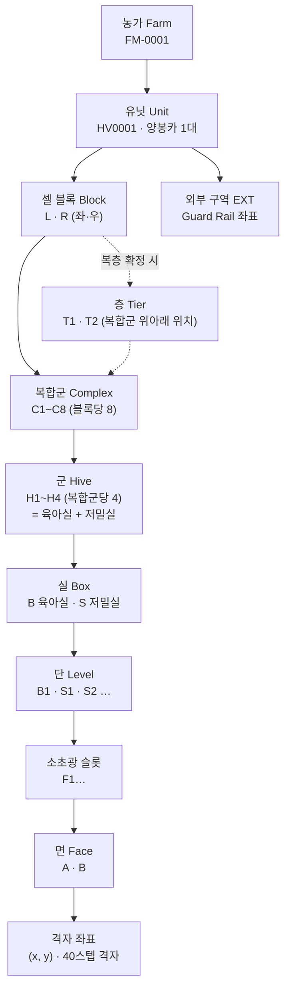

| 계층     | 코드                  | 개수 (유닛당)        | 물리 대응                                         | 비고                                     |
| :----- | :------------------ | :-------------- | :-------------------------------------------- | :------------------------------------- |
| 농가     | `FM-0001`           | —               | 농가 계정                                         | Keeper 앱 계정과 1:1                       |
| 유닛     | `HV0001` / `TS0001` | 1               | Honey Vanguard / Terra Shelter 차대            | 유닛 코드 + 일련번호                           |
| 셀 블록   | `L` · `R`           | 2               | 좌·우 셀 블록                                      | 공조 급배기 독립 제어 단위                        |
| 복합군    | `C1`~`C8`           | 블록당 8 → 16      | 복합군 구역, 150mm 간판 LED, 복합군 ID 피듀셜              |                                        |
| 층      | `T1` · `T2`         | (복층 확정 시)       | 셀 블록 안 복합군의 위아래 위치                            | 현재 주소에는 생략 (§8.7)                      |
| 군      | `H1`~`H4`           | 복합군당 4 → **64** | 여왕 1 마리, 육아실 + 저밀실, 소문 1 개 (칼라 1~4), 군 ID 마커 LED | 격리판으로 이웃 군과 나뉨                         |
| 실      | `B` · `S`           | 군당 2            | 육아실 · 저밀실                                     | 기능 구분                                  |
| 단      | `B1` · `S1` · `S2`… | 실당 1~n          | 실 안에서 쌓는 칸                                    | 현재 하드웨어 실당 1 단. 저밀실 2 단 확장 가능            |
| 소초광 슬롯 | `F1`…               | 단당 n            | 소초광이 꽂히는 자리                                   | 현재 기준 단당 1 (육아 64 · 저밀 64) — **확인 필요** |
| 면      | `A` · `B`           | 2               | 소초광 양면                                        | 스캐너 Cam1/Cam2 면 A·B 와 일치                |
| 격자 좌표  | `(x, y)`            | —               | Tender Scan 40 스텝 격자                            | 40 스텝 = ? mm 확정 후 mm 병기                 |
| 외부 구역  | `EXT`               | 블록당 1           | Guard Rail 순찰 면                               | 복합군 ID 피듀셜을 절대 앵커로 사용                  |

**위치 주소 표기 (사람이 읽는 형식)**

| 대상        | 표기                           | 읽는 법                          |
| :-------- | :--------------------------- | :---------------------------- |
| 군         | `HV0001.L3.H2`               | 1 호 양봉카 · 좌측 블록 3 번 복합군 · 2 번 군  |
| 단         | `HV0001.L3.H2.S2`             | 위 군의 저밀실 2 단                   |
| 소초광 슬롯    | `HV0001.L3.H2.S1.F1`          | 위 군 저밀실 1 단의 1 번 슬롯             |
| 격자 점      | `HV0001.L3.H2.B1.F1:A(12,07)` | 위 군 육아실 1 단 1 번 슬롯 소초광 A 면 (12, 07) |
| (복층 확정 시) | `HV0001.L.T2.C3.H2`           | 좌측 블록 · 2 층 · 3 번 복합군 · 2 번 군    |
| (복층 + 단)  | `HV0001.L.T2.C3.H2.S2.F1`     | 좌측 블록 · 2 층 · 3 번 복합군 · 2 번 군 · 저밀실 2 단 · 1 번 슬롯 |
| 외부 점      | `HV0001.L.EXT(x,y)`          | 좌측 외벽 Guard Rail 좌표           |
| 냉장 슬롯     | `TS0001.R2.S05`              | 1 호 테라 쉘터 · 2 번 랙 · 5 번 슬롯       |

### 8.3 개체 ID (무엇)

| 개체                   | ID 형식                    | 예                       | 부여 시점     | 식별 수단                            |
| :------------------- | :----------------------- | :---------------------- | :-------- | :------------------------------- |
| **Comb Frame** (소초광) | `CF-{6}`                 | `CF-000123`             | 제작·첫 투입   | 광 ID·QR → Tender Scan **Cam2** 판독 |
| **Cell** (카트리지)      | `CL-{8}`                 | `CL-00004512`           | 카트리지 틀 투입 | 띠지 QR (고객 Story 진입점)             |
| **여왕**               | `QN-{연도}-{4}`            | `QN-2027-0012`          | 신왕 확인·도입  | 가상 ID (군 + 확인 이력). 연도 색 마킹 병행 가능 |
| **장비**               | `{모듈 코드}-{4}`            | `NB-HV-WAL-0003`        | 출고        | 명판 + 펌웨어 등록 (§4 모듈 코드 재사용)       |
| **센서 노드**            | `SN-{6}`                 | `SN-000871`             | 출고        | 보안 칩 공개키 등록 (§7.3 서명 주체)         |
| **로트**               | `LT-{유닛}-{YYYYMMDD}-{2}` | `LT-HV0001-20270515-01` | 채밀·인출 배치  | Proof·Story 묶음 단위                |
| **주문**               | `OD-…`                   | —                       | NEXA Core | 샵 영역. 여기서는 연결만 정의                |

### 8.4 연결 (바인딩) — 개체가 지금 어디 있나

개체 ID 와 위치 주소를 **기간을 가진 연결 기록**으로 잇는다. 현재 위치 = `to` 가 비어 있는 기록.

| 연결 | 예 | 바뀌는 때 |
| :--- | :--- | :--- |
| Comb Frame ↔ 슬롯 | `CF-000123` @ `HV0001.L3.H2.B1.F1` | 내검 인출·재삽입, 채밀, Builder Chamber 소독 |
| 여왕 ↔ 군 | `QN-2027-0012` @ `HV0001.L3.H2` | 신왕 교체, 무왕, 합봉 |
| Cell ↔ 소초광 칸 | `CL-00004512` @ `CF-000456` (X-03, Y-02) | 투입, 인출 |
| Cell ↔ 로트 | `CL-00004512` ∈ `LT-HV0001-20270515-01` | 인출 시 1 회 (변경 불가) |
| Cell ↔ 냉장 슬롯 | `CL-00004512` @ `TS0001.R2.S05` | 입고·출고 |
| 장비·센서 ↔ 위치 | `SN-000871` @ `HV0001.L3.H2~H3` (격리판) | 설치·교체 |

격리판처럼 **두 군 사이**에 있는 장비는 `H2~H3` 처럼 양쪽 군을 함께 표기한다.

### 8.5 카트리지 한 개의 전체 이력 (예)

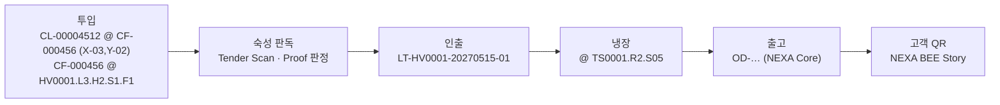

같은 ID 사슬로 “어느 양봉카·어느 복합군·어느 군의 어느 여왕 아래서, 어떤 기후에서 숙성되어, 몇 도로 보관됐는지”를 끝까지 따라간다.

### 8.6 기존 문서 키와의 정합

| 기존 키 (문서) | 새 기준 | 조치 |
| :--- | :--- | :--- |
| `hive_id` (내검 스캐너 Memory Map) | 군 주소 `HV0001.L3.H2` | 이름·뜻 그대로 (군 = Hive), 값 형식만 통일 |
| `frame_id` (내검 스캐너 Memory Map, 소초광 뜻) | **`comb_id`** = `CF-…` | **이름 변경** — 레이저 문서의 `frame_id`(카메라 영상 프레임 번호) 와 충돌 |
| `frame_id` (Guard Sting 프로토콜, 영상 프레임) | 그대로 | 영상 프레임 전용으로 한정 |
| `face`, `x,y` | 동일 | 40 스텝 = ? mm 확정 후 mm 필드 추가 |
| `partner_hive_id` (합봉 상대) | 군 주소 | 값 형식 통일 |
| 복합군 `0~7`, `entrance_color_hsv[8][4]` (미아 방지 문서) | `C1~C8`, `H1~H4` | 1 부터 번호로 변환. 소문 칼라 인덱스 = `H` 번호 |
| 카트리지 좌표 “좌측 셀 블록 3 번 복합군 X-03, Y-02” (판매 전략) | `CL-…` @ `CF-…` (X-03, Y-02) + 군 주소 | 위치는 소초광 기준, 고객 표시는 군 주소로 |

### 8.7 NEXA 플랫폼 ID 와의 대응

NEXA 플랫폼에는 이미 두 종류의 ID 가 있다. §10 의 ID 는 이 둘과 **역할이 다른 세 번째 ID(현장 자산 ID)** 다.

| ID | 정식 명칭 | 형식 | 붙이는 대상 | 근거 |
| :--- | :--- | :--- | :--- | :--- |
| **지식 ID** | **Identity ID** (영혼 ID, `identity_id`) | `{접두}-{NanoID 4자}` — `K`(지식)·`P`(프로토콜)·`F`(기능) | **개념 하나** (전역 원장, 약 1 만 건 규모) | TDD-052 `08_TDD_NEXA_IdentityID발급및처리설계` |
| **기능 ID** | **Capability ID** (기능 자격 ID) | `nexa.{출처}.{영역}.{메뉴·액션}` — 출처 `platform`·`edge`·`plugin` | **할 수 있는 동작·메뉴** (한 엔티티에 여러 개) | TDD-050 `08_TDD_NEXA_CapabilityID체계_발급및Tier접근권한` |
| **현장 자산 ID** | 위치 주소 · 개체 ID (§8.2·8.3) | `HV0001.L3.H2` · `CF-000123` 등 | **실물 한 개·자리 한 곳** (수백만 건 규모) | 본 문서 §8 |

**판단 기준:** 개념이면 **Identity ID**, 할 수 있는 동작이면 **Capability ID**, 실물 한 개나 자리 한 곳이면 **현장 자산 ID**.
실물 카트리지 한 개마다 Identity ID 를 발급하지 않는다. Identity 원장은 1 만 건 규모를 전제로 하기 때문이다.

#### 8.7.1 항목별 대응

| NEXA BEE 항목 | Identity ID (개념) | Capability ID (동작) | 현장 자산 ID (실물·위치) |
| :--- | :--- | :--- | :--- |
| 공간 계층 용어 — 유닛·셀 블록·층·복합군·군·실·단·슬롯·면·격자 | `K-` 계층마다 1 개 (예: “군 = 육아실 + 저밀실”의 정의) | — | 위치 주소 `HV0001.L3.H2.S1.F1` |
| 개체 유형 — Comb Frame·Cell·여왕·로트·센서 노드 | `K-` 유형마다 1 개 | — | 개체 ID `CF-…`·`CL-…`·`QN-…`·`LT-…`·`SN-…` |
| 장비 모듈 — Tender Gantry·Guard Rail·Hive Wall 등 | `K-` 모듈마다 1 개 (§4 모듈 정의) | 모듈이 수행하는 동작마다 1 개 (아래 8.7.2) | 장비 개체 ID `NB-HV-WAL-0003` |
| 장비 동작 — 내검 촬영·노즐 분사·격리판 개도·소문 개폐·레이저 발사 | (필요 시 `F-`) | `nexa.edge.bee.…` | — |
| Keeper 앱 메뉴 — 라벨 입력·무왕 대응 선택·알림 | — | `nexa.platform.bee.keeper.…` | — |
| 샵·인증 — NEXA BEE Shop·Proof 판정·Story | `K-` (Proof 기준 등 규칙) | `nexa.platform.shop.bee.…` · `nexa.platform.bee.proof.…` | 로트·카트리지 ID 로 연결 |
| 규칙 — Proof 최소 기준·끊김 판정·혜택 등급 | `K-` (규칙 개념) | — | — |
| 프로토콜 — 서명 로그 포맷·이동 이벤트 규격·Guard Sting 패킷 | `P-` 규격마다 1 개 | — | — |

#### 8.7.2 Capability ID 명명 규칙 (NEXA BEE)

- 장비 동작: **`nexa.edge.bee.{하위 모듈}.{동작}`** — 출처는 현장 관측·제어이므로 `edge`
- 앱·샵: **`nexa.platform.bee.{영역}.{동작}`** · **`nexa.platform.shop.bee.{영역}.{동작}`**
- 모듈 이름은 §4 이름을 소문자 + 밑줄로: `tender_arm`, `tender_scan`, `guard_eye`, `guard_sting`, `hive_wall`, `hive_gate`, `fanner`, `scent_node` …
- 유닛 코드 (`hx`) 는 넣지 않는다 — 전체 6 단계 제한 안에 동작까지 담기 위해서다. 유닛 구분은 현장 자산 ID 가 맡는다.

| 동작 | Capability ID 예 |
| :--- | :--- |
| 내검 촬영 | `nexa.edge.bee.tender_scan.capture` |
| 노즐 A 열풍 샤워 | `nexa.edge.bee.tender_scan.nozzle_a` |
| 소초광 인출 | `nexa.edge.bee.tender_arm.extract` |
| 격리판 향 교환 개도 | `nexa.edge.bee.hive_wall.scent_open` |
| 소문 개폐 | `nexa.edge.bee.hive_gate.toggle` |
| 말벌 탐지 | `nexa.edge.bee.guard_eye.detect` |
| **레이저 발사** | **`nexa.edge.bee.guard_sting.fire`** — 명시적으로 부여된 장비·역할만 허용 (와일드카드 `guard_sting.*` 로 일괄 부여하지 않음) |
| Keeper 라벨 입력 | `nexa.platform.bee.keeper.label_input` |

위험 동작 (레이저 발사, 열풍 노즐 등) 을 개별 Capability ID 로 나눠 두면, Sting 미장착 사양이나 규제 지역에서 **해당 기능 자격만 회수**하는 방식으로 끌 수 있다.

#### 8.7.3 한 장비에 세 ID 가 함께 붙는 예

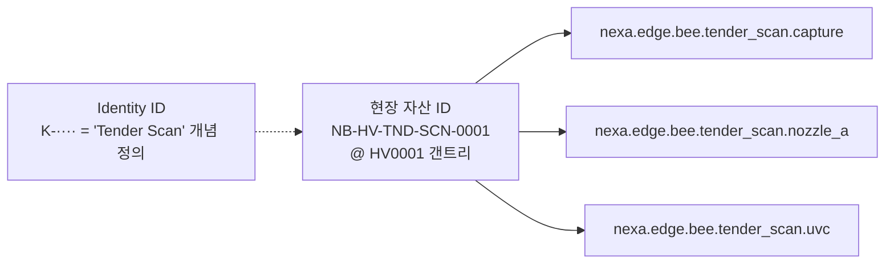

실제 `K-····` 값은 서버 mint API 만 발급한다 (문서에서 임의로 만들지 않는다).

### 8.8 확인 필요

1. **단당 소초광 슬롯 수** — 현재 문서들은 “육아 64 장”과 “1 군당 8 장 (육아 4+ 저밀 4)”이 섞여 있다. 군 (여왕 1) 당 육아실 1 단 1 장·저밀실 1 단 1 장으로 보고 작성했으며, 다르면 `F` 번호만 늘리면 된다.
2. **셀 블록 “복층”의 의미** — 복합군을 위아래 2 층으로 쌓는 구조인지 확인. 쌓는 구조라면 블록과 복합군 사이에 `층(Tier)` 계층 (`T1`·`T2`) 을 주소에 넣는다.
3. **저밀실 2 단 운용 여부** — 현재 하드웨어는 실당 1 단. 2 단 운용 시 갠트리 도달 범위·포고 단자·격리판 높이를 함께 설계한다.
4. **번호 방향** — 복합군 `C1` 이 차량 앞쪽인지 뒤쪽인지, `H1` 이 외부에서 볼 때 왼쪽인지, 단 `S1` 이 아래 칸인지. 제안: 차량 앞 → 뒤, 외부에서 볼 때 왼 → 오른쪽, 단은 아래 → 위.
5. **Cell 카트리지 격자** — 복합군 구역당 24 구·45 구 두 안이 있다. 소초광 한 장당 칸 배열 (X×Y) 을 확정해야 한다.
6. **40 스텝 = ? mm** — 격자 좌표의 mm 환산값.

---

## 9. 제어 계층·통신 버스 지도

**원칙: MQTT 는 전부 쓰되, 전파는 구역별로 막는다.**
MQTT 는 무선 기술이 아니라 TCP/IP 위의 메시징 규약이다. 차량 안에서는 **유선 이더넷 위에서** 그대로 쓴다. NEXA 플랫폼의 MQTT 토픽·와일드카드 규칙 ([`08_TDD_NEXIA_MQTT토픽데이터라우팅`](../../../08_TDD/NEXIA/08_TDD_NEXIA_MQTT토픽데이터라우팅.md), TDD-022) 을 따르면서, 벌 생태에 대한 전파 영향은 **거리·송신 출력·송신 시간**을 줄이는 방향으로 최소화한다.

> 무선 전파가 꿀벌에 미치는 영향은 연구 결과가 엇갈리고 확정 근거는 제한적이다. 그래도 거리·출력·송신 시간을 줄이는 것은 비용이 거의 들지 않는 예방 조치이므로 본 원칙을 채택한다.

### 9.1 제어 계층

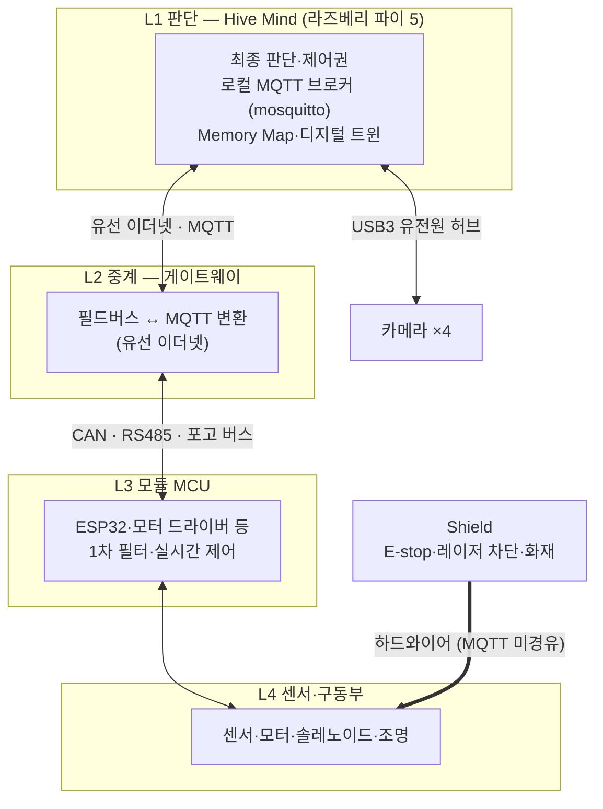

| 계층 | 담당 | 통신 | 원칙 |
| :--- | :--- | :--- | :--- |
| **L1 판단** | Hive Mind | 로컬 MQTT 브로커, USB3 | 최종 판단·기록·클라우드 브리지 |
| **L2 중계** | 게이트웨이 | 이더넷 (MQTT) ↔ CAN/RS485 | MCU 가 MQTT 를 몰라도 되게 변환 |
| **L3 모듈 MCU** | 각 장비 MCU | CAN · RS485 · 포고 버스 · I2C/I2S(로컬) | 실시간 제어는 결정론적 필드버스로. 1 차 필터 후 요약만 올림 |
| **L4 센서·구동부** | 센서·액추에이터 | MCU 로컬 배선 | — |
| **안전** | Shield | **하드와이어** | E-stop·레이저 차단·화재 대응은 MQTT·소프트웨어 경로에 의존하지 않음 |

### 9.2 모듈별 버스 지도

| 모듈 | 연결 | 구역 (§9.3) | 비고 |
| :--- | :--- | :--- | :--- |
| Tender Scan — 카메라 ×4 | **USB3 유전원 케이블 + 허브 → Hive Mind** | 1 | 영상은 USB 가 본체 |
| Tender Scan — 전용 ESP32 (BME688·가스) | **유선 권장: USB 허브 (USB-CDC) 또는 CAN** | 1 | 내검 스캐너 문서의 “ESP-NOW 등” → **유선으로 변경 권장** (카메라 USB 배선이 이미 헤드까지 옴) |
| Tender Scan — 마이크 (SPH0645) | I2S → 헤드 MCU | 1 | 로컬 |
| Tender Arm — 갠트리 축·그리퍼 | 모터 드라이버 ↔ CAN | 1 | 케이블 캐리어 배선 |
| Comb Frame — 매립 온도·피에조 | **포고 버스** (갠트리 접촉 시) | 0 | 무선 없음 |
| Hive Wall — 방별 센서·개도 | **차폐 CAN/RS485** + 포고 백업 | 0 | 격리판 문서 방향 유지 |
| Hive Gate — 도어·IR 카운터·마이크 | CAN/RS485 | 2 | 외벽이지만 유선 |
| Fanner — 급배기 팬·유닛 댐퍼·스캐닝 차압 센서 | PWM·로컬 제어 ↔ CAN | 1 | 군·복합군 배기 댐퍼 모터 없음 (Aero Profiler) |
| Air Core — 솔레노이드 팩 | 24V 드라이버 ↔ CAN | 1 | |
| Guard Rail — Guard Eye·Sting | **유선 검토: 기존 급전선과 같은 케이블 캐리어로 RS485** · ESP-NOW 는 예비 | 2 | 현재 설계는 데이터 ESP-NOW. 전력선이 이미 있으므로 유선 데이터로 전환 검토 |
| Stance Jack | 모터 드라이버 ↔ CAN | 1 | |
| Nectar Power — BMS·전력 계측 | CAN | 1 | |
| Scout Stick | BLE (필요 시 짧게) | 4 | 지붕 자이로는 유선 |
| Terra Shelter | 연결 시 유선, 분리 시 자체 LTE 또는 저장 후 전송 | 3 | |
| 외부 업링크 | LTE/5G 모뎀 | 3 | 안테나는 벌 구역 반대편 |

### 9.3 구역별 무선 허용선

| 구역 | 범위 | 허용 통신 |
| :--- | :--- | :--- |
| **0. 벌집 내부** | 소초광 · 격리판 · 육아실 · 저밀실 | **무선 금지.** 포고 버스, 차폐 CAN/RS485 |
| **1. 차량 내부** | 갠트리 · 챔버 · 기계실 | **무선 금지 권장.** 이더넷, USB3, CAN |
| **2. 외벽·소문 주변** | Guard Rail · Hive Gate | **원칙 유선.** 불가피 시 저출력·저빈도·이벤트성, 소문에서 최대 이격 |
| **3. 운전석·지붕** | 외부 업링크 · GNSS | LTE/5G 허용. 안테나는 벌 구역 반대편, 업로드는 모아서 |
| **4. 사람 손** | Scout Stick · 스마트폰 | BLE 등 필요 시 단시간. 상시 송신 금지 |

- **Wi-Fi AP 는 기본 꺼짐.** 현장 접속이 필요할 때만 버튼으로 켜고, 타이머로 자동 꺼짐.
- Keeper 앱은 차량 Wi-Fi 가 아니라 **클라우드 경유**로 접속하는 것을 기본으로 한다.

### 9.4 MQTT 구성

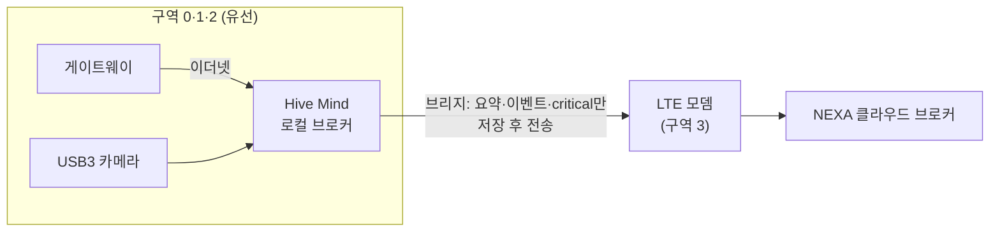

| 규칙 | 내용 |
| :--- | :--- |
| **로컬 브로커 중심** | 원데이터·고빈도 데이터는 Hive Mind 로컬 브로커에만 둔다 |
| **선별 브리지** | 클라우드로는 요약·이벤트·critical 토픽만 전달. LTE 송신 시간이 줄어 전파 노출도 함께 줄어든다 |
| **저장 후 전송** | 통신이 끊기면 로컬에 쌓았다가 재연결 시 일괄 전송 (§7.3.2 서명 로그와 같은 방식) |
| **이미지는 MQTT 에 싣지 않음** | MQTT 에는 메타데이터·파일 참조만. 이미지 파일은 배치 업로드 |
| **안전 회로 제외** | Shield 기능은 MQTT 에 의존하지 않는다 (§9.1) |

### 9.5 토픽 설계

NEXIA 규칙 `[Group]/[Location]/[Device_ID]/[DataType]/[SubTopic]` 에 §8 공간 주소를 넣는다. **와일드카드를 쓰려면 레벨 수를 고정**해야 하므로, 해당 없는 자리는 `-` 로 채운다.

```text
nexa/bee/{unit}/{complex}/{hive}/{module}/{datatype}/{sub}

nexa/bee/HV0001/L3/H2/hive_wall/sensor/temp
nexa/bee/HV0001/L3/H2/hive_gate/state/door        ← retained
nexa/bee/HV0001/-/-/fanner/sensor/co2             ← 유닛 단위 장비
nexa/bee/HV0001/-/-/guard_sting/cmd/fire          ← 명령
nexa/bee/HV0001/-/-/guard_sting/ack/fire          ← 명령 응답
```

| 목적 | 구독 예 |
| :--- | :--- |
| L3 복합군 전체 센서 | `nexa/bee/HV0001/L3/+/+/sensor/#` |
| 모든 유닛의 격리판 온도 | `nexa/bee/+/+/+/hive_wall/sensor/temp` |
| critical 만 이상 감지로 | `nexa/bee/+/+/+/+/sensor/+/critical` (NEXIA 끝자리 critical 방식) |
| 한 유닛 전체 명령 감시 | `nexa/bee/HV0001/+/+/+/cmd/#` |

- 층 (`T`) 을 쓰게 되면 `{complex}` 자리에 `L.T2.C3` 대신 `LT2C3` 처럼 **한 레벨 안에** 넣어 레벨 수를 유지한다.
- 모듈 이름은 Capability ID 와 같은 소문자 + 밑줄 이름을 쓴다 (§8.7.2).

| 항목 | 규칙 |
| :--- | :--- |
| **QoS** | 유선 고빈도 텔레메트리 QoS 0 · 이벤트·명령 QoS 1 · 명령은 `ack` 토픽으로 응답 |
| **retained** | 소문 개폐, 모드 등 **현재 상태**만 retained |
| **ACL** | 브로커 ACL 을 Capability ID 와 맞춘다. 예: `nexa.edge.bee.guard_sting.fire` 자격이 있는 주체만 `…/guard_sting/cmd/fire` 발행 가능 |
| **서명** | §7.3 서명은 페이로드 안에 넣어, 브로커를 거쳐도 변조 여부를 검증 |

### 9.6 기존 문서 정합 과제

| 문서 | 현재 | 조치 |
| :--- | :--- | :--- |
| 내검 스케너 | 전용 ESP32 → RPi “ESP-NOW 등” | 유선 (USB-CDC 또는 CAN) 으로 변경 |
| 레일캠 - 허니왜건 말벌 레이저 요격 전략 | 데이터 ESP-NOW (전력은 와이어) | 같은 케이블 캐리어로 RS485 유선 데이터 검토, ESP-NOW 는 예비 |
| 시스템 - 군별 격리판 기능 | 차폐 CAN/RS485 + 포고 | 유지 |

### 9.7 링크 인지형 업링크 전략

Hive Mind 는 현재 외부로 나가는 회선을 보고 플랫폼과의 교신 방식을 바꾼다. 기준은 유선·무선이 아니라 **" 쓴 만큼 과금되는 회선인가 "** 이다. 거점의 정액 Wi-Fi·위성 회선은 무선이라도 비종량으로 본다.

| 링크 상태 | 판정 | 대표 상황 |
| :--- | :--- | :--- |
| **비종량 (Unmetered)** | 이더넷 · 거점 정액 회선 | 정박 (외부 전원 + 이더넷 도킹) |
| **종량 (Metered)** | LTE 모뎀 | 주행 · 현장 |
| **오프라인** | 회선 없음 | 음영 지역 |

정박 시 외부 전원과 이더넷을 한 커넥터로 도킹하면 운영 모드 (상단 체크리스트 A4) 와 링크 상태가 함께 바뀐다.

#### 9.7.1 데이터 등급별 전송

| 등급 | 예 | 비종량 | 종량 (LTE) |
| :--- | :--- | :--- | :--- |
| **P0 즉시** | 말벌 대량 공격, 화재·과열, 도난, Shield 동작 | 즉시 | **즉시. 데이터 소진 후에도 전송** |
| **P1 요약** | 군별 상태 요약, 이벤트 | 실시간 | 30~60 분 묶음 압축 전송 |
| **P2 대용량** | 이미지·영상, 원본 로그, 학습 데이터 | 즉시 동기화 | 전송 안 함. 로컬 저장 후 비종량 연결 시 일괄 |
| **P3 관리** | OTA 펌웨어, AI 모델, 백업 | 여기서만 수행 | 긴급 보안 패치만 예외 |

- **Proof 앵커링:** 종량 상태에서도 **하루치 서명 로그의 해시 (수백 바이트)** 는 매일 먼저 플랫폼에 등록한다. 원본은 나중에 비종량 회선으로 올려 해시와 대조한다. 오래 로컬에 쌓아도 §7.3 데이터 무결성 게이트가 유지된다.
- **고품질 분석 요청:** 원본 대신 **현장에서 잘라낸 관심 영역 + 추론 결과**(수십 KB) 만 보낸다. 원본이 꼭 필요하면 Keeper 앱이 예상 용량을 보여 주고 관리자 승인 시에만 전송하거나, 다음 비종량 연결로 예약한다.
- **원격 보기:** Keeper 앱 원격 보기는 저해상도 스냅샷이 기본이다. 현장에서는 BLE 로 직접 본다.

#### 9.7.2 LTE 요금제·데이터 예산

- **요금제:** 최저가 IoT 요금제에 **JSON 만** 주고받고, 소진 후에는 **건당 (종량) 과금**을 쓴다. 비상 상황과 고품질 분석 때만 추가 비용이 생긴다.
- **통신사의 " 소진 시 차단 " 옵션은 쓰지 않는다.** P0 알림까지 막히기 때문이다. 차단은 Hive Mind 가 직접 한다.
- **예산 추정:** 5 분마다 2KB 요약이면 월 약 17MB (추정). 실제로는 연결 유지 비용이 더 크므로 MQTT keepalive 를 길게 잡고, TLS 세션 재사용 또는 전송 시에만 접속하는 방식을 쓴다.
- **모뎀:** Cat-M1 보다 **Cat-1 이상**. 비상 시 잘라낸 이미지 몇 장은 보낼 수 있어야 한다.
- 요금제의 실제 단가와 초과 과금 구조는 통신사별로 확인이 필요하다.

| 월 사용량 | Hive Mind 동작 |
| :--- | :--- |
| ~70% | 정상 (P0·P1 + 매일 해시) |
| 70~90% | P1 묶음 주기 연장 |
| 90~100% | P0 + 최소 요약 + 매일 해시 |
| 100% 초과 | **P0 만** (종량 과금 발생) · Keeper 앱에 알림 |

재전송 폭주 같은 펌웨어 오류로 인한 요금 폭탄은 이 예산 관리로 막는다.

#### 9.7.3 귀소 후 발송 (Homing Window)

LTE 로 **미룰 수 있는 전송**(P1 묶음 일부, 매일 해시, 승인된 P2) 은 가능하면 **벌이 귀소한 뒤**에 보낸다.

| 규칙 | 내용 |
| :--- | :--- |
| **귀소 판정** | Guard Eye 소문 출입 카운트가 기준 이하로 내려가거나, 일몰 시각 + 여유 시간 중 먼저 오는 쪽 |
| **대상** | 미룰 수 있는 전송만. **P0 는 언제나 즉시** |
| **최대 지연** | P1 요약은 최대 N 시간을 넘기지 않는다 (N 미정). 넘으면 비행 시간대라도 전송 |
| **비행 시간대 모뎀** | 망 등록만 유지하는 저전력 상태 (PSM/eDRX). P0 발생 시 즉시 깨어나 전송 |
| **비·야간** | 비행이 없으면 귀소 상태로 본다 |

- 어차피 LTE 전송을 묶어 보내므로, **발송 시각만 정하면 되는 규칙**이라 구현 부담이 적다.
- 안테나가 이미 벌 구역 반대편 (구역 3) 에 있어 실제 영향은 작을 수 있다. §9.3 과 같이 **예방 원칙**에 따른 추가 절제다.
- 밤에 모아 보내면 통신 혼잡이 적은 시간대라 전송도 안정적이다.

#### 9.7.4 로컬 미디어 보관

- 저장장치는 NVMe. 비종량 연결 없이 **최대 2 주**(가정) 를 버틸 용량으로 잡는다.
- 보존 규칙: 이상 감지 영상은 길게, 평상시 영상은 짧게. 용량이 차면 평상시 영상부터 지운다. Proof 대상 원본은 비종량 업로드와 해시 대조가 끝나기 전에는 지우지 않는다.

---

## 부록 A. 기존 문서 ↔ 신규 명칭 매핑

| 기존 문서                                             | 신규 명칭                                                           |
| :---------------------------------------------------- | :------------------------------------------------------------------ |
| 내검 스케너 - 소초광 특성 및 관리 시스템              | Tender Gantry › Tender Scan                                           |
| 레일캠 -GRC 외부 보안·생태 플랫폼                      | Guard Rail (몸체) · Guard Eye                                       |
| 레일캠 - 허니왜건 말벌 레이저 요격 전략                 | Guard Rail › Guard Sting                                            |
| 시스템 - 군별 격리판 기능                               | Hive Wall                                                           |
| 양봉 소문 시스템                                      | Hive Gate                                                           |
| 가스및 온습도 센싱 (BME688…)                          | Scent Node                                                          |
| 스마트 다왕 벌통 푸시 - 풀 공조 시스템 사양서           | Fanner                                                              |
| 운영장비 - 하이브리드 다목적 챔버                       | Builder Chamber                                                     |
| 운영장비 - 중력 온열 채밀기                             | Harvest Drip                                                        |
| 공압 Closed-loop 시스템 융합                          | Air Core                                                            |
| `리프팅잭_및_하드웨어_시스템_설계서`                  | Stance Jack                                                         |
| `시스템-전력_예산_마스터`                             | Nectar Power                                                        |
| `비상상황_및_안전대비책_마스터플랜` · 시스템 - 양봉 방재 | Shield                                                              |
| 스마트 무선 양봉 관리기 및 검진 시스템 기획서         | Scout Stick                                                         |
| 운영 - 판매 전략                                        | NEXA BEE Shop (Cell · My Hive · Gift · Honey Road) · NEXA BEE Story |

## 부록 B. 검토했으나 미채택한 후보

| 대상        | 후보                                                                   | 비고                                           |
| :---------- | :--------------------------------------------------------------------- | :--------------------------------------------- |
| 구 허니웨건 | Honey Pavilion, Hive Pavilion, Cell Studio, Hive Expression (코드 HX), Honey Express, Hive Vanguard, Bloom Chaser, Bee Caravan | **Honey Vanguard** 채택 (코드 HV). Hive Expression 은 부르기 어렵고 Hive 부품명과 겹쳐 변경. Honey Wagon 은 영어권에서 분뇨 수거차 속어라 제외. Cell 은 상품명으로 재사용 |
| 구 냉장웨건 | Cube Save → Cube Live, Ark Shelter, Thermal Capsule → Explorer Capsule | Terra Shelter 채택 (캠퍼 전환 시 개명 불필요)  |
