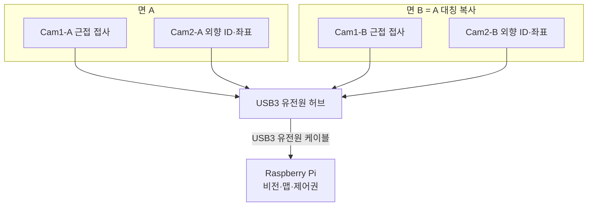
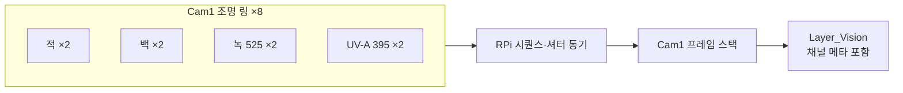
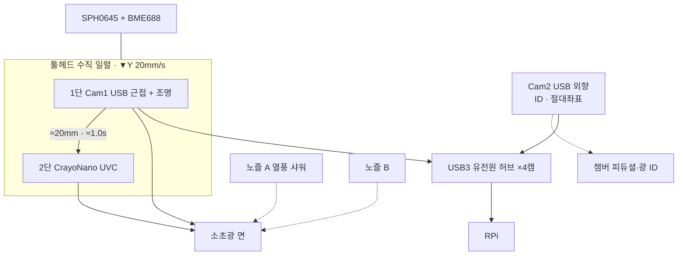
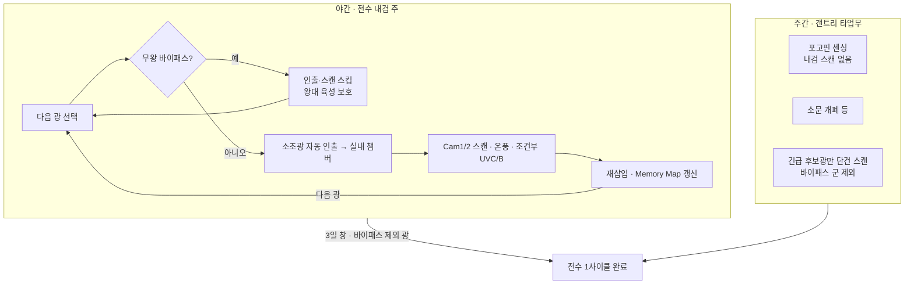
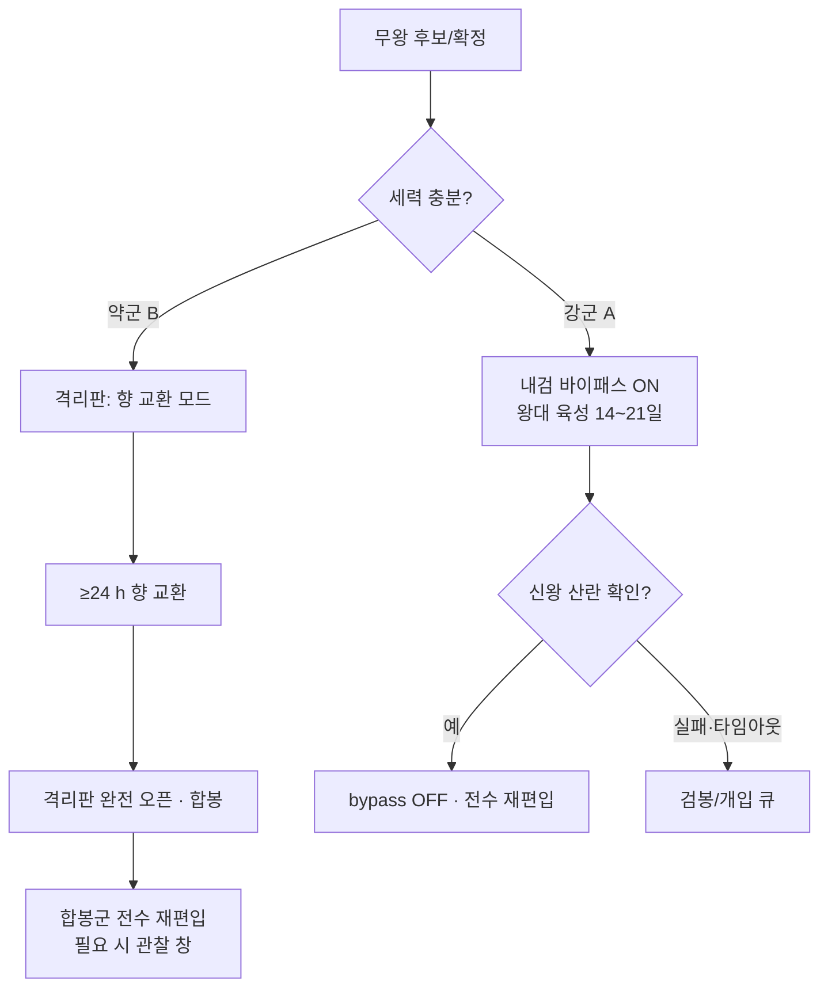
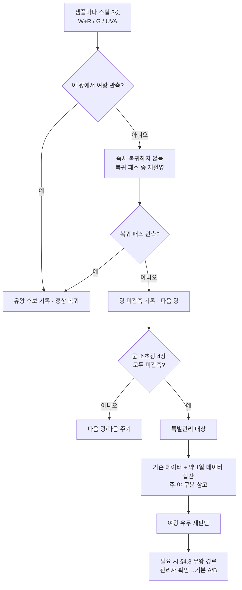
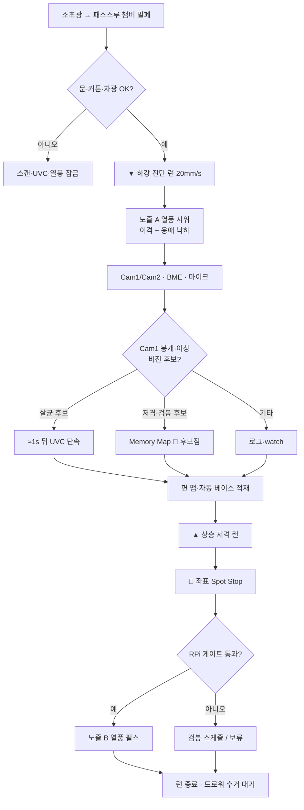
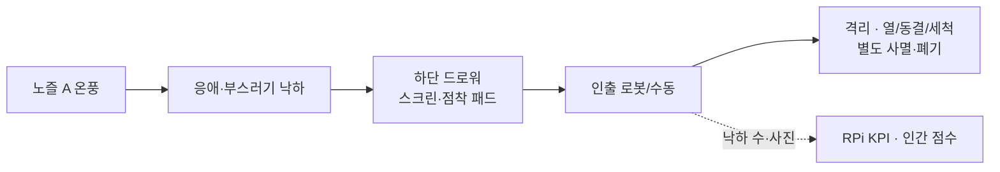
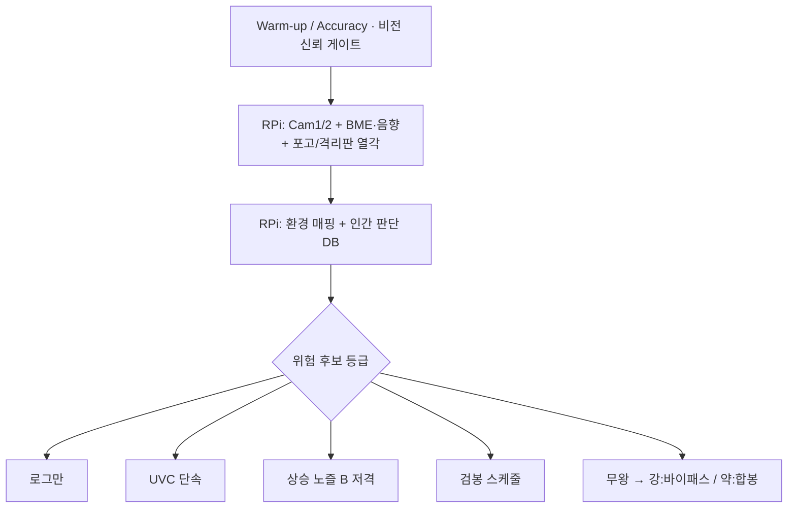
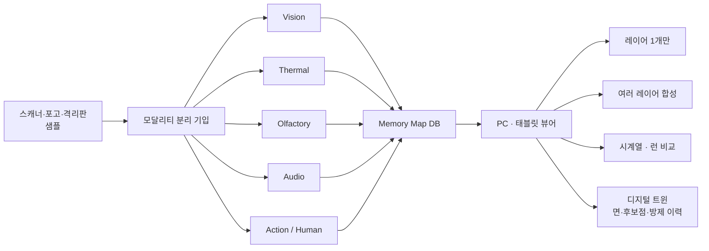

---
doc_id:
title: "소초광 스캐너 핵심 특성 및 운영 전략서"
category: "설계서"
domain: "양봉"
status: draft
created: 2026-09-25
updated: 2026-10-20
parent_doc:
implements_doc:
see_also:
  - "가스및 온습도 센싱 (BME688 센서 및 BSEC2 라이브러리).md"
  - "전력_예산_마스터.md.md"
  - "공압 Closed-loop 시스템 융합.md"
  - "통합 방제 대책 마스터플랜 (NEXA Biosecurity Masterplan).md"
  - "군별 격리판 기능.md"
  - "미아 벌 방지 및 교통 체증 극복 마스터 플랜.md"
terms_standard: []
terms_nexa:
  - "소초광 스캐너"
  - "하강 진단 런"
  - "상승 저격 런"
  - "비전 UVC 게이트"
  - "MLX90614 미채택"
  - "Memory Map 후보점"
  - "워킹 디스턴스"
  - "방제 안전 엔벨로프"
  - "노즐 A 응애 낙하"
  - "바닥 드로워 수거"
  - "센서 레이어 맵"
  - "디지털 트윈 뷰어"
  - "USB 4카메라"
  - "Cam1 근접 / Cam2 외향"
  - "ESP32-CAM 폐기"
  - "멀티스펙트럼 조명 8"
  - "UV-A 395 영상 펄스"
  - "3일 주기 전수 내검"
  - "야간 스캔 · 주간 타업무"
  - "무왕군 내검 바이패스"
  - "약군 격리판 합봉"
  - "여왕검수 스틸컷"
  - "특별관리 무여왕후보"
  - "열각 포고·격리판·BME"
---

# 소초광 스캐너 핵심 특성 및 운영 전략서

실내 스핀 - 갠트리 **툴헤드**의 센서·공압·UVC 배치와 **하강=진단 / 상승=표적 방제** 운영 전략.
시스템 감각은 **시각·청각·후각·열각** 모두 있다.
헤드에서는 비전·(보조) 후각·청각을 패스스루에서 모으고, **열각은 헤드 MLX 가 아니라** 소초광 매립·포고·격리판·BME 온채널로 본다 (§2.7).
KPI 는 현장 실측으로만 갱신한다.

**비전 버스:** `ESP32-CAM` 은 **완전 폐기**. RPi 로 영상·메타를 보내기 어렵고 (무선·CAN 모두 비현실) → **라즈베리 파이 USB(+ 유전원 허브) 카메라 ×4** 로 통일.

---

## 0. 부품 리스트 (읽는 순서용)

| 부품명                 | 한줄 정체                      | 용도                                     | 특징·주의                                                                                   |     |          |                  |                                                      |                                                  |
| :------------------ | :------------------------- | :------------------------------------- | :-------------------------------------------------------------------------------------- | --- | -------- | ---------------- | ---------------------------------------------------- | ------------------------------------------------ |
| **Cam1** (면당 1)     | RPi **USB** 근접 카메라         | 소초광 **면 접사** (봉개·셀)                    | 면 A/B 각 1 → 합 2. 접사 렌즈·조명 링                                                             |     |          |                  |                                                      |                                                  |
| **Cam2** (면당 1)     | RPi **USB** 외향 카메라         | **소초광 ID** · 챔버 **절대좌표**/피듀셜           | 면 A/B 각 1 → 합 2. 외부를 봄                                                                  |     |          |                  |                                                      |                                                  |
| **USB 카메라 ×4**      | Cam1×2 + Cam2×2            | 양면 대칭 복사                               | **USB3 유전원 (액티브) 케이블** + 전원 허브 → RPi                                                    |     |          |                  |                                                      |                                                  |
| **USB3 허브·유전원 케이블** | 전원 공급형 허브/연장               | 4 캠 대역·급전                              | 수동 연장만으로 부족. 허브 전원·포트 할당 KPI                                                            |     |          |                  |                                                      |                                                  |
| **보조 조명 링**         | Cam1 용 **4 파장 ×2 = 8 LED** | 접사 멀티스펙트럼                              | 적·백·녹 525·UV-A395 각 2. 여왕 “마법광” 단정 금지 → **§2.6**                                        |     |          |                  |                                                      |                                                  |
| **적색 LED ×2**       | 가시 적색                      | 벌 교란↓ 운용·기본 접사                         | 평시/저자극 후보                                                                               |     |          |                  |                                                      |                                                  |
| **백색 LED ×2**       | 광대역 가시                     | 일반 형태·색 분류                             | 기본 채널                                                                                   |     |          |                  |                                                      |                                                  |
| **녹색 525 nm ×2**    | 협대역 녹                      | 윤곽·텍스처 대비·CMOS 감도                      | **옵션 채널**. 여왕 단독 특화 아님                                                                  |     |          |                  |                                                      |                                                  |
| **UV-A 395 nm ×2**  | 근자외선 (영상용)                 | 멀티스펙·(선택) 형광/표시                        | **단펄스만**. UVC 살균과 별개. **§2.6·§6**                                                       |     |          |                  |                                                      |                                                  |
| **CrayoNano 3535**  | **UVC** LED (3535)         | ROI **단속 살균**                          | UV-A 와 **혼동 금지**. 선량·차광·벌 밀집 OFF                                                        |     | **노즐 A** | 와이드 슬릿 **온풍** 노즐 | 하강 시 ① 렌즈 보호·벌 이격 ② **적당한 열풍으로 응애 (이동성) 낙하시켜 바닥 수거** | 고온·고압 저격 (노즐 B) 과 구분. 육아·벌 스트레스 엔벨로프 내. 낙하≠박멸 확정 |
| **노즐 B**            | 핀포인트 니들 노즐                 | 상승 시 **열풍 펄스** 저격                      | Spot Stop + RPi 게이트 후에만. 안전 엔벨로프 필수                                                     |     |          |                  |                                                      |                                                  |
| **SPH0645**         | I2S 디지털 마이크                | 분봉·튜팅 등 **음향 보조**                      | 에어·열풍 구간은 학습 제외                                                                         |     |          |                  |                                                      |                                                  |
| **BME688**          | 온습·기압·가스 (MOX)             | **후각** 1 차 + **열각 보조**(온)              | 전용 ESP. 확진·세력 단정 금지 → [BME 문서](./가스및%20온습도%20센싱%20(BME688%20센서%20및%20BSEC2%20라이브러리).md) |     |          |                  |                                                      |                                                  |
| **소초광 매립 T**        | 광 내부 온도센서                  | **열각**                                 | 광마다 매립, 포고로 읽음                                                                          |     |          |                  |                                                      |                                                  |
| **포고핀**             | 갠트리 접촉 버스                  | 매립 T·피에조 센싱                            | 주간 타업무 주 (§2.7)                                                                         |     |          |                  |                                                      |                                                  |
| **격리판 내장 T**        | 방별 온도                      | **열각**                                 | 각 방 격리판                                                                                 |     |          |                  |                                                      |                                                  |
| **BSEC2**           | 보쉬 센서 융합 라이브러리             | IAQ 등 **압축 지수**                        | 엣지에서 돌리되 출력은 후보만                                                                        |     |          |                  |                                                      |                                                  |
| **전용 ESP32**        | 가스·센서 MCU (비전 아님)          | BME 듀티·가스 패킷                           | **영상은 안 실음**. ESP-NOW 등으로 소형 패킷만                                                        |     |          |                  |                                                      |                                                  |
| **RPi (메인)**        | 라즈베리 파이                    | **USB×4 비전 수집** · 최종 판단·Memory Map·제어권 | 인간 DB + 환경 매핑. 방제 허가. 영상 본체                                                             |     |          |                  |                                                      |                                                  |
| **솔레노이드 밸브**        | NC 공압 밸브                   | 노즐 A/B **단펄스** 개폐                      | 평시 닫힘. 전력 산정순 14                                                                        |     |          |                  |                                                      |                                                  |
| **스핀 - 갠트리**        | 실내 XY(·스핀) 이송              | 헤드를 소초광 면 위로 **등속 이송**                 | 목표 Y 20 mm/s. 전력 산정순 3                                                                  |     |          |                  |                                                      |                                                  |
| **패스스루 챔버**         | 방풍·밀폐 내검실                  | 광 인입 후 **스캔·방제**                       | 미밀폐 시 UVC·열풍 잠금                                                                         |     |          |                  |                                                      |                                                  |

본문에서 모듈명만 나와도 이 표를 기준으로 읽으면 된다.

---

## 1. 목적·범위

| 한다 | 하지 않는다 |
| :--- | :--- |
| 소초광 **표면** 비전·(보조) 가스·음향 스캔 + **열각은 포고·격리판·BME** | 질병·응애 **실험실급 확진** |
| Cam1 봉개 등 **비전 후보점**을 Memory Map 에 기록 | 헤드 **MLX90614** 점온·벌방마다 IR 체크 |
| (참고) MLX 미채택 ≠ 열각 없음. 열각 소스 §2.7 | 셀 단위 열각 맵을 **스캐너 헤드 IR**로 주장 |
| 상승 런에서 **후보 좌표** 핀포인트 열풍·UVC **시도** | “주변 벌·유충 열해 0” 보장 주장 |
| 노즐 A **광역 온풍**으로 이동성 응애 **낙하 → 바닥 수거·별도 처리** | 노즐 A 만으로 봉개 속 응애·박멸 **확정** |
| RPi USB×4 비전 + 센서 소형 패킷 → 최종 판단·제어 | ESP32-CAM·카메라 CAN/무선 영상 전송 |
| 면당 Cam1(접사)+Cam2(ID·좌표), 양면 **총 4 캠** | 단면 1 캠으로 ID·접사·양면 겸용 |
| Cam1 **4 파장×2(8 LED)** 멀티스펙 조명 | 녹·UV-A 만으로 여왕 **확정 판독** 주장 |
| 인간 터치·음성 점수와 스냅샷 페어링 | 가스로 **세력 절대 지수** 산출 |
| 좌표별 **센서 레이어 맵** → PC 뷰어·디지털 트윈 | 모달리티를 한 픽셀에 뭉개 저장 |
| **3 일 주기** 무인 전수 내검 (야간 주) | 하루 64 광 강제 완주 · 상시 사람 입회 |
| **무왕군** 대응 이원화: 강군 **바이패스** / 약군 **격리판→합봉** | 무왕·왕대 육성 중에도 전수 스캔으로 왕대 훼손 |
| 여왕검수 **스틸컷** 3 채널·겹침 샘플·복귀 재촬영 (§4.4) | 상시 영상 스트림으로 여왕 확정 |

역할 분담은 [`가스및 온습도 센싱`](./가스및%20온습도%20센싱%20(BME688%20센서%20및%20BSEC2%20라이브러리).md) **§2** 와 동일:
**보쉬·엣지 = 1 차 필터**, **RPi = 인간 판단 DB + 환경 매핑 + 제어권**.

---

## 2. 시스템 특성

### 2.1 헤드 컨셉

- **초근접 접사** 환경 (센서별 §3) 에서 헤드로 **시각·청각·(보조) 후각**을 한 패스에 포집. **열각은 §2.7** (포고·격리판·BME).
- 공압 (노즐 A/B)·UVC 로 **발견 즉시가 아니라** RPi 게이트 통과 후 표적 조치.
- 레이저 등 대형·오염 취약 광학은 **실내 헤드에서 제외** → 관성·오염면 축소. (실외 M140 은 별도 문서)

### 2.2 경량·등속

| 항목 | 목표 | 비고 |
| :--- | :--- | :--- |
| Y 주행 | **화질 우선** 등속 (초기 예 20 mm/s) | 3 일 전수 주기로 시간 압박을 풀고, 과속 금지 |
| 페이로드 | 센서 + 노즐 +UVC 최소 | 전력·관성은 [`전력_예산_마스터`](시스템-전력_예산_마스터.md.md) 산정순 3 |

### 2.3 버스·MCU · 비전 (현실)

| 규칙 | 내용 |
| :--- | :--- |
| **비전** | **ESP32-CAM 폐기.** RPi ← **USB3 유전원 케이블 + 허브 ← 카메라 ×4** |
| **왜 폐기** | ESP32-CAM → RPi 영상 경로가 Wi-Fi·**CAN 모두 비현실**(대역·지연·신뢰). 비전은 USB 가 본체 |
| I2C | BME688 등 — 주소·풀업·길이 관리. MCU 는 전용 ESP. **MLX 버스 없음** |
| BSEC2 / 가스 | **전용 ESP32**에서 압축 → RPi 로 **소형 패킷**(ESP-NOW 등). 영상에 태우지 않음 |
| 압축 의미 | IAQ·클래스 = **위생·이상취 후보**. “가상 세력 지수”로 쓰지 않음 |

### 2.5 USB 카메라 ×4 배치

소초광은 **양면**이므로, 한쪽 면의 `Cam1+Cam2` 를 **그대로 복사**해 총 4 대.

| ID | 지향 | 역할 |
| :--- | :--- | :--- |
| **Cam1-A** | 면 A **소초광 근접** | 봉개·셀 접사 → Layer_Vision (매크로) |
| **Cam2-A** | 면 A **외부 방향** | 소초광 **ID**(QR/마커) · 챔버 **절대좌표**/피듀셜 → 포즈·맵 정합 |
| **Cam1-B** | 면 B 근접 | Cam1-A 와 동일 (반대면) |
| **Cam2-B** | 면 B 외향 | Cam2-A 와 동일 (반대면) |



| 배선 | 내용 |
| :--- | :--- |
| 케이블 | **USB3 유전원 (액티브)**. 수동 롱케이블만으로 4 캠 안정 급전·대역 보장 안 함 |
| 허브 | **전원 어댑터 달린** USB3 허브. 포트별 전류·동시 스트리밍 KPI |
| 동기 | Cam2 포즈로 Memory Map 절대좌표 잡고, Cam1 접사를 같은 `(face, x, y)` 에 기입 |
| 폐기 | ESP32-CAM · 카메라용 CAN · 카메라 Wi-Fi 상시 중계 — **채택하지 않음** |

### 2.6 Cam1 멀티스펙트럼 조명 (8 LED)

기존 적·백에서 **녹 525 nm · UV-A 395 nm** 를 더해, 파장당 **2 개씩 총 8 개**로 구성한다.
목적은 “여왕만 빛나게”가 아니라 **채널을 하드웨어로 깔아 두고**, 시퀀스·학습·앙상블로 **확장·실효를 실험**하는 것이다. 없는 것보다 가능성이 올라간다.

| 채널 | 개수 | 역할 (현실) |
| :--- | :---: | :--- |
| **적색** | 2 | 벌 교란 상대적으로 낮음. 야간·저자극 접사 |
| **백색** | 2 | 일반 형태·색·봉개 분류 기본기 |
| **녹 525 nm** | 2 | CMOS 감도·윤곽/텍스처 대비. **여왕 단독 특화는 약함** |
| **UV-A 395 nm** | 2 | 멀티스펙·(선택) 형광/페인트 마크. **여왕 고유 형광은 기대치 낮음** |

여왕 판독의 본체는 여전히 **크기·체형·위치·(선택) 표시 + Cam1** 이다. 녹·UV-A 는 **보조 옵션 채널**.



#### 운용·주의 (필수)

| 항목 | 규칙 |
| :--- | :--- |
| **점등** | Cam1 셔터와 동기. 평시 OFF 또는 적/백만. 녹·UV-A 는 **스캔 펄스** |
| **UV-A ≠ UVC** | 395 nm 는 **영상용**. CrayoNano **UVC 살균**과 전원·인터록·문서 용어 분리 |
| **UV-A 유해** | UV-C 급은 아니나 **무해 아님**. 사람 눈·피부 근거리 응시 금지. 벌·유충·밀납 → **강·장시간 금지**, **수~수십 ms 단펄스** |
| **센서** | 일반캠 **UV 컷 필터**면 395 nm 직수광 약함 → UV 통과/개조 또는 **형광 (가시 복귀)** 전제인지 KPI 로 명시 |
| **상시 ON** | UV-A·고강도 녹 **금지**. 챔버 미밀폐·문 열림 시 UV-A 잠금 |
| **학습** | 프레임에 `light_ch` 메타 (R/W/G/UVA) 기입. 채널별 레이어·앙상블은 실측 KPI 로만 승격 |
| **Cam2** | ID·피듀셜용. 필요 시 챔버 조명; 8 LED 링은 **Cam1 접사 전용**을 기본 |

---

### 2.7 감각 4 종 · 포고·내장 열각

**MLX90614 폐기 = 열각 없음이 아니다.**
시스템은 **시각·청각·후각·열각**을 모두 쓴다. 헤드 비접촉 IR 만 뺀다.

| 감각 | 소스 | 비고 |
| :--- | :--- | :--- |
| **시각** | Cam1·Cam2 USB×4 | 내검 스틸·ID·좌표 (§4.4) |
| **청각** | SPH0645 등 | 분봉·튜팅 보조 |
| **후각** | BME688 + BSEC2 | 공기질·이상취 1 차 필터. **온채널도 열각 보조** |
| **열각** | ① 소초광 **내부 매립 T** → **포고핀** 센싱 ② 각 방 **격리판 내장 T** ③ BME 온도 | 상시/주간 포고·군 상태. 헤드 IR 스캔 대체 |

| 채널 | 역할 |
| :--- | :--- |
| **갠트리 스캐너 (본 문서)** | 면 단위 맵·비전·(챔버) 후각·청각·표적 방제 |
| **소초광 포고 T/피에조** | 광 내부 온도·진동. 주간 타업무·교차 검증 |
| **격리판 내장 T** | 방 (군) 단위 열 환경. [`군별 격리판`](./군별%20격리판%20기능.md) |
| **우선순위** | 방제 트리거 = 스캐너 비전 후보 + RPi. 열각 이상은 **검봉·재스캔·공조** 힌트 (헤드 IR 맵 아님) |

---

## 3. 워킹 디스턴스 · 일렬 배치

“전 센서 5~10mm 동일”은 쓰지 않는다. **센서마다 목표 거리**를 둔다.

| 단 | 장치 | 목표 거리 (면↔센서) | 비고 |
| :--- | :--- | :--- | :--- |
| 1 선행 | **Cam1** USB + **8 LED 링** | 접사 **DOF 맞는 거리**(실측) | 면당 1. 조명 §2.6 |
| — | **Cam2** USB (외향) | 챔버 벽·피듀셜·광 ID 가 읽히는 거리 | 소초광을 보지 않음. **절대좌표·ID** 전용 |
| 2 후 | **CrayoNano 3535 UVC** | 선량 균일 거리 (실측 mJ/cm²) | 벌 밀집·문 열림 시 OFF. Cam1 대비 수직 이격 |
| 공압 | 노즐 A 슬릿 / B 니들 | A: **광역 온풍**(낙하·이격) · B: 셀 축 **핀포인트** | A/B 모두 센서 창 직분사 회피. A 상시≈열풍 샤워 |
| 후면 | **SPH0645** · **BME688** | 에어·열풍 **직분사 밖** | 음영·우회 배치 |
| — | ~~MLX90614~~ | — | 헤드 **미채택**. 열각은 포고·격리판·BME (§2.7) |

### 3.1 수직 이격 (동기용)

갠트리 헤더가 **▼ Y 20 mm/s** 로 하강할 때, Cam1→UVC 타임라인 정렬용 **수직 직렬** 버퍼:

```text
  (1단)  Cam1 USB 근접 + 조명 링   ←── RPi USB 허브
           │  수직 이격 ≈ 20 mm  →  주행 20 mm/s 이면 ≈ 1.0 s (UVC 지연 게이트)
           ▼
  (2단)  CrayoNano UVC

  [외향]  Cam2 USB — 소초광 ID · 절대좌표/피듀셜 (면마다 1, 양면 합 2)
  [공압]  노즐 A(와이드) / 노즐 B(핀포인트) — Cam2 포즈 + Memory Map 조준선 정합
  [후면]  SPH0645 + BME688(전용 MCU)
  [비전]  면A Cam1+Cam2 · 면B Cam1+Cam2 = USB×4 → USB3 유전원 → RPi
  [제외]  헤드 MLX90614 IR — 없음 (열각은 포고·격리판·BME)
```

이격·속도가 바뀌면 **지연 시간 = 이격 / 속도** 로 재계산한다.



---

## 4. 스캔 기하 · 시간 · 운용 주기

커스텀 소초광 대략 **730 × 430 × 35 mm** (본 기획 기준; 구문서 457 mm 표기와 혼동 주의).
Y 만으로는 **한 줄**이다. 면 커버에는 **X 래스터**가 필요하다.

| 항목 | 권장 (초기값) | 비고 |
| :--- | :--- | :--- |
| Y 속도 | **화질 우선 · 기본 20 mm/s** (§4.2) | 하루 완주용 과속 금지. 피치 mm 확정 후 표 갱신 |
| X 피치 | **40 스텝** 단위 (기구 확정 → mm 로 환산 고정) | 벌방마다 점체크 불가. Cam1 은 **스트립/ROI 커버** |
| 패턴 | 지그재그 (serpentine) | 양면은 Cam1-A/B **동시** (뒤집기 기본 불필요) |
| 면·광당 시간 | (Y 행정/속도)×줄수 + 가감속 + 인출/재삽입 | 전수는 **§4.1 3 일 주기**로 소화 |
| 정렬 | 패스스루 챔버·피듀셜 | 방풍·밀폐와 정합 |
| KPI | 커버리지 %, 위치 오차, **영상 선명도** | “몇 시간 안에 64 광”보다 **판독 가능 화질** 우선 |

패스스루: 소초광이 **실내 방풍·밀폐 챔버**로 인출된 뒤 스캔 (서랍식).
**보온:** 챔버·실내 인출이므로 야간 냉각을 **큰 제약으로 두지 않음** (다만 런 실패·장시간 정체 시 Abort 는 유지).
문/커튼 미닫힘 → **스캔·UVC·열풍 금지**.
**Cam2** 피듀셜·광 ID 는 챔버/광 프레임에 고정 (양면 대칭).

### 4.1 기획 — 3 일 주기 완전 자동 전수 내검

**기준:** 사람 입회 없음 (무인). 속도는 **영상 화질**이 상한.
**주기:** 육아실 소초광 **64 광을 약 3 일에 1 회** 전수 스캔·맵 갱신.

| 구분 | 내용 |
| :--- | :--- |
| **전수 주기** | **72 h** 창 안에 64 광 1 바퀴 (실패·재시도 버퍼 포함) |
| **주 스캔 시간대** | **야간** — 외역·소문 트래픽↓, 적색 조명·자동 인출에 유리 |
| **주간 갠트리** | 전수 스캔 대신 **타업무**: 포고핀 센싱 (내검 스캔 없이 T/진동 등), 소문 개폐, 기타 스케줄 잡 |
| **주간 예외** | RPi 가 올린 **긴급 후보광**만 주간 단건 스캔·검봉 알림 가능. **무왕 바이패스 군은 제외**(§4.3) |
| **운용자** | 평시 무인. 사람은 대시보드·터치/음성 라벨·장애 대응 |
| **스케줄 제외** | `queenless_bypass` 플래그 군·광 → 전수·단건 내검 **스킵** (§4.3) |



#### 3 일 창 — 광 배분 (예시)

야간 유효 스캔 윈도우를 하룻밤 **~8 h**로 두면, 3 야간 ≈ **24 h** 순수 스캔·핸들 예산.

| 배분 | 내용 |
| :--- | :--- |
| 밤 1 | 광 1–22 (±) |
| 밤 2 | 광 23–44 |
| 밤 3 | 광 45–64 + 실패 재시도 |
| 주간 | 포고·소문·유지보수 이동. 전수 래스터는 돌리지 않음 (긴급 제외) |

광당 벽시계 (인출 + 스캔 + 재삽입) 는 **화질 고정 속도**로 실측해 KPI(Key Performance Indicator, 핵심 성과 지표) 화한다.
예: 광당 평균 ≤ **~20 분**이면 3×8 h ≈ 24 h 로 64 광이 빠듯하게 맞음. 더 길면 야간 창 연장·피치 mm 확정·이중 챔버 등을 검토 — **과속으로 맞추지 않음**.

#### 주간 타업무 (갠트리 · 내검 스캔 아님)

| 업무 | 내용 |
| :--- | :--- |
| **포고 센싱** | 소초광 버스 접촉 → 온도·피에조 등. **비전 전수 스캔 없음** |
| **소문** | 스케줄·기상·경보에 따른 개폐 |
| **기타** | 청소 펄스, 드로워 인출 준비, 캘리브·대기 포즈 |
| **병행** | 야간 전수에서 쌓인 🔴 후보·인간 라벨 대기열 정리 (RPi)

### 4.2 내검 이송 속도 표

**전제 (산정용)**

| 항목 | 값 |
| :--- | :--- |
| 소초광 면 | 730 × 430 mm |
| Y 행정 | 430 mm (줄 주행) |
| X 커버 | 730 mm |
| 양면 | Cam1-A/B **동시** (뒤집기 없음) |
| 상승 | 하강의 ≈0.25 배 (Spot Stop 위주) |
| 줄 가감속 | ≈0.5 s/줄 |
| 인출·재삽입 | ≈2 min/광 (무인 핸들) |
| 3 일 예산 | 야간 ≈8 h × 3 ≈ **24 h** → 광당 ≈ **22.5 min** |

**권장 이송 속도**

| 구분 | Y 속도 | 비고 |
| :--- | :--- | :--- |
| **기본 (화질 우선)** | **20 mm/s** | 초기 기준선. 흐림 없으면만 상향 |
| **여유·피치 굵을 때** | 15~25 mm/s | 피치 ≥20 mm 이면 3 일 전수와 양립 쉬움 |
| **잔피치 보정** | **~40–45 mm/s** | X 피치 ≈8~10 mm 일 때만 3 일 맞추려 검토 |
| **상한** | 화질 KPI | 3 일 맞추려고 과속 **금지** |
| X 인덱싱 | Y 와 同급 또는 약간 빠름 | 줄 사이 이동은 짧음 |

**X 피치별 · Y=20 mm/s (핸들 2 min 포함)**

| X 피치 (추정) | 줄 수 (730÷피치) | 광당 대략 | 64 광 합 | 3 야간 (24h) |
| :--- | ---: | ---: | ---: | :--- |
| ≈8 mm | ~92 | ~45 min | ~48 h | **부족** (~6 야간분) |
| ≈10 mm | ~73 | ~36 min | ~39 h | **부족** |
| ≈20 mm | ~37 | ~20 min | ~21 h | **거의 맞춤** |
| ≈40 mm | ~19 | ~12 min | ~12 h | **여유** |

**3 일 (광당 ≤22.5 min) 에 맞추는 최소 Y 속도 (핸들 2 min)**

| X 피치 (추정) | 필요 Y (대략) | 해석 |
| :--- | :--- | :--- |
| ≈8 mm | **≥ ~43 mm/s** | 기본 20 으로는 불가 → 피치 확대 또는 속도↑ 또는 주기/창 연장 |
| ≈10 mm | **≥ ~34 mm/s** | 같음 |
| ≈20 mm | **≥ ~17 mm/s** | **기본 20 mm/s 로 충분** |
| ≈40 mm | **≥ ~9 mm/s** | **20 mm/s 여유** |

**핸들 시간 민감도** (예: 피치 ≈40 mm · Y=40 mm/s)

| 인출 + 재삽입 | 광당 | 64 광 |
| :--- | ---: | ---: |
| 1 min | ~5.8 min | ~6.2 h |
| 2 min | ~6.8 min | ~7.3 h |
| 3 min | ~7.8 min | ~8.3 h |
| 5 min | ~9.8 min | ~10.5 h |

**기획 결론:** `40 스텝` 을 **mm 로 환산 고정**한 뒤,
- 피치 **≥20 mm** → **Y 20 mm/s** 를 내검 기본 속도로 채택
- 피치 **≤10 mm** → 피치 재설계 우선, 차선이 **~40 mm/s**
숫자는 실측 화질·핸들 KPI 로 갱신한다.
### 4.3 무왕군 대처 — 이원화 (강군 바이패스 / 약군 합봉)

**공통 이유 (내검 쪽):** 스캐너 기구가 돌면 **왕대·(구조상) 숫벌집**이 제거·훼손된다.
그래서 무왕 대응은 **세력**으로 갈라, 강군만 “스스로 왕 만들기 + 내검 바이패스”, 약군은 **합봉**으로 살린다.

**타당성:** 강·무왕 + 유충이 있으면 비상왕대가 성립하는 경우가 많다.
약·무왕은 좋은 왕을 못 키우거나 방어·보온이 무너지기 쉬워, 인접 **유왕군과 향 (페로몬) 교환 후 합봉**하는 관행과 맞다.
격리판을 **향만 통하게** 조작했다가 **24 h 후 완전 오픈**은 신문지/스크린 합봉의 자동화장에 해당한다. (합봉 상대·질병 게이트는 RPi 정책)

#### 분기

| 경로 | 조건 (정성 → KPI 로 수치화) | 조치 |
| :--- | :--- | :--- |
| **A. 강군** | 세력 **충분** (봉판·비전 밀도·포고/하중·인간 점수 등) | **내검 바이패스** + 비상왕대 육성 (§4.3.1) |
| **B. 약군** | 세력 **너무 약함** | **격리판 조작 → 향 교환 → 24 h 후 완전 오픈 합봉** (§4.3.2). 내검 인출은 합봉 완료 전까지 바이패스 |



세력 임계는 문서에 허수 고정하지 않고 **현장 KPI**(봉면적·무게·출입·인간 점수) 로 둔다.

#### 관리자 확인 (간단)

무왕 후보/확정 → **관리자 알림** → 경로 (A 바이패스 / B 합봉 / 보류) **선택 요청**.
**응답 시한**(예: 수~십수 시간, KPI) 내 답 없으면 → **세력 분기 기본 로직 (A/B) 자동 실행**.
선택·타임아웃·자동실행만 로그. UI·푸시·전체 관리 상태머신은 **별도 문서**.

#### 4.3.1 경로 A — 강군 · 내검 바이패스

| 항목 | 내용 |
| :--- | :--- |
| **플래그** | `queenless_bypass=true`, `mode=self_queen` |
| **금지** | 해당 군 소초광 **챔버 인출·전수/단건 스캔·노즐 A/B·UVC** |
| **허용** | 소문 정책, 원격 모니터, 알림. 포고는 왕대·광면을 안 건드릴 때만 (불확실 시 스킵) |
| **기간** | 가설 **14~21 일** (품종·계절 튜닝) |
| **해제** | 신왕 **산란 확인** / 관리자 해제 / 타임아웃→검봉 큐 |
| **전수** | 3 일 목록에서 **건너뜀** |

#### 4.3.2 경로 B — 약군 · 격리판 향 교환 → 합봉

| 단계 | 내용 |
| :--- | :--- |
| **1. 상대 선정** | 인접 (또는 정책상) **유왕·건강** 군. 질병·약제 잔류 게이트 불통 시 합봉 금지·검봉 큐 |
| **2. 격리판** | [`군별 격리판 기능`](./군별%20격리판%20기능.md) — **완전 차단 → 향 (공기·페로몬) 교환 가능한 개도**로 조작. 일벌 대량 통과는 아직 막음 |
| **3. 대기** | **≥ 24 h** 향 교환 (초기 값. 싸움·거부 KPI 로 튜닝 가능) |
| **4. 합봉** | 격리판 **완전 오픈** — 약 무왕군을 유왕군 쪽으로 **합봉** |
| **내검** | 향 교환·합봉 완료 전까지 해당 광 **내검 바이패스** (왕대 시도·잔존 봉아 보호 + 불필요 인출 금지) |
| **플래그** | `queenless_bypass=true`, `mode=combine`, `partner_hive_id`, `scent_since`, `opened_at` |
| **이후** | 합봉군을 전수 스케줄에 재편입. 짧은 **관찰 창**(싸움·여왕 상태) 후 정상 주기 |

#### 기록 · 한 줄

Memory Map / 군 상태 예: `bypass_reason`, `mode=self_queen|combine`, `bypass_until`, `partner_hive_id`, `strength_score`.

**한 줄 (§4.3):** 무왕이면 — **세력 충분: 내검 멈추고 왕대 / 세력 약함: 격리판으로 향 섞은 뒤 24 h 후 열어 합봉.**

### 4.4 여왕검수 (스틸컷 · 간단)

영상 스트림은 보내지 않는다. **스틸컷만** RPi/DB 로 올린다.
여왕 **미관측 ≠ 무왕 확정**. 주·야 시간대는 판단 **가중 참고**로만 쓴다.

#### 촬영 세트 (샘플 포인트마다)

| 컷 | 조명 | 비고 |
| :--- | :--- | :--- |
| 1 | **백색 + 적색** | 형태·저자극 |
| 2 | **녹색 525 nm** | 대비 옵션 |
| 3 | **UV-A 395 nm** | 단펄스. UVC 와 별개 |

진행 (하강) 중 열풍 샤워·니들 열풍·UV-C 소독은 할 수 있으나, **3 컷 순간은 처치 펄스 OFF(또는 직전/직후 짧은 정지)** — 움직임·UV-C 간섭 완화.

#### 샘플 간격

| 항목 | 내용 |
| :--- | :--- |
| 기본 | 화각이 진행 방향으로 **약 50% 이동·겹침**할 때마다 위 3 컷 |
| 변수 | `queen_shot_overlap_pct` (또는 이송거리) — **사용자 지정**. 기본 50 |

#### 판정 흐름



| 단계 | 내용 |
| :--- | :--- |
| 광 단위 | 하강 샘플에서 미관측 → **복귀하며 재촬영** 후 복귀 |
| 군 단위 | 소초광 **4 장 모두** 미관측 → **특별관리** (아직 무왕 확정 아님) |
| 재판단 | 그동안 맵·포고·음향·출입 등 + **약 1 일** 추가 데이터 합산 |
| **주·야** | `inspect_tod=day\|night` 를 샘플·군 판정에 **참고**. 야간은 봉구·은닉↑ 가능 → 미관측 가중 신중. 주간 단건은 반대로 참고 |
| 확정 | 재판단 후에도 무왕 후보면 **§4.3** (알림→선택→시한 후 자동) |

메타 예: `light_ch`, `overlap_pct`, `pass=down\|return`, `inspect_tod`, `queen_seen`, `colony_special_watch`.

**한 줄 (§4.4):** 스틸 3 채널·겹침 샘플·복귀 재촬영 → 4 광 미관측만으로 무왕 단정하지 말고, **주·야를 참고해 1 일 합산 후** §4.3 으로.

---

## 5. 왕복 운영 전략

밀폐 챔버 특성을 활용해 **하강 = 청정 진단**, **상승 = 표적 조치**로 이원화한다.



### 5.1 1 단계 — 하강 진단 런 (▼ Y, 20 mm/s)

**가동:** Cam1·Cam2(USB) · 노즐 A(**광역 온풍/열풍 샤워**) · SPH0645 · BME(전용 MCU) · UVC(**조건부 단속**)
**미가동:** MLX90614 등 헤드 IR 점온.

| 순서 | 동작 |
| :--- | :--- |
| 1 | 노즐 A **열풍 샤워** — 렌즈 보호·일벌 이격 + **이동성 응애 낙하** (§5.3). 상시 가동이므로 헤드 IR 점온은 쓰지 않음 |
| 2 | **Cam2**로 광 ID·절대좌표 갱신 → Memory Map 포즈 고정 |
| 3 | **Cam1** 접사 (X **40 스텝** 스트립). 조명: 기본 적/백, 필요 시 녹·UV-A **셔터 동기 펄스** (§2.6). 온풍이 렌즈를 가리면 듀티·각도·버퍼로 분리 |
| 4 | **비전 게이트 (후보):** `[Cam1: 봉개·이상 후보]` 이면 ≈1.0 s 뒤 UVC **ROI 단속** (선량 KPI·벌 밀집 시 OFF) |
| 5 | 비전상 **저격·검봉 후보** → UVC 정책과 별도로 Memory Map **🔴 후보점** (Cam2 좌표, 확진 아님) |
| 6 | 가스·음향 **보조**. 세력·질병명 자동 기입 금지 |

후보 분류는 **Cam1 비전 + RPi·인간 점수**로 한다. 온도 밴드로 번데기/사체방을 가르지 않는다.

### 5.2 2 단계 — 상승 저격 런 (▲ Y 복귀)

**가동:** 노즐 B(핀포인트) 고압 **열풍 펄스** (± 정책에 따라 UVC 재확인)

| 순서 | 동작 |
| :--- | :--- |
| 1 | 하강 시 🔴 후보 좌표에 노즐 B 조준 → **Spot Stop** |
| 2 | RPi 게이트 통과 시에만 솔레노이드 단펄스. 목표 공기온 **실측 엔벨로프 내**(초기 가설 45~50°C — **왁스·유충 안전 KPI 로 확정**) |
| 3 | 펄스 시간·압력·횟수는 [`공압 Closed-loop`](./공압%20Closed-loop%20시스템%20융합.md) · 전력 산정순 5·14 와 맞출 것 |
| 4 | 봉개 **내부** 응애 후보 등 A 로 안 떨어지는 표적. “통째 구이·주변 무피해”는 **검증 과제**. 실패·과열 시 Abort |

상승 중에도 센서 재샘플은 가능하나, **에어·열풍 노이즈**가 큰 구간은 학습·판정에서 제외 플래그.

### 5.3 노즐 A — 응애 낙하 · 바닥 수거 (전략)

**타당성 (요약):** 이동성 (포레틱) 응애는 기계적 자극·온풍·분진 처리 등으로 **낙하율이 올라가는** 현상이 양봉에서 이미 쓰인다 (당분 분무, 스크린 바텀, 온열 처치의 일부 효과와 같은 계열).
노즐 A 를 **광역·적당한 온풍**으로 쓰면 ▲소비/벌 표면의 이동성 응애를 바닥으로 떨어뜨릴 **확률을 높이는 1 차 물리 방제**로 타당하다.
다만 **봉개 속 응애·박멸 확정·무피해**는 A 만으로 주장하지 않는다 → 그 구간은 노즐 B·UVC·검봉·약제 정책과 분업.

| 구분 | 노즐 A (광역 온풍) | 노즐 B (핀포인트) |
| :--- | :--- | :--- |
| 목표 | **낙하·이격·렌즈 보호** | 봉개 이상 **후보 셀** 국소 열충격 |
| 온도·유량 | **중온·중유량** (벌·개방육아 스트레스 한계 아래, **실측 KPI**) | 더 높은 단펄스 (별도 엔벨로프) |
| 응애 | 이동성 위주 **드롭 유도** | 봉개 내부 후보 **국소 시도** |
| 후속 | 바닥 **수거 → 별도 사멸·폐기** | Memory Map 좌표·재검봉 |

**바닥 수거·별도 처리**



- 하드웨어 전제는 [`통합 방제 대책 마스터플랜`](./통합%20방제%20대책%20마스터플랜%20(NEXA%20Biosecurity%20Masterplan).md) 의 **하단 슬라이딩 드로워/패드**와 맞춘다. 패스스루 챔버에도 **낙하물 받이**가 없으면 A 전략이 성립하지 않는다.
- 떨어진 응애를 **다시 군에 넣지 않는다.** 청소·재장착 전 별도 처리가 필수.
- KPI 예: 런당 낙하 수 (샘플 계수), 벌 이탈·육아 손상 징후, Cam1 비전 품질 저하율. 문서에 고정 % 박지 않음.

---

## 6. 방제 안전 엔벨로프

| 영역 | 규칙 |
| :--- | :--- |
| **챔버** | 문/커튼 닫힘 · 사람 미개입 · 차광. 아니면 UVC·열풍·고압 **전부 잠금** |
| **UVC** | 파장·거리·속도 → **mJ/cm² KPI**. 벌 밀집 ROI·개방 봉개·**왕대** 후보는 기본 OFF 또는 검봉 이관. **무왕 바이패스 군은 UVC·내검 전부 잠금**(§4.3) |
| **UV-A 395 (영상)** | **단펄스만**. 상시 OFF. 사람 응시·문 열림 시 잠금. UVC 와 회로·정책 분리 |
| **조명 링** | 평시 적/백 위주. 녹·UV-A 는 Cam1 동기 펄스. 과열·과전류 KPI |
| **노즐 A 온풍** | 광역·중온. **육아·일벌 스트레스 한계 아래**. 낙하 유도 ≠ 고온 박멸. 센서 창 직분사 금지 |
| **노즐 B 열풍** | 셀 내부·인접 실측 T. 왁스 연화·정상 육아 손상 한계 아래로. 문헌·벤치 후 숫자 고정 |
| **낙하 수거** | 드로워/패드 미장착·미인출 시 A 온풍 방제 모드 **제한 또는 경고** |
| **공압** | NC 솔밸브. A 는 연속/저듀티 가능 (KPI), B 는 **단펄스**. 청소 펄스는 별 모드 |
| **Abort** | E-stop, 압력·온도 이상, 센서 dirty, 통신 두절, 인간 “중지”, 맵 신뢰도 부족 |

상세 방역 정책은 [`통합 방제 대책 마스터플랜`](./통합%20방제%20대책%20마스터플랜%20(NEXA%20Biosecurity%20Masterplan).md) 과 충돌 시 **마스터플랜 우선**.

---

## 7. 의사결정 · 데이터 · 대시보드

### 7.1 파이프라인 (앙상블)



가스 점수 × 환경 가중 = **위험 후보 지수**. 자동 질병명·자동 확진 금지.
무왕 바이패스·합봉 진행 중에는 A2·A3(UVC·저격) **실행 금지**(§4.3).

### 7.2 Memory Map (최소 필드)

| 필드 | 내용 |
| :--- | :--- |
| `x,y` / 면 ID | 광·면·셀 근사 좌표 |
| `t` | 타임스탬프 |
| `vision`, `gas_*`, `audio_*`, `temp_*` | 스냅샷 → 레이어 (§7.4). 열각은 포고·격리판·BME (헤드 mlx 없음) |
| `grade` | 후보 등급 (예: watch / treat_candidate / inspect) |
| `human_score` | 터치·음성 좋음·나쁨·무엇·얼마나 |
| `action` | none / uvc / hot_air / abort |
| `trust` | 게이트·오염·거리 이상 플래그 |
| `queenless_bypass` | 무왕 대응 중 내검 스킵. `mode=self_queen\|combine` (§4.3) |

센서·환경은 **자동 베이스 적재**. 사람은 판단 숫자만 ([BME §6](./가스및%20온습도%20센싱%20(BME688%20센서%20및%20BSEC2%20라이브러리).md) 과 동일 UX).

### 7.3 Human-in-the-Loop

초기·검봉 시 사양액·소초광 상태·활력·의심 질병 등을 **터치·음성으로 숫자·태그** 입력 → Baseline DB 갱신.
입력 없으면 모델·정책 갱신을 서두르지 않는다.

### 7.4 시각 지도 · 레이어 · 디지털 트윈 뷰어

스캐너가 찍는 값은 **한 장 합성 이미지로 뭉개지 않고**, 감각 (모달리티) 마다 **같은 좌표 격자**에 따로 쌓는다.
PC·태블릿 뷰어에서 레이어 on/off · 합성 · 시계열로 보면, 소초광면의 **가상 디지털 트윈**이 된다.

#### 기입 로직 (간단)

```text
스캔 샘플 (t, face_id, x, y)   ※ X는 40 스텝 격자
  ├─ Layer_Vision   ← Cam1 접사 + Cam2 ID/포즈 + `light_ch` + 여왕스틸 메타(§4.4)
  ├─ Layer_Thermal  ← 포고(광 매립 T) · 격리판 T · BME 온 (헤드 MLX 없음)
  ├─ Layer_Olfactory← BME/BSEC (IAQ·후보 점수)
  ├─ Layer_Audio    ← SPH0645 (밴드·이벤트 플래그)
  ├─ Layer_Action   ← UVC/노즐A·B·Abort 이력
  └─ Layer_Human    ← 터치·음성 점수·태그
```

| 규칙 | 내용 |
| :--- | :--- |
| **공통 키** | `hive_id` · `frame_id` · `face` · `x,y`(40 스텝 격자) · `t` |
| **분리 저장** | 시각·열각·후각·청각·조치·인간을 **컬럼/테이블/타일 레이어로 분리** |
| **신뢰 플래그** | dirty·거리 이상 샘플은 레이어에 넣되 `trust=low` (표시 옵션) |
| **자동 적재** | 런 종료 시 RPi 가 격자 맵을 DB/파일로 갱신. 사용자는 판정만 가산 |



#### 뷰어 (사용자 PC 등)

| 모드 | 내용 |
| :--- | :--- |
| **단일 레이어** | 예: 비전만 / 열각 (포고·격리판) 만 / 후각 후보만 |
| **합성 뷰** | 비전 위에 🔴 후보·봉개 윤곽·열·인간 점수 오버레이 |
| **시계열** | 같은 광·같은 면의 이전 런과 diff |
| **트윈** | 소초광 기하 + 레이어 + 드로워 낙하 KPI 를 한 화면에서 탐색 |

UI 비주얼 상세는 프론트 문서에 맡기고, 본 절은 **좌표 공통 · 레이어 분리 · 뷰어 토글** 계약만 고정한다.

---

## 8. 음향 (SPH0645)

| 권장 | 내용 |
| :--- | :--- |
| 샘플 구간 | 노즐 A 온풍 **약** / 열풍·고압 **전·후** 정지나 저노이즈 구간 |
| 용도 | 분봉·튜팅 등 **보조 힌트** ([사운드 매핑](꿀벌의%20사운드%20및%20진동%20신호%20매핑%20테이블.md) 연계) |
| 금지 | 에어 폭발 구간을 분봉 주파수로 오인 학습 |

---

## 9. 오염 · 메인터넌스

| 대상 | 대책 |
| :--- | :--- |
| Cam1/Cam2·UVC 창 | 프로폴리스·밀납·습기 → 광학 성능 급락. **방호·주기 세정·dirty 플래그** |
| 조명 링 (8 LED) | 렌즈·도광 오염, UV-A/UVC 창 혼동 금지. 파장별 전류·펄스 점검 |
| 노즐 A | **광역 온풍**(응애 낙하·이격·렌즈 보호). 한계·오염 시 중단·청소. **낙하 받이 없는 런은 방제 모드 제한** |
| 노즐 B 니들 | 막힘·왁스 점검 |
| BME | 직분사·응축 회피 ([BME 배치](./가스및%20온습도%20센싱%20(BME688%20센서%20및%20BSEC2%20라이브러리).md) §7) |

---

## 10. 전력 · 공압 링크

| 항목 | 참조 |
| :--- | :--- |
| 갠트리 전동 | 전력 마스터 **산정순 3** |
| 컴프레서·에어 Wh | **산정순 5** |
| 솔밸브 NC 단펄스 | **산정순 14** |
| 공압 루프 | `공압 Closed-loop 시스템 융합.md` |

면당 스캔 시간·저격 횟수가 늘면 **주간 Wh**를 전력 표에 다시 넣는다.

---

## 11. 한 줄

**하강에서 후보를 맵하고 (노즐 A 로 이동성 응애 낙하·바닥 수거), 상승에서 RPi 게이트 통과 좌표만 저격한다.**
**3 일 주기 무인 전수** — 야간 스캔 주, 주간은 포고·소문 등 타업무. 속도는 **화질 우선**(하루 완주 비목표).
**무왕군 이원화** — 강군: 내검 바이패스·왕대 / 약군: 격리판 향 교환 ≥24 h 후 완전 오픈 합봉.
여왕검수는 **스틸 3 채널·겹침·복귀 재촬영**, 4 광 미관측 시 특별관리·1 일 재판단 (**주·야 참고**).
감각은 **시각·청각·후각·열각**(열각=포고·격리판·BME; 헤드 MLX 만 폐기). 비전 USB×4 · 조명 8 채널. 최종 지능·제어는 RPi.
