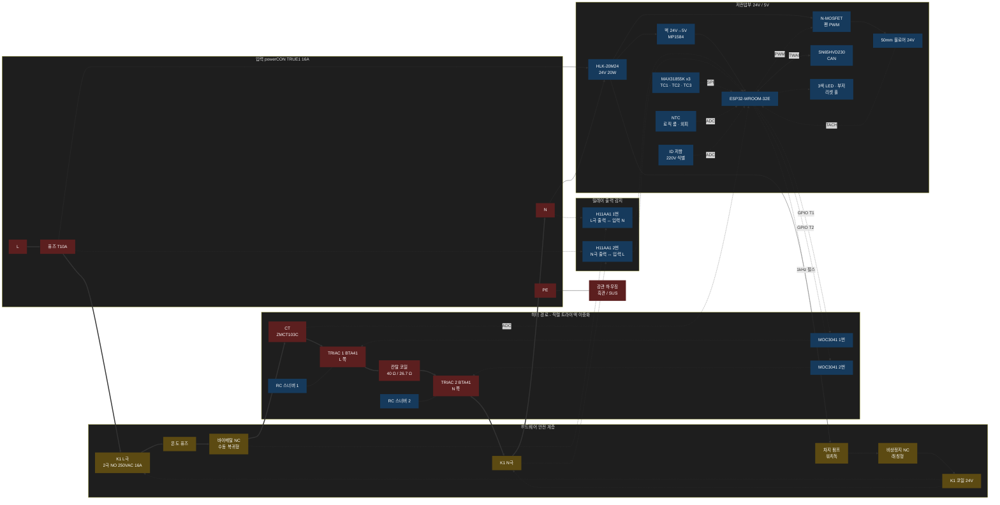
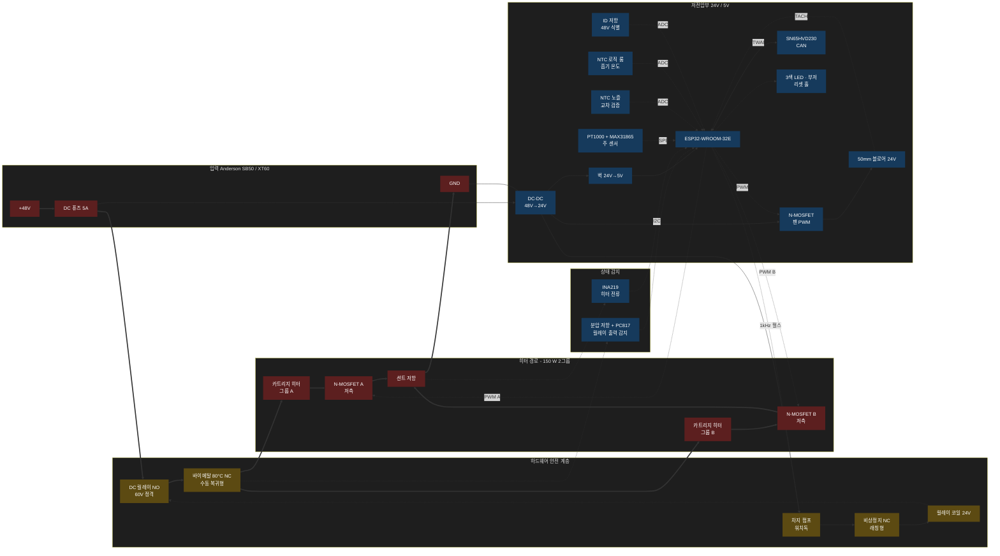

---
doc_id:
title: NEXA ThermoFlux (열풍기 모듈)
category: 기획서
domain: 양봉
status: draft
created: 2026-10-13
updated: 2026-10-14
parent_doc:
implements_doc:
see_also:
  - "[[모듈-열융착기 (NEXA Heat Fuser)]]"
  - "[[시스템-양봉 방재]]"
terms_standard: []
terms_nexa: []
---

# NEXA ThermoFlux (열풍기 모듈)

열풍 융착기 (타포린 본더) 와 NEXA BEE 양봉 장비에서 공통으로 쓰는 **독립 열풍 모듈**의 설계 문서다. 모듈은 " 목표 온도·풍량·모드 " 만 받아 스스로 온도를 제어하고, 안전은 펌웨어와 무관한 하드웨어 계층이 최종 책임진다.

---

## 1. 개요와 사양

```unset
       =========================================================
                 [ NEXA ThermoFlux 1200·1800 / 150 ]
       =========================================================
       - 기 구 부: 흑관 또는 SUS304 관 + 직접 용접 테이퍼 (Ø40 → Ø28)
                   내면 마이카 라이너 / 외단열 용접포 / 상단 제어부 3D 프린팅
                   (아연관(백관) 사용 금지)
       - 발 열 부: [작업실 220V] 칸탈 A1 단일 코일
                     1단계 40 Ω  1,210 W (보유 코일 원형)
                     2단계 26.7 Ω 1,815 W (출력 부족 시 300 mm로 절단)
                   [양봉 48V DC] 카트리지 히터 150W
       - 전 원 부: 220V = BTA41 트라이액 x2 (직렬 이중화) + 2극 NO 메인 릴레이
                   48V  = MOSFET x2 + DC 릴레이
       - 제 어 부: 모듈 내부 PID + 버스트 파이어 (목표 온도 수신형)
       - 통 신 부: 유선 CAN (RF 노출 최소화) <-> 무선 ESP-NOW (암호화) 자동 전환
       - 안 전 부: 하드웨어 3중 차단 (서모스탯/온도 퓨즈, 워치독 릴레이, 비상정지)
                   + 펌웨어 감시 태스크 + 모드별 온도 상한
       - U     I: 파워 스위치, 비상정지(히터만 차단), 리셋 홀, 3색 LED, 부저
                  (실시간 데이터 표시는 웹 브라우저/앱 허브 전담)
       =========================================================
```

| 주요 기능구역         | 상세 기능 요약                                                       | 설계 의도                                                                                                                             |
| --------------------- | -------------------------------------------------------------------- | ------------------------------------------------------------------------------------------------------------------------------------- |
| 회생형 바람길 터널    | 블로어 ➔ 로직 룸 ➔ 방열판 ➔ 가열실 (원통 → 테이퍼) ➔ 혼합 메시 ➔ 노즐 | 전력 소자 폐열로 흡기를 1 차 예열하고 제어반 전용 팬을 없앤다. 로직 룸은 가열실 **상류의 냉기 구간**에 둔다                            |
| 단일 코일 발열체      | 칸탈 40 Ω 코일 1 개                                                   | 무엇이 고장 나도 출력은 코일 정격에 머문다. 풍량만 있으면 열선이 견디는 **단일 고장 안전** 구조                                       |
| 직렬 트라이액 이중화  | 코일 양쪽 (L·N) 에 트라이액 1 개씩                                      | 하나가 단락돼도 다른 하나가 계속 제어하고 메인 릴레이는 안전 차단을 그대로 맡는다. 릴레이 추가 없이 단락 고장에 대한 예비 운전이 된다 |
| 테이퍼 가열실         | 가열체가 용접 테이퍼 구간까지 들어감                                 | 길이를 줄이고, 좁아지는 구간의 빠른 풍속으로 출구 쪽 열선을 더 잘 식힌다                                                              |
| 강관 하우징           | 흑관/SUS 관 + 내면 마이카 라이너 + 외단열                            | 아연 흄이 없고, 코일과 금속의 접촉을 막는다. 추가 단열·마감은 실측 후 정한다                                                          |
| 목표 온도 수신형 제어 | 명령 = 모드 + 목표 온도 + 풍량                                       | 통신 지연과 무관하게 모듈 내부 PID 가 온도를 잡는다. 데이터 경로는 조건 분기 없이 직결한다                                             |
| 하드웨어 우선 안전    | 서모스탯·온도 퓨즈·워치독 릴레이·비상정지                            | MCU 가 멈추거나 트라이액이 단락 고장 나도 히터 전원이 물리적으로 끊긴다                                                                |
| 모드별 온도 상한      | 변형 (220V/48V) 과 모드별 상한을 펌웨어 상수로 고정                    | 웹·CAN 어느 경로의 명령도 상한을 넘을 수 없다. 양봉 모드는 출력 상한으로 45°C 도달 자체를 막는다                                      |
| 통신 이원화           | 유선 CAN ↔ 무선 ESP-NOW                                              | 크래들 결합 시 무선을 끄고 CAN 으로 전환한다. 무선은 암호화·등록 피어만 허용한다                                                       |
| 노즐 인터페이스       | 교체식 쐐기 노즐 + 퇴피 신호                                         | 본더 정지 시 노즐을 즉시 빼내 원단 과열을 막는다 (스프링 복귀형 = 전원 상실 시 자동 퇴피)                                             |
| 분리형 UI             | 퀵 릴리즈 인렛 + 웹 디스플레이                                       | 본체 화면을 없애 내구성을 높이고, 상태는 웹 허브와 3 색 LED 로 표시한다                                                                 |

---

## 2. 출력·발열체 설계

열풍기가 공기에 줄 수 있는 열량은 다음 식으로 정해진다.

\[
P = \frac{\dot{m} \cdot c_p \cdot \Delta T}{\eta}, \qquad \dot{m} = \rho \cdot Q
\]

(공기 밀도 \(\rho\) = 1.2 kg/m³, 비열 \(c_p\) = 1,005 J/kg·K, 히터 효율 \(\eta\) = 0.8 가정)

### 2.1 필요 전력과 풍량 (토출 400°C, 흡기 20°C, ΔT = 380 K)

|        풍량 Q |           필요 전력 |
| ------------: | ------------------: |
|      50 L/min |            약 480 W |
|     100 L/min |            약 950 W |
| **127 L/min** | **1,210 W (1 단계)** |
|     150 L/min |          약 1,430 W |
| **190 L/min** | **1,815 W (2 단계)** |
|     200 L/min |          약 1,910 W |

- 1 단계 (1,210 W) 로 시작해 융착 시험 (노즐 폭·이송 속도별 박리 강도) 으로 출력이 충분한지 판정한다.
- 부족하면 코일을 300 mm 로 절단해 2 단계 (1,815 W) 로 올린다. 2 단계는 시판 핸디 열풍 융착기급 출력이다. 롤러식 자동 융착기는 1.5~3 kW 급 (예: SD-W200C 3 kW) 이다.
- 전기 정격 (퓨즈·릴레이·배선) 은 처음부터 2 단계 기준으로 잡아, 절단할 때 코일 외에는 바꿀 것이 없게 한다.

### 2.2 발열체: 보유 칸탈 코일 (선 지름 역산)

캘리퍼 고장으로 열선 지름을 실측하지 못해, 코일 외경과 밀착 길이로 역산했다.

\[
L*w = \frac{R \cdot \pi d^2 / 4}{\rho_e}, \qquad N = \frac{L_w}{\pi (D - d)}, \qquad L*{closed} = N \cdot d
\]

(\(R\) = 40 Ω, \(\rho_e\) = 1.45 µΩ·m (칸탈 A1), \(D\) = 코일 외경 6 mm)

|  선 지름 d | 열선 전개 길이 |                                밀착 길이 |
| ---------: | -------------: | ---------------------------------------: |
|    0.65 mm |          9.2 m |                                   354 mm |
| **0.7 mm** |     **10.6 m** | **446 mm** ← 보유 코일 (약 450 mm) 과 일치 |
|    0.75 mm |         12.2 m |                                   554 mm |

| 항목                      |        1 단계 (원형) | 2 단계 (300 mm 절단) |
| ------------------------- | ------------------: | ------------------: |
| 밀착 길이                 |           약 450 mm |              300 mm |
| 열선 길이 / 권수          | 10.6 m / 약 640 바퀴 |  7.1 m / 약 430 바퀴 |
| 저항                      |                40 Ω |              26.7 Ω |
| 출력 (220V)               |             1,210 W |             1,815 W |
| 전류                      |               5.5 A |               8.3 A |
| 열선 표면 부하            |           5.2 W/cm² |          11.7 W/cm² |
| 코일 지름 ÷ 선 지름 (D/d) |              약 7.6 |              약 7.6 |

- 위 값은 **외경 6 mm, 칸탈 A1 을 전제로 한 역산**이다. 니크롬 등 다른 합금이면 0.65 mm 전후가 나오지만 결론은 같다. 캘리퍼가 복구되면 실측해 확정한다 (§11 검증 1).
- 2 단계 절단 후에는 저항을 측정해 (목표 26.7 Ω) 펌웨어 정격 출력 상수를 맞춘다 (§5).

#### 검토 후 기각한 안

| 안                                                  | 기각 이유                                                                                                                                                                     |
| --------------------------------------------------- | ----------------------------------------------------------------------------------------------------------------------------------------------------------------------------- |
| 탭 분할 24 Ω + 16 Ω, 트라이액 2 개, 2,000 W          | 트라이액 하나만 단락돼도 짧은 구간이 순간 3 kW 로 고착돼 0.1 초 안팎에 용융 범위에 든다. 30 ms 이내 고속 차단, 동시 점화 금지 (동시 시 23 A), 열풍 속 탭 접점 같은 부담이 커진다 |
| 코일을 짧게 하고 " 잔여 시간 예측 알고리즘 " 으로 보완 | 열선은 3 초 안팎에 최종 온도에 도달하므로 시간 누적형 보호가 성립하지 않는다. 시간 관리가 필요한 대상은 하우징 축열이며, §2.6 에서 실측 기반으로 다룬다                         |
| 십자 마이카 X 교차 권선 + 도브테일 모듈             | 조립 시 중심선 간섭을 피하려면 모듈 적층·결착이 필요하다. 발열 분포 이득에 비해 구조·절연 위험과 제작 난이도가 크다                                                           |

### 2.3 열선 온도 시뮬레이션 (선 지름 0.7 mm)

#### 1) 계산 조건 (가정)

| 항목   | 값                                                                               |
| ------ | -------------------------------------------------------------------------------- |
| 열선   | 칸탈 A1 0.7 mm, 비저항 1.45 µΩ·m (온도에 따른 저항 상승 무시 = 보수적)           |
| 바람길 | 마이카 라이너 안지름 Ø40 또는 Ø32, 개구율 70%                                    |
| 풍량   | 토출 400°C 가 되도록 출력에 맞춰 결정 (히터 효율 0.8)                             |
| 대류   | 원통 직교류 상관식 (Churchill–Bernstein) × 코일 상호 차폐 0.7 (피치 2d 이상 기준) |
| 복사   | 산화 칸탈 방사율 0.7 × 자기 차폐 0.5 = 실효 0.35                                 |
| 모델   | 정상 상태 1 차원 (흐름 방향 공기 온도 상승 반영)                                  |

열선 온도 판정 기준 (일반 가이드, 가정):

| 열선 온도     | 판정        |
| ------------- | ----------- |
| 1,000°C 이하  | 장수명 운전 |
| 1,000~1,200°C | 수명 단축   |
| 1,200°C 초과  | 단수명·위험 |
| 약 1,500°C    | 용융        |

#### 2) 결과 (최대 출력 연속 운전, 최고 열선 온도)

| 구성                  | 400°C 풍량 | 바람길 Ø40 | 바람길 Ø32 |
| --------------------- | ---------: | ---------: | ---------: |
| 1 단계 450 mm, 1,210 W |  127 L/min |      609°C |      576°C |
| 2 단계 300 mm, 1,815 W |  190 L/min |      780°C |      723°C |

- 두 단계 모두 **최대 출력으로 계속 돌려도 장수명 기준보다 200°C 이상 낮다.** 출력 제한 없이 정격 운전할 수 있다.
- 테이퍼 가열실 (§2.4) 은 출구 쪽 열선을 추가로 식힌다 (0.5 mm 기준 계산에서 출구 끝 100~160°C 감소).
- 권선이 밀착되면 냉각 면적이 줄어 같은 출력에서 수백 °C 오른다. **피치 2d 이상이 위 결과의 전제다.**

#### 3) 동적 거동

| 항목                               |        1 단계 |        2 단계 | 의미                                                                               |
| ---------------------------------- | -----------: | -----------: | ---------------------------------------------------------------------------------- |
| 열선 열 시정수                     |     약 3.6 s |     약 2.9 s | 수 초 안에 최종 온도에 도달한다. 최종 온도가 안전 범위이므로 시간 제한이 필요 없다 |
| 반사이클 (8.3 ms) 점화 시 온도 맥동 |     약 0.6 K |     약 1.3 K | 버스트 파이어 맥동은 무시할 수준                                                   |
| 트라이액 1 개 단락 시               |    정상 제어 |    정상 제어 | 다른 트라이액이 제어를 이어받는다 (§2.5)                                            |
| 트라이액 2 개 모두 단락 시          | 1,210 W 고정 | 1,815 W 고정 | 정격과 같으므로 팬이 돌면 열선은 견딘다. 메인 릴레이 차단으로 충분                 |
| 팬 정지 시 열선 온도 상승          |    약 70 K/s |   약 160 K/s | 약 4~10 초 안에 위험 온도. 팬 락 감지 → 히터 차단이 주 보호, 바이메탈이 최후 보호   |

- 1 초 창 방식 (예: 400 ms 켜고 600 ms 끔) 대신 반사이클 단위 분산 점화를 쓴다 (§5).

### 2.4 코일 권선·지지 설계

#### 1) 피치와 길이

| 항목                                 |                     1 단계 |                 2 단계 |
| ------------------------------------ | ------------------------: | --------------------: |
| 피치 (선 지름의 2~3 배)               |                1.4~2.1 mm |            1.4~2.1 mm |
| 늘린 코일 길이 (피치 2d / 2.5d / 3d) | 약 890 / 1,115 / 1,340 mm | 약 600 / 750 / 900 mm |

- 판매 상태의 밀착 코일은 그대로 쓰지 않는다. 권선이 붙으면 그 사이로 바람이 통하지 않아 과열점이 된다.
- **첫 가열 전에** 나사봉이나 피치 지그로 균일하게 늘리고 모양을 완성한다. 칸탈은 고온을 한 번 겪으면 결정립이 커져 부서지기 쉬워지므로 다시 늘리거나 휠 수 없다.

#### 2) 십자 마이카 지지체 배치

```unset
          blower side (cold)                         outlet side (hot)
  term 1 ── perimeter winding (notches) ─────────────────────►┐
                                                               │ beyond plate end
  term 2 ◄── interior return: short coils on slits ◄───────────┘
             (staggered, stays inside one quadrant)
```

- **바깥 둘레:** 반원 노치를 따라 출구 쪽으로 감는다. 노치 1~2 개마다 권선을 걸어 피치를 유지한다.
- **내부 귀환:** 짧은 코일을 가로 슬릿에 걸어 블로어 쪽으로 되돌아온다. 한 사분면 안에서 엇갈리게 배치하고, 사분면을 넘어가는 연결은 **판 끝단 바깥에서 1 회만** 한다 (조립 시 중심선에 상대 판이 있으므로).
- **단자 2 개는 모두 블로어 쪽**에 모인다. 가열실을 가로지르는 리드선이 없어 고온 배선 문제가 생기지 않는다.
- **지지 간격 30~40 mm 이하.** 70 mm 간격이면 지지점 비틀림 응력이 약 0.7 MPa 로, 고온 장기 처짐 우려가 있다. 간격을 줄일 수 없으면 코일 속에 얇은 마이카 띠나 세라믹 튜브를 끼워 연속 지지한다.
- **곧은 연결선은 마이카 면에서 띄운다.** 길게 닿으면 그 부분이 과열점이 되고 마이카가 열화된다.
- **마이카:** 고온용 금운모 (phlogopite) 경질판을 쓴다. 슬릿 끝에는 Ø1 mm 구멍을 뚫어 열 사이클 균열을 막는다.

#### 3) 테이퍼 가열실

- 하우징 관은 원통부 (Ø40) 에서 **직접 용접한 테이퍼부**(→ Ø28) 로 좁아지고, 가열체도 테이퍼 구간까지 들어간다. 축소관을 따로 두는 것보다 전체 길이가 약 10% 짧다.
- 열선은 **테이퍼 구간에 50~55%** 배정한다. 그 이상 몰면 오히려 테이퍼 쪽이 더 뜨거워진다. 피치는 어디서든 2d 이상을 지킨다.
- 마이카 십자도 같은 각도로 좁혀 **코일과 마이카 라이너 면 간격 3~5 mm 이상**을 끝까지 유지한다 (라이너 뒤는 접지 금속).
- 테이퍼에서 둘레 감기는 장력과 중력 (출구가 아래인 자세) 으로 좁은 쪽으로 흘러내리려 한다. 테이퍼 구간 노치는 깊게 파고 1~2 바퀴마다 고정한다.
- 가열부 끝에 **혼합 구간 10~20 mm 또는 스테인리스 메시**를 둔다. 노즐에서 코일 줄무늬 온도 얼룩을 없애고 열선 파편을 막는다. TC1 은 혼합 뒤에 둔다.
- 대가는 압력 손실 증가다. 50 mm 블로어 정압으로 목표 풍량이 나오는지 시험한다.

#### 4) 테이퍼 용접

- **제작:** 판재를 부채꼴로 전개해 말고 길이 방향을 맞대기 용접한 뒤, 원통부와 원주 용접한다. 관 (두꺼움) 과 테이퍼 판 (얇음) 의 두께 차이를 고려해 입열을 판 쪽에 덜 준다.
- **동심도:** 테이퍼 축이 원통부 축과 어긋나면 한쪽 벽이 코일에 가까워진다. 용접 후 출구 끝 편심을 확인한다 (목표 ±1 mm).
- **내면 비드:** 그라인더로 평평하게 다듬는다. 튀어나온 비드는 마이카 라이너를 들뜨게 하고 코일과의 간격을 줄인다.
- **흑관:** CO2·피복 아크 용접 가능. 슬래그·스패터·스케일을 제거하고 외면은 600°C 급 실리콘 도료로 마감한다.
- **SUS304:** TIG 용접 시 **내면 아르곤 백퍼지**를 한다. 퍼지 없이 용접하면 내면이 검게 산화 (슈가링) 되어 고온에서 가루로 떨어진다. 퍼지가 어려우면 산세 페이스트로 산화막을 제거한다.
- **조립 전 소성:** 용접·도장을 마친 관은 코일을 넣기 전에 토치나 오븐으로 따로 구워 도료 경화와 유분·연기 제거를 끝낸다 (실외 또는 배기 아래).

#### 5) 마이카 라이너

- 관 안쪽 **전체**를 금운모 시트로 덮는다. 원통부는 말아 넣고, 테이퍼부는 부채꼴로 전개한 시트를 쓴다. 이음부는 10 mm 이상 겹친다.
- 역할: ① 코일과 금속의 1 차 절연 (처짐·단선 시 접촉 방지), ② 흑관 산화 스케일이 바람에 섞이는 것을 차단, ③ 관 벽 온도 완화.
- 라이너는 바람 방향으로 겹치게 (상류 시트가 하류 시트 위) 배치해 이음부가 바람에 들리지 않게 한다.

#### 6) 단자와 길들이기

- 칸탈은 납땜이 안 된다. **니켈 슬리브 압착**으로 연결하고, 끝부분은 선을 2~3 겹 꼬아 저항을 낮춘 **냉단**으로 만든다.
- 두 단자 사이에는 마이카 격벽을 두고 연면거리 약 6 mm 이상을 확보한다.
- 길들이기 순서:
  1. 차가운 상태에서 성형·고정한다.
  2. 저항을 확인한다 (1 단계 약 40 Ω, 2 단계 약 26.7 Ω). 낮으면 권선 접촉이 있는 것이다.
  3. 듀티 20~30%, 팬 최대로 켜고 어두운 곳에서 열선 색을 본다. 한 곳만 밝으면 과열점이다. 간격은 완전히 식힌 뒤 고친다.
  4. 정격 근처로 운전해 보호 산화막 (알루미나) 을 만든다. 알루미나 막은 약 1,000°C 이상에서 잘 형성되므로, 정확한 조건은 칸탈 등급별 제조사 자료를 따른다.
  5. 이후에는 구부리지 않는다.

### 2.5 결선

```unset
L ──[퓨즈 T10A]──[2극 NO 릴레이 L]──[CT]──[TRIAC 1 (BTA41)]── coil term 1
N ───────────────[2극 NO 릴레이 N]────────[TRIAC 2 (BTA41)]── coil term 2
PE ── 강관 하우징 (흑관/SUS, 블로어 쪽 차가운 끝에 링 단자 볼트 체결)
(spare: 확장 코일용 트라이액 쌍 자리 + 배선 공간)
```

- **2 극 메인 릴레이 1 개:** 국내 콘센트는 플러그 방향이 바뀌어 L/N 이 고정되지 않으므로, L·N 을 함께 끊는다. 릴레이 코일은 워치독 (차지 펌프) 회로와 비상정지 스위치를 직렬로 거친다.
- **릴레이 접점은 반드시 NO(상시 개방, a 접점, DPST-NO) 다.** 코일에 전류가 흐를 때만 닫히므로 MCU 정지, 24V 전원 상실, 코일 단선, 비상정지, 워치독 펄스 중단 등 **어떤 고장에서도 히터 전원이 열린다 (페일 세이프).** NC 접점이나 전환형 (1c) 의 NC 쪽을 쓰면 고장 시 오히려 히터가 연결되므로 금지한다.
- **가열하지 않을 때는 릴레이를 연다.** 히터 명령이 있을 때만 닫으므로 대기 중에는 히터 회로 자체가 죽어 있다. 순서는 다음과 같다.
  - 시작: 릴레이 닫힘 → 100 ms 안정 대기 → 트라이액 자가 진단 3 단계 (약 180 ms) → 점화 허가.
  - 정지: 트라이액 OFF → 50 ms 뒤 릴레이 개방. 전류가 없을 때 접점을 열어 아크와 접점 마모를 막는다.
- **릴레이 융착 감지:** 릴레이를 열었는데 출력 쪽에 전압이 남아 있으면 접점 융착으로 판정한다. 극별로 감지해야 한쪽 극만 붙은 경우도 잡는다 (H11AA1 2 개: L 극 출력↔입력 N, N 극 출력↔입력 L). 매 정지 때와 부팅 직후마다 검사된다.
- **직렬 트라이액 이중화:** 코일 L 쪽에 TRIAC 1, N 쪽에 TRIAC 2 를 둔다. 트라이액 고장은 단락이 대부분이라는 전제로, 단락된 트라이액은 전선처럼 되고 다른 하나가 계속 제어한다. 고장 난 소자를 떼어 낼 필요가 없으므로 **메인 릴레이 1 개를 공유**해도 된다.

| 상태                  | 제어 담당             | 다른 하나                     | 메인 릴레이                     |
| --------------------- | --------------------- | ----------------------------- | ------------------------------- |
| 정상                  | TRIAC 1 버스트 점화   | TRIAC 2 게이트 상시 ON (추종) | 안전 차단                       |
| TRIAC 1 단락          | TRIAC 2 버스트 점화   | (단락 = 도통)                 | 안전 차단                       |
| TRIAC 2 단락          | TRIAC 1 버스트 점화   | (단락 = 도통)                 | 안전 차단                       |
| 둘 다 단락            | 제어 불가             | -                             | **개방 (하드 차단, 현장 리셋)** |
| 어느 한쪽 개방 (드묾) | 히터 정지 (안전 방향) | -                             | -                               |

- **제로크로스 추종:** MOC3041 은 제로크로스에서만 켜지므로, 추종 쪽 게이트를 계속 켜 두면 제어 쪽이 켜지는 그 제로크로스에서 함께 켜진다. 반파 도통이 생기지 않는지 시험한다 (§11).
- **예비 운전 중에도 안전 계층은 그대로다.** 메인 릴레이, CT, 바이메탈, 온도 퓨즈가 모두 살아 있으므로 두 번째 고장까지 단일 고장 안전이 유지된다.
- **잠복 고장 대책:** 가열 시작 때마다 자가 진단으로 두 트라이액을 각각 확인하고, 운전 중에는 10 초마다 TRIAC 2 를 교차 검사한다 (§8).
- **대가:** 트라이액 전압 강하가 하나 더 생겨 발열이 늘어난다 (1 단계 약 6~8 W, 2 단계 약 10~12 W 추가). 두 트라이액을 같은 방열판 (절연 탭) 에 두고 방열판은 바람길에 둔다.
- **대기 중 절연:** 릴레이가 열리면 코일 양쪽이 모두 전원에서 떨어지므로 플러그 방향과 무관하다.
- **CT 1 개:** 공통 경로에 두고 자가 진단·비제어 도통·이중 단락을 모두 판정한다. 판정 문턱은 두 스너버 누설 전류보다 높게 잡는다.
- **확장 경로:** 2 단계로도 부족하면 같은 40 Ω 코일을 하나 더 병렬로 두고 **코일마다 직렬 트라이액 쌍**을 따로 붙인다 (1 단계 코일 2 개 = 2,420 W, 11 A, 트라이액 4 개). 이때는 퓨즈 T16A 로 올린다.

### 2.6 운용 보호

| 구분                  | 대책                    | 내용                                                                                                                                                                                                             |
| --------------------- | ----------------------- | ---------------------------------------------------------------------------------------------------------------------------------------------------------------------------------------------------------------- |
| 소프트웨어            | 팬 선행·쿨다운          | 팬이 설정 풍량에 도달한 뒤 히터를 허가하고, 정지 시 쿨다운 (§4.4) 을 유지한다                                                                                                                                      |
| 소프트웨어            | 풍량별 출력 상한 맵     | 시험으로 `P_max(팬 RPM, 흡기 온도)` 표를 만들어 PID 출력 상한으로 쓴다. 저풍량 설정에서 열선이 과열되지 않게 한다                                                                                                |
| 소프트웨어            | TC2 실시간 제한         | 코일 출구 온도 (TC2) 기준으로 출력을 제한한다. 풍량 저하는 RPM 보다 TC2 가 먼저 알려 준다                                                                                                                           |
| 소프트웨어            | 열선 저항 감시          | 전압·전류로 저항을 계산한다. 칸탈은 온도에 따른 저항 변화가 작으므로, 저항이 떨어지면 **권선 접촉 (국부 단락)**, 오르면 단선 진행으로 판정한다                                                                    |
| 소프트웨어            | 하우징 잔여 시간 (실측) | 관 외벽·외피 온도를 측정해 `잔여 시간 = (한계 온도 − 현재 온도) / 상승률` 로 계산한다. 30 초 전 경고 → 점진 감발 → 한계에서만 차단한다. 이음매 중간 급차단을 피한다                                                |
| 하드웨어              | 바이메탈 + 온도 퓨즈    | 관 외벽 (단열재 안쪽), 히터 직렬. 단일 코일은 고장이 수 초 이상에 걸쳐 진행되므로 **실제 보호 역할을 한다.** 바이메탈은 **수동 복귀형**을 쓴다. 자동 복귀형은 식으면 다시 닫혀 무인 상태에서 켜짐·꺼짐을 반복한다 |
| 하드웨어              | 워치독 릴레이           | GPIO 펄스가 끊기거나 고착되면 개방. 고속 차단 회로는 필요 없다                                                                                                                                                   |
| 하드웨어              | 릴레이 융착 감지        | 개방 명령 후 출력 전압이 남으면 융착 판정 (§2.5). 융착 상태에서 남는 최후 보호는 온도 퓨즈다                                                                                                                      |
| 하드웨어 + 소프트웨어 | 직렬 트라이액 이중화    | 트라이액 1 개 단락 시 다른 하나로 예비 운전, 매 가열 시작 자가 진단 + 운전 중 교차 검사 (§2.5, §8)                                                                                                                 |
| 하드웨어              | 하우징 온도 센서        | 관 외벽 TC3(단열재 안쪽) + 외피 NTC. 하우징 잔여 시간·쿨다운 종료의 입력                                                                                                                                         |
| 하드웨어              | 지지 간격·피치          | §2.4. 권선 접촉과 처짐을 원천적으로 막는다                                                                                                                                                                       |

### 2.7 양봉 48V 버전 (150 W)

| 목표             | ΔT (흡기 22°C) | 150 W 로 가능한 풍량 |
| ---------------- | -------------: | ------------------: |
| 응애 방제 42.5°C |        약 20 K |        약 290 L/min |
| 밀납 해지 65°C   |        약 43 K |        약 140 L/min |

- 48V 버전은 출력이 **부족한 것이 아니라 남는다.** 따라서 위험은 " 과열 가능성 " 이며, §4.2 의 **출력 상한**으로 관리한다.

---

## 3. 하드웨어 구성

### 3.1 바람길과 발열체

```unset
[흡기] → [블로어] → [로직 룸 (냉기)] → [트라이액 방열판] → [칸탈 코일: 원통부 → 테이퍼부] → [TC2] → [혼합 메시] → [노즐 + TC1] → [토출]
```

- **발열체:** 보유 칸탈 A1 코일을 십자 마이카 지지체에 감는다 (§2.4). 인두기용 세라믹 봉 히터와 구리 코일은 쓰지 않는다.
  - 인두기 히터는 전도형이라 공기 가열에 쓰면 표면적이 모자라 소자 온도가 과도하게 오른다.
  - 구리는 200~300°C 부터 산화하며, 산화 가루가 열풍을 타고 융착면에 날아간다.
- **로직 룸:** ESP32·전원 모듈·포토커플러는 가열실 상류 냉기 구간에 두고, 마이카 격벽과 공기층으로 열 역류를 막는다. 로직 룸 NTC 로 온도를 감시한다 (상한 70°C).
- **센서:**
  - TC1(혼합 메시 뒤, 노즐 직전): 제어용.
  - TC2(코일 출구, 라이너 관통): 풍량 저하·코일 과열 감시용. 블로어는 막히면 부하가 줄어 **회전수가 오히려 오를 수 있으므로** RPM 만으로는 풍량을 보장할 수 없다.
  - TC3(관 외벽, 단열재 안쪽)·외피 NTC: 하우징 축열 감시·쿨다운 종료 판정용 (§2.6, §4.4).

### 3.2 하우징

```unset
  [3D 프린팅 제어부] ─ 단열 이음 ─ [강관: 원통부 ─ 용접 테이퍼] ─ [노즐]
                                     │  안: 마이카 라이너 (전체)
                                     │  밖: 용접포 → (실측 후) 추가 단열 / 3D 마감
```

#### 1) 관 재질

- **아연관 (백관) 은 사용하지 않는다.** 아연 도금은 약 200°C 부터 열화하고 419°C 에서 녹는다. 가열 시 산화아연 흄 (흡입 시 금속열) 과 아연 가루가 노즐로 토출된다.
- 흑관 또는 SUS304 관을 쓴다.

| 항목                      | 흑관 (탄소강)                           | SUS304 관            |
| ------------------------- | --------------------------------------- | -------------------- |
| 고온 산화                 | 스케일 발생 → 마이카 라이너로 공기 차단 | 거의 없음            |
| 열전도 (제어부로 가는 열) | 약 50 W/m·K                             | 약 16 W/m·K (약 1/3) |
| 용접                      | CO2·피복 아크, 쉬움                     | TIG + 내면 백퍼지    |
| 녹 (양봉카 습기)          | 외면 600°C 급 실리콘 도료 필수           | 없음                 |
| 가격·구입                 | 저렴, 쉬움                              | 비쌈                 |

- **규격 예:** 40A 흑관 (외경 48.6, 내경 약 41.6 mm). 마이카 라이너를 넣으면 바람길이 약 Ø40 으로 §2.3 계산 조건과 맞는다. SUS 는 같은 내경급을 고른다.
- **두께:** 40A 배관용 흑관은 20 cm 에 약 0.7 kg 이다. 관이 두꺼울수록 무게·축열 (예열 지연, 쿨다운·열 역류 증가) 이 커지므로, 구할 수 있으면 얇은 관을 쓴다.

#### 2) 단열과 마감

- **내단열:** 마이카 라이너 (§2.4). 코일과 금속이 직접 닿지 않게 하는 것이 1 차 목적이다.
- **외단열 (1 차):** 용접포를 감는다. 내열은 실리카 용접포가 유리섬유보다 높다.
  - 섬유가 날리므로 바깥을 감싸 마감한다 (금속 테이프, 3D 마감재 등).
  - 코팅품은 첫 가열 때 연기가 나므로 미리 구워 낸다.
  - 바이메탈·온도 퓨즈·TC3 는 **단열재 안쪽 관 외벽에 직접** 붙인다. 바깥에 붙이면 반응이 늦다.
- **추가 단열재·3D 마감:** 제작 후 외피 온도를 실측해 결정한다 (§11). 목표는 손잡이부 60°C 이하다.

#### 3) 3D 프린팅 재질 선정

판정 기준은 **닿는 면의 실측 최고 온도 ≤ 재질 열변형 온도 − 20°C**다 (열변형 온도는 대략값, 제품별 확인).

| 재질                | 열변형 온도 (대략) | 사용 가능 면 온도 |
| ------------------- | -----------------: | ----------------: |
| PLA                 |            55~60°C |     사용하지 않음 |
| PETG                |            70~80°C |           50~60°C |
| ABS / ASA           |           95~100°C |           75~80°C |
| PC / PC-CF          |          110~140°C |          90~120°C |
| PA-CF (나일론 탄소) |         150°C 이상 |          약 130°C |

#### 4) 상단 제어부 (3D 프린팅)

- **단열 이음:** 강관에 직접 붙이지 않는다. 마이카·세라믹 와셔나 스페이서를 끼우고 접촉 면적을 최소로 해 관의 열전도를 끊는다.
- **220V 부:** 일반 필라멘트는 난연 등급이 없다. 릴레이·트라이액·퓨즈는 **금속 서브 케이스**에 넣거나 난연 필라멘트 (PC-FR, ABS-FR) 를 쓴다.
- **체결:** 출력물은 나사 체결부가 시간이 지나며 처지므로 단자·고정부에 황동 인서트를 쓴다.
- **열 역류:** 전원 발거 후 강관 축열이 제어부로 전도된다. 재질은 §11 열 역류 시험의 실측 최고 온도로 확정한다.

### 3.3 부품 리스트 (Bill of Materials)

#### 공통

| 부품 분류          | 부품명 및 규격                                                          | 수량  | 체크포인트                                                                      |
| ------------------ | ----------------------------------------------------------------------- | ----- | ------------------------------------------------------------------------------- |
| 기구/하우징 관     | 흑관 또는 SUS304 관 40A 급 (내경 약 41~42 mm) + 직접 용접 테이퍼 (→ Ø28) | 1     | **아연관 (백관) 금지.** 흑관은 외면 600°C 급 실리콘 도료. 보호 접지 (PE) 러그 체결 |
| 기구/내단열        | 금운모 마이카 라이너 시트 (원통부 + 테이퍼 부채꼴 전개)                 | 1 세트 | 관 내면 전체, 이음부 10 mm 이상 겹침                                            |
| 기구/외단열        | 실리카 용접포 등 (추가 단열재는 실측 후 결정)                           | 1     | 섬유 비산 방지 마감, 첫 가열 전 소성                                            |
| 기구/제어부        | 3D 프린팅 상단 제어부 하우징 + 황동 인서트                              | 1     | 재질은 실측 후 확정 (§3.2), 220V 부는 금속 서브 케이스 또는 난연 재질             |
| 기구/단열 이음     | 마이카·세라믹 와셔·스페이서                                             | 1 세트 | 강관 → 제어부 열전도 차단                                                       |
| 기구/마감 (선택)   | 3D 프린팅 외피                                                          | 1     | 실측 외피 온도에 따라 적용 여부·재질 결정                                       |
| 기구/가이드        | 4 점 편심 슬리브 + 볼베어링                                              | 1 세트 | 노즐 높이·삽입 위치 조정용 (§9.4)                                               |
| 기구/충격흡수      | 다이 스프링 (롱 바디)                                                   | 1     | 가이드 핀 관통 필수                                                             |
| 기구/밀봉          | 마이카 절연판 + 고내열 실리콘 패드                                      | 1 세트 | 로직 룸과 가열실 격벽                                                           |
| 혼합 메시          | SUS304 메시 또는 다공판                                                 | 1     | 가열부 끝, 온도 균일화·파편 차단                                                |
| 노즐               | SUS304 쐐기형 노즐 20/30/40mm                                           | 각 1  | 교체식, 노즐별 TC1 오프셋 보정값 보유                                           |
| 송풍               | 50mm 블로어 24V DC (PWM + TACH)                                         | 1     | 흡기 측 배치, 고정압형 (테이퍼 압력 손실 확인)                                  |
| 팬 구동            | 로직 레벨 N-MOSFET                                                      | 1     | PWM 저측 스위칭                                                                 |
| 메인 연산          | ESP32-WROOM-32E 모듈                                                    | 1     | 태스크 워치독 사용                                                              |
| 통신               | SN65HVD230 CAN 트랜시버                                                 | 1     | ESP32 TWAI (클래식 CAN, 8 바이트 프레임)                                         |
| 로직 전원          | 24V→5V 벅 컨버터 (MP1584 급)                                             | 1     | ESP32 3.3V 는 보드 LDO                                                           |
| 워치독 릴레이 구동 | 차지 펌프 회로 (커패시터 결합 + 정류 + 트랜지스터)                      | 1     | GPIO 펄스가 끊기거나 고착되면 릴레이 개방                                       |
| 비상정지           | 래칭형 비상 스위치 **NC 접점**(누르면 개방)                             | 1     | 릴레이 코일 회로 직렬, **히터만 차단하고 팬은 유지**                            |
| 온도 감시          | NTC 10kΩ                                                                | 1     | 로직 룸 온도 겸 흡기 온도                                                       |
| 변형 식별          | ID 저항 (ADC 판독)                                                      | 1     | 220V/48V 변형 자동 인식                                                         |
| UI                 | 파워 스위치, 리셋 홀, 3 색 LED, 액티브 부저                              | 각 1  | 상태 표시 (§8)                                                                  |

#### 작업실 220V 변형

| 부품 분류        | 부품명 및 규격                                                              | 수량  | 체크포인트                                                                                        |
| ---------------- | --------------------------------------------------------------------------- | ----- | ------------------------------------------------------------------------------------------------- |
| 발열체           | 칸탈 A1 코일 40 Ω (외경 6 mm, 밀착 약 450 mm, 선 지름 약 0.7 mm 역산)       | 1     | 1 단계 원형 1,210 W / 2 단계 300 mm 절단 1,815 W                                                    |
| 지지체           | 금운모 경질 마이카 십자 지지체 (노치·슬릿, 테이퍼 하단)                     | 1 세트 | 지지 간격 30~40 mm 이하, 슬릿 끝 Ø1 구멍                                                          |
| 단자             | 니켈 압착 슬리브 + 냉단 처리                                                | 2     | 납땜 금지, 단자 간 마이카 격벽                                                                    |
| 전력 소자        | BTA41 (40A 800V, 절연 탭)                                                   | 2     | 직렬 이중화 (L·N 각 1). 같은 방열판, 방열판은 바람길에 배치. 확장 코일용 쌍 자리 예비              |
| 신호 격리        | MOC3041 제로크로스 포토트라이액                                             | 2     | 트라이액별 1 개, GPIO 별도. 위상 제어 불가 → 버스트 파이어 전용                                    |
| 메인 릴레이      | 2 극 NO(DPST-NO, 2a) 250VAC 16A 릴레이                                       | 1     | **NO 접점 필수 (코일 무전원 = 개방)**, L·N 동시 차단, 워치독·비상정지 연동                         |
| 열 차단          | 바이메탈 서모스탯 **NC 형·수동 복귀형**(평소 닫힘, 과열 시 개방) + 온도 퓨즈 | 각 1  | **NO 형·자동 복귀형 금지**, 관 외벽 (단열재 안쪽) 부착, 히터 직렬, 설정값은 풍량 차단 시험으로 결정 |
| 입력 보호        | 퓨즈 T10A (병렬 코일 확장 시 T16A)                                          | 1     | 인렛 직후                                                                                         |
| 배선             | 내열 (실리콘·유리섬유) 1.5 mm²                                               | -     | 확장 여유 포함                                                                                    |
| 24V 전원         | Hi-Link HLK-20M24 (24V 20W)                                                 | 1     | 팬·로직 전원                                                                                      |
| 온도 센서        | K-type 시스 열전대 + MAX31855K                                              | 3     | TC1·TC2·TC3, 단선 감지 비트 사용                                                                  |
| 외피 온도        | NTC 10kΩ                                                                    | 1     | 하우징 잔여 시간 입력                                                                             |
| 전류 감지        | ZMCT103C 변류기                                                             | 1     | AC 히터 전류 RMS (INA219 는 DC 전용이라 사용 불가)                                                 |
| 릴레이 후단 감지 | H11AA1 AC 감지 옵토                                                         | 2     | 극별 감지 (L 극 출력↔입력 N, N 극 출력↔입력 L). 하드웨어 차단·릴레이 융착 판독                       |
| 스너버 (선택)    | RC 스너버                                                                   | 2     | 트라이액별 동일 사양. 누설 전류는 CT 판정 문턱보다 낮게                                           |
| 전원 커넥터      | powerCON TRUE1 TOP (16 A)                                                   | 1 세트 | 부하 상태 탈착 정격 품목                                                                          |

#### 양봉 48V 변형

| 부품 분류        | 부품명 및 규격                                 | 수량  | 체크포인트                                                   |
| ---------------- | ---------------------------------------------- | ----- | ------------------------------------------------------------ |
| 발열체           | 48V 카트리지 히터 어레이 (총 150W, 2 그룹)      | 1 세트 | 트라이액은 DC 를 끌 수 없으므로 MOSFET 사용                   |
| 전력 소자        | 로직 레벨 N-MOSFET                             | 2     | 저측 스위칭, PWM 가능                                        |
| 메인 릴레이      | DC 60V 정격 NO 릴레이                          | 1     | **NO 접점 필수**, 워치독·비상정지 연동                       |
| 열 차단          | 바이메탈 80°C **NC 형·수동 복귀형** (절대 상한) | 1     | **NO 형·자동 복귀형 금지**, 히터 직렬                         |
| 릴레이 후단 감지 | 분압 저항 + PC817 옵토                         | 1     | DC 릴레이 출력 전압 판독, 하드웨어 차단·융착 판정            |
| 입력 보호        | DC 퓨즈 5A                                     | 1     | 커넥터 직후                                                  |
| 24V 전원         | 48V→24V DC-DC                                  | 1     | 팬·로직 전원                                                 |
| 온도 센서 (주)   | PT1000 + MAX31865                              | 1     | 저온 정밀 제어 (K-type 은 오차 ±2.2°C 라 42.5°C 제어에 부적합) |
| 온도 센서 (교차) | NTC 10kΩ (노즐)                                | 1     | 주 센서와 교차 검증                                          |
| 전류 감지        | 션트 + INA219                                  | 1     | DC 히터 전류                                                 |
| 전원 커넥터      | Anderson SB50 또는 XT60                        | 1 세트 | powerCON TRUE1 은 AC 용이므로 DC 에 쓰지 않음                   |

### 3.4 전기·작업 안전

- 220V 가 들어가는 강관 하우징이므로 **보호 접지 (PE) 필수**, 누전차단기가 있는 콘센트에서만 사용한다. 외피를 3D 마감재로 덮어도 강관 접지는 유지한다.
- 마이카 라이너는 1 차 절연일 뿐이다. 열선이 처지거나 끊어져 관에 닿는 경우는 접지와 누전차단기가 보호한다.
- 관 나사 이음에 테플론 테이프를 쓰지 않는다 (약 260°C 에서 분해). 용접 또는 금속 체결, 고온 실란트를 쓴다.
- 고압부와 로직부 사이, 코일 단자 사이는 강화 절연 기준 **연면거리 약 6 mm 이상**을 확보하고, 격벽은 마이카로 한다.
- PVC 타포린은 과열 시 염화수소 등 유해 흄이 나온다. 작업실에 **국소 배기**를 두고, 온도 상한 (§4.2) 을 지킨다.

---

## 4. 안전 아키텍처

### 4.1 3 계층 차단 구조

| 계층          | 구성                                                                  | MCU 고장 시 동작   | 담당 고장                                                               |
| ------------- | --------------------------------------------------------------------- | ------------------ | ----------------------------------------------------------------------- |
| ① 하드웨어    | 바이메탈·온도 퓨즈 (히터 직렬), 워치독 2 극 릴레이, 비상정지, 입력 퓨즈 | **동작함**         | MCU 정지·폭주, 트라이액/MOSFET 단락, 풍량 상실                          |
| ② 펌웨어 감시 | 감시 태스크 (최고 우선순위, 10 ms) + ESP32 태스크 워치독              | 재부팅 시 ①이 차단 | 과열, 팬 락, 풍량 저하, 통신 두절, 트라이액 단락 (1 개·이중), 릴레이 융착 |
| ③ 상위        | 본더/크래들 제어반, 웹 허브 입력 검사, 원격 알림 (§10.4)               | 무관               | 잘못된 작업 설정, 무인 현장의 고장 통보 (안전 근거로 삼지 않음)         |

- 같은 ESP32 의 Core 1 감시 태스크는 Core 0 이 멈춰도 돌지만, **칩 리셋·브라운아웃에는 함께 멈춘다.** 그래서 최종 차단은 ①이 맡는다.
- **워치독 릴레이:** 감시 태스크가 정상일 때만 GPIO 펄스 (약 1 kHz) 를 낸다. 차지 펌프가 이 펄스로만 릴레이 코일을 유지하므로, 핀이 HIGH 나 LOW 로 고착되면 릴레이가 열린다.
- **트라이액 단락:** 하나만 단락되면 다른 하나가 제어를 이어받아 예비 운전한다. 둘 다 단락되면 릴레이를 연다. 단일 코일이므로 이중 단락이어도 출력은 코일 정격 (최대 1,815 W) 에 머물고, 팬이 돌면 열선이 견딘다 (§2.3). 위험해지는 것은 **이중 단락 + 릴레이 융착 + 팬 정지**가 겹칠 때이며, 이때는 바이메탈·온도 퓨즈가 최후로 차단한다.

### 4.2 변형·모드별 온도 상한

상한은 펌웨어 상수로 고정하며 패킷으로 바꿀 수 없다. 명령의 목표 온도는 허용 범위로 잘리고 (클램프) 상태 비트로 보고된다.

| 변형 | 모드                 | 목표 허용 범위 | 소프트 차단 (히터 OFF) | 래치 차단                 | 하드웨어 상한             |
| ---- | -------------------- | -------------- | ---------------------- | ------------------------- | ------------------------- |
| 220V | GENERAL (융착·가열)  | 50~450°C       | TC1 ≥ 470°C            | TC1 ≥ 480°C 또는 TC2 상한 | 바이메탈 + 온도 퓨즈      |
| 48V  | BEE_MITE (응애 방제) | 38.0~43.0°C    | 44.0°C                 | 45.0°C                    | 80°C 바이메탈 + 출력 상한 |
| 48V  | BEE_WAX (밀납 해지)  | 50~70°C        | 72°C                   | 75°C                      | 80°C 바이메탈             |

- **양봉 모드 교차 접근 금지:** BEE 모드는 48V 변형에서만, GENERAL 모드는 220V 변형에서만 허용한다. 변형은 ID 저항으로 자동 판별한다.
- **BEE_MITE 출력 상한:** 히터가 100% 고착되더라도 토출이 45°C 를 넘지 못하도록 최대 출력을 제한한다. 상한은 흡기 온도 (로직 룸 NTC) 와 최저 풍량으로 계산한다.
  - 예) 최저 풍량 60 L/min, 흡기 22°C → 허용 ΔT 23 K → 약 35 W.
  - 흡기가 35°C 인 한여름에는 ΔT 10 K → 약 15 W 로 자동 축소한다.
  - 최저 풍량은 MITE 모드에서 30% 미만으로 내려가지 않게 고정한다.
- 80°C 바이메탈은 BEE_WAX 운전을 막지 않기 위한 **절대 상한**이다. 45°C 보호는 출력 상한 + PT1000/NTC 이중 센서 교차 검증으로 한다.
- 이 모듈은 **토출 온도**까지만 보증한다. 벌통 내부 목표 온도·시간 같은 방제 프로토콜은 [[시스템-양봉 방재]] 에서 정의한다.

### 4.3 감시 시나리오

| 감시 시나리오         | 조건                                                                        | 조치                                                          | 래치                                           |
| --------------------- | --------------------------------------------------------------------------- | ------------------------------------------------------------- | ---------------------------------------------- |
| ① 토출 과열           | TC1 ≥ 모드별 소프트/래치 한계                                               | 히터 OFF, 팬 100%, Red + 연속음                               | 래치 한계 초과 시                              |
| ② 풍량 저하·코일 과열 | TC2 ≥ 한계 (초기값: 정상 최대 운전값 + 50°C, 시험으로 확정)                 | 히터 OFF, 팬 100%, Red + 연속음                               | 예                                             |
| ③ 팬 락               | 히터 명령 중 RPM < 1,500                                                    | 히터 OFF, Red + 간헐음                                        | 예                                             |
| ④ 센서 단선           | MAX31855/MAX31865 단선 비트                                                 | 히터 OFF, Red + 간헐음                                        | 예                                             |
| ⑤ 트라이액 이중 단락  | 자가 진단 ①단계 (둘 다 OFF) 에서 전류, 또는 예비 운전 중 비제어 도통          | 릴레이 개방, Red + 연속음                                     | 예 (하드 차단, 현장 리셋만)                    |
| ⑥ 통신 두절           | 유효 명령 미수신 ≥ 500 ms                                                   | STANDBY 진입: 히터 OFF, 노즐 퇴피, 냉각 운전                  | 아니오 (재수신 시 복귀)                        |
| ⑦ 로직 룸 과열        | NTC ≥ 70°C                                                                  | 히터 OFF, 팬 100%                                             | 아니오                                         |
| ⑧ 하드웨어 차단       | 릴레이 닫힘 명령 중 출력 전압 없음 (비상정지·서모스탯·워치독)               | 상태 보고, 히터 명령 무시                                     | 하드웨어 복귀 필요 (바이메탈은 현장 수동 복귀) |
| ⑨ 열선 저항 이상      | 실측 저항이 기준값 대비 −5% 이하 (권선 접촉) 또는 +10% 이상 (단선 진행)       | 히터 OFF, Red + 간헐음                                        | 예                                             |
| ⑩ 하우징 축열         | TC3·외피 NTC 기반 잔여 시간 0                                               | 30 초 전 경고 → 감발 → 히터 OFF, 쿨다운                        | 아니오                                         |
| ⑪ 릴레이 융착         | 릴레이 개방 후 100 ms 지나도 L 극 또는 N 극 출력 전압 있음                    | 트라이액 점화 금지, 쿨다운, Red + 간헐음, 원격 알림           | 예 (현장 리셋만)                               |
| ⑫ 트라이액 1 개 단락   | 자가 진단 ②·③단계 전류, 운전 중 비제어 도통 (이중화 상태), T2 교차 검사 전류 | 남은 트라이액으로 제어 계속 (예비 운전), Green 점멸, 원격 알림 | 차단 없음, 표시는 현장 리셋까지 유지           |

- 래치 고장은 **토출 온도가 80°C 미만으로 내려간 뒤** 리셋 명령 또는 리셋 홀로만 해제한다.
- **현장 리셋 전용:** 트라이액 이중 단락 (⑤), 릴레이 융착 (⑪), 트라이액 1 개 단락 표시 (⑫) 는 부품 교체가 필요한 고장이므로 리셋 명령 (원격·CAN) 으로는 풀리지 않고 **본체 리셋 홀**로만 해제한다.
- **무인 운용 시 귀결:** 어떤 고장이든 " 히터 꺼짐 + 팬 쿨다운 + 래치 유지 " 상태로 수렴하고, 사람이 올 때까지 그대로 기다린다. 고장 발생은 허브가 원격으로 알린다 (§10.4).
- ⑨의 기준값은 길들이기 후 열간 실측 저항으로 정하고, 판정 폭은 시험으로 조정한다.

### 4.4 냉각 운전과 전원 발거

- **정상 정지:** 히터를 끈 뒤 **TC1 < 80°C 그리고 TC3(관 외벽) < 쿨다운 기준**이 될 때까지 팬을 계속 돌린다. 강관은 열용량이 커서 공기보다 늦게 식으므로 TC1 만으로 끝내면 축열이 제어부로 역류한다. TC3 기준 (초기값 100°C) 은 열 역류 시험으로 확정한다.
- **비상 시 1 순위는 비상정지 스위치다.** 히터 릴레이만 끊고 팬은 24V 전원으로 계속 돌아 냉각이 유지된다.
- **powerCON 발거는 최후 수단이다.** 발거하면 팬도 멈춰 가열실의 열이 로직 룸과 블로어로 역류한다.
  - **열 역류 시험:** 최고 운전 온도에서 발거한 뒤 로직 룸 70°C 이하, 블로어 하우징 정격 이하, 3D 프린팅 제어부 표면이 재질 허용 온도 (§3.2) 이하인지 확인한다.
  - 초과하면 팬 보조 전원을 추가한다. 팬 5 W × 60 s = 300 J 로, 24V 기준 약 1 F 급 슈퍼커패시터 모듈이나 소형 리튬 팩이 필요하다.

---

## 5. 온도 제어

- **모듈 내부 PID:** 상위는 목표 온도만 보내고, 모듈이 TC1(220V) 또는 PT1000(48V) 을 기준으로 PID 를 돌린다. 원격으로 히터를 켜고 끄는 방식은 통신 지연·지터 때문에 불안정하다.
- **버스트 파이어 (220V):** MOC3041 은 제로크로스형이라 위상 제어가 안 된다. 10 ms 틱마다 히터를 켤지 정하면 MOC3041 이 다음 제로크로스에서 트라이액을 켜므로, 별도 제로크로스 검출 없이 반사이클 단위 출력 조절이 된다. 시그마 - 델타 누산으로 켜는 반사이클을 고르게 분산한다 (1 초 창 방식 금지). 버스트 점화는 제어 담당 트라이액 하나만 하고, 다른 하나는 게이트를 켜 둔 채 추종한다 (§2.5).
- **정격 출력 상수:** `HEATER_RATED_W` 는 실측 저항으로 정한다 (1 단계 약 1,210 W / 2 단계 약 1,815 W). PID 출력 (W) 을 이 값으로 나눈 것이 듀티다.
- **출력 상한:** PID 출력은 `min(정격, 풍량별 출력 상한 맵, 모드 상한)` 으로 제한한다 (§2.6).
- **48V 변형:** MOSFET PWM(수 kHz) 으로 연속 출력 조절하고, BEE_MITE 에서는 §4.2 출력 상한을 PID 출력에 적용한다.
- **속도 연동:** 이송 속도에 맞춘 목표 온도·풍량 계산은 **본더 메인 제어반**이 한다 (§9.3). 웹 브라우저는 탭 절전·지연이 있어 실시간 연동 루프에 넣지 않는다.

---

## 6. 데이터 패킷

ESP32 TWAI 는 클래식 CAN 만 지원하므로 **프레임당 데이터는 8 바이트**다. 모든 구조체는 `packed`, 리틀 엔디언 (ESP32 기본), 고정소수점 정수로 정의하고, ESP-NOW 에서도 같은 바이트 배열을 그대로 쓴다.

### 6.1 명령 패킷 (제어반 ➔ ThermoFlux, CAN ID `0x310`, 8 바이트)

```cpp
enum TF_Mode : uint8_t {
    TF_MODE_STANDBY  = 0,
    TF_MODE_GENERAL  = 1,
    TF_MODE_BEE_MITE = 2,
    TF_MODE_BEE_WAX  = 3,
};

enum TF_CmdFlag : uint8_t {
    TF_CMD_HEATER_ENABLE  = 1 << 0,
    TF_CMD_NOZZLE_RETRACT = 1 << 1,
    TF_CMD_FAULT_RESET    = 1 << 2,
};

typedef struct __attribute__((packed)) {
    uint8_t  seq;              // 0~255 순환, 하트비트·중복 검출
    uint8_t  mode;             // TF_Mode
    uint16_t target_temp_dC;   // 목표 온도 0.1°C 단위 (425 = 42.5°C)
    uint8_t  fan_pct;          // 0~100 %
    uint8_t  flags;            // TF_CmdFlag 비트 조합
    uint8_t  protocol_ver;     // 패킷 규격 버전
    uint8_t  crc8;             // 앞 7바이트 CRC-8
} TF_Command;

static_assert(sizeof(TF_Command) == 8, "TF_Command must fit one classic CAN frame");
```

### 6.2 피드백 패킷 (ThermoFlux ➔ 제어반, CAN ID `0x311`·`0x312`, 8 바이트 × 2)

```cpp
typedef struct __attribute__((packed)) {
    uint8_t  seq;              // 응답 순번
    uint8_t  mode;             // 실제 적용 중인 모드
    int16_t  outlet_temp_dC;   // TC1(220V) 또는 PT1000(48V), 0.1°C
    int16_t  element_temp_C;   // TC2(220V) 또는 NTC(48V), 1°C
    uint16_t status_bits;      // TF_Status 비트
} TF_FeedbackA;

typedef struct __attribute__((packed)) {
    uint16_t fan_rpm;          // 실제 회전수
    uint16_t heater_current_cA;// 히터 전류 0.01A (220V = CT RMS, 48V = INA219)
    uint8_t  heater_duty_pct;  // 실제 출력 0~100 %
    int8_t   logic_room_C;     // 로직 룸(흡기) 온도
    uint8_t  fault_code;       // 최초 래치 원인 (TF_Status 비트 번호)
    uint8_t  crc8;             // A 7바이트 + B 앞 7바이트 CRC-8
} TF_FeedbackB;

static_assert(sizeof(TF_FeedbackA) == 8 && sizeof(TF_FeedbackB) == 8, "feedback frames must be 8 bytes");
```

### 6.3 상태 비트 (`status_bits`, 단일 정의)

| 비트 | 이름                  | 의미 (1 = 해당)                                              |
| ---: | --------------------- | ------------------------------------------------------------ |
|    0 | `ST_WIRED`            | 유선 CAN 모드                                                |
|    1 | `ST_SENSOR_OPEN`      | 온도 센서 단선                                               |
|    2 | `ST_OVERHEAT`         | 토출 과열                                                    |
|    3 | `ST_AIRFLOW_LOW`      | 코일 측 과열 (풍량 저하)                                     |
|    4 | `ST_FAN_LOCK`         | 팬 락                                                        |
|    5 | `ST_HEARTBEAT`        | 통신 두절                                                    |
|    6 | `ST_SWITCH_SHORT`     | 트라이액 이중 단락 (220V) / MOSFET 단락 (48V)                |
|    7 | `ST_HW_CUT`           | 하드웨어 차단 (비상정지·서모스탯·워치독)                     |
|    8 | `ST_LOGIC_HOT`        | 로직 룸 과열                                                 |
|    9 | `ST_TARGET_CLAMPED`   | 목표 온도가 모드 상한으로 잘림                               |
|   10 | `ST_NOZZLE_RETRACTED` | 노즐 퇴피 상태                                               |
|   11 | `ST_COOLDOWN`         | 쿨다운 운전 중                                               |
|   12 | `ST_COIL_RESISTANCE`  | 열선 저항 이상 (권선 접촉·단선 진행)                         |
|   13 | `ST_HOUSING_HOT`      | 하우징 축열 한계 (감발·차단)                                 |
|   14 | `ST_RELAY_WELD`       | 메인 릴레이 접점 융착 (현장 리셋 전용)                       |
|   15 | `ST_BACKUP_TRIAC`     | 트라이액 1 개 단락, 다른 하나로 예비 운전 중 (현장 리셋 전용) |

- 웹 허브는 이 바이트 배열을 JSON 으로 변환해 표시한다. 변환은 허브 (제어반) 쪽에서 하며 모듈은 바이너리만 보낸다.

---

## 7. 유무선 통신 이원화

크래들 (NEXA BEE 로봇 암) 에 결합되면 커넥터의 감지 핀 (`GPIO_CAN_DETECT`) 이 HIGH 가 되어 CAN 모드로 바뀐다.

```unset
 [케이블 분리]  GPIO_CAN_DETECT = LOW   → 무선 ESP-NOW 모드
 [케이블 결합]  GPIO_CAN_DETECT = HIGH  → 50 ms 디바운스 후 유선 CAN 모드, 무선 OFF
```

- **ISR 은 플래그만 세운다.** `WiFi.mode()`, `esp_now_init()` 은 실행이 오래 걸리고 메모리를 할당하므로 ISR 안에서 부르면 시스템이 멈춘다. 실제 전환은 통신 태스크가 한다.
- **포고핀 접촉 떨림**에 대비해 50 ms 디바운스 후 핀을 다시 읽는다.
- **무선 보안:** ESP-NOW 는 제어반 MAC 1 개만 피어로 등록하고 암호화 (PMK/LMK) 를 켠다. 수신 콜백에서 송신 MAC, CRC, 규격 버전을 확인한 패킷만 받는다.
- **채널 공존:** ESP-NOW 와 Wi-Fi STA 는 같은 무선 칩을 쓰므로 웹 허브 AP 와 같은 채널이어야 한다. 유선 모드에서는 무선을 끄므로 웹 모니터링은 제어반을 거친다.
- 무선 차단은 **예방적 RF 노출 최소화** 조치다. 꿀벌에 대한 RF 영향은 연구 결과가 엇갈리므로 효과를 단정하지 않는다.

```cpp
static portMUX_TYPE cmd_mux = portMUX_INITIALIZER_UNLOCKED;
static TF_Command shared_cmd = {};
static volatile uint32_t last_valid_cmd_ms = 0;
static volatile bool new_cmd_arrived = false;
static volatile bool link_change_pending = false;
static volatile bool is_wired = false;

void IRAM_ATTR on_can_detect_change() {
    link_change_pending = true;
}

static bool accept_command(const uint8_t* data, size_t len) {
    if (len != sizeof(TF_Command)) return false;

    TF_Command cmd;
    memcpy(&cmd, data, sizeof(cmd));
    if (cmd.protocol_ver != TF_PROTOCOL_VER) return false;
    if (crc8(data, sizeof(cmd) - 1) != cmd.crc8) return false;

    portENTER_CRITICAL(&cmd_mux);
    shared_cmd = cmd;
    last_valid_cmd_ms = millis();
    new_cmd_arrived = true;
    portEXIT_CRITICAL(&cmd_mux);
    return true;
}

static void on_espnow_recv(const esp_now_recv_info_t* info, const uint8_t* data, int len) {
    if (memcmp(info->src_addr, CONTROLLER_MAC, 6) != 0) return;
    accept_command(data, (size_t)len);
}

static void apply_link_mode(bool wired) {
    if (wired) {
        esp_now_deinit();
        WiFi.mode(WIFI_OFF);
        twai_start();
    } else {
        twai_stop();
        WiFi.mode(WIFI_STA);
        esp_now_init();
        add_encrypted_controller_peer();   // CONTROLLER_MAC + LMK 등록
        esp_now_register_recv_cb(on_espnow_recv);
    }
    is_wired = wired;
}

void Communication_Task(void* pvParameters) {
    pinMode(GPIO_CAN_DETECT, INPUT_PULLDOWN);
    attachInterrupt(digitalPinToInterrupt(GPIO_CAN_DETECT), on_can_detect_change, CHANGE);
    apply_link_mode(digitalRead(GPIO_CAN_DETECT) == HIGH);

    for (;;) {
        if (link_change_pending) {
            link_change_pending = false;
            vTaskDelay(pdMS_TO_TICKS(LINK_DEBOUNCE_MS));
            const bool wired = (digitalRead(GPIO_CAN_DETECT) == HIGH);
            if (wired != is_wired) apply_link_mode(wired);
        }

        if (is_wired) {
            twai_message_t msg;
            if (twai_receive(&msg, pdMS_TO_TICKS(5)) == ESP_OK && msg.identifier == CAN_ID_CMD) {
                accept_command(msg.data, msg.data_length_code);
            }
        } else {
            vTaskDelay(pdMS_TO_TICKS(5));
        }
    }
}
```

- `twai_driver_install()` 은 `setup()` 에서 한 번만 호출한다. ESP-NOW 콜백 시그니처는 Arduino-ESP32 3.x 기준이다.

---

## 8. 펌웨어 태스크 구조

| 태스크                | 코어   | 주기   | 우선순위 | 역할                                                                         |
| --------------------- | ------ | ------ | -------- | ---------------------------------------------------------------------------- |
| `Communication_Task`  | Core 0 | 5 ms   | 중       | 링크 전환, 명령 수신·검증                                                    |
| `Heater_Control_Task` | Core 1 | 10 ms  | 중       | PID, 버스트 파이어, 직렬 트라이액 게이트 구동, 팬 출력                       |
| `Safety_Monitor_Task` | Core 1 | 10 ms  | 최고     | 상태 판정, 트라이액 자가 진단, 릴레이 개폐, 히터 허가, 워치독 펄스, LED·부저 |
| 피드백 송신           | Core 0 | 100 ms | 하       | 10 Hz 피드백 (CAN 2 프레임 / ESP-NOW 16 바이트)                                |

데이터 경로 (명령 → 출력) 는 분기 없이 직결하지만, **안전 판정은 명시적 조건으로 쓴다.** 안전 로직에서 분기를 줄이는 것은 목표가 아니다.

```cpp
static volatile bool heater_permitted = false;
static volatile uint16_t latched_faults = 0;

static constexpr uint16_t LATCH_MASK =
    ST_SENSOR_OPEN | ST_OVERHEAT | ST_AIRFLOW_LOW | ST_FAN_LOCK | ST_SWITCH_SHORT |
    ST_COIL_RESISTANCE | ST_RELAY_WELD;
static constexpr uint16_t HARD_CUT_MASK    = ST_SWITCH_SHORT;
static constexpr uint16_t ONSITE_ONLY_MASK = ST_SWITCH_SHORT | ST_RELAY_WELD;   // 리셋 홀로만 해제
static constexpr uint16_t HOLD_MASK =
    ST_HEARTBEAT | ST_HW_CUT | ST_LOGIC_HOT | ST_OVERHEAT | ST_HOUSING_HOT;

static constexpr uint32_t RELAY_SETTLE_MS    = 100;   // 접점 동작 + H11AA1 판독 안정
static constexpr uint32_t RELAY_OFF_DELAY_MS = 50;    // 트라이액 OFF 후 무전류 개방

static bool     rearm_required     = false;   // 래치 해제 후 히터 명령이 한 번 꺼져야 재가열
static bool     relay_wanted       = false;
static bool     relay_closed       = false;
static uint32_t relay_changed_ms   = 0;
static uint32_t relay_last_want_ms = 0;

static bool relay_settled() {
    return millis() - relay_changed_ms >= RELAY_SETTLE_MS;
}

static bool relay_ready() {
    return relay_wanted && relay_closed && relay_settled();
}

static void update_relay(bool want, bool hard_cut) {
    const uint32_t now = millis();
    relay_wanted = want;
    if (want) relay_last_want_ms = now;

    const bool off_delay = relay_closed && !hard_cut && (now - relay_last_want_ms < RELAY_OFF_DELAY_MS);
    const bool close = want || off_delay;

    if (close != relay_closed) {
        relay_closed = close;
        relay_changed_ms = now;
    }
    relay_keepalive_pulse(close);
}

// ── 직렬 트라이액 이중화 ──────────────────────────────────────────
static constexpr uint8_t  TRIAC_1 = 1 << 0;   // L 쪽
static constexpr uint8_t  TRIAC_2 = 1 << 1;   // N 쪽
static constexpr uint32_t TEST_STEP_MS       = 60;      // CT RMS 안정 (3 사이클)
static constexpr uint32_t T2_CHECK_PERIOD_MS = 10000;   // 운전 중 T2 교차 검사 주기

enum GateMode : uint8_t { GATE_OFF, GATE_ONLY_T1, GATE_ONLY_T2, GATE_RUN };
enum TestStep : uint8_t { TEST_BOTH_OFF, TEST_T1_OFF, TEST_T2_OFF, TEST_DONE, TEST_RUN_T2_CHECK };

static volatile GateMode gate_mode     = GATE_OFF;
static volatile uint8_t  triac_shorted = 0;   // 단락 판정된 트라이액, 리셋 홀로만 해제
static TestStep test_step        = TEST_BOTH_OFF;
static uint32_t test_step_ms     = 0;
static uint32_t last_t2_check_ms = 0;

static void enter_step(TestStep step) {
    test_step = step;
    test_step_ms = millis();
}

static bool triac_ready() {
    return test_step == TEST_DONE || test_step == TEST_RUN_T2_CHECK;
}

// 반환값: 두 트라이액 모두 단락이면 ST_SWITCH_SHORT
static uint16_t update_triac_checks(const SensorSnapshot& s) {
    if (!relay_ready()) {
        gate_mode = GATE_OFF;
        enter_step(TEST_BOTH_OFF);
        return 0;
    }

    const uint32_t now     = millis();
    const bool step_done   = now - test_step_ms >= TEST_STEP_MS;
    const bool current_on  = s.heater_current_a > SWITCH_LEAK_LIMIT_A;

    switch (test_step) {
        case TEST_BOTH_OFF:
            gate_mode = GATE_OFF;
            if (step_done) {
                if (current_on) return ST_SWITCH_SHORT;
                enter_step(TEST_T1_OFF);
            }
            break;

        case TEST_T1_OFF:
            gate_mode = GATE_ONLY_T2;
            if (step_done) {
                if (current_on) triac_shorted |= TRIAC_1;
                enter_step(TEST_T2_OFF);
            }
            break;

        case TEST_T2_OFF:
        case TEST_RUN_T2_CHECK:
            gate_mode = GATE_ONLY_T1;
            if (step_done) {
                if (current_on) triac_shorted |= TRIAC_2;
                last_t2_check_ms = now;
                enter_step(TEST_DONE);
            }
            break;

        case TEST_DONE:
            gate_mode = GATE_RUN;
            if (s.heater_uncontrolled) {
                if (triac_shorted) return ST_SWITCH_SHORT;   // 남은 트라이액까지 단락
                triac_shorted |= TRIAC_1;                     // 제어 담당 T1 단락 → T2가 이어받음
            }
            if (!triac_shorted && now - last_t2_check_ms >= T2_CHECK_PERIOD_MS) {
                enter_step(TEST_RUN_T2_CHECK);
            }
            break;
    }
    return 0;
}

void Safety_Monitor_Task(void* pvParameters) {
    TickType_t wake = xTaskGetTickCount();
    esp_task_wdt_add(nullptr);

    for (;;) {
        const SensorSnapshot s = read_sensors();
        const ModeLimit& lim = active_mode_limit();
        const TF_Command cmd = read_shared_cmd();
        const bool heater_cmd = (cmd.flags & TF_CMD_HEATER_ENABLE) && cmd.mode != TF_MODE_STANDBY;

        uint16_t st = 0;
        if (is_wired)                                          st |= ST_WIRED;
        if (s.outlet_sensor_open || s.element_sensor_open)     st |= ST_SENSOR_OPEN;
        if (s.outlet_c >= lim.soft_trip_c)                     st |= ST_OVERHEAT;
        if (s.element_c >= lim.element_trip_c)                 st |= ST_AIRFLOW_LOW;
        if (heater_cmd && s.fan_rpm < MIN_SAFETY_RPM)          st |= ST_FAN_LOCK;
        if (millis() - last_valid_cmd_ms > HEARTBEAT_TIMEOUT_MS) st |= ST_HEARTBEAT;
        st |= update_triac_checks(s);
        if (triac_shorted)                                     st |= ST_BACKUP_TRIAC;
        const bool relay_out_all = s.relay_out_l && s.relay_out_n;
        const bool relay_out_any = s.relay_out_l || s.relay_out_n;
        if (relay_closed && relay_settled() && !relay_out_all)  st |= ST_HW_CUT;
        if (!relay_closed && relay_settled() && relay_out_any)  st |= ST_RELAY_WELD;
        if (s.logic_room_c >= LOGIC_ROOM_LIMIT_C)              st |= ST_LOGIC_HOT;
        if (s.coil_resistance_valid && !coil_resistance_in_band(s.coil_resistance_ohm)) st |= ST_COIL_RESISTANCE;
        if (s.housing_remaining_s <= 0.0f)                     st |= ST_HOUSING_HOT;

        uint16_t latch_now = st & LATCH_MASK;
        if ((st & ST_OVERHEAT) && s.outlet_c < lim.latch_trip_c) latch_now &= ~ST_OVERHEAT;
        latched_faults |= latch_now;

        const bool local_reset   = reset_hole_pressed();
        const bool command_reset = (cmd.flags & TF_CMD_FAULT_RESET);
        if ((local_reset || command_reset) && s.outlet_c < FAULT_RESET_BELOW_C) {
            const uint16_t keep = local_reset ? 0 : ONSITE_ONLY_MASK;
            latched_faults &= (st | keep);   // 원인이 남은 고장과 현장 리셋 전용 고장은 유지
            if (local_reset) triac_shorted = 0;   // 교체 후 다음 자가 진단에서 재판정
        }

        if (latched_faults) rearm_required = true;
        if (!heater_cmd)    rearm_required = false;

        const uint16_t blocking = (st & HOLD_MASK) | latched_faults;
        const bool relay_want =
            heater_cmd && !rearm_required && !(st & ST_HEARTBEAT) && latched_faults == 0;
        update_relay(relay_want, latched_faults & HARD_CUT_MASK);
        heater_permitted = relay_want && blocking == 0 && relay_ready() && triac_ready();

        const bool degraded_blink = triac_shorted && (millis() / 500) % 2;
        digitalWrite(PIN_LED_READY, blocking == 0 && !degraded_blink);
        digitalWrite(PIN_LED_FAULT, blocking != 0);
        digitalWrite(PIN_BUZZER, buzzer_level(blocking));
        if (consume_new_cmd_flag()) {
            digitalWrite(PIN_LED_COMM, !digitalRead(PIN_LED_COMM));
        }

        update_feedback(s, (uint16_t)(st | latched_faults), latched_faults);
        esp_task_wdt_reset();
        vTaskDelayUntil(&wake, pdMS_TO_TICKS(10));
    }
}

static bool buzzer_level(uint16_t blocking) {
    if (blocking & (ST_OVERHEAT | ST_AIRFLOW_LOW | ST_SWITCH_SHORT)) return true;
    if (blocking & (ST_FAN_LOCK | ST_SENSOR_OPEN | ST_COIL_RESISTANCE | ST_RELAY_WELD)) return (millis() / 200) % 2;
    return false;
}

static bool burst_fire_tick(float demand_w) {
    static float accumulator = 0.0f;

    accumulator += constrain(demand_w, 0.0f, HEATER_RATED_W) / HEATER_RATED_W;
    const bool fire = accumulator >= 1.0f;
    if (fire) accumulator -= 1.0f;
    return fire;
}

// 제어 담당 트라이액만 버스트 점화하고, 다른 하나는 게이트를 계속 켜 둔다(제로크로스 동기 추종)
static void drive_gates(GateMode mode, bool fire) {
    const bool t1_controls = !(triac_shorted & TRIAC_1);
    bool g1 = false;
    bool g2 = false;

    switch (mode) {
        case GATE_OFF:     break;
        case GATE_ONLY_T1: g1 = true; break;
        case GATE_ONLY_T2: g2 = true; break;
        case GATE_RUN:
            g1 = t1_controls ? fire : true;
            g2 = t1_controls ? true : fire;
            break;
    }
    digitalWrite(PIN_TRIAC1, g1);
    digitalWrite(PIN_TRIAC2, g2);
}

void Heater_Control_Task(void* pvParameters) {
    TickType_t wake = xTaskGetTickCount();
    esp_task_wdt_add(nullptr);

    for (;;) {
        const TF_Command cmd = read_shared_cmd();
        const float target_c = clamp_target_to_mode(cmd);   // 클램프 시 ST_TARGET_CLAMPED 보고
        const bool  run = heater_permitted && (cmd.flags & TF_CMD_HEATER_ENABLE);
        const float demand_w = run ? pid_update(target_c, outlet_temp_c(), heater_power_cap_w()) : 0.0f;

        if (!run) pid_reset();
        drive_gates(gate_mode, burst_fire_tick(demand_w));
        set_fan_percent(effective_fan_pct(cmd));   // max(명령, 쿨다운 요구, 고장 시 100 %)

        esp_task_wdt_reset();
        vTaskDelayUntil(&wake, pdMS_TO_TICKS(10));
    }
}
```

- 릴레이는 히터 명령이 있고 래치 고장이 없을 때만 닫힌다. 닫힌 뒤 `RELAY_SETTLE_MS` 안정 대기와 트라이액 자가 진단 (3 단계 × `TEST_STEP_MS`) 을 마쳐야 점화가 허가된다. 정지 시에는 트라이액이 먼저 꺼지고 `RELAY_OFF_DELAY_MS` 뒤 릴레이가 열린다.
- **트라이액 자가 진단 (매 가열 시작):** ① 둘 다 OFF → 전류 있으면 이중 단락 (하드 차단). ② T1 OFF·T2 ON → 전류 있으면 T1 단락. ③ T1 ON·T2 OFF → 전류 있으면 T2 단락. 정상이면 세 단계 모두 다른 쪽이 꺼져 있어 전류가 흐르지 않으므로 진단이 가열을 일으키지 않는다.
- **운전 중 감시:** `s.heater_uncontrolled` 는 CT 실측 RMS 가 최근 창의 점화 비율로 기대되는 값보다 큰 상태 (제어 담당 트라이액이 꺼진 반사이클에 도통) 다. 이중화 상태에서 발생하면 T1 단락으로 보고 T2 가 제어를 이어받는다. 예비 운전 중에 발생하면 이중 단락이다.
- **T2 교차 검사:** T2 는 평소 게이트가 켜져 있어 단락이 드러나지 않으므로, 10 초마다 60 ms 동안 T1 만 켜고 T2 를 꺼서 확인한다. 이 동안 출력이 빠지지만 열선 시정수 (약 3 s) 에 비해 짧아 온도 영향은 무시할 수준이다 (출력 손실 약 0.6%).
- **예비 운전:** `triac_shorted` 가 있으면 `ST_BACKUP_TRIAC` 를 보고하고 Green LED 를 점멸한다. 히터 허가에는 영향을 주지 않는다. 리셋 홀로만 해제되며, 교체하지 않았다면 다음 자가 진단에서 다시 판정된다.
- 부팅 직후에는 릴레이가 열린 상태로 시작하므로, 100 ms 뒤 첫 융착 검사가 가열 전에 이루어진다.
- `reset_hole_pressed()` 는 본체 리셋 홀 스위치 입력이다. 명령 리셋은 `ONSITE_ONLY_MASK` 고장을 풀지 못한다.
- `rearm_required`: 래치가 풀려도 히터 명령이 한 번 꺼졌다가 다시 들어와야 릴레이가 닫힌다. 리셋 직후 남아 있던 이전 명령으로 저절로 재가열되는 일을 막는다.
- `HEATER_RATED_W` 는 실측 저항으로 정한 정격 출력이다 (1 단계 약 1,210 W / 2 단계 약 1,815 W).
- `heater_power_cap_w()` 는 `min(HEATER_RATED_W, 풍량별 출력 상한 맵, 하우징 감발 값, 모드 상한)` 을 돌려준다. BEE_MITE 에서는 §4.2 출력 상한이 적용된다.
- `effective_fan_pct()` 는 쿨다운 중 (히터 OFF 이고 TC1 ≥ 80°C 또는 TC3 ≥ 쿨다운 기준) 이면 최소 60%, 과열·풍량 저하 래치면 100% 를 강제한다.
- 48V 변형은 `burst_fire_tick()`·`drive_gates()` 대신 MOSFET PWM 출력 함수를 쓰고, 트라이액 자가 진단 ②·③ 단계는 생략한다.

| LED/부저     | 상태                                                                |
| ------------ | ------------------------------------------------------------------- |
| White 토글   | 유효 명령 수신 (통신 정상)                                          |
| Green 점등   | 히터 허가 상태                                                      |
| Green 점멸   | 예비 운전 (트라이액 1 개 단락, 다른 하나로 제어 중) → 현장 교체 필요 |
| Red + 연속음 | 과열·풍량 저하·트라이액 이중 단락 → 비상정지 스위치 누름            |
| Red + 간헐음 | 팬 락·센서 단선·열선 저항 이상·릴레이 융착                          |
| Red 만 점등   | 통신 두절·하드웨어 차단·로직 룸 과열·하우징 축열 (자동 대기)        |

---

## 9. 본더·NEXA BEE 연동 인터페이스

### 9.1 노즐

- 쐐기형 SUS304 노즐을 20/30/40mm 폭으로 교체 사용한다. 노즐 끝은 두 원단 사이로 들어가 **압착선 바로 앞**에서 열풍을 토출한다. 끝과 압착선 사이 거리는 시험으로 정한다 (초기 3~5 mm).
- TC1 은 노즐 직전이라 실제 계면 온도보다 높다. **노즐별 오프셋**을 노즐 끝 시험 열전대로 보정해 웹 허브 프리셋에 저장한다.

### 9.2 노즐 퇴피

- 퇴피 구동기는 본더 쪽에 두고, 모듈은 **피벗 마운트와 퇴피 위치 스위치**를 제공한다.
- **스프링 복귀형:** 구동기가 노즐을 융착 위치에 붙잡고 있고, 전원이 끊기거나 구동기가 해제되면 스프링이 노즐을 빼낸다.
- 명령 `TF_CMD_NOZZLE_RETRACT` 와 상태 `ST_NOZZLE_RETRACTED` 로 동기화한다. 통신 두절 (STANDBY) 도 퇴피를 일으킨다.

### 9.3 속도 연동 (본더 제어반 담당)

- 본더 제어반은 하부 차동 롤러 엔코더로 이송 속도를 알고 있으므로, 속도에 맞춰 목표 온도·풍량을 계산해 보낸다. 상용 특허 (US 2014/0374020) 도 속도와 열량을 동기화하고 감속 시 냉각 공기를 쓰는 방식이다.
- **정지:** 노즐 퇴피 → 히터는 대기 온도 유지 (열풍은 원단 밖으로 토출).
- **재출발:** 노즐 삽입 → 설정 지연 후 이송 시작.
- 광학 모션 센서 (PMW3901) 는 손 유도 작업의 보조 신호로 두고, 연동 모드의 주 속도 신호는 엔코더로 한다.

### 9.4 기구 결합

- 신규 본더는 공압 상부 롤러가 압착을 맡으므로, 4 점 편심 슬리브 + 다이 스프링 슬라이더는 **노즐 높이·삽입 위치 조정과 진동 흡수**용으로 역할을 다시 정한다. 2 장 → 3 장 단차는 롤러가 흡수한다.

---

## 10. 웹 UI 기획

웹 브라우저는 **검증된 프로파일을 만들어 주입하는 허브**다. 안전 상한은 기기 쪽 (§4.2) 에 있으며, 웹 입력 검사는 편의 기능이다.

### 10.1 단독 구동 모드 (Handy Mode)

- **다이렉트 노브:** 원형 가상 노브로 목표 온도와 팬 % 를 바꾼다. 값은 모드 허용 범위 안에서만 움직인다.
- **시간 스케줄러:** `[0~60초: 60°C] ➔ [60~180초: 120°C] ➔ [180~240초: 쿨다운]` 같은 프로파일을 그리면, 웹은 구간마다 목표 온도 명령을 보낸다. 통신이 끊기면 기기는 §4.3 ⑥에 따라 STANDBY 로 간다.
- **입력 검사:** 모드 상한을 넘는 값이나 " 팬 0% + 히터 ON" 같은 조합은 송신 전에 막고 이유를 표시한다.
- **하우징 잔여 시간 표시:** §2.6 의 실측 기반 잔여 시간을 표시하고, 30 초 전부터 경고한다.

### 10.2 연동 구동 모드 (Bonder / NEXA BEE)

- 웹은 프리셋 선택과 모니터링만 하고, 실시간 속도 연동은 본더/크래들 제어반이 맡는다 (§9.3).
- **작업 프리셋** (값은 시험으로 확정):
  - 프리셋 1 [타포린 2 겹 융착]: GENERAL / 목표 380°C / 팬 80% / 노즐 30mm
  - 프리셋 2 [타포린 3 겹 단차]: GENERAL / 목표 420°C / 팬 90% / 노즐 30mm
  - 프리셋 3 [응애 방제]: BEE_MITE / 목표 42.5°C / 팬 30% (48V 전용)
  - 프리셋 4 [밀납 해지]: BEE_WAX / 목표 65°C 펄스 (48V 전용, 벌 직접 노출 금지 조건은 [[시스템-양봉 방재]] 따름)

### 10.3 품질 데이터 로깅

```unset
  [ 작업 개시 ] → (10 Hz 피드백 + 본더 엔코더 위치 수집) → [ 작업 종료 ]
                                                              │
                                                              ▼
                                               [ 융착 품질 통계서 자동 발행 ]
                                               - 총 이동 거리, 평균 속도
                                               - 온도 이탈 구간 위치(m) 마킹
```

- **기록 항목:** 토출 온도, 코일 측 온도, 하우징 온도, 팬 RPM, 히터 전류, 열선 저항, 출력 %, 상태 비트, 노즐 상태, 본더 엔코더 위치·속도, 상부 롤러 공압.
- **불량 구간 마킹:** 곡선 구간 감속이나 단차 통과 때 온도가 기준에서 벗어난 구간을 **엔코더 위치 (m)** 로 표시한다. 예: "1.2 m 지점 온도 저하 - 불량 의심 ".
- **열선 수명 추적:** 열선 저항의 장기 추세를 기록해 교체 시기를 예측한다.
- **양봉 방제 이력:** 벌통 번호, 방제 시간, 토출 온도 최대값 (43°C 초과 여부) 을 누적해 방재 이력 데이터로 쓴다.

### 10.4 원격 알림 (무인 현장)

원격지 양봉장처럼 며칠씩 사람이 없는 현장을 기준으로 한다. 알림은 허브 (제어반) 가 담당하며, 모듈의 안전 동작은 알림 성공 여부와 무관하다.

| 알림           | 조건 (허브 판정)                       | 내용                                                                                                      |
| -------------- | -------------------------------------- | --------------------------------------------------------------------------------------------------------- |
| 래치 고장      | `status_bits` 의 래치 고장 비트 상승    | 기기 ID, `fault_code`, 토출·관 외벽 온도, 릴레이 상태                                                     |
| 현장 출동 필요 | `ST_SWITCH_SHORT` 또는 `ST_RELAY_WELD` | 부품 교체 필요, 원격 리셋 불가 안내                                                                       |
| 예비 운전      | `ST_BACKUP_TRIAC`                      | 트라이액 1 개 단락, 다른 하나로 운전 중. 운전은 계속되지만 다음 고장 시 정지하므로 방문 시 두 개 모두 교체 |
| 하드웨어 차단  | `ST_HW_CUT` 지속 ≥ 5 s                 | 바이메탈 동작 시 현장 수동 복귀 필요                                                                      |
| 하우징 축열    | `ST_HOUSING_HOT`                       | 연속 운전 한계 도달                                                                                       |
| 모듈 무응답    | 피드백 미수신 ≥ 5 s                    | 전원 상실·MCU 정지는 모듈이 스스로 알릴 수 없으므로 허브가 침묵을 감지한다                                |

- 알림 경로 (앱 푸시, 이동통신 모뎀 문자 등) 와 허브 자체의 상위 연결 감시는 허브 문서에서 정의한다.
- 같은 고장의 반복 알림은 상태가 바뀔 때만 보낸다 (상승 에지·해제 시 1 회씩).
- 원격 리셋은 현장 리셋 전용 고장 (§4.3) 을 해제하지 못한다. 그 밖의 고장도 원격 리셋 후에는 모듈이 바로 가열하지 않고, 새 히터 명령을 받아야 릴레이가 닫힌다.

---

## 11. 검증 항목

| 번호 | 항목                                       | 판정 기준                                                                                                                |
| ---: | ------------------------------------------ | ------------------------------------------------------------------------------------------------------------------------ |
|    1 | 열선 지름 실측 (캘리퍼 복구 후)            | 역산값 약 0.7 mm 확인. 다르면 §2.3 재계산                                                                                |
|    2 | 코일 저항                                  | 1 단계 약 40 Ω, 2 단계 절단 후 약 26.7 Ω                                                                                   |
|    3 | 융착 시험 (노즐 폭·이송 속도별 박리 강도)  | 1 단계 1,210 W 충분 여부 → 부족 시 300 mm 절단 (2 단계 1,815 W) → 그래도 부족하면 병렬 코일 확장                            |
|    4 | 열선 색 점검 (출구가 아래인 자세 포함)     | 국부적으로 밝은 띠 없음 (권선 접촉·흘러내림 없음)                                                                        |
|    5 | 노즐 끝 실온도와 TC1 오프셋                | 노즐별 보정값 확정                                                                                                       |
|    6 | 노즐 폭 방향 온도 균일도                   | 혼합 메시 적용 후 코일 줄무늬 얼룩 없음                                                                                  |
|    7 | 블로어 정압 (용접 테이퍼 관)               | 목표 풍량 (1 단계 127 / 2 단계 190 L/min @400°C) 확보                                                                       |
|    8 | 풍량 차단 시험 (흡기 막힘·노즐 막힘)       | TC2 차단값 확정, RPM 변화 확인, 바이메탈·온도 퓨즈 동작 확인                                                             |
|    9 | 열 역류 시험 (최고 온도에서 전원 발거)     | 로직 룸 ≤ 70°C, 블로어 정격 이내, 3D 제어부 표면 ≤ 재질 허용 온도 → 초과 시 팬 보조 전원·단열 이음 보강·재질 상향        |
|   10 | 트라이액 단락 모의 (T1 만 / T2 만 / 둘 다)   | 1 개 단락: 예비 운전 전환·온도 제어 유지·Green 점멸·원격 알림. 둘 다: 릴레이 개방, 팬 가동 시 열선 정상 온도 유지         |
|   11 | 워치독 릴레이                              | NO 접점 확인 (24V 무전원 상태에서 L·N 모두 개방), GPIO 고착 (HIGH/LOW)·MCU 정지 시 2 극 개방 확인                           |
|   12 | 열선 저항 감시 판정 폭                     | 정상 운전 중 오판 없음, 인위적 권선 접촉 시 검출                                                                         |
|   13 | 하우징 잔여 시간                           | 연속 최대 출력에서 경고·감발·차단 순서 동작, 외피 ≤ 60°C 유지                                                            |
|   14 | BEE_MITE 출력 상한                         | 히터 100% 고착 + 최저 풍량 + 여름 흡기에서 토출 < 45°C                                                                   |
|   15 | ESP-NOW 보안·채널                          | 미등록 송신기 명령 무시, 웹 허브 AP 채널 공존                                                                            |
|   16 | 링크 전환                                  | 포고핀 반복 탈착 시 오전환·멈춤 없음                                                                                     |
|   17 | 슬라이더 역할 재정의                       | 신규 본더 구조에서 노즐 위치 재현성 확인                                                                                 |
|   18 | 작업실 흄 배기                             | PVC 융착 시 국소 배기 동작                                                                                               |
|   19 | 하우징 외피 온도 실측 (용접포만 감은 상태) | 연속 최대 출력에서 관 외벽·외피 온도 분포 기록 → 추가 단열재 적용 여부와 3D 마감 재질 결정                               |
|   20 | 용접 테이퍼 품질                           | 출구 편심 ±1 mm 이내, 내면 비드 평탄, SUS 는 내면 산화 (슈가링) 없음, 마이카 라이너 밀착                                   |
|   21 | 쿨다운 종료 기준                           | TC1·TC3 조건 충족 후 정지 시 제어부 온도 재상승이 재질 허용 온도 이내                                                    |
|   22 | 보호 접지 연속성                           | 강관 ↔ 인렛 PE 단자 저항 0.1 Ω 이하                                                                                      |
|   23 | 릴레이 융착 감지                           | L 극·N 극 접점을 각각 점퍼로 모의 융착 → 개방 명령 후 판정, 트라이액 점화 금지, 명령 리셋으로 해제 안 됨, 리셋 홀로만 해제 |
|   24 | 릴레이 개폐 순서                           | 시작 시 100 ms 안정 후 점화, 정지 시 트라이액 OFF 후 릴레이 개방 (CT 로 개방 순간 전류 0 확인)                            |
|   25 | 바이메탈 수동 복귀                         | 동작 후 식어도 자동으로 다시 닫히지 않음                                                                                 |
|   26 | 원격 알림                                  | 각 고장 모의 시 허브 알림 발송, 모듈 전원 차단 시 5 초 내 무응답 알림                                                     |
|   27 | 트라이액 자가 진단                         | 정상 소자에서 3 단계 모두 전류 0(진단 중 가열 없음), 단락 모의 시 단계별 정확한 판정                                      |
|   28 | 제로크로스 추종                            | T2 게이트 상시 ON 상태에서 T1 버스트 시 반파 도통 없음 (파형 또는 CT 로 양·음 반사이클 대칭 확인)                          |
|   29 | 운전 중 교차 검사                          | 운전 중 T1·T2 단락 모의 시 검출, 10 초 주기 검사로 인한 토출 온도 흔들림 무시 수준                                        |
|   30 | 트라이액 발열                              | 2 단계 연속 최대 출력에서 방열판 온도 정격 이내 (2 개분 발열)                                                              |

---

## 12. 회로도

블록 단위 결선도다. 굵은 선 (`==>`) 은 전력 경로, 실선 (`-->`) 은 저전압 전원, 점선 (`-.->`) 은 신호·제어다. 게이트 저항, 풀다운, 디커플링 커패시터, 릴레이 코일 역기전력 다이오드 같은 주변 소자는 생략했으며, 실제 회로는 부품 도착 후 확정한다.

### 12.1 작업실 AC 220V 변형



- **24V 전원 (HLK-20M24) 은 K1 앞단**에서 받는다. 비상정지·워치독으로 K1 이 열려도 팬은 계속 돌아 쿨다운이 유지된다.
- **비상정지는 K1 코일 회로에 직렬**이다. 눌러도 24V 전원과 팬은 살아 있고 히터 경로만 끊긴다.
- **온도 퓨즈·바이메탈은 K1 뒤, 트라이액 앞의 공통 경로**에 둔다. H11AA1 1 번이 그 뒤에서 감지하므로 바이메탈 동작도 하드웨어 차단 (⑧) 으로 판독된다.
- **CT 는 공통 경로 1 개**로 자가 진단, 비제어 도통, 이중 단락을 모두 판정한다.

### 12.2 양봉 DC 48V 변형



- **DC-DC 는 릴레이 앞단**에서 받는다. 릴레이가 열려도 팬과 로직이 살아 있다.
- **MOSFET 은 저측 스위칭**이며 단일 구성이다. MOSFET 단락은 INA219 전류로 감지해 DC 릴레이로 차단한다 (`ST_SWITCH_SHORT`).
- **BEE_MITE 45°C 보호**는 출력 상한 (§4.2) 과 PT1000·NTC 교차 검증이 맡고, 80°C 바이메탈은 BEE_WAX 를 막지 않는 절대 상한이다.
- 트라이액은 DC 를 끌 수 없으므로 48V 변형에는 쓰지 않는다.
