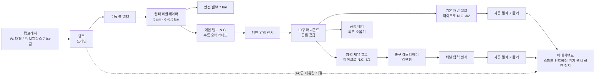

# 모듈 - 에어 펄스 허브 (NEXA AirPulse Hub)

공압이 필요한 여러 장비 (융착기, 양봉카 잭, 스태커 리프트, 청소 장비 등) 에 **도킹해서 쓰는 공용 공압 제어 모듈**의 설계 문서다. 허브는 공기 전처리, 채널별 밸브 제어, 장비 식별, 공기 예산, 안전 감시를 맡고, 큰 힘이나 큰 유량이 필요한 동력단과 하중 유지 장치는 각 장비 (어태치먼트) 가 갖는다.

---

## 1. 개요와 설계 원칙

```unset
       =========================================================
                 [ NEXA AirPulse Hub  W / F ]
       =========================================================
       - 공 급 부: W = 작업실 대형 컴프레서 / F = 양봉카 오일리스 저소음 7 bar급
                   입구 감압 6~6.5 bar + 안전 밸브 7 bar
       - 밸 브 부: 마이크로 솔레노이드 N.C. 3/2, 24V 1.2W, 0~7 bar, 응답 8 ms
                   10구 매니폴드 (W 최대 10 스테이션 / F 최대 6 스테이션)
       - 채 널 부: 기본 채널(밸브 직결) / 압력 채널(역류형 레귤레이터 + 압력 센서)
                   공통: 도킹 포트 + 장비 ID + 위치 센서 입력
       - 제 어 부: ESP32-S3, 펄스 엔진(1~30 Hz), 공기 예산·우선순위, 프로파일 NVS 저장
       - 통 신 부: 휴대폰 웹(AP) 프로파일 설정 + 유선 CAN (NEXA 장비 연동)
       - 안 전 부: 워치독 NO 릴레이로 밸브 전원 차단, 비상정지, 채널별 래치 고장
                   고장 시 상태는 어태치먼트가 기계적으로 보장
       - U     I: 푸시 로터리 인코더(선택·설정) + 격발·정지 버튼, 채널별 4단 LED, 합성 사운드
       =========================================================
```

| 주요 기능구역 | 상세 기능 요약 | 설계 의도 |
| --- | --- | --- |
| 공용 허브 + 어태치먼트 | 허브 = 두뇌 + 소유량 밸브, 어태치먼트 = 동력단·하중 유지 | 제어기·밸브·UI 를 공유하고, 새 장비는 어태치먼트만 개발한다 |
| 2 타입 허브 | W(작업실) / F(양봉카) | 공급 공기량이 달라 허용 장비와 채널 수를 나눈다. 펌웨어·도킹 규격은 공통 |
| 다채널 동시 사용 | 채널마다 밸브·도킹 포트·장비 ID | 여러 장비를 동시에 쓰고, 한 채널 고장이 다른 채널을 멈추지 않는다 |
| 채널 2 등급 | 기본 채널 (직결) / 압력 채널 (레귤레이터 + 센서) | 일정 압력이 필요한 장비에만 레귤레이터·센서를 써서 부품을 줄이고, 펄스 채널은 직결로 날카롭게 유지한다 |
| 공기 예산 | 메인 압력 기준 우선순위 운전 | 공급이 부족하면 편의 기능부터 멈추고 하중 유지를 끝까지 지킨다 |
| 장비 자동 식별 | 도킹 커넥터의 ID EEPROM | 잘못된 장비에 잘못된 프로파일이 실행되는 것을 막는다 |
| 하드웨어 우선 안전 | 워치독 NO 릴레이 + 비상정지로 밸브 전원 차단 | MCU 가 멈추면 모든 밸브가 꺼지고, 각 장비는 스스로 안전 상태로 간다 |
| 수동 오버라이드 | 메인 밸브·채널 밸브의 파란 버튼 (매미고리 덮개 안) | 정전 시에도 덮개를 열고 탱크 압력으로 의도한 동작 (퇴피·해제) 을 수동으로 할 수 있다 |

### 설계 원칙

1. **허브는 소유량·신호 단이다.** 마이크로 밸브의 유량으로 직접 움직일 수 있는 장비만 직접 구동하고, 큰 유량 장비는 허브가 파일럿 신호만 보낸다.
2. **고장 시 상태는 어태치먼트가 책임진다.** 장비마다 안전한 상태 (유지·퇴피·해제) 가 다르므로, 허브 밸브가 꺼졌을 때 어떻게 될지는 어태치먼트의 기계 구성 (체크 밸브, 스프링, 락) 으로 정한다.
3. **일정 압력은 압력 채널의 레귤레이터가, 펄스는 기본 채널의 밸브가 직결로 맡는다.** 3/2 밸브 하나를 고속 PWM 으로 여닫아 압력을 만드는 " 가상 비례제어 " 는 쓰지 않는다 (§3.2). 레귤레이터는 펌웨어와 무관한 기계적 상한 압력이기도 하다.
4. **유압은 허브에 두지 않는다.** 증압기와 공압 구동 유압 펌프는 잭·스태커 어태치먼트 안에 있다.
5. **속도 조절은 어태치먼트가 한다.** 스피드 컨트롤러는 장비마다 필요한 속도가 달라 어태치먼트의 실린더 포트에 둔다 (§5.5). 허브에 두면 펄스 채널까지 유량이 줄어든다.

---

## 2. 허브 타입과 공기 예산

### 2.1 W 형 / F 형

| 구분 | AirPulse Hub **W** (작업실) | AirPulse Hub **F** (양봉카 현장) |
| --- | --- | --- |
| 공급 | 작업실 대형 컴프레서 | 7 bar 전후 오일리스 저소음 컴프레서 + 탱크 |
| 전원 | AC 220V → 24V SMPS | 양봉카 48V(또는 24V) → DC-DC 24V |
| 스테이션 / 채널 | 10 스테이션, 최대 8 채널 | 6 스테이션, 최대 4 채널 (10 구 블록 공용, 미사용 포트 플러그) |
| 압력 채널 (초기안) | 2 (나머지 기본 채널) | 1 (나머지 기본 채널) |
| 허용 장비 | 전 장비 (§5.3) | 잭, 스태커 (저속), 펄스 청소 (단발), 프로폴리스 타격 |
| 제한 | 공기 예산 안에서 동시 사용 | **연속 대유량 장비 (청소기·해머) 금지.** 고소비 장비는 한 번에 하나 |
| 추가 | - | 응축수 대책 (워터 세퍼레이터, 드레인), 진동 대책 |

- 채널은 스테이션 (밸브) 1~3 개로 구성한다. 단동 실린더·파일럿 신호는 1 개, 복동 실린더나 상승·하강을 따로 제어하는 장비는 2 개, 디지털 압력 제어 + 리프트 (융착기 롤러, §5.6) 는 3 개를 쓴다.
- 타입은 허브 ID 로 구분한다. 어태치먼트가 도킹하면 허브 타입의 허용 목록을 먼저 확인하고, 허용되지 않으면 구동을 거부한다.

### 2.2 공기 소비 등급

| 등급 | 대표 장비 | 소비량 (6 bar, 대략) | 비고 |
| --- | --- | --- | --- |
| 저 | 소형 실린더 (노즐 퇴피, Ø20×50 단동), 파일럿 신호 | 1 회 약 0.1 L(ANR), 1 Hz 운전 시 약 7 L/min | 마이크로 밸브 직접 구동 |
| 중 | Ø1 mm 노즐 펄스 청소, 소형 벤투리 | 연속 약 30~50 L/min, 펄스는 듀티 비례 | 단발·짧은 펄스는 F 형 허용 |
| 고 | 에어 해머, 대형 벤투리 (청소기·흄 흡입), 냉각 에어 나이프, 공압 구동 유압 펌프 (잭·스태커) | 수십~200 L/min 대 (제품별 상이) | 장비 측 대용량 밸브가 메인 라인에서 직접 공급 |

- 수치는 계산·일반 사양 기반의 가정이다. F 형 컴프레서 사양 (7 bar 토출량, 탱크 용량) 이 정해지면 허용 장비와 동시 사용 조합을 다시 계산한다 (§12).
- 고소비 장비는 탱크 압력을 끌어 쓰는 구조이므로, F 형에서는 **연속 운전 시간 상한**을 프로파일에 둔다.

### 2.3 우선순위와 공기 예산

| 우선순위 | 대상 | 공급 부족 시 |
| --- | --- | --- |
| 1 하중 유지·안전 | 잭, 스태커 리프트, 노즐 퇴피, 롤러 압착·리프트 | 끝까지 유지 |
| 2 공정 | 이음매 냉각 에어, 흄 흡입, 원단 클램프, 주차 브레이크 해제 | 1 다음으로 유지 |
| 3 편의 | 펄스 청소, 노즐 팁 청소, 타격, 공압 커터, 청소기, 해머 | 가장 먼저 일시 정지 |

- 롤러 압착·리프트가 1 인 이유: 들린 롤러가 공급 부족으로 갑자기 내려오면 손 끼임 위험이 있고, 융착 중 압착력이 빠지면 이음매 불량이 난다. 하강 속도는 어태치먼트의 스피드 컨트롤러로도 제한한다 (§5.6).

메인 압력 (입구 감압 후) 으로 허용 우선순위를 정한다. 초기값이며 F 형 실측으로 확정한다.

| 메인 압력 | 허용 우선순위 | 동작 |
| --- | --- | --- |
| ≥ 5.5 bar | 1·2·3 | 정상 |
| 5.0~5.5 bar | 1·2 | 편의 채널 일시 정지 + 표시 |
| 4.5~5.0 bar | 1 | 공정 채널 정지, 하중 유지만 |
| < 4.5 bar | 없음 | 전 채널 밸브 OFF → 각 장비 고장 시 상태, 원격 알림 |

- 복귀는 각 경계보다 0.3 bar 높아야 한다 (히스테리시스). 경계에서 채널이 켜졌다 꺼졌다 반복하지 않게 한다.
- 일시 정지된 채널은 압력이 회복되면 **사용자가 다시 격발해야** 재개한다. 장비가 예고 없이 다시 움직이지 않게 한다.

---

## 3. 밸브: 마이크로 솔레노이드

### 3.1 사양 판정

| 항목 | 사양 | 판정 |
| --- | --- | --- |
| 형식 | N.C. 3/2 | 적합 |
| 사용 압력 | 0~7 bar | 사용 가능하나 여유 없음 → **입구 6~6.5 bar 감압 + 7 bar 안전 밸브 필수** |
| 코일 | 24V DC 1.2 W (약 50 mA) | 구동 쉬움, 발열 작음 |
| 연속 통전 | 100% ED | 압력 유지 용도 가능 |
| 응답 시간 | 8 ms | **고주파 한계.** 완전 개폐 기준 실용 상한 약 25~30 Hz (실측 확정) |
| 수동 오버라이드 | 밸브 윗면 파란 버튼 | 정전 시 수동 조작에 사용 (공급 압력 필요). 평소에는 덮개 안에 있음 |
| 매니폴드 | 1F~10F 블록 | 10F 공용, 미사용 포트 플러그 |
| 커넥터 | M 타입 (수평형) | 전면 케이블 노출 최소 |
| 수명 (회수) | **미표기** | 판매자 확인 + 수명 시험 필수 |
| 유량 (오리피스) | **미표기** | 소유량으로 보고 실측 |
| 밸브 앞면 원형 부품 | **정체 미확인** | 개별 배기구 (소음기) 또는 단순 외형으로 추정. 실물 확인 후 확정 |

- **수동 오버라이드 접근:** 밸브 윗면의 파란 버튼은 평소 매미고리로 잠긴 덮개 안에 있다. 비상시 덮개를 열고 직접 누른다. 덮개가 오조작 방지 가드 역할을 하므로 별도 가드는 두지 않는다.
  - 덮개를 연 상태에서 버튼 위치가 채널 LED 열과 일치하게 배치하고, 덮개 안쪽 또는 매니폴드에 채널 번호를 표기한다. 비상시 다른 채널을 누르는 실수를 막는다.
  - **덮개 열림 센서:** 리드 스위치 + 자석으로 덮개 상태를 감지한다 (§8.2 ⑬).
    - 배선은 " 덮개 닫힘 = 접점 닫힘 " 으로 한다. 선이 끊기거나 커넥터가 빠지면 " 열림 " 으로 읽혀 안전한 쪽으로 판정된다.
    - 덮개가 열려 있으면 새 격발 (현장 버튼·원격 CAN) 을 거부하고, 수동 오버라이드 모드로 표시한다. 사람 손이 밸브 위에 있는 동안 장비가 예고 없이 움직이지 않게 한다.
    - 압력 채널에서 덮개가 닫혀 있는데 명령 없이 채널 압력이 오르면 수동 조작일 수 없으므로 바로 밸브 고착 (⑥) 으로 판정한다. 덮개가 열려 있으면 수동 오버라이드 (⑨) 로 본다. 기본 채널은 채널 압력을 보지 못하므로 덮개 열림 표시만 한다.
- **밸브 앞면 원형 부품:** 실물이 오면 개별 배기구인지 확인한다. 개별 배기구라면 밸브마다 앞으로 배기하게 되므로 §4.1 의 " 매니폴드 공통 배기 → 케이스 밖 소음기 " 구조가 성립하지 않는다. 배기 방향을 사용자 쪽에서 돌리거나 배기 모음 덮개를 둔다.

### 3.2 운용 한계

- **주파수 상한:** 펌웨어 상수 `VALVE_MAX_HZ` = 25 Hz(초기값). 응답 실측 후 30 Hz 까지 올릴 수 있다. 150 Hz 처럼 응답 시간보다 짧은 주기는 밸브가 다 열리기 전에 닫히라는 명령이 와서 동작이 불안정하고 마모만 늘어난다.
- **최소 ON·OFF 시간:** 각각 10 ms 이상 (응답 8 ms + 여유). 듀티가 이보다 짧아지면 펌웨어가 잘라낸다.
- **일정 압력 (예압):** 압력 채널의 출구 레귤레이터로 설정하고, 밸브는 켜 두기만 한다. 채널 압력 센서로 목표 범위 안에 있는지 감시한다.
- **수명 관리:** 채널별 개폐 횟수를 NVS 에 누적한다. 정격 수명 (확인 후 입력) 의 80% 에서 교체 경고를 낸다.

### 3.3 구동 회로

| 기능 | 구성 | 이유 |
| --- | --- | --- |
| 드라이버 | 솔레노이드용 8 채널 로우사이드 드라이버 (예: TI DRV8860, 데이터시트 확인) | 여자 (정격 전압)→유지 (PWM 감전류) 기능 내장, 개방·단락 진단, SPI 제어 |
| 켜짐 | 정격 24V 로 여자 | 응답 시간 확보 |
| 유지 | PWM 감전류 유지 | 코일 발열 감소, 장시간 압력 유지 |
| 꺼짐 | 드라이버 내장 클램프 (부족하면 제너 클램프 외장) | 일반 다이오드보다 빨리 소자시켜 닫힘 응답을 줄인다 |
| 진단 | 드라이버 고장 비트 (코일 개방·단락) | 채널 래치 고장 입력 |

- W 형은 드라이버 2 개 (10 스테이션), F 형은 1 개 (6 스테이션) 를 쓴다.
- 대체안: 로직 레벨 60V 급 N-MOSFET + 24V 제너·다이오드 직렬 클램프 + 채널별 전류 감지. 클램프 시 드레인 전압은 약 49V 이므로 MOSFET 내압은 60V 급으로 잡는다.
- **(선택) 밸브 동작 확인:** 솔레노이드 플런저가 움직이면 켜질 때 코일 전류 상승 곡선에 작은 꺼짐 (딥) 이 생긴다. 채널별 전류 감지 (대체안 회로) 로 이 딥을 잡으면 압력 센서가 없는 기본 채널에서도 " 밸브가 실제로 움직였는지 " 를 판정할 수 있다. 1.2 W 소형 코일은 딥이 작아 실측으로 가능 여부를 정한다 (§12).

---

## 4. 채널 구조

### 4.1 채널 등급

| 등급 | 구성 | 공급 압력 | 감시 | 용도 |
| --- | --- | --- | --- | --- |
| **기본 채널** | 밸브 → 커플러 (직결) | 메인 6~6.5 bar 그대로 | 메인 압력 센서 + 드라이버 진단 + 격발 시 메인 압력 강하 판정 + 어태치먼트 위치 센서 (있으면) | 펄스 청소, 타격, 파일럿 신호 (B·C 급), 노즐 퇴피 |
| **압력 채널** | 밸브 → 역류형 레귤레이터 → 채널 압력 센서 → 커플러 | 레귤레이터 설정값 | 채널 압력 피드백 (목표 도달, 유지 중 누설, 밸브 고착, 오버라이드) | 자체 레귤레이터가 없는 장비의 일정 압력 유지 |

```unset
 기본 채널: [매니폴드 공통 공급] → [마이크로 밸브] ─────────────────────────────────→ [자동 밀폐 커플러] → 어태치먼트
 압력 채널: [매니폴드 공통 공급] → [마이크로 밸브] → [역류형 레귤레이터] → [채널 압력 센서] → [자동 밀폐 커플러] → 어태치먼트
                                     └─ 배기: 매니폴드 공통 배기 → 외부 소음기
```

- **채널 등급은 하드웨어로 고정**한다. 압력 채널은 패널에 표시 (예: 포트 옆 "P" 각인) 하고, 장비 프로파일이 압력 채널을 요구하는데 기본 채널에 도킹하면 거부한다 (§5.2).
- **기본 채널은 레귤레이터를 거치지 않는다.** 레귤레이터는 유로가 좁고 내부 체적이 있어 펄스 파형을 뭉갠다. 직결해야 펄스가 가장 날카롭다.
- **압력 채널의 레귤레이터는 역류 기능형**을 쓴다. 밸브가 배기할 때 하류 공기가 레귤레이터를 거꾸로 지나 빠져나갈 수 있어야 한다. 일반 레귤레이터를 쓰면 배기가 막혀 장비가 퇴피·해제되지 않는다. 릴리프형 (넘치는 압력만 대기로 버림) 은 이 문제를 해결하지 못하므로 혼동하지 않는다.
- **채널 압력 센서 (압력 채널만):** 0~1 MPa 아날로그 (0.5~4.5V) 를 쓴다. 목표 압력 도달, 유지 중 누설, 밸브 고착, 수동 오버라이드 동작을 판정한다.
- **기본 채널의 호스 이탈 판정:** 기본 채널은 채널 압력을 볼 수 없으므로, 격발 직후 메인 압력이 장비별 기준보다 빨리 떨어지면 호스 이탈로 본다 (§8.2 ⑭). 다른 채널이 같은 시간대에 격발되면 원인을 가를 수 없어 판정을 보류한다.
- **디지털 압력 제어:** 레귤레이터 없이 공급·유지 스테이션 2 개 + 어태치먼트의 체크 밸브·공기 파일럿 배기 밸브·압력 센서로 압력을 유지한다. 압력을 프로파일과 CAN 명령으로 자동 설정할 수 있다. 매니폴드 밸브는 2/2 로 쓸 수 없어서 유지 기능을 어태치먼트에 둔다. 기계적 상한이 없으므로 과압이 위험한 장비는 어태치먼트에 릴리프 밸브를 둔다. 첫 적용은 융착기 롤러 압착이다 (§5.6).
- **배기:** 매니폴드 공통 배기는 케이스 밖 소결 소음기로 뺀다. 케이스 안으로 배기하면 밀폐 케이스가 가압되고 습기가 찬다. 단, 매니폴드에 공통 배기 통로가 있는지 (밸브마다 따로 배기하는지) 는 실물로 확인한다 (§3.1).

### 4.2 채널 독립 고장과 공통 고장

| 구분 | 원인 | 범위 |
| --- | --- | --- |
| 채널 고장 | 코일 개방·단락, 목표 압력 미도달·유지 중 압력 강하 (압력 채널), 격발 시 메인 압력 급강하 (기본 채널), 위치 확인 실패, 운전 중 분리, ID 불일치 | **해당 채널만** 래치 |
| 공통 고장 | 메인 압력 상실, 비상정지, 워치독 차단, 24V 이상 | 전 채널 밸브 OFF |

---

## 5. 어태치먼트와 도킹

### 5.1 어태치먼트 등급

| 등급 | 구동 방식 | 고장 시 상태를 정하는 장치 | 예 |
| --- | --- | --- | --- |
| **A 직접 구동** | 허브 밸브가 실린더·노즐을 직접 구동 | 스프링 복귀 실린더, 노즐 개방 | 노즐 퇴피, 롤러 압착·리프트, 원단 클램프, 공압 커터, 주차 브레이크, 펄스 청소, 프로폴리스 타격 |
| **B 파일럿 구동** | 허브는 파일럿 신호만, 장비 측 대용량 밸브 (외부 파일럿형) 가 메인 라인에서 직접 공급 | 장비 측 밸브의 스프링 복귀 | 벤투리 청소기, 에어 해머, 이음매 냉각 에어, 흄 흡입 |
| **C 공유압** | 허브 신호로 장비 측 증압기·공압 구동 유압 펌프 구동 | 유압 체크 밸브 + 기계식 락 + 수동 하강 밸브 | 양봉카 잭, 스태커 리프트 |

- B·C 급은 메인 공급 라인을 장비에 별도로 연결한다. 허브 채널 호스 (4 mm) 는 신호와 소유량 전용이다.
- 파일럿 신호는 기본 채널로 메인 압력 (6~6.5 bar) 을 그대로 보낸다. 장비 측 밸브의 최대 파일럿 압력이 이보다 낮을 때만 압력 채널을 쓴다.

### 5.2 도킹 인터페이스

| 구분 | 구성 | 비고 |
| --- | --- | --- |
| 공압 | 양쪽 자동 밀폐 커플러 | 분리 시 허브·장비 양쪽 모두 닫힘, 이물 유입 방지 캡 |
| 전기 | 24V, GND, CAN H/L, ID(1-Wire), DOCK 감지, POS(위치 센서 입력), ANA(아날로그 센서 입력 0.5~4.5V) | DOCK 감지 핀은 **가장 짧게** 해 제일 먼저 끊어지고 제일 늦게 붙게 한다 |
| 식별 | 어태치먼트 내 1-Wire EEPROM (예: DS28E07) | 장비 ID, 등급, 필요 채널 등급, 프로파일 버전 저장 |
| 위치 센서 | 어태치먼트 실린더의 리드 스위치 (선택) | 노즐 퇴피처럼 " 실제로 움직였는지 " 가 중요한 장비. 압력보다 직접적이다 |

**도킹 순서**

1. DOCK 감지 → ID 읽기.
2. 허브 타입 허용 목록 확인 → 허용되지 않으면 거부 (채널 LED 빨강).
3. 채널 등급 확인 → 압력 채널이 필요한 장비가 기본 채널에 도킹하면 거부 (채널 LED 빨강).
4. 장비 프로파일·한계값 로드.
5. 누설 시험 (압력 채널만): 밸브를 짧게 켜서 채널 압력을 올린 뒤 끄고, 압력 강하가 기준 이내인지 확인한다 (배기형 장비는 생략).
6. 위치 센서가 있는 장비는 초기 위치 (예: 퇴피 상태) 를 확인한다.
7. 준비 완료 (채널 LED 맨 아래 1 개 파랑 점등).

**분리 순서**

- 운전 중 DOCK 감지가 끊기면 해당 채널 밸브를 즉시 끄고 채널 래치 (운전 중 분리) 를 건다.
- 커플러가 자동 밀폐형이므로 장비 쪽에 남은 압력은 장비가 유지하거나 (C 급) 장비 자체 배기로 해제한다.

### 5.3 장비 프로파일

| 장비 | 등급 | 채널 | 허용 허브 | 우선순위 | 스테이션 | 최대 압력 | 최대 주파수 | 고장 시 상태 | 연속 상한 |
| --- | --- | --- | --- | ---: | ---: | ---: | ---: | --- | --- |
| 융착기 노즐 퇴피 | A | 기본 + 위치 센서 | W | 1 | 1 | 6 bar | - | 퇴피 (스프링) | 없음 |
| 융착기 롤러 압착·리프트 | A | 기본 + 위치·압력 센서 (ANA) | W | 1 | 3 | 프로파일 목표 압력 | 리프트 10 Hz | 배기 밸브 형식에 따름 (N.O. 해제 / N.C. 유지), 하강 속도 제한 | 없음 |
| 융착기 이음매 냉각 에어 | B | 기본 | W | 2 | 1 | 파일럿 | - | 정지 | 없음 |
| 융착기 흄 흡입 | B | 기본 | W | 2 | 1 | 파일럿 | - | 정지 | 없음 |
| 융착기 노즐 팁 청소 | A | 기본 | W | 3 | 1 | 6 bar | 25 Hz | 정지 | 5 s |
| 융착기 원단 클램프 | A | 기본 | W | 2 | 1 | 6 bar | - | 해제 (스프링) | 없음 |
| 융착기 공압 커터 | A | 기본 + 위치 센서 | W | 3 | 1 | 6 bar | - | 칼날 복귀 (스프링) | 2 s |
| 융착기 주차 브레이크 | A | 기본 | W | 2 | 1 | 6 bar | - | 제동 (스프링) | 없음 |
| 펄스 청소 (렌즈·내벽) | A | 기본 | W·F | 3 | 1 | 6 bar | 25 Hz | 정지 | F: 10 s |
| 프로폴리스 타격 | A | 기본 | W·F | 3 | 1 | 6 bar | 15 Hz | 정지 | F: 30 s |
| 벤투리 청소기 | B | 기본 | W | 3 | 1 | 파일럿 | - | 정지 | 없음 |
| 에어 해머 | B | 기본 | W | 3 | 1 | 파일럿 | 장비 내장 | 정지 | 없음 |
| 양봉카 잭 | C | 기본 | W·F | 1 | 1~2 | 파일럿 | - | 하중 유지 | 펌프 구동 F: 시험 확정 |
| 스태커 리프트 | C | 기본 | W·F | 1 | 1~2 | 파일럿 | - | 하중 유지 | 펌프 구동 F: 시험 확정 |

- 값은 초기안이며 장비별 시험으로 확정한다.
- 융착기 장비는 §5.6 에 상세를 둔다. 롤러 압착은 어태치먼트 압력 센서 (ANA) 를 쓰는 디지털 압력 제어이므로, 현재 목록에는 허브 압력 채널이 꼭 필요한 장비가 없다. 압력 채널 (W 2, F 1) 은 자체 레귤레이터가 없는 장비를 위한 범용 채널로 두고, 어태치먼트 목록이 확정되면 수를 다시 정한다.
- 융착기 노즐 퇴피는 [[NEXA ThermoFlux (열풍기 모듈)]] §9.2 의 스프링 복귀형 퇴피와 같은 구조다. 허브 밸브가 꺼지면 스프링이 노즐을 빼낸다.

### 5.4 C 급 공유압 어태치먼트

**양봉카 잭**

- 증압기 또는 공압 구동 유압 펌프를 잭 어태치먼트에 내장한다.
- 5 톤을 150 bar 로 들려면 유압 램 단면적 약 33 cm²(지름 약 65 mm) 가 필요하다.
- **하중 유지:** 유압 파일럿 체크 밸브가 공기·전원과 무관하게 하중을 잡는다. 장시간 정차 시에는 기계식 락 (락 너트·핀) 을 건다.
- **하강:** 수동 하강 밸브 + 하강 속도 제한 오리피스. 공압 하강을 추가하더라도 수동 경로를 남긴다.
- **보호:** 유압 안전 밸브, 유압 압력 센서 (선택, 하중 추정).

**스태커 리프트 (소형 수동 스태커의 공압화)**

- 핸드 펌프 자리에 공압 구동 유압 펌프를 붙인다.
- 하중 유지는 스태커에 원래 있는 유압 체크 밸브가 맡는다.
- 하강은 기존 수동 릴리스 밸브를 그대로 둔다.
- 허브 채널은 " 상승 " 1 스테이션이 기본이다. 하강을 자동화하면 2 스테이션을 쓴다.
- F 형에서는 공급량이 작아 상승 속도가 느리다. 컴프레서 사양 확정 후 판정한다.

### 5.5 어태치먼트 공압 구성 규칙

| 구성 | 위치 | 규칙 |
| --- | --- | --- |
| 스피드 컨트롤러 | 어태치먼트 실린더 포트 | 배기 조절형 (meter-out) 을 기본으로 한다. 채울 때는 빠르게, 뺄 때 속도를 제한한다. **펄스 장비에는 쓰지 않는다** |
| 기계적 상한 | 어태치먼트 | 과압이 위험한 장비는 자체 레귤레이터 또는 소형 릴리프 밸브를 둔다. 기본 채널은 메인 압력이 그대로 오기 때문이다 |
| 위치 센서 | 어태치먼트 실린더 | 동작 확인이 중요한 장비 (노즐 퇴피) 는 리드 스위치를 달아 도킹 커넥터 POS 핀으로 보낸다 |
| 압력 센서 | 어태치먼트 실린더 | 디지털 압력 제어 장비 (롤러 압착) 는 실린더 쪽 압력 센서를 도킹 커넥터 ANA 핀으로 보낸다 |
| 유지 기능 | 어태치먼트 | 허브 밸브는 매니폴드에 꽂혀 2/2 로 쓸 수 없으므로, 압력을 가둬야 하면 체크 밸브 + 공기 파일럿 배기 밸브 (N.O. 또는 N.C.) 를 어태치먼트에 둔다 |
| 블리드 (상시 미세 배기) | - | 쓰지 않는다. 유지 중에도 공기를 버린다. 비상시 천천히 빼야 하면 평소 닫혀 있는 수동 배기 밸브를 따로 둔다 |

### 5.6 열융착기 어태치먼트 (초기안, 적용은 차후 검토)

[[NEXA열융착기 (NEXA Heat Fuser)]] 에 붙는 공압 기능을 W 형 허브 하나에 배정한 안이다. 8 채널·10 스테이션 (W 형 전부) 을 쓴다.

| 채널 | 기능 | 스테이션 | 동작 | 고장 시 상태 | 격발 |
| ---: | --- | ---: | --- | --- | --- |
| 1 | 노즐 퇴피 | 1 | ON = 노즐 융착 위치 / OFF = 스프링 퇴피 | 퇴피 | 본더 CAN |
| 2 | 롤러 압착·리프트 | 3 | 복동 실린더: A = 압착 공급 / B = 압착 유지 / C = 리프트 | N.O.: 압착 해제 (아암 무게) / N.C.: 압착 유지 | 본더 CAN, 현장 토글 |
| 3 | 이음매 냉각 에어 | 1 | 롤러 뒤 에어 나이프 (장비 측 대용량 밸브 파일럿) | 정지 | 본더 CAN |
| 4 | 흄 흡입 | 1 | 노즐 주변 벤투리 흡입 (장비 측 밸브 파일럿) | 정지 | 본더 CAN |
| 5 | 노즐 팁 청소 | 1 | 퇴피 위치에서 노즐 끝 펄스 블로우 | 정지 | 현장 토글 |
| 6 | 원단 클램프 | 1 | 출발 시 원단 끝 고정 | 해제 | 본더 CAN, 현장 토글 |
| 7 | 공압 커터 | 1 | 이음매 끝 원단 절단 | 칼날 복귀 | **현장 누르는 동안** |
| 8 | 주차 브레이크 | 1 | ON = 제동 해제 / OFF = 스프링 제동 | 제동 | 본더 CAN |

**롤러 압착·리프트 (공압 주도: 복동 실린더 1 개, 스프링은 탈착식)**

| 구성 | 힘 | 역할 |
| --- | --- | --- |
| 복동 실린더 헤드 측 (디지털 압착) | 압착력 전체 | 원단별·속도별·곡면별 압착력을 자동 조절 |
| 복동 실린더 로드 측 (리프트) | 상부 아암 무게 이상 | 즉시 완전 해제, 원단 넣고 빼기 |
| 상부 아암 무게 | 최소 접촉력 | 롤러 높이와 무관하게 일정한 예압. 공기가 없어도 롤러가 원단에 닿음 |
| 스프링 (탈착식, 기본 미장착) | 볼트로 조정 | 컴프레서 없는 현장에서 쓰는 수동 모드 전용 |

```unset
 허브 스테이션 A (공급) ──→ [체크 밸브] ──────────────┬──→ 복동 실린더 헤드 측 (↓ 압착) ──→ 상부 아암 → 상부 롤러
                                                      ├── [압력 센서] → 도킹 커넥터 ANA
                                                      └── [공기 파일럿 배기 밸브 (N.O. 기본 / N.C. 선택)] → [오리피스] → 대기
 허브 스테이션 B (유지) ──→ 배기 밸브 파일럿
 허브 스테이션 C (리프트) → [스피드 컨트롤러] → 복동 실린더 로드 측 (↑ 리프트)
```

- **스프링을 기본에서 뺀 이유:** 공기가 있는 동안 스프링은 리프트 때 공기 부담을 늘리고, 스프링 힘 아래로 압착력을 내릴 수 없게 만들며 (얇은 원단·곡면에 불리), 롤러 높이에 따라 힘이 변해 압력 센서로 잡히지 않는 오차를 만든다. 정전 시 원단을 잡아 주는 역할은 아암 무게나 N.C. 배기 밸브 (아래) 로 대신한다. 정전 시에는 노즐이 먼저 퇴피하므로 롤러가 원단을 놓아도 안전하다.
- **매니폴드 제약 때문에 유지 기능을 어태치먼트에 둔다.** 허브 밸브는 매니폴드에 꽂혀 공급·배기 통로를 공유하므로, 포트를 막아 2/2 밸브처럼 쓸 수 없다. 그래서 " 유지 (막힘)" 기능은 어태치먼트의 체크 밸브와 공기 파일럿 배기 밸브가 맡는다.

**동작 표 (N.O. 배기 밸브 기준)**

| 상태 | A (공급) | B (유지) | C (리프트) | 결과 |
| --- | --- | --- | --- | --- |
| 압력 올림 | 펄스 ON | ON | OFF | 체크 밸브를 지나 헤드 측 충전 |
| 압력 유지 | OFF | ON | OFF | 체크 밸브와 닫힌 배기 밸브 사이에 공기가 갇혀 유지. 공기 소모 없음 |
| 압력 내림 | OFF | 펄스 OFF | OFF | 배기 밸브가 잠깐 열려 오리피스로 조금씩 배기 |
| 압착 해제 | OFF | OFF | OFF | 헤드 측 배기 → 아암 무게만 남음 |
| 완전 리프트 | OFF | OFF | ON | 헤드 측 배기 상태에서 로드 측 가압으로 롤러를 들어 올림 |
| 정전·워치독 차단 | OFF | OFF | OFF | **압착 해제 → 아암 무게만.** 노즐은 먼저 퇴피하므로 안전 |

**배기 밸브 형식 선택**

| 형식 | B 동작 | 정전 시 롤러 | 적합한 경우 |
| --- | --- | --- | --- |
| **N.O. (기본)** | B ON = 닫힘 (유지), OFF = 열림 (배기) | 압착 해제, 아암 무게만 | 원단을 쉽게 빼야 할 때 |
| N.C. (선택) | B ON = 열림 (배기), OFF = 닫힘 (유지) | 압착 유지 (공기가 갇혀 누설로 천천히 빠짐) | 재시작 시 원단 위치를 지켜야 할 때 |

- **N.O.:** 파일럿 공기가 있을 때만 닫힌다. 압착 중 B 를 계속 켜 두며, 밸브가 100% ED 라 문제없다.
- **N.C.:** 압착 해제 명령 시 B 를 켜서 헤드 측을 배기한다. 리프트 (C) 전에 반드시 헤드 측을 먼저 배기해야 한다 (헤드 면적이 로드 면적보다 커서 갇힌 압력을 이기지 못한다). 정전 중 원단을 빼려면 어태치먼트의 **수동 배기 밸브**로 헤드 측을 뺀다.
- 형식은 장비 프로파일에 저장하고, 펌웨어가 B 출력 극성을 형식에 맞춰 바꾼다.

**탈착식 스프링 (수동 모드)**

- **스프링 받침 (턱) 은 그대로 두고 스프링만 넣고 뺀다.** 실린더 로드는 하단 클레비스에 직접 연결해, 스프링이 없어도 실린더 힘이 그대로 아암에 전달되게 한다.
- **탈착 방법:** 클레비스 핀을 R 핀 같은 빠른 탈착형으로 해서 핀을 뽑고 스프링을 빼거나, 아래 받침을 분리형 칼라 (두 쪽 고리) 로 만든다.
- **간섭 확인:** 공압 모드에서 위·아래 받침이 실린더 전체 행정 동안 서로 닿지 않아야 한다.
- **예압 조정:** 받침 한쪽을 나사로 높이 조절해 수동 모드 압착력을 맞춘다.
- **수동 모드 절차:** 실린더 포트를 대기로 열어 로드가 자유롭게 움직이게 한다 (N.C. 배기 밸브면 수동 배기 밸브를 연다). 공기가 없으므로 리프트는 수동 레버나 캠으로 한다.
- **모드 혼동 방지:** 스프링을 단 채 공압 모드로 운전하면 실제 압착력이 스프링 힘만큼 커지고 압력 센서로는 알 수 없다.
  - 기본: 웹·노브 설정에 " 스프링 장착 / 미장착 " 을 두고, 장착이면 목표 압력에서 스프링 힘만큼 빼서 보정한다.
  - 선택: 스프링 받침에 마이크로 스위치를 달아 자동 감지한다. 도킹 커넥터에 디지털 입력이 하나 더 필요하다 (§12).

- **압력 센서:** 실린더 쪽 (어태치먼트) 에 두어야 정확하다. 도킹 커넥터 ANA 핀으로 허브 ADC 에 들어간다.
- **제어:** 목표 압력 ± 허용 폭 (초기값 ±0.1 bar) 을 벗어나면 A 또는 B 를 최소 펄스 (10 ms) 로 움직이고, 압력이 안정될 때까지 (초기값 40 ms) 기다린 뒤 다시 판정한다 (§8.3 `pressure_hold_step`). 오리피스 크기와 대기 시간은 실측으로 맞춘다.
- **압착력 설정:** 원단 종류별 목표 압력을 장비 프로파일에 저장한다. 본더 제어반이 이송 속도와 곡면 구간에 맞춰 목표 압력을 CAN 으로 바꾼다. 온도·풍량을 속도에 맞추는 것과 같은 방식이다.
- **곡면 본딩:** 펄스 리프트 대신 목표 압력을 낮춘다. 출렁임이 허용 폭 (±0.1 bar) 안이라 이음매 무늬가 거의 생기지 않는다. 펄스 리프트 (C) 는 단차를 의도적으로 넘길 때만 쓰고 상한은 10 Hz 로 둔다. 펄스 시 무늬 간격 = 이송 속도 ÷ 펄스 주파수 (예: 33 mm/s ÷ 10 Hz = 3.3 mm).
- **하강 속도 제한:** 로드 측 포트의 배기 조절형 스피드 컨트롤러로 롤러가 천천히 내려오게 한다. 손 끼임을 막는다.
- **위치 센서:** " 들림 " 위치 리드 스위치로 리프트 완료를 확인한다 (⑮).
- **실린더 형식·위치:** 상부 아암 중앙 (기존 스프링·볼트 자리) 에 둔다. 힘이 두 상부 롤러 사이 중앙에 걸려야 기울지 않고 4 개 편심 슬리브로 맞춘 평행도가 유지된다. 공간이 좁으면 컴팩트 (박형) 복동 실린더를 쓰고, 낮은 압력에서 패킹 마찰로 힘이 들쭉날쭉하지 않도록 저마찰형을 쓴다.
- **힘 참고 (6 bar, 헤드 측, 지렛대 없음):** Ø32 약 480 N, Ø40 약 750 N, Ø50 약 1,180 N. 로드 측은 로드 단면만큼 작지만 아암 무게만 이기면 된다. 필요한 압착력은 원단별로 실측해 실린더를 고른다.
- **좌우 압착력 분리 (선택):** 하부 롤러를 NEMA 17 두 개로 따로 구동하므로, 곡면에서 좌우 압착력도 달리하려면 롤러별 실린더 2 개를 쓸 수 있다. 밸브·센서가 두 배가 되므로 1 개로 먼저 시험한다.
- **공기 의존:** 융착 중 공급이 떨어지면 압착력이 약해져 이음매 품질이 나빠진다. 그래서 우선순위 1 이고, 압력이 목표 아래로 일정 시간 이상 머물면 본더에 알려 이송을 멈춘다.
- **정전 중 원단 빼기:** 덮개를 열고 메인 밸브 → 채널 2 의 C 스테이션 수동 오버라이드 순서로 탱크 압력으로 든다.

**기타 기능**

- **이음매 냉각 에어:** 융착 직후 이음매를 식혀 빨리 굳힌다. 이송 속도를 높일 수 있고, 감속·정지 때 과열을 막는다. [[NEXA ThermoFlux (열풍기 모듈)]] 에서 인용한 상용 특허 (US 2014/0374020) 도 감속 시 냉각 공기를 쓴다. 공기 소비가 커서 장비 측 밸브가 메인 라인에서 직접 공급한다 (B 급).
- **흄 흡입:** PVC·PE 를 가열할 때 나오는 흄을 노즐 주변에서 벤투리로 빨아 배출한다. 작업자 보호용이며 B 급이다.
- **노즐 팁 청소:** 노즐 끝 탄화물을 펄스로 날려 막힘과 온도 편차를 줄인다. **노즐이 퇴피 위치 (위치 센서 확인) 일 때만** 동작한다. 원단에 펄스가 닿지 않게 하기 위해서다.
- **원단 클램프:** 출발 시 원단 끝이 밀리거나 겹침이 어긋나는 것을 막는다. 이송 시작 후 설정 거리에서 해제한다.
- **공압 커터:** 칼날이 있어 **누르는 동안 방식만** 허용하고, 커터 가드를 둔다. 칼날 복귀를 위치 센서로 확인한 뒤에야 이송을 다시 허용한다.
- **주차 브레이크:** 스프링 제동·공압 해제형이다. 정전 시 자동으로 제동되어 경사면에서 밀리지 않는다. 공기 예산으로 해제 채널이 멈추면 바로 제동되므로, 본더 제어반은 브레이크 채널 상태를 보고 이송을 먼저 멈춘다.
- **인터록 판단 위치:** 기능 간 조건 (노즐 퇴피 확인 후 팁 청소, 칼날 복귀 확인 후 이송 등) 은 본더 제어반이 판단해 CAN 명령을 보낸다. 허브는 채널별 허용·감시만 한다.
- **채널 점유:** 전 기능을 달면 W 형 8 채널을 모두 쓰므로, 본더 운전 중에는 다른 장비를 같은 허브에 도킹할 수 없다. 기능을 줄이거나 허브를 하나 더 두는 것은 적용 단계에서 정한다.
- **도킹 방식:** 채널마다 커넥터를 따로 꽂으면 8 번 연결해야 한다. 본더는 여러 채널을 한 번에 연결하는 묶음 하네스 (다채널 커플러 + 커넥터) 를 검토한다 (§12).

---

## 6. 공압 회로



- **메인 밸브:** 전원이 끊기면 닫혀 허브 하류 공급을 막는다. 정전 시에는 **메인 밸브 수동 오버라이드 → 채널 밸브 수동 오버라이드** 순서로 탱크 압력을 이용해 의도한 동작을 할 수 있다.
- **안전 밸브:** 레귤레이터가 고장 나도 밸브 정격 (7 bar) 을 넘지 않게 한다.
- **F 형 추가:** 탱크 출구에 워터 세퍼레이터를 두고 드레인을 주기적으로 뺀다. 양봉카는 일교차가 커서 응축수가 많다.
- **배관:** 허브 내부는 외경 4 mm(내경 2.5 mm) PU 호스와 원터치 피팅을 쓴다. 바브 (끼움) 연결은 7 bar 에서 빠질 수 있어 쓰지 않는다.

---

## 7. 제어·전원 하드웨어

### 7.1 부품 리스트 (Bill of Materials)

#### 공통

| 부품 분류 | 부품명 및 규격 | 수량 (W / F) | 체크포인트 |
| --- | --- | --- | --- |
| 메인 연산 | ESP32-S3 모듈 | 1 / 1 | DAC 없음 → 사운드는 PWM 또는 I2S (§9.5) |
| 밸브 | 마이크로 솔레노이드 N.C. 3/2, 24V 1.2W, 0~7 bar, M 타입 | 10 / 6 | 수명·유량 확인, 예비 2 개 |
| 매니폴드 | 10F 매니폴드 블록 | 1 / 1 | 미사용 포트 무두 플러그 |
| 밸브 드라이버 | 솔레노이드용 8 채널 로우사이드 드라이버 (예: DRV8860) | 2 / 1 | 여자·유지 PWM, 개방·단락 진단 |
| 공기 전처리 | 수동 볼 밸브, 필터 레귤레이터 (5 µm, 드레인), 안전 밸브 7 bar | 1 세트 / 1 세트 | F 형은 워터 세퍼레이터 추가 |
| 메인 밸브 | N.C. 2/2 또는 3/2, 24V, 수동 오버라이드 | 1 / 1 | 정전 시 닫힘 |
| 출구 레귤레이터 | 소형 역류 기능형 레귤레이터 (릴리프형 아님) | 2 / 1 | 압력 채널만, 배기 역류 가능 확인 |
| 압력 센서 | 0~1 MPa 아날로그 (0.5~4.5V) | 3 / 2 | 메인 1 + 압력 채널, 분압 후 ADC |
| ADC 확장 | ADS1115 (I2C 16 비트 4ch) | 3 / 2 | 메인·압력 채널 센서 + 채널별 ANA 입력 (W 11 개, F 6 개 사용) |
| 도킹 커플러 | 양쪽 자동 밀폐 퀵 커플러 | 채널 수 | 분리 시 양쪽 닫힘 |
| 도킹 커넥터 | 24V·GND·CAN H/L·ID·DOCK 감지·POS·ANA | 채널 수 | DOCK 핀 최단, POS 는 풀업 입력, ANA 는 분압 후 ADC |
| 장비 ID | 1-Wire EEPROM (예: DS28E07) | 어태치먼트당 1 | 어태치먼트 측 |
| 배기 | 소결 소음기 | 1 / 1 | 케이스 밖 배기 |
| 배관 | PU 호스 외경 4 mm (내경 2.5 mm, 10 bar) + 원터치 피팅 | 1 세트 | 바브 연결 금지 |
| 워치독 릴레이 | 차지 펌프 + **NO** 릴레이 (24V 밸브 전원 차단) | 1 / 1 | 코일 무전원 = 밸브 전원 개방 |
| 비상정지 | 래칭형 비상 스위치 **NC 접점** | 1 / 1 | 워치독 릴레이 코일 회로 직렬 |
| 덮개 열림 센서 | 리드 스위치 (NO, 자석 근접 시 닫힘) + 네오디뮴 자석 | 1 / 1 | 덮개 닫힘 = 접점 닫힘, 풀업 + RC 필터로 GPIO 입력 |
| 로직 전원 | 24V→5V 벅 | 1 / 1 | ESP32-S3 3.3V 는 보드 LDO |
| 통신 | SN65HVD230 CAN 트랜시버 | 1 / 1 | NEXA 장비 연동 |
| UI | 푸시 로터리 인코더 | 1 / 1 | 채널 선택·설정 전용 (격발하지 않음) |
| UI | 격발 버튼 + 정지 버튼 (모멘터리, 가드 테두리) | 각 1 / 각 1 | §9.1, 색·모양을 서로 다르게 |
| LED | WS2812B 주소 지정 LED, 채널당 4 개 | 32 / 16 | 4 단 수직 표시 |
| 사운드 | PAM8403 앰프 + 8 Ω 2030 박스 스피커 (+ RC 저역 필터) | 1 / 1 | §9.5 |
| 섀시 | 매미고리 잠금형 커버, 바닥 방진 고무, 내부 흡음재 | 1 / 1 | 배기는 외부로 빼므로 IP54 목표 |

- 스피드 컨트롤러, 위치 센서 (리드 스위치), 장비별 상한 장치 (레귤레이터·릴리프), 디지털 압력 제어용 체크 밸브·공기 파일럿 배기 밸브 (N.O./N.C.)·오리피스·압력 센서·수동 배기 밸브, 융착기 롤러의 복동 실린더와 탈착식 스프링은 허브 BOM 이 아니라 어태치먼트 BOM 에 넣는다 (§5.5, §5.6).

#### W 형 전용

| 부품 분류 | 부품명 및 규격 | 수량 | 체크포인트 |
| --- | --- | --- | --- |
| 24V 전원 | AC 220V → 24V SMPS (30 W 급) | 1 | 밸브 10 개 여자 동시 시 약 12 W + 로직 |
| 입력 보호 | 퓨즈 + 인렛 | 1 | 보호 접지 (PE) 체결 |
| 컴프레서 제어 (선택) | 16A NO 파워 릴레이 | 1 | 허브가 컴프레서 전원을 제어할 경우에만. 워치독 연동 |

#### F 형 전용

| 부품 분류 | 부품명 및 규격 | 수량 | 체크포인트 |
| --- | --- | --- | --- |
| 24V 전원 | 48V(또는 24V) → 24V DC-DC | 1 | 차량 전원 노이즈 대책 |
| 입력 보호 | DC 퓨즈 + 역접속 보호 | 1 | |
| 응축수 | 워터 세퍼레이터 + 드레인 | 1 | 탱크 출구 |

### 7.2 안전 계층

| 계층 | 구성 | MCU 고장 시 | 담당 고장 |
| --- | --- | --- | --- |
| ① 하드웨어 | 워치독 NO 릴레이 (밸브 24V 차단), 비상정지 NC, 메인 밸브 N.C., 안전 밸브 | **동작함** | MCU 정지·폭주, 과압 |
| ② 펌웨어 감시 | 채널·공통 감시 태스크 + 태스크 워치독 | 재부팅 시 ①이 차단 | 압력 이상, 코일 고장, 분리, ID 불일치, 공기 예산 |
| ③ 어태치먼트 | 스프링 복귀, 체크 밸브, 기계식 락, 수동 하강 | 무관 | 허브 밸브가 꺼진 뒤의 안전 상태 |

- 워치독 릴레이는 [[NEXA ThermoFlux (열풍기 모듈)]] 와 같은 차지 펌프 방식이다. 감시 태스크가 정상일 때만 펄스를 내고, 펄스가 끊기거나 핀이 고착되면 릴레이가 열려 모든 밸브 전원이 끊긴다.
- 밸브가 모두 N.C.이므로 전원 차단은 곧 " 전 채널 배기 " 다. 그래서 배기했을 때 위험해지는 장비 (하중 유지) 는 어태치먼트가 체크 밸브로 스스로 유지해야 한다 (설계 원칙 2).

---

## 8. 제어 알고리즘

### 8.1 펄스 프로그램

현장에서 화면 없이 격발하는 매크로다. 세부값은 브라우저 (휴대폰 AP 접속 또는 플랫폼 접속) 에서 설정하고, 주파수·지속 시간·반복 횟수는 현장에서 노브로 4 단계 중 고를 수 있다 (§9.3). 모두 NVS 에 저장한다.

| 항목 | 범위 | 설정 위치 | 비고 |
| --- | --- | --- | --- |
| 주파수 | 0(연속 ON), 1~25 Hz | 노브 4 단계 / 웹 | `min(프로그램, 장비 프로파일, VALVE_MAX_HZ)` 로 자름 |
| 듀티 | 10~90% | 웹 | 최소 ON·OFF 10 ms 보장 |
| 지속 시간 (버스트) | 0.1~60 s, 연속 | 노브 4 단계 / 웹 | 장비 연속 상한 적용. 연속은 정지 버튼까지 |
| 버스트 간격 | 0~60 s | 웹 | |
| 반복 횟수 | 1~255 | 노브 4 단계 / 웹 | 지속 시간이 연속이면 1 회로 고정 |
| 노브 4 단계 값표 | 항목별 4 개 값 | 웹 | 장비 프로파일에 저장 |

### 8.2 감시 시나리오

| 감시 시나리오 | 조건 | 조치 | 범위 / 래치 |
| --- | --- | --- | --- |
| ① 메인 압력 상실 | 메인 < 4.5 bar | 전 채널 OFF, 원격 알림 | 공통, 압력 회복 + 재격발 |
| ② 공기 예산 | 메인이 우선순위 경계 미만 | 낮은 우선순위 채널 일시 정지 | 채널, 압력 회복 + 재격발 |
| ③ 목표 압력 미도달 (압력 채널) | 밸브 ON 후 설정 시간 내 채널 압력 미도달 | 채널 OFF | 채널 래치 (호스 이탈·누설 의심) |
| ④ 유지 중 압력 강하 (압력 채널) | 유지 중 채널 압력이 기준 이상 떨어짐 | 채널 OFF, 경고 | 채널 래치 (누설) |
| ⑤ 코일 개방·단락 | 드라이버 고장 비트 | 채널 OFF | 채널 래치 |
| ⑥ 밸브 고착 의심 (압력 채널) | 밸브 OFF 인데 채널 압력 유지·상승, 오버라이드 아님 | 경고, 메인 밸브 차단 검토 | 채널 래치 |
| ⑦ 운전 중 분리 | DOCK 감지 끊김 | 채널 OFF | 채널 래치 |
| ⑧ 미허용 장비 | ID 미등록, 허브 타입 불허, 채널 등급 불일치 | 구동 거부 | 채널 |
| ⑨ 수동 오버라이드 감지 (압력 채널) | 덮개 열림 중 밸브 명령 없이 채널 압력 상승 | 상태 표시, 해당 채널 자동 명령 보류 | 채널, 해제 시 복귀 |
| ⑩ 밸브 수명 | 누적 개폐 ≥ 정격 80% | 교체 경고 | 표시만 |
| ⑪ 통신 두절 | 원격 명령 채널의 하트비트 미수신 ≥ 500 ms | 해당 채널 펄스 정지 (유지형은 어태치먼트가 유지) | 채널, 재수신 시 복귀 |
| ⑫ 하드웨어 차단 | 비상정지·워치독으로 밸브 전원 없음 | 상태 보고 | 공통, 하드웨어 복귀 |
| ⑬ 덮개 열림 | 덮개 열림 센서 열림 (또는 단선) | 새 격발 거부, 수동 오버라이드 모드 표시, 원격 알림 | 공통, 덮개 닫힘 시 복귀 |
| ⑭ 격발 시 메인 압력 급강하 (기본 채널) | 단독 격발 후 200 ms 안에 메인 압력이 장비별 기준 이상 떨어짐 | 채널 OFF | 채널 래치 (호스 이탈 의심) |
| ⑮ 위치 확인 실패 | 위치 센서 장비에서 밸브 전환 후 설정 시간 내 POS 입력 미변화 | 채널 OFF, 경고 | 채널 래치 (걸림·호스 이탈·실린더 고장) |

- ⑭는 같은 200 ms 안에 다른 채널이 격발되지 않았을 때만 판정한다. 여러 채널이 동시에 공기를 쓰면 원인을 가를 수 없기 때문이다. 기준값은 장비 프로파일 (`start_drop_bar`) 에 두고 실측으로 정하며, 0 이면 판정하지 않는다.
- ⑮는 노즐 퇴피처럼 동작 실패가 위험으로 이어지는 장비에 쓴다. 퇴피 실패 시에는 ThermoFlux 에 CAN 으로 알려 가열을 막는다.

- ⑥은 마이크로 밸브의 이물 고착을 잡는다. 덮개가 닫혀 있으면 수동 조작이 불가능하므로 명령 없는 압력 상승은 곧 ⑥이다. 덮개가 열려 있으면 ⑨로 보고 ⑥ 판정을 보류하며, 덮개를 닫은 뒤 일정 시간 (초기값 3 s, 잔압 배기 시간) 지나서 ⑥ 판정을 재개한다.
- ⑬에서 이미 가동 중인 채널은 멈추지 않는다. 갑자기 정지하면 그 자체가 예고 없는 동작 변화가 되기 때문이다. 멈추려면 정지 버튼이나 비상정지를 쓴다.
- ⑬의 원격 알림은 무인 양봉카 (F 형) 에서 덮개가 열린 사실을 알리는 용도다. 부팅 시에도 덮개 상태를 읽어 열려 있으면 바로 ⑬으로 시작한다.
- 채널 래치는 해당 채널 LED 와 웹에서 확인하고, 해당 채널을 선택한 상태에서 노브 길게 누름 (또는 웹) 으로 해제한다.

### 8.3 펌웨어 핵심

```cpp
enum Priority : uint8_t { PRIO_NONE = 0, PRIO_HOLD = 1, PRIO_PROCESS = 2, PRIO_UTILITY = 3 };
enum TriggerMode : uint8_t { TRIG_TOGGLE = 0, TRIG_HOLD = 1 };   // 토글 / 누르는 동안
enum ChannelKind : uint8_t { CH_BASIC = 0, CH_PRESSURE = 1 };    // 기본 / 압력 채널 (하드웨어 고정)

static constexpr uint16_t BURST_CONTINUOUS = 0xFFFF;              // 지속 시간 '연속'

struct KnobLevels {               // 노브 4단계 값표 (웹에서 편집)
    uint8_t  freq_hz[4];          // 예: 2, 5, 10, 20
    uint16_t burst_ms[4];         // 예: 500, 1000, 3000, BURST_CONTINUOUS
    uint8_t  repeat[4];           // 예: 1, 3, 5, 10
};

struct KnobSetting {              // 장비 ID별 NVS 저장, 각 0~3
    uint8_t freq_lv;
    uint8_t burst_lv;
    uint8_t repeat_lv;
};

struct AttachmentProfile {
    uint16_t   id;
    uint8_t    attach_class;      // 'A' / 'B' / 'C'
    uint8_t    allowed_hubs;      // HUB_W | HUB_F 비트
    uint8_t    priority;          // Priority
    uint8_t    trigger_mode;      // TriggerMode
    bool       needs_pressure_ch; // 압력 채널 필요
    bool       has_position;      // 위치 센서(POS) 있음
    uint16_t   max_pressure_kpa;
    uint8_t    max_pulse_hz;      // 0 = 펄스 금지 (연속 ON만)
    uint16_t   max_burst_s;       // 0 = 무제한
    float      start_drop_bar;    // ⑭ 기준, 0 = 판정 안 함
    KnobLevels knob;
};

struct PulseProgram {
    uint8_t  freq_hz;             // 0 = 연속 ON
    uint8_t  duty_pct;
    uint16_t burst_ms;            // BURST_CONTINUOUS = 정지 명령까지
    uint16_t gap_ms;
    uint8_t  repeat;
};

struct ChannelState {
    const AttachmentProfile* profile;   // nullptr = 미도킹·미허용
    PulseProgram prog;
    uint32_t start_ms;
    bool     running;
    bool     latched;
    bool     hold_local;          // 현장 '누르는 동안' 격발로 시작됨
    float    main_bar_at_start;   // 격발 순간 메인 압력 (⑭)
};

static constexpr uint8_t  VALVE_MAX_HZ       = 25;
static constexpr uint32_t VALVE_MIN_ON_MS    = 10;
static constexpr uint32_t VALVE_MIN_OFF_MS   = 10;
static constexpr uint32_t BURST_MAX_MS       = 60000;   // BURST_CONTINUOUS와 겹치지 않게
static constexpr float    BUDGET_BAR[4]      = { 0.0f, 4.5f, 5.0f, 5.5f };   // 우선순위별 하한
static constexpr float    BUDGET_HYST_BAR    = 0.3f;
static constexpr uint32_t DROP_WINDOW_MS     = 200;     // ⑭ 판정 구간

static portMUX_TYPE     ch_mux         = portMUX_INITIALIZER_UNLOCKED;   // UI 태스크 ↔ Valve_Task
static volatile uint8_t g_allowed_prio = PRIO_NONE;                      // Valve_Task가 갱신
static volatile float   g_main_bar     = 0.0f;                           // 센서 태스크가 ADS1115로 갱신

static bool docking_allowed(const AttachmentProfile& prof, uint8_t ch_index, uint8_t hub_type) {
    if ((prof.allowed_hubs & hub_type) == 0)                              return false;
    if (prof.needs_pressure_ch && CHANNEL_KIND[ch_index] != CH_PRESSURE)  return false;
    return true;
}

// 디지털 압력 제어 (§5.6 롤러 압착): A = 공급 스테이션, B = 유지 스테이션 (OFF = 배기)
static constexpr uint32_t PL_PULSE_MS  = 10;    // = VALVE_MIN_ON_MS
static constexpr uint32_t PL_SETTLE_MS = 40;    // 펄스 후 압력 안정 대기 (실측 조정)

enum PlAction : uint8_t { PL_NONE = 0, PL_FILL = 1, PL_VENT = 2 };

struct PressureLoop {
    float    target_bar;        // 프로파일·CAN으로 설정
    float    band_bar;          // 허용 폭, 초기값 0.1
    uint8_t  action;            // PlAction
    uint32_t action_ms;
};

static void pressure_hold_step(PressureLoop& pl, float p_bar, uint32_t now_ms,
                               bool& fill_on, bool& hold_on) {
    const uint32_t since = now_ms - pl.action_ms;

    if (pl.action != PL_NONE && since < PL_PULSE_MS) {          // 펄스 진행 중
        fill_on = (pl.action == PL_FILL);
        hold_on = (pl.action != PL_VENT);
        return;
    }
    fill_on = false;
    hold_on = true;
    if (pl.action != PL_NONE && since < PL_PULSE_MS + PL_SETTLE_MS) return;   // 안정 대기

    pl.action = PL_NONE;
    if      (p_bar < pl.target_bar - pl.band_bar) pl.action = PL_FILL;
    else if (p_bar > pl.target_bar + pl.band_bar) pl.action = PL_VENT;

    if (pl.action != PL_NONE) {
        pl.action_ms = now_ms;
        fill_on = (pl.action == PL_FILL);
        hold_on = (pl.action != PL_VENT);
    }
}

// 감시 태스크: 기본 채널 단독 격발 직후 메인 압력 급강하 = 호스 이탈 의심 (⑭)
static bool basic_fire_drop_fault(uint8_t ch_index, uint32_t now_ms, uint8_t starts_in_window) {
    const ChannelState& ch = channels[ch_index];
    if (CHANNEL_KIND[ch_index] != CH_BASIC || !ch.running || ch.profile == nullptr) return false;
    if (ch.profile->start_drop_bar <= 0.0f || starts_in_window != 1)               return false;
    if (now_ms - ch.start_ms > DROP_WINDOW_MS)                                     return false;
    return (ch.main_bar_at_start - g_main_bar) > ch.profile->start_drop_bar;
}

static PulseProgram program_from_knob(const KnobLevels& lv, const KnobSetting& ks,
                                      const PulseProgram& web_base) {
    PulseProgram p = web_base;                 // 듀티·간격은 웹 설정값 유지
    p.freq_hz  = lv.freq_hz[ks.freq_lv];
    p.burst_ms = lv.burst_ms[ks.burst_lv];
    p.repeat   = (p.burst_ms == BURST_CONTINUOUS) ? 1 : lv.repeat[ks.repeat_lv];
    return p;
}

static PulseProgram clamp_program(PulseProgram p, const AttachmentProfile& prof) {
    const uint8_t hz_cap = min(VALVE_MAX_HZ, prof.max_pulse_hz);
    if (p.freq_hz > 0 && hz_cap == 0) p.freq_hz = 0;
    if (p.freq_hz > hz_cap)           p.freq_hz = hz_cap;

    if (p.freq_hz > 0) {
        const uint32_t period_ms = 1000u / p.freq_hz;
        const uint32_t min_pct   = (VALVE_MIN_ON_MS * 100u + period_ms - 1) / period_ms;
        const uint32_t max_pct   = 100u - (VALVE_MIN_OFF_MS * 100u + period_ms - 1) / period_ms;
        p.duty_pct = (uint8_t)constrain((uint32_t)p.duty_pct, min_pct, max_pct);
    }
    if (prof.max_burst_s > 0) {
        const uint32_t cap_ms = min<uint32_t>(prof.max_burst_s * 1000u, BURST_MAX_MS);
        if (p.burst_ms == BURST_CONTINUOUS || p.burst_ms > cap_ms) p.burst_ms = (uint16_t)cap_ms;
    } else if (p.burst_ms != BURST_CONTINUOUS && p.burst_ms > BURST_MAX_MS) {
        p.burst_ms = (uint16_t)BURST_MAX_MS;
    }
    if (p.burst_ms == BURST_CONTINUOUS) p.repeat = 1;
    return p;
}

static uint8_t update_allowed_priority(float main_bar) {
    static uint8_t level = PRIO_UTILITY;
    while (level > PRIO_NONE && main_bar < BUDGET_BAR[level]) level--;
    while (level < PRIO_UTILITY && main_bar >= BUDGET_BAR[level + 1] + BUDGET_HYST_BAR) level++;
    return level;
}

static uint32_t program_total_ms(const PulseProgram& p) {
    if (p.burst_ms == BURST_CONTINUOUS) return UINT32_MAX;
    return ((uint32_t)p.burst_ms + p.gap_ms) * p.repeat;
}

static bool pulse_output(const ChannelState& ch, uint32_t now_ms) {
    const PulseProgram& p = ch.prog;
    const uint32_t elapsed = now_ms - ch.start_ms;
    uint32_t in_burst = elapsed;

    if (p.burst_ms != BURST_CONTINUOUS) {
        const uint32_t cycle_ms = (uint32_t)p.burst_ms + p.gap_ms;
        if (cycle_ms == 0 || elapsed >= program_total_ms(p)) return false;
        in_burst = elapsed % cycle_ms;
        if (in_burst >= p.burst_ms) return false;
    }
    if (p.freq_hz == 0) return true;

    const uint32_t period_ms = 1000u / p.freq_hz;
    return (in_burst % period_ms) < period_ms * p.duty_pct / 100u;
}

// 현장 격발·원격 CAN 시작 명령 모두 이 판정을 거친다
static bool channel_can_fire(const ChannelState& ch) {
    return ch.profile != nullptr && !ch.latched && ch.profile->priority <= g_allowed_prio &&
           valve_rail_present() && !estop_active() && !lid_open();
}

// UI 태스크: 격발 버튼 누름
static void on_run_pressed(uint8_t i) {
    ChannelState& ch = channels[i];
    bool rejected = false;

    portENTER_CRITICAL(&ch_mux);
    if (ch.running) {
        if (!ch.hold_local) ch.running = false;          // 토글 정지
    } else if (!channel_can_fire(ch)) {
        rejected = true;
    } else {
        ch.prog       = clamp_program(program_from_knob(ch.profile->knob, knob_setting[i], web_program[i]),
                                      *ch.profile);
        ch.hold_local        = (ch.profile->trigger_mode == TRIG_HOLD);
        ch.main_bar_at_start = g_main_bar;
        ch.start_ms          = millis();
        ch.running           = true;
    }
    portEXIT_CRITICAL(&ch_mux);

    rejected ? play_reject() : play_shutter();
}

// UI 태스크: 정지 버튼 (짧게 = 선택 채널, 길게 = 전 채널)
static void on_stop_pressed(uint8_t selected, bool all_channels) {
    portENTER_CRITICAL(&ch_mux);
    for (uint8_t i = 0; i < CHANNEL_COUNT; ++i) {
        if (all_channels || i == selected) channels[i].running = false;
    }
    portEXIT_CRITICAL(&ch_mux);
}

void Valve_Task(void* pvParameters) {
    TickType_t wake = xTaskGetTickCount();
    esp_task_wdt_add(nullptr);

    for (;;) {
        const uint32_t now     = millis();
        const float main_bar   = g_main_bar;
        const uint8_t allowed  = update_allowed_priority(main_bar);
        const bool global_ok   = valve_rail_present() && !estop_active();
        g_allowed_prio = allowed;

        for (uint8_t i = 0; i < CHANNEL_COUNT; ++i) {
            ChannelState& ch = channels[i];
            bool out;

            portENTER_CRITICAL(&ch_mux);
            const bool permitted = global_ok && ch.profile != nullptr && !ch.latched &&
                                   ch.profile->priority <= allowed;

            if (ch.running && !permitted)                                      ch.running = false;   // 재개는 사용자 재격발
            if (ch.running && now - ch.start_ms >= program_total_ms(ch.prog))  ch.running = false;   // 프로그램 종료
            if (ch.running && ch.hold_local && !run_button_held())             ch.running = false;   // 누르는 동안 방식
            out = ch.running && pulse_output(ch, now);
            portEXIT_CRITICAL(&ch_mux);

            set_valve(i, out);
        }

        relay_keepalive_pulse(safety_monitor_ok());
        esp_task_wdt_reset();
        vTaskDelayUntil(&wake, pdMS_TO_TICKS(1));
    }
}
```

- `Valve_Task` 는 1 ms 주기다 (FreeRTOS 틱 1 kHz, Arduino-ESP32 기본값 기준). 주파수 상한이 25 Hz(주기 40 ms) 이므로 1 ms 분해능이면 듀티를 2.5% 단위로 맞출 수 있다.
- `set_valve()` 는 드라이버 (SPI) 에 출력 비트를 쓰고, 개폐 전이마다 채널 수명 카운터를 올린다.
- 감시 시나리오 (§8.2) 는 별도 감시 태스크가 판정해 `ch.latched` 를 세운다. `safety_monitor_ok()` 는 감시 태스크가 정상 주기로 돌고 있고 공통 고장이 없을 때만 참이며, 이때만 워치독 펄스가 나간다.
- 공기 예산으로 정지된 채널은 `running` 이 꺼지므로, 압력이 회복돼도 자동으로 다시 돌지 않는다.
- **누르는 동안 방식**은 UI 태스크가 아니라 `Valve_Task` 가 1 ms 마다 버튼 상태 (`run_button_held()`, 하드웨어 디바운스된 입력) 를 직접 확인해 끈다. UI 태스크가 멈춰도 손을 떼면 밸브가 꺼진다.
- 메인 압력은 센서 태스크가 ADS1115(최대 860 SPS) 로 읽어 `g_main_bar` 에 갱신한다. 1 ms 주기 `Valve_Task` 에서 I2C 를 직접 읽지 않는다.
- `CHANNEL_KIND[]` 는 허브 타입별 상수 배열이다 (예: W 형 = 압력 2 + 기본 6). 감시 태스크는 `basic_fire_drop_fault()` 를 `ch_mux` 임계 구역 안에서 호출하고, `starts_in_window` 는 최근 200 ms 안에 격발된 채널 수다.
- 디지털 압력 제어 채널은 `pulse_output()` 대신 `pressure_hold_step()` 결과로 A·B 스테이션을 구동한다. B 출력은 배기 밸브 형식에 따라 `B = (N.O.) ? hold_on : !hold_on` 으로 극성을 바꾼다. 채널이 꺼지면 (압착 해제) A 는 OFF, B 는 배기 쪽 (N.O. = OFF, N.C. = ON) 으로 둔다. 스프링 장착 모드면 목표 압력에서 스프링 보정값을 뺀다. 압력 값은 해당 채널 ANA 입력 (센서 태스크가 갱신한 값) 을 쓴다.
- `lid_open()` 은 RC 필터 + 소프트웨어 디바운스 (20 ms) 를 거친 리드 스위치 입력이며, 접점이 열려 있으면 (단선 포함) 참이다. 가동 중 채널은 끄지 않고 새 격발만 막으므로 `Valve_Task` 의 `global_ok` 에는 넣지 않는다.
- UI 태스크와 `Valve_Task` 가 같은 채널 상태를 쓰므로 `ch_mux` 임계 구역으로 보호한다. SPI 출력 (`set_valve()`) 은 임계 구역 밖에서 한다.

---

## 9. UI 와 청각 피드백

### 9.1 조작부 구성

| 조작부 | 위치 | 역할 |
| --- | --- | --- |
| 푸시 로터리 인코더 노브 | 상단 좌측 | 채널 선택, 설정 진입·값 변경, 래치 해제. **격발하지 않는다** |
| 격발 버튼 (RUN) | 상단 우측 1 | 선택 채널 시작·정지 (장비별 토글 또는 누르는 동안) |
| 정지 버튼 (STOP) | 상단 우측 2 | 짧게: 선택 채널 정지 / 길게 (1 s): 전 채널 정지 |

- **선택 (노브) 과 실행 (버튼) 을 분리한다.** 노브를 돌리다 눌러서 오격발하는 것을 막는다.
- 두 버튼은 가드 테두리를 두어 손이나 공구가 스쳐도 눌리지 않게 하고, 색·모양을 서로 다르게 해 손끝으로 구분되게 한다.
- 정지 버튼은 펌웨어 정지다. 하드웨어 비상정지 (빨간 버섯형, §7.2) 는 따로 둔다.

### 9.2 조작 흐름

| 상태 | 노브 회전 | 노브 짧게 누름 | 노브 길게 누름 (2 s) | 격발 버튼 | 정지 버튼 |
| --- | --- | --- | --- | --- | --- |
| 평상 | 채널 선택 → 선택 상태 | - | - | 거부음 (선택 채널 없음) | 길게: 전 채널 정지 |
| 선택 | 다른 채널로 이동 | 설정 진입 | 래치된 채널이면 래치 해제 | 선택 채널 시작·정지 | 짧게: 선택 채널 정지 / 길게: 전 채널 정지 |
| 설정 | 현재 항목 단계 변경 | 다음 항목 (마지막 항목 뒤 저장·종료) | 저장 없이 취소 | 무시 | 짧게: 저장 없이 취소 / 길게: 전 채널 정지 |

- 선택 상태는 10 s 동안 조작이 없으면 평상으로 돌아간다. 설정 상태는 30 s 무조작이면 저장 없이 취소한다.
- 가동 중인 채널도 선택·설정할 수 있다. 바꾼 설정은 **다음 격발부터** 적용한다.
- 격발 직전 해당 채널의 허용 상태 (도킹, 프로파일, 공기 예산, 래치) 를 확인하고, 불가하면 격발하지 않고 거부음을 낸다.

**격발 방식 (장비 프로파일 `trigger_mode`)**

| 방식 | 동작 | 대상 |
| --- | --- | --- |
| 토글 | 한 번 누르면 시작, 다시 누르거나 프로그램이 끝나면 정지 | A·B 급 (펄스 청소, 타격, 청소기, 해머, 롤러 압착·리프트, 원단 클램프) |
| 누르는 동안 | 누르고 있는 동안만 가동, 손을 떼면 즉시 정지 | C 급 상승 (잭, 스태커 리프트), 공압 커터 |

- 하중을 올리는 장비는 사람이 지켜보는 동안만 움직이게 한다. 손을 떼면 밸브가 꺼지고 어태치먼트의 체크 밸브가 하중을 잡는다.

### 9.3 노브 간이 설정

현장에서는 3 개 항목을 각각 4 단계 중에서 고른다. 단계별 실제 값 (노브 4 단계 값표) 과 듀티·버스트 간격·압력 같은 세부값은 브라우저에서 설정한다.

| 순서 | 항목 | LED 색 | 1 단 | 2 단 | 3 단 | 4 단 |
| ---: | --- | --- | ---: | ---: | ---: | ---: |
| 1 | 펄스 주파수 | 청록 | 2 Hz | 5 Hz | 10 Hz | 20 Hz |
| 2 | 지속 시간 | 흰색 | 0.5 s | 1 s | 3 s | 연속 |
| 3 | 반복 횟수 | 노랑 | 1 | 3 | 5 | 10 |

- 값은 기본 값표이며 장비 프로파일마다 웹에서 바꿀 수 있다. 모든 값은 격발 시 `clamp_program()` 으로 장비 한계와 `VALVE_MAX_HZ` 에 맞춰 잘린다.
- **LED 표시:** 아래에서부터 켜진 개수가 단계 (1 개 = 1 단 … 4 개 = 4 단), 색이 항목이다. 설정 중인 채널만 설정 표시로 바뀌고, 나머지 채널은 평소 상태 표시를 유지한다.
- **항목 안내음:** 항목에 들어갈 때 항목 번호만큼 클릭음을 낸다 (주파수 1 회, 지속 2 회, 반복 3 회). 밝은 곳에서 색 구분이 어려울 때 보조한다.
- **건너뛰는 항목:**
  - 장비가 펄스를 허용하지 않으면 (`max_pulse_hz` = 0) 주파수 항목을 건너뛴다.
  - 지속 시간이 " 연속 " 이면 반복 항목을 건너뛴다 (1 회 고정).
  - 누르는 동안 방식 장비는 설정 항목이 없어 거부음을 내고 설정에 들어가지 않는다.
- " 연속 " 은 정지 버튼이나 다시 격발할 때까지 가동한다. 장비 연속 상한 (`max_burst_s`) 이 있으면 그 시간에서 끝난다.
- 설정은 도킹된 장비 ID 별로 NVS 에 저장한다. 같은 장비를 다시 도킹하면 마지막 설정을 불러온다.
- `VALVE_MAX_HZ` 가 실측으로 30 Hz 로 올라가면 주파수 4 단 기본값을 다시 정한다.

### 9.4 채널별 4 단 LED (평소 상태)

| 상태 | LED 표시 | 의미 |
| --- | --- | --- |
| 미도킹 | 꺼짐 | 장비 없음 |
| 준비 | 맨 아래 1 개 파랑 점등 | 도킹·식별·누설 시험 완료 |
| 채널 선택 | 전체 파랑, 숨쉬기 | 노브로 선택된 채널 |
| 밸브 가동 | 전체 녹색, 펄스와 동기 점멸 | 실제 밸브 동작 (연속 ON 은 점등 유지) |
| 공기 예산 정지 | 전체 주황, 느린 점멸 | 메인 압력 부족으로 일시 정지, 재격발 대기 |
| 채널 고장 | 빨강 1 개, 강한 점멸 | 채널 래치 (압력·코일·분리·ID) |
| 미허용 장비 | 전체 빨강 점등 | 허브 타입 불허 또는 미등록 ID |
| 덮개 열림 | 전 채널 맨 위 1 개 보라 점등 | 수동 오버라이드 모드, 새 격발 거부 (§8.2 ⑬) |
| 수동 오버라이드 | 보라, 아래에서 위로 순차 | 압력 채널에서 덮개 열림 중 채널 압력 상승 감지 (전원이 있을 때만 표시) |
| 설정 중 | 항목 색 + 단계 개수 | §9.3 |

- 덮개 열림 표시는 각 채널의 맨 위 LED 만 덮어쓴다. 아래 3 개는 원래 채널 상태 (가동·고장 등) 를 계속 보여 준다.
- 전원이 완전히 끊긴 상태에서는 LED 가 켜지지 않는다. 정전 중 수동 조작은 표시 없이 밸브 오버라이드로만 한다.

### 9.5 합성 사운드

ESP32-S3 에는 DAC 가 없다. 다음 중 하나로 출력한다.

| 방식 | 구성 | 비고 |
| --- | --- | --- |
| PWM + RC 필터 (기본) | LEDC PWM(고주파 캐리어) → RC 저역 필터 → PAM8403 → 2030 스피커 | 현재 BOM 유지 |
| I2S (대안) | I2S → MAX98357A(디지털 입력 D 급 앰프) → 스피커 | 음질·노이즈 유리, 부품 1 개 교체 |

| 이벤트 | 합성 방법 | 길이 |
| --- | --- | --- |
| 노브 회전 클릭 | 1,800 Hz 사인파 | 5 ms |
| 격발 셔터음 | 무작위 샘플 (백색 잡음) 을 고역 필터로 4~8 kHz 대역 강조 → 감쇠 엔벨로프 | 약 40 ms |
| 거부음 | 400 Hz 사각파 2 회 | 각 80 ms |
| 고장 경보 | 2 kHz / 1 kHz 교대음 | 래치 해제까지 반복 (음소거 가능) |

- 샘플링은 8 kHz 대역을 내기 위해 **16 kHz 이상**으로 한다. "4~8 kHz 백색 잡음 " 은 주파수를 무작위로 고르는 것이 아니라 무작위 샘플 값을 만든 뒤 대역을 거르는 방식이다.
- 버퍼를 1~2 ms 로 짧게 잡아 체감 지연을 수 ms 이내로 한다.

---

## 10. 통신과 연동

- **브라우저 설정:** 휴대폰으로 허브 AP 에 직접 접속하거나, 상위 허브를 거쳐 플랫폼에서 접속한다. 펄스 프로그램 세부값, 노브 4 단계 값표, 장비 프로파일 편집과 채널 상태·압력·수명 카운터 표시를 맡는다. AP 는 WPA2 비밀번호를 쓰고, 일정 시간 조작이 없으면 끈다.
- **NVS 저장:** 펄스 프로그램, 장비 프로파일, 장비별 노브 설정, 채널 수명 카운터. 웹 없이도 현장에서 노브와 격발 버튼으로 운전한다.
- **유선 CAN:** 본더 제어반·양봉카 제어반이 채널 동작을 명령한다 (예: 노즐 퇴피, 롤러 목표 압력·리프트, 냉각 에어, 주차 브레이크). 원격 명령 채널은 하트비트를 받아야 동작한다 (§8.2 ⑪). 패킷은 8 바이트 클래식 CAN, 순번·CRC 를 포함한다.
- **ThermoFlux 연동:** 노즐 퇴피 명령 (`TF_CMD_NOZZLE_RETRACT`) 을 본더 제어반이 허브 채널 명령으로 바꿔 보낸다.
- **원격 알림:** 메인 압력 상실, 채널 래치, 하드웨어 차단, 덮개 열림은 상위 허브를 거쳐 원격으로 알린다 ([[NEXA ThermoFlux (열풍기 모듈)]] §10.4 와 같은 방식).

---

## 11. 검증 항목

| 번호 | 항목 | 판정 기준 |
| ---: | --- | --- |
| 1 | 밸브 응답 시간 (켜짐·꺼짐) | 압력 센서 파형으로 측정 → `VALVE_MAX_HZ` 확정 (25~30 Hz) |
| 2 | 밸브 누설 (7 bar, 닫힘) | 압력 유지 용도에 허용 가능한 수준 |
| 3 | 밸브 수명 시험 | 25 Hz 연속 구동, 누설·응답 저하 시점 기록 → 교체 주기 확정 |
| 4 | 채널 유량 | 6 bar 에서 소형 실린더 왕복 시간, 펄스 청소 노즐 토출 |
| 5 | 감압·안전 밸브 | 레귤레이터 6~6.5 bar 유지, 안전 밸브 7 bar 개방 |
| 6 | 출구 레귤레이터 역류 (압력 채널) | 밸브 배기 시 어태치먼트가 정상 퇴피·해제 |
| 7 | 공기 예산 (F 형 실제 컴프레서) | 우선순위 경계 동작, 히스테리시스로 떨림 없음, 재격발 전 자동 재개 없음 |
| 8 | 동시 사용 | 허용 조합 동시 운전 시 하중 유지 채널 압력 유지 |
| 9 | 도킹 식별 | 미등록·미허용 장비 거부, 정상 장비 프로파일 자동 로드 |
| 10 | 운전 중 분리 | 해당 채널만 정지·래치, 다른 채널 영향 없음 |
| 11 | 정전 시 수동 조작 | 메인 밸브 → 채널 밸브 오버라이드로 퇴피·해제 가능 |
| 12 | 비상정지·워치독 | 밸브 전원 차단, 전 채널 배기, GPIO 고착 시 릴레이 개방 |
| 13 | 누설·호스 이탈 감지 | 목표 압력 미도달·유지 중 강하 판정 (③④) |
| 14 | 코일 고장 진단 | 코일 분리·단락 모의 시 드라이버 고장 비트 → 채널 래치 |
| 15 | 잭 어태치먼트 하중 유지 | 공급 상실·전원 차단 시 하중 하강 없음, 수동 하강 속도 제한 동작 |
| 16 | 스태커 리프트 | 상승 속도 (W/F), 수동 릴리스 하강 정상 |
| 17 | 배기 소음·케이스 | 외부 소음기 배기 소음, 케이스 내부 가압·결로 없음 |
| 18 | 사운드 | 클릭·셔터음 체감 지연 수 ms 이내, PWM 캐리어 잡음 없음 |
| 19 | 조작 분리 | 노브 회전·누름만으로는 어떤 채널도 격발되지 않음 |
| 20 | 누르는 동안 방식 | 버튼을 떼면 밸브 OFF 까지 지연 수 ms 이내, UI 태스크 정지 상태에서도 동일 |
| 21 | 노브 간이 설정 | 단계 변경이 LED 색·개수로 표시, 장비 재도킹 시 설정 복원, 장비 한계 초과값은 잘림 |
| 22 | 밸브 앞면 원형 부품 | 개별 배기구인지 확인 → 배기 경로 결정 |
| 23 | 덮개 열고 수동 오버라이드 | 매미고리 해제 후 파란 버튼 접근 가능, 채널 번호 식별, 메인 → 채널 순서로 조작 가능 |
| 24 | 덮개 열림 센서 | 열림 시 현장·원격 격발 거부, 가동 채널 유지, 센서 선 분리 시 " 열림 " 판정, 부팅 시 상태 반영 |
| 25 | 오버라이드·고착 구분 | 덮개 닫힘 + 명령 없는 압력 상승 = ⑥, 덮개 열림 = ⑨, 닫은 뒤 3 s 보류 후 ⑥ 재개 |
| 26 | 기본 채널 펄스 파형 | 레귤레이터 없는 직결에서 25 Hz 펄스가 압력 채널 대비 날카로운지 압력 파형으로 비교 |
| 27 | 채널 등급 불일치 | 압력 채널 필요 장비를 기본 채널에 도킹하면 거부 |
| 28 | 호스 이탈 (기본 채널, ⑭) | 단독 격발 중 호스 분리 시 200 ms 안에 감지, 동시 격발 시 판정 보류. 장비별 `start_drop_bar` 확정 |
| 29 | 위치 확인 (⑮) | 노즐 퇴피 실린더 걸림 모의 시 래치, ThermoFlux 가열 차단 연동 |
| 30 | 롤러 압착 디지털 제어 | 목표 압력 ±0.1 bar 유지, 유지 중 공기 소모 없음, 오리피스·안정 대기 시간 확정 |
| 31 | 롤러 고장 시 상태 | N.O.: 전원 차단 시 압착 해제 (아암 무게만) / N.C.: 압착 유지 시간 측정, 수동 배기로 해제. 리프트 하강 속도 제한 (손 끼임 없음) |
| 32 | 곡면 압착력 | 목표 압력 변경에 따른 압착력·이음매 품질, 펄스 리프트 시 무늬 간격 확인 |
| 33 | 아암 무게·탈착식 스프링 | 아암 무게만으로 원단 접촉 유지 여부, 저압 마찰에 의한 힘 편차, 스프링 탈착 시간, 스프링 장착 모드 보정값 |
| 34 | 이음매 냉각 에어 | 냉각 유무에 따른 이송 속도 상한·박리 강도 비교 |
| 35 | 열융착기 인터록 | 노즐 미퇴피 시 팁 청소 거부, 칼날 미복귀 시 이송 거부, 브레이크 채널 정지 시 이송 선정지 |

---

## 12. 열린 항목

| 항목 | 필요한 정보 | 영향 |
| --- | --- | --- |
| F 형 컴프레서 사양 | 7 bar 토출량 (L/min), 탱크 용량 | F 형 허용 장비, 동시 사용 조합, 잭·스태커 상승 속도 |
| 마이크로 밸브 수명·유량 | 판매자 사양 또는 시험 | 주파수 운용, 교체 주기, A 급 직접 구동 범위 |
| 잭 어태치먼트 구조 | 증압기형 / 공압 구동 유압 펌프형 선택, 하중·스트로크 | 공기 소비, 하중 유지 장치 |
| W 형 컴프레서 제어 여부 | 허브가 컴프레서 전원을 제어할지 | 16A NO 릴레이 채택 여부 |
| 어태치먼트 목록 확정 | 장비별 압력·주파수·고장 시 상태 | 장비 프로파일 표 (§5.3), 압력 채널 수 |
| 밸브 동작 전류 감지 | 1.2 W 코일에서 플런저 이동 딥이 잡히는지 실측 | 기본 채널 밸브 고착 판정 가능 여부 (§3.3) |
| 디지털 압력 제어 | 2 밸브 방식의 정밀도·과충전 실측 | 압력 채널 레귤레이터 대체 여부 (§4.1) |
| 열융착기 공압 기능 적용 범위 | 8 개 기능 중 실제 적용할 기능, 실린더·스프링 사양 | 채널 점유, 허브 추가 여부 (§5.6) |
| 다채널 묶음 하네스 | 본더용 다채널 커플러·커넥터 형식 | 도킹 편의, 채널별 ID 처리 방식 |
| 다스테이션 채널 펌웨어 | 채널 안에서 스테이션 A·B·C 를 고르는 명령 형식, 압력 제어 모드 전환 | 롤러 압착·리프트, 복동 실린더 |
| 롤러 압착력 사양 | 원단별 필요 압착력, 복동 실린더 지름·행정, 상부 아암 무게 | 롤러 어태치먼트 설계 (§5.6) |
| 롤러 배기 밸브 형식 | 정전 시 압착 해제 (N.O.) / 유지 (N.C.) 중 선택 | 원단 처리 방식, 수동 배기 밸브 필요 여부 |
| 스프링 장착 자동 감지 | 도킹 커넥터에 디지털 입력 (AUX) 추가 여부 | 모드 혼동 방지 방식 |
| 밸브 앞면 원형 부품 | 실물 확인 (개별 배기 여부) | 배기 경로 (§3.1, §4.1) |
| 상단 우측 버튼 2 개 | 격발·정지 배정 확정, 버튼 부품 선정 | 조작 흐름 (§9.1~9.2) |
