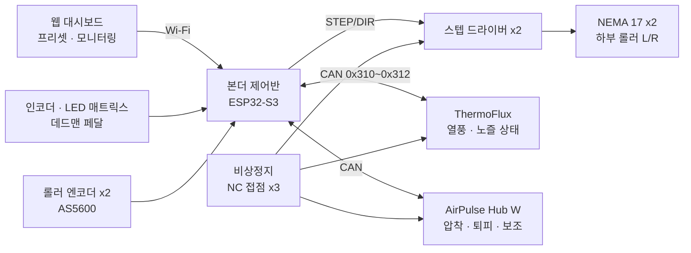

---
doc_id:
title: NEXA 열융착기 (NEXA Heat Fuser) v2.0
category: 기획서
domain: 양봉
status: draft
created: 2026-10-14
updated: 2026-10-20
parent_doc:
implements_doc:
see_also:
  - "[[모듈-열융착기 (NEXA Heat Fuser)]]"
  - "[[모듈-ThermoFlux (열풍기 모듈)]]"
  - "[[모듈-에어 펄스 허브 (NEXA AirPulse Hub)]]"
terms_standard: []
terms_nexa:
---

# 모듈 - 열융착기 (NEXA Heat Fuser) v2.0

타포린·방수 원단을 **열풍으로 녹이고 롤러로 눌러 붙이는** 열풍 쐐기식 융착기의 기초 기획서다. v1.0(히터 드럼 방식) 과 하드웨어 구조가 달라 새 문서로 작성하며, v1.0 은 소재·UI·운용 아이디어만 참고한다.

- 열원은 독립 열풍 모듈 [[모듈-ThermoFlux (열풍기 모듈)]] 이 맡는다.
- 압착·노즐 퇴피·보조 공압 기능은 [[모듈-에어 펄스 허브 (NEXA AirPulse Hub)]] W 형이 맡는다.
- 본더 제어반은 이송 (차동 롤러) 과 전체 시퀀스·인터록을 맡는다.

---

## 1. 개요와 사양

```unset
       =========================================================
                 [ NEXA Heat Fuser v2.0 ]
       =========================================================
       - 열 원 부: ThermoFlux 열풍 모듈 + 교체식 쐐기 노즐 20/30/40 mm
                   노즐 퇴피 = 원통 캠 마운트 + 공압 실린더 (스프링 = 퇴피)
       - 압 착 부: 상부 아이들러 롤러 x2 + 상하 이송 뭉치
                   복동 실린더 (헤드 = 디지털 압착 / 로드 = 리프트)
                   4X 편심 슬리브 평행 조정, 탈착식 스프링 (수동 모드)
       - 이 송 부: 하부 너링 롤러 x2 (동축 좌우 분리) + NEMA 17 롱바디 x2
                   L25 커플러 직결, 좌우 속도차로 곡선 융착 (차동 이송)
       - 공 압 부: AirPulse Hub W 연동 (8채널·10스테이션)
       - 제 어 부: 본더 제어반 ESP32-S3, 스텝 드라이버 x2, 롤러 엔코더 x2
                   CAN 버스: ThermoFlux · AirPulse Hub
       - 안 전 부: 비상정지 (모터·히터·밸브 동시 차단), 노즐 스프링 퇴피,
                   손 끼임 방지 가드, 데드맨 페달 (수동·곡선 작업)
       - U     I: 로터리 인코더 + 24x8 LED 매트릭스 + 웹 대시보드
       =========================================================
```

| 주요 기능구역     | 상세 기능 요약                                            | 설계 의도                                                                                 |
| ----------------- | --------------------------------------------------------- | ----------------------------------------------------------------------------------------- |
| 열풍 쐐기 융착    | ThermoFlux 노즐이 두 원단 사이에서 압착선 바로 앞을 가열  | 드럼 축열이 없어 정지 시 노즐만 빼면 원단이 타지 않는다. 온도 응답이 빠르다               |
| 원통 캠 노즐 퇴피 | 공압 실린더가 마운트를 밀면 원통 슬릿을 따라 이동 후 회전 | 노즐을 삽입 방향 그대로 빼낸 뒤 회전해 치운다. 틸트 호가 원단을 누르는 문제를 없앤다      |
| 리프트 연동       | 열풍기 마운트가 상하 이송 뭉치와 강결합                   | 롤러를 들면 열풍기도 함께 올라가, 한 번의 리프트로 작업부 전체가 원단에서 떨어진다        |
| 공압 디지털 압착  | 복동 실린더 헤드 측 압력을 센서 피드백으로 유지           | 원단·속도·곡선 구간별 압착력을 자동으로 바꾼다. 스프링처럼 높이에 따라 힘이 변하지 않는다 |
| 차동 이송         | 좌우 하부 롤러를 각자 모터로 구동                         | 좌우 속도차로 원단을 돌려 곡선 이음을 만든다 (v1.0 캐스터 방식 대체)                      |
| 모듈 분리         | 열원·공압·이송을 각각 독립 모듈로                         | 열풍기와 공압 허브는 양봉 장비와 공용, 본더는 이송·시퀀스만 개발한다                      |

### 1.1 v1.0 대비 변경

| 구분      | v1.0                                       | v2.0                             | 이유                                        |
| --------- | ------------------------------------------ | -------------------------------- | ------------------------------------------- |
| 열원      | 상단 히터 드럼 (카트리지 히터, 슬립링)     | ThermoFlux 열풍 + 쐐기 노즐      | 축열·슬립링·정지 시 탄화 문제 제거          |
| 압착      | 스프링 / 리드스크루                        | 공압 복동 실린더 + 탈착식 스프링 | 자동 압착력 조절, 즉시 해제                 |
| 구동      | AC 감속 모터 → 유니버설 조인트 → 상단 드럼 | NEMA 17 x2 → 하부 롤러 직결      | 상부는 아이들러라 조인트·단열 격벽 불필요   |
| 곡선      | 하단 캐스터 따라가기 (손 곡선 보조)        | 하부 좌우 차동 이송              | 곡선을 제어기가 직접 만든다                 |
| 정지 보호 | 히터 차단 + 압력 해제 + 에어 냉각          | 노즐 퇴피 + 압착 해제 + 리프트   | 열원이 원단에서 물리적으로 떨어진다         |
| 공압      | 냉각 에어 솔레노이드 단독                  | AirPulse Hub 8 채널              | 압착·퇴피·냉각·흄·클램프·커터·브레이크 통합 |

### 1.2 설계 원칙

1. **열원은 원단에서 물리적으로 떨어져야 정지한 것이다.** 정지·고장·정전 시 노즐은 스프링으로 퇴피한다. 히터를 끄는 것만으로는 부족하다.
2. **고장 시 상태는 기구가 보장한다.** 노즐 퇴피 (스프링), 압착 해제 (N.O. 배기 밸브), 주차 브레이크 (스프링 제동) 는 전원·공기와 무관하게 안전 쪽으로 간다.
3. **본더 제어반은 시퀀스와 이송만 맡는다.** 온도 제어는 ThermoFlux 내부, 밸브 구동과 공기 예산은 AirPulse Hub 가 맡는다. 본더는 목표값과 순서를 명령한다.
4. **실시간 연동 루프에 웹을 넣지 않는다.** 속도 - 온도 - 압력 연동은 본더 제어반이 CAN 으로 직접 한다. 웹은 프리셋 주입과 모니터링만 한다.

---

## 2. 기구 구조

### 2.1 전체 배치

```unset
 [열원부]     ThermoFlux (세로 장착) ─ 주황 마운트 ─ 원통 캠 ─ 퇴피 실린더
                 │                      │
                 └─ 쐐기 노즐 → 압착선 앞   └─ 상하 이송 뭉치와 강결합
 [압착부]     복동 실린더 (+ 탈착식 스프링) → 상하 이송 뭉치 (4X 편심 슬리브) → 상부 롤러 x2
                                                                    ↕ 원단 2~3겹
 [이송부]     NEMA 17 ─ L25 ─ 베어링 ─ 하부 너링 롤러 L │ 하부 너링 롤러 R ─ 베어링 ─ L25 ─ NEMA 17
 [프레임]     C 프레임 (목 깊이 = 원단 가장자리에서 이음매까지 최대 거리)
```

### 2.2 하부 이송부 (차동 너링 롤러)

- **하부 롤러 2 개를 동축으로 좌우 분리**하고, 각각 NEMA 17 롱바디가 L25 조 커플러로 직결 구동한다.
- **너링 표면:** 원단을 미끄럼 없이 잡아 끈다. 너링이 원단 코팅을 찍지 않는지 소재별로 확인한다.
- **좌우 같은 속도 = 직선, 속도차 = 곡선**이다 (§6). 두 롤러 사이 간격은 최소로 하되 서로 닿지 않게 한다.
- **모터 토크 검토:** NEMA 17 롱바디 약 0.5~0.65 N·m, 롤러 반경 15 mm 가정 시 롤러당 견인력 약 33~43 N. 압착 상태에서 3 겹 타포린을 끌 수 있는지 시험하고, 부족하면 감속기 (유성 5:1 등) 를 넣는다 (§11).
- **엔코더:** 롤러 축 끝에 자기식 엔코더 (AS5600) 를 두어 실제 회전을 측정한다. 스텝 지령과 비교해 탈조·미끄럼을 감지하고, ThermoFlux 속도 연동의 기준 속도로 쓴다.

### 2.3 상부 압착부

- **상부 롤러 2 개 (좌우 분리 아이들러):** 하부 좌우 롤러 위에 하나씩 놓이며 각자 자유 회전한다. 곡선 (차동) 이송 때 좌우 속도가 달라도 끌림이 없다.
- **표면 소재:** 노즐 열풍과 가열된 원단에 닿으므로 내열 실리콘 고무 (약 200~250°C) 또는 PTFE 피복을 쓴다. 온도를 실측해 확정한다.
- **상하 이송 뭉치:** 상부 롤러 2 개를 한 블록에 묶어 수직으로 움직인다. 열풍기 마운트도 이 뭉치에 강결합된다 (§2.5).
- **4X 편심 슬리브 평행 조정:** 상부 롤러 축과 하부 롤러 축의 평행도를 맞춘다. 좌우 압착력 차이가 나지 않게 하는 핵심 조정이다.
- **복동 실린더 (상부 아암 중앙):**
  - 헤드 측 = 디지털 압착: AirPulse 스테이션 A(공급)·B(유지) + 어태치먼트 체크 밸브·공기 파일럿 배기 밸브·압력 센서.
  - 로드 측 = 리프트: AirPulse 스테이션 C + 배기 조절형 스피드 컨트롤러 (하강 속도 제한).
  - 힘이 두 상부 롤러 사이 중앙에 걸리도록 배치해 평행도를 유지한다.
  - 공간이 좁으면 컴팩트 (박형), 저압 마찰 편차를 줄이도록 저마찰형을 쓴다.
  - 힘 참고 (6 bar, 헤드 측): Ø32 약 480 N, Ø40 약 750 N, Ø50 약 1,180 N.
- **최소 접촉력 = 상부 아암 무게 (열풍기 포함).** 열풍기 무게만큼 최소 힘이 커지므로, 아주 얇은 원단에서 과하면 로드 측에 약한 압력을 걸어 상쇄한다.
- **탈착식 스프링 (수동 모드):** 스프링 받침 (턱) 은 그대로 두고 스프링만 넣고 뺀다. 상세는 [[모듈-에어 펄스 허브 (NEXA AirPulse Hub)]] §5.6.
  - 실린더 로드는 하단 클레비스에 직접 연결해, 스프링이 없어도 힘이 그대로 전달되게 한다.
  - 클레비스 핀은 R 핀 같은 빠른 탈착형으로 한다.
  - 공압 모드에서 위·아래 받침이 전체 행정 동안 닿지 않아야 한다.
  - 수동 모드는 받침 높이 나사로 압착력을 맞추고, 실린더 포트를 대기로 열며, 리프트는 수동 레버·캠으로 한다.

### 2.4 열원부 (ThermoFlux)

- ThermoFlux 220V(1,200~1,800 W) 를 세로로 장착한다. 노즐은 하단에서 꺾여 **측면에서 두 원단 사이로 들어가** 압착선 바로 앞 (초기 3~5 mm) 에서 열풍을 토출한다.
- 노즐은 SUS304 쐐기형 20/30/40 mm 를 이음 폭에 맞춰 교체한다. 노즐별 온도 오프셋은 ThermoFlux 프리셋에 저장한다.
- 온도·풍량은 본더 제어반이 CAN 으로 명령하고 ThermoFlux 내부 PID 가 제어한다 (ThermoFlux §6, §9).
- 퇴피 상태에서는 히터를 대기 온도로 유지하고 열풍은 원단 밖으로 나가게 한다.

### 2.5 노즐 퇴피 기구 (원통 캠 마운트)

열풍기를 잡는 주황 마운트가 **슬릿이 있는 원통 가이드** 위를 움직인다. 마운트가 왼쪽으로 움직이면 원통 축을 따라 이동하면서 슬릿을 따라 회전하고, 노즐이 프론트 방향으로 돌아 나간다 (퇴피). 원통 가이드는 상하 이송 뭉치와 강결합된 암에 있다.

- **힘의 방향: 퇴피 (왼쪽) = 스프링, 삽입 (오른쪽) = 공기.** 공기·전원이 없을 때 노즐이 원단 밖에 있어야 하기 때문이다. 반대 (공기 퇴피·스프링 삽입) 로 하면 콤프레셔 정지·정전 때 스프링이 뜨거운 노즐을 원단 사이로 밀어 넣는다.
- **실린더 배치:** 일반 단동 실린더 (공기 = 로드 전진, 스프링 = 로드 후퇴) 는 **마운트 왼쪽에 두고 로드로 당기는 방향**에 단다. 실린더를 오른쪽에 두고 미는 방향으로 달아야 하면 **스프링 전진형 단동 실린더**(공기 = 로드 후퇴) 를 쓴다.
- **원통 가이드 길이는 늘리지 않는다 (현재 약 34 × Ø22 mm).** 가이드가 길어지면 블로어 쪽 부담이 커진다. 대신 가이드 안의 스프링을 없애 원통은 **슬릿 전용**으로 쓰고, 34 mm 전체를 행정에 쓴다.
- **퇴피 힘 = 실린더 내장 스프링 + 외부 보조 인장 스프링:**
  - 단동 실린더 내장 스프링은 피스톤 복귀용이라 힘이 약하다 (Ø16~20 급 수 N~20 N 수준, 카탈로그 스프링 반력 표로 확인). 모자라는 만큼 외부 인장 스프링을 더한다.
  - 외부 스프링은 열풍기 몸통에서 떨어진 곳에 걸고, SUS304·SUS631 선재를 쓴다 (피아노선은 약 120°C 한계).
  - 사용 처짐은 자유 길이의 30~40% 이내로 하고, 길고 무른 스프링에 예압을 크게 걸어 행정 전체에서 힘이 고르게 한다.
  - 퇴피 끝에 남는 힘이 (중력 + 캠 마찰) × 1.5 이상이어야 한다. 퇴피 끝은 열풍기가 가장 많이 들린 위치라 필요한 힘이 가장 크고 스프링 힘은 가장 약하다.
- **중력 부담 줄이기:** 열풍기 무게중심을 회전축 가까이 두어, 퇴피 회전이 무게중심을 거의 들어 올리지 않게 한다. 그러면 스프링은 주로 마찰만 이기면 된다.
- **대안 (스프링으로 힘이 부족할 때): 복동 실린더.** 퇴피 쪽에도 공기 힘을 쓴다. 다만 정전·공기 차단 때 자동 퇴피를 지키려면 어태치먼트에 **소형 공기 탱크 + 체크 밸브 + 공기 파일럿 밸브 (허브 신호가 사라지면 탱크 공기를 퇴피 쪽으로 보냄)**를 두고, 허브 스테이션을 하나 더 쓴다 (채널 1 = 2 스테이션, 선택 기능 하나 제외).

| 항목             | 규칙                                                                                                                             | 이유                                                                                                              |
| ---------------- | -------------------------------------------------------------------------------------------------------------------------------- | ----------------------------------------------------------------------------------------------------------------- |
| 슬릿 형상        | 작업 위치 쪽 **직선 구간**(회전 없이 이동) → **점진 구간** → **나선 구간**(이동 + 회전) → **끝 감속 구간** (§2.5.1)              | 노즐이 원단 사이에 있는 동안 회전하면 원단을 비틀거나 찢는다. 회전 시작·끝은 기계식 S 커브로 부드럽게 한다        |
| 직선 구간 길이   | 노즐 삽입 깊이 + 여유 5~10 mm 이상                                                                                               | 노즐 끝이 원단에서 완전히 빠진 뒤 회전                                                                            |
| 노즐 끝 위치     | 회전축보다 회전 반대쪽 (뒤쪽) 으로 약간 치우치게                                                                                 | 축 바로 아래면 회전 초기에 끝이 수평으로만 움직여 아래 원단을 긁는다 (예: 반경 300 mm, 10° → 앞 52 mm, 위 4.6 mm) |
| 작업 위치 정밀도 | 슬릿과 별개인 **위치 결정 스톱**(V 홈·조정 나사) 에 실린더 힘으로 밀착                                                           | 원통 캠은 슬릿 틈새가 노즐 끝에서 확대된다 (반경 15 mm → 250 mm 면 약 17 배, 틈새 0.1 mm → 약 1.7 mm)             |
| 캠 팔로워        | 단순 핀 대신 베어링 롤러                                                                                                         | 마찰·걸림 감소                                                                                                    |
| 고장 시 퇴피     | 단동 실린더 내장 스프링 + 외부 보조 인장 스프링이 **퇴피 방향 (왼쪽) 으로 민다**. 공기는 삽입 방향에만 쓴다                      | 정전·허브 차단 시 자동 퇴피                                                                                       |
| 행정             | 34 mm 가이드 안에 직선 + 점진 + 나선 + 감속 구간을 모두 넣는다. 모자라면 노즐 삽입 깊이를 줄이거나 나선 경사를 키운다 (45° 이하) | 가이드를 늘리지 않는 조건                                                                                         |
| 나선 경사각      | 약 45° 이하                                                                                                                      | 가파르면 스프링 힘만으로 캠이 되돌아가지 못한다                                                                   |
| 스프링 힘        | 퇴피 끝 잔여 힘 ≥ (중력 모멘트 환산 힘 + 캠 마찰) × 1.5                                                                          | 고장 시 퇴피 완주 보장, 스프링 노화 여유                                                                          |
| 실린더 연결      | 로드 끝 구면 로드 엔드 (볼 조인트), 실린더 뒤쪽은 회전형 클레비스·트러니언. 실린더 경사각은 가능한 한 작게                       | 캠 핀은 나선을 따라 이동하며 돈다. 고정 연결이면 걸리고, 비스듬한 힘의 옆 성분은 가이드 마찰이 된다               |
| 위치 확인        | 실린더 양 끝 리드 스위치 (퇴피 완료 / 삽입 완료)                                                                                 | 본더 인터록과 AirPulse 위치 확인 감시 (⑮)                                                                         |
| 퇴피 속도        | 실린더 포트에 배기 조절형 스피드 컨트롤러 (meter-out). 직선 구간 통과 초기 목표 0.3 s 이내                                       | 너무 느리면 노즐이 원단 사이에서 계속 가열한다. 정전 시에도 같은 경로로 배기되어 속도가 같다                      |
| 끝단 충격        | 퇴피 끝에 고무 범퍼 또는 쿠션 내장 실린더                                                                                        | 스피드 컨트롤러를 덜 조여도 위치 결정 스톱·열풍기를 보호한다                                                      |

- **열 관리:**
  - 실린더 패킹은 FKM 내열형을 쓰거나 차열판을 둔다 (일반 NBR 은 약 80°C 한계).
  - 마운트와 열풍기 하우징 사이에 마이카·PEEK 단열 스페이서를 넣고, 원통 가이드 틈새는 열팽창만큼 둔다.
  - 3D 프린트 부품은 표면 온도 ≤ HDT − 20°C 규칙을 따른다 (ThermoFlux §3.2).
- **케이블:** Powercon·CAN 케이블에 이동·회전용 여유 루프와 스트레인 릴리프를 둔다.
- **퇴피 후 열풍 방향:** 원단, 상부 롤러, 실린더, 공압 호스를 향하지 않게 한다.

#### 2.5.1 기계식 S 커브 (가변 리드 슬릿)

허브 밸브는 열림·닫힘만 있는 3/2 밸브라 실린더 속도를 연속으로 바꿀 수 없다. 그래서 실린더는 거의 일정한 속도로 밀기만 하고, **노즐 회전의 가감속은 슬릿 모양 (리드 변화) 이 만든다.** 추가 부품 없이 S 커브에 가까운 회전이 된다.

|        구간 | 슬릿 경사              | 노즐 동작                                                    |
| ----------: | ---------------------- | ------------------------------------------------------------ |
| ① 시작 직선 | 0                      | 회전 없이 원단에서 빠진다                                    |
|      ② 점진 | 0 → 최대 (완만한 곡선) | 회전이 부드럽게 시작된다. 덜컥거림이 가장 큰 꺾임점을 없앤다 |
|      ③ 나선 | 최대 (45° 이하)        | 일정 속도로 회전한다                                         |
|   ④ 끝 감속 | 최대 → 0               | 회전이 부드럽게 멈추고, 마지막은 범퍼가 받는다               |

- **가공:** 원통 전개도에서 슬릿 중심선을 매끄러운 곡선 (직선 - 원호 - 직선 또는 사이클로이드) 으로 그린다. 3D 프린트 시제품으로 경로를 확인한 뒤 금속으로 가공한다.
- **고장 시 퇴피와의 관계:** 점진·감속 구간의 경사는 나선 최대 경사보다 완만하므로 스프링 복귀에 불리하지 않다. 스프링 힘 계산은 ③ 나선 구간 기준으로 한다.
- **복동·서보 공압을 쓰지 않는 이유:**
  - 복동 실린더는 정전·공기 차단 때 힘이 없어 자동 퇴피를 잃는다. 되살리려면 공기 탱크와 파일럿 밸브가 더 필요하다.
  - 복동은 허브 스테이션을 하나 더 쓰고, 그래도 온·오프 밸브로는 S 커브가 되지 않는다.
  - 진짜 S 커브는 비례 밸브와 아날로그 위치 센서가 필요해 비용 대비 효과가 낮다.
- **보조: 삽입 끝 펄스 소프트 랜딩 (선택):**
  - 삽입은 공기가 스프링을 이기며 미는 동작이라, 스프링 선정이 약하거나 노화되면 삽입이 빨라져 위치 결정 스톱에 세게 부딪힌다. 이때 삽입 끝 직전에 짧은 배기 펄스를 넣어 감속한다.
  - 중간 위치 센서가 없으므로 시간 기준이다. 본더는 매 삽입마다 " 밸브 ON → 삽입 완료 리드 스위치 " 시간을 측정해 이동 평균을 학습하고, 평균의 약 70~80% 시점부터 펄스를 넣는다. 펄스 폭·횟수는 웹에서 조정하고 기본값은 끔이다.
  - 펄스는 AirPulse 채널 1 의 펄스 프로그램으로 실행한다. 위치 결정은 여전히 스톱이 맡고, 펄스는 충격만 줄인다.
  - 퇴피 쪽에는 펄스를 쓰지 않는다. 퇴피는 빠르고 확실해야 하며 정전 시에도 같은 동작이어야 한다.
- **스프링 상태 진단:** 퇴피 시간 (" 밸브 OFF → 퇴피 완료 리드 스위치 ") 과 삽입 시간을 로그로 남긴다. 퇴피 시간이 기준보다 늘거나 삽입 시간이 줄면 스프링 약화로 보고 교체를 알린다. 퇴피 시간이 허용 한계를 넘으면 운전을 막는다.

### 2.6 프레임

- **C 프레임:** 목 깊이가 원단 가장자리에서 이음매까지의 최대 거리를 정한다. 대형 타포린 작업 범위를 고려해 정한다 (§11).
- 하부에 모터 2 개가 좌우로 나가므로, 원단이 지나가는 앞뒤 방향 공간과 손 작업 공간을 확보한다.
- 바닥은 방진 고무로 지지하고, 원단 공급·배출 테이블을 같은 높이로 맞춘다.

---

## 3. 공압 구성 (AirPulse Hub W 연동)

W 형 허브 하나를 본더 전용으로 배정한다 (8 채널·10 스테이션). 상세 회로·고장 시 상태·인터록은 [[모듈-에어 펄스 허브 (NEXA AirPulse Hub)]] §5.6 을 따른다.

| 채널 | 기능             | 스테이션 | 구동 대상                                | 고장 시 상태     | 적용 |
| ---: | ---------------- | -------: | ---------------------------------------- | ---------------- | ---- |
|    1 | 노즐 퇴피        |        1 | 원통 캠 퇴피 실린더 (스프링 = 퇴피)      | 퇴피             | 1 차 |
|    2 | 롤러 압착·리프트 |        3 | 복동 실린더 (A 공급 / B 유지 / C 리프트) | 압착 해제 (N.O.) | 1 차 |
|    3 | 이음매 냉각 에어 |        1 | 롤러 뒤 에어 나이프 (B 급 파일럿)        | 정지             | 2 차 |
|    4 | 흄 흡입          |        1 | 노즐 주변 벤투리 (B 급 파일럿)           | 정지             | 2 차 |
|    5 | 노즐 팁 청소     |        1 | 퇴피 위치 펄스 블로우                    | 정지             | 선택 |
|    6 | 원단 클램프      |        1 | 출발 시 원단 끝 고정                     | 해제             | 선택 |
|    7 | 공압 커터        |        1 | 이음매 끝 절단 (누르는 동안만)           | 칼날 복귀        | 선택 |
|    8 | 주차 브레이크    |        1 | 본체 고정 (스프링 제동)                  | 제동             | 선택 |

- 1 차 = 기본 동작에 필수, 2 차 = 품질·안전 향상, 선택 = 적용 여부를 시험 후 결정한다.
- 롤러 압착 목표 압력은 원단 프리셋과 본더 명령 (속도·곡선 구간) 으로 바뀐다.
- 본더는 허브 채널을 CAN 으로 명령하고, 허브는 하트비트가 끊기면 해당 채널을 멈춘다 (AirPulse §8.2 ⑪).

---

## 4. 제어·전기 구성

### 4.1 시스템 구조



- **본더 제어반:** 이송 (차동 속도), 운전 시퀀스, 인터록, 속도 - 온도 - 압력 연동, UI 를 맡는다.
- **ThermoFlux:** 목표 온도·풍량·모드를 받아 스스로 온도를 제어하고 노즐 상태를 보고한다.
- **AirPulse Hub:** 채널 명령을 받아 밸브를 구동하고 공기 예산·채널 감시를 맡는다.
- **ThermoFlux 통신은 유선 CAN:** 무선 패킷이 끊기면 융착 도중 정지해 이음매 불량 (재출발 자국) 이 생긴다. ThermoFlux 는 어차피 Powercon 케이블이 들어가고 본더는 AirPulse 용 CAN 버스가 이미 있어 추가 비용이 거의 없다. ESP-NOW 는 단독 (핸디) 모드와 양봉 장비용으로 둔다.
- **비상정지:** NC 접점 3 개짜리 버섯형 스위치 하나로 모터 드라이버 전원, ThermoFlux 히터, AirPulse 밸브 전원을 동시에 끊는다. 밸브 전원이 끊기면 노즐 퇴피·압착 해제·브레이크 제동이 기구적으로 일어난다. ThermoFlux·AirPulse 의 외부 비상정지 입력 단자 규격은 열린 항목이다 (§11).

### 4.2 부품 리스트 (초기안)

#### 열원·기구

| 부품 분류      | 부품명 및 규격                                                                                               |   수량 | 체크포인트                             |
| -------------- | ------------------------------------------------------------------------------------------------------------ | -----: | -------------------------------------- |
| 열풍 모듈      | NEXA ThermoFlux 220V (1,200~1,800 W)                                                                         |      1 | 별도 문서                              |
| 노즐           | SUS304 쐐기 노즐 20/30/40 mm                                                                                 |   각 1 | 노즐별 온도 오프셋                     |
| 하부 롤러      | 너링 롤러 (강, 동축 좌우 분리)                                                                               |      2 | 너링 피치·깊이는 소재 시험으로         |
| 상부 롤러      | 내열 실리콘 또는 PTFE 피복 아이들러                                                                          |      2 | 표면 온도 실측                         |
| 롤러 베어링    | 플랜지·필로 블록 베어링                                                                                      |      8 | 상부는 내열 그리스                     |
| 커플러         | L25 조 커플러                                                                                                |      2 | 축 정렬 오차 흡수                      |
| 상하 이송 뭉치 | 수직 슬라이드 + 4X 편심 슬리브                                                                               |      1 | 평행도 조정                            |
| 압착 실린더    | 컴팩트 복동 저마찰 실린더 (지름 시험 후 확정)                                                                |      1 | 열풍기 근접 시 FKM 패킹                |
| 탈착식 스프링  | 압축 스프링 + 높이 조절 받침 + R 핀 클레비스                                                                 | 1 세트 | 수동 모드 전용                         |
| 퇴피 기구      | 가변 리드 슬릿 원통 가이드 + 캠 팔로워 + 위치 결정 스톱 + 끝단 범퍼                                          | 1 세트 | 직선 → 점진 → 나선 → 감속 슬릿         |
| 퇴피 실린더    | 단동 스프링 내장형 (스프링 = 퇴피), 리드 스위치 홈. 배치에 따라 스프링 복귀형 (당김) 또는 스프링 전진형 (밂) |      1 | 내열 패킹, 카탈로그 스프링 반력        |
| 보조 스프링    | 외부 인장 스프링 (SUS304·SUS631) + 걸이 핀                                                                   |    1~2 | 열풍기에서 떨어진 곳, 처짐 30~40% 이내 |
| 실린더 연결    | 구면 로드 엔드 + 회전형 클레비스·트러니언                                                                    | 1 세트 | 나선 경로 추종                         |
| 단열           | 마이카·PEEK 스페이서, 차열판                                                                                 | 1 세트 | 마운트·실린더 주변                     |
| 프레임         | C 프레임, 방진 고무                                                                                          |      1 | 목 깊이 결정                           |

#### 공압 (어태치먼트 측)

| 부품 분류       | 부품명 및 규격                                        |   수량 | 체크포인트                  |
| --------------- | ----------------------------------------------------- | -----: | --------------------------- |
| 체크 밸브       | 소형 인라인 체크 밸브                                 |      1 | 압착 헤드 측 공급           |
| 배기 밸브       | 공기 파일럿 2/2 배기 밸브 (N.O. 기본 / N.C. 선택)     |      1 | 정전 시 압착 해제·유지 선택 |
| 오리피스        | 배기 유량 제한                                        |      1 | 압력 제어 분해능            |
| 압력 센서       | 0~1 MPa 아날로그 (0.5~4.5V)                           |      1 | 도킹 커넥터 ANA             |
| 수동 배기 밸브  | 평소 닫힘 볼 밸브                                     |      1 | N.C. 선택 시 필수           |
| 스피드 컨트롤러 | 배기 조절형 (meter-out)                               |      2 | 로드 측 (하강), 퇴피 실린더 |
| 위치 센서       | 리드 스위치                                           |      3 | 노즐 퇴피·삽입, 롤러 들림   |
| 도킹            | AirPulse 도킹 커넥터·커플러 (또는 다채널 묶음 하네스) | 1 세트 | 허브 문서 열린 항목         |

#### 제어·전기

| 부품 분류      | 부품명 및 규격                                    | 수량 | 체크포인트                                      |
| -------------- | ------------------------------------------------- | ---: | ----------------------------------------------- |
| 메인 연산      | ESP32-S3 모듈                                     |    1 | 본더 제어반                                     |
| 스텝 드라이버  | TMC2209 (저소음, 탈조 감지) 또는 동급             |    2 | 모터 정격 전류 맞춤                             |
| 모터           | NEMA 17 롱바디 (약 0.5~0.65 N·m)                  |    2 | 견인력 부족 시 감속기                           |
| 롤러 엔코더    | AS5600 자기식 엔코더 + 축 끝 자석                 |    2 | 미끄럼·탈조 감지, 속도 기준                     |
| CAN            | SN65HVD230 트랜시버                               |    1 | ThermoFlux·AirPulse 공용 버스, 양 끝 120 Ω 종단 |
| 전원           | AC 220V → 24V SMPS (모터용, 100 W 급) + 24V→5V 벅 | 각 1 | ThermoFlux 는 별도 Powercon 220V                |
| 비상정지       | 버섯형 래칭, **NC 접점 블록 3 개**                |    1 | 모터·히터·밸브 동시 차단                        |
| 모터 전원 차단 | 모터 24V 라인 NO 릴레이 (비상정지 직렬)           |    1 | 비상정지 시 모터 전원 개방                      |
| UI             | 로터리 인코더 + MAX7219 24x8 LED 매트릭스         | 각 1 | v1.0 UI 개념 계승                               |
| 데드맨 페달    | 모멘터리 발판 스위치                              |    1 | 수동·곡선 작업                                  |
| 손 가드        | 압착선 앞 손가락 가드                             |    1 | 롤러 닙 끼임 방지                               |

---

## 5. 운전 시퀀스와 인터록

### 5.1 상태 흐름

| 단계 | 정지 시 (이송 중 → 정지)              | 재출발 시 (정지 → 이송)                    |
| ---: | ------------------------------------- | ------------------------------------------ |
|    1 | 이송 정지 (감속)                      | 롤러 하강, 헤드 측 압착 (노즐은 퇴피 상태) |
|    2 | **노즐 퇴피 → 퇴피 완료 스위치 확인** | 목표 압착력 도달 확인                      |
|    3 | 롤러 압착 해제                        | ThermoFlux 목표 온도 도달 확인             |
|    4 | 롤러 리프트 (열풍기 마운트 함께 상승) | 노즐 삽입 → 삽입 완료 스위치 확인          |
|    5 | ThermoFlux 대기 온도 유지             | 설정 지연 (초기 0.3~0.5 s) 후 이송 시작    |

### 5.2 인터록

| 조건                           | 금지 동작                     | 이유                                                    |
| ------------------------------ | ----------------------------- | ------------------------------------------------------- |
| 노즐 삽입 상태                 | 롤러 리프트                   | 노즐이 원단 사이에 낀 채 올라가면 윗 원단을 밀어 올린다 |
| 노즐 삽입 상태 + 이송 정지     | (허용 시간 초과 시) 자동 퇴피 | 정지 중 같은 자리 가열 → 탄화                           |
| 롤러 압착력 미달               | 노즐 삽입, 이송 시작          | 압착 없이 녹이면 접착 불량                              |
| ThermoFlux 목표 온도 미달      | 노즐 삽입, 이송 시작          | 차가운 융착 → 박리                                      |
| 노즐 미퇴피                    | 노즐 팁 청소                  | 펄스가 원단에 닿는다                                    |
| 커터 칼날 미복귀               | 이송 시작                     | 원단 손상·손 위험                                       |
| 주차 브레이크 채널 정지        | 이송 (먼저 정지)              | 브레이크가 자동 제동된다                                |
| 롤러 엔코더와 스텝 지령 불일치 | 이송 정지 → 정지 시퀀스       | 미끄럼·탈조 = 같은 자리 가열 위험                       |
| ThermoFlux 통신 두절           | 이송 정지 → 정지 시퀀스       | ThermoFlux 는 스스로 STANDBY + 퇴피 요청                |

- 인터록 판단은 본더 제어반이 한다. ThermoFlux 와 AirPulse 는 각자의 안전 (온도·밸브·하트비트) 을 독립적으로 지킨다.

---

## 6. 곡선 융착 (차동 이송)

좌우 하부 롤러의 속도차로 원단을 돌려 곡선 이음을 만든다. 상부 롤러가 좌우 분리 아이들러라 속도차에 따라 자유롭게 돈다.

- 이음매 중심선 속도 v, 곡선 반경 R(이음매 중심선 기준), 좌우 롤러 접촉 중심 간격 b 일 때:
  - 안쪽 롤러 = v × (R − b/2) / R, 바깥쪽 롤러 = v × (R + b/2) / R
  - 예: b = 20 mm, R = 200 mm 면 안쪽 0.95 v, 바깥쪽 1.05 v
- **최소 반경:** R > b/2 가 이론 한계지만, 실제로는 주름·층 어긋남으로 더 크다. 원단별 최소 반경을 시험으로 정해 프리셋에 둔다.
- **곡선 구간 압착력:** 목표 압력을 낮춰 원단이 돌기 쉽게 한다 (펄스 리프트 대신). 출렁임이 허용 폭 ±0.1 bar 안이라 이음매 무늬가 거의 생기지 않는다.
- **열량:** ThermoFlux 목표 온도·풍량은 중심선 속도 v 기준으로 계산한다. 곡선 바깥쪽은 속도가 빨라 열이 덜 들어가므로, 급한 곡선에서는 v 를 낮춘다.
- **조작:** 인코더 " 곡선 " 모드에서 반경 (또는 좌우 속도비) 을 돌려 정하고, 데드맨 페달을 누르는 동안만 이송한다.

```cpp
struct WheelSpeed {
    float left_mm_s;
    float right_mm_s;
};

// v_mm_s: 이음매 중심선 속도, radius_mm: 곡선 반경 (+ = 왼쪽으로 굽음, - = 오른쪽, 0 = 직선)
// track_mm: 좌우 하부 롤러 접촉 중심 간격, min_radius_mm: 원단 프리셋의 최소 반경
static WheelSpeed differential_speed(float v_mm_s, float radius_mm,
                                     float track_mm, float min_radius_mm) {
    if (radius_mm == 0.0f) return { v_mm_s, v_mm_s };

    const float half  = track_mm * 0.5f;
    const float r_abs = fmaxf(fabsf(radius_mm), fmaxf(min_radius_mm, half * 2.0f));
    const float inner = v_mm_s * (r_abs - half) / r_abs;
    const float outer = v_mm_s * (r_abs + half) / r_abs;

    return (radius_mm > 0.0f) ? WheelSpeed{ inner, outer } : WheelSpeed{ outer, inner };
}

// 롤러 표면 속도 → 스텝 주파수
static float step_hz(float surface_mm_s, float roller_dia_mm, uint16_t steps_per_rev, uint8_t microsteps) {
    return surface_mm_s / (PI * roller_dia_mm) * steps_per_rev * microsteps;
}
```

- 반경은 원단 최소 반경과 `b`(R ≥ b) 중 큰 값 아래로 내려가지 않게 잘라, 안쪽 롤러가 멈추거나 역회전하지 않게 한다.

---

## 7. 열 - 속도 - 압력 연동

v1.0 의 드럼은 축열 때문에 정지·감속 시 원단이 탔지만, 열풍 방식은 노즐을 빼면 열 공급이 바로 끊긴다. 연동은 본더 제어반이 맡는다 (ThermoFlux §9.3).

| 입력               | 본더 제어반 동작                                           |
| ------------------ | ---------------------------------------------------------- |
| 이송 속도 (엔코더) | ThermoFlux 목표 온도·풍량을 속도 맵으로 계산해 CAN 송신    |
| 감속               | 냉각 에어 (채널 3) 개입, 목표 온도 선제 하향               |
| 정지               | 정지 시퀀스 (§5.1): 퇴피 → 압착 해제 → 리프트              |
| 곡선 구간          | 중심선 속도 하향, 롤러 목표 압력 하향                      |
| 원단 프리셋        | 속도 맵, 목표 압력, 노즐 폭, 최소 곡선 반경을 한 번에 로드 |

- **속도 맵:** 원단·겹수별로 `(속도 → 목표 온도, 풍량, 압착 압력)` 표를 시험으로 만든다. 프리셋 초기값은 ThermoFlux §10.2(타포린 2 겹 380°C·팬 80%, 3 겹 단차 420°C·팬 90%) 를 출발점으로 한다.
- **속도 하한:** 노즐 삽입 상태에서 설정 속도 하한 아래로 내려가면 경고하고, 허용 시간을 넘으면 자동 퇴피한다.

---

## 8. UI

v1.0 의 " 인코더 + 24x8 LED 매트릭스 + 웹 " 개념을 이어받는다 (v1.0 UI/UX 절).

| 조작             | 동작                                                               |
| ---------------- | ------------------------------------------------------------------ |
| 인코더 클릭      | 모드 순환: `T`(온도) / `S`(속도) / `P`(압착 압력) / `C`(곡선 반경) |
| 인코더 회전      | 선택 항목 미세 조정 (가속 스케일링)                                |
| 인코더 길게 누름 | 정지 시퀀스 후 역방향 조그 (원단 빼내기)                           |
| 모드 스위치      | 자동 (프리셋) / 수동 조그 셔틀                                     |
| 데드맨 페달      | 수동·곡선 작업은 누르는 동안만 이송, 떼면 정지 시퀀스              |
| 비상정지         | 모터·히터·밸브 동시 차단                                           |

- **수동 조그 셔틀:** 인코더 회전량을 이송량으로 직결한다. 온도·압착은 프리셋 그대로 유지하고, §7 속도 하한 규칙을 적용한다.
- **매트릭스 표시:** 좌측 8x8 = 모드 아이콘, 우측 16x8 = 게이지. 노즐 퇴피 중·압착 대기·온도 도달 같은 상태를 아이콘으로 구분한다.
- **웹 대시보드:** 원단 프리셋 편집, 실시간 온도·속도·압력 그래프, 품질 로그 (엔코더 위치별 온도·압력 이탈 구간). Wi-Fi 설정은 v1.0 의 QR·캡티브 포털 방식을 따른다.

---

## 9. 안전

| 위험                  | 대책                                                                         |
| --------------------- | ---------------------------------------------------------------------------- |
| 정지 중 원단 탄화     | 정지 시퀀스 자동 퇴피, 정지 허용 시간 초과 시 강제 퇴피, 정전 시 스프링 퇴피 |
| 롤러 닙 손 끼임       | 손가락 가드, 데드맨 페달, 리프트 하강 속도 제한, 정지 시 압착 해제           |
| 고온 노즐·하우징 접촉 | 퇴피 위치 열풍 방향 관리, 하우징 외단열, 고온 경고 표시                      |
| 흄 흡입               | 흄 흡입 채널 (벤투리), 환기                                                  |
| 커터                  | 누르는 동안만 동작, 커터 가드, 칼날 복귀 확인 후 이송                        |
| 경사면 밀림           | 주차 브레이크 (스프링 제동, 정전 시 자동 제동)                               |
| 공압 실린더 열 손상   | FKM 패킹, 차열판, 단열 스페이서                                              |
| 제어기 정지           | ThermoFlux·AirPulse 각자의 워치독 + 하트비트 두절 시 독립 안전 동작          |

---

## 10. 검증 항목

| 번호 | 항목 | 판정 기준 |
| ---: | ------------------------ | -------------------------------------------------------------------------------------------------------------------------------- | --- | --- | --------------------- | -------------------------------------------------------------------- |
| 1 | 견인력 | 최대 압착 + 3 겹 타포린에서 미끄럼·탈조 없음 (부족 시 감속기) |
| 2 | 직선 이송 | 좌우 같은 속도에서 5 m 주행 시 사행량 기준 이내 |
| 3 | 차동 곡선 | 반경별 (500·300·200 mm) 곡선 이음 품질, 원단별 최소 반경 확정 |
| 4 | 평행도 조정 | 4X 편심 슬리브로 좌우 압착 자국 폭 균일 |
| 5 | 디지털 압착 | 목표 압력 ±0.1 bar 유지, 압력별 압착력 측정 |
| 6 | 리프트·하강 | 리프트 시 열풍기 마운트 동반 상승, 하강 속도 제한 (손 끼임 없음) |
| 7 | 노즐 퇴피 경로 | 직선 구간에서 회전 없음, 회전 시 아래 원단 접촉 없음, 회전 시작·끝 덜컥거림 없음 (가변 리드 슬릿), 직선 구간 통과 시간 목표 이내 | | 8 | 노즐 작업 위치 재현성 | 퇴피·삽입 20 회 반복 시 노즐 끝 위치 편차 기준 이내 (위치 결정 스톱) |
| 9 | 고장 시 퇴피 | 공기 차단·전원 차단 시 스프링만으로 퇴피 완주 |
| 10 | 열 영향 | 퇴피 실린더·압착 실린더·마운트·상부 롤러 표면 온도가 각 한계 이하 |
| 11 | 정지 시퀀스 | 이송 정지 → 퇴피 → 해제 → 리프트 순서, 각 단계 위치 확인 |
| 12 | 인터록 | §5.2 표 전 항목 모의 시험 |
| 13 | 비상정지 | 모터·히터·밸브 동시 차단, 노즐 퇴피·압착 해제 확인 |
| 14 | 속도 - 온도 연동 | 속도 변화 시 계면 온도 안정, 감속 시 냉각 에어 효과 |
| 15 | 이음매 품질 | 원단·겹수별 박리 강도·기밀 (풀무 기준) |
| 16 | 탈착식 스프링 수동 모드 | 스프링 장착·제거 시간, 수동 모드 압착력 조정 범위 |
| 17 | 삽입 끝 펄스·스프링 진단 | 약한 스프링으로 바꿔 끼운 상태에서 펄스로 스톱 충격 감소 확인, 퇴피·삽입 시간 추세로 스프링 약화 경고 동작 |

---

## 11. 열린 항목

| 항목                 | 필요한 정보                                                                                   | 영향                                  |
| -------------------- | --------------------------------------------------------------------------------------------- | ------------------------------------- |
| 모터 견인력          | 3 겹 타포린 + 최대 압착 시 필요 토크                                                          | 감속기 채택 여부                      |
| 롤러 치수            | 하부 너링 롤러 지름·폭, 상부 롤러 소재·지름                                                   | 차동 간격 b, 속도 환산, 내열          |
| 압착 실린더          | 필요 압착력, 지름·행정, 상부 아암 무게 (열풍기 포함)                                          | 압착 범위, 최소 접촉력                |
| 퇴피 힘 예산         | 열풍기·마운트 무게, 회전축 - 무게중심 거리, 캠 마찰, 실린더 내장 스프링 반력                  | 외부 보조 스프링 사양, 복동 전환 여부 |
| 원통 캠 치수         | 34 mm 안에 들어가는지: 노즐 삽입 깊이, 직선 구간 길이, 나선 각도, 점진·감속 구간 곡선, 회전각 | 퇴피 경로, 정밀도, 스프링 힘          |
| C 프레임 목 깊이     | 작업할 원단 폭과 이음 위치                                                                    | 프레임 크기·강성                      |
| 비상정지 연동        | ThermoFlux·AirPulse 외부 비상정지 입력 단자 규격                                              | 단일 비상정지 구현                    |
| 배기 밸브 형식       | 정전 시 압착 해제 (N.O.) / 유지 (N.C.)                                                        | 원단 처리 방식                        |
| 보조 공압 기능 범위  | 채널 3~8 적용 여부                                                                            | 허브 채널 점유, 비용                  |
| 다채널 묶음 하네스   | 본더용 다채널 커플러·커넥터                                                                   | 도킹 편의                             |
| 소재별 속도 맵       | 원단·겹수별 속도 - 온도 - 풍량 - 압력 표                                                      | 프리셋                                |
| v1.0 어태치먼트 계승 | TPU 테이프 공급 지그, 트레일링 나이프, 드로잉 펜의 v2.0 구조 적용 방식                        | 확장 기능                             |

---

## 12. v1.0 에서 이어받는 것

- **소재 확장:** 인조 가죽 (PU/PVC), 투명 PVC 시트, PP/PE 부직포 등 열가소성 소재. 소재별 온도는 ThermoFlux 목표 온도와 속도 맵으로 맞춘다.
- **UI 개념:** 인코더 + LED 매트릭스 + 웹 대시보드, 수동 조그 셔틀, Wi-Fi QR·캡티브 포털 설정.
- **안전 개념:** 통신 두절 시 정지, 정지 시 자동 도피 (v2.0 은 노즐 퇴피로 구현), 데드맨 스위치.
- **이어받지 않는 것:** 히터 드럼, 자작 슬립링, 드럼 표면 접촉식 온도 센싱, 하단 캐스터·각도 센서·0° 잠금 핀, AC 모터·디지털 가변저항 속도 제어. 구조가 바뀌어 해당하지 않는다.

---

## 13. Thermal Tarp Bonder 소프트웨어 사양 및 흐름 정의

" 거시적 제어 (웹서버의 G-code 자동 주행) 와 미시적 제어 (인간의 감각 기반 실시간 오버라이드 보정)" 가 아주 이상적으로 결합

### 1 단계: 데이터 준비 및 전처리 (외부 웹서버 영역)

• 도면 업로드: 사용자가 웹 인터페이스를 통해 가공할 타포린 도면 파일 (예: DXF, SVG 등) 을 서버에 업로드합니다.
• G-code 변환 및 편집: 업로드된 도면 궤적을 기반으로 하단 차동 롤러 모터의 이송 속도 (F 값) 와 궤적이 포함된 G-code 를 자동 생성합니다.
• 키프레임 시각적 할당: 웹 GUI 상에서 오차가 발생하기 쉬운 주요 곡선 진입부, 꺾임 지점에 동기화용 키프레임 (Keyframe ID) 을 마우스 클릭으로 매핑하고 커스텀 G-code(주석 또는 커스텀 M-code) 로 삽입합니다.
• 장비 전송: 편집이 완료된 최종 G-code 스트림을 Wi-Fi(WebSocket 프로토콜) 를 통해 현장의 열 융착기 제어 보드 (ESP32) 로 실시간 스트리밍 전송합니다.

###2 단계: 물리 마킹 및 자동 진행 (런타임 기본 구동 영역)

• 원단 마킹 연동: 도면 제작 단계와 매칭되도록 실제 타포린 원단 위에도 키프레임 지점 (체크포인트) 을 물리적으로 마킹합니다.
• G-code 기반 자동 주행: ESP32 가 웹서버로부터 수신한 G-code 라인을 한 줄씩 해석 (Parsing) 하여 양쪽 NEMA 17 모터의 스텝 주파수를 제어하며 본딩을 시작합니다.
• 키프레임 위치 실시간 동기화: 주행 중 원단 마킹을 센서가 감지 (자동) 하거나 작업자가 동기화 스위치를 클릭 (수동) 하는 순간, ESP32 내부의 가상 스텝 카운터 좌표를 도면상의 정밀 이론 좌표로 강제 매핑 (Snap) 하여 누적된 미끄러짐 오차를 0 으로 초기화합니다.

### 3 단계: 작업자 개입 실시간 3 중 보정 (오버라이드 인터랙션 영역)

G-code 가 주행하는 베이스 흐름 속에서, 연성 원단의 실시간 변형을 잡기 위해 작업자가 아래의 3 가지 수단으로 모터 속도에 실시간 오프셋 (Offset) 을 누적·합성합니다.
• 손 조향 보정 (물리적 개입): 작업자가 두 손으로 원단을 직접 당기거나 밀면서 발생하는 장력 변화를 수동으로 보정합니다. (센서 연동 시 아날로그 압력 가감)
• 음성 명령어 보정 (비접촉 조향): 두 손이 원단 홀딩으로 묶여있을 때, 마이크 헤드셋을 통해 영어 명령어 (Left, Right, Center) 를 던져 실시간으로 조향 비율을 미세 조정합니다.
• 물리 버튼 보정 (확실한 보정): 가이드 바나 발판 주변에 배치된 물리 스위치를 툭툭 쳐서 디지털 신호 인터럽트로 즉시 궤적 보정 및 센터 리셋을 수행합니다.

## 14. 음성 제어

음성 인식의 확률적 한계를 보완하기 위해 하드웨어 인터록 (Interlock) 과 예외 처리 로직을 겹겹이 쌓아야 합니다.

### 1. 음성 명령의 ' 소프트 조향 (가감 속도)' 제한법

• 기획: 음성이 인식되었다고 해서 모터를 반대로 돌리거나 급격하게 속도를 바꾸지 않도록 차단합니다.
• 설계: 한쪽 모터의 원래 속도가 100 이라면, " 레프트 (Left)" 명령 시 왼쪽 모터는 최대 80 까지만 감소, 오른쪽은 120 까지만 증가하도록 한계치 (Limit) 를 좁게 설정합니다. 이렇게 하면 설령 기계가 잘못 인식하더라도 완만하게 휘어지므로 작업자가 손으로 원단을 당겨 충분히 강제 보정이 가능하고, 원단이 완전히 씹히는 대참사를 막을 수 있습니다.

### 2. 무반응 대비: ' 기본값 센터 (Center)' 자동 복귀 타이머

• 기획: 작업자가 " 레프트 " 를 받아 곡선을 돌다가, 직선 구간 진입 시 " 센터 " 를 외쳤는데 소음 때문에 무반응 (인식 실패) 하는 상황을 방지합니다.
• 설계: " 레프트 " 나 " 라이트 " 명령이 실행되면 최대 1.5 초~2 초 동안만 유지된 후, 추가 음성 입력이 없으면 ESP32 내부 타이머가 자동으로 속도를 " 센터 (직선)" 상태로 리셋하게 만듭니다. 즉, 곡선을 돌 때는 " 레프트... 레프트..." 하고 주기적으로 툭툭 던져주고, 말을 안 하면 안전하게 직선 주행을 하도록 만드는 방식입니다.

### 3. ' 풋 스위치 ' 와 연동된 하드웨어 킬 스위치 (최종 안전장치)

• 기획: 롤러가 폭주하거나 제어가 완전히 꼬였을 때를 대비한 즉각적인 탈출구입니다.
• 설계: 발판 스위치 (Foot Switch) 구조를 단순 On/Off 가 아니라, 발을 밟고 있는 동안만 모터가 돌고 발을 떼면 그 즉시 2 개의 스텝모터 펄스를 하드웨어적으로 차단 (Disable) 하도록 설계합니다. 음성이 아무리 오작동하더라도 작업자가 발만 떼면 0.01 초 만에 장비가 멈추므로 스트레스와 사고 위험이 사라집니다.

### 4. 음성 인식 결과가 들어오더라도 안전 필터 (타이머 및 보정 범위) 를 거쳐 모터로 전달되는 안전 지향형 코드 구조입니다.

```c
#include <stdio.h>
#include "esp_timer.h"

#define SPEED_CENTER 1000 // 직선 기준 속도
#define SPEED_DELTA 200 // 최대 조향 변위율 (안전을 위해 낮게 설정)
#define AUTO_CENTER_MS 1500 // 1.5초 후 자동으로 센터 복귀

uint32_t last_turn_time = 0;
enum { CMD_LEFT, CMD_RIGHT, CMD_CENTER } current_steer = CMD_CENTER;

// 1. 음성 엔진이 단어를 식별했을 때 호출되는 함수
void on_speech_command_detected(int command_id) {
if (command_id == 0) { // "Left"
current_steer = CMD_LEFT;
last_turn_time = esp_log_timestamp(); // 시간 기록
}
else if (command_id == 1) { // "Right"
current_steer = CMD_RIGHT;
last_turn_time = esp_log_timestamp();
}
else if (command_id == 2) { // "Center" (정상 대신 센터)
current_steer = CMD_CENTER;
}
}

// 2. 모터 구동 틱 루프 (백그라운드에서 상시 감시)
void motor_safety_monitor_task(void \*arg) {
while(1) {
uint32_t now = esp_log_timestamp();

        // 무반응 대비: 조향 명령 후 1.5초 지나면 강제로 센터 복귀
        if (current_steer != CMD_CENTER && (now - last_turn_time > AUTO_CENTER_MS)) {
            current_steer = CMD_CENTER;
            printf("[안전장치] 음성 입력 공백으로 인한 자동 센터(직선) 복귀\n");
        }

        // 최종 속도 계산 (급격한 반전 방지)
        int left_rpm = SPEED_CENTER;
        int right_rpm = SPEED_CENTER;

        if (current_steer == CMD_LEFT) {
            left_rpm  = SPEED_CENTER - SPEED_DELTA; // 약간만 감속
            right_rpm = SPEED_CENTER + SPEED_DELTA; // 약간만 가속
        } else if (current_steer == CMD_RIGHT) {
            left_rpm  = SPEED_CENTER + SPEED_DELTA;
            right_rpm = SPEED_CENTER - SPEED_DELTA;
        }

        // 스텝 모터 드라이버에 안전 속도 전달
        // set_stepper_speed(left_rpm, right_rpm);

        vTaskDelay(pdMS_TO_TICKS(50));
    }

}
```

### 음성인식 앤지

ESP-Skainet 은 칩 제조사인 에스프레시프 (Espressif Systems) 가 직접 개발하여 공급하는 ESP32 및 ESP32-S3 전용 오프라인 음성 인터랙션 개발 프레임워크입니다. 타포린 열 융착기 제어 시스템에 이 엔진이 가장 적합한 기술적 특징과 구체적인 선택 이유는 다음과 같습니다.

### ESP-Skainet(MultiNet) 의 3 가지 주요 특징

#### 1. 재학습이 필요 없는 ' 텍스트 등록형 ' 오프라인 매칭

일반적인 경량 임베디드 머신러닝 (TinyML) 은 새로운 단어를 인식시키려면 수십 명의 음성 샘플을 녹음하고 PC 나 클라우드에서 모델을 다시 학습 (Retraining) 시켜야 합니다.
반면 ESP-Skainet 의 명령어 인식 엔진인 MultiNet 은 칩 내부의 전용 스크립트 (g2p) 가 사용자가 입력한 영문 텍스트 단어를 음소 (Phoneme) 단위로 즉시 변환해 줍니다. 따라서 코드 플래시 모델 설정 (menuconfig) 에서 원하는 단어를 텍스트로 적어 넣기만 하면 추가 학습 없이 즉시 100~200 개 이상의 단어를 구별할 수 있습니다.

#### 2. 하드웨어 가속 기반의 초고속 반응성

ESP32-S3 칩에는 AI 알고리즘 연산을 고속화하기 위한 벡터 명령 집합 (Vector Instructions) 연산 장치가 내장되어 있습니다. ESP-Skainet 은 이 칩셋의 성능을 100% 끌어내도록 빌드되어 있어, 소리가 입력된 후 단어를 판별해 내는 지연 시간 (Latency) 이 수십 밀리초 (ms) 단위에 불과합니다. 롤러가 실시간으로 굴러가며 원단을 접합하는 제어 런타임 환경에서 딜레이 없는 즉각적인 오프셋 보정이 가능합니다.

#### 3. 패키지화된 오디오 전처리 알고리즘 (AFE - Audio Front-End)

순수한 인식 엔진뿐만 아니라, 마이크로 들어오는 아날로그 단계의 소리를 정제하는 전방향 하드웨어 오디오 프레임워크가 패키지로 내장되어 있습니다.
• NS (Noise Suppression): 주변 지속 노이즈 (백색소음) 억제
• AEC (Acoustic Echo Cancellation): 스피커 반향 제거
• VAD (Voice Activity Detection): 사람이 말하는 타이밍을 영리하게 캐치

### 🎯 본 프로젝트 (Thermal Tarp Bonder) 에서의 선택 이유

#### 1. 열풍기 소음 환경에 최적화된 NS(소음 억제) 엔진 내장

작업 시 열풍기 팬이 고속 회전하면서 발생하는 ' 쉬이익 -' 하는 소음은 매우 일정한 주파수를 가집니다. ESP-Skainet 에 기본 내장된 Audio Front-End(AFE) 의 NS 모델을 상향 조정 (HIGH_PERF 모드) 해 두면, 열풍기 소음 주파수 성분만 실시간으로 깎아내고 작업자의 목소리 주파수만 도려내어 인식 엔진으로 밀어줄 수 있습니다.

#### 2. 명확한 발음 중심의 엄격한 제어선 구축

작업자가 사용할 보정 단어는 Left, Right, Center 등 발음 구조와 음소가 명확하게 갈리는 단어 10 개 미만입니다. 대규모 음소 데이터베이스를 기반으로 사전 학습된 에스프레시프 공식 엔진을 사용하면 발음의 모호함으로 인한 오작동 확률을 최소화할 수 있습니다.

#### 3. 인터넷 단절 상태에서의 완전 로직 보장

공장, 작업장, 또는 창고 환경은 Wi-Fi 음영 지역이 많아 클라우드 STT 연동 시 무반응 먹통 현상이 상시 발생할 수 있습니다. ESP-Skainet 은 칩 내부 RAM 및 Flash 영역에서 100% 로컬 구동되므로 네트워크 신호 강도와 무관하게 언제나 균일한 속도로 신뢰성 있게 보정 명령을 처리합니다.

---

## 15. 🌐 외부 웹서버 플랫폼 소프트웨어 기능 명세 목차

### 1. 도면 데이터 수신 및 정규화 모듈 (File & Data Ingestion)

• 표준 포맷 고정 및 수신 환경 체계화
• 서버 부하와 인프라 비용을 최소화하기 위해 .svg 포맷을 플랫폼 공식 단일 표준으로 지정
• React 프론트엔드로부터 멀티파트 데이터 포맷 (multer 미들웨어 사용) 을 통해 대용량 벡터 원본 도면을 비동기 청크 단위로 안전하게 수신
• 확장자 위조 방지 및 바이너리 헤더 검증 (MIME-Type) 파이프라인 구축
• 텍스트 기반 벡터 파싱 및 구조화
• XML/SVG 기반의 문자열 데이터를 가벼운 JSON 객체 구조로 변환
• 도면 내 선 (line), 호 (circle), 베지에 곡선 (path) 의 기하학적 뼈대 좌표 추출 및 정렬

### 2. 시각적 키프레임 주입 및 G-code 변환 모듈 (G-code & Keyframe Architecture)

• 인터랙티브 키프레임 (동기화 마크) 편집 기능
• React(Paper.js) 에서 마우스 스냅으로 지정한 오차 동기화 지점의 2D/3D 좌표 정보 수신
• 수신된 동기화 지점의 인덱스와 G-code 상의 라인 번호를 실시간 매핑 및 추적
• 커스텀 명령어 삽입 및 G-code 빌드
• 정밀 정렬이 필요한 경계면 (곡선 진입, 꺾임) 바로 다음에 장비 약속용 커스텀 코드 (예: M100 P1) 또는 고유 주석 주입
• 하단 차동 롤러 모터의 기본 이송 속도 (F 값) 와 궤적이 조합된 최종 확장형 G-code 스트림 데이터 생성 및 데이터베이스 (DB) 임시 저장 관리

### 3. 양방향 실시간 스트리밍 통신 모듈 (Real-time Telemetry & Flow Control)

• 웹소켓 (WebSocket) 기반 세션 관리
• 현장 장비 (ESP32) 및 모바일 기기 (React 브라우저) 와 딜레이가 가장 적은 고속 양방향 데이터 터널 형성
• 하방 흐름 제어 (Downstream Flow Control)
• ESP32 의 램 (RAM) 버퍼 과부하 및 메모리 넘침 (Overflow) 을 방지하기 위해, 장비의 실행 완료 큐 상태를 감시하며 10 줄 단위로 G-code 라인을 끊어서 밀어주는 실시간 핑퐁 프로토콜 구현
• 상방 텔레메트리 피드백 데이터 수집 (Upstream Logging)
• 장비가 실행 완료한 현재 G-code 라인 인덱스, 실시간 노즐 온도 (MAX6675), 작업자의 실시간 조향 개입 여부 및 누적 오차 보정값 수신
• 수신된 센싱 데이터를 모니터링 데이터베이스에 실시간 적재하여 향후 G-code 자동 생성 오차 보정 계수 알고리즘 갱신용 빅데이터셋 확보

### 4. 모바일 브라우저 표준 웹 API 연동 지원 모듈 (Web API & UX Support)

• 앱 설치가 필요 없는 전용 웹 스펙 인터페이스 공급
• 태블릿/스마트폰에 전용 앱 설치 과정 없이 URL 북마크나 QR 코드 스캔만으로 구동되는 배포 구조 환경 제공
• 브라우저 새로고침 한 번으로 플랫폼 전체 기능 패치가 완료되는 중앙 집중형 업데이트 환경
• 비접촉 안면 인식 및 체동 추적 연동 (Face Tracking Interface)
• WebAssembly 기반 초경량 비전 라이브러리 연동용 데이터 구조 설계
• 브라우저가 계산한 작업자 얼굴 중심점 변위 데이터를 수신하여 거치대 회전용 모터 제어 명령 ([ROTATE_LEFT/RIGHT, 각도]) 으로 가공 및 초고속 재전송
• 모바일 내장 센서 및 그래픽 레이어 데이터 변환 (Sensor Fusion)
• DeviceOrientation API 기반의 모바일 자이로/기속도 센서 틸트 각도 데이터를 실시간 차동 모터 오프셋 값으로 치환하는 연산 레이어 구축
• WebXR / WebGL API 가이드 뷰어 구현을 위한 도면 궤적 - 후면 카메라 영상 그래픽 오버레이 데이터 전송 지원
• 모바일 터치 스크린 그리드 매크로 매핑
• 모바일 브라우저 화면 전체를 4~6 개의 초대형 터치 영역으로 분할하여 장갑 낀 손이나 팔꿈치 충격 시 즉시 장비 킬 스위치 (Disable) 및 비상 정지 펄스를 쏠 수 있는 웹 인터럽트 이벤트 핸들러 배치

#### 🛠️ 관련 추천 오픈소스 라이브러리 정리

Node.js 환경에서 위의 목차 기능을 최소한의 코드로 가장 견고하게 구현할 수 있는 주력 패키지 리스트입니다.
• 파일 처리 및 웹 통신: multer (다양한 벡터 파일 업로드), ws 또는 socket.io (하방 G-code 스트리밍 및 상방 텔레메트리 양방향 핑퐁)
• 벡터 및 캐드 데이터 가공: xml2js / fast-xml-parser (SVG 파일 구조 분해 및 파싱), makerjs (MS 의 CNC/캐드 전용 기하학 패스 및 좌표 역산 엔진)

---

## 16. 🛠️ ESP32-S3 임베디드 펌웨어 역할 분담 기획

### 1. 🛑 반드시 임베디드가 ' 직접 ' 처리해야 하는 필수 기능 (Do)

웹서버나 브라우저의 무선 통신 (Wi-Fi) 은 딜레이나 끊김이 발생할 수 있으므로, 시간 단위가 마이크로초 (µs) 인 정밀 하드웨어 제어와 작업자 안전은 오직 ESP32-S3 칩 내부의 실시간 펌웨어가 독점하여 엄격하게 처리해야 합니다.
• 3 중 실시간 보정 오프셋 합성 알고리즘:

- 웹서버에서 들어오는 기본 G-code 궤적 속도에, 실시간으로 입력되는 [손 조향/음성 (ESP-Skainet)/물리 버튼] 오프셋 값을 10ms 주기로 초고속 연산·합성하여 양쪽 2 개의 NEMA 17 모터들 주파수를 가감속하는 핵심 코어 로직.
  • 키프레임 (마크 동기화) 좌표 리셋 제어:
- 원단 마킹 센서 신호나 작업자의 터치 입력이 들어오는 순간, 하드웨어 인터럽트 (IRAM_ATTR) 를 발동시켜 현재 내부 스텝 카운터를 이론상 도면 좌표로 강제 스냅 (Snap) 하고 누적 오차를 0 으로 초기화하는 제어선.
  • 안전 인터록 (Interlock) 및 자동 센터 복귀 타이머:
- 발판 토글 스위치 (Foot Switch) 에서 발을 떼는 순간 0.001 초 만에 모터 펄스를 물리적으로 차단 (Disable)/복귀 하는 킬 스위치 로직.
- 조향 보정 명령 후 1.5 초간 추가 입력이 없으면 하드웨어 타이머 인터럽트를 통해 자동으로 직선 주행 모드로 속도를 되돌리는 복귀 알고리즘.
  • 고신뢰성 실시간 온도 제어 (PID):
- MAX6675/31855 센서 피드백을 받아 트라이액 (BTA41) 을 위상 제어 (Phase Control) 하여, 열풍 온도가 출렁이지 않고 수백 도 수준에서 칼같이 유지되도록 만드는 독립 폐루프 (Closed Loop) 제어.

### 2. 🤝 기존 솔루션이나 오픈소스에 ' 맡겨야 ' 하는 기능 (Don't Do)

모든 것을 밑바닥부터 완전 날코딩하면 버그가 많아지고 개발 기간이 무한정 늘어납니다. 검증된 오픈소스 엔진을 뼈대로 삼고 우리는 위의 ' 보정/안전 ' 핵심 로직만 얹는 전략이 필요합니다.
• 기본 G-code 파서 및 모터 가속도 프로필:

- FluidNC 나 GRBL-ESP32 같은 초고성능 오픈소스 CNC 펌웨어 엔진을 기본 뼈대로 채택합니다. 직선/곡선 주행 시 모터가 부드럽게 출발하고 멈추는 가속도 (Acceleration) 계산 및 표준 G-code 해석은 이 검증된 엔진에게 통째로 맡깁니다.
  • 음성 전처리 및 기본 단어 매칭:
- 우리가 선택한 제조사 공식 ESP-Skainet (MultiNet) 라이브러리를 그대로 가져다 씁니다. 소음 제거 (NS) 와 Left, Right, Center 음소 매칭 연산은 엔진 내부에 맡기고, 우리는 인식 성공 시 뿜어져 나오는 ' 단어 ID(0, 1, 2)' 결과값만 받아서 모터 속도 합성 함수로 넘겨주기만 하면 됩니다.

#### 🎯 임베디드 소프트웨어 3 대 코어 모듈 아키텍처

결과적으로 ESP32-S3 내부 펌웨어는 FreeRTOS(실시간 운영체제) 기반 위에 다음 3 개의 독립된 테스크 (Task) 가 멀티태스킹으로 돌며 소통하게 됩니다.

1. 통신 및 파싱 테스크 (Low Priority): 웹소켓으로 웹서버와 핑퐁하며 G-code 라인을 수신해 버퍼 큐에 차곡차곡 쌓는 역할.
2. 안전 및 오프셋 합성 테스크 (Medium Priority): 1.5 초 자동 센터 타이머를 감시하고, 음성 단어 ID 와 터치 스위치 입력을 받아 최종 모터 속도 오프셋을 조율하는 감시자 역할.
3. 모터 및 히터 제어 테스크 (High Priority / 하드웨어 인터럽트): 한 치의 오차도 허용하지 않는 스텝 모터 펄스 출력 및 트라이액 위상 제어, 키프레임 좌표 순간 강제 리셋을 처리하는 최상위 제어선.
   이 구조로 임베디드 단의 경계를 명확히 나누어 두면, 장비가 폭주할 위험 없이 ' 수술실 콘셉트 ' 의 엄격하고 정교한 제어를 하드웨어 레벨에서 완벽하게 보장할 수 있습니다.

발은 언제든지 의도치 않게 떨어지거나 미끄러질 수 있으므로, **안정적인 주행을 위해 발판을 계속 밟고 있는 방식 대신 ' 한 번 밟으면 고 (Go), 다시 밟으면 스톱 (Stop)' 하는 토글 (Toggle) 스위치 방식
다만, 산업용 열 융착기는 수백 도의 열풍기와 강력한 압착 롤러가 동시에 구동되는 장비이기 때문에, **단순한 On/Off 토글 방식으로만 설계하면 비상 상황이나 오작동 시 기계가 멈추지 않고 폭주하는 위험한 불량 (원단 타버림 등)**으로 이어질 수 있습니다.
따라서 토글 방식을 안전하고 엄격하게 소화하려면, 임베디드 펌웨어 (ESP32-S3) 단에 다음과 같은 **' 안전 잠금 및 예외 처리 로직 (Interlock)'\*\* 이 반드시 함께 설계되어야 합니다.

---

### 🛡️ 토글 (Stop/Go) 방식을 안전하게 쓰기 위한 3 대 임베디드 설계 규칙

#### 1. 물리적 ' 비상 정지 (E-Stop)' 라인의 완전 독립 분리

- **설계:** 주행 제어는 토글 발판으로 하더라도, **기계를 즉시 멈추는 비상 정지 (Stop) 명령만큼은 별도의 물리 버튼 (대형 버섯머리 버튼 등) 으로 분리**해야 합니다.
- **펌웨어 로직:** 토글 상태가 현재 `Go` 이더라도, 비상 정지 인터럽트가 감지되는 순간 토글 플래그를 강제로 `Stop` 으로 리셋하고 모터 펄스 (Disable) 와 트라이액 히터 전원을 0.001 초 만에 차단하도록 마스킹 처리합니다.

#### 2. 채터링 (Software Debouncing) 의 극단적 제어

- **설계:** 발판 스위치를 밟을 때 발생하는 미세한 전기적 떨림 (채터링) 때문에, 작업자는 분명 한 번만 밟았는데 기계가 고 (Go) 했다가 곧바로 스톱 (Stop) 해 버리는 오작동이 일어날 수 있습니다.
- **펌웨어 로직:** 발판이 눌리는 순간 하드웨어 타이머를 가동하여, 최소 200ms~300ms 이내에 다시 들어오는 발판 신호는 완전히 무시 (Ignore) 하는 엄격한 디바운싱 코드를 배치해야 작업자가 스트레스를 받지 않습니다.

#### 3. 음성 및 모바일 인터페이스와의 ' 상태 동기화 (State Sync)'

- **설계:** 토글 방식은 현재 기계가 `Go` 상태인지 `Stop` 상태인지가 눈으로 보이지 않습니다.
- **펌웨어 로직:** 발판을 밟아 상태가 바뀔 때마다 ESP32-S3 는 웹소켓을 통해 즉시 Node.js 서버를 거쳐 **작업자의 태블릿 (React) 화면 우측 HUD 레이어에 현재 상태를 대형 텍스트 (`[ RUNNING ]` / `[ PAUSED ]`) 로 플래시**해 주어야 합니다. 또한 필요하다면 음성 명령 `"Stop"` 을 외쳤을 때도 토글 상태가 안전하게 `Stop` 으로 상호 전환되도록 소프트웨어 맵핑을 묶어두어야 합니다.

🎯 결론 및 절충 제안

작업자의 편의성을 위해 **토글 (Stop/Go) 주행 제어** 방식을 도입하는 것은 찬성입니다! 단, 임베디드 펌웨어 설계 시 **" 구동 (Go) 은 오직 발판 토글로만 제어하되, 정지 (Stop) 는 [발판 토글, 음성 명령어, 모바일 화면 터치, 물리 비상 버튼] 그 어떤 것이든 먼저 들어오는 신호가 있다면 즉시 올스톱 (All-Stop) 시키는 우선권 구조 (Stop-Priority)"**로 설계하시는 것이 소프트웨어 관점에서의 완전한 정답입니다.

이렇게 짜두면 발이 떨어지거나 미끄러져도 기계가 갑자기 서서 원단이 타버리는 일도 없고, 위험할 때는 손이나 입으로 언제든 즉시 멈출 수 있어 가장 안전합니다.

---

## 핵심 액추에이터 동작들과 제어 배정

### 1. 🛑 물리 스위치 (하드웨어) 배정 목록

_두 손으로 원단을 잡거나 작업 중 시선이 원단에 고정되어 있어도, **눈으로 보지 않고 손끝/발끝의 감각만으로 0.1 초 만에 조작해야 하는 기능들**입니다._

- **롤러 구동 및 정지 (토글):** 3 구 풋 스위치의 중앙 페달 (`Go / Stop`)
- **롤러 실시간 차동 조향 (좌 / 우):** 3 구 풋 스위치의 좌/우 페달 또는 가이드 바 측면 대형 푸시 버튼
- **열풍 노즐 제어 (진입 / 퇴피) + 리프트 / 압착 연동:**
  - **통합 설계 추천:** 노즐의 진입/퇴피와 피스톤의 리프트/압착은 개별 버튼으로 두면 대참사가 납니다. 노즐이 진입하지 않았는데 압착하거나, 압착된 상태에서 노즐만 빠지면 기계가 망가집니다.
  - **물리 스위치 구성:** 가이드 바에 독립된 하나의 **[메인 공정 토글 스위치]**를 두어, `ON` 시 [노즐 진입 + 압착 피스톤 DOWN] 이 순차적으로 물리 구동되고, `OFF` 시 [압착 피스톤 UP + 노즐 퇴피] 가 강제 연동되도록 하드웨어 킬 스위치 선을 구축합니다.
- **마크 동기화 (키프레임 트리거):** 가이드 바 손가락 근처에 배치된 소형 푸시 버튼 (`지금 통과 / 싱크 리셋`)

### 2. 📱 소프트웨어 / 태블릿 디스플레이 배정 목록

_공정이 시작되기 전 **사전 세팅 (Calibration) 항목**이거나, 주행 중에 **수치적으로 미세 조율**해도 원단 손상이나 안전에 즉각적인 위험이 없는 기능들입니다. React + Paper.js HUD 화면에 배치합니다._

- **롤러 기본 속도 (빨리 / 천천히):** 화면 우측의 슬라이더 바 또는 `+ / -` 대형 터치 영역 (G-code 베이스 속도 오버라이드 툴)
- **압착력 조절 (압착력 올리기 / 풀기):** 레귤레이터 전동 밸브 제어용 디지털 수치 입력 창 (원단 재질/두께별 사전 설정값 선택 체계)
- **열풍 온도 세팅 (올리기 / 내리기):** PID 목표 온도 설정 창 및 실시간 MAX6675 온도 그래프 레이어
- **열풍기 풍량 세팅 (열풍 RPM 올리기 / 내리기):** 트라이액 출력 가이드 셋업 창

#### 💡 물리 스위치 복잡도를 낮추는 한 차원 높은 ' 하이브리드 ' UX 제안

" 사용자 경험에 비용을 아끼지 않는다 " 는 철학을 극대화하기 위해, **소프트웨어에 배정된 항목 중 일부를 ' 음성 명령어 (ESP-Skainet)' 보조 축으로 연결**해 두면 물리 버튼을 늘리지 않고도 환상적인 조작감을 완성할 수 있습니다.

- **예시 1:** 두 손으로 원단을 잡고 가다가 열풍이 좀 약한 것 같으면, 고개를 돌려 화면을 누를 필요 없이 입으로 **" 템프 업 (Temp Up)"** 혹은 **" 알피엠 업 (RPM Up)"**이라고 툭 던집니다. 디스플레이 화면의 수치가 스르륵 올라가면서 트라이액 출력이 미세 조정됩니다.
- **예시 2:** 직선 주행 속도가 너무 답답하면 **" 패스트 (Fast)"**, 정밀한 곡선을 앞두고 안전하게 가고 싶다면 **" 슬로우 (Slow)"**를 외쳐 롤러의 베이스 RPM 단계를 손 안 대고 변속합니다.

이렇게 분담하면 제어반 전면에 기계식 스위치가 뇌관처럼 복잡하게 주렁주렁 달리는 산업용 장비 특유의 조잡함이 완전히 사라집니다. 가이드 바 주변에는 **안전과 조향 중심의 극소수 정예 물리 스위치**만 칼같이 배치되고, 나머지는 **태블릿의 아름다운 UI 와 영리한 음성 인터랙션**이 조율하는 미니멀하고 포트리스 (Fortress) 같은 명품 외관 디자인 정체성을 달성할 수 있습니다.

---

## 🔄 물리 - 소프트웨어 양방향 실시간 동기화 아키텍처

사용자 경험 (UX) 과 장비의 엄격한 신뢰성을 생각한다면 **디스플레이 (소프트웨어) 화면에는 기계가 가진 ' 모든 스위치와 기능 ' 이 예외 없이 전부 배정되어 있어야 하며, 물리 스위치와 실시간으로 완벽하게 양방향 동기화 (State Synchronization)**되어야 합니다,
물리 버튼을 최소화한다는 의미는 작업 중 시선 분산을 막기 위한 것일 뿐, 소프트웨어 화면에서까지 기능을 빼버리면 안 됩니다. **" 하드웨어와 소프트웨어가 한 몸처럼 똑같은 상태를 공유하는 것 "**이 디지털 트윈의 핵심입니다.
ESP32-S3(임베디드) 와 React 태블릿 (소프트웨어) 간에 상태 데이터를 핑퐁하여 완벽한 일체감을 만드는 구조입니다.

### 1. 물리 스위치 작동 → 소프트웨어 화면에 즉시 반영 (상방 동기화)

- **시나리오:** 작업자가 가이드 바의 물리 [메인 공정 토글] 을 올려 노즐을 진입시킵니다.
- **동기화 흐름:** ESP32-S3 핀 인터럽트 감지 → 웹소켓으로 태블릿에 `{"nozzle": "ENTERED", "pressure": "ON"}` 패킷 송신 → React 화면 우측 HUD 레이어에 배치된 가상 스위치 버튼이 **눈 깜짝할 사이에 (수십 ms 이내) 자동으로 ON 상태로 스르륵 켜지며 불이 들어옵니다.**
- **UX 이점:** 작업자는 고개를 돌려 기계 구석을 보지 않고도, 눈앞의 태블릿 화면만 보면 현재 피스톤과 노즐이 안전하게 작동했는지 그래픽으로 확신할 수 있습니다.

### 2. 소프트웨어 터치/음성 작동 → 물리 액추에이터 구동 (하방 동기화)

- **시나리오:** 사전 셋업 단계나 장비 점검 시, 작업자가 태블릿 화면에 있는 가상 [압착력 풀기] 버튼을 손가락으로 누릅니다.
- **동기화 흐름:** React 가 웹소켓으로 Node.js 를 거쳐 ESP32-S3 로 명령 송신 → ESP32-S3 가 공압 솔레노이드 밸브를 열어 물리적으로 압착력을 풀어줍니다.
- **UX 이점:** 물리 버튼이 고장 났거나 셋업 모드일 때, 태블릿 화면 자체를 완벽한 원격 제어반 (Remote Controller) 으로 100% 대체할 수 있습니다.

## 💻 동기화 상태 머신 (State Machine) 설계 규칙

양쪽이 동시에 상태를 바꿀 때 데이터가 꼬이는 ' 레이스 컨디션 (Race Condition)' 을 방지하기 위해, ESP32-S3 단에 다음과 같은 **엄격한 단일 진실 공급원 (Single Source of Truth)** 원칙을 세워야 합니다.

- **최종 권한은 항상 ESP32-S3(하드웨어) 가 가집니다.** 태블릿 브라우저 화면의 스위치는 기계를 직접 바꾸는 게 아니라, " 바꿔달라는 요청 " 만 서버로 보냅니다.
- ESP32-S3 가 물리 버튼이나 웹소켓 요청을 받아 **물리 릴레이/밸브의 출력을 실제로 바꾼 그 순간, 비로소 최종 확정된 장비 상태 (Status Packet) 를 태블릿으로 방송 (Broadcast)**합니다. 태블릿 화면은 이 최종 패킷을 받아서 UI 스위치 그래픽을 갱신합니다.

이렇게 모든 스위치를 소프트웨어에 배정하고 물리 장치와 실시간 동기화해 두면, " 수술실 스크린 " 콘셉트의 시각적 완성도가 완벽해질 뿐만 아니라 장비 디버깅과 안전 관리가 극도로 명쾌해집니다.

---

**네, 충분히 발생할 수 있으며, 이 간극을 공학적으로 ' 번역 갭 (Translation Gap)' 또는 ' 추상화 레이어의 충돌 ' 이라고 부릅니다.**

U2 님이 간파하신 대로, 외부 웹서버는 고성능 CPU 와 대용량 메모리를 기반으로 도면 (SVG) 을 해석하고 복잡한 수학적 궤적을 연산하는 **' 거대한 뇌 '** 역할을 수행합니다. 반면, 현장의 **ESP32-S3**는 실시간 마이크로초 (µs) 단위로 펄스를 뿜어내며 모터와 밸브를 움직이는 **' 단단한 척수와 근육 '**입니다.

이 두 세계가 만나는 지점에서 웹서버의 연산 결과를 ESP32 가 받아들이지 못하거나 오작동을 일으킬 수 있는 **실전 기술적 병목 구간 3 가지**와 이를 매끄럽게 연결할 해결책을 정리해 드립니다.

---

## ⚠️ 웹서버와 ESP32 사이에서 발생할 수 있는 3 대 중간 지점 오류

### 1. 실수 (Float) 연산 정밀도와 하드웨어 스텝 단위의 충돌

- **중간 지점의 갭:** 웹서버 (Node.js) 가 고차원 베지에 곡선을 계산하면 `X: 120.456789...` 같은 정밀한 소수점 데이터가 생성됩니다. 하지만 실제 ESP32 가 제어하는 NEMA 17 스텝 모터는 **'1 스텝 (펄스 1 개)' 단위로만 움직이는 불연속적인 하드웨어**입니다.
- **해결책:** 웹서버 단에서 고차원 계산을 마친 후, 장비로 전송하기 직전에 **실제 기계의 감속비와 물리 눈금 스케일 (정수형 정밀도) 에 맞추어 변환 (Quantization)**한 뒤 G-code 스트림으로 쏘아주어야 합니다. (예: `120.45mm` -> 모터 펄스 수 `12045개`)

### 2. 통신 지연 (Latency) 으로 인한 버퍼 부족 및 명령 고갈

- **중간 지점의 갭:** 웹서버가 아무리 뛰어난 연산으로 완벽한 곡선 G-code 라인들을 만들어내도, Wi-Fi 네트워크의 일시적인 깜빡임 (Jitter) 으로 인해 ESP32 로 데이터가 제때 도착하지 못하면 문제가 생깁니다. 모터가 달리는 속도보다 명령이 들어오는 속도가 느려지면, 롤러가 뚝뚝 끊기며 융착 부위가 타버리는 불량이 발생합니다.
- **해결책:** ESP32 내부에 **선입선출 (FIFO) 방식의 G-code 버퍼 큐 (Queue)**를 넉넉히 (약 20~50 줄 분량) 유지해야 합니다. 웹서버의 고차원 뇌가 미리 앞길을 계산해서 버퍼를 채워두면, 인터넷이 잠시 끊겨도 척수 (ESP32) 는 버퍼 내부의 명령을 파내어 부드러운 주행을 유지할 수 있습니다.

### 3. 실시간 인터럽트 (음성/터치) 와 G-code 가속도 프로필의 간섭

- **중간 지점의 갭:** 웹서버는 도면의 원래 커브 궤적만 계산해서 내려보냈는데, 현장에서 작업자가 갑자기 입으로 **"Left!"**를 외치거나 손으로 터치 패널을 쳐서 강력한 속도 오프셋을 가산하는 순간입니다. 하드웨어 스텝 모터는 관성이 있어서 갑자기 속도를 확 바꾸면 탈조 (모터가 징 - 소리를 내며 멈춤) 가 일어납니다.
- **해결책:** 웹서버의 명령은 ' 기준선 (Baseline)' 으로만 취급하고, 작업자의 실시간 돌발 보정치 (오프셋) 를 합성하여 모터 주파수를 부드럽게 깎아주는 **' 하드웨어 가속도 평활화 (S-Curve/Linear Acceleration) 필터 '**를 ESP32 내부 최상위 런타임에 최종 문지기로 배치해야 합니다.

🎯 요약: 뇌와 근육의 완벽한 조화

- **외부 웹서버 (뇌):** 복잡하고 어려운 벡터 기하학 연산을 모두 도맡아 처리한 뒤, 가장 단순하고 직관적인 **G-code 형태의 명확한 행동 지침 (Action Plan)**으로 바꾸어 내려보냅니다.
- **ESP32-S3(척수/근육):** 웹서버의 고차원 논리를 이해하려 하지 않고, 오직 들어오는 **G-code 숫자를 하드웨어 타이머 펄스로 1:1 변환**하는 데 집중합니다. 단, 내 몸의 감각 센서 (음성/터치/발판) 가 직접 척수를 자극할 때만 반사적으로 오프셋 숫자를 버무려 최종 근육 (모터 드라이버) 을 움직입니다.

이 구조로 추상화 단계를 명확히 분리해 두면 중간 지점에서 데이터가 꼬이거나 번역 오류로 기계가 멍청해지는 현상을 완벽히 방지할 수 있습니다.

---

## 📡통신 패킷과 버퍼 큐 구조

외부 웹서버 (Node.js) 와 장비 (ESP32-S3) 간의 **최종 상방/하방 패킷 스펙**을 완벽하게 재정리합니다.

단순히 기계를 굴리는 것을 넘어, 작업이 끝난 후 사용자의 주관적 만족도 (품질 평가) 데이터와 매칭하여 향후 **G-code 생성 가중치를 자동으로 업데이트하고 오류를 스스로 정정하는 ' 포스트 오퍼레이션 온톨로지 (Post-Operation Ontology)' 기반의 자동화 데이터 지식 체계**를 구축할 수 있도록 모든 공정 변수를 촘촘히 엮었습니다.


1. 웹서버 → 장비 (하방 패킷 스펙)

웹서버가 도면 (SVG) 분석 및 이전 품질 학습 데이터를 기반으로 **공압, 온도, 속도를 라인별로 사전 매핑**하여 스트리밍하는 구조입니다.

json

```json
{
  "cmd_idx": 1420,              // G-code 라인 고유 식별 번호 (품질 추적용 Key)
  "gcode": "G1 X12045 Y8520 F1500", // 정수형 물리 스텝 스케일로 변환된 이동 지령
  "process_preset": {
    "target_temp": 250.0,       // 해당 구간 목표 노즐 온도 (℃)
    "blower_rpm_pct": 85,       // 해당 구간 시로코 블로워 팬 풍량 (0~100%)
    "clamping_force": 4.2       // 해당 구간 전동 레귤레이터 목표 압착력 (Bar)
  },
  "keyframe": {
    "id": 4,                    // 해당 라인이 동기화할 몇 번째 키프레임 마크인지 지정
    "sync_x": 12000,            // 마크 감지 시 강제 스냅(Snap)할 이론상 X 좌표
    "sync_y": 8500              // 마크 감지 시 강제 스냅(Snap)할 이론상 Y 좌표
  }
}
```

---

2. 장비 → 웹서버 (상방 패킷 스펙 - 50ms 주기)

현장의 물리적 센싱 상태와 작업자의 개입 흔적 (스트레스 지수 데이터) 을 남김없이 실시간 수집하는 패킷입니다.

json

```json
{
  "running_idx": 1420,          // 현재 실행 중인 G-code 라인 인덱스
  "status": "RUNNING",          // 장비 가동 상태
  
  "roller": {
    "gcode_speed_l": 1000,      // G-code 지령 왼쪽 속도 (Hz)
    "gcode_speed_r": 1000,      // G-code 지령 오른쪽 속도 (Hz)
    "manual_offset_l": -150,    // 손/음성/버튼 개입으로 가산된 왼쪽 속도 변위량
    "manual_offset_r": 150,     // 손/음성/버튼 개입으로 가산된 오른쪽 속도 변위량
    "final_hz_l": 850,          // 최종 출력 왼쪽 펄스 주파수
    "final_hz_r": 1150          // 최종 출력 오른쪽 펄스 주파수
  },

  "pneumatic": {
    "nozzle_position": "ENTERED", // 열풍 노즐 현재 상태 (ENTERED / RETRACTED)
    "clamp_status": "CLAMPED",    // 피스톤 압착 상태 (CLAMPED / LIFTED)
    "clamping_force": 4.2         // 실시간 전동 레귤레이터 압착 압력값
  },

  "thermal": {
    "current_temp": 245.8,       // 실시간 노즐 팁 측정 온도 (℃)
    "triac_output_pct": 78       // BTA41 트라이액 AC 위상 제어 출력 비율 (0~100%)
  },

  "hardware_switches": {
    "foot_switch": "GO",         // 발판 토글 스위치 상태
    "main_process_sw": "ON",     // 가이드 바 메인 공정 스위치 상태
    "skainet_detected": "LEFT"   // ESP-Skainet이 순간 포착한 음성 명령어 단어 이름
  },

  "synchronization": {
    "last_keyframe_id": 4,       // 통과한 키프레임 인덱스
    "sync_error_adjusted": -45   // 마크 통과 순간 강제 리셋한 물리적 오차 스텝 수
  }
}
```

---

3. 작업 종료 후 품질 평가 및 사후 분석 데이터 모델 (Post-Op Data)

융착 공정이 끝난 직후, **작업자가 태블릿 UI 화면을 통해 입력하는 주관적/객체적 품질 평가 데이터 세트**입니다. 이 데이터가 중앙 DB 로 넘어가면서 온톨로지의 최종 조각이 맞춰집니다.

json

```json
{
  "job_id": "JOB_20261015_01",  // 공정 고유 ID
  "target_svg": "tarp_tent_side_v2.svg", // 사용된 원본 도면 파일명
  "user_evaluation": {
    "bonding_quality": 4,       // 사용자 품질 만족도 점수 (1~5)
    "wrinkle_occurrence": 1,    // 우글거림/우는 현상 발생 수준 (0: 없음, 5: 심함)
    "burnt_spots": 0,           // 타버린 구간 개수
    "unbonded_sections": 0,     // 미접착/들뜬 구간 개수
    "user_notes": "곡선 진입 전에 속도를 조금 줄이고 온도를 높이는 것이 부드러움"
  }
}
```

코드를 사용할 때는 주의가 필요합니다.

---

🧠 자동화 품질 향상을 위한 종합 온톨로지 (Ontology) 활용 시나리오

수집된 모든 상방/하방/사후 데이터는 관계형 테이블을 넘어 **" 도면 기하학 - 기계 역학 - 인간 감각 "**이 결합된 하나의 종합 지식 그래프로 축적됩니다.

text

```json
[ SVG 도면 속성: 급격한 곡선 궤적 R=150 ]
        │ (추상적 도면 정보)
        ▼
[ G-code 1420번 라인: 지령 속도 L:1000 / R:1000 ]
        │ (이론상 자동화 주행 데이터)
        ▼ 
[ 실시간 수집: 작업자가 음성 "Left" 3회 연타, 오프셋 -150 가산 됨 ] -> '인간의 직관 보정 개입 개시'
[ 실시간 수집: 4번 키프레임 통과 시 -45스텝 미끄러짐 오차 보정 발생 ] -> '물리적 밀림 특성 파악'
        │ (작업 중 축적된 상방 텔레메트리)
        ▼
[ 품질 평가 수신: 우글거림 0, 접착력 만족도 5 (최상) ]
        │ (사후 데이터 결합)
        ▼
💡 【중앙 온톨로지 피드백 루프 작동】
"다음에 동일한 'R=150 곡선 궤적' 도면이 입력되면, 웹서버(뇌)는 G-code를 처음 설계할 때부터 
 베이스 속도를 미리 850으로 낮추고 조향 비를 기획 단계에서부터 선반영하여 G-code를 자동 갱신(Retraining)한다."
```

이 고차원 데이터 순환 체계가 갖춰지면, 장비를 쓰면 쓸수록 **사용자의 현장 숙련도와 감각이 소프트웨어 알고리즘으로 완전 이식**되어 종국에는 작업자가 손이나 입으로 보정 명령을 내리지 않아도 기계가 스스로 완벽한 곡면 융착을 해내는 **진정한 의미의 완전 자율 스마트 본딩 머신**으로 진화하게 됩니다.

---

데이터 기반의 완전 자율 진화형 온톨로지 마스터 플랜이 수립되었습니다.

- 이 고차원 온톨로지 데이터 수집 체계까지 고려한 상태에서, 시스템 구축의 실질적 시작점인 **[1 단계: React 화면에서 SVG 도면을 파싱하여 키프레임을 시각적으로 배치하는 프론트엔드 UI 프로토타입 설계]**부터 구체적인 이야기를 나누어 볼까요?
