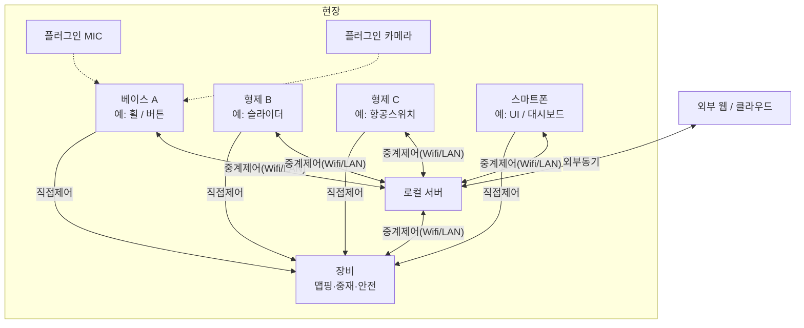
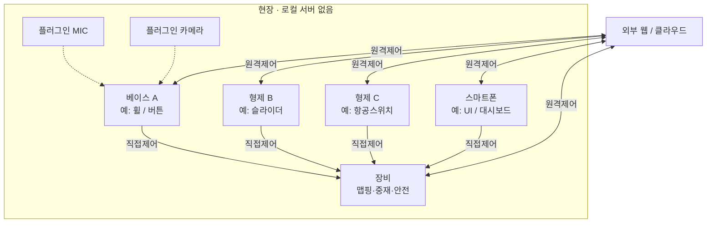

# 모듈형 오픈 하이브리드 컨트롤러 (Modular Open Controller)

AS5600 자기 휠 **베이스 컨트롤러**를 중심으로, 필요 시 **형제 컨트롤러**(스마트폰·장비 특화 조작 블록 등) 를 조합하고, **표준 제어 패킷**으로 장비를 다루는 모듈형 컨트롤러 플랫폼.

---

## 0. 시스템 전제 (합의 요약)

### 0.1 용어

| 용어                                       | 정의                                                                                                                                              |
| :----------------------------------------- | :------------------------------------------------------------------------------------------------------------------------------------------------ |
| **컨트롤러 블록**                          | **조작·제어 입력**을 만들어 표준 패킷으로 보내는 단위. 센서 텔레메트리 노드가 아님.                                                               |
| **베이스 컨트롤러**                        | 기본형. AS5600 휠·버튼 등 범용 조작 코어.                                                                                                         |
| **형제 컨트롤러**                          | 베이스와 같은 패밀리의 **다른 형태 컨트롤러**. 베이스가 소화하기 힘든 **장비 특화 조작**, 또는 **스마트폰 (대시보드 + 소프트웨어 컨트롤 UI)** 등. |
| **장비 (Equipment)**                       | 기능이 있는 대상. 열융착기, 양봉카, PC(수신기) 등.                                                                                                |
| **거치 (Mount)**                           | 테이블·암·벽면 등 기구. 제어 논리와 분리.                                                                                                         |
| **표준 패킷**                              | **컨트롤러 (베이스·형제) 의 조작·입력** 스냅샷/이벤트. 의미 해석은 장비가 수행.                                                                   |
| **플러그인 (Plugin)**                      | 베이스에 **유·무선으로 꽂는 입력/기능 확장**. **형제 컨트롤러가 아님** (조작 UI·독립 제어 주체 없음). 예: 음성용 추가 마이크 모듈 (§7.8).         |
| **로컬 서버**                              | 외부 웹 플랫폼의 **현장 형제**. 컨트롤러·장비가 붙는 허브. 외부는 로컬 경유만 (§0.2.1).                                                           |
| **액세서리**                               | 전원 팩·RF 중계 등 **조작·음성 입력과 무관한** 보조.                                                                                              |
| **(이 문서 밖)** 장비·외부 센서 텔레메트리 | 온습도·하중 등 → **장비 또는 센서 → 플랫폼 웹서버**. 컨트롤러 패킷이 아님. 폰 대시보드에서 **조회만** 가능.                                       |

### 0.1.1 형제 / 플러그인 / 액세서리 구분

| 분류              | 예시                                                                  | 이유                                                   |
| :---------------- | :-------------------------------------------------------------------- | :----------------------------------------------------- |
| **형제 컨트롤러** | 베이스, **슬라이더형 B**, **스위치형 C**, 스마트폰, 조그·특화 블록 등 | 각각 **자체적으로 제어 가능**. 폼팩터·입력 수단만 다름 |
| **플러그인**      | 유선 미니 마이크 (`VOICE_EXT_MIC`)                                    | 음성 채널 확장. 자체 컨트롤 UI 없음                    |
| **액세서리**      | 배터리 팩, 순수 RF 허브                                               | 전원/링크 보조만                                       |
| **문서 밖**       | 장비·필드 공정 센서                                                   | 텔레메트리 → 서버                                      |

**동일 액추에이터 · 다형 제어:** 휠 (A)·슬라이더 (B)·스위치 (C) 가 **같은 장비 액추에이터**를 다른 입력 형태로 건드릴 수 있다. 패킷은 표준 입력이고, **충돌 시 우선순위는 장비가 선택**.

### 0.2 역할 분담

```text
[외부 웹 / 클라우드 플랫폼]  ←—— 오직 로컬 서버 경유 ——→  [로컬 서버]
         (원격·전사 동기)         (현장 플랫폼 형제)            │
                                                         ┌─────┴─────┐
                                                         ▼           ▼
                                                   [장비…]    [컨트롤러 패밀리]
                                                         │           │
                                                         └── 직결(저지연) ─┘
```

| 주체                     | 역할                                                                                                                  |
| :----------------------- | :-------------------------------------------------------------------------------------------------------------------- |
| **외부 웹 플랫폼**       | 전사·원격·클라우드. **로컬 서버가 있으면 장비/컨트롤러에 직접 붙지 않고 로컬 서버만** 상대.                           |
| **로컬 서버**            | 외부 플랫폼의 **현장 형제**. 컨트롤러·장비가 붙는 **현장 허브**. 중계·프로필 캐시·로컬 대시보드. 개발 PC 로 시작 가능. |
| **베이스·형제 컨트롤러** | 표준 입력 패킷. **장비 직결** 및/또는 **로컬 서버** 연결.                                                             |
| **장비**                 | 해석·구동·충돌 중재. **로컬 서버** 연결 (목표). 텔레메트리 보고.                                                      |
| **스마트폰**             | 형제. 로컬 직결 + 로컬 서버 (·원격은 외부→로컬 경유).                                                                  |

### 0.2.1 플랫폼 = 외부 웹 + 로컬 서버 (형제)

로컬 서버는 컨트롤러 형제가 아니라 **플랫폼 서버의 현장형 형제**다.

| 규칙                  | 내용                                                                                                   |
| :-------------------- | :----------------------------------------------------------------------------------------------------- |
| **로컬 서버 있음**    | 컨트롤러·장비 → **로컬 서버**. 외부 웹 → **로컬만** (§0.2.3 경우 1).                                   |
| **외부 단절**         | 로컬 서버만으로 현장 IoT·중계·대시보드 유지 가능.                                                      |
| **로컬 서버 없음**    | 컨트롤러·장비 → **외부 웹 직접** + **장비 직결** (§0.2.3 경우 2). 가능하면 로컬 도입 후 경우 1 로 전환. |
| **형제 컨트롤러 P2P** | **보류** (§0.2.4). 허브는 로컬 서버 (또는 경우 2 에서는 외부 웹).                                       |

**연결 자동 감지:** 컨트롤러·장비 소프트웨어가 기동·주기적으로 **로컬 서버 유무**와 **원격 (외부) 서버 연결 가능 여부**를 검사해, 경우 1 / 경우 2 / 직접제어만 경로를 자동 선택·전환하고 현재 모드를 표시한다.

### 0.2.2 제어·연결 경로

| 상황                      | 경로                                                               |
| :------------------------ | :----------------------------------------------------------------- |
| 현장 저지연               | 컨트롤러 → **장비 직결**                                           |
| 현장 IoT·중계·폰 대시보드 | 컨트롤러/장비 → **로컬 서버**                                      |
| 원격·전사                 | 원격 클라이언트 → **외부 웹** → **로컬 서버** → 장비/컨트롤러 중계 |
| 외부만 있고 로컬 없음     | 비권장. 가능하면 로컬을 먼저 둔다 (개발 PC 라도).                   |

원격도 오픈 컨트롤러 입력 모델을 유지:
원격 UI/물리 형제 → (외부) → 로컬 서버 → 장비로 **표준 패킷 중계**.

충돌 시 장비 우선순위 예:
`안전정지 > 로컬 수동 직결 > 로컬 서버 중계 수동 > 외부 경유 원격 > 서버 자동`

### 0.2.3 시스템 연결 다이어그램

#### 경우 1 — 로컬 서버 **있음** (권장)

외부 웹은 로컬만 상대. 컨트롤러·장비는 로컬 서버 + 장비 직결.



#### 경우 2 — 로컬 서버 **없음**

컨트롤러·장비가 **외부 웹과 원격제어** 연결. 장비와의 직접제어는 그대로.



|               | 로컬 있음 (경우 1)                 | 로컬 없음 (경우 2)              |
| :------------ | :--------------------------------- | :------------------------------ |
| 외부 웹       | **로컬 서버만** 상대 (`외부동기`)  | 컨트롤러·장비와 **원격제어**    |
| 현장 허브     | 로컬 서버 · **중계제어 (Wifi/LAN)** | 없음 (원격제어 또는 직접제어만) |
| 장비 직접제어 | 있음 (저지연)                      | 있음 (1 차 생존)                 |
| 형제 P2P      | 보류                               | 보류                            |

권장은 **경우 1**. 경우 2 는 부트스트랩·야전·로컬 미배치 시. 로컬이 생기면 외부 직결은 끊고 경우 1 로 전환.

### 0.2.4 형제 컨트롤러 간 통신 (P2P) — **보류**

**채택하지 않음 (보류).** 복잡도 대비 이득이 작고, 허브는 **로컬 서버**가 담당한다.

- 서버 (로컬) down 이어도 **장비 직결**로 제어 가능.
- 폰↔베이스 상태 공유 등은 향후 **로컬 서버 경유**로 풀거나, 그때만 제한적 P2P 를 재검토.

### 0.3 변신의 위치

컨트롤러는 **항상 같은 표준 패킷**을 보낸다.
장비가 패킷을 자기 동작으로 맵핑하고, 이전 셋팅은 **(외부→) 로컬 서버 → 장비**로 로드한다.
동일 컨트롤러라도 연결된 장비·프로필에 따라 **장비 측에서 “변신”**한다.

### 0.4 조향 코어

- **채택:** AS5600 비접촉 자기 휠.
- **폐기:** 초기 로터리 인코더 (기계식) 중심 설계.

### 0.5 출시 로드맵

| 단계          | 범위                                                           |
| :------------ | :------------------------------------------------------------- |
| **1 차**      | 베이스 블록 + **열융착기** (유·무선 도킹)                      |
| **2 차**      | 스마트폰 형제 컨트롤러 (대시보드·소프트웨어 UI·페어링)         |
| **3 차**      | **로컬 서버** (개발 PC) → 이후 외부 웹은 로컬 서버 경유        |
| **확장 검증** | PC USB 수신기 + 무선 → **마우스·매크로 키보드 대체 가능 여부** |

### 0.5.1 상기 — 1 차 성공 정의 (이 문장만 증명하면 됨)

> **보안 있는 베이스 컨트롤러 ↔ 열융착기** 로, 조향·시작/정지·비상 (장비 E-Stop 분계) 이 된다.

- 증명 단위는 **만능 리모컨·전 장비·폰·서버·터치휠이 아님**.
- 공통은 **프로토콜**. 전 장비 유·무선 동시 완비는 1 차 필수 아님.
- 1 차 Arm 은 **장비/유선 확정**만으로도 가능해야 함 (폰 없이도).
- PC 마우스 대체·다장비 브로드캐스트·회전체 터치는 **나중 검증/옵션**.
- 컨트롤러만 완성하고 열융착기 **수신·맵핑·Arm**을 미루면 1 차 실패로 본다.

### 0.6 대수·협력

- **기본:** 컨트롤러 1 대 ↔ 장비 1 대 (대상 지정).
- **최종:** 한계 이상 장비에 연결·협력. 전송은 브로드캐스트 가능, **해석·반응 여부는 각 장비**.

---

## 1. 통신·주소 지정 (유니캐스트 기본)

### 1.1 후자 (장비 대상 지정) — 가능하며 **기본으로 채택**

무선 물리 계층이 브로드캐스트여도, **패킷 헤더의 목적지 필드로 필터**하면 된다.

| 모드                    | `dest_id`                  | 용도                                                 |
| :---------------------- | :------------------------- | :--------------------------------------------------- |
| **유니캐스트 (기본)**   | 특정 `equipment_id`        | 페어링된 장비만 반응. 다른 장비는 수신해도 **무시**. |
| **브로드캐스트 (옵션)** | `0xFFFFFFFF` (또는 예약값) | 다수 장비 협력·발견. 장비 정책이 허용할 때만 반응.   |
| **멀티캐스트 (확장)**   | 그룹 ID                    | 협력 그룹만 반응 (후순위).                           |

**페어링 흐름 (권장):**

1. 스마트폰이 컨트롤러·장비를 각각 (또는 함께) 연결.
2. 장비에 `allowed_controller_id` 등록, 컨트롤러에 `active_dest_id` 설정.
3. 이후 컨트롤러는 **유니캐스트**로 표준 패킷 송신.
4. 장비는 `dest_id == me` (또는 허용 브로드캐스트) 이고 `controller_id` 허용일 때만 적용.

유선 도킹 시에도 동일 프레임을 쓰되, 물리적으로 1:1 이면 `dest_id` 는 고정·생략 가능 (링크 로컬).

### 1.2 링크 종류 (컨트롤러·장비)

| 구간                        | 예시 링크                                |
| :-------------------------- | :--------------------------------------- |
| 베이스 ↔ 스마트폰 (형제)    | USB-C (기본)                             |
| 베이스 ↔ 특화 형제 컨트롤러 | CAN, I2C, 포고 도킹, 무선 등             |
| 컨트롤러 패밀리 ↔ 장비      | **유선 도킹 + 무선** (장비별 단계적)     |
| PC 장비                     | PC USB **수신기 (동글)** ← 컨트롤러 무선 |

페이로드는 **제어 입력**으로 통일. 장비/외부 센서 텔레메트리는 이 링크의 책임이 아님.

### 1.3 전송 주기 정책 — **하트비트 기본 + 이벤트 시 전송**

| 종류          | 조건                     | 내용                                  |
| :------------ | :----------------------- | :------------------------------------ |
| **하트비트**  | 주기적 (권장 1~5 Hz)     | 생존·`seq`·배터리·주요 축 요약·페어링 |
| **이벤트**    | 조작 유의미 변화 시      | 버튼, 휠 Δ, 터치, 형제 착탈, ESTOP 등 |
| **풀 스냅샷** | 페어링 직후·복구·요청 시 | 코어 (+ 형제 합류 입력) 1 회          |

휠 등 연속값은 **데드존·Δ임계**를 넘을 때만 이벤트로 보낸다.
장비가 더 높은 샘플이 필요하면 장비 측에서 `REQUEST_STREAM` 으로 임시 승격 (옵션).

---

## 2. 표준 패킷 v0.1

정의: **컨트롤러 (베이스·형제) 의 조작·제어 입력**.
장비 구동 명령·G-code·PID·**장비/외부 센서 텔레메트리**는 넣지 않는다.

```text
[헤더] + [코어/형제 제어 입력] + [이벤트] + [CRC]
```

### 2.0 컨트롤러가 보내는 데이터 종류 (타입 카탈로그)

`msg_type`(전송 형태) 과 `data_type`(제어 내용) 을 구분한다.
**온습도·하중·거리 등 공정 센서 값은 이 목록에 없다** → 장비/센서 → 플랫폼 서버 (폰은 대시보드로 조회 가능).

#### A. 전송 형태 (`msg_type`)

| 코드   | 이름        | 설명                       |
| :----- | :---------- | :------------------------- |
| `0x01` | `HEARTBEAT` | 주기 생존·요약             |
| `0x02` | `EVENT`     | 조작·착탈·장애 등 단발     |
| `0x03` | `SNAPSHOT`  | 제어 입력 전체 1 회        |
| `0x04` | `STREAM`    | (옵션) 장비 요청 시 고주기 |

#### B. 코어 데이터 타입 — 베이스 (`data_type`)

| type   | 이름                | 페이로드 요지                  | v1   |
| :----- | :------------------ | :----------------------------- | :--- |
| `0x20` | `WHEEL_ABS`         | 절대각 `raw` / `deg`           | 필수 |
| `0x21` | `WHEEL_DELTA`       | 상대 Δ                         | 필수 |
| `0x22` | `BTN_WHEEL`         | 휠 4 키 + 전면타격             | 필수 |
| `0x23` | `BTN_OUTER`         | 외곽 유틸 키                   | 필수 |
| `0x24` | `SW_SIDE`           | Mode 등 사이드                 | 필수 |
| `0x25` | `CLICK_GESTURE`     | 멀티·롱·콤보 ID                | 권장 |
| `0x26` | `TOUCH_XY`          | 터치 X,Y·active                | 옵션 |
| `0x27` | `TOUCH_SCROLL`      | 스크롤 벡터                    | 옵션 |
| `0x28` | `IMU_ATTITUDE`      | roll / pitch / (yaw)           | 옵션 |
| `0x29` | `IMU_RAW`           | accel / gyro / mag             | 옵션 |
| `0x2A` | `POWER`             | `batt_pct`, charging           | 필수 |
| `0x2B` | `VOICE_KEYWORD`     | 키워드 ID (`LISTEN_ON` 일 때만) | 옵션 |
| `0x2E` | `MIC_LISTEN`        | 청취 ON/OFF·사유 (§7.7)        | 옵션 |
| `0x2C` | `CONTROLLER_STATUS` | fault, link_q, arm 요청 힌트   | 필수 |
| `0x2D` | `CAPABILITY`        | 장착 입력·형제 컨트롤러 비트맵 | 권장 |

#### C. 형제 컨트롤러 합류 타입 (`data_type`) — 제어 입력만

베이스가 아닌 **다른 형태 컨트롤러**가 같은 표준으로 싣는 값. 공정 센서 아님.

| type   | 이름             | 출처 예        | 페이로드 요지                                                 |
| :----- | :--------------- | :------------- | :------------------------------------------------------------ |
| `0x30` | `SIBLING_META`   | 모든 형제      | `sibling_id`, 역할 (phone/specialized), FW                    |
| `0x31` | `UI_AXIS`        | 폰·특화 UI     | 소프트웨어 축/슬라이더 값 (0~1 또는 int)                      |
| `0x32` | `UI_BUTTON`      | 폰·특화 UI     | 가상 버튼·토글 비트                                           |
| `0x33` | `UI_COMMAND`     | 폰             | 사용자 의도 명령 ID (시작/일시정지 요청 등 — **확정은 장비**) |
| `0x34` | `SPECIAL_JOG`    | 장비 특화 블록 | 조그·전용 엔코더 Δ                                            |
| `0x35` | `SPECIAL_KEYPAD` | 장비 특화 블록 | 전용 키 매트릭스                                              |
| `0x36` | `SPECIAL_ANALOG` | 장비 특화 블록 | 전용 아날로그 레버 등                                         |
| `0x3F` | `SIBLING_VENDOR` | 형제 커스텀    | 벤더 확장 (여전히 **조작** 의미)                              |

#### D. 이벤트 코드 (`event_id`)

| event_id | 이름             | 의미                                         |
| :------- | :--------------- | :------------------------------------------- |
| `0x01`   | `ESTOP_REQUEST`  | 소프트 비상 요청                             |
| `0x02`   | `PAIR_BEACON`    | 페어링 광고                                  |
| `0x03`   | `SIBLING_ATTACH` | 형제 컨트롤러 연결                           |
| `0x04`   | `SIBLING_DETACH` | 형제 컨트롤러 분리                           |
| `0x05`   | `FAULT`          | 컨트롤러 장애                                |
| `0x06`   | `ARM_REQUEST`    | 무장 요청 (확정은 장비)                      |
| `0x07`   | `DISARM_REQUEST` | 해제 요청                                    |
| `0x08`   | `DEST_CHANGED`   | 활성 `dest_id` 변경                          |
| `0x09`   | `MODE_CHANGED`   | 절대/상대·Mode 변경                          |
| `0x0A`   | `LOW_BATTERY`    | 저전력                                       |
| `0x0B`   | `SESSION_REVOKE` | 세션 폐기                                    |
| `0x0C`   | `GESTURE_FIRE`   | 제스처/콤보 (`0x25`)                         |
| `0x0D`   | `VOICE_ON`       | 마이크 청취 활성 (button / wake)             |
| `0x0E`   | `VOICE_OFF`      | 비활성 (button / post_cmd / timeout / noise) |

> 같은 `WHEEL_DELTA` / `UI_AXIS` 라도 장비 맵핑에 따라 조향·마우스·온도 오프셋 등으로 달라진다.

#### E. 이 문서에서 제외하는 데이터

| 제외                                          | 어디로                                                    |
| :-------------------------------------------- | :-------------------------------------------------------- |
| 온도·습도·거리·하중·공압·유량·RPM·전류·GPS 등 | **장비 / 외부 센서 → 플랫폼 웹서버**                      |
| 서버→장비 원격 운전 명령                      | 장비↔서버 채널                                            |
| 폰 대시보드의 텔레메트리 표시                 | 서버/장비 API 를 **조회**할 뿐, 컨트롤러 표준 패킷이 아님 |

### 2.1 헤더

| 필드            | 설명                                                   |
| :-------------- | :----------------------------------------------------- |
| `protocol_ver`  | 스키마 버전                                            |
| `controller_id` | 베이스 고유 ID                                         |
| `dest_id`       | 대상 장비 ID. 브로드캐스트=예약값                      |
| `seq`           | 증가 시퀀스                                            |
| `ts_ms`         | 상대 타임스탬프                                        |
| `msg_type`      | §2.0-A (`HEARTBEAT` / `EVENT` / `SNAPSHOT` / `STREAM`) |
| `link`          | USB / CAN / ESPNOW / … (디버그)                        |
| `flags`         | paired, low_batt, fault 등                             |
| `session_id`    | (옵션) 폰 페어링 세션                                  |

### 2.2 코어 입력 (베이스 v1) — §2.0-B 요약

| 그룹        | 대응 type     | 필드 예                                 |
| :---------- | :------------ | :-------------------------------------- |
| 휠          | `0x20` `0x21` | `wheel_raw`, `wheel_deg`, `wheel_delta` |
| 휠 버튼     | `0x22`        | `btn_wheel`                             |
| 외곽/사이드 | `0x23` `0x24` | `btn_outer`, `sw_mode`                  |
| 마이크      | `0x2B` `0x2E` | keyword, `mic_listen` (§7.7)            |
| 제스처      | `0x25`        | multi/long/combo                        |
| 터치 (옵션) | `0x26` `0x27` | touch / scroll                          |
| IMU(옵션)   | `0x28` `0x29` | attitude / raw                          |
| 전원·상태   | `0x2A` `0x2C` | batt, fault                             |
| 음성 (옵션) | `0x2B`        | keyword_id                              |

### 2.3 형제 컨트롤러 합류 — §2.0-C

특화 블록·스마트폰 UI 입력이 표준 패킷에 **제어 타입 (`0x30`~)** 으로 합류.
TLV 를 쓰더라도 `type` 은 **조작 계열만** (센서 TEMP 등 금지).

| 필드         | 설명                   |
| :----------- | :--------------------- |
| `sibling_id` | 형제 컨트롤러 인스턴스 |
| `data_type`  | §2.0-C                 |
| `status`     | ok / stale / fault     |
| `payload`    | UI 축·키·조그 등       |

### 2.4 이벤트 — §2.0-D

### 2.5 넣지 않는 것

- 장비 액추에이터 최종 명령, G-code, 서버 권위 PID/셋포인트
- 장비·외부 센서 텔레메트리 (서버 채널) — §2.0-E
- 컨트롤러가 장비 프로필로 의미를 내부 스위칭한 결과 → 맵핑은 **장비** 책임

---

## 3. 형제 컨트롤러·거치

### 3.1 레고식 형제 컨트롤러

베이스가 커버하지 못하는 **조작 형태**를 형제로 붙인다. 버스·도킹으로 ID 스캔·핫플러그.

| 형제 예             | 역할                                                        |
| :------------------ | :---------------------------------------------------------- |
| 베이스 (A)          | AS5600 휠·버튼 — 범용 코어. **자체 컨트롤러**               |
| 슬라이더형 (B)      | 물리 슬라이더로 특정 액추에이터 축 입력 — **자체 컨트롤러** |
| 스위치형 (C)        | 물리 스위치·키 매트릭스 — **자체 컨트롤러**                 |
| 스마트폰            | 대시보드 + 소프트웨어 컨트롤 UI (`UI_*`)                    |
| (향후) 조그·발판 등 | 동일 표준 패킷의 다른 폼팩터                                |

A/B/C 는 등급이 아니라 **형태만 다름**. 같은 액추에이터를 동시에 건드리면 **장비가 우선순위·합성·거절**을 결정.
전원 팩·RF 허브·마이크 플러그인은 형제 아님.

### 3.2 거치

- 테이블, 3 단 암, 벽/자석·클립 등 — **제어와 무관**
- 동일 베이스 (및 형제) 를 거치만 바꿔 사용

### 3.3 스마트폰 (형제 컨트롤러)

| 상태    | 동작                                                                          |
| :------ | :---------------------------------------------------------------------------- |
| 폰 연결 | 소프트웨어 컨트롤 + 대시보드 (컨트롤러 상태; 텔레메트리는 서버 조회) + 페어링 |
| 폰 없음 | **베이스만**으로 제어 (1 차 포함)                                             |

---

## 4. 전원

- 베이스: **자체 배터리** + **기본 무선충전**
- 장비 도킹·전원 액세서리로부터 **전력 보조** 가능 (형제 컨트롤러 요건 아님)
- 회전체 서브 MCU 시: 소형 Li-Po + 유도충전 (AS5600 간섭 검증)

---

## 5. 안전 (E-Stop)

- **원칙:** 장비 측 하드웨어 E-Stop 이 주도 (대부분 장비).
- **컨트롤러:** `ESTOP_REQUEST` 등 소프트 요청 가능.
- **E-Stop 없는 장비:** 장비 프로필에 soft-stop 정책 명시. 산업 안전이 필요한 장비는 하드웨어 E-Stop 권장.

서버 명령과 컨트롤러 입력이 겹치면 **장비가 우선순위 정책**으로 결정
(권장 예: 안전정지 > 수동 컨트롤러 > 서버 자동 — 장비마다 재정의 가능).

---

## 6. 부팅·페어링 시퀀스 (장비 기준)

1. **장비 부팅** (서버 연결은 장비 정책에 따름).
2. **스마트폰 (또는 수동) 으로 컨트롤러↔장비 페어링** → `active_dest_id` / `allowed_controller_id`.
3. 컨트롤러 **SNAPSHOT** 1 회 + 이후 **HEARTBEAT + EVENT**.
4. 장비는 표준 패킷을 해석해 구동. 셋팅·이력은 서버에서 장비로 로드.
5. 유선 도킹 시에도 동일. 무선만으로도 동일 프로토콜.

PC 검증: PC USB 수신기가 “장비” 역할을 하며 HID/매크로로 맵핑.

---

## 7. 베이스 하드웨어 (AS5600 휠)

포켓형 러기드 마스터 베이스. 60×60mm 급 사각 바디 + 50mm 휠 방향.

### 7.1 구성 요약

- AS5600 + 대형 베어링 + 댐퍼 그리스 (무접점 연속 회전감)
- 휠 내부/사방 택트 + 외곽 기능 키 + **사이드 Mode 유지**
- **마이크 전용 택트** — INMP441 옵션 시 필수 (§7.7). PTT UX 상 물리 키 유지
- (옵션) TM040040 터치, ICM-20948 IMU, INMP441 — IMU 는 **보조** (사이드 키 대체 아님)
- **방진·방수:** 사이드/마이크 택트 제거로 IP 를 올리지 않고, **실리콘·멤브레인 실링으로 키를 유지한 채** 목표 IP 확보 (§7.4.1)
- 표시: FND 또는 LED · 음성 ON 시 LED 점등 권장
- 자석·벨트 클립 등 현장 거치

### 7.2 휠 제어 변수

| 분류     | 변수명                        | 권장 기본값 | 단위 | 설명                               |
| :------- | :---------------------------- | :---------- | :--- | :--------------------------------- |
| 모드     | `CONTROL_MODE_FLAG`           | RELATIVE    | Enum | ABSOLUTE / RELATIVE                |
| 스케일   | `SENSITIVITY_MAPPING_RATIO`   | 1.0         | 계수 | Δraw → 오프셋 배율                 |
| 시간     | `CLICK_LOCK_WINDOW_MS`        | 30          | ms   | 클릭 시 회전 락                    |
| 시간     | `AUTO_ZERO_DELAY_MS`          | 400         | ms   | 상대각 자동 제로                   |
| 공차     | `AS5600_DEADZONE_RAW`         | 12          | LSB  | 불감대                             |
| 공차     | `ALL_CLICK_TRIGGER_WINDOW_MS` | 15          | ms   | 4 키 동시 → ESTOP_REQUEST (소프트) |
| 이벤트   | `WHEEL_DELTA_EVENT_THRESHOLD` | (튜닝)      | LSB  | 이 이상 Δ만 EVENT 전송             |
| 하트비트 | `HEARTBEAT_HZ`                | 1~5         | Hz   | 생존 주기                          |

### 7.3 고급 클릭 (임베디드)

| 변수                       | 기본값 | 설명                    |
| :------------------------- | :----- | :---------------------- |
| `MULTI_CLICK_WINDOW_MS`    | 250    | 더블/트리플             |
| `COMBO_SEQUENCE_WINDOW_MS` | 500    | 순차 콤보               |
| `LONG_PRESS_TIER1_MS`      | 500    | 1 단계 롱               |
| `LONG_PRESS_TIER2_MS`      | 1500   | 2 단계                  |
| `LONG_PRESS_TIER3_MS`      | 3000   | 3 단계 (중대 명령 후보) |

위험 명령 (셧다운 등) 은 장비·서버 정책과 맞추고, 가능하면 장비 하드웨어 인터록과 병행.

### 7.4 기능 분담 예 (8 키 + 사이드 + 마이크 택트)

- **휠 내부 4:** 런타임 개입 (조향·압착 등 — 실제 의미는 장비 맵핑)
- **외곽 4:** 시작/일시정지, 마크, 절대/상대 모드 등 유틸
- **사이드:** Mode(휠 부가 기능 전환) — **유지**
- **마이크 전용 택트 (`BTN_MIC`):** 클릭 / 더블클릭 / 롱클릭 (PTT) (§7.7) — **유지**

핀 증가 시 MCP23017 등 IO 확장 또는 비트마스크 콤보 엔진.

### 7.4.1 설계 결정 — 사이드·마이크 키 유지 + 실리콘 실링

무버튼 (IMU 제스처만) 은 방진·방수 기구는 단순해지나, **PTT·Mode·장갑·진동 오탐**에서 UX·안전이 불리하다.

| 방안 | 판정 |
| :--- | :--- |
| 사이드/마이크 키 제거 + IMU 만 | IP 에는 유리, **전체 UX 비권장** |
| **키 유지 + 실리콘/멤브레인 오버몰드·가스켓** | **채택** — 딸깍 피드백·PTT 유지, 목표 IP 는 실링으로 충족 |

ICM-20948 제스처 (뒤집기·탭 등) 는 **보조 입력·잠금·슬립** 등에 쓸 수 있으나, 사이드/마이크 물리 키를 **대체하지 않는다**.

### 7.5 IMU (옵션 · 보조 · 제한적 직접)

ICM-20948 등. 중력 Roll/Pitch, 칼만 퓨전, (선택) 탭·자세 제스처.
손목 기울임 조향·도킹 수평 경고 등은 **장비 맵핑**에 따름.
**사이드 Mode / 마이크 `BTN_MIC` 를 대체하지 않는다** (§7.4.1). 제스처는 **보조**이거나, 아래처럼 **충돌 없이 제한된 직접 제어**만 허용한다.

#### 호주머니 전제 — 오탐 방지 게이트

걷거나 앉을 때 흔들림·톡이 많아, **주머니 안에서는 제스처를 거의 죽인다.**

| 게이트 | 조건 | 동작 |
| :--- | :--- | :--- |
| `POSE_POCKET` | 대략 수직·암흑 (조도 옵션)·저진폭 보행 패턴 | **제스처 입력 무시** (조향 IMU 도 잠금 권장) |
| `POSE_IN_HAND` | 가로/기울기 안정 + (옵션) 그립·비보행 | 제스처 **허용 창** 개방 |
| `POSE_DOCKED` | 자석 도킹·거치 | 탭 무시, 자세는 수평 경고만 |
| 콤보 필수 | 중요 동작은 **자세 확정 후 N 초 안에 탭** | 단일 흔들림만으로 실행 금지 |

주머니 → 손: `POSE_IN_HAND` 확정 후 **0.5~1 초 안정**해야 제스처 무장.
손 → 주머니: 즉시 `POSE_POCKET` → 모든 제스처 해제.

#### 제한적 예제 (충돌 최소화)

| 제스처 | 유형 | 하는 일 | 안 하는 일 |
| :--- | :--- | :--- | :--- |
| **뒤집기 (얼굴/휠 아래)** | 보조·직접 (안전) | 입력 잠금 / 소프트 슬립 진입 | Mode 전환·마이크 ON·조향 |
| **세운 뒤 1 초 유지** | 보조 | `POSE_IN_HAND` 확정, LED 로 “제스처 가능” | 그 자체로 장비 명령 없음 |
| **손 확정 후 톡 1 회** | 보조 | 사이드 Mode **미리보기/토글 제안** — 확정은 사이드 키 또는 짧은 재탭 | 주머니·도킹 중 무효 |
| **손 확정 후 톡톡** | 제한적 직접 | 화면/LED 밝기·햅틱만 등 **장비 비연동** 로컬 UI | 액추에이터·마이크 HOLD |
| **손에서 살짝 기울임** | 직접 (맵핑 시) | 조향 오프셋 — **오직 IN_HAND + Arm 후** | 주머니·DISARM 시 0 |
| **더블탭으로 마이크** | — | **예제에 넣지 않음** | `BTN_MIC` 와 충돌·PTT 불가 |
| **흔들기 전원 OFF** | — | **예제에 넣지 않음** | 보행 오탐 |

요약: 주머니 = **무제스처**. 손 = **잠금 (뒤집기)·Mode 보조 (톡)·조향 (기울임, Arm 후)**.
마이크·사이드 확정·전원·E-Stop 계열은 물리 키/장비.

#### 패킷 (개념)

| 필드/이벤트 | 예 |
| :--- | :--- |
| `IMU_POSE` | `pocket` / `in_hand` / `docked` |
| `IMU_GESTURE` | `flip_lock` / `tap_mode_hint` / … (화이트리스트만) |
| 조향 | 기존 `IMU_ATTITUDE` — `in_hand` 아니고 Arm 아니면 장비·컨트롤러가 폐기 |

### 7.6 TM040040 (옵션 · 회전체)

휠 무한 회전 시 슬립링 대신 **서브 ESP32 + ESP-NOW**로 터치·각도 선행 역산 후 메인에 전달하는 구조 가능.
무선충전↔AS5600 자기 간섭, 캡 두께 (정전식) 는 시제품 검증 항목.

```text
[휠 서브 ESP32]
1. TM040040 raw (X,Y)
2. AS5600 θ
3. 사각 프레임 상단 변 기준 2D 역회전
4. 결과 벡터만 메인으로 전송 → 표준 패킷 코어(`TOUCH_*`)에 합류
```

### 7.7 INMP441 음성 — 전용 택트 제스처 + 소프트웨어 (옵션)

물리 배치만으로는 현장 소음·오인식을 못 막는다. **기본은 비활성 (`LISTEN_OFF`)**.
**마이크 전용 택트 1 개**로 클릭 / 더블클릭 / 롱클릭을 구분해 청취 모드를 고른다.

#### 물리

| 항목   | 권장                                                        |
| :----- | :---------------------------------------------------------- |
| 위치   | 상단 LED 근처 핀홀, 입 (말) 방향·손잡이와 분리               |
| 실링   | 고어텍스 벤트 + 실리콘 가스켓, 본체 진동 플로팅             |
| 택트   | **`BTN_MIC` 전용 1 개** — 다른 기능과 겸용 금지, 리세스 권장 |
| 피드백 | 모드별 LED: 단발=단색, 절대=점멸, PTT=눌림 중만 점등        |
| HW cut | `LISTEN_OFF` 시 INMP441 I2S/전원 차단 권장                  |

#### 전용 택트 제스처 → 청취 모드

| 제스처                   | 모드             | 동작                                                                         |
| :----------------------- | :--------------- | :--------------------------------------------------------------------------- |
| **클릭 (싱글)**          | `LISTEN_ONESHOT` | 청취 ON. **명령 수락 직후 OFF**, 또는 **일정 시간 무음/무명령**이면 자동 OFF |
| **더블클릭**             | `LISTEN_HOLD`    | **절대 활성화** — 수동으로 끌 때까지 유지 (다시 클릭 또는 더블클릭으로 OFF)  |
| **롱클릭 (누르고 있기)** | `LISTEN_PTT`     | 워키토키식. **누르는 동안만 ON**, **손 떼는 즉시 OFF**                       |

```text
                    ┌─ 클릭 ──────► LISTEN_ONESHOT ──(명령|무음타임아웃)──► OFF
LISTEN_OFF ─ BTN_MIC┤─ 더블클릭 ──► LISTEN_HOLD ────(클릭/더블로 해제)───► OFF
                    └─ 롱클릭(홀드)► LISTEN_PTT ────(릴리즈 즉시)────────► OFF
```

| 상태             | 동작                                                         |
| :--------------- | :----------------------------------------------------------- |
| `LISTEN_OFF`     | 인식·(가능 시) 마이크 전원 OFF. `VOICE_KEYWORD` 미송신       |
| `LISTEN_ONESHOT` | 한 번 말하기용. 명령 후 또는 무음 타이머로 OFF               |
| `LISTEN_HOLD`    | 절대 (지속) 활성. LED 점멸로 “상시 청취” 경고                 |
| `LISTEN_PTT`     | 홀드 중만 활성. 릴리즈 = 즉시 OFF (가장 안전·소음 현장 권장) |

#### 싱글 클릭 (`ONESHOT`) 비활성 조건

| 조건                 | 설명                                                      |
| :------------------- | :-------------------------------------------------------- |
| 명령 수락 후         | 화이트리스트 키워드 수락·송신 직후 → `LISTEN_OFF`         |
| 무음/무명령 타임아웃 | `VOICE_SILENCE_TIMEOUT_MS` 동안 유효 음성·명령 없음 → OFF |
| (옵션) 소음 게이트   | 과대 소음이면 ON 유지 거부 또는 강제 OFF                  |

#### 절대 활성 (`HOLD`) 해제

- 다시 **클릭** 또는 **더블클릭** → `LISTEN_OFF` (문서 기본: 둘 다 허용, 펌웨어에서 하나로 고정 가능)
- 부팅·페어링·세션 revoke 시 무조건 `LISTEN_OFF` 로 리셋 (절대 활성이 잔존하지 않음)

#### 환경별 권장

| 환경        | 권장 제스처                               |
| :---------- | :---------------------------------------- |
| 조용함      | 클릭 (ONESHOT) 또는 더블클릭 (HOLD)         |
| 소음·열융착 | **롱클릭 PTT** 우선. HOLD 는 가능하면 지양 |
| 이동·한 손  | PTT (입에 대고 말하고 놓기)               |

#### 파라미터

| 변수                       | 권장 기본    | 설명                                              |
| :------------------------- | :----------- | :------------------------------------------------ |
| `VOICE_DEFAULT_STATE`      | `LISTEN_OFF` | 부팅·페어링 직후                                  |
| `MIC_MULTI_CLICK_MS`       | 250~300      | 더블클릭 판정 창 (기존 멀티클릭과 동일 계열)      |
| `MIC_LONG_PRESS_MS`        | 400~500      | 이 이상 홀드 = PTT 진입 (미만 릴리즈는 클릭 후보) |
| `VOICE_SILENCE_TIMEOUT_MS` | 3000~5000    | ONESHOT: 무음/무명령 자동 OFF                     |
| `VOICE_POST_CMD_MUTE`      | `true`       | ONESHOT: 명령 수락 후 즉시 OFF                    |
| `VOICE_CONFIDENCE_MIN`     | (튜닝)       | 미만 키워드 폐기                                  |
| `VOICE_NOISE_GATE_DB`      | (튜닝)       | 초과 시 ONESHOT/HOLD 제한, PTT 는 유지 가능        |
| `VOICE_KEYWORD_WHITELIST`  | 최소 집합    | Left/Right/Center 등                              |

#### 패킷·이벤트

| 항목                 | 내용                                                                                              |
| :------------------- | :------------------------------------------------------------------------------------------------ |
| `0x2B VOICE_KEYWORD` | 청취 ON 상태 + 화이트리스트·confidence 통과 시만                                                  |
| `0x2E MIC_LISTEN`    | `mode`(off/oneshot/hold/ptt) + ON/OFF 사유                                                        |
| 이벤트               | `VOICE_ON` / `VOICE_OFF` (oneshot / hold / ptt_press / ptt_release / post_cmd / silence / manual) |

#### 실효성 원칙 (상기)

1. **평소 OFF** — 상시 청취가 오인식의 주범.
2. **클릭 = 짧고 닫기**, **더블 = 절대 (지속)**, **롱 = 워키토키 (PTT)**.
3. 소음 현장은 **PTT 우선**.
4. HOLD 는 LED 로 “켜져 있음”을 분명히.
5. 음성은 **보조 입력**. 조향·비상은 휠/키/장비 E-Stop 이 주.
6. 추가 마이크는 **플러그인** (§7.8). 형제 컨트롤러로 취급하지 않음.

### 7.8 음성 마이크 플러그인 (`VOICE_EXT_MIC`) — 형제 아님

베이스 내장 INMP441 에 **유선 미니 마이크 모듈**을 플러그인으로 연결해 SNR·스테레오/어레이 이득을 얻는다.
조작 UI 가 없으므로 **형제 컨트롤러가 아니라 플러그인**이다. §7.7 택트 제스처 (ONESHOT/HOLD/PTT) 는 그대로 적용되고, 플러그인은 **어느 채널을 쓸지**만 확장한다.

#### 배치 시나리오

| 시나리오   | 베이스 마이크  | 플러그인 마이크 | 비고                 |
| :--------- | :------------- | :-------------- | :------------------- |
| 포켓 + 입  | 호주머니 (본체) | 입 주변 클립    | 실무 기본 후보       |
| 입만       | OFF            | 입 주변만 ON    | 소음 현장 SNR 최우선 |
| 둘 다 외부 | 고정/거치      | 고정/거치       | 방향 추정·스테레오용 |
| 베이스만   | ON             | 미연결          | 플러그인 없음        |

#### 채널 모드 (`VOICE_CH_MODE`)

| 모드         | 동작                          | 우선 사용             |
| :----------- | :---------------------------- | :-------------------- |
| `MOUTH_ONLY` | 플러그인만 인식 입력          | 소음·열융착           |
| `STEREO_BF`  | 두 채널 동기 — 빔/노이즈 참조 | 조용~중간, SNR 보너스 |
| `BASE_ONLY`  | 본체만                        | 플러그인 없음·폴백    |
| `DUAL_RAW`   | (디버그) 두 채널 원시         | 캘리브·실험           |

청취 ON/OFF·PTT 등은 §7.7. 채널 모드는 설정/프로파일에서 고른다.

#### 링크·동기

- **유선 기본** (동일 I2S 클럭 도메인 권장) — TDOA·스테레오에 필수에 가깝다.
- 플러그인 미검출·단선 → 자동 `BASE_ONLY` 폴백.
- 인식 결과만 `VOICE_KEYWORD` 로 송신. 오디오 스트림은 표준 제어 패킷에 넣지 않음.

#### 스테레오·어레이 이득 (목표)

- 입 근접 채널 우선 + 주머니 채널을 **노이즈 참조**로 쓰는 차감/빔이 실무적.
- “스튜디오 스테레오”가 아니라 **명령어 SNR·오인식 감소**가 목표.

#### 발원 방향 (좌표가 아님)

| 가능                                                | 비고                                                         |
| :-------------------------------------------------- | :----------------------------------------------------------- |
| **TDOA·레벨차로 대략 방향/구역** (좌·우, 작업자 쪽) | 마이크 2 개 → 보통 1 축 각도. 거울상 모호성                    |
| **cm 급 XYZ 좌표 추적**                              | **제품 목표로 비권장** (마이크 수·잔향·금속 환경). 연구/옵션 |

제품 문구는 **“방향/구역 추정”**. “좌표 추적”은 내부 실험 기능으로만.

#### 기하·캘리브레이션

유선이라 **두 마이크 간격·상대 자세가 가변** → 방향 추정·빔을 쓰려면 기하가 필요.

| 방식                           | 내용                                                                                                        |
| :----------------------------- | :---------------------------------------------------------------------------------------------------------- |
| **현장 캘리브 (프리 모드)**    | 알려진 발화/톤으로 지연차·레벨비 측정 → `baseline_mm`, 축·극성 저장                                         |
| **장비 고정 + DB (설치 모드)** | 장비 브래킷에 간격이 고정이면 `equipment_id → mic_geometry` 를 **서버/환경설정에서 로드** → **캘리브 생략** |
| **검증 (옵션)**                | 고정 모드도 가끔 짧은 검증 톤으로 DB 와 현실 불일치 경고                                                     |

```text
플러그인 연결
    ├─ geometry_source = FIXED_DB  → 서버/로컬 프로필에서 mic_geometry 로드 → 즉시 사용
    └─ geometry_source = FREE      → 1회 캘리브 마법사 → 베이스(+서버) 저장
```

`mic_geometry` 예: `baseline_mm`, `ch0_role`(base/mouth), `ch1_role`, `calib_ts`, `equipment_id`(고정 시).

#### 파라미터 (플러그인)

| 변수                    | 설명                                     |
| :---------------------- | :--------------------------------------- |
| `VOICE_CH_MODE`         | `MOUTH_ONLY` / `STEREO_BF` / `BASE_ONLY` |
| `VOICE_GEOMETRY_SOURCE` | `FIXED_DB` / `FREE`                      |
| `VOICE_BASELINE_MM`     | 캘리브 또는 DB 값                        |
| `VOICE_PLUGIN_PRESENT`  | 플러그인 검출 플래그                     |

#### 우선순위 (구현)

1. 유선 입주변 플러그인 + `MOUTH_ONLY` + §7.7 PTT
2. `STEREO_BF` 노이즈 참조
3. 장비 DB 고정 기하
4. TDOA 방향 추정 (옵션)
5. 3D 좌표 — 비목표

---

## 8. 액세서리 vs 플러그인

| 구분              | 정의                                     | 예                                 |
| :---------------- | :--------------------------------------- | :--------------------------------- |
| **플러그인**      | 베이스 **입력/기능 확장** (조작 UI 없음) | `VOICE_EXT_MIC` 유선 마이크 (§7.8) |
| **액세서리**      | 전원·링크 등 **비입력** 보조             | 배터리 팩, 순수 RF 중계            |
| **형제 컨트롤러** | 제어 입력 **주체**                       | 폰, 특화 키/조그 블록              |

장비/필드 공정 센서 텔레메트리는 **장비·서버 문서** 범위 (본 문서 제외).

---

## 9. BOM 요약 (v1 중심 · 옵션 구분)

### 9.1 전자

| 부품            | 권장                         | 수량 | 역할                        | 비고                  |
| :-------------- | :--------------------------- | ---: | :-------------------------- | :-------------------- |
| 메인 MCU        | ESP32-S3-WROOM-1 (8MB PSRAM) |    1 | 패킷·버스·링크              | v1 필수               |
| 서브 MCU        | ESP32-S3 Mini 등             |  0~1 | 회전체 터치                 | 옵션                  |
| 각도            | AS5600                       |    1 | 휠 절대각                   | v1 필수               |
| 터치            | Cirque TM040040              |  0~1 | 휠 표면                     | 옵션                  |
| IMU             | ICM-20948 (권장)             |  0~1 | 자세                        | 옵션 · MPU9250 비권장 |
| 마이크 (베이스) | INMP441                      |  0~1 | 본체 음성                   | 옵션                  |
| 마이크 플러그인 | INMP441 등 미니 모듈         |  0~1 | 유선 `VOICE_EXT_MIC` (§7.8) | 옵션 · 형제 아님      |

### 9.2 스위치·전원

| 부품             | 수량 | 비고                                              |
| :--------------- | ---: | :------------------------------------------------ |
| 휠 방향 택트     |  4~8 | 병렬 보강 시 8                                    |
| 외곽 택트        |    4 | 유틸                                              |
| 사이드 Mode 토글 |    1 | 휠 부가 모드                                      |
| 마이크 전용 택트 |  0~1 | `BTN_MIC` 클릭/더블/롱 PTT (§7.7, INMP441 시 필수) |
| LED/FND          | 1 식 | 상태                                              |
| Li-Po (베이스)   |    1 | 자체 전원                                         |
| 휠 Li-Po 300mAh  |  0~1 | 서브 MCU 시                                       |
| 무선충전 코일    | 1 식 | 베이스·(옵션) 휠                                  |

### 9.3 기구

베어링, 댐퍼 그리스, PTFE 외곽 절연 (터치 시), 자석·클립, 방수 벤트, ABS/PETG 하우징.

---

## 10. 단일 컨트롤러 전략 — 장단점과 의도

**의도:** 컨트롤러를 한 번 정확히 만들면, 장비마다 전용 조작반을 중복 개발·재고·유지보수하지 않는다. 표준 패킷 + 장비측 맵핑으로 확장한다.

| 장점                                   | 단점·리스크                                                  |
| :------------------------------------- | :----------------------------------------------------------- |
| 개발·금형·펌웨어·교육 비용 집중        | 만능 패킷/UX 가 장비별 최적감과 어긋날 수 있음               |
| 예비품·수리·숙련 이전 용이             | 무선 오페어링·스푸핑 시 **여러 장비 유형에 공통 공격면**     |
| 현장 장비 전환 속도                    | 한 컨트롤러 결함이 전 장비 운용에 영향 (단품 리스크)         |
| PC·열융착기 등으로 동일 입력 검증 가능 | “의도치 않은 장비 반응”은 프로토콜·정책으로 반드시 막아야 함 |

단점보다 **중복 투자 절감**이 목표면, 아래 **보안·바인딩**을 1 차부터 설계에 넣는 것이 전제 조건이다.

---

## 11. 보안·오제어 단속 (의도치 않은 장비 제어 방지)

위협을 두 갈래로 본다.

1. **오작동형:** 옆 장비·이전 페어링 잔존·브로드캐스트 오인으로 _내 컨트롤러가 남의 장비를_ 움직임.
2. **공격형:** 위조 컨트롤러·재전송 (replay)·패킷 위조로 _무단 제어_.

### 11.1 방어 계층 (권장 · 겹쳐 쓰기)

| 계층               | 조치                                                                            | 막는 것             |
| :----------------- | :------------------------------------------------------------------------------ | :------------------ |
| **L0 물리**        | 유선 도킹 시 링크 로컬만 수용, 무선 수신 アンテナ/감도 제한 (옵션)              | 원거리 무차별 수신  |
| **L1 주소**        | `dest_id` 유니캐스트 기본. 장비는 `dest≠me` 즉시 drop                           | 단순 혼선           |
| **L2 허용 목록**   | 장비에 `allowed_controller_id[]` (및 만료). 미등록 송신 무시                    | 남의 컨트롤러       |
| **L3 세션**        | 폰 페어링으로 `session_id` + 단기 `session_key` 발급. 하트비트에 세션 유효 표시 | 이전 페어링 잔존    |
| **L4 인증**        | 패킷 HMAC(또는 AES-CCM) — `controller_id‖dest_id‖seq‖payload`                   | 스푸핑·변조         |
| **L5 신선도**      | `seq` 단조 증가 + 창 (window) 밖·중복 drop. 선택: 타임스탬프                    | 재전송 (replay)     |
| **L6 모드 게이트** | 장비 `CONTROL_ARMED` 후에만 모션 반영. 기본은 Safe/Idle                         | 전원 인가 직후 폭주 |
| **L7 범위**        | 브로드캐스트는 **명시 opt-in** + 위험 액추에이터는 유니캐스트만                 | 다수 장비 오작동    |
| **L8 서버 감사**   | 페어링·무장·E-Stop 이벤트를 서버 로그 (3 차)                                    | 사후 추적           |

**1 차 (열융착기) 최소셋:** L1 + L2 + L5 + L6.
**무선 현장 전:** L3 + L4.
**다수 협력 전:** L7 필수.

### 11.2 페어링·무장 (Arm) 규칙

```text
[기본] 장비 = DISARMED (패킷 수신해도 구동 반영 안 함)
   │
   ├─ 스마트폰(또는 유선 확정 UI)으로 페어링
   │     · 장비 ↔ 컨트롤러 ID 상호 등록
   │     · session_key 교환 (가능하면 ECDH/사전공유키)
   │
   ├─ 작업자 확인 → CONTROL_ARMED
   │     · LED/FND·장비 측 표시로 “누가 조종 중” 명시
   │
   ├─ 하트비트 끊김 N초 → 자동 DISARM 또는 fail-safe
   │
   └─ 새 장비로 전환 시 이전 dest 세션 즉시 revoke
```

- **한 컨트롤러 → 활성 dest 1 개 (기본).** 브로드캐스트/멀티는 별도 “협력 모드” 진입 후에만.
- **한 장비 → 활성 컨트롤러 1 개 (기본).** 두 번째 페어링 시 기존 세션 강제 종료 또는 거부.
- 주머니·낙하시 오입력: 장비는 ARMED 여도 **데드맨/홀드 - 투 - 런**(필요 시) 또는 입력 유휴 시 감속.

### 11.3 무선 (ESP-NOW 등) 특별 주의

- ESP-NOW 는 편의성이 높고 **암호화·페어링을 직접 설계**해야 한다. “ID 만 맞으면 OK”는 부족.
- 공장에 동일 펌웨어 장비가 많으면, **장비별 고유 키**(서버·폰이 주입) 권장. 전 장비 공통 키는 유출 시 전면 노출.
- PC 동글도 동일 L2~L5 적용. HID 매핑 전에 **세션 무장** 없으면 마우스 이벤트 미생성.

### 11.4 유선 도킹

- 물리 1:1 이어도 프로토콜은 동일. 도킹 = 암시적 페어링으로 볼지, 그래도 폰 확인을 받을지 **장비 등급**으로 나눈다.
  - 저위험 (PC 수신기): 도킹/근접만으로 arm 가능 (정책).
  - 고위험 (열·모션): 도킹 + 명시 arm + (권장) 인증.

### 11.5 단속 실패 시 장비 측 최후 수단

- 하드웨어 E-Stop / 킬스위치 (장비 주도).
- 워치독: 유효 패킷 없으면 정지.
- 서버 원격 lock-out (3 차).

---

## 12. 구현 기술 체크리스트

심플 전제만으로는 구현이 막힌다. 아래는 **설계·시제품에서 반드시 확인할 항목**이다.
상태: `미착수` / `검증중` / `통과` / `보류(옵션)` 로 갱신한다.

### 12.1 프로토콜·소프트웨어

| ID  | 체크 항목                                    | 왜 중요한가                | 통과 기준 (예)                           |
| :-- | :------------------------------------------- | :------------------------- | :--------------------------------------- |
| P01 | 바이너리 프레임 레이아웃·엔디안·CRC 다항식   | 장비 간 상호운용           | 문서화된 struct + 테스트 벡터            |
| P02 | HEARTBEAT / EVENT / SNAPSHOT 상태머신        | 전력·혼선·복구             | 끊김 후 SNAPSHOT 재동기                  |
| P03 | `dest_id` 필터 + allowed_controller 테이블   | 오제어 1 차 방어           | 미허용 ID 0 건 구동                      |
| P04 | seq 창·replay 거부                           | 재전송 공격·중복 실행      | 동일 seq 재주입 무시                     |
| P05 | (무선 전) HMAC/AEAD + session_key            | 스푸핑                     | 키 없는 송신기 거부                      |
| P06 | CONTROL_ARMED / DISARM / 하트비트 타임아웃   | 폭주·잔존 세션             | N 초 무하트비트 → 정지                   |
| P07 | 휠 Δ임계·데드존·클릭락 필터                  | 오이벤트·클릭 시 각도 튀김 | 클릭 시 조향 스파이크 없음               |
| P08 | 멀티/롱클릭 타이머 (FreeRTOS)                | UX·오작동                  | 장갑 조작 시나리오 통과                  |
| P09 | 장비 맵핑 테이블 (열융착기)                  | “변신”의 실체              | 필드→축/히터 문서화                      |
| P10 | 서버↔장비 프로필·로컬/원격/서버자동 우선순위 | 이중·원격 명령             | 정책 매트릭스 명시                       |
| P11 | 폰·컨트롤러 서버 접속 + 원격 패킷 중계       | IoT 원격                   | 로컬 직결과 동일 표준 패킷으로 원격 조작 |
| P13 | 폰 형제 로컬 UI (USB CDC 등)                 | 2 차                        | 컨트롤 UI + 상태; 서버 없이도 로컬 가능  |
| P12 | WebSerial/WebUSB 한계 인지                   | iOS 등 미지원              | 지원 OS 매트릭스·폴백 (앱/중계)          |

### 12.2 RF·링크

| ID  | 체크 항목                                | 왜 중요한가    | 통과 기준 (예)                    |
| :-- | :--------------------------------------- | :------------- | :-------------------------------- |
| R01 | ESP-NOW(또는 선정 RF) p95 지연·패킷 손실 | 조향감         | 목표 지연·손실률 문서화           |
| R02 | 동일 채널 다수 컨트롤러 혼선             | 현장 밀집      | 2 대 이상 동시 무오작동           |
| R03 | 유선 CAN/USB 와 무선 페이로드 동일성     | 이중 구현 방지 | 동일 파서                         |
| R04 | PC USB 동글 수신·HID 매핑 PoC            | 확장 검증      | 마우스/매크로 대체 가능 여부 판정 |
| R05 | 브로드캐스트 opt-in 동작                 | 다수 협력      | 기본 off 에서 타 장비 무반응      |

### 12.3 전원·충전

| ID  | 체크 항목                            | 왜 중요한가    | 통과 기준 (예)           |
| :-- | :----------------------------------- | :------------- | :----------------------- |
| E01 | 베이스 배터리 런타임 (하트비트 모드) | UX             | 목표 시간 명시·실측      |
| E02 | 무선충전 중 AS5600 각도 오차         | 자기 간섭      | 충전 on/off 오차 한도 내 |
| E03 | 장비 도킹 전원 보조·역류 방지        | 안전           | 역주입·과전류 보호       |
| E04 | (옵션) 폰 USB-C 전력 역할 (PD/OTG)   | 기종 편차      | 지원 기기 표             |
| E05 | (옵션) 휠 300mAh + 슬립 듀티         | 과장 스펙 방지 | 실측 Wh·시간             |

### 12.4 기구·센서 하드웨어

| ID  | 체크 항목                                                    | 왜 중요한가    | 통과 기준 (예)                |
| :-- | :----------------------------------------------------------- | :------------- | :---------------------------- |
| H01 | AS5600 자석 정렬·에어갭                                      | 분해능·선형성  | 전 회전 구간 캘리브           |
| H02 | 베어링 + 댐퍼 손맛·낙하 충격                                 | 현장 내구      | 낙하/분진 시나리오            |
| H03 | 택트 디바운스·전면타격→ESTOP_REQUEST                         | 소프트 비상    | 오탐/미탐 기준                |
| H04 | (옵션) TM040040 + 캡 두께 0.5~1.0mm                          | 정전식 미감지  | 재질·두께 확정                |
| H05 | (옵션) 외곽 PTFE 마스킹 vs 클릭 간섭                         | 터치/클릭 충돌 | 가장자리 클릭 시 스크롤 없음  |
| H06 | (옵션) 듀얼 ESP 패키징·열·RF                                 | 50mm 휠 밀도   | 열폭주·끊김 없음              |
| H07 | (옵션) IMU 진동 (열풍기) vs 칼만                             | 기울임 조향    | 도킹/수조작 모드 분리         |
| H08 | IP/분진·마이크 벤트                                          | 야전           | 목표 IP 등급                  |
| H10 | 마이크 택트: 클릭=ONESHOT / 더블=HOLD / 롱=PTT               | 오인식·UX      | 세 제스처·해제 경로 통과      |
| H11 | `VOICE_EXT_MIC` 플러그인: MOUTH_ONLY / 동기 / 캘리브·DB 기하 | SNR·방향       | 단선 시 BASE_ONLY 폴백        |
| H09 | 자석 거치 vs IMU/AS5600                                      | 외부 자계      | 거치 상태 보정 또는 조향 잠금 |

### 12.5 안전·장비 연동

| ID  | 체크 항목                                      | 왜 중요한가 | 통과 기준 (예)         |
| :-- | :--------------------------------------------- | :---------- | :--------------------- |
| S01 | 장비 HW E-Stop 과 soft ESTOP_REQUEST 역할 분리 | 규격·실안전 | 문서화된 책임 분계     |
| S02 | DISARM·페어링 해제·장비 전환 revoke            | 오제어      | 전환 후 구 장비 무반응 |
| S03 | E-Stop 없는 장비 프로필                        | 예외 처리   | soft-stop 템플릿       |
| S04 | 열융착기 1 차 E2E (유선 + 무선)                | 마일스톤    | 조향·시작/정지·비상    |

### 12.6 구현 순서 제안

1. **유선 1:1** + 표준 패킷 + 열융착기 맵핑 (P01–P03, P07, P09, S04 유선)
2. **Arm/세션/seq** (P04, P06, S02)
3. **무선 + 동글/장비 수신** (R01–R04) + **HMAC** (P05)
4. 스마트폰 형제 컨트롤러 (컨트롤 UI·대시보드·페어링) (P11)
5. 옵션 하드웨어 (터치·IMU·서브 ESP) 는 H04–H07 통과 후 편입

---

## 13. 다음 작업

- [ ] §12 체크리스트 상태 컬럼을 프로젝트 보드와 동기
- [ ] 표준 패킷 바이너리 레이아웃·테스트 벡터 (P01)
- [ ] 열융착기 맵핑 테이블 (P09)
- [ ] 페어링·Arm UI 시퀀스 (P06, §11.2)
- [ ] 무선 전 HMAC/세션 키 방식 선정 (P05)
- [ ] PC USB 수신기 HID PoC (R04)
- [ ] AS5600 ↔ 무선충전 간섭 벤치 (E02)
- [ ] E-Stop 없는 장비용 soft-stop 템플릿 (S03)

---

## 부록 A. 이전 초안과의 차이 (의도적 변경)

| 이전                                             | 현재                                                                |
| :----------------------------------------------- | :------------------------------------------------------------------ |
| 컨트롤러가 장비 프로필로 입력 의미를 내부 스위칭 | **표준 패킷 고정**, 해석은 장비 + 서버                              |
| 로터리 인코더 중심                               | **AS5600 휠**                                                       |
| 상시 고속 스트림 암시                            | **하트비트 + 이벤트**                                               |
| 무분별 브로드캐스트 반응                         | **dest_id 유니캐스트 기본**, 브로드캐스트는 옵션                    |
| 서버는 폰/장비만·클라우드 직결                   | **로컬 서버 (현장 형제)** 허브. 외부 웹은 로컬 경유만. 형제 P2P 보류 |
| “모든 장비 100% 호환” 과장                       | **동일 패킷·유무선 도킹**으로 확장, 맵핑은 장비 책임                |
| 형제를 센서·텔레메트리 슬롯으로 취급             | **형제 = 다른 형태 컨트롤러** (폰·특화 조작). 공정 센서는 문서 제외 |
| 추가 마이크를 형제 블록으로 혼동                 | **플러그인** (`VOICE_EXT_MIC`). 채널 확장·캘리브/DB 기하 (§7.8)     |

📊 NEXA Open Controller 최종 기성 모듈 기준 부품 치수 명세표

_모든 치수의 단위는 **mm** 기준이며, 커넥터 및 소자 돌출부를 포함한 최대 실측치입니다._

| 부품군       | 기성 모듈명 및 표준 모델                                          | 가로 (X)          | 세로 (Y)   | 높이/두께 (Z)                                                              | 실제 조립 설계 대입 시 특이사항 및 Z 축 마진 팁                                                              |
| --------- | ------------------------------------------------------- | --------------- | -------- | ---------------------------------------------------------------------- | ------------------------------------------------------------------------------------------ |
| **코어 연산** | **메인 개발 보드** (고정 본체용) <br>ESP32-S3 DevKitC-1 기성 모듈      | **24.5**        | **50.5** | **4.5**                                                                | 고정 사각 바디 (60x60mm) 내부 바닥면 한쪽에 칩 소자가 아닌 **개발 보드 형태로 장착 시**의 크기입니다.                          |
| **코어 연산** | **서브 개발 보드** (회전 휠 내부용) <br>ESP32-S3-Mini-1-N8 개발 보드    | **13.2**        | **23.5** | **3.2**                                                                | 휠 내부 매립을 위해 핀헤더를 납땜하지 않고 선만 다이렉트 결선 시 두께입니다. 일반 보드보다 대폭 슬림합니다.                             |
| **센서**    | **중앙 터치 패널 모듈** <br>Cirque GlidePoint TM040040/TM035035 | 지름 40/35.0 (원형) | **1.25** | 휠 캡 (50mm) 내벽 안쪽에 밀착 장착. 뒷면 **FFC 플랙시블 케이블 커넥터 높이 (+0.8mm)** 추가 계산 필수. |                                                                                            |
| **센서**    | **절대각 센서 모듈** <br>AS5600 기성 브레이크아웃 모듈                   | **15.0**        | **16.0** | **2.5**                                                                | 저항 소자들과 I2C 커넥터 부위가 포함된 모듈 크기입니다. 중심축 최하단 청정 방 가벽 내부에 완전히 안착됩니다.                           |
| **센서**    | **9 축 IMU 센서 모듈** <br>MPU9250 / ICM-20948 기성 모듈         | **15.0**        | **25.0** | **3.0**                                                                | 소자 단독이 아닌 핀 전단 보드 형태 크기입니다. 고정 본체 메인 보드 옆 공간에 수평 레이아웃으로 배정합니다.                             |
| **센서**    | **디지털 마이크 모듈** <br>INMP441 기성 소형 보드 모듈                  | **14.0**        | **14.0** | **2.5**                                                                | 핀홀 타공 및 고어텍스 방수 필터 패드가 얹어지는 상단 LED 인디케이터 구획선 옆 공간에 배치합니다.                                  |
| **전원**    | **최종 선정 초박형 배터리** <br>리튬 폴리머 (401230 규격)                | **12.0**        | **30.0** | **4.0**                                                                | **U2 님 최종 선정 제품.** 서브 Mini 보드 (가로 13.2mm) 와 휠 내부 지름 40mm 공간에서 **좌우 평면 병렬 배열** 시 딱 맞아떨어집니다. |
| **전원**    | **무선 충전 수신 모듈 코일** <br>5V 1A 소형 Rx 수신부 코일 패드            | 지름 28.0 (원형)    | **0.8**  | 휠 내부 최하단 바닥면이나 베어링 외곽 테두리 틈새에 얇은 스티커처럼 접착 마감하여 두께 소모 최소화.              |                                                                                            |
| **역학 구조** | **초박형 볼 베어링** <br>68002RS 표준 기성 규격                      | 외경 20.0         | 내경 10.0  | **5.0**                                                                | **하단 중심축 고정 구조.** Z 축 5mm 가 통째로 적층되므로, 사각 본체 바닥 중앙 홈에 베어링 외경을 아예 통째로 매립합니다.                |
| **역학 구조** | **원뿔형 압축 스프링** <br>(C 형 와이어 탄성 예압 힌지)                   | 외경 14.0         | 내경 11.0  | **4.0**                                                                | 휠이 위로 빠지지 않게 예압을 가하는 보라색 C 형 와이어 공간. 최대 압착 (E-Stop 전면 타격) 시 **1.2mm**까지 수축 가변.             |
| **인터페이스** | **하단 사방 택트 스위치** <br>4 방향 기성 SMD 택트 스위치                 | **4.5**         | **4.5**  | **2.0**                                                                | 휠 가장자리 중간층 (청정 구역) 에 1 조당 2 개씩 병렬 배치. 휠 스커트 날개와의 물리적 수직 가동 유격 **0.3~0.5mm** 별도 확보.         |
| **인터페이스** | **상단 상태 표시 LED** <br>WS2812B 핀헤더 타입 미니 모듈               | **10.0**        | **10.0** | **2.0**                                                                | 칩 소자가 아닌 간이 브레이크아웃 모듈 형태로 배치 시 크기입니다. 사각 프레임 최상단 SPA LED 라인에 정렬합니다.                        |
