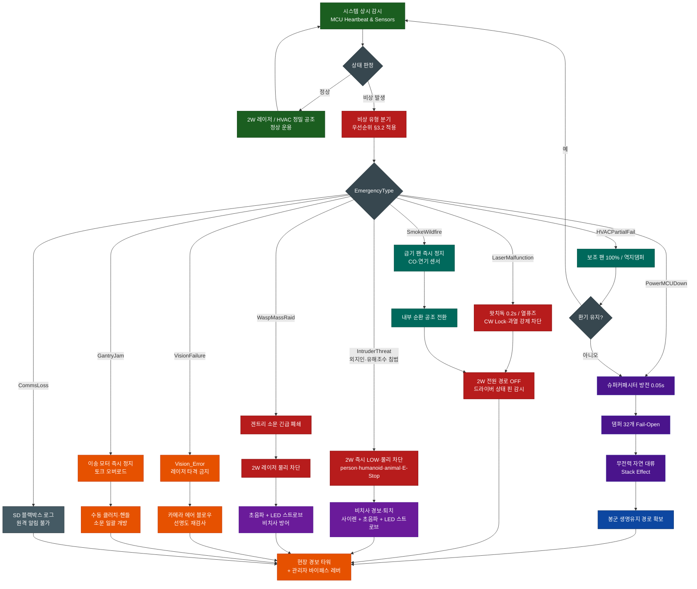

# 비상상황 및 안전대비책 마스터플랜

## 0. 문서 역할 · 자매문서

| 본 문서               | 다루는 것                                         | 다루지 않는 것 (원본 문서)                           |
| :-------------------- | :------------------------------------------------ | :--------------------------------------------------- |
| **비상·Fail-Safe**    | 위험 시 **끊고·살리고·알리는** 순서, 이중화, 복구 | —                                                    |
| 레이저 발사 정책      | EmergencyType 만                                   | **`FIRE_OK`·소문 지향·M140 상세** → 레이저 요격 전략 |
| 외부 순찰·피에조·기상 | Intruder/Wasp 진입점                              | **GRC 플랫폼** 상세                                  |
| 미아·체증             | 비상과 교차 시 참고                               | **미아·체증 마스터플랜**                             |
| 방제 전략 전반        | 말벌 대량 침입 비상만                             | **Biosecurity 마스터플랜**                           |

**설계 목표 문구:** “전멸·안전사고 **제로에 수렴**”은 **목표**이며, §9 잔여 리스크·가정 하에서 달성한다. 절대 보증 문구로 쓰지 않는다.

---

## 1. 개요 (Executive Summary)

Class 4 **2W 레이저**, 밀폐 **HVAC**, **실내 겐트리**, **AI 비전**이 한 차에 모인 시스템의 비상 운용 마스터플랜이다.

원칙: **인명 및 꿀벌 보호 1 원칙 (Fail-Safe & Life Support)**.
비상 시 우선순위는 **사람·외지인 안전 ≫ 봉군 질식/열사 방지 ≫ 비치사 방어 ≫ 자산·원격 알림**.

다중 이중화 (Redundancy)·물리 인터락·Fail-Open 댐퍼로, 하드웨어·소프트웨어·환경 돌발에도 **봉군 전멸 경로를 차단**하고 **레이저 오발사 경로를 끊는** 것을 목표로 한다.

### 관리 로봇 2 기

| 기                         | 위치           | 비상 시 역할                                           |
| :------------------------- | :------------- | :----------------------------------------------------- |
| **실내 겐트리**            | 차체 내부      | 소문·댐퍼 접근 · Fail-Open/수동 개방 (§2.4)            |
| **실외 레일 스캐너 (GRC)** | 외벽·소문 전면 | 비전 · **M140 레이저** · Intruder/Wasp 감지 (§2.1·2.5) |

비상 시 **레이저 OFF·광학 안전 = 실외 스캐너**, **봉군 환기·소문 개방 = 실내 겐트리·HVAC**. 기구·통신 상세는 각 자매문서.

---

## 2. 영역별 비상상황 분석 및 종합 대비책 Matrix

### 2.1 [Class 4 2W 레이저] 고출력 광학 안전 계통

| 비상상황 (Risk Event)     | 발생 원인 및 위험 요소                  | 물리적 / 하드웨어 대비책                               | 소프트웨어 / AI 알고리즘 대비책                                   |
| :------------------------ | :-------------------------------------- | :----------------------------------------------------- | :---------------------------------------------------------------- |
| **인체 / 안구 노출**      | 사람/작업자 접근, 반사광 실명·화상      | 물리 차단 SW · ARM 적색 점멸 LED · E-Stop · 2 중 인터락 | `FIRE_OK` 미충족 시 발사 금지 · YOLO `person`/`humanoid` 즉시 LOW |
| **MOSFET 단락 (CW Lock)** | 합선으로 연속 발사·화재                 | 왓치독 0.2s 강제 차단 · 100°C 바이메탈/열 퓨즈         | 드라이버 상태 핀 피드백 감시                                      |
| **현장 테스트 (Dry-Run)** | 2W ON 상태 테스트 시 인체 인터락과 충돌 | Dry-Run 물리 SW: 2W 차단 + 라인레이저·LED·피에조       | Synthetic / Mockup 모드 (비상타입 아님)                           |

### 2.2 [비전 카메라 & 센서] 시각 마비 및 오인 계통

| 비상상황 (Risk Event)     | 발생 원인 및 위험 요소        | 물리적 / 하드웨어 대비책 | 소프트웨어 / AI 알고리즘 대비책                   |
| :------------------------ | :---------------------------- | :----------------------- | :------------------------------------------------ |
| **렌즈 오염 (Blindness)** | 분변·프로폴리스·이슬 → 오타격 | 카메라 전용 에어 블로우  | Laplacian Variance → `Vision_Error` · 레이저 금지 |
| **대낮 직사광 / 난반사**  | 앵커 오판·잔상                | 어닝 · Pure DC LED 마커  | 셔터 1/1000s 이하                                 |

### 2.3 [밀폐 공조 HVAC & 댐퍼] 봉군 생명 유지

| 비상상황 (Risk Event)  | 발생 원인 및 위험 요소                   | 물리적 / 하드웨어 대비책                  | 소프트웨어 / AI 알고리즘 대비책   |
| :--------------------- | :--------------------------------------- | :---------------------------------------- | :-------------------------------- |
| **정전 / 시스템 다운** | 소문 폐쇄 + 팬 정지 → 15~30 분 내 전멸 가능 | 댐퍼 32 **Fail-Open** · 슈퍼캡 0.05s 방전 | Heartbeat 끊김 → 비상 방전 트리거 |
| **댐퍼 고착·벌 진입**  | 프로폴리스·덕트 진입 → Fail-Open 실패    | 메쉬 · PTFE · Anti-Sticking Sweep         | 일 1 회 강제 왕복                  |
| **팬 모터 고장**       | 환기 불능                                | N+1 더블 모터 · 역지 댐퍼                 | RPM/풍량 감시 → 보조 100%         |
| **브라운아웃**         | 기동 전압강하 → MCU 리부트               | 제어/동력 **배터리 버스 분리**            | 제어계 독립 → 알림·댐퍼 개방      |

### 2.4 [겐트리 & 소문] 구동 계통

| 비상상황 (Risk Event)   | 발생 원인 및 위험 요소 | 물리적 / 하드웨어 대비책                     | 소프트웨어 / AI 알고리즘 대비책 |
| :---------------------- | :--------------------- | :------------------------------------------- | :------------------------------ |
| **겐트리 걸림**         | 소문 일괄 조작 불능    | 수동 클러치/핸들                             | 토크 오버로드 → 모터 정지       |
| **전산·전력 완전 불통** | 자동 개방 불가         | **물리 바이패스 레버** (소문·댐퍼 강제 개방) | —                               |

### 2.5 [야생·환경] 복합 위협

| 비상상황 (Risk Event)    | 발생 원인 및 위험 요소          | 물리적 / 하드웨어 대비책 | 소프트웨어 / AI 알고리즘 대비책                  |
| :----------------------- | :------------------------------ | :----------------------- | :----------------------------------------------- |
| **말벌 대량 습격**       | 1:1 저격 능력 초과              | 겐트리 소문 긴급 폐쇄    | 5 초≥10 마리 → 레이저 OFF · 초음파 +LED             |
| **외지인·유해조수 침범** | 레이저 타격 금지 (인명·동물·법) | 2W 전원 물리 차단        | `person`/`humanoid`/`animal` → 사이렌·초음파·LED |
| **산불·외부 연기/CO**    | HVAC 가 유해가스를 내부로 흡입   | CO/연기 센서             | 급기 정지 · **내부 순환** (≠레이저 오작동)       |
| **통신 망실**            | 원격 알림 불가                  | 현장 경보 타워           | SD 블랙박스 로그                                 |

---

## 3. Fail-Safe Flow

### 3.1 EmergencyType 분류

| EmergencyType        | 문서 근거 | 포함 Risk                        | 1 차 동작 요지                         | 심각도 |
| :------------------- | :-------- | :------------------------------- | :------------------------------------ | :----- |
| **PowerMCUDown**     | §2.3      | 정전·시스템 다운·심각 브라운아웃 | 슈퍼캡 → Fail-Open → 자연 대류        | S0     |
| **SmokeWildfire**    | §2.5      | 산불·외부 연기/CO                | 급기 정지 · 내부 순환 · 레이저 OFF    | S0     |
| **IntruderThreat**   | §2.1·2.5  | 외지인·유해조수                  | 2W OFF · 비치사 경보·퇴치             | S1     |
| **LaserMalfunction** | §2.1      | CW Lock·과열·드라이버 이상       | 왓치독·열퓨즈 · 전원 경로 OFF         | S1     |
| **WaspMassRaid**     | §2.5      | 말벌 대량 (5 초≥10)               | 소문 폐쇄 · 레이저 OFF · 비치사       | S2     |
| **VisionFailure**    | §2.2      | 렌즈 오염·치명 오인              | `Vision_Error` · 레이저 금지 · 블로우 | S2     |
| **HVACPartialFail**  | §2.3      | 팬 고장·댐퍼 고착 징후           | N+1; 실패 시 Fail-Open                | S1~S0  |
| **GantryJam**        | §2.4      | 겐트리 걸림                      | 모터 정지 · 수동 클러치               | S2     |
| **CommsLoss**        | §2.5      | LTE/LoRa 단절                    | 경보 타워 · SD 로그                   | S3     |

※ Dry-Run = 시험 모드 (비상 아님). 바이패스 레버 = 전 유형 **최종 수동 종착**.

### 3.2 동시 발생 시 우선순위 (Arbitration)

여러 EmergencyType 이 동시에 뜨면 **낮은 번호 (높은 우선) 만 “주도 동작”** 하고, 나머지는 **억제·병행 가능 여부**를 따른다.

| 순위 | Type                              | 다른 Type 과의 규칙                                                             |
| :--: | :-------------------------------- | :----------------------------------------------------------------------------- |
|  1   | PowerMCUDown                      | **항상 최우선.** 레이저·겐트리 자동 공세 중지. Fail-Open 방해 금지.            |
|  2   | SmokeWildfire                     | 급기 금지·내부 순환 유지. Wasp 로 소문 폐쇄는 가능하되 **외기 흡입 재개 금지**. |
|  3   | IntruderThreat / LaserMalfunction | 2W **무조건 OFF**. Wasp 저격 모드 진입 금지.                                   |
|  4   | WaspMassRaid                      | Intruder·LaserFault·VisionFailure 중이면 **저격 금지**, 소문 폐쇄 + 비치사만.    |
|  5   | VisionFailure                     | 레이저 Engage 금지. 순찰·경보는 유지.                                          |
|  6   | HVACPartialFail                   | 환기 실패 시 PowerMCUDown 경로로 **승격**.                                     |
|  7   | GantryJam                         | 자동 소문 동작 중지 → 수동.                                                    |
|  8   | CommsLoss                         | 로컬 경보·로그만. 상위 Type 동작을 막지 않음.                                  |

```text
예: 정전 + 말벌 대량
  → PowerMCUDown 주도 (Fail-Open·생존)
  → WaspMassRaid의 “레이저 저격”은 무시, “소문 폐쇄”는 전력 있으면 병행·없으면 수동
```

### 3.3 Fail-Safe Flow (Mermaid)



---

## 4. 심각도 · 목표 대응 시간 (SLA 안)

| 등급   | 의미                  | 목표 1 차 조치                 | 대표 Type                                                   |
| :----- | :-------------------- | :---------------------------- | :---------------------------------------------------------- |
| **S0** | 봉군 전멸·인명 직결   | **≤ 1 s** (가능하면 하드웨어) | PowerMCUDown, SmokeWildfire(급기), (승격된) HVACPartialFail |
| **S1** | 레이저·인명/동물 위해 | **≤ 100 ms** 발사 차단        | IntruderThreat, LaserMalfunction                            |
| **S2** | 봉군·운용 중대 손상   | **≤ 5 s**                     | WaspMassRaid, VisionFailure, GantryJam                      |
| **S3** | 원격·편의 상실        | **≤ 30 s** 로컬 경보·로그     | CommsLoss                                                   |

---

## 5. 복구 (Recovery) 절차

비상 **진입**만 있고 **해제**가 없으면 상시 Lockout 이 된다. 공통 순서:

```text
1) 원인 Clear 확인 (센서·비전·전원·연기=0, Intruder 미검출 등)
2) 경보 타워 Yellow → 점검 모드
3) 레이저: 물리 마스터 SW OFF → 현장 육안·로그 확인 → (담당자) SW ON
   ※ 자동 재무장 금지. FIRE_OK는 레이저 전략서.
4) HVAC: Fail-Open 댐퍼를 정상 시퀀스로 재닫기 전, CO2/온습도·급기 품질 OK
5) 소문/겐트리: 수동 개입 후 클러치 복귀 · 원점·소프트 리밋 재확인
6) EmergencyType 비트 Clear · 블랙박스에 recovery_ts 기록
7) 경보 Green · 정상 감시 루프 복귀
```

| Type             | Clear 조건 (요지)                  | 재무장 특이                                     |
| :--------------- | :--------------------------------- | :---------------------------------------------- |
| PowerMCUDown     | 상용/배터리 안정 N 분, Heartbeat OK | 댐퍼 강제 Open 유지 해제 전 내부 가스·온도 확인 |
| SmokeWildfire    | CO/연기 임계 미만 M 분              | 급기 재개 전 외기 품질                          |
| IntruderThreat   | person/animal 0, E-Stop 리셋       | 물리 SW 사람 확인 후                            |
| LaserMalfunction | 드라이버·온도 OK, 왓치독 리셋      | 모듈/배선 점검 로그 필수                        |
| WaspMassRaid     | 밀도 임계 미만 + 쿨다운            | 소문 재개방은 정책 타임테이블                   |
| VisionFailure    | 선명도 통과                        | 실패 시 레이저 Engage 금지 유지                 |
| GantryJam        | 원점·리밋 OK                       | 토크 로그 보관                                  |
| CommsLoss        | 링크 복구                          | 로컬 로그 업로드                                |

---

## 6. 역할 분담 (RACI 요지)

| 활동                 | 자동 (MCU/RPi) | 현장 관리자  |          원격 운용          |
| :------------------- | :-----------: | :----------: | :-------------------------: |
| Fail-Open 방전       |     **R**     | A(시험·확인) |              I              |
| 2W 물리 SW ON/OFF    |   C(상태만)   |   **R/A**    |              I              |
| E-Stop               |       C       |    **R**     |              —              |
| Intruder/Wasp 비치사 |     **R**     |      A       |              I              |
| 바이패스 레버        |       —       |   **R/A**    |              —              |
| 원격 FIRE 명령       |   A(게이트)   |      C       | **금지 기본** (정책 예외만) |
| 블랙박스 회수        |       C       |    **R**     |              A              |

R=실행 A=책임 C=협조 I=통보.

---

## 7. 블랙박스 로그 스키마 (안)

이벤트 1 건 = JSONL 1 행. SD 및 (가능 시) RPi 미러.

| 필드               | 형       | 설명                                                      |
| :----------------- | :------- | :-------------------------------------------------------- |
| `ts_ms`            | u64      | 모노토닉/UTC                                              |
| `event`            | enum     | `enter` / `arbitrate` / `action` / `recover` / `selftest` |
| `type`             | string   | EmergencyType                                             |
| `severity`         | u8       | §3.2 순위                                                 |
| `severity_active`  | string[] | 동시 활성 Type                                            |
| `sev`              | S0~S3    |                                                           |
| `laser_pwr`        | bool     | 2W 경로 통전                                              |
| `master_sw`        | bool     | 물리 SW                                                   |
| `dampers`          | enum     | closed/open/fail_open                                     |
| `entrance`         | enum     | open/closed/unknown                                       |
| `vision`           | enum     | ok/error/blind                                            |
| `co_ppm` / `smoke` | num      | 해당 시                                                   |
| `action`           | string   | 수행 액션 코드                                            |
| `operator`         | string   | 수동 개입 ID(있으면)                                      |
| `note`             | string   | 자유                                                      |

---

## 8. 정기 자가진단 체크리스트 (안)

| 주기 | 항목                                  | 합격                                          |
| :--- | :------------------------------------ | :-------------------------------------------- |
| 일   | 댐퍼 Anti-Sticking Sweep              | 왕복·전류 정상                                |
| 일   | 비전 선명도 샘플                      | `Vision_Error` 아님                           |
| 주   | Dry-Run (2W OFF) 조준 시연            | 라인·LED·피에조만                             |
| 주   | 경보 타워 Red/Yellow/Green            | 가청·가시                                     |
| 월   | 슈퍼캡 Fail-Open **무부하/시험 회로** | 0.05s 급 개방 확인 (실봉군 밀폐 시험은 절차서) |
| 월   | 왓치독 CW 시뮬 (더미 부하)            | 0.2s 내 차단                                  |
| 분기 | 수동 클러치·바이패스 레버             | 소문/댐퍼 일괄 동작                           |
| 분기 | 블랙박스 순환·용량                    | 덮어쓰기·무결성                               |

---

## 9. 잔여 리스크 · 가정

| 가정 / 잔여                            | 대응                                                     |
| :------------------------------------- | :------------------------------------------------------- |
| Fail-Open 이 프로폴리스로 **완전 고착** | 메쉬·PTFE·스윕·월간 시험. 최후 = 바이패스 레버·수동 개방 |
| 슈퍼캡 수명·저온 용량 저하             | 교체 주기·온도 디레이팅                                  |
| 비전 오탐으로 Intruder 과다            | 다중 프레임·센서 퓨전. 레이저는 보수적으로 OFF           |
| 오지에서 원격 불가                     | CommsLoss = 로컬 경보가 본진                             |
| 차량 전도·수침·낙뢰                    | 본 문서 범위 외 → 차체/전기 방재 문서로 이관 권장        |
| “전멸 0%” 절대 보증                    | **설계 목표**. 실측·시즌 KPI 로 검증                      |

---

## 10. 결론 및 하드웨어 구현 가이드

1. **봉군 생명유지:** 소문 폐쇄 중 정전이어도 **댐퍼 Fail-Open + 슈퍼캡 + Stack Effect**로 질식·열사 경로를 끊는다.
2. **고착 방지:** 메쉬 · PTFE · 일일 스윕으로 Fail-Open 신뢰도를 유지한다.
3. **레이저:** 물리 SW · ARM LED · 2 중 인터락 · CW 왓치독 · IntruderThreat. 발사 상세는 **레이저 요격 전략 `FIRE_OK`**.
4. **동시 비상:** §3.2 우선순위로 저격보다 **생존·인명**이 이긴다.
5. **복구:** 자동 재무장 금지. 물리 SW·Clear·로그 후에만 정상 복귀 (§5).
6. **구동 단순화:** 겐트리 + 수동 클러치·바이패스 레버로 단점·고장점을 줄인다.
7. **검증:** §8 자가진단과 §7 블랙박스로 “설계 목표 → 실측”을 닫는다.
