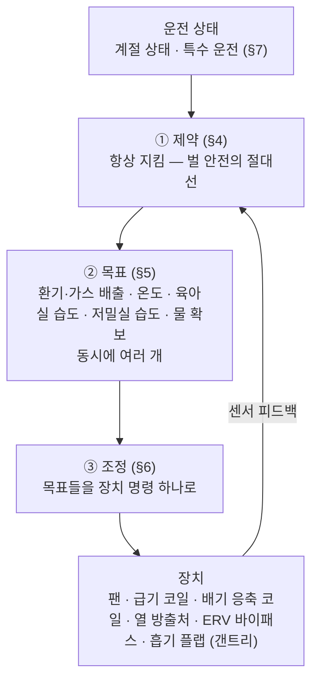
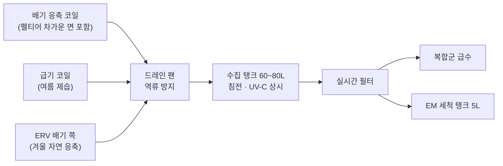

---
doc_id:
title: "Fanner — 공조 제어 개념 (온습도·환기·결로수 수집)"
category: "설계서"
domain: "양봉"
status: draft
created: 2026-09-29
updated: 2026-10-01
parent_doc: "NEXA BEE 브랜드·장비 네이밍 체계 및 생태계 구축 전략 (진행중).md"
implements_doc:
see_also:
  - "스마트 다왕 벌통 푸시-풀 공조 시스템 사양서.md"
  - "NEXA 양봉 시스템 자원 구성과 인프라 구성.md"
  - "시스템-전력_예산_마스터.md.md"
  - "시스템-군별 격리판 기능.md"
  - "시스템-계절과 기후 상황 대응전략.md"
  - "시스템-공조 구동 방식 검토 (펠티어 기본형·히트펌프 가치 분석).md"
  - "시스템-지능형 공조 제어 알고리즘 Aero Profiler.md"
terms_standard:
  - "ERV (전열교환기)"
  - "이슬점"
  - "가압 플레넘"
  - "역류 방지 플랩"
terms_nexa:
  - "Fanner"
  - "Honey Vanguard"
  - "Hive Mind"
  - "Nectar Power"
  - "에너지 목적 전환"
---

# Fanner(NB-HV-FAN) 공조 시스템 중요성 및 작동 매커니즘

| 핵심 목적 (Why)                         | 왜 중요한가? (치명적 리스크 방어)                                                                           | 하드웨어·소프트웨어 작동 매커니즘 (How)                                                                                          | 비고 (핵심 기술 사상)                                    |
| ----------------------------------- | ---------------------------------------------------------------------------------------------- | ----------------------------------------------------------------------------------------------------------------- | ------------------------------------------------ |
| **1. 페로몬 역류 방지**  <br>(생태계 붕괴 차단)   | • 소초광 틈새가 노출되어 있어, 양압 무너질 시 타 군의 페로몬이 실내로 융합됨  <br>• 서로 다른 여왕 냄새 교란 시 **전체 군집 붕괴 (도봉/싸움)** 유발   | • **2 포인트 마스터 차압 센서** 기반 간접 추론 제어  <br>• 실내를 **급기 챔버화 (양압)**하여 기류 방향을 `[실내 ➔ 배기구]` 일방통행으로 단단히 고정                    | **[생명 마지노선]**  <br>데이터 기반 0.1 초 선제 오버드라이브 방어      |
| **2. 여왕벌·외역벌 귀소 유도**  <br>(다왕 복합군 사수·표류 방지)   | • 초장축 1.5 평 아파트형 밀집 소문 구조 (소문 간격 좁음)  <br>• 처녀왕이 교미 비행 후 귀소 시 집을 오인하면 **옆집에서 즉시 실왕 (살해) 당함**  <br>• 외역벌이 옆 군으로 표류하면 **세력 편중·도봉·응애·질병 전파**  <br>• 소문으로 외기가 빨려 들면 자기 군 냄새 신호가 사라짐 | • **평시 (외역벌):** 모든 군을 양압으로 유지 → 소문마다 **자기 군 냄새가 실린 약한 바람 (양압 페로몬풍)** 이 나가 자기 집 식별을 돕는다  <br>• **여왕 귀소 시:** 교미 비행 출발 감지 또는 시간대 기준 (처녀왕 일령·오후·맑고 바람 약한 날) 으로 **Tender Gantry(텐더 갠트리)**가 해당 군 흡기 플랩만 최대로 열어 그 소문의 냄새 바람을 강화  <br>• 필요 시 급기 팬 PWM 을 올려 실내 압력 보강  <br>• **소문 풍속 상한** 준수 — 바람이 너무 세면 착륙을 방해 | **[보조 유도 수단]**  <br>시각 표식 (소문 색·패턴) 이 주력, 냄새 바람은 보조  <br>모터 없는 갠트리 연동 기계식 플랩  <br>효과는 현장 검증 (§7.3·§7.4) |
| **3. 겨울철 내부 과습 방지**  <br>(집단 동사 방지) | • 겨울철 벌들의 뭉침 (봉구) 호흡 가스로 인해 내부 습도 90% 이상 폭발  <br>• 벽면 결로가 벌 몸에 떨어지면 **집단 얼어 죽음 (동사)**            | • **전열교환기 (ERV)** 기본 베이스 가동  <br>• 나가는 실내 가스의 열 (현열) 은 70% 이상 회수 (에너지 세이브) 하면서 **축축한 습기만 밖으로 유도 탈수**                   | **[패시브 에너지 세이브]**  <br>벌들의 소중한 체열 완벽 락 (Lock) 보존  |
| **4. 의도적 결로수 수집**  <br>(천연 용수 자원화)  | • 오프그리드 (Off-grid) 이동 양봉 환경 특성상 상시 깨끗한 물 보급이 어려움  <br>• 벌들의 자급 용수 확보 필수                         | • **동적 온도 출렁임 (Thermal Pulse) 제어**  <br>• 펠티어 역전 가온으로 공기를 ' 수증기 스펀지 ' 로 만든 뒤, 영하의 **배기 주름관에 충돌시켜 응축수 대량 포집**          | **[자원 순환형 팜 (O2O)]**  <br>벌들의 자체 봉구 온도를 열적 버퍼로 활용 |
| **5. 무인 자율 내검 보장**  <br>(에어커튼 격리)   | • 낮 시간대 소문 개방 상태에서 소초광 인출 시 벌들이 실내로 탈출할 위험  <br>• 로봇 레일 및 스캐너 카메라 렌즈 오염 리스크                    | • 인출 순간 열린 내검구에서 실내 (+3~5 Pa) 가 군보다 높아 **공기가 실내에서 군 안쪽으로** 흐른다 → **인입형 에어커튼**  <br>• 인출 전 해당 군 흡기 플랩을 최소로 두고, 압력 변화는 급기 팬 PWM 으로 즉시 보상 (§7.2 내검)         | **[24 시간 프리존 내검]**  <br>벌들을 강한 압력으로 벌통 내부에 격리 차단  |
| **6. 사계절 단열 한계 극복**  <br>(열교 현상 차단) | • 한여름 뙤약볕 직사광선 폭열 유입  <br>• 한겨울 50mm 외단열을 뚫고 펠티어 금속 방열판을 타고 들어오는 **냉기 열교 (Heat Bridge) 결로 리스크** | • 1.5 미터 수직 일자 구조 **[서멀 이젝터 타워] + [3 중 차폐 단열 재킷 (XPS)]** 고정 인프라 셋팅  <br>• 비시즌/정박 시 **무동력 자연 부력 대류 (0W)** 방열 방어        | **[소프트웨어 하이브리드]**  <br>가혹한 1 톤 트럭 캠퍼 환경 최적화       |

# Fanner — 공조 제어 개념 (온습도·환기·결로수 수집)

Fanner(NB-HV-FAN) 공조 시스템을 **어떻게 제어할 것인가**의 개념을 정리한다.
공조의 기능은 온습도 조절·보조와 환기에 그치지 않고 **결로수 수집 (물 확보)** 을 포함한다.

제어는 모드 하나를 고르는 방식이 아니라, **제약을 지키면서 여러 목표를 동시에 조정**하는 방식으로 한다. 서로 배타적인 것만 **운전 상태**로 둔다.
구동 방식은 **히트펌프 사양**과 **펠티어 사양 (신규 개발)** 을 모두 유지하며, 두 사양은 같은 제어 구조를 쓴다.

---

## 1. 공간·유로 정의

### 1.1 공간

| 용어 | 범위 | 공조와의 관계 |
| :--- | :--- | :--- |
| **실내** | Honey Vanguard 내부 전체 | |
| └ **벌 공간** | 복합군 내부 (육아실·저밀실) | **공조 대상.** 군마다 흡기 플랩 (저밀실·육아실 각각) 으로 실내 공기를 받고, 군마다 독립 배기 라인 (저밀실 상단·육아실 하단) 이 셀 블록 배기 챔버로 연결된다 |
| └ **작업 공간** | Tender Gantry 통로, 기계실 | **급기 플레넘.** 급기가 먼저 채우고 벌 공간으로 넘어가는 가압 공간 |

### 1.2 유로 — 실내 가압 플레넘 방식

셀 블록 2 층 구조를 유지하고, 복합군으로 가는 별도 공급 라인을 두지 않는다. **실내 전체를 급기 유로 (가압 플레넘)** 로 쓴다. 배기는 **군마다 독립 라인 2 개 (저밀실 상단·육아실 하단)** 를 셀 블록 배기 챔버까지 따로 끌고 간다. 셀 블록 L·R 의 배기 계통은 기본적으로 분리하고, 두 챔버는 **평시 닫힘 연결 댐퍼**로 이어 팬 고장·정비·저부하 때만 연동한다 (Aero Profiler 문서 §1.7). **군·복합군 배기 댐퍼 모터는 두지 않는다** (§1.3 압력 샌드위치, Aero Profiler 문서).

```text
외기 → 급기 블로어 → HEPA → ERV(급기 쪽) → 급기 코일 → 실내 (가압 플레넘, 공통)
     → 흡기 플랩 (군마다 저밀실·육아실 각각, 역류 방지, 갠트리 기계식) + 소초광 사이 틈 (최소 누설) → 군 (저밀실 · 육아실)
     → 저밀실 상단 배기 라인 ┐
     → 육아실 하단 배기 라인 ┴→ 군별 독립 배기 라인 → 역류 방지 플랩 (챔버 입구) → 셀 블록 배기 챔버 (L·R 분리, 평시 닫힘 연결 댐퍼로 연동 가능)
     → ERV(배기 쪽) → 배기 응축 코일 → 배기팬 2 대 (역풍 방지 댐퍼) → 외기
     ※ 소문 열림 (Hive Gate 1~4 단계): 군별 흡기와 배기 라인의 차이만큼 소문으로 나간다 (최소 양압 페로몬풍, §7.3)
```

**이 방식을 택한 이유**

- 격리판·소초광 구간에 급기 배관이 없다.
- 격리판을 빼서 합봉하거나 세력에 따라 위치를 바꾸는 운영이 공조 구조에 묶이지 않는다.
- 2 층 구조를 유지하므로 단층 세로형의 소문 간격 문제 (여왕 귀소 오류·표류) 를 피한다.
- 급기가 실내에서 한 번 섞이므로 벌 공간에 들어가는 공기의 온도 변화가 완만하다.
- 군마다 배기 라인이 독립이라 형제 군끼리 배기관을 공유하지 않는다. 페로몬·질병이 섞일 경로가 챔버 한곳뿐이고, 역류 방지 플랩이 막는다.
- 군별 배기 라인에서 **벌 공간 밖**의 군 압력을 잴 수 있다 (§1.5).

| 위치 | 역할 |
| :--- | :--- |
| **급기 코일** (ERV 뒤, 실내 유입 전) | 급기 냉각·가온·제습. 실내로 들어가는 공기의 온도·절대습도를 정한다 (실내 공통) |
| **급기 코일 출구** | 벌 공간 보호 기준점. 급기 온도 한계를 여기서 지킨다. 측정은 블로어 뒤 실내 토출구 직전의 **급기 출구 온습도 센서** (§1.5) |
| **실내 (가압 플레넘)** | 급기가 먼저 채우는 공간. 벌 공간보다 높은 압력을 유지한다 (§1.3) |
| **흡기 플랩** (128 개, 군마다 저밀실·육아실) | 군으로 공기를 넣는 입구. 역류 방지 + 개도 조절. **군별·실별 풍량을 정하는 유일한 조절 요소** (§1.4) |
| **소초광 사이 틈** | 원칙적으로 막는다. 약간의 누설은 허용하되 흡기 경로로 계산하지 않는다 |
| **저밀실 상단 배기 라인** (군마다) | 저밀실의 습기를 뺀다. 꿀 숙성 수분이 가장 많은 배기 |
| **육아실 하단 배기 라인** (군마다) | 육아실 바닥에 가라앉는 CO₂를 뺀다 |
| **역류 방지 플랩** (128 개, 챔버 입구) | 가볍고 떨림 없는 무전원 플랩. 배기팬이 멈추거나 군이 청소 중일 때 챔버 공기가 군으로 넘어가지 않게 한다 |
| **셀 블록 배기 챔버** (L·R 각 1) | 배기팬이 압력을 고정한다 (§1.3 압력 샌드위치) |
| **챔버 연결 덕트 + 연결 댐퍼** (유닛 1) | 평시 닫힘 (분리). 팬 고장·정비·저부하·부하 쏠림 때 열어 유닛 전체 팬이 나눠 맡는다 (연동). 질병 의심·방제·청소·한쪽 강풍 때는 닫힘 고정 (격리 강제) |
| **배기 응축 코일** (ERV 뒤, 배기 쪽) | 벌이 증발시킨 수분을 배기에서 포획. 벌 급기 온도에 영향이 없다 |

- 급기 코일 출력은 실내 전체에 공통으로 작용한다.
- 군별 차이와 실별 (저밀실·육아실) 차이는 모두 **흡기 플랩 개도**로 보정한다. 실내와 배기 챔버 압력이 고정되어 있으므로 군별 유량은 자기 플랩 개도로만 정해진다 (§1.3).
- 전체 환기량은 **실내 − 챔버 압력차** (급배기 팬 PWM) 로 모든 군을 한꺼번에 바꾼다.

### 1.3 압력 계층

| 공간 | 목표 차압 (외기 기준, 가정 — 현장 검증 후 확정) |
| :--- | :--- |
| **실내 (플레넘)** | +3~5 Pa |
| **벌 공간 (군)** | 평시 +1~+2 Pa, 월동 0~+0.5 Pa (푸시 - 풀 사양서). 실내와 챔버 사이에서 정해지는 결과값 |
| **배기 챔버** | 블록 안 소문이 모두 닫힘: 0 Pa 까지. 열린 군이 있으면: 소문 유출량 목표를 맞추는 값 (약 +0.5~1 Pa, Aero Profiler 문서 §2.5) |
| **외기** | 0 |

**압력 샌드위치 (군을 실내 압력과 챔버 압력 사이에 끼우는 방식)** — 실내는 급기팬이, 배기 챔버는 배기팬이 고정한다. 군은 항상 두 압력 사이에 끼므로 흡기 플랩 개도와 무관하게 양압이다.

- 흡기 (상류) 를 조이면 군 압력이 내려간다. 따라서 배기 댐퍼 없이 양압을 지키려면 챔버 압력을 군 목표 바로 아래에 고정해야 한다.
- 전체 압력 예산 (실내 − 챔버) 은 약 2.5~4 Pa 다. 흡기 플랩·그릴·배기 라인·역류 방지 플랩을 이 안에서 설계한다 (Aero Profiler 문서 §1.5).
- **실내 > 벌 공간 > 외기** 순서는 절대 지킨다. 순서가 깨지면 벌 공간 공기가 실내로 역류해 군끼리 페로몬이 섞이거나, 소문으로 외기가 빨려 들어간다.
- 급기는 항상 배기보다 크다. 배기는 센서 기반으로 필요한 만큼만 당긴다.
- 출입문을 열어 실내 압력이 떨어지면 역류 방지 플랩이 닫혀 섞임을 막고, 급기 팬이 즉시 보상한다.

### 1.4 흡기 플랩 · 역류 방지 플랩 · 급기구 배치

**흡기 플랩 (군마다 저밀실·육아실 각각, 128 개)**

| 항목 | 내용 |
| :--- | :--- |
| **구조** | 기계식, 무전원. 역류 방지 (한 방향) + 개도 조절 + 주행 진동에 풀리지 않는 고정 홈 |
| **배치** | 움직이는 부분 (조정부) 은 실내 (플레넘) 쪽 갠트리가 닿는 면에 둔다. 출구 그릴은 짧은 내부 채널로 먼 위치에 둔다 (아래 급기구 배치). 벌 쪽에는 탈착식 고정 그릴만 보인다 |
| **조정** | Tender Gantry 가 개도를 바꾼다. 개도는 Aero Profiler 테이블로 산출한다. 모든 플랩은 최소 개도 이상을 유지한다 |
| **고장 시** | 갠트리가 멈춰도 플랩은 마지막 개도를 유지한다 |

**역류 방지 플랩 (군별 배기 라인 끝, 128 개)**

- 가볍고 떨림 없는 무전원 플랩 (필름형 또는 자석 척력형). 열림 압력 약 0.5 Pa 이하 (가정).
- 평상 유량에서 완전히 열린 상태가 되게 해 반쯤 열린 떨림을 피한다. 닫힘 쪽에 부드러운 시트를 둔다.
- **챔버 입구 쪽에 모아 둔다.** 벌에게 진동이 전달되지 않고, 프로폴리스가 붙지 않으며, 한곳에서 점검·청소한다.

**급기구 배치 — 두 실 각 하단, 반대편 끝 대각**

| 실 | 급기구 | 배기구 | 흐름 |
| :--- | :--- | :--- | :--- |
| **저밀실** | 가장 아래, A 끝 | 상단, B 끝 | 아래에서 위로 대각 훑기. 부력과 같은 방향이라 숙성 제습에 유리하다 |
| **육아실** | 가장 아래 (바닥 띠), A 끝 | 바닥, B 끝 | 바닥을 따라 수평으로 CO₂ 를 밀어낸다. 육아권을 직접 때리지 않는다 |

- 급기구는 바닥에서 약 20~30 mm 띄우고 (부스러기·청소 경로 회피), **소문 반대편 끝**에 둔다. 겨울에는 육아실 급기를 최소로 둔다 (봉구 냉각 방지).
- 형태는 소초광 **끝면과 마주 보는 벽** 하단 띠의 **가로 슬릿 카세트** (두 실 공통). 뒤에 얕은 분배 상자, 벌 차단은 망, 망은 벽면과 같은 높이, 실내 쪽 서랍식 탈착 (권장). 망 앞 풍속 약 0.3~0.5 m/s (가정).
- 세부 사양과 크기는 Aero Profiler 문서 §1.4.

128 개 플랩을 갠트리가 차례로 조정하면 시간이 걸리므로 (한 바퀴 약 20 분 가정), 조절 속도에 따라 역할을 나눈다.

| 조절 | 수단 | 대상 |
| :--- | :--- | :--- |
| **빠른 조절** (초 단위) | 급배기 팬 PWM (실내·챔버 압력) | 출입문 개방, 내검 인출 순간, **전체 환기량**, CO₂ 상한 대응 |
| **느린 조절** (분~시간) | 흡기 플랩 (Tender Gantry) | 군별·실별 풍량 배분, 여왕 귀소 지원, 계절 설정 |

### 1.5 차압·급기 온습도 센서 배치 — 벌 공간 밖에서만 잰다

벌 공간 안의 압력 측정구는 프로폴리스로 막혀 값이 굳거나 서서히 틀어진다. 따라서 **차압 센서는 벌이 닿지 않는 곳에만 둔다.**

| 위치 | 수량 | 용도 |
| :--- | :--- | :--- |
| **실내 (플레넘) ↔ 외기** | 1 (고정) | 플레넘 압력. 급기 팬 제어 기준 |
| **배기 챔버 ↔ 실내** | 셀 블록마다 1 (고정) | 압력 샌드위치. 배기팬 제어 기준 |
| **군별 배기 라인 그릴 바로 뒤** (스캐닝) | 셀 블록마다 센서 1 + 측정점 64 | 군 압력 근사값. 유량 이중 추정·저항 DB 갱신·막힘 판정 (Aero Profiler 문서 §2.3) |

- 제어용 고정 센서와 보정용 스캐닝 센서를 나눈다. 빠른 압력 루프는 순차 측정으로 돌릴 수 없다.
- 군마다 배기 라인 측정점이 있으므로 군 압력을 순차로 직접 근사한다. 측정점은 벌이 닿지 않는 그릴 뒤에 둔다. 군별 CO₂·온습도·스트레스 음향 (격리판 센서) 으로 보완한다.

**급기 온습도 센서 — 군에 들어가는 공기를 잰다**

군별 격리판 센서는 급기에 벌의 체온·호흡·꽃꿀 증발·선풍 조절이 섞인 **결과**다. 급기 코일 제어와 육아실 예측 가드 (Aero Profiler 문서 §2.4) 에는 들어가는 공기, 즉 **원인**을 따로 재야 한다. 급기 변화는 급기 쪽에서 몇 분 안에 보이지만 육아실에는 수십 분~수 시간 뒤에 나타나므로, 이 값이 예측의 리드 타임이 된다.

공기 경로: 외기 → ERV → 급기 코일 → 급기 블로어 → 토출구 → 실내 (가압 플레넘) → 흡기 플랩 → 군

| 위치 | 정확한 지점 | 수량 | 용도 |
| :--- | :--- | :--- | :--- |
| **① 급기 출구** | **블로어 뒤 덕트, 실내 토출구 바로 앞.** 코일·블로어를 지나 공기가 충분히 섞인 구간 | 급기 계통마다 1 | 급기 코일 제어 루프, 급기 온도 상·하한 보호, 예측 모델의 선행 신호 |
| **② 실내 대표점** | 셀 블록마다, **흡기 플랩 조정부가 있는 면 (갠트리 쪽) 의 플랩 높이.** 토출구 바람이 직접 닿는 곳·출입문·일사 받는 벽면을 피한다 | 셀 블록마다 1 (층간 차이가 크면 위·아래층 각 1) | **군이 실제로 들이마시는 공기.** 예측 모델의 급기 상태 입력 |

- **코일 바로 뒤에 두지 않는다.** 온도가 층지게 갈라져 한 점 값이 대표성이 없다. 제습 운전 중에는 습도가 100% 가까이 오르고 응축수 물방울이 튀어, 포화 근처에서 부정확하고 젖으면 값이 한동안 틀어진다. 블로어 모터 열이 더해진 뒤의 값이 실내로 실제 들어가는 공기다.
- **절대습도는 ①과 ②가 거의 같고, 온도는 실내에서 달라진다.** 실내에는 출입문 개방 외에 수분원이 거의 없지만, 외피 열 출입과 층간 온도 차이 (굴뚝 효과) 가 있다. ①과 ②의 절대습도 차이가 크면 출입문 누설이나 센서 이상으로 판정한다.
- **사양 (권장):** 자체 히터가 있는 온습도 센서 (SHT4x 급, 결로 후 회복용). 실내 대표점은 통풍형 차폐 커버. 실내 쪽에서 손이 닿게 달아 교정·교체가 쉽게 한다.

### 1.6 프로폴리스 대응

- 막히는 곳은 센서가 아니라 **그릴·플랩·소초광 틈**이다. 벌은 작은 틈, 거친 면, 외풍이 드는 곳을 막는다.
- **그릴 면적을 넉넉히** 잡는다. 일부가 막혀도 흐름이 유지되고, 풍속이 낮아 벌이 외풍으로 느끼는 자극도 줄어든다.
- **막힘 진단 (야간 응답 시험):** 벌이 잠잠하고 소문이 닫힌 (0 단계) 밤에 급기 팬 PWM 을 한 단계 바꾸고 군별 배기 라인 압력 (스캐닝) 의 응답을 본다. 응답이 둔하거나 기대값을 벗어나면 막힘으로 판정하고 Tender 청소 과제로 올린다. 푸시 - 풀 사양서의 HEPA 막힘 진단과 같은 방식이다.
- **청소:** 그릴은 탈착식으로 한다. 프로폴리스는 차가울 때 잘 부서지므로 추운 시기나 냉각 상태에서 청소한다. 역류 방지 플랩은 챔버 입구에 모여 있어 한곳에서 점검한다. 플랩마다 아날로그 홀 센서로 닫힘을 감시하고, Air Core 퍼지 라인으로 이따금 약한 바람을 불어 플랩·시트를 털어 낸다. 허용 추이를 벗어나면 관리자에게 알리고, 관리자가 카세트를 직접 점검·교체한다 (Aero Profiler 문서 §1.3).
- **소초광 틈:** 벌이 스스로 막아 주는 것은 이득이지만, 내검으로 소초광을 뺐다 넣으면 밀봉 상태가 바뀐다. 따라서 압력 제어는 고정값이 아니라 센서 기반으로 한다.
- **그릴 망 규격:** 벌 통과를 막으려면 약 4mm 이하가 필요하지만, 촘촘한 망은 프로폴리스로 잘 막힌다. 시제품으로 2~3 종을 한 시즌 비교해 정한다 (§12).

---

## 2. 기본 전제 — 전열교환은 제어 대상이 아니다

- 공기가 알루미늄 주름판 유로를 지나는 순간 열과 습기가 회수된다. 켜고 끄는 소프트웨어 기능이 아니라 **조립된 하드웨어의 기본 동작**이다.
- 따라서 " 대기·에너지 세이브 " 같은 제어 항목을 두지 않는다. 팬이 미풍이든 강풍이든 전열교환은 항상 일어난다.
- 방제·청소 시 전열 소자를 우회하는 바이패스는 특수 운전 (§7.2) 에서만 일어난다.
- **예외 — 자유 냉방 바이패스:** 외기가 벌 공간 배기보다 차가울 때 ERV 는 배기 열을 급기로 되돌려 벌 대사열 제거를 방해한다. 이때만 ERV 바이패스 비율을 조정 대상으로 둔다 (§6). 급기 온도 하한을 지키는 범위에서 연다 (공조 구동 방식 검토 문서 §9.4).

---

## 3. 제어 구조 — 제약 → 목표 → 조정



| 층 | 성격 | 누가 정하나 |
| :--- | :--- | :--- |
| **운전 상태** | 서로 배타적. 한 번에 하나 | Hive Mind (계절 유로 댐퍼는 농가 수동) |
| **① 제약** | 위반하면 다른 모든 것보다 먼저 해소 | 고정 기준 + Hive Mind 가 계절·군 상태별로 조정 |
| **② 목표** | 목표값과 우선순위를 가진 기능. 동시에 여러 개가 켜진다 | Hive Mind 가 목표값·우선순위·켜짐 여부를 정한다 |
| **③ 조정** | 목표들의 요구를 합쳐 장치 출력 하나로 만든다 | 모듈 MCU 가 제어 루프를 돌린다 |

- Hive Mind 는 **무엇을 얼마나** 원하는지만 내리고, 장치를 어떻게 움직일지는 조정 층이 정한다. 판단 권한 구분은 NEXA BEE 체크리스트 A3 에서 확정한다.
- Hive Mind 와 통신이 끊겨도 조정 층은 마지막 목표값과 제약으로 계속 돈다.

---

## 4. 제약 — 항상 지킨다

| 제약 | 기준 (가정 — 현장 검증 후 확정) | 위반 시 동작 |
| :--- | :--- | :--- |
| **CO₂ 상한** | 벌 공간 CO₂ 상한 (값 미정) | 환기 풍량을 강제로 올린다. 다른 목표보다 먼저 |
| **급기 온도 한계** | 급기 코일 출구 상·하한 (값 미정) | 급기 코일 출력을 제한한다 |
| **벌 공간 온도** | 육아실 봉판 구역 34~35°C | 온도 목표를 강제로 올린다 |
| **육아실 습도** | 하한 중심 — 너무 건조하면 알 부화·애벌레에 불리 (값 미정) | 육아실 흡기 플랩을 줄이고 육아실 습도 목표를 강제로 올린다 |
| **저밀실 습도** | 상한 중심 — 너무 습하면 꿀 숙성 지연·발효 위험 (값 미정) | 저밀실 흡기 플랩을 열고 저밀실 습도 목표를 강제로 올린다. **육아실 기준 (§4.2) 안에서만** |
| **압력 계층** | 실내 > 벌 공간 > 외기 (§1.3). 벌 공간 평시 +1~+2 Pa, 월동 0~+0.5 Pa | 급기 팬을 올리고 배기팬을 낮춰 챔버 압력을 올린다. 소문으로 외기가 빨려 드는 것을 먼저 막는다 |
| **응축면 결빙** | 응축면에 성에 | 해당 코일 제상 후 재개 |
| **벌 공간 벽 안쪽 결로** | 벽 안쪽 면 온도 > 벌 공간 이슬점 + 여유 (§4.1) | 실내 온도 하한을 올리고 급기 코일 냉방을 줄인다. 저밀실 환기를 늘린다 (저밀실 흡기 플랩) |
| **벌 스트레스 신호** | 선풍 날갯짓 소리 증가, 육아실 온도 이탈, 소문 출입 이상 | 물 확보 목표를 즉시 끄고 코일 과구동을 금지한다 |
| **전력 한도** | Nectar Power 가 허용하는 공조 전력 | 전체 출력 상한. 초과 시 낮은 우선순위 목표부터 줄인다 |
| **외부 연기·유해 가스 유입** | 외기 쪽 연기·유해 가스 감지 (감지 방법 미정) | **급기를 즉시 차단**하고 비상 운전으로 넘긴다. 가스 배출 목표의 풍량 증가보다 먼저 |

- 외부에서 들어오는 가스는 배출 대상이 아니라 **차단 대상**이다. 목표로 두면 " 가스가 있으니 풍량을 올린다 " 는 반대 동작이 나올 수 있으므로 제약으로 둔다.
- **육아실 기준은 저밀실 조정이 넘을 수 없는 제약이다** (§4.2 육아실 우선 원칙).

### 4.1 벌 공간 결로 방지 로직 (메모)

가압 플레넘 구조에서는 **실내 온도가 곧 벌통 벽 바깥 온도**다. 실내를 차게 하면 벌통 벽 안쪽 면이 벌 공간 이슬점보다 낮아져 벌 공간 안에 결로가 생긴다. 결로 기준은 실내가 아니라 **벌 공간 이슬점**으로 잡는다.

**위험 지점**

| 계절 | 가장 위험한 면 | 이유 |
| :--- | :--- | :--- |
| **여름·유밀기** | 실내 쪽 벽, 저밀실 상단 | 꽃꿀 숙성으로 저밀실 이슬점이 높다 (35°C·습도 60% 기준 약 26°C). 실내를 과냉방하면 결로 |
| **겨울·월동** | 외기 쪽 벽 (소문 쪽), 모서리 | 외기에 가장 가까워 가장 차갑다. 봉구 호흡 습기가 맺혀 떨어지면 동사 위험 |

**판정**

1. 방별 (육아실·저밀실) 온습도로 **벌 공간 이슬점**을 계산한다.
2. 벽 안쪽 면 온도를 구한다.
   - 추정: 벽 안쪽 면 온도 = 바깥 온도 + 온도 계수 × (벌 공간 온도 − 바깥 온도). 바깥 온도는 실내 쪽 벽이면 실내 온도, 외기 쪽 벽이면 외기 온도.
   - 온도 계수 (0~1) 는 벽 단열로 정해지며, 대표 지점의 실측값으로 보정한다.
   - 실측: 대표 지점 (외기 쪽 벽, 모서리, 저밀실 상단) 의 **벽 속에 매립한 온도 센서**. 개구부가 없으므로 프로폴리스 영향이 없다.
3. **결로 여유 = 벽 안쪽 면 온도 − 벌 공간 이슬점.** 여유가 기준 (2~3K 가정) 아래로 내려가면 제약 위반으로 본다.

**위반 시 동작 (순서대로)**

1. **실내 온도 하한을 올린다.** 여름에는 급기 코일 냉방을 줄이고, 겨울에는 급기 가온을 늘린다.
2. **벌 공간 이슬점을 낮춘다.** 저밀실 환기를 늘린다 (저밀실 흡기 플랩, 급하면 전체 압력차). 육아실 습도 하한은 지키는 범위에서만 한다.
3. **실내 쪽 차가운 면을 줄인다.** 복사 패널이 있으면 수온을 올리거나 정지한다 (§8 메모).
4. 계속 위반되면 Keeper 에 알리고 해당 지점을 Tender 점검 과제로 올린다.

- 실내 온도 하한은 고정값이 아니라 **벌 공간 이슬점을 따라 움직이는 값**이다. 유밀기 밤처럼 이슬점이 높을 때는 실내를 덜 식힌다.
- 급기 온도 한계 (급기 코일 출구) 와 함께 적용한다. 둘 중 더 높은 하한을 따른다.

### 4.2 육아실 우선 원칙 — 저밀실 조정은 육아실 기준을 넘지 못한다

육아실과 저밀실은 **완전히 독립된 공간이 아니다.** 격왕판으로 공기가 통하고, 급기 코일 출력은 실내 공통이며, 전체 압력차는 모든 실에 함께 작용한다. 따라서 저밀실을 말리거나 식히는 조정은 반드시 육아실에도 번진다.

**육아실 기준 (제약)** — 고정된 절대값이 아니라 **군별 정상 범위와 추이**로 판정한다 (Aero Profiler 문서 §2.4).

| 항목 | 기준 (가정 — 현장 검증 후 확정) |
| :--- | :--- |
| **온도** | 봉판 구역 34~35°C 를 벌이 스스로 유지할 수 있을 것. 가장자리 봉판이 식지 않을 것 |
| **습도** | **절대습도 (이슬점)** 기준. 그 군의 정상 범위 하단 + 여유 (경고선) 아래로 **예측 궤적**이 내려가지 않을 것 |
| **CO₂** | 상한 (값 미정). 상승 추이로 예측 판정 |
| **기류** | 육아권 풍속 상한 (값 미정). 급기가 육아권을 직접 때리지 않을 것 |
| **결로** | 벽 안쪽 결로 여유 (§4.1) |

**원칙**

1. **육아실 기준은 목표가 아니라 제약이다.** 저밀실 습도 목표는 그 안에서만 움직인다.
2. **저밀실 조정은 육아실 기준 검사를 통과해야 실행한다.** 대상은 저밀실 흡기 플랩 개방, 급기 코일 제습·냉방 강화, 전체 압력차 증가다.
3. **충돌하면 저밀실이 양보한다.** 숙성이 늦어지는 것은 감수한다. 대신 저밀실 습도가 상한에 오래 머물면 Keeper 에 알린다 (채밀 일정·공간 확보 등 사람 판단).
4. **예측으로 미리 줄인다.** 육아실은 늦게 반응하고 갠트리는 실시간 조정이 안 된다. 그래서 군별 응답 모델 (지연·시간상수·이득) 과 현재 추세로 육아실 궤적을 예측해, **저밀실 플랩을 얼마나 줄일지 (조절량)** 와 **다음에 언제 다시 조정할지 (다음 조절 시각)** 를 함께 정한다 (Aero Profiler 문서 §2.4 육아실 예측 가드).
5. **줄이기는 과감히, 열기는 조금씩.** 불확실하면 다음 조절 시각을 앞당기고 여유를 키운다. 예측보다 빨리 나빠지면 빠른 레버 (급기 코일 제습 완화, 전체 압력차 감소, 갠트리 긴급 호출) 를 쓴다.
6. **전역 출력은 가장 빡빡한 육아실이 정한다.** 급기 코일·전체 압력차·ERV 바이패스는 모든 군에 동시에 작용하므로, 가장 건조해지기 쉬운 군의 육아실이 버틸 수 있는 범위에서만 바꾼다. 계획된 변경은 군별 예측에 미리 알려 플랩을 먼저 조정할 시간을 준다. 예측에는 낮·밤, 계절·군 상태, 날씨 (급기 실측값·예보) 를 함께 반영한다 (Aero Profiler 문서 §2.4 변수 체계·2 층 구조).

- 예외: 압력 계층, 외부 연기·유해 가스 차단, CO₂ 상한 같은 **생명 제약**은 이 원칙보다 위다. 이들도 대부분 육아실 보호와 같은 방향이다.
- 육아실 기준 판정에는 육아실 방별 센서 (Hive Wall 격리판 센서) 가 필수다. 저밀실 센서나 배기 라인 값으로 대신하지 않는다.

---

## 5. 목표 — 동시에 여러 개

| 우선순위 | 목표 | 제어 변수 | 켜지는 조건 | 목표값 |
| :--- | :--- | :--- | :--- | :--- |
| 1 | **환기·가스 배출** (이하 " 환기 ") | **상시:** CO₂·산소 (벌 호흡)<br>**감지 시:** 이상 가스 — Scent Node 가스 지수 (부패·곰팡이·암모니아, 방제 후 잔류 가스) | CO₂는 항상, 이상 가스는 감지될 때 | 최소 환기량 + CO₂ 기준. 이상 가스 감지 시 기준 이하로 내려갈 때까지 풍량 증가 |
| 2 | **온도** | 벌 공간 온도 | 항상 | 계절·군 상태별 (Hive Mind) |
| 3 | **육아실 습도** | 육아실 습도 | 항상 | 육아에 알맞은 범위 유지. 건조 방지가 중심 (값 미정) |
| 4 | **저밀실 습도** | 저밀실 습도 | 항상 (유밀기 강화) | 꿀 수분 18% 도달을 돕는 낮은 습도. 제습이 중심 (값 미정) |
| 5 | **물 확보** | 결로수 수집량 | **조건부** — 물 부족 + 잉여 전력 (§9) | 수집 탱크 목표 수위 |

- 제약은 모든 목표보다 위에 있다.
- 육아실 습도를 저밀실 습도보다 위에 둔다. 애벌레 보호가 꿀 숙성 속도보다 먼저다. 우선순위에 그치지 않고, **저밀실 목표의 출력은 육아실 기준 (§4.2) 을 넘지 못한다.**
- 목표끼리 **같은 방향**이면 합친다. 예: 저밀실 제습 = 물 확보 (상단 배기에 수분이 가장 많다), 겨울 난방 = 배기 응축의 남는 열을 급기로.
- 목표끼리 **반대 방향**이면 우선순위가 높은 쪽을 따른다. 예: 환기 풍량을 올려야 하는데 응축면 통과 시간을 늘리고 싶다면 환기를 따른다.
- **주의:** CO₂ 배출을 위해 육아실 흡기 플랩을 열면 건조한 공급 공기가 육아실을 더 많이 지나 육아실이 마를 수 있다. 이때는 환기를 따르되, 육아실 습도 제약에 닿으면 풍량 총량 (실내 − 챔버 압력차) 을 올리고 육아실 플랩은 줄인다.

---

## 6. 조정 — 장치 출력

| 장치 | 영향을 받는 목표 | 조정 규칙 |
| :--- | :--- | :--- |
| **급배기 블로어 풍량** | 환기, 온도, 습도, 물 확보 | 급기팬은 실내 압력, 배기팬은 챔버 압력을 고정한다 (압력 샌드위치, §1.3). 둘의 압력차가 **전체 환기량**이다. 최소 환기량 이상, 급기 > 배기를 항상 지킨다. 압력의 **빠른 보상**을 맡는다 |
| **급기 코일 출력** (냉·난) | 온도, 저밀실 습도 (여름 제습), 물 확보 (여름) | 급기 온도 한계 안에서만. 급기 절대습도는 블록 공통 |
| **배기 응축 코일 출력** | 물 확보 | 결빙 한계와 전력 한도 안에서 |
| **남는 열 방출처** | 온도, 물 확보 | 난방이 필요하면 급기로, 나머지는 배기 하류로 (§9.5) |
| **ERV 자유 냉방 바이패스 댐퍼** | 온도 | 외기가 배기보다 차갑고 대사열을 빼야 할 때 연다. 급기 온도 하한 안에서 비율을 조절한다 (§2 예외). 압축기보다 먼저 쓴다 |
| **흡기 플랩** (Tender Gantry, 군마다 저밀실·육아실) | 환기 (육아실 CO₂), 온도, 육아실 습도, 저밀실 습도 | 군별·실별 풍량 배분. 저밀실을 열면 저밀실 제습, 육아실을 열면 CO₂ 배출. 육아실 습도 하한을 지키는 범위에서. 개도는 Aero Profiler 테이블로 산출하고 **느린 조절**만 맡는다 (§1.4) |

**조정 순서**

1. 제약 위반이 있으면 먼저 해소한다.
2. 목표 우선순위대로 장치 출력을 배분한다.
3. 같은 방향 요구는 합치고, 반대 방향이면 상위 목표를 따른다.
4. 저밀실 목표에서 나온 출력 (저밀실 흡기 플랩, 급기 코일 제습·냉방, 전체 압력차) 은 **육아실 기준 검사를 통과해야 실행**한다 (§4.2).
5. 전력 한도를 넘으면 낮은 우선순위 목표부터 줄인다.

**상황 예시**

| 상황 | 켜진 목표 | 조정 결과 |
| :--- | :--- | :--- |
| 여름밤 유밀기 | 환기 · 온도 · 육아실 습도 · 저밀실 습도 · 물 확보 | 저밀실 흡기 플랩을 열어 저밀실 제습, 급기 코일 냉방·제습 강화 (저밀실 제습과 물 확보가 같은 방향). 풍량은 환기 요구 이상 |
| 장마 낮 | 환기 · 온도 · 육아실 습도 · 저밀실 습도 | 급기 코일 제습 우선. 물 확보는 꺼져 있어도 응축수는 저절로 모인다 |
| 겨울 건조 | 환기 · 온도 · 육아실 습도 | 육아실 흡기 플랩을 최소로 두어 육아실 건조 방지. 풍량은 최소 환기량 |
| 겨울 월동 + 물 부족 | 환기 · 온도 · 물 확보 | 초저속 풍량. 배기 응축 코일 가동, 남는 열은 급기 난방으로 사용 |
| CO₂ 상한 초과 | 제약 우선 | 풍량 강제 증가. 물 확보를 위한 풍량 억제는 무시 |
| 방제 종료 후 잔류 가스 | 환기 (이상 가스) · 온도 | 해당 복합군 흡기 플랩 개도 증가, 급하면 전체 압력차 증가. 가스 지수가 기준 이하가 될 때까지 물 확보 꺼짐 |
| 외부 산불 연기 | 제약 우선 | 급기 즉시 차단, 비상 운전 |
| 출입문 개방 | 제약 우선 (압력 계층) | 역류 방지 플랩이 닫혀 섞임 차단. 급기 팬 즉시 증속으로 실내 압력 복구 |

---

## 7. 운전 상태 — 서로 배타적인 것만

### 7.1 계절 상태

| 계절 상태 | 히트펌프 | 펠티어 | 계절 유로 댐퍼 (농가 수동) |
| :--- | :--- | :--- | :--- |
| **냉방 계절** | 사방밸브 냉방 | 급기 모듈 정방향 (냉각) | 여름 — 100% 개방 |
| **난방 계절** | 사방밸브 난방 | 급기 모듈 역전 (가온) | 겨울 — 50% 축소 |
| **중간기** | 목표에 따라 전환 (전환 빈도 제한) | 목표에 따라 극성 전환 | 농가 판단 |

계절 상태 전환 기준 (외기 온도 이동평균 등) 은 미정이다.

### 7.2 특수 운전

| 특수 운전 | 켜지는 목표 | 특징 (푸시 - 풀 사양서) |
| :--- | :--- | :--- |
| **평시** | 전부 (물 확보는 조건부) | 차압 +1~+2 Pa |
| **월동** | 환기 · 온도 (물 확보는 조건부) | 차압 0~+0.5 Pa, 초저속 풍량, 소문 폐쇄 연동 |
| **새벽 청소** | 없음 (청소 동작만) | **최단 시간 원칙** (§7.5). 급기는 끄지 않고 실내 양압만 유지. 청소 바이패스로 ERV 보호, 청소 중인 군만 음압 흡입 |
| **자율 방제** | 환기만 (방제 흐름 유지) | 독립 방제 급기 배관, ERV 우회, 종료 후 에어 워시. 약제는 벌 공간과 배기 쪽에만 흐른다 (§7.5) |
| **내검** | 환기 · 온도 (물 확보는 조건부) | 소문이 닫힌 밤에 하는 것을 권장한다. 시작 전 Tender Gantry 가 흡기 플랩을 최소로 두고, 인출 순간의 압력 변화는 급기 팬 PWM 으로 보상한다. 인출 중인 군은 실내와 바로 통해 더 높은 양압이 걸리고, 공기가 열린 쪽에서 안쪽으로 흘러 벌이 실내로 나오는 것을 줄인다. 촬영 조명은 짧고 약하게 쓴다 |
| **비상** | Shield 지시에 따름 | 공조 제어 밖. 하드와이어 인터록 |

- 청소·방제 중에는 물 확보 목표를 끈다. 약제가 섞인 응축수는 수집하지 않는다.
- 유닛 운영 모드 (주행·정박·채밀·월동·비상) 와 공조 운전 상태의 대응은 NEXA BEE 체크리스트 A4 에서 확정한다.

### 7.3 소문 상태 — 5 단계와 공기 경로

공조의 기준은 시각 (낮·밤) 이 아니라 **군별 소문 단계**다. 소문은 Tender Gantry 가 슬라이드 레버를 톱니 턱 5 단계로 조정한다 (Aero Profiler 문서 §1.6).

| 단계 | 상태 | 쓰임 |
| :---: | :--- | :--- |
| 0 | 닫힘 | 방제, 새벽 청소, 주행 |
| 1 | 통풍 망 (벌 차단, 공기만 통함) | 열대야, 주행 중 환기 |
| 2 | 최소 | 월동, 도봉·말벌 방어 |
| 3 | 축소 | 봄·가을 평시 |
| 4 | 전개 | 유밀기 강군, 여왕 귀소 지원 |

| 소문 | 공기가 나가는 길 | 우선 |
| :--- | :--- | :--- |
| **열림 (1~4 단계)** | 소문 (**최소 양압 페로몬풍**, 환기량의 약 10~15%) + **나머지는 배기 라인** | 양압 유지, 귀소, 미아 방지 |
| **닫힘 (0 단계)** | 전부 배기 라인 → ERV → 배기 응축 코일 | 결로 수집, 열 회수, 내검, 저항 보정 |

- **소문이 열렸을 때의 목표는 소문 유출량이다.** 소문 유출 = 흡기 − 배기 라인 > 0. 소문 풍속을 최소값과 상한 (착륙 방해 방지) 사이에 두고, 셀 블록 챔버 압력 (빠름) 과 흡기 플랩 (느림) 으로 맞춘다 (Aero Profiler 문서 §2.5).
- **낮에도 배기팬은 끄지 않는다.** 소문으로 뺄 수 있는 양은 소문 풍속 상한 때문에 환기량의 일부뿐이다. 환기 수요가 가장 큰 여름 낮에는 배기팬이 높게 돈다. 배기팬을 끄면 모든 공기가 소문으로 몰려 풍속이 지나치게 세지고 저밀실 상단 배기가 끊긴다.
- **배기 응축 코일은 소문이 열렸을 때 줄이거나 끈다.** 공기 일부가 ERV·코일을 거치지 않아 포획 효율이 낮다. 꽃꿀 숙성 수증기가 가장 많이 나오는 밤 (소문 닫힘) 에 주력으로 돌려 물 확보 목표와 맞춘다.
- **팬 부하는 급기가 크다.** 급기 = 배기 + 소문 유출 + 누설이고, 급기는 필터·ERV·코일 저항을 이기며 실내 양압을 유지한다. 배기는 소문이 닫힌 밤에 거의 전량을 빼야 하므로 급기 유량의 약 85~95% 를 감당하게 잡는다 (Aero Profiler 문서 §1.5).
- **소문 면 바람:** 풍속 3 m/s 의 동압 (약 5 Pa) 은 군 양압보다 크다. 소문 앞 바람막이·미로형 구조로 줄이고, 강풍이면 실내 압력을 상한까지 올리며 바람받이 면 소문을 2 단계로 줄이도록 요청한다.
- 소문 단계는 주로 벌 (교통량·방어·계절) 이 정하는 **조건 변수**다. 공조는 Hive Gate 단계를 입력으로 받고, 강풍·도봉·월동·열대야·여왕 귀소처럼 방향이 같을 때만 단계 변경을 요청한다. 개폐 시각과 단계는 Hive Gate 와 연동한다.

### 7.4 여왕 귀소 지원 — 군별 보조 동작

운전 상태가 아니라 **해당 군에만 걸리는 보조 동작**이다.

| 항목 | 내용 |
| :--- | :--- |
| **켜짐** | 교미 비행 출발이 감지되면 켠다. 직접 감지가 어려우면 처녀왕 일령 (보통 5~10 일째), 오후 교미 비행 시간대, 따뜻하고 바람 약한 날의 **시간대 기준**으로 켠다 |
| **동작** | Tender Gantry 가 해당 군 흡기 플랩을 최대로 연다. 해당 군의 양압이 올라가 소문에서 자기 군 냄새가 실린 바람이 나간다 |
| **제한** | 소문 풍속 상한 (값 미정). 바람이 너무 세면 착륙을 방해한다 |
| **위상** | 여왕 귀소는 주로 시각 표식에 의존하므로 **보조 수단**이다. 소문 색·패턴 (미아 방지 문서) 이 주력이고, 효과는 현장 검증 대상이다 |

### 7.5 새벽 청소·자율 방제와 압력 계층

두 운전 모두 **청소·방제 중인 군만 음압**이 되고, 실내 (플레넘) 는 양압을 유지한다. 공기는 실내에서 군 쪽으로만 흐르므로 역류 방지 플랩과 충돌하지 않고, 다른 군의 공기가 실내로 새지 않는다.

**새벽 청소 — 최단 시간 원칙**

- 소문이 닫힌 새벽에 하고, 전체 소요 시간을 최대한 줄인다. 군의 온도 저하와 벌 스트레스를 최소화하기 위해서다.
- 급기는 끄지 않는다. 실내 양압을 지킬 만큼만 돌리고, 청소 중인 군이 실내 공기를 끌어가는 만큼 급기 팬 PWM 으로 보상한다.
- 청소 중인 군은 바닥 플랩 (F) 으로 실내 공기를 받아 청소 바이패스 (E) 로 배출한다. ERV 는 거치지 않는다. 이 군은 챔버보다 압력이 낮아지므로 그 군의 배기 라인 역류 방지 플랩이 닫혀 챔버 공기가 넘어오지 않는다.
- 시간 단축 방법: 셀 블록 L/R 을 동시에 청소한다. 댐퍼 전환은 다음 군을 미리 열고 이전 군을 닫는 겹침 방식으로 한다. 고정 시간 대신 짧은 흡입을 반복하고, 이물질이 없으면 바로 다음 군으로 넘어간다.

**자율 방제 — 약제 경로와 차선책**

- 약제 미스트는 독립 방제 급기 배관 → 군 → 배기 (ERV 우회) 로만 흐른다. 실내 (플레넘) 로는 넘어가지 않는다.
- 방제 전 Tender Gantry 가 흡기 플랩을 최소로 두어, 실내 공기가 약제를 묽히지 않게 한다.
- **소독약품 선정 기준:** 벌 안전성, 꿀·밀랍 잔류, ERV·알루미늄·댐퍼 부식성, 역류 방지 플랩 재질 (필름·시트·자석) 열화, 결로수 오염 여부 (방제 중 물 확보 꺼짐), 양봉용 허가 여부. 부식성이 강한 약제는 ERV 우회를 필수로 한다. 구체 약품은 별도 문서에서 정한다.
- **급기 쪽 소독 (실내·흡기 플랩 실내 쪽·급기 덕트·급기 코일):** 자동 약제 소독을 하지 않는다. 약제가 닿지 않는 구간이므로 정기 점검 때 **수동 청소**로 대신한다 (닦기, 그릴·필터 교체). 이것이 차선책이다.

---

## 8. 구동 사양 — 히트펌프 · 펠티어

| 항목 | 히트펌프 사양 `Fanner (HP)` | 펠티어 사양 `Fanner (PLT)` |
| :--- | :--- | :--- |
| 상태 | **재산정** (공조 구동 방식 검토 문서 §9). DC 48V 가역식, 냉방 정격 약 3.5 kW (3~4 kW, 약 10,000~14,000 BTU/h), 인버터 약 0.9~3.5 kW. 또는 1.8 kW × 2 대. 기존 24,000~28,000 BTU/h 는 폐기 | **신규 개발**. 12V 소자 약 10 개 (12710~12715 급), H- 브릿지 극성 전환. 실효 냉각 약 0.3~0.5 kW, 가온 약 0.6~0.9 kW |
| 역할 | 따뜻한 날 완화 냉방, 비 오는 날 재열 제습, 증식기 야간 난방, 결로수 (선택) | 히트펌프 최저 출력 아래 작은 부하, 정밀 보정, 최소 백업 |
| 냉·난 전환 | 사방밸브 | 소자 극성 반전 |
| 급기 코일 | 실내 코일 (냉방 시 증발기, 난방 시 응축기) | 급기 모듈: 소자 면을 급기 쪽에 둠 |
| 배기 응축 | 배기 쪽 증발기 추가, 또는 난방 시 배기를 실외 코일로 경유 (§12) | 배기 응축 모듈: 차가운 면을 배기 쪽에 둠 |
| 남는 열 처리 | 응축기를 급기 또는 실외로 전환 | 뜨거운 면의 열을 급기 또는 배기 하류로 전환 (수랭 루프 + 밸브 등, §12) |
| 장점 | 대용량·고효율 | 압축기·냉매 없음, 소자 단위 부분 제어·교체 쉬움 |
| 약점 | 기동 전류, 냉매 배관 | 효율이 히트펌프보다 낮음, 뜨거운 면 방열 관리 |
| 배수 | 증발기 드레인 팬 | 차가운 면이 되는 **모든 면**에 드레인 팬 |

- 벌 대사열 (평시 약 3.7 kW, 최대 약 7.5 kW) 은 **환기가 먼저 뺀다.** 이를 위한 급기 총 풍량은 약 2,500 m³/h 이고, 급기 블로어는 N+1 로 이중화한다. 봄 한 달의 1 순위 고장 대비는 히트펌프가 아니라 팬이다 (공조 구동 방식 검토 문서 §9.4).

조정 층은 " 급기 코일 출력 +40% 냉방 " 처럼 사양과 무관한 명령을 내리고, 사양별 드라이버가 이를 사방밸브·압축기 또는 소자 극성·전력으로 바꾼다. 따라서 제어 구조는 두 사양이 같다.

> **메모 — 열 버스 (물 순환 루프) 와 복사 냉방 (구상)**
> - **복사 냉방을 실내 전체에 까는 것은 우선순위가 낮다.** 큰 열부하 (꽃꿀 증발 잠열 약 3.4~4.8 kW, 벌 대사열) 는 벌 공간에서 생기고 배기·급기 코일이 처리한다. 복사 냉방이 맡는 것은 실내 현열 (외피 일사·장비 발열) 뿐이다.
> - **벌 공간 안 (Hive Wall·격리판) 에는 냉수 배관을 넣지 않는다.** 이슬점이 높아 효과가 없고, 육아실 국부 냉각·꿀 숙성 지연·격리판 자유도 상실·프로폴리스 문제가 있다.
> - **대신 냉수 라인을 열 버스로 확장한다.** 펠티어 뜨거운 면 수랭, 히트펌프 물 - 냉매 열교환기, 축냉·축열 탱크 (밤 잉여 전력으로 축냉 → 낮 피크 사용), 남는 열 방출처 전환 (§9.5), 장비 수랭을 한 루프로 묶는다.
> - 복사 천장 패널은 열 버스의 선택 말단 (지붕 아래 일사 차단) 으로, 실측 후 필요할 때 추가한다. 수온은 실내 이슬점 이상, 실내 온도는 §4.1 하한 이상을 지킨다.
> - 겨울: 물을 빼는 대신 **식품 등급 PG** 로 채워 난방·열 이동에 계속 쓰는 안을 우선 검토한다. 드레인은 보조 (모세관 배관은 완전 배수가 어려움).
> - 이동 차량 대응: 누수 센서·물받이·드라이 브레이크 커플러, 진동 대응 피팅, 출입문 개방 시 펌프 정지·수온 상향 인터록.
> - 우선순위: ① 외피 패시브 (고반사 도장, 이중 지붕 통기층, 단열 보강) → ② 열 버스 → ③ 복사 천장 패널.

---

## 9. 물 확보 목표 — 에너지 목적 전환

### 9.1 물 확보 기본 전략

- NEXA BEE 의 물 확보 기본 전략은 **결로수 수집·재활용**이다. 벌이 증발시킨 물 (꽃꿀 숙성 수분, 꿀 대사수) 을 모아 정화한 뒤 벌에게 되돌린다.
- 규모: 야간 꽃꿀 숙성 수증기 하루 50~70L (자원 구성 문서 기준). 맑은 봄밤에는 대부분 환기로 빠지므로 포획은 **선택 목표**다. 재산정 히트펌프 (약 3.5 kW) 제습 모드 기준 최대 **하룻밤 약 25L** (약 450~500 Wh/L, 외부 전원 시). 수집 탱크 60~80L, UV-C 살균 후 재급여. 기존 " 포획 목표 40L 이상 " 은 폐기 (공조 구동 방식 검토 문서 §9.3).
- 물 확보 목표가 꺼져 있어도 제습·난방 운전 중 응축수는 저절로 모인다. **물 확보 목표는 물이 부족할 때 응축을 강화하는 목표**다.

### 9.2 관점 — 낭비가 아니라 목적 전환

- 물 확보 목표는 **잉여 전력을 물로 바꾸는 목표**다. 약간의 에너지 손실은 감수한다.
- 이동식 현장에서는 외부 급수가 어렵기 때문에 물 확보의 가치가 전력 손실보다 크다. 또한 잉여 전력이 있을 때만 켜므로, 쓰이지 않을 전력을 **물로 저장**하는 셈이다.
- 평가 지표는 손실량이 아니라 **물 1L 확보에 든 전력량 (Wh/L)** 으로 잡는다.
- 전열교환기가 기본적으로 열을 회수하므로, 손실은 ERV 를 지난 뒤 남는 부분에 한정된다.

### 9.3 원리와 응축 위치

| 요소 | 내용 |
| :--- | :--- |
| 공기 중 수분량 | 벌 공간 배기 (여름은 외기 포함) 에 담긴 수분 |
| 응축면 온도 | 이슬점보다 얼마나 낮은가 |
| 통과 풍량 | 응축면을 지나는 공기량 |

- 물의 출처는 공기다. 장비는 물을 만들지 않고, **응축면을 더 차갑게·더 오래** 유지해 포획률을 높인다.
- 벌이 증발시킨 수분은 **배기**에 모인다. 따라서 기본 응축 위치는 **배기 응축 코일**이며, 벌 급기 온도는 건드리지 않는다.
- 낮에는 수분 일부가 소문으로 빠지므로, 포획은 소문이 닫힌 밤에 가장 잘 된다 (§7.3).
- 전열 소자는 배기의 습기 일부를 급기로 되돌린다. 배기 응축 코일은 **ERV 뒤**에 두는 것이 기본안이다.

### 9.4 계절별 운전

| 계절 | 전열교환기의 역할 | 물 확보 운전 | 비고 |
| :--- | :--- | :--- | :--- |
| **겨울** | 배기의 열을 급기로 회수. 배기가 식으면서 주름판에서 응축수가 저절로 생김 | ERV 를 지나 이미 식은 배기를 배기 응축 코일로 조금 더 냉각 | **절약과 결로를 동시에 돕는다.** 추가 에너지가 적게 든다 |
| **여름** | 뜨거운 외기를 배기로 미리 식혀 냉방 부하를 줄임 | 급기 코일 제습을 강화하고, 배기 응축은 보조로 | ERV 를 지난 배기는 데워져 있어 배기 응축은 비싸다 |

### 9.5 남는 열 처리 순서

| 순서 | 방출처 | 조건 |
| :--- | :--- | :--- |
| ① | **급기** | 난방이 필요할 때만, 급기 온도 한계 안에서. 버리는 대신 쓸모 있는 열로 쓴다 |
| ② | **배기 하류 → 외기** | ①을 넘는 나머지. 에너지 손실로 감수한다 |

- 벌 공간을 버퍼로 쓰지 않는다. 벌 공간은 급기 온도 한계로만 보호한다.
- 확장 옵션: 축열 탱크를 두면 ②로 버리던 열을 모아 Harvest Drip(채밀기)·Builder Chamber·겨울 급수 가온에 다시 쓸 수 있다. 필수는 아니다.

### 9.6 켜짐·꺼짐 조건

**켜짐** — 모두 만족할 때:

- 물 부족: 수집 탱크 수위가 기준 미만이거나, 예상 소비량 대비 남은 일수가 기준 미만 (기준값 미정)
- 잉여 전력 있음 (외부 전원 연결 또는 배터리 잔량 상위 구간)
- 특수 운전이 평시 또는 월동

**꺼짐** — 하나라도 해당할 때:

- 수위 회복
- 벌 스트레스 신호 또는 제약 위반
- 잉여 전력 소진
- 청소·방제·비상 운전 진입

---

## 10. 결로수 흐름



정화 라인 상세는 자원 구성 문서의 물 자원 순환 정화 시스템을 따른다.

---

## 11. 표시 라벨 — Keeper 앱

내부 제어는 목표 조정 방식이지만, 농가에게는 **지금 가장 크게 작동 중인 목표**를 이름 하나로 보여 준다.

| 라벨 | 표시 조건 |
| :--- | :--- |
| **가스 배출 중** | 환기 요구가 최소 환기량을 크게 넘을 때 (CO₂ 상승 또는 이상 가스 감지) |
| **예열 중** | 급기 코일이 난방 출력 중이고 온도 목표가 주도할 때 |
| **냉방 중** | 급기 코일이 냉방 출력 중이고 온도 목표가 주도할 때 |
| **제습 중** | 급기 코일이 냉방 출력 중이거나 저밀실 흡기 플랩 개도가 높고, 저밀실 습도 목표가 주도할 때 |
| **결로 수집 중** | 물 확보 목표가 켜져 있을 때 (다른 라벨과 함께 표시 가능) |
| **귀소 지원 중** | 여왕 귀소 지원이 켜진 군에만 표시 |

- 특수 운전 (월동·청소·방제·내검·비상) 은 라벨보다 먼저 표시한다.
- " 주도한다 " 의 판정 방식 (출력 비중 등) 은 미정이다.

---

## 12. 확인 필요

1. 제약 기준값: CO₂ 상한, 급기 온도 상·하한, 육아실 습도 하한, 저밀실 습도 상한
2. 이상 가스 판정 기준 (Scent Node 가스 지수), 외부 연기·유해 가스 감지 방법 (외기 흡입구 센서 등)
3. 계절 상태 전환 기준, 중간기 사방밸브·극성 전환 빈도 제한
4. 히트펌프·펠티어 **병용**(주력 + 보조) 여부, 또는 유닛별 사양 택 1
5. 펠티어 소자 10 개를 급기 모듈과 배기 응축 모듈에 나누는 방식, 뜨거운 면 열 전환 구조 (수랭 루프 + 밸브 등)
6. 히트펌프 배기 응축 방식: 배기 쪽 증발기 추가 vs 난방 시 배기를 실외 코일로 경유
7. 배기 응축 코일 위치 (ERV 뒤 기본안) 와 물 확보 목표가 켜졌을 때 ERV 부분 우회 여부
8. 물 부족 판정 수위·남은 일수 기준, Wh/L 목표값
9. 실내 (플레넘) 목표 차압 (+3~5 Pa 가정), 출입문 에어록 또는 도어 인터록
10. 표시 라벨의 " 주도 목표 " 판정 방식
11. 흡기 플랩 기구: 역류 방지·개도 조절·고정 홈을 한 부품으로 만드는 방식, 저밀실·육아실 각각 Tender Gantry 가 접근할 위치, 조정부 - 출구 내부 채널, 가로 슬릿 카세트 사양. **격리판·격왕판에 급기구를 융합하는 방안** (검토 예정)
12. 구동부 수: 군·복합군 환기 배기 댐퍼 모터 0. 흡기 플랩 128 개 (기계식·무전원), 역류 방지 플랩 128 개. 전력 예산 문서의 " 복합군 급배기 댐퍼 32 개 " 항목 갱신 필요 (전력 예산 정리 때)
13. 저밀실·육아실 습도 센서의 출처 (Hive Wall 방별 센서, Scent Node, 배기 라인 센서 등)
14. 저밀실 상단 배기 라인 (수분이 가장 많음) 만 배기 응축 코일로 보내는 분리 챔버 구조를 둘지
15. 압력 샌드위치 세부: 챔버 압력 목표·하한, 압력 예산 목업 실측, 스캐닝 측정 구성 (Aero Profiler 문서 §5)
16. 그릴 망 규격: 벌 통과 방지와 프로폴리스 막힘 사이의 균형. 시제품 2~3 종 한 시즌 비교
17. 소초광 사이 틈 밀봉 방식 (가스켓·립 등) 과 허용 누설량
18. 여왕 귀소 지원: 소문 풍속 상한, 교미 비행 출발 감지 방법, 효과 현장 검증
19. 새벽 청소 전체 소요 시간 목표, 셀 블록 L/R 동시 청소에 필요한 청소 팬·바이패스 구성
20. 소독약품 선정 (§7.5 기준), 급기 쪽 수동 청소 주기
21. 벌 공간 결로 방지 (§4.1): 결로 여유 기준값, 벽 종류별 온도 계수, 매립 온도 센서 위치·수량
22. 열 버스 (§8 메모): 채택 여부, 축냉·축열 탱크 용량, PG 채움 vs 동절기 드레인, 복사 천장 패널 필요성 (외피 패시브 적용 후 실측)
23. 용량 재산정 (공조 구동 방식 검토 문서 §9): 급기 총 풍량 약 2,500 m³/h 블로어 사양·N+1, ERV 자유 냉방 바이패스 댐퍼 (§2 예외), 급기 온도 하한, 첫 시즌 실측 후 재산정
24. 육아실 우선 원칙 (§4.2): 육아권 풍속 상한, 경고선 여유, 예측 가드의 기본·최소·최대 조절 간격, 1 회 변경량 상한 (Aero Profiler 문서 §2.4)
25. 급기 온습도 센서 (§1.5): 급기 출구 센서의 덕트 내 혼합 거리 (코일·블로어 뒤 몇 m), 실내 대표점의 층간 온도 차이 실측 후 층별 추가 여부, ①·② 절대습도 차이의 이상 판정 기준
26. 소문 5 단계 (§7.3): 단계별 개구 면적·구멍 패턴, 소문 최소 풍속·상한, 소문 앞 바람막이·미로형, 소문 면 풍속·풍향 센서, 급배기 팬 용량 비율 실측 (Aero Profiler 문서 §1.6·§2.5·§5)
27. 챔버 연결 (Aero Profiler 문서 §1.7): 연결 덕트 경로·크기, 연결 위치 (ERV 앞 권장), 연결 댐퍼 밀폐 등급·닫힘 확인, 분리·연동·격리 강제 전환 기준

## 13. 다음 작업 후보

- 목표 조정 로직 순서도 (제약 확인 → 목표 배분 → 장치 출력, Hive Mind·MCU 역할 구분)
- 펠티어 소자 10 개 극성 전환용 12V H- 브릿지·다채널 릴레이 전력 배선도
- 결로수 드레인 배관·역류 방지 밸브 배치 (급기 코일 / 배기 응축 코일 / ERV 배기 쪽)
- 흡기 플랩 기구 스케치 (역류 방지 + 개도 조절 + 고정 홈, 탈착식 그릴)
- 야간 막힘 응답 시험 절차 (팬 PWM 단계, 판정 기준, Tender 청소 과제 연동)
- 벌 공간 결로 여유 계산 로직 (이슬점 계산 → 벽 안쪽 면 온도 추정·보정 → 실내 온도 하한 산출)
- 열 버스 구성도 (펠티어·히트펌프·축열 탱크·방출처 밸브·장비 수랭)
