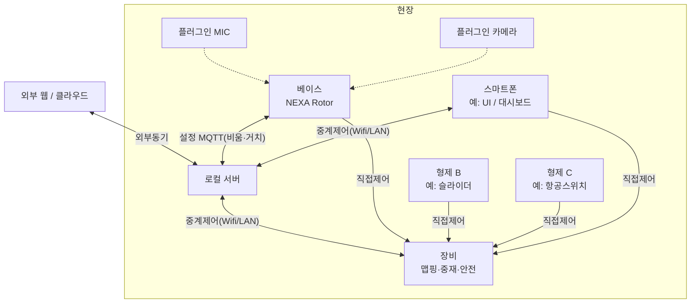
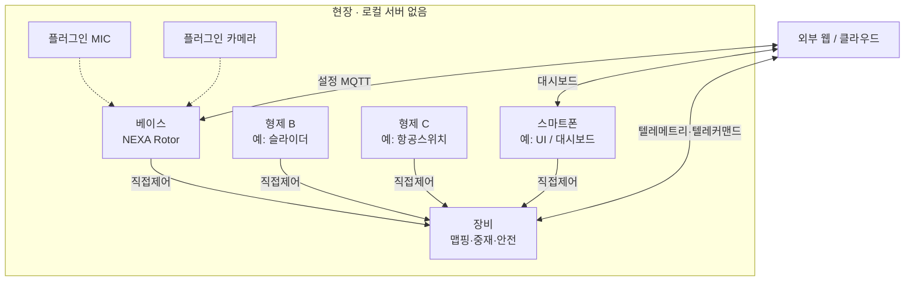

# 모듈형 오픈 하이브리드 컨트롤러 (Modular Open Controller)

**NEXA Rotor** 를 베이스 컨트롤러로 두고, 필요 시 **형제 컨트롤러**(스마트폰·장비 특화 조작 블록 등) 를 조합하고, **표준 제어 패킷**으로 장비를 다루는 모듈형 컨트롤러 플랫폼.

기구·센서·영점·마이크·화면은 [모듈형 오픈 컨트롤러 NEXA Rotor](모듈형%20오픈%20컨트롤러%20NEXA%20Rotor.md) 가 담당한다. 1 차 형제 판 (슬라이더·숫자 키·시작/정지) 은 [모듈형 오픈 컨트롤러 NEXA Deck](모듈형%20오픈%20컨트롤러%20NEXA%20Deck.md) 이다. 이 문서는 패밀리 규약 (역할, 패킷, 연결, 보안, 비상 정지 배치) 만 둔다.

---

## 0. 시스템 전제 (합의 요약)

### 0.1 용어

| 용어                                       | 정의                                                                                                                                              |
| :----------------------------------------- | :------------------------------------------------------------------------------------------------------------------------------------------------ |
| **컨트롤러 블록**                          | **조작·제어 입력**을 만들어 표준 패킷으로 보내는 단위. 센서 텔레메트리 노드가 아님.                                                               |
| **베이스 컨트롤러**                        | 1 차 물리 베이스. 실체는 **NEXA Rotor** (노브·터치 링·원형 터치·마이크). 기구는 Rotor 문서.                                                    |
| **형제 컨트롤러**                          | 베이스와 같은 패밀리의 **다른 형태 컨트롤러**. 베이스가 소화하기 힘든 **장비 특화 조작**, 또는 **스마트폰 (대시보드 + 소프트웨어 컨트롤 UI)** 등. |
| **장비 (Equipment)**                       | 기능이 있는 대상. 열융착기, 양봉카, PC(Desk Driver) 등.                                                                                          |
| **거치 (Mount)**                           | 테이블·암·벽면 등 기구. 제어 논리와 분리.                                                                                                         |
| **표준 패킷**                              | **컨트롤러 (베이스·형제) 의 조작·입력** 스냅샷/이벤트. 의미는 **장비 컨트롤 맵**이 정한다.                                                         |
| **장비 컨트롤 맵**                         | 표준 패킷 필드를 그 장비의 기능으로 읽는 표. 장비 문서의 절 제목이다. 펌웨어 기본과 브라우저에서 바꾸는 칸이 같은 표다. 자식은 `DeviceConfigPacket` 이고, 그 패킷은 페어링 때 로터 UI 템플릿·눈금만 싣는다. 기능 행은 장비에 남는다. |
| **터치 링**                                | 원형 터치 바깥에서 사용자가 누르는 링. 표준 패킷의 비트 마스크. 수량은 이름에 넣지 않는다. 지금은 8칸, 45°이고, 터치판 3장이 한 칸이다. 택트 스위치는 `BTN_MIC`, `BTN_SLOT` 이다. |
| **터치판**                                 | 터치 링 아래 구리판. 지금은 24장, 15°. 맞닿아 켜진 묶음은 터치판 그룹이다. |
| **인디케이터 LED**                         | 로터 위의 상태등. 수량은 이름에 넣지 않는다. 지금은 5칸이고, 링크, 무장, 청취, 배터리, 장애다. |
| **휠 버텀 LED**                            | 노브 아래 빛. 방향, 분, 인덱스. 터치판과 같은 각도다. 지금은 24칸. |
| **내장 LED**                               | GPIO48 사슬의 마지막 하나. 인디케이터 LED의 무장이 밖으로 안 보일 때만 그 슬롯 색을 따른다. 인디케이터 LED와 휠 버텀 LED 를 대신하지 않는다. |
| **플러그인 (Plugin)**                      | 베이스에 **유·무선으로 꽂는 입력/기능 확장**. **형제 컨트롤러가 아님** (조작 UI·독립 제어 주체 없음). 예: 음성용 추가 마이크 (`VOICE_EXT_MIC`, 절차는 Rotor 문서). |
| **로컬 서버**                              | 외부 웹 플랫폼의 **현장 형제**. 장비·폰이 붙는 허브. 컨트롤러 조종은 직결이고, Rotor 의 Wi-Fi 는 비움의 설정과 스피커 옵션의 사운드 스트림이다. 외부는 로컬 경유만 (§0.2.1). |
| **액세서리**                               | 전원 팩·RF 중계 등 **조작·음성 입력과 무관한** 보조.                                                                                              |
| **(이 문서 밖)** 장비·외부 센서 텔레메트리 | 온습도·하중 등 → **장비 또는 센서 → 플랫폼 웹서버**. 컨트롤러 패킷이 아님. 폰 대시보드에서 **조회만** 가능.                                       |

### 0.1.1 형제 / 플러그인 / 액세서리 구분

| 분류              | 예시                                                                  | 이유                                                   |
| :---------------- | :-------------------------------------------------------------------- | :----------------------------------------------------- |
| **형제 컨트롤러** | 베이스, **NEXA Deck**, 스마트폰, 조그·특화 블록 등 | 각각 **자체적으로 제어 가능**. 폼팩터·입력 수단만 다름 |
| **플러그인**      | 유선 스테레오 마이크 (`VOICE_EXT_MIC`)                            | 음성 채널 확장. 자체 컨트롤 UI 없음. 꽂힌 컨트롤러와 클럭을 공유 |
| **액세서리**      | 배터리 팩, 순수 RF 허브                                               | 전원/링크 보조만                                       |
| **문서 밖**       | 장비·필드 공정 센서                                                   | 텔레메트리 → 서버                                      |

### 0.1.2 마이크와 카메라

마이크는 세 겹이다.

| 겹 | 내용 |
| :--- | :--- |
| **플러그인** | 스테레오 마이크 `VOICE_EXT_MIC`. 유선으로 한 컨트롤러에 꽂고, 그 컨트롤러와 클럭을 공유한다. 조작 주체가 아니다 |
| **컨트롤러** | Rotor·Deck 모두 본체 마이크를 둘 수 있다. 평소 출력은 `VOICE_KEYWORD` 와 `MIC_LISTEN` 뿐이다 |
| **컨트롤러 사이 유선** | 두 컨트롤러가 유선으로 **샘플 클럭을 공유**하면 그 사이에서도 스테레오가 동작한다. 빔·구역처럼 지능형 기능은 이 연결에서 연다 |

무선으로만 이어진 컨트롤러끼리는 클럭이 없다. 각자 키워드만 보내고, 장비는 가까운 컨트롤러 또는 먼저 들어온 입력을 고른다. 오디오 샘플은 표준 패킷에 넣지 않는다.

카메라도 같은 겹이다. 플러그인 카메라는 꽂힌 컨트롤러와 트리거를 공유한다. 컨트롤러마다 카메라를 둘 수 있다. 컨트롤러 사이 유선으로 트리거가 맞을 때만 스테레오·정렬이 동작한다. 영상 프레임은 표준 패킷에 넣지 않고, 검출 결과만 보낸다.

**동일 액추에이터 · 다형 제어:** 노브 (Rotor)·슬라이더·키 (Deck)·스마트폰이 **같은 장비 액추에이터**를 다른 입력 형태로 건드릴 수 있다. 패킷은 표준 입력이고, **충돌 시 우선순위는 장비가 선택**.

### 0.2 역할 분담

```text
[외부 웹 / 클라우드 플랫폼]  ←—— 오직 로컬 서버 경유 ——→  [로컬 서버]
         (원격·전사 동기)         (현장 플랫폼 형제)            │
                                                         ┌─────┴─────┐
                                                         ▼           ▼
                                                   [장비…]    [컨트롤러 패밀리]
                                                         │           │
                                                         └── 직결(저지연) ─┘
```

| 주체                     | 역할                                                                                                                  |
| :----------------------- | :-------------------------------------------------------------------------------------------------------------------- |
| **외부 웹 플랫폼**       | 전사·원격·클라우드. **로컬 서버가 있으면 장비/컨트롤러에 직접 붙지 않고 로컬 서버만** 상대.                           |
| **로컬 서버**            | 외부 플랫폼의 **현장 형제**. 장비·폰이 붙는 **현장 허브**. 중계·프로필 캐시·로컬 대시보드. 컨트롤러 조종 패킷은 이 허브에 싣지 않는다. 개발 PC 로 시작 가능. |
| **베이스·형제 컨트롤러** | 표준 입력 패킷. 조종은 **장비 직결**. 로컬 서버 연결은 대시보드·설정이고, Rotor 의 조종 패킷은 그 연결에 실리지 않는다. |
| **장비**                 | **장비 컨트롤 맵**으로 해석·구동·충돌 중재. **로컬 서버** 연결 (목표). 텔레메트리 보고.                               |
| **스마트폰**             | 형제. 로컬 직결 + 로컬 서버 (·원격은 외부→로컬 경유).                                                                  |

### 0.2.1 플랫폼 = 외부 웹 + 로컬 서버 (형제)

로컬 서버는 컨트롤러 형제가 아니라 **플랫폼 서버의 현장형 형제**다.

| 규칙                  | 내용                                                                                                   |
| :-------------------- | :----------------------------------------------------------------------------------------------------- |
| **로컬 서버 있음**    | 장비·폰·대시보드 → **로컬 서버**. Rotor 의 Wi-Fi 는 무장 해제 중의 설정과, 스피커 옵션의 사운드 스트림뿐이다 (§0.2.2). 외부 웹 → **로컬만** (§0.2.3 경우 1). |
| **외부 단절**         | 로컬 서버만으로 현장 IoT·중계·대시보드 유지 가능.                                                      |
| **로컬 서버 없음**    | 장비 MQTT → **외부 브로커 직접** + **장비 직결** (§0.2.3 경우 2). 텔레메트리와 텔레커맨드 모두 이 경로를 연다. 로컬이 생기면 경우 1 로 전환. |
| **형제 컨트롤러 P2P** | **보류** (§0.2.4). 허브는 로컬 서버 (또는 경우 2 에서는 외부 웹).                                       |

**연결 자동 감지:** 장비와 폰이 기동·주기적으로 **로컬 서버 유무**와 **원격 (외부) 서버 연결 가능 여부**를 검사해, 경우 1 / 경우 2 / 직접제어만 경로를 자동 선택·전환하고 현재 모드를 표시한다. Rotor 의 조종 경로는 로컬 유무와 상관없이 직결이다. 바뀌는 것은 설정 MQTT 의 브로커 위치뿐이다.

### 0.2.2 제어·연결 경로

| 상황                      | 경로                                                               |
| :------------------------ | :----------------------------------------------------------------- |
| 현장 저지연               | 컨트롤러 → **장비 직결** (ESP-NOW 또는 CAN)                        |
| 현장 IoT·중계·폰 대시보드 | 장비·폰 → **로컬 서버**. Rotor 의 조종 스트림은 이 행에 넣지 않는다 |
| 원격·전사, 로컬 있음      | 원격 클라이언트 → **외부 웹** → **로컬 서버 MQTT** → 장비          |
| 원격·전사, 로컬 없음      | 장비 MQTT → **외부 브로커 직접**. 직결은 그대로                    |

원격도 오픈 컨트롤러 입력 모델을 유지한다. 텔레커맨드는 현장에서와 같은 **표준 패킷**이고, 통로는 MQTT 다. 로컬 서버가 있으면 그 브로커가 중계한다. 로컬 서버가 없는 현장도 지원한다. 그때 장비가 외부 브로커를 직접 구독하고, 로컬이 생기면 외부 직결은 끊는다. 파이썬 프로세스는 이 중계에 두지 않는다.

텔레메트리(온도·하중 등)도 같은 MQTT 다. 장비에서 브로커로 올라가고, 컨트롤러 표준 패킷에는 넣지 않는다. ESP-NOW·CAN 만 있는 장비는 이 구독을 열지 않는다. 텔레커맨드나 텔레메트리를 쓸 장비가 MQTT 를 연다. 순위는 아래와 같아서, 현장 직결이 외부 MQTT 보다 위다.

충돌 시 장비 우선순위 예:
`안전정지 > 로컬 수동 직결 > 로컬 서버 중계 수동 > 외부 경유 원격 > 서버 자동`

같은 등급에서 Rotor 와 Deck 처럼 같은 축을 건드리면 장비가 정리한다. 기본은 **작업 위치에 더 가까운 컨트롤러**, 거리가 같거나 모르면 **그 축에 먼저 입력이 들어온 컨트롤러**다. 장비 프로필이 합성·거절·축별 고정을 따로 정할 수 있다.

현장 조종을 MQTT 로 옮기지 않는다. 지연이 긴 장비도 예외가 아니다. 배터리는 Rotor 에 있다. 조종하려고 Wi-Fi 에 붙으면 그 접속 동안 라디오가 깨어 있고, 같은 2.4 GHz 라 진행 중인 ESP-NOW 가 멈춘다. 짧은 조작에도 접속과 해제의 전류가 들고, 세션을 유지하면 비움 사다리가 아끼던 소비가 돌아온다. 그래서 Rotor 는 무장·`STREAM` 중에 Wi-Fi 를 열지 않는다. 그 Wi-Fi 로 오고 가는 것은 퀵 전환 표, `event`, NTP, 그리고 스피커 옵션의 사운드 스트림뿐이다. 사운드 스트림은 현장 조종이 아니다. 절차는 [NEXA Rotor](모듈형%20오픈%20컨트롤러%20NEXA%20Rotor.md) 「사운드 스트림」이다.

이중 무선은 콘센트 전원인 장비가 감수한다. 그 장비는 ESP-NOW 또는 CAN 으로 Rotor 의 현장 조종을 받고, 포털 MQTT 로 텔레메트리와 텔레커맨드를 연다. 채널은 AP 에 맞추고, 구동 펄스처럼 짧은 구간만 MQTT 송신을 양보한다. 이 코드가 장비 쪽에 있는 이유는 그 보드가 상시 전원이라 시분할이 배터리를 깎지 않기 때문이다.

포털의 고성능 AI 가 텔레메트리를 분석해 장비를 지능적으로 돌리는 명령도 이 텔레커맨드다. 수신자는 그 장비 자신이다. 로터를 거쳐 다시 보내지 않는다. 판정은 포털에 둔다. 로터와 장비 MCU 는 그 모델을 돌리지 않는다. 순위에서도 이 명령은 `서버 자동` 이라 현장 직결보다 아래다. 로터가 분석 결과를 받아 Wi-Fi 로 장비에 넘기면 배터리를 쓰고, 무장 중에는 그 Wi-Fi 가 닫혀 있어 명령이 비움까지 늦어진다. 장비는 자기 텔레메트리를 올리고, AI 의 목표와 보정은 자기 명령 토픽으로 받는다. 로터 펌웨어에 장비별 AI 분기를 넣지 않는다.

`로컬 서버 중계 수동` 은 폰·웹이 로컬 브로커로 넣는 수동이다. Rotor 의 손 조작은 이 등급으로 올라가지 않고, 로컬 수동 직결로 남는다. [NEXA Desk Driver](장비-NEXA%20Desk%20Driver.md)(ESP32-S3, 데스크 드라이버)와 NEXA Desk는 dest 가 PC 일 때만 있다. 브라우저와 운영체제가 ESP-NOW 를 듣지 못하기 때문이다. 자기 라디오가 있는 장비의 텔레커맨드는 이 경로를 거치지 않는다.

### 0.2.3 시스템 연결 다이어그램

#### 경우 1 — 로컬 서버 **있음** (권장)

외부 웹은 로컬만 상대. 장비와 폰은 로컬 서버에 붙고, 컨트롤러의 조종은 장비 직결이다. Rotor 가 로컬과 여는 Wi-Fi 는 비움·거치의 설정 MQTT 와, 스피커 옵션의 사운드 스트림이다. 스트림 절차는 [NEXA Rotor](모듈형%20오픈%20컨트롤러%20NEXA%20Rotor.md) 「사운드 스트림」이다.



Rotor 와 로컬 서버의 화살표는 중계 조종이 아니다. 무장 해제·비움·거치에서 `slot`, `event`, NTP 를 받는 설정 MQTT 다. 사운드 스트림은 이 화살표가 아니다. 절차는 [NEXA Rotor](모듈형%20오픈%20컨트롤러%20NEXA%20Rotor.md) 「사운드 스트림」이다. 배터리가 Rotor 에 있어서, 조종 중 Wi-Fi 는 ESP-NOW 와 채널을 다투고 접속을 유지하면 비움 사다리의 절약이 사라진다. 형제 컨트롤러의 조종도 직결이다. 그림의 `중계제어` 는 폰과 장비뿐이다. 형제를 중계로 그리면 조종 패킷이 Wi-Fi 를 탄다고 읽히기 때문이다.

#### 경우 2 — 로컬 서버 **없음**

장비가 **외부 브로커 MQTT** 로 텔레메트리와 텔레커맨드를 직접 한다. 장비와의 직접제어는 그대로.



|               | 로컬 있음 (경우 1)                 | 로컬 없음 (경우 2)              |
| :------------ | :--------------------------------- | :------------------------------ |
| 외부 웹       | **로컬 서버만** 상대 (`외부동기`)  | 장비와 **텔레메트리·텔레커맨드**. Rotor 와는 비움의 **설정 MQTT** |
| 현장 허브     | 로컬 서버. 장비·폰은 중계. Rotor Wi-Fi 는 설정과 사운드 스트림 | 없음. 직접제어와 장비의 외부 MQTT |
| 장비 직접제어 | 있음 (저지연)                      | 있음 (1 차 생존)                 |
| 형제 P2P      | 보류                               | 보류                            |

경우 1 과 경우 2 를 둘 다 둔다. 로컬이 없는 현장은 경우 2 다. 로컬이 생기면 외부 직결은 끊고 경우 1 로 전환.

경우 2 에서 외부 웹이 Rotor 와 여는 연결은 무장 해제의 설정 MQTT 다. `slot`, `event`, NTP 만 오간다. 조종 패킷은 실리지 않는다. 배터리를 가진 Rotor 가 원격 조종의 라디오가 되면, 그 접속 동안 ESP-NOW 직결이 멈추기 때문이다. 텔레메트리와 텔레커맨드는 장비와 외부 브로커 사이다. 직접제어는 어느 경우에도 남는다. 형제 컨트롤러에서 외부 웹으로 가는 조종 화살표는 그리지 않는다.

### 0.2.4 형제 컨트롤러 간 통신 (P2P) — **보류**

**채택하지 않음 (보류).** 복잡도 대비 이득이 작고, 허브는 **로컬 서버**가 담당한다.

- 서버 (로컬) down 이어도 **장비 직결**로 제어 가능.
- 폰↔베이스 상태 공유 등은 향후 **로컬 서버 경유**로 풀거나, 그때만 제한적 P2P 를 재검토.

### 0.3 변신의 위치

컨트롤러는 **항상 같은 표준 패킷**을 보낸다.
장비가 패킷을 자기 동작으로 맵핑하고, 이전 셋팅은 **(외부→) 로컬 서버 → 장비**로 로드한다.
동일 컨트롤러라도 연결된 장비·프로필에 따라 **장비 측에서 “변신”**한다.

### 0.4 베이스의 실체 — NEXA Rotor

베이스 컨트롤러의 기구·센서·펌웨어 실체는 **NEXA Rotor** 다. MT6701, 베어링, 원형 터치, 터치 링, 두 개의 0°, 마이크, 화면은 Rotor 문서.

이 문서가 베이스에 대해 고정하는 것은 다음뿐이다.

| 항목 | 규약 |
| :--- | :--- |
| 입력 | 노브 절대각·증분, 터치 링 마스크 두 프레임, 원형 터치, 마이크 |
| 가공 | 감도·양자화·제스처 이름은 컨트롤러가 붙이지 않는다. 장비 컨트롤 맵 |
| 영점 | 소프트웨어 0° 는 페어링 ACK 순간의 노브 마크. 절차는 Rotor 문서 |
| 넣지 않는 것 | AS5600 포켓 휠, 평면 XY 터치, 외곽 키, 사이드 Mode, 노브 안 비상 정지 |

여기서 말하는 **사이드 Mode** 는 컨트롤러 본체의 물리 스위치다. 장비가 `DeviceConfigPacket.touchMode` 로 선언하는 UI 템플릿 (4 분할, 조이스틱, 스크롤, PC 포인터) 과는 별개다.

초기 기계식 로터리 인코더와 AS5600 포켓 휠 중심 설계는 베이스 정의에서 빠진다.

### 0.5 출시 로드맵

| 단계          | 범위                                                           |
| :------------ | :------------------------------------------------------------- |
| **1 차**      | **NEXA Rotor (베이스)** + **열융착기** (표준 패킷, 유·무선)    |
| **2 차**      | 스마트폰 형제 컨트롤러 (대시보드·소프트웨어 UI·페어링)         |
| **3 차**      | **로컬 서버** (개발 PC) → 이후 외부 웹은 로컬 서버 경유        |
| **확장 검증** | [NEXA Desk Driver](장비-NEXA%20Desk%20Driver.md) + 무선 → **포인터·매크로 대체 가능 여부** |

### 0.5.1 상기 — 1 차 성공 정의 (이 문장만 증명하면 됨)

> **보안 있는 NEXA Rotor ↔ 열융착기** 로, 노브 조향·터치 링 시작/정지·비상 (장비 기본 장착 또는 안전 모듈) 이 된다.

- 증명 단위는 **만능 리모컨·전 장비·폰·서버가 아님**.
- 공통은 **프로토콜**. 전 장비 유·무선 동시 완비는 1 차 필수 아님.
- 1 차 Arm 은 **장비/유선 확정**만으로도 가능해야 함 (폰 없이도).
- PC 포인터·다장비 브로드캐스트는 **나중 검증**.
- 마이크는 Rotor 에 두되, 1 차 성공 문장의 필수 증명에서는 빠진다.
- 컨트롤러만 완성하고 열융착기 **수신·맵핑·Arm**을 미루면 1 차 실패로 본다.

### 0.6 대수·협력

- **기본:** 컨트롤러 1 대 ↔ 장비 1 대 (대상 지정).
- **최종:** 한계 이상 장비에 연결·협력. 전송은 브로드캐스트 가능, **해석·반응 여부는 각 장비**.

---

## 1. 통신·주소 지정 (유니캐스트 기본)

### 1.1 후자 (장비 대상 지정) — 가능하며 **기본으로 채택**

무선 물리 계층이 브로드캐스트여도, **패킷 헤더의 목적지 필드로 필터**하면 된다.

| 모드                    | `dest_id`                  | 용도                                                 |
| :---------------------- | :------------------------- | :--------------------------------------------------- |
| **유니캐스트 (기본)**   | 특정 `equipment_id`        | 페어링된 장비만 반응. 다른 장비는 수신해도 **무시**. |
| **브로드캐스트 (옵션)** | `0xFFFFFFFF` (또는 예약값) | 다수 장비 협력·발견. 장비 정책이 허용할 때만 반응. 자리 `PRESENCE` (`0x0F`) 는 이 주소로 보내고, 모션은 담지 않는다. |
| **멀티캐스트 (확장)**   | 그룹 ID                    | 협력 그룹만 반응 (후순위).                           |

**페어링 흐름 (권장):**

1. 스마트폰이 컨트롤러·장비를 각각 (또는 함께) 연결.
2. 장비에 `allowed_controller_id` 등록, 컨트롤러에 `active_dest_id` 설정.
3. 이후 컨트롤러는 **유니캐스트**로 표준 패킷 송신.
4. 장비는 `dest_id == me` (또는 허용 브로드캐스트) 이고 `controller_id` 허용일 때만 적용.

유선 도킹 시에도 동일 프레임을 쓰되, 물리적으로 1:1 이면 `dest_id` 는 고정·생략 가능 (링크 로컬).

### 1.2 링크 종류 (컨트롤러·장비)

| 구간                        | 예시 링크                                |
| :-------------------------- | :--------------------------------------- |
| 베이스 ↔ 스마트폰 (형제)    | USB-C (기본)                             |
| 베이스 ↔ 특화 형제 컨트롤러 | CAN, I2C, 포고 도킹, 무선 등             |
| 컨트롤러 패밀리 ↔ 장비      | **유선 도킹 + 무선** (장비별 단계적)     |
| PC 장비                     | [NEXA Desk Driver](장비-NEXA%20Desk%20Driver.md)(데스크 드라이버) ← 컨트롤러 무선 |

페이로드는 **제어 입력**으로 통일. 장비/외부 센서 텔레메트리는 이 링크의 책임이 아님.

### 1.3 전송 주기 정책 — **하트비트 기본 + 이벤트 시 전송**

| 종류          | 조건                     | 내용                                                                 |
| :------------ | :----------------------- | :------------------------------------------------------------------- |
| **하트비트**  | 조작·무장 중 1~5 Hz. Rotor 비움은 사다리 | 생존·`seq`·페어링·`hbPeriodMs`. 잔량 퍼센트는 싣지 않는다. **이 주기가 끊기면** 장비는 출력 0, 직전 속도 유지 금지. Rotor 의 간격·상한·수신 창은 Rotor 문서 「비움 사다리」 |
| **스트림**    | 연속 조작 중, 상한 100 Hz | 노브 절대각·증분, 접촉 중 터치. `msg_type = STREAM`. 홀드 중에도 절대각을 반복 |
| **이벤트**    | 상태 변화 시             | 스위치 엣지, 마이크 청취, 형제 착탈, 비상 접점 알림, 잔량·충전 변화 (`0x2A`) |
| **풀 스냅샷** | 페어링 직후·복구·요청 시 | 코어 (+ 형제 합류 입력) 1 회                                         |

베이스 (Rotor) 는 연속 각을 데드존으로 걸러 침묵시키지 않는다. 감도·양자화는 장비가 한다.
스트림이 잠시 비어도 하트비트가 살아 있으면 링크 사망이 아니다. 그때 장비는 **마지막 절대각**을 유지하고, 마지막 속도를 유지하지 않는다.
끊김 시간은 마지막으로 알린 `hbPeriodMs` × 놓친 횟수다. 간격을 알리지 않는 컨트롤러는 1~5 Hz 를 그 횟수만큼 놓친 것으로 본다. 끊기면 DISARM 과 함께 출력 0. Rotor 의 횟수와 비움 사다리는 Rotor 문서가 정한다.

---

## 2. 표준 패킷 v0.1

정의: **컨트롤러 (베이스·형제) 의 조작·제어 입력**.
장비 구동 명령·G-code·PID·**장비/외부 센서 텔레메트리**는 넣지 않는다.

```text
[헤더] + [코어/형제 제어 입력] + [이벤트] + [CRC]
```

### 2.0 컨트롤러가 보내는 데이터 종류 (타입 카탈로그)

`msg_type`(전송 형태) 과 `data_type`(제어 내용) 을 구분한다.
**온습도·하중·거리 등 공정 센서 값은 이 목록에 없다** → 장비/센서 → 플랫폼 서버 (폰은 대시보드로 조회 가능).

#### A. 전송 형태 (`msg_type`)

| 코드   | 이름        | 설명                       |
| :----- | :---------- | :------------------------- |
| `0x01` | `HEARTBEAT` | 주기 생존·요약             |
| `0x02` | `EVENT`     | 조작·착탈·장애 등 단발     |
| `0x03` | `SNAPSHOT`  | 제어 입력 전체 1 회        |
| `0x04` | `STREAM`    | (옵션) 장비 요청 시 고주기 |

#### B. 코어 데이터 타입 — 베이스 NEXA Rotor (`data_type`)

논리 필드의 정의·좌표계·`framePref` 는 Rotor 문서의 `ControllerOutputPacket`. 온더와이어 봉투 (헤더·`msg_type`·CRC) 는 이 절이다.

| type   | 이름                | 페이로드 요지                                                         | v1        |
| :----- | :------------------ | :-------------------------------------------------------------------- | :-------- |
| `0x20` | `KNOB_ABS`          | `knobAngleDeg` (θ_soft), `sensorAngleDeg` (θ_sensor). 감도 미적용     | 필수      |
| `0x21` | `KNOB_DELTA`        | `knobDeltaStep`. 감도·양자화 미적용                                   | 필수      |
| `0x22` | `BTN_DIR`           | `buttonMaskSoft`, `buttonMaskMark`, `framePref`. 기본 `0x03` (bit0=1 터치 소프트웨어 0, bit1=1 터치 링 소프트웨어 0). 마스크는 45° 칸 8 비트 | 필수      |
| `0x26` | `TOUCH_POLAR`       | `touchState`, `touchCount`, `touchFixedDeg`, `touchMarkDeg`, `touchLevel` | 필수 |
| `0x28` | `IMU_ATTITUDE`      | roll / pitch. 절대 수평은 중력 기준, 상대 수평은 잡아 둔 기준 자세와의 차. Rotor 기본 패킷에는 넣지 않음. 채택 시 프로토콜 버전 상승 | 보류   |
| `0x29` | `IMU_RAW`           | accel / gyro. Rotor 는 6 축. `MT6701` 자석 때문에 지자기는 넣지 않음. 기본 패킷 제외 | 보류      |
| `0x2A` | `POWER`             | `batt_pct`, `charging`, `docked`. Rotor 기본 장착. `docked` 는 스테이션 거치고 `charging` 과 별개. `STREAM`·매 `HEARTBEAT` 에는 넣지 않는다. 문턱은 아래 표 | 기본 |
| `0x2B` | `VOICE_KEYWORD`     | 동작 중인 화이트리스트의 키워드 ID. `LISTEN_ON` 일 때만. 목록·기본 리스트는 Rotor 문서. 오디오 스트림 아님 | Rotor 계획 |
| `0x2E` | `MIC_LISTEN`        | 청취 ON/OFF·사유. 절차는 Rotor 문서                                   | Rotor 계획 |
| `0x2C` | `CONTROLLER_STATUS` | `fault`, `link_q`, arm 요청 힌트, `hbPeriodMs`. `HEARTBEAT` 페이로드. 헤더 `link` (물리 링크 종류) 와 별개. 100 Hz 코어에 넣지 않음. 간격을 늘리기 전에 `hbPeriodMs` 로 알린다 | 필수 |
| `0x2D` | `CAPABILITY`        | 장착 입력 비트. 형제 비트는 2 차 착탈 때 갱신. 송신 규칙은 Rotor 문서 | 1 차 장착 비트, 2 차 형제 비트 |

베이스는 제스처 이름과 스크롤 Δ 를 만들지 않는다. 탭·조이스틱·스크롤·포인터는 장비가 `TOUCH_POLAR` 와 `BTN_DIR` 로 계산한다. 형제 컨트롤러의 소프트웨어 축·버튼은 §2.0-C.

`0x2A` 는 페어링 `SNAPSHOT` 1 회, `charging` 변화, `docked` 변화, `POWER_STEP_PCT` 이상 잔량 변화, `POWER_LOW_PCT` 하향 돌파, 그리고 무변화 `POWER_REFRESH_S` 재송신으로만 보낸다. 기본값은 여기가 기준이다.

| 이름 | 기본값 | 단위 | 의미 |
| :--- | ---: | :--- | :--- |
| `POWER_STEP_PCT` | 1 | % | 마지막 송신값과의 잔량 차가 이 값 이상일 때만 `EVENT` |
| `POWER_LOW_PCT` | 20 | % | 잔량이 이 값을 내려 넘으면 `LOW_BATTERY` 와 `0x2A` |
| `POWER_REFRESH_S` | 60 | 초 | 변화가 없어도 `0x2A` 를 한 번 다시 보내는 간격 |

이전 초안의 `WHEEL_*`, `BTN_OUTER`, `SW_SIDE`, `CLICK_GESTURE`, `TOUCH_XY`, `TOUCH_SCROLL` 은 베이스 코어에서 빠진다.

#### C. 형제 컨트롤러 합류 타입 (`data_type`) — 제어 입력만

베이스가 아닌 **다른 형태 컨트롤러**가 같은 표준으로 싣는 값. 공정 센서 아님.

| type   | 이름             | 출처 예        | 페이로드 요지                                                 |
| :----- | :--------------- | :------------- | :------------------------------------------------------------ |
| `0x30` | `SIBLING_META`   | 모든 형제      | `sibling_id`, 역할 (phone/specialized), FW                    |
| `0x31` | `UI_AXIS`        | 폰·특화 UI     | 소프트웨어 축/슬라이더 값 (0~1 또는 int)                      |
| `0x32` | `UI_BUTTON`      | 폰·특화 UI     | 가상 버튼·토글 비트                                           |
| `0x33` | `UI_COMMAND`     | 폰             | 사용자 의도 명령 ID (시작/일시정지 요청 등 — **확정은 장비**) |
| `0x34` | `SPECIAL_JOG`    | 장비 특화 블록 | 조그·전용 엔코더 Δ                                            |
| `0x35` | `SPECIAL_KEYPAD` | 장비 특화 블록 | `key_id`, `value`. Deck 은 숫자·시작·정지·레버·푸시락. 필드 예는 Deck 문서 |
| `0x36` | `SPECIAL_ANALOG` | 장비 특화 블록 | `axis`, `value` (`0`~`1`). Deck 슬라이더는 축 `0`~`5`. 송신 간격은 아래 `SLIDER_STEP`. 필드 예는 Deck 문서 |
| `0x3F` | `SIBLING_VENDOR` | 형제 커스텀    | 벤더 확장 (여전히 **조작** 의미)                              |

`0x36` 은 마지막 송신값과의 차가 `SLIDER_STEP` 이상일 때만 그 축을 `EVENT` 로 보낸다. 패킷의 `value` 는 측정된 위치이고, 스텝 격자에 맞추지 않는다. 움직임이 멈추고 남은 차가 `SLIDER_STEP` 보다 작으면 그 실제 위치를 한 번 더 보낸다. 장비가 쓸 눈금·감도는 장비 컨트롤 맵이다. 기본값은 여기가 기준이다.

| 이름 | 기본값 | 단위 | 의미 |
| :--- | ---: | :--- | :--- |
| `SLIDER_STEP` | 0.01 | `0`~`1` 비율 | 100 스텝. `0`~`1` 전체를 이 간격으로 나누어 송신 |

#### D. 이벤트 코드 (`event_id`)

| event_id | 이름             | 의미                                         |
| :------- | :--------------- | :------------------------------------------- |
| `0x01`   | `ESTOP_REQUEST`  | 비상 접점의 사후 알림. 하드와이어 차단을 대신하지 않음 (§5) |
| `0x02`   | `PAIR_BEACON`    | 페어링 광고                                  |
| `0x03`   | `SIBLING_ATTACH` | 형제 컨트롤러 연결                           |
| `0x04`   | `SIBLING_DETACH` | 형제 컨트롤러 분리                           |
| `0x05`   | `FAULT`          | 컨트롤러 장애                                |
| `0x06`   | `ARM_REQUEST`    | 무장 요청 (확정은 장비)                      |
| `0x07`   | `DISARM_REQUEST` | 해제 요청                                    |
| `0x08`   | `DEST_CHANGED`   | 활성 `dest_id` 변경                          |
| `0x09`   | `MODE_CHANGED`   | 예약/미사용. 본체 사이드 Mode·절대/상대 플래그는 베이스에서 빠졌다. 장비 `touchMode` 는 이 이벤트가 아니다 |
| `0x0A`   | `LOW_BATTERY`    | 잔량이 `POWER_LOW_PCT` 를 내려 넘을 때. 같은 순간 `0x2A` 를 함께 보낸다 |
| `0x0B`   | `SESSION_REVOKE` | 세션 폐기                                    |
| `0x0C`   | `GESTURE_FIRE`   | 예약/미사용. 베이스는 제스처 이름을 만들지 않는다. `0x25` 타입은 없다 |
| `0x0D`   | `VOICE_ON`       | 마이크 청취 활성 (button / wake)             |
| `0x0E`   | `VOICE_OFF`      | 비활성 (button / post_cmd / timeout / noise) |
| `0x0F`   | `PRESENCE`       | 자리 비움 `AWAY` (`0`) 또는 복귀 `RETURN` (`1`). 브로드캐스트 `EVENT`. 로터는 사실을 알리고, 반응은 수신을 켠 장비가 정한다. 절차는 Rotor 문서 「존재 감지」 |

> 같은 `KNOB_DELTA` / `UI_AXIS` 라도 장비 컨트롤 맵에 따라 조향·포인터·온도 오프셋 등으로 달라진다.

#### E. 이 문서에서 제외하는 데이터

| 제외                                          | 어디로                                                    |
| :-------------------------------------------- | :-------------------------------------------------------- |
| 온도·습도·거리·하중·공압·유량·RPM·전류·GPS 등 | **장비 MQTT 텔레메트리**. 로컬 브로커, 없으면 외부 브로커. §0.2.2 |
| 서버→장비 원격 운전 명령                      | **장비 MQTT 텔레커맨드**. 같은 표준 패킷. §0.2.2         |
| 포털 AI 의 지능 제어 (목표·보정)              | **그 장비가 포털 MQTT 로 직접 수신**. 로터 재전달 없음. §0.2.2 |
| 폰 대시보드의 텔레메트리 표시                 | 서버/장비 API 를 **조회**할 뿐, 컨트롤러 표준 패킷이 아님 |

### 2.1 헤더

| 필드            | 설명                                                   |
| :-------------- | :----------------------------------------------------- |
| `protocol_ver`  | 스키마 버전                                            |
| `controller_id` | 베이스 고유 ID                                         |
| `dest_id`       | 대상 장비 ID. 브로드캐스트=예약값                      |
| `seq`           | 증가 시퀀스                                            |
| `ts_ms`         | 상대 타임스탬프                                        |
| `msg_type`      | §2.0-A (`HEARTBEAT` / `EVENT` / `SNAPSHOT` / `STREAM`) |
| `link`          | USB / CAN / ESPNOW / … (디버그)                        |
| `flags`         | paired, `low_batt`, fault 등. `low_batt` 는 1 비트. 잔량 퍼센트는 `0x2A` |
| `session_id`    | (옵션) 폰 페어링 세션                                  |

### 2.2 코어 입력 (베이스 = NEXA Rotor) — §2.0-B 요약

| 그룹     | 대응 type     | 필드 예                                                                 |
| :------- | :------------ | :---------------------------------------------------------------------- |
| 노브     | `0x20` `0x21` | `knobAngleDeg`, `sensorAngleDeg`, `knobDeltaStep`                       |
| 터치 링 | `0x22`        | `buttonMaskSoft`, `buttonMaskMark`, `framePref` 기본 `0x03`. 45° 칸 8 비트 |
| 원형 터치 | `0x26`       | `touchState`, `touchCount`, `touchFixedDeg`, `touchMarkDeg`, `touchLevel` |
| 마이크   | `0x2B` `0x2E` | keyword, `mic_listen`. 100 Hz 제어 패킷과 분리. 절차는 Rotor 문서       |
| 전원     | `0x2A`        | 기본 장착. 매 패킷이 아님. 문턱은 `POWER_STEP_PCT` 1, `POWER_LOW_PCT` 20, `POWER_REFRESH_S` 60 |
| 상태     | `0x2C`        | `fault`, `link_q`, arm 힌트. `HEARTBEAT`. 헤더 `link` 와 별개           |
| 능력     | `0x2D`        | 장착 비트. 형제 비트는 2 차. 규칙은 Rotor 문서                          |

### 2.3 형제 컨트롤러 합류 — §2.0-C

특화 블록·스마트폰 UI 입력이 표준 패킷에 **제어 타입 (`0x30`~)** 으로 합류.
TLV 를 쓰더라도 `type` 은 **조작 계열만** (센서 TEMP 등 금지).

| 필드         | 설명                   |
| :----------- | :--------------------- |
| `sibling_id` | 형제 컨트롤러 인스턴스 |
| `data_type`  | §2.0-C                 |
| `status`     | ok / stale / fault     |
| `payload`    | UI 축·키·조그 등       |

### 2.4 이벤트 — §2.0-D

### 2.5 넣지 않는 것

- 장비 액추에이터 최종 명령, G-code, 서버 권위 PID/셋포인트
- 장비·외부 센서 텔레메트리 (서버 채널) — §2.0-E
- 컨트롤러가 장비 프로필로 의미를 내부 스위칭한 결과 → 맵핑은 **장비** 책임

---

## 3. 형제 컨트롤러·거치

### 3.1 레고식 형제 컨트롤러

베이스가 커버하지 못하는 **조작 형태**를 형제로 붙인다. 버스·도킹으로 ID 스캔·핫플러그.

| 형제 예             | 역할                                                        |
| :------------------ | :---------------------------------------------------------- |
| 베이스 (NEXA Rotor) | 노브·터치 링·원형 터치·마이크. **자체 컨트롤러**. 기구는 Rotor 문서 |
| NEXA Deck       | 슬라이더·SPST·DPDT·푸시락·발판 잭 각 6, 숫자 키, 시작/정지, Rotor 와 같은 노브·터치 링·원형 터치·마이크. 스위치는 트리거 접점. 배터리는 없고 유선 전원. MCU 를 두고 CAN·ESP-NOW. 7 개 이상은 스페셜 컨트롤러. 버섯은 같은 상자의 안전 모듈. 기획은 Deck 문서 |
| 스마트폰            | 대시보드 + 소프트웨어 컨트롤 UI (`UI_*`)                    |
| (향후) 조그 등 | 동일 표준 패킷의 다른 폼팩터                                |

슬라이더형 B 와 스위치형 C 는 별도 제품이 아니다. 그 1 차 실체는 NEXA Deck 한 대다.

A/B/C 는 등급이 아니라 **형태만 다름**. 같은 액추에이터를 동시에 건드리면 **장비가 우선순위·합성·거절**을 결정한다. 같은 등급의 기본 정리는 가까운 컨트롤러, 이어서 먼저 들어온 입력이다 (§0.2.2).
전원 팩·RF 허브·마이크 플러그인은 형제 아님.

### 3.2 거치

- 테이블, 3 단 암, 벽/자석·클립 등 — **제어와 무관**
- 동일 베이스 (및 형제) 를 거치만 바꿔 사용

### 3.3 스마트폰 (형제 컨트롤러)

| 상태    | 동작                                                                          |
| :------ | :---------------------------------------------------------------------------- |
| 폰 연결 | 소프트웨어 컨트롤 + 대시보드 (컨트롤러 상태; 텔레메트리는 서버 조회) + 페어링 |
| 폰 없음 | **베이스만**으로 제어 (1 차 포함)                                             |

---

## 4. 전원

컨트롤러는 자체 전원으로 장비와 떨어질 수 있다. 셀 용량, 충전, 회전부를 넘는 급전은 **NEXA Rotor** 기구 범위다. 이 문서는 전원 팩을 액세서리 (비입력) 로만 분류한다. 장비 도킹으로 전력을 보조할 수 있으나, 그것은 형제 컨트롤러의 조건이 아니다.

---

## 5. 안전 (비상 정지)

비상 정지는 **Rotor 몸체 밖**이다. 노브의 터치 링이나 제어 패킷으로 차단을 대신하지 않는다. MCU 정지와 무선 단절과 무관하게, 전원 또는 액추에이터 릴레이가 **하드와이어 직렬**로 끊겨야 한다.

| 배치 | 내용 | 언제 |
| :--- | :--- | :--- |
| **장비 기본 장착** | 적색 버섯 스위치를 장비 하우징에 둔다 | 기본 |
| **안전 모듈** | 같은 스위치를 독립 모듈로 만들어 장비 안전 회로에 직렬 삽입한다. 형제 컨트롤러도 플러그인도 아니다. 조작 패킷을 만들지 않는다 | 장비에 자리를 두기 어려울 때 |

접점 신호를 장비가 읽어 DISARM 과 로그에 쓸 수 있다. 그 알림이 `ESTOP_REQUEST` 다. 로그 경로가 죽어도 하드와이어 차단은 유지된다.

산업 안전이 필요한 장비는 위 둘 중 하나를 둔다. 둘 다 없는 장비만 프로필에 soft-stop 을 적는다.

서버 명령과 컨트롤러 입력이 겹치면 장비가 우선순위로 결정한다.

`안전정지 > 로컬 수동 직결 > 로컬 서버 중계 수동 > 외부 경유 원격 > 서버 자동`

---

## 6. 부팅·페어링 시퀀스 (장비 기준)

1. **장비 부팅** (서버 연결은 장비 정책에 따름).
2. **스마트폰 (또는 수동·유선 확정) 으로 컨트롤러↔장비 페어링** → `active_dest_id` / `allowed_controller_id`. 세션·Arm 은 §11.
3. Rotor 는 ACK 순간에 소프트웨어 0° (`θ_pair`) 를 저장한다. 각도 절차만 Rotor 문서.
4. 컨트롤러 **SNAPSHOT** 1 회 + 이후 **HEARTBEAT** + 연속 조작 중 **STREAM** + **EVENT**.
5. 장비는 표준 패킷을 해석해 구동. 셋팅·이력은 서버에서 장비로 로드.
6. 유선 도킹 시에도 동일. 무선만으로도 동일 프로토콜.

PC 검증: PC 는 장비 중 하나다. [NEXA Desk Driver](장비-NEXA%20Desk%20Driver.md)와 NEXA Desk(런타임)는 dest 가 PC 일 때만 있다. 브라우저와 운영체제가 ESP-NOW 를 듣지 못하기 때문이다. 다른 장비의 텔레커맨드 중계가 아니다. Desk Driver(ESP32-S3)가 세션 무장 뒤에 USB HID 와 로컬 구동단(MOSFET/SSR/트라이액 등)을 만든다. 버튼 5 개로 Desk 없이 모드를 고른다. Desk는 모드별 표와 실시간 주입만 하고, 패킷마다 해석하지 않는다. 디폴트 키 배정 (커서, 방향키, 수정키, 스크롤) 은 연구 중이다. 브라우저 페이지는 HID 로도 누르고, Desk가 넘긴 표준 패킷으로 자기 이벤트를 만든다. 같은 조작이 둘 다 오면 페이지는 패킷만 쓴다.

---

## 7. 베이스 하드웨어

베이스의 기구, BOM, 마이크, 영점, 화면은 [모듈형 오픈 컨트롤러 NEXA Rotor](모듈형%20오픈%20컨트롤러%20NEXA%20Rotor.md) 로 이양했다.

이 문서에 남는 하드웨어 규약은 §5 비상 정지 배치뿐이다. 본체 마이크와 VOICE_EXT_MIC 플러그인의 조작 절차도 Rotor 문서다. 플러그인이 형제가 아니라는 분류만 §8 에 남긴다.

---

## 8. 액세서리 vs 플러그인

| 구분              | 정의                                     | 예                                 |
| :---------------- | :--------------------------------------- | :--------------------------------- |
| **플러그인**      | 베이스 **입력/기능 확장** (조작 UI 없음) | `VOICE_EXT_MIC` 유선 마이크 (절차는 Rotor 문서) |
| **액세서리**      | 전원·링크 등 **비입력** 보조             | 배터리 팩, 순수 RF 중계            |
| **형제 컨트롤러** | 제어 입력 **주체**                       | 폰, 특화 키/조그 블록              |

장비/필드 공정 센서 텔레메트리는 **장비·서버 문서** 범위 (본 문서 제외).

---

## 9. BOM

베이스 부품표는 NEXA Rotor 문서. 이 패밀리 문서에는 부품표를 두지 않는다.

안전 모듈과 장비 기본 장착 비상 스위치는 컨트롤러 BOM 이 아니다. 장비 또는 안전 모듈 문서에서 적색 버섯 스위치와 직렬 접점을 다룬다.

---

## 10. 단일 컨트롤러 전략 — 장단점과 의도

**의도:** 컨트롤러를 한 번 정확히 만들면, 장비마다 전용 조작반을 중복 개발·재고·유지보수하지 않는다. 표준 패킷 + 장비 컨트롤 맵으로 확장한다.

| 장점                                   | 단점·리스크                                                  |
| :------------------------------------- | :----------------------------------------------------------- |
| 개발·금형·펌웨어·교육 비용 집중        | 만능 패킷/UX 가 장비별 최적감과 어긋날 수 있음               |
| 예비품·수리·숙련 이전 용이             | 무선 오페어링·스푸핑 시 **여러 장비 유형에 공통 공격면**     |
| 현장 장비 전환 속도                    | 한 컨트롤러 결함이 전 장비 운용에 영향 (단품 리스크)         |
| PC·열융착기 등으로 동일 입력 검증 가능 | “의도치 않은 장비 반응”은 프로토콜·정책으로 반드시 막아야 함 |

단점보다 **중복 투자 절감**이 목표면, 아래 **보안·바인딩**을 1 차부터 설계에 넣는 것이 전제 조건이다.

---

## 11. 보안·오제어 단속 (의도치 않은 장비 제어 방지)

위협을 두 갈래로 본다.

1. **오작동형:** 옆 장비·이전 페어링 잔존·브로드캐스트 오인으로 _내 컨트롤러가 남의 장비를_ 움직임.
2. **공격형:** 위조 컨트롤러·재전송 (replay)·패킷 위조로 _무단 제어_.

### 11.1 방어 계층 (권장 · 겹쳐 쓰기)

| 계층               | 조치                                                                            | 막는 것             |
| :----------------- | :------------------------------------------------------------------------------ | :------------------ |
| **L0 물리**        | 유선 도킹 시 링크 로컬만 수용, 무선 수신 アンテナ/감도 제한 (옵션)              | 원거리 무차별 수신  |
| **L1 주소**        | `dest_id` 유니캐스트 기본. 장비는 `dest≠me` 즉시 drop                           | 단순 혼선           |
| **L2 허용 목록**   | 장비에 `allowed_controller_id[]` (및 만료). 미등록 송신 무시                    | 남의 컨트롤러       |
| **L3 세션**        | 폰 페어링으로 `session_id` + 단기 `session_key` 발급. 하트비트에 세션 유효 표시 | 이전 페어링 잔존    |
| **L4 인증**        | 패킷 HMAC(또는 AES-CCM) — `controller_id‖dest_id‖seq‖payload`                   | 스푸핑·변조         |
| **L5 신선도**      | `seq` 단조 증가 + 창 (window) 밖·중복 drop. 선택: 타임스탬프                    | 재전송 (replay)     |
| **L6 모드 게이트** | 장비 `CONTROL_ARMED` 후에만 모션 반영. 기본은 Safe/Idle                         | 전원 인가 직후 폭주 |
| **L7 범위**        | 브로드캐스트는 **명시 opt-in** + 위험 액추에이터는 유니캐스트만                 | 다수 장비 오작동    |
| **L8 서버 감사**   | 페어링·무장·E-Stop 이벤트를 서버 로그 (3 차)                                    | 사후 추적           |

**1 차 (열융착기) 최소셋:** L1 + L2 + L5 + L6.
**무선 현장 전:** L3 + L4.
**다수 협력 전:** L7 필수.

### 11.2 페어링·무장 (Arm) 규칙

```text
[기본] 장비 = DISARMED (패킷 수신해도 구동 반영 안 함)
   │
   ├─ 스마트폰(또는 유선 확정 UI)으로 페어링
   │     · 장비 ↔ 컨트롤러 ID 상호 등록
   │     · session_key 교환 (가능하면 ECDH/사전공유키)
   │
   ├─ 작업자 확인 → CONTROL_ARMED
   │     · LED/FND·장비 측 표시로 “누가 조종 중” 명시
   │
   ├─ 하트비트 놓침 (알린 간격 × 횟수) → 자동 DISARM 또는 fail-safe
   │
   └─ 새 장비로 전환 시 이전 dest 세션 즉시 revoke
```

- **한 컨트롤러 → 활성 dest 1 개 (기본).** 모션의 브로드캐스트/멀티는 별도 “협력 모드” 진입 후에만. 자리 비움·복귀 `PRESENCE` 는 그 모드 밖에서도 방송하고, 반응은 각 장비가 정한다.
- 이미 묶인 장비 사이의 전환은 Rotor 「퀵 전환」이다. 발견을 다시 하지 않는다. 진입 때 이전 dest 는 즉시 revoke 하고, Arm 은 짧은 확인 뒤에만 한다. 장비 인덱스와 페어링 채널 색의 편집은 포털·웹 브라우저다. 표의 무선 수신은 Rotor 「MQTT」이고, 유선은 USB-C 다.
- **한 장비 → 활성 컨트롤러 1 개 (기본).** 두 번째 페어링 시 기존 세션 강제 종료 또는 거부.
- 주머니·낙하시 오입력: 장비는 ARMED 여도 **데드맨/홀드 - 투 - 런**(필요 시) 또는 입력 유휴 시 감속.

### 11.3 무선 (ESP-NOW 등) 특별 주의

- ESP-NOW 는 편의성이 높고 **암호화·페어링을 직접 설계**해야 한다. “ID 만 맞으면 OK”는 부족.
- 공장에 동일 펌웨어 장비가 많으면, **장비별 고유 키**(서버·폰이 주입) 권장. 전 장비 공통 키는 유출 시 전면 노출.
- PC 동글도 동일 L2~L5 적용. HID 매핑 전에 **세션 무장** 없으면 마우스 이벤트 미생성.

### 11.4 유선 도킹

- 물리 1:1 이어도 프로토콜은 동일. 도킹 = 암시적 페어링으로 볼지, 그래도 폰 확인을 받을지 **장비 등급**으로 나눈다.
  - 저위험 (Desk Driver): 도킹/근접만으로 arm 가능 (정책).
  - 고위험 (열·모션): 도킹 + 명시 arm + (권장) 인증.

### 11.5 단속 실패 시 장비 측 최후 수단

- 하드웨어 E-Stop / 킬스위치 (장비 주도).
- 워치독: 알린 `hbPeriodMs` 를 놓친 횟수만큼 없으면 출력 0. 간격을 알리지 않으면 1~5 Hz 기준이다. 스트림만 잠시 비고 하트비트가 살아 있으면 마지막 절대각을 유지한다.
- 서버 원격 lock-out (3 차).

### 11.6 포털 ↔ 장비 MQTT (코딩 체크)

명령 하향은 장비가 물어보고 가져온다. 포털이 명령 토픽에 올려 두면, 구독·발행 권한이 샌 동안 그 명령이 브로커에 남는다. 안전 정지와 현장 직결은 이 주기에 넣지 않는다.

- 장비 발신만. 장비에 수신 포트를 열지 않는다. TLS.
- 요청마다 nonce. 응답은 그 nonce 에만 묶는다. 공유 토픽에 명령을 남기지 않는다.
- MQTT 응답을 쓸 때 토픽은 장비 하나. 발행은 포털만, 구독은 그 장비만. 와일드카드 구독 없음. 명령 retain 없음.
- 더 좁히면 장비가 클라이언트 인증서로 HTTPS GET. 본문은 그 연결에만 온다.
- 장비마다 자격. 전 장비 공통 비밀번호 없음.
- 브라우저↔포털도 HTTPS. 포털 계정 없이 명령을 만들지 못한다.
- HMAC 또는 AES-CCM. 입력은 `controller_id‖dest_id‖seq‖payload`. `seq` 창 밖·중복은 버린다.
- 설정·프리셋만 retain. 가열·구동 명령은 retain 하지 않는다.
- `CONTROL_ARMED` 전에 구동 반영 없음. 원격 무장은 포털에서 한 번 더 확인.
- 명령 시각이 끊기면 새 구동을 멈춘다. 마지막 가열 명령을 유지하지 않는다.
- 전원 차단은 스케줄 종료 또는 명시 버튼만.
- 텔레메트리는 장비가 자기 토픽만 발행.
- 로그는 페어링·무장·원격 전원. 키와 비밀번호는 로그에 없음.
- 로컬 브로커가 있으면 외부 포털은 로컬만 상대. 없으면 장비가 외부에서 가져온다. 로컬이 생기면 외부 연결은 끊는다.

---

## 12. 구현 기술 체크리스트

심플 전제만으로는 구현이 막힌다. 아래는 **설계·시제품에서 반드시 확인할 항목**이다.
상태: `미착수` / `검증중` / `통과` / `보류(옵션)` 로 갱신한다.

### 12.1 프로토콜·소프트웨어

| ID  | 체크 항목                                    | 왜 중요한가                | 통과 기준 (예)                           |
| :-- | :------------------------------------------- | :------------------------- | :--------------------------------------- |
| P01 | 바이너리 프레임 레이아웃·엔디안·CRC 다항식   | 장비 간 상호운용           | 문서화된 struct + 테스트 벡터            |
| P02 | HEARTBEAT / STREAM / EVENT / SNAPSHOT 상태머신 | 전력·혼선·복구          | 하트비트 끊김은 정지, 스트림 공백은 마지막 절대각 |
| P03 | `dest_id` 필터 + allowed_controller 테이블   | 오제어 1 차 방어           | 미허용 ID 0 건 구동                      |
| P04 | seq 창·replay 거부                           | 재전송 공격·중복 실행      | 동일 seq 재주입 무시                     |
| P05 | (무선 전) HMAC/AEAD + session_key            | 스푸핑                     | 키 없는 송신기 거부                      |
| P06 | CONTROL_ARMED / DISARM / 하트비트 타임아웃   | 폭주·잔존 세션             | 알린 간격 × 놓친 횟수 무하트비트 → 정지. Rotor 는 상한을 넘기지 않음 |
| P07 | 노브 Δ는 감도·양자화 없이 송신. 스케일은 장비 | 이중 배율 방지             | 컨트롤러 출력에 감도 계수가 없음         |
| P08 | 제스처 이름을 베이스가 만들지 않음            | 장비 해석과 중복           | 탭·스크롤·포인터는 장비 컨트롤 맵만      |
| P09 | 장비 컨트롤 맵 (열융착기)                    | “변신”의 실체              | 필드→축/히터 문서화                      |
| P10 | 서버↔장비 프로필·로컬/원격/서버자동 우선순위 | 이중·원격 명령             | 정책 매트릭스 명시                       |
| P11 | 폰·웹의 원격 패킷을 장비 MQTT 로 중계        | IoT 원격                   | 로컬 직결과 동일 표준 패킷. 로컬 없으면 장비↔외부 브로커 직접 |
| P13 | 폰 형제 로컬 UI (USB CDC 등)                 | 2 차                        | 컨트롤 UI + 상태; 서버 없이도 로컬 가능  |
| P12 | WebSerial/WebUSB 한계 인지                   | iOS 등 미지원              | 지원 OS 매트릭스·폴백 (앱/중계)          |

### 12.2 RF·링크

| ID  | 체크 항목                                | 왜 중요한가    | 통과 기준 (예)                    |
| :-- | :--------------------------------------- | :------------- | :-------------------------------- |
| R01 | ESP-NOW(또는 선정 RF) p95 지연·패킷 손실 | 조향감         | 목표 지연·손실률 문서화           |
| R02 | 동일 채널 다수 컨트롤러 혼선             | 현장 밀집      | 2 대 이상 동시 무오작동           |
| R03 | 유선 CAN/USB 와 무선 페이로드 동일성     | 이중 구현 방지 | 동일 파서                         |
| R04 | Desk Driver 수신·HID·로컬 구동 매핑 PoC  | 확장 검증      | 마우스/매크로 대체 가능 여부 판정 |
| R05 | 브로드캐스트 opt-in 동작                 | 다수 협력      | 기본 off 에서 타 장비 무반응      |

### 12.3 전원·충전

셀·코일·회전부 급전의 실측 항목은 NEXA Rotor 문서. 이 문서에 남는 항목은 도킹 전력뿐이다.

| ID  | 체크 항목                          | 왜 중요한가 | 통과 기준 (예)      |
| :-- | :--------------------------------- | :---------- | :------------------ |
| E03 | 장비 도킹 전원 보조·역류 방지      | 안전        | 역주입·과전류 보호  |
| E04 | (옵션) 폰 USB-C 전력 역할 (PD/OTG) | 기종 편차   | 지원 기기 표        |

### 12.4 기구·센서 하드웨어

MT6701, 베어링, 원형 터치, 터치 링, 마이크, 화면의 검증은 NEXA Rotor 문서. 여기서는 패밀리 경계만 확인한다.

| ID  | 체크 항목                                      | 왜 중요한가     | 통과 기준 (예)                          |
| :-- | :--------------------------------------------- | :-------------- | :-------------------------------------- |
| H12 | Rotor 몸체에 비상 스위치가 없음                | 차단 경로 분리  | 노브 조작만으로 전원이 끊기지 않음      |
| H13 | 음성은 `VOICE_KEYWORD` / `MIC_LISTEN` 만       | 패킷 비대화     | 100 Hz 스트림에 오디오 샘플이 없음      |

### 12.5 안전·장비 연동

| ID  | 체크 항목                                      | 왜 중요한가 | 통과 기준 (예)                                      |
| :-- | :--------------------------------------------- | :---------- | :-------------------------------------------------- |
| S01 | 하드와이어 차단과 `ESTOP_REQUEST` 알림의 분리  | 규격·실안전 | 패킷을 끊어도 버섯 스위치가 릴레이를 연다           |
| S05 | 장비 기본 장착과 안전 모듈이 같은 직렬 회로    | 배치만 다름 | 모듈을 빼도 장비 장착 스위치로 동일하게 차단        |
| S02 | DISARM·페어링 해제·장비 전환 revoke            | 오제어      | 전환 후 구 장비 무반응                              |
| S03 | 비상 하드웨어가 없는 장비 프로필               | 예외 처리   | soft-stop 템플릿                                    |
| S04 | 열융착기 1 차 E2E (유선 + 무선)                | 마일스톤    | 노브 조향·터치 링 시작/정지·장비 또는 모듈 비상 정지 |

### 12.6 구현 순서 제안

1. **유선 1:1** + 표준 패킷 + 열융착기 맵핑 (P01–P03, P07, P09, S04 유선)
2. **Arm/세션/seq** (P04, P06, S02)
3. **무선 + 동글/장비 수신** (R01–R04) + **HMAC** (P05)
4. 스마트폰 형제 컨트롤러 (컨트롤 UI·대시보드·페어링) (P11)
5. Rotor 기구·마이크·영점은 Rotor 문서의 검증을 따른다. IMU 를 기본 패킷에 넣을 때는 프로토콜 버전을 올린다.

---

## 13. 다음 작업

- [ ] §12 체크리스트 상태 컬럼을 프로젝트 보드와 동기
- [ ] 표준 패킷 바이너리 레이아웃·테스트 벡터 (P01). Rotor `ControllerOutputPacket` 필드를 §2.0-B 타입에 실음
- [ ] 열융착기 장비 컨트롤 맵 (P09)
- [ ] 페어링·Arm UI 시퀀스 (P06, §11.2) 와 Rotor 소프트웨어 0° 저장 시점의 일치
- [ ] 무선 전 HMAC/세션 키 방식 선정 (P05)
- [ ] Desk Driver HID·로컬 구동 PoC (R04). 원형 터치 규칙
- [ ] 열융착기 비상 정지: 장비 기본 장착 또는 안전 모듈 (S01, S05)
- [ ] 비상 하드웨어가 없는 장비용 soft-stop 템플릿 (S03)

---

## 부록 A. 이전 초안과의 차이 (의도적 변경)

| 이전                                             | 현재                                                                |
| :----------------------------------------------- | :------------------------------------------------------------------ |
| 컨트롤러가 장비 프로필로 입력 의미를 내부 스위칭 | **표준 패킷 고정**, 해석은 장비 컨트롤 맵                           |
| 로터리 인코더, 이어서 AS5600 포켓 휠이 베이스    | **베이스 = NEXA Rotor**. 기구는 Rotor 문서                          |
| 상시 고속 스트림만, 또는 하트비트 + 이벤트만       | **하트비트 (생존) + STREAM(절대각, 상한 100 Hz)**                    |
| 무분별 브로드캐스트 반응                         | **dest_id 유니캐스트 기본**, 브로드캐스트는 옵션                    |
| 서버는 폰/장비만·클라우드 직결                   | **로컬 서버 (현장 형제)** 허브. 외부 웹은 로컬 경유만. 형제 P2P 보류 |
| “모든 장비 100% 호환” 과장                       | **동일 패킷·유무선 도킹**으로 확장, 맵핑은 장비 책임                |
| 형제를 센서·텔레메트리 슬롯으로 취급             | **형제 = 다른 형태 컨트롤러** (폰·특화 조작). 공정 센서는 문서 제외 |
| 추가 마이크를 형제 블록으로 혼동                 | Rotor **본체 마이크** + 플러그인 `VOICE_EXT_MIC`. 절차는 Rotor 문서 |
| 노브 4 키 동시 눌림을 소프트 비상으로 사용        | 비상 정지는 **장비 기본 장착** 또는 **안전 모듈**의 하드와이어. 패킷은 사후 알림 |
| 상단 4 방 물리 스위치                             | 40 mm 스트립 바깥 **터치 링**. 터치판 24장을 컨트롤러가 마스크로 줄인다. 지금은 8비트이고, `0x22` 로 보낸다 |
| 평면 XY 터치, 외곽 키, 사이드 Mode, 듀얼 MCU     | 베이스 코어에서 제외                                                |

## 부록 B. 철회한 치수표

AS5600 브레이크아웃, 고정 본체와 서브 ESP32, 전면 타격용 압축 스프링을 전제로 한 기성 모듈 mm 표는 베이스 정의에서 철회했다. 중앙 원형 터치는 `TM040040` 이고, 베어링 10×20×5 와 이후 기구 치수는 NEXA Rotor 문서가 갱신한다.
