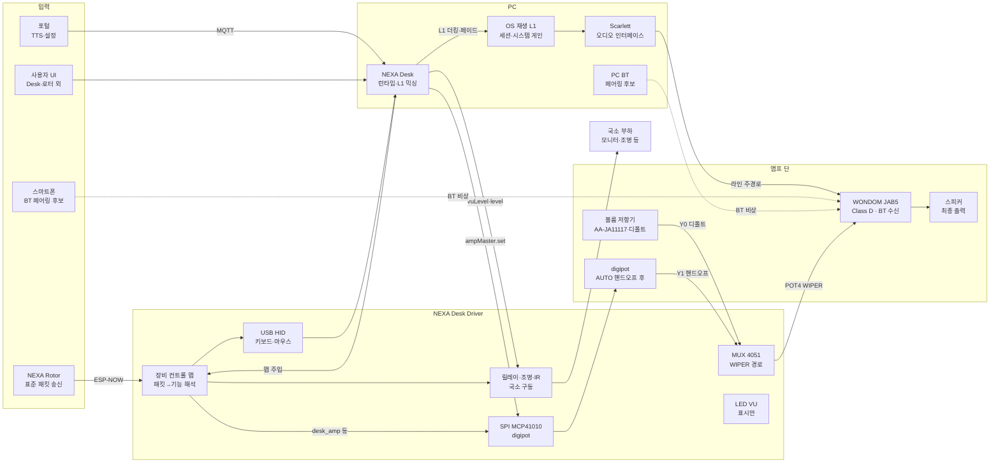
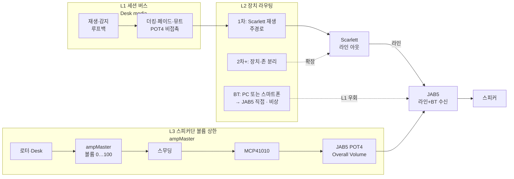

# 장비 — NEXA Desk Driver

**dest 가 PC 일 때**의 **PC 슬롯 장비**다. 로터·브라우저·OS 는 ESP-NOW 를 직접 듣지 못하므로, 이 장비가 무선 종단이 되어 **실행**한다. 열융착기·매트처럼 **장비 슬롯·표준 패킷**으로 페어링한다. 중계 허브가 아니다.

**이름·호칭:** 문서·교차 링크는 **NEXA Desk Driver**. 대화에서는 **데스크 드라이버**(Desk Driver). 「드라이버」만 단독으로 쓰지 않는다 (USB·OS 드라이버와 혼동). 구칭 **NEXA PC 수신기**는 쓰지 않는다.

**기본 기능 (필수):**

1. 로터 → ESP-NOW **수신**
2. **USB HID** (키보드·마우스)
3. (선택) **NEXA Desk**로 표준 패킷 넘김 · 장비 컨트롤 맵 주입
4. **피드백 표시** — LED · LCD 등 (상태 + **최소 조명**). 전자잉크는 쓰지 않음

**로컬 구동단 (같은 장비의 실행면):** **릴레이 중심**(자석식 릴레이 · SSR) 으로 주변기기·조명 전원을 끊고, 디밍 LED 는 MOSFET/트라이액을 쓴다. 채널 **10 개 이상**·확장 뱅크. PC 깨우기·원격 전원 접점도 같은 축. **지능형 조명**(씬·시퀀스·재실/시간/매트 연동)·전류·과열·케이블 IR 을 둔다. **캠·USB 허브는 두지 않는다.** 상세는 아래 각 절.

자기 라디오 (ESP-NOW/Wi‑Fi/Zigbee 등) 가 있는 방등·스마트 플러그는 **별 dest**. 이 장비를 거치지 않는다 (패밀리 §0.2.2).

**무선 통일:** PC 용 마우스·키보드 (HID) 도 **블루투스·Wi‑Fi HID 를 쓰지 않는다.** 로터↔현장 장비와 같이 **ESP-NOW → Desk Driver → USB HID** 로 통일한다. (유선으로 로터를 HID 화하지 않음. Wi‑Fi 는 지연·변동이 크고, BLE HID 는 동글 홉을 없애도 ESP-NOW+ 로컬 HID 를 넘기기 어렵다.)

로터는 USB HID 장치가 아니다. HID·로컬 구동·(선택) Desk 패킷은 **Desk Driver**가 한다.
상세 조작·장비 컨트롤 맵 주입·웹뷰는 [APP-NEXA Desk](APP-NEXA%20Desk.md)(또는 동등 로컬 런타임) 와 맞물린다. 제품명 **NEXA Desk**(짧게 Desk) 는 **PC 위 런타임**이고, Desk Driver 는 **책상 옆 하드웨어**다.

## 구성

| 위치                 | 역할                                                                                                                              |
| :------------------- | :-------------------------------------------------------------------------------------------------------------------------------- |
| **NEXA Desk Driver** | ESP32-S3. ESP-NOW·HID·Desk · 깨우기/전원 · **릴레이 (시프트 확장)** · 조명 · **JAB5·MCP41010** · 피드백 · IR · **GPIO/버스 확장** |
| **NEXA Rotor**       | 표준 패킷만 송신. 프레임 보정·터치 마스크·충격 창까지. PC 전용 분기 없음                                                          |
| **PC / NEXA Desk**   | HID·어댑터·웹뷰. 장비 컨트롤 맵·씬·조명 · **세션 믹싱/TTS 더킹** · `ampMaster`                                                    |
| **포털**             | 페이지·설정. 다른 장비 MQTT 는 Desk Driver 비경유                                                                                 |

```text
로터 ── 표준 패킷 ── ESP-NOW ── NEXA Desk Driver (ESP32-S3)
                                      │ 장비 컨트롤 맵
                                      ├─► USB HID (키보드·마우스)
                                      ├─► (선택) NEXA Desk 패킷
                                      ├─► PC 깨우기 / 원격 전원
                                      ├─► 릴레이·SSR 등 ch0… (주변기·조명) + 확장 뱅크
                                      ├─► 지능형 조명 (디밍·씬·시퀀스·연동)
                                      ├─► 케이블 IR 헤드(들)
                                      └─► 피드백 LED / LCD (+ 최소 조명)
Desk Driver 버튼 ── 모드·씬 직접 전환
NEXA Desk ── 장비 컨트롤 맵·씬·IR·시퀀스 주입
```

### 데이터 흐름 (Mermaid)

L1 = PC/세션 더킹·페이드. L2 = 재생 장치 라우팅 (1 차 Scarlett). L3 = **볼륨 상한** `ampMaster` → digipot → JAB5 POT4.
**BT:** JAB5 내장 수신 · 페어링 대상 **PC 또는 스마트폰**. **비상·임시**(L1 더킹 우회). 주경로는 Scarlett 라인.



### 오디오 계층

L1·L2·L3 + **BT 보조**. 1 차 L2=Scarlett. BT 는 L1 을 거치지 않음 (더킹·Desk 뮤트 불가). L3(`ampMaster`) 는 라인·BT 공통 **볼륨 상한**으로 남을 수 있음 (Driver 생존 시).



## 하드웨어

- MCU: **ESP32-S3** (네이티브 USB 장치). USB 시리얼 변환 칩만으로는 HID 가 되지 못한다.
- 데이터: GPIO **19 = D−**, GPIO **20 = D+**. 다른 GPIO 로는 USB 데이터 불가.
- 커넥터 (USB): **D−·D+·GND** — **HID 데이터 전용.** **VBUS 로 보드를 급전하지 않음**(1 차). D−/D+ 직렬 저항. USB-C 면 CC 저항. USB 허브 IC·캠 포트는 두지 않음.
- **버튼 약 5 개** — NEXA Desk 없이 모드·씬 직접 선택. 고른 모드는 활성 창이 바뀌어도 유지 가능.
- **피드백 표시 (필수):** LED · LCD · **단순 LED VU**(저핀). 「피드백 표시」.
- **보드 전원 (1 차 채택):** **별도 5 V**(어댑터·상시 탭). PC OFF·앰프 상시·로터/`ampMaster` 생존·릴레이·깨우기 수신을 **설정 없이** 보장. USB·+5VSB 급전·VBUS OR 회로는 **1 차 비채택**(단순·역류·내구성). 「전원·깨우기」.
- **구동 슬롯·확장 (릴레이 중심):** 온/오프 부하는 **자석식 릴레이 · SSR**을 기본으로 채널에 둔다. 디밍 LED 만 MOSFET(DC)·트라이액 (AC). **시프트/I²C 확장**으로 `ch` 연장. 「주변기기·조명 제어」·「핀 · GPIO 확장」.
- **앰프 볼륨:** **MCP41010** + **74HC4051 MUX** + 경로 스위치 1. 「WONDOM」.
- **IR 헤드 잭:** 본체에 IR 을 고정하지 않고, **케이블로 뺀 발광 헤드**를 여러 방향·기기에 붙인다. 「IR 블래스터」.

## 주변기기·조명 제어

이 보드 (및 **확장 뱅크**) 에 **직접 배선된** 부하만 담당한다. 스마트홈·자기 라디오 조명을 중계하지 않는다. 로터는 표준 패킷만 보내고, **장비 컨트롤 맵**이 `채널 id → 스위치·동작` 을 고른다.

**1 차 집중:** 릴레이 (자석식·SSR) 온/오프 + **지능형 조명**(디밍·씬·연동). 캠·USB 허브·USB 데이터 스위치는 범위 밖.

### 전원 도메인 — AC / DC

채널마다 **끊는 선의 전원 종류**를 먼저 정한다. 스위치 스타일·단자·안전 간격·매핑 메타 (`powerDomain`) 가 여기서 갈린다. AC 슬롯에 DC 부하 (또는 그 반대) 를 꽂지 않는다.

| 도메인 | 끊는 위치 (예)                                                                 | 맞는 스위치                    | 비고                                               |
| :----- | :----------------------------------------------------------------------------- | :----------------------------- | :------------------------------------------------- |
| **AC** | 벽·멀티탭 쪽 교류 (보통 단상). 기기 **AC 코드** 또는 어댑터 **1 차 (AC 입력)** | SSR · 트라이액 · 자석식 릴레이 | 절연·크리피지·퓨즈. 트라이액만 위상 디밍           |
| **DC** | 어댑터 **2 차**, USB/버스 급전, LED 드라이버 출력, 저압 레일                   | MOSFET · (저압) 자석식 릴레이  | PWM·저압 ON/OFF. AC SSR/트라이액을 DC 에 쓰지 않음 |

**스위칭 엘리먼트**는 **같은 기기라도 어디서 끊느냐에 따라 도메인이 바뀐다.** 예: 모니터·Scarlett 어댑터의 **AC 플러그 쪽**을 끊으면 AC, **어댑터 뒤 DC 잭**을 끊으면 DC. 설치 때 한 경로만 고르고 채널 메타에 기록한다.

| 구분      | AC 채널                                                  | DC 채널                  |
| :-------- | :------------------------------------------------------- | :----------------------- |
| 정격 표기 | V~ · A~ (또는 W)                                         | V ⎓ · A (또는 W)         |
| 디밍      | 트라이액 위상 (검증된 부하만)                            | MOSFET PWM               |
| 기본 OFF  | 접점/SSR 개방                                            | MOSFET off / 릴레이 개방 |
| 혼용      | AC 뱅크와 DC 뱅크 (또는 슬롯 키잉) 로 **물리 분리** 권장 | 동일                     |

신호용 접점 (메인보드 전원 SW 단락 등) 은 부하 전원이 아니라 **건접점**이다. `powerDomain` 은 `dry_contact` 등으로 두고 AC/DC 전력 슬롯과 섞지 않는다. 「전원·깨우기」.

### 제어 후보 (1 차)

전원 라인을 끊고 잇는 방식. USB 데이터·앱 제어가 아니다.

| 대상                   | 끊기 후보                                      | powerDomain                               | 스위치 후보                                            |
| :--------------------- | :--------------------------------------------- | :---------------------------------------- | :----------------------------------------------------- |
| **모니터**             | AC 코드 · 또는 어댑터 1 차 (AC) / 드물게 DC 잭 | 주로 **AC** (경로에 따라 DC)              | SSR · 자석식 릴레이 · (DC 면) MOSFET                   |
| **앰프 (WONDOM JAB5)** | DC/어댑터 급전 · 「WONDOM 앰프」               | 주로 **DC**(보드 정격) · 어댑터 1 차는 AC | 전원: SSR·자석 릴레이 · 볼륨: POT4 경로                |
| **Scarlett**           | 외장 어댑터 AC/DC · 또는 버스 급전 경로        | **AC 또는 DC** (설치 선택)                | SSR · 자석식 릴레이 · MOSFET(DC)                       |
| **조명**               | AC 스탠드 · DC LED 스트립                      | **AC** 또는 **DC**                        | 온/오프: SSR·자석 릴레이 · **디밍:** 「LED·조명 디밍」 |
| **디밍 LED**           | 디밍 가능 DC LED / (검증된) AC 디밍 LED        | **DC** 우선 · AC 는 트라이액 검증 부하만  | MOSFET PWM · 트라이액 위상                             |
| **(예약)**             | 같은 책상 주변기                               | 채널 메타에 AC/DC 명시                    | 채널만 늘림. 로터 펌웨어 변경 없음                     |

배정은 설치마다 다르다. 위는 **후보**이고, 실제 표는 Desk·NVS 매핑이 정한다. **도메인 미기입 채널은 구동하지 않는다**(연구 중 기본 후보).

### 스위치 스타일 (릴레이 중심)

채널마다 **한 가지 스타일**을 고른다. 스타일은 `powerDomain` 과 맞아야 한다. **온/오프 주변기·비디밍 조명**은 릴레이류를 우선한다.

| 우선  | 스타일            | powerDomain                      | 성격                      | 쓰기 좋은 곳                                                 |
| :---- | :---------------- | :------------------------------- | :------------------------ | :----------------------------------------------------------- |
| **1** | **자석식 릴레이** | **AC 또는 DC** · **dry_contact** | 접점 온/오프, 절연·범용   | 모니터·앰프·Scarlett·스탠드, 메인보드 전원 SW. **디밍 아님** |
| **1** | **SSR**           | **AC**                           | 무접점 온/오프, 조용·수명 | 같은 AC 온/오프. 클릭 소음 싫을 때. **디밍 아님**            |
| **2** | **MOSFET**        | **DC**                           | PWM **디밍**·저압 스위칭  | **디밍 LED**, DC 잭, (필요 시) 릴레이 코일 구동              |
| **2** | **트라이액**      | **AC**                           | 위상 **디밍**             | 디밍 가능 AC LED(검증 목록만)                                |

PC 메인보드 전원 스위치 접점 (옵토/자석 릴레이) 도 **채널 하나**로 둘 수 있다. 깨우기·콜드 부팅 절차는 「전원·깨우기」.

### LED·조명 디밍

`mode = dim_level` 인 채널만 밝기를 받는다. **디밍 가능 LED**(또는 검증된 디밍 램프) 에만 쓴다. 온/오프 전용·비디밍 LED 에 level 을 넣어도 **무시하거나 on/off 로만 클램프**(연구 중 기본: 거부하지 않고 0=OFF · >0=ON).

| 항목          | 방침                                                                                                |
| :------------ | :-------------------------------------------------------------------------------------------------- |
| **대상**      | 디밍 가능 **DC LED**(스트립·패널) 가 1 차. AC 디밍 LED 는 트라이액 **허용 목록**에 있을 때만        |
| **DC 디밍**   | MOSFET **PWM**. 논리 레벨 `level` 0…100(또는 0…255 — 장비 컨트롤 맵 단위 확정). 0 = OFF             |
| **AC 디밍**   | 트라이액 **위상각**. 같은 `level` 스케일. 비디밍·유도성 부하는 트라이액 채널에 두지 않음            |
| **불가**      | SSR·자석식 릴레이 채널은 `on_off` 만. `dim_level` 메타면 매핑 **거부**                              |
| **조작**      | 로터 노브 → `level` 증감 (후보). 링 칸 → 프리셋 (예: 0 / 30 / 70 / 100). Desk 슬라이더·MQTT `level` |
| **곡선**      | 선형 또는 감마 (눈 보정). 장비 컨트롤 맵 `dimCurve` — 기본 후보는 감마                              |
| **최소 점등** | `levelMin` 아래는 OFF 로 스냅 (깜빡임·꺼짐 오인 방지). 값은 채널별                                  |
| **페이드**    | 선택. `fadeMs` 로 목표 level 까지 보간. 실시간 노브는 페이드 짧게 또는 0                            |
| **상태**      | Desk Driver 가 마지막 `level` 을 유지 (전원 리셋 후는 기본 OFF, 또는 NVS 복귀 — 미결)               |

```text
로터 노브 / Desk / MQTT
    → level (0…100)
    → ch.mode == dim_level ?
         ├─ DC + MOSFET  → PWM duty
         ├─ AC + 트라이액 → 위상각 (허용 부하만)
         └─ 그 외         → 거부 또는 on_off 폴백(정책)
```

비디밍 조명·모니터·앰프·Scarlett 는 `on_off` 만. 디밍 LED 와 **채널을 나눈다.**

### 지능형 조명 제어

조명은 단순 토글을 넘어 **규칙·씬·연동**으로 돌린다. **판정·스케줄·AI 는 Desk·포털·(이벤트 보낸) 장비**에 두고, Desk Driver 는 **채널 실행·페이드·시퀀스·로컬 표**만 맡는다. 로터 펌웨어에 조명 AI 를 넣지 않는다.

| 층                     | 하는 일                                  | 예                                                     |
| :--------------------- | :--------------------------------------- | :----------------------------------------------------- |
| **수동**               | 로터 노브/링 · Desk 슬라이더 · 본체 버튼 | level 증감, 씬 호출                                    |
| **씬**                 | 여러 조명 (+ 주변기) 한 번에             | `work` 밝게 · `watch` 40% · `sleep` OFF+ 피드백등만    |
| **시퀀스**             | 켜짐/꺼짐·level 변화 시간차              | 주변기 ON 후 작업등 페이드인                           |
| **연동 (이벤트→실행)** | 외부 이벤트를 표가 씬/`level` 로 변환    | 아래 표                                                |
| **적응 (선택)**        | 시간대 기본 level · 일출몰 곡선          | Desk/포털이 주기적으로 목표 level 주입. Driver 는 추종 |

| 연동 입력 (후보)  | 출처                                                        | Desk Driver 동작 (예)                                     |
| :---------------- | :---------------------------------------------------------- | :-------------------------------------------------------- |
| 재실 / 비움       | 로터 `PRESENCE` 등 (표준 이벤트·Desk 경유 또는 매핑된 패킷) | 비움 유예 후 조명 OFF·`away` 씬. 재실 시 `home`/`work`    |
| 입면·기상         | 매트 이벤트 → Desk                                          | 입면: 페이드아웃·`sleep`. 기상: 낮은 level→점증 (또는 씬) |
| PC 슬립/깨우기    | 깨우기 경로·Desk                                            | 깨우기 전후 최소등·작업등 씬                              |
| 시각·캘린더       | 포털/Desk                                                   | 야간 `levelMax` 캡, 주간 기본 씬                          |
| **오디오 (음악)** | **NEXA Desk 루프백 분석** — 「오디오·PC 전제」              | 목표 `level`/밴드 추종 디밍. 샘플은 Driver 로 안 보냄     |
| 수동 우선         | 로터·버튼                                                   | 연동 자동을 **일시 억제**(타임아웃 후 재개 — 정책)        |

| 항목         | 방침                                                                                                              |
| :----------- | :---------------------------------------------------------------------------------------------------------------- |
| **구역**     | 책상·국소만. 방 전체 스마트조명은 별 dest                                                                         |
| **디밍**     | `dim_level` 채널 + 「LED·조명 디밍」. 릴레이 채널은 씬에서 on/off 만                                              |
| **피드백등** | 본체 LED 최소 조명은 부하 조명과 별. `sleep` 씬에서만 남기는 후보                                                 |
| **충돌**     | 같은 ch 에 수동과 연동이 겹치면 **로컬 수동 > 씬 호출 > 자동 연동**(패밀리 가까운·먼저 온 입력과 맞춤, 세부 미결) |
| **PC 꺼짐**  | 릴레이 씬·재실·시각 등 **비오디오** 연동은 대기전원으로 가능. **오디오 연동·더킹은 PC·Desk 가 켜져 있을 때만**    |

```text
[매트/로터/포털/Desk] 이벤트·규칙
        → 목표 씬 / level / 시퀀스 id
        → Desk Driver 실행 (릴레이·MOSFET·트라이액·페이드)
        → 피드백 LED/LCD

[PC 재생] → Desk 루프백 분석 → level만 → Desk Driver 디밍
```

### 오디오 · PC 를 기본 전제로 한 설계 방향

음악·영상은 **PC 를 통해 듣는 흐름을 1 차 전제**로 둔다 (Scarlett·앰프·Desk 미디어). 그에 맞춘 역할 분담:

| 기능                                             | 어디서                                      | 비고                                                        |
| :----------------------------------------------- | :------------------------------------------ | :---------------------------------------------------------- |
| 재생 오디오 가로채기·분석                        | **NEXA Desk** (루프백 등)                   | Driver 에 DSP·마이크 스택을 올리지 않음                     |
| 음악↔조명 디밍                                   | Desk → Driver 에 **`level`/씬만**           | 기존 디밍 경로 재사용                                       |
| 큰 음악 위 **AI 음성 안내 시 볼륨 더킹**         | **NEXA Desk `media`** (재생 볼륨·세션 더킹) | 조명 Driver 와 별개. OS/앱 볼륨 또는 Desk 재생 경로         |
| PC 꺼진 채 음악 + 음성 + 더킹 + 조명 오디오 반응 | **범위 밖 (과설계)**                        | 라인인·마이크·앰프 패스·상시 DSP 를 Driver 에 이양하지 않음 |

**과설계로 보지 않는 것:** PC 켜짐 전제에서 Desk 가 소리 분석·더킹하고 Driver 는 릴레이·디밍만.
**과설계로 미루는 것:** PC 오프에서도 동일 체험을 위해 Driver 에 오디오 경로 전부를 옮기는 것.

앰프 하드웨어·POT·채널 분리는 「WONDOM 앰프 (JAB5)」. 세션 믹싱 (브라우저 vs AI TTS) 은 [APP-NEXA Desk](APP-NEXA%20Desk.md) 「사운드 믹싱 · 채널」.

### 아트 프로젝트 확장 (웹 · MQTT/WebSocket)

Desk Driver 는 책상 유틸을 넘어, **웹 기반 아트**(p5.js 등) 와 **같은 실행면**으로 확장할 수 있다. 분석·연출은 브라우저 (또는 Desk), Driver 는 **조명·VU·씬 실행만** — 「지능형 조명」·외부 MQTT 경로를 재사용한다.

| 층                   | 역할                               | 예                                                                                     |
| :------------------- | :--------------------------------- | :------------------------------------------------------------------------------------- |
| **웹 아트**          | 비주얼 · Web Audio 분석 · 매핑     | p5.js / 동등 · Desk 웹뷰 임베드 가능                                                   |
| **브리지**           | 브라우저 → 장비                    | **MQTT** 또는 **WebSocket**. Art-Net/DMX 는 브라우저 직행 불가 → 필요 시 별 게이트웨이 |
| **NEXA Desk** (선택) | 루프백·권한·토픽·대시보드          | 규약만 맞으면 웹→브로커→Driver 만으로도 가능                                           |
| **Desk Driver**      | `level` / 씬 / `vuLevel` 구독·실행 | 디밍·릴레이·단순 LED VU                                                                |
| **조명**             | 현장 부하                          | 채널 매핑만 있으면 사용자마다 재현 가능                                                |

```text
[공유 아트 웹: p5 등]
        │  MQTT 또는 WebSocket
        ▼
[브로커 / WS 게이트]
        │  공통 토픽·페이로드 (ch · level · scene · vuLevel · identity_id · instance_id)
        ▼
[NEXA Desk Driver] ──► 디밍 · 릴레이 씬 · VU
        ▲
[NEXA Desk] ──(선택, 동일 규약)──┘
```

| 항목                | 방침                                                                        |
| :------------------ | :-------------------------------------------------------------------------- |
| **확장·공유**       | **Driver + 연결된 조명 + 규약**이면 동일 아트 프로젝트를 **공유·재현** 가능 |
| **각자 연출**       | 각자 브라우저 분석 → 자기 `identity_id` → 자기 Driver                         |
| **공동 공연**(선택) | 호스트 하나 → 브로커 → 다수 Driver                                          |
| **1 차와 관계**     | 일상 Desk 루프백↔조명의 **확장 갈래**. Driver 에 아트 DSP 없음              |
| **전제**            | 토픽·페이로드·채널 id 합의. 브로커·보안은 프로비저닝 때                     |

#### 페이로드 초안 (MQTT / WS 공통 논리)

토픽 예: `nexa/{identity_id}/{instance_id}/{capability_id}/driver/cmd` · 상태: `nexa/{identity_id}/{instance_id}/{capability_id}/driver/state` (확정 전). `identity_id`=근거 (영구), `instance_id`=누구 (일시), `capability_id`=무엇을 (예: `nexa.desk.driver.level`).

| `type`          | 필드 (초안)                    | 의미               |
| :-------------- | :----------------------------- | :----------------- |
| `level.set`     | `ch`, `level` 0…100, `fadeMs?` | 디밍               |
| `scene.set`     | `id`                           | 씬                 |
| `ampMaster.set` | `v` 0…100, `zone?`             | POT4(AUTO 일 때만) |
| `vuLevel`       | `v` 0…100                      | LED VU             |
| `ampPath`       | `digipot` \| `pot`             | sense 보고 (state) |

**공통 필드 (모든 페이로드):** `instance_id`, `identity_id`, `capability_id`, `ts`. 토픽 계층과 동일한 identity_id·instance_id·capability_id 를 사용한다. `device_id` 는 `identity_id` 로 대체 (장비 정체성 = identity).

Desk·아트 웹·Driver 가 **같은 type 이름**을 쓴다. JSON 키 확정은 구현 직전.

### 채널·확장

| 항목            | 방침                                                                                                                                                                                                 |
| :-------------- | :--------------------------------------------------------------------------------------------------------------------------------------------------------------------------------------------------- |
| **기본 채널**   | **10 개 이상**을 전제로 한다 (본체 보드 실장 수량은 기구 때 확정, 목표 ≥10).                                                                                                                         |
| **주소**        | 논리 `ch` 인덱스 (0…N−1). 장비 컨트롤 맵·Desk·MQTT 는 이 id 만 본다.                                                                                                                                 |
| **확장**        | GPIO 가 모자라면 **시프트/IO 확장기·구동 뱅크**(유선) 로 채널을 늘린다. dest 는 그대로 PC(Desk Driver). 로터·슬롯을 나누지 않는다.                                                                   |
| **타입 메타**   | 채널마다 `powerDomain`(ac / dc / dry_contact), `switchStyle`(mosfet/ssr/triac/magnetic_relay), `mode`(on_off / dim_level), (`dim_level` 이면) `dimCurve`·`levelMin`·`fadeMs`, 정격·라벨을 표에 둔다. |
| **도메인 정합** | `powerDomain`↔`switchStyle` 불일치, 또는 `dim_level` 인데 SSR/자석 릴레이면 해당 채널 **거부**(펌웨어·Desk 검증).                                                                                    |
| **기본 상태**   | 전원 투입·리셋 후 **기본 OFF**(안전). 예외 (상시등) 는 매핑·정책으로만.                                                                                                                              |
| **동시성**      | 여러 채널 동시 ON 가능. 돌입전류·합 전류 한도는 **도메인·뱅크별** KPI.                                                                                                                               |

```text
[Desk Driver MCU]
    ├─ 본체 구동 슬롯  ch0 … ch9+   (MOSFET / SSR / 트라이액 / 자석 릴레이 혼재 가능)
    └─ (선택) 확장 뱅크  ch10 …     같은 논리 주소 공간
로터/Desk/MQTT ──► 채널 id + 동작(on/off 또는 level) ──► 해당 스위치 실행
```

### 명령 경로

| 경로          | 통로                                      | 요지                                         |
| :------------ | :---------------------------------------- | :------------------------------------------- |
| **옆 (로컬)** | 로터 → ESP-NOW → Desk Driver → 채널·씬·IR | 실시간. 링/노브→ on/off · **디밍** · 씬      |
| **Desk**      | 장비 컨트롤 맵·씬·시퀀스·IR 주입 · UI     | HID 주기 경로에 Desk 를 끼우지 않음          |
| **외부**      | 상시 브로커 MQTT → Desk Driver            | PC 꺼져 있어도 가능. `level`·씬·IR·조명 목표 |

무장 (또는 동등 권한) 뒤에만 구동 (피드백 최소 조명은 정책 예외 후보 — 「피드백 표시」).

### 씬 · 프리셋

여러 릴레이·디밍 채널 (+ IR) 을 **한 이름**으로 묶는다. 로터는 씬 id 만 보내고, 펼침은 Desk Driver 표가 한다. 지능형 조명의 기본 단위.

| 항목     | 방침                                                                                                     |
| :------- | :------------------------------------------------------------------------------------------------------- |
| **예**   | `work`(모니터 + 앰프 +Scarlett+ 작업등) · `watch`(모니터 + 디밍 40%) · `sleep`(부하 OFF·야간 피드백등만) |
| **내용** | 채널별 `on`/`off`/`level` · (선택) IR 매크로 · 시퀀스 id                                                 |
| **호출** | 로터 링 칸·버튼 · Desk · MQTT `scene` · 연동 규칙                                                        |
| **저장** | NVS + Desk 주입. 로터 펌웨어에 씬 본문 없음                                                              |

### 전원 시퀀스

돌입·오디오 팝·버스 열거를 줄이려고 **켜짐/꺼짐 순서를 시간차로** 둔다. 씬이 시퀀스를 가리킬 수 있다.

| 항목       | 방침                                                             |
| :--------- | :--------------------------------------------------------------- |
| **ON 예**  | Scarlett → (delay) → 앰프 → (delay) → 모니터 → 조명              |
| **OFF 예** | 역순. 앰프를 모니터보다 먼저 끄는 등 표로 정의                   |
| **단위**   | 채널 스텝 + `delayMs`. Desk Driver 가 타이머 실행                |
| **중단**   | 새 씬·비상 OFF·무장이 시퀀스를 끊고 안전 쪽 (기본 OFF 방향) 으로 |

### 전류 · 전력 센싱

채널 (또는 뱅크 합) 의 **실제 통전**을 본다. 허브 텔레메트리 중계가 아니라 **이 장비의 피드백**.

| 용도             | 요지                                                              |
| :--------------- | :---------------------------------------------------------------- |
| **과전류**       | 한도 초과 시 해당 ch 즉시 OFF + 피드백·Desk 이벤트                |
| **기대 vs 실측** | ON 명령 후 전류≈0 이면 미접속·퓨즈·고장 후보로 표시               |
| **대기전력**     | (선택) 장시간 미소 전류 로그 — Desk/MQTT 로만 올림                |
| **해상도**       | 채널별 vs 뱅크 합산은 기구·BOM 때. 논리 이벤트는 `ch` 단위를 우선 |

### 온도 · 과열 컷

구동단·케이스 온도가 한도를 넘으면 **해당 채널 또는 뱅크를 OFF**. 복귀는 냉각 후 수동/정책 (자동 재투입은 기본 비활성 후보).

### IR 블래스터 (케이블 헤드)

배선으로 전원을 못 끊는 TV·셋톱·구형 AV 는 **적외선 코드**로 켠다. 본체에 IR LED 만 달면 한쪽만 커버되므로, **발광부를 케이블로 분리**한다.

| 항목            | 방침                                                                                                   |
| :-------------- | :----------------------------------------------------------------------------------------------------- |
| **필수 형태**   | 본체 **IR 구동 출력 (잭)** + **케이블형 IR 헤드** 1 개 이상. 헤드는 기기 수신창 앞·옆·장해물 뒤로 배치 |
| **다방향**      | 잭·헤드는 **복수** 가능 (같은 코드 동시 송출 또는 헤드별 존). 존 id 는 매핑 메타                       |
| **학습·코드**   | 캡처·DB·주입은 **Desk**(또는 포털). Desk Driver 는 코드·존을 받아 송출만                               |
| **호출**        | 씬 스텝 · 로터 칸 · Desk · MQTT. 표준 패킷에 IR 본문을 실지 않고 id/매크로 키                          |
| **전원과 병행** | 같은 기기를 AC 채널과 IR 로 이중 정의하지 않는 것이 기본. 필요 시 시퀀스에서 순서만 명시               |

```text
[Desk Driver] ──케이블── IR 헤드 A ──► TV 수신창
              ──케이블── IR 헤드 B ──► 셋톱 / 옆면
              ──케이블── IR 헤드 C ──► …
```

## WONDOM 앰프 (JAB5)

현장 앰프는 **WONDOM JAB5**(Class D · DSP · BT) 를 쓴다. **2 장**을 확보해 두고, 1 차는 단일 (또는 한 장의 4ch)·이후 **I²S 캐스케이드·존 확장**에 쓴다. NEXA 와 **강하게 결합하는 런타임 축은 ICP5 가 아니라 POT·전원·Desk `media`** 다.

**ICP5 란:** WONDOM **인서킷 프로그래머 보드**(별매). PC↔USB 로 연결하고, 케이블로 **JAB5 DSP**에 붙여 전용 PC 소프트웨어로 **EQ·음색 등 설치 튜닝**을 한다. Scarlett·4POT·런타임 `ampMaster` 와 **다른 경로**. NEXA API 아님. 연결 중에는 볼륨을 낮추고 digipot 와 동시 조작하지 않는다.

**Scarlett 란:** Focusrite **Scarlett**(또는 동등) **USB 오디오 인터페이스**. 문서 전제의 **주 재생 경로**는 PC → Scarlett 라인 아웃 → JAB5 라인 인. Desk L1(더킹·페이드·뮤트) 이 건드리는 쪽도 이 재생 장치. 마이크 입력과 공존 가능. ICP5·음색 DSP 와 **별개**(톤은 ICP5, 재생·믹싱은 Scarlett+Desk).

### 역할 분담

| 층                       | 담당                                  | 하는 일                                      |
| :----------------------- | :------------------------------------ | :------------------------------------------- |
| **전원**                 | Desk Driver 릴레이/SSR                | JAB5(또는 그 DC 어댑터) 급전 ON/OFF · 시퀀스 |
| **스피커단 마스터 볼륨** | Desk Driver(또는 전담 ESP) → **POT4** | 디지털 포트/DAC 로 Overall Volume            |
| **세션 믹싱·더킹·TTS**   | **NEXA Desk `media`**                 | 브라우저 재생↓ · AI TTS↑ 등. PC 전제         |
| **초기 EQ·튜닝**         | ICP5 + WONDOM PC UI                   | 설치·캘리브만. 런타임 NEXA API 아님          |
| **조명 연동**            | Desk 루프백 → Driver `level`          | 「지능형 조명」·오디오 PC 전제               |

**AI 안내 · TTS (1 차):** 포털 TTS/안내는 **별도 AI 스피커 없이** NEXA Desk `media` 가 재생·더킹하고, JAB5 는 기존 스피커단으로만 키운다.
**단점 (1 차):** PC(·Desk) OFF 면 그 역할은 **불가**.
**차후:** 전용 AI 스피커 경로를 두며, 그 기능은 **NEXA 닉시 (Nixie)** 가 맡는 계획 (PC 비의존·상시 안내).

**Desk → 닉시 이관 트리거 (초안):** (1) 닉시가 포털 TTS 를 **PC 없이** 재생 가능 (2) 책상/룸에서 Desk `media` TTS 와 **이중 재생이 거슬릴 때** Desk 는 더킹·음악만·닉시가 안내 (3) 사용자가 “상시 안내”를 켠 뒤. 그 전엔 **병행 가능**, 강제 이관 없음.

```text
[브라우저·Desk 미디어·AI TTS] ──(PC 안 믹싱/더킹)──► Scarlett/라인
                                                      │
                                                      ▼
                                              WONDOM JAB5 ×1~(2)
                                                      │
                    Desk/로터 ──► Desk Driver ──┬── 릴레이: 전원
                                               └── POT4←디지털 포트: 마스터 볼륨
ICP5 ──(설치·튜닝만)── JAB5
```

### 4POT 포트 (WONDOM JAB5 의 4 개 가변저항 포트)

**WONDOM 볼륨 조절 저항기** — 품번 **AA-JA11117** Functional Cables Kit for JAB3+ / JAB4 / JAB5
(외부 가변저항 케이블 4 개 포함). 이하 본 문서에서 **볼륨 저항기**.
지금 이 볼륨 저항기로 POT1~4 를 **수동** 제어 중이다.

자동화 시에는 가변저항을 ESP 가 ‘돌리는’ 것이 아니라, **MCP41010 을 POT4 경로에 두고** SPI 로 와이퍼를 쓴다.
**볼륨 저항기**와 digipot 는 **둘 다 상시 배선**하고, **WIPER 만 MUX 로 고른다.** 전환은 **MUX(74HC4051) + 패널 스위치 1 개**(강제 수동). 커넥터 분리 교체는 최후 수단.

| 포트     | 기능 (4.0/2.0 모드 요지)       | NEXA 1 차                                                   |
| :------- | :----------------------------- | :---------------------------------------------------------- |
| **POT4** | **Overall Volume** (전체 볼륨) | **런타임 제어 대상.** 디지털 포트 ← Desk Driver · AUX_ADC_0 |
| POT1     | CH2 상대 게인                  | 수동 유지 (AA-JA11117) · 이후 채널 분리 시 검토             |
| POT2     | CH2 HPF/BPF                    | 설치 때 고정                                                |
| POT3     | CH1 HPF/BPF                    | 설치 때 고정                                                |

#### 포트 원리 · 실측 저항

오디오 L/R 가 가변저항을 **통과하지 않는다.** JAB5(ADAU1701) 가 포트 양단 기준전압으로 분압을 만들고, **와이퍼 전압만 AUX_ADC 가 읽어** DSP 볼륨·게인·필터를 바꾼다.

```text
REF(~3.3 V 레일, 보드 공급) ── 포트(≈10 kΩ) ── GND
                                    │
                                 WIPER ──► AUX_ADC (POT4=ADC0) ──► DSP 볼륨
오디오 ──────────────────────────► DSP/파워단 ──► 스피커  (별 경로)
```

| 항목               | 값                                                                                       |
| :----------------- | :--------------------------------------------------------------------------------------- |
| 볼륨 저항기        | **AA-JA11117**                                                                           |
| 종단 저항 R (실측) | **≈ 10.27 kΩ** → 공칭 **10 kΩ** (볼륨 저항기 4 개 동일 사양으로 보고 1 개 측정으로 충분) |
| ADC 유효 상한      | AUX_ADC 풀스케일 전형 **~3.0 V** (레일은 ~3.3 V 일 수 있음)                              |
| digipot 종단       | **10 kΩ** 급으로 맞춤                                                                    |

커넥터 **핀 1/2/3 = REF/WIPER/GND 순서**는 보드·케이블 실크로 확정 (아직 표 미기입). 논리 역할만 위와 같다.

### 앰프 볼륨 제어 흐름 (1 차 확정)

| 단계 | 흐름                                                                                         |
| :--- | :------------------------------------------------------------------------------------------- |
| 1    | 로터 노브 / Desk UI / 씬 → 논리 **`ampMaster` 0…100**                                        |
| 2    | **세션 더킹은 Desk L1 만.** `ampMaster` 는 사용자·씬 값 (더킹과 합성하지 않음 — 정책 A 확정) |
| 3    | Desk → Driver `ampMaster.set` → **SPI MCP41010** → (MUX 가 digipot 선택 시) POT4 와이퍼      |
| 4    | AUX_ADC 가 전압 읽음 → DSP Overall Volume → 스피커                                           |

- **일상 (AUTO):** MUX → MCP41010 W. 로터·Desk·Driver → `ampMaster`.
- **수동/비상 (MANUAL):** 패널 스위치 → MUX → AA-JA11117 W. `ampMaster` 무시.
- **경로:** 「POT4 경로 전환 — MUX + 스위치」. **ICP5**는 런타임 결합 안 함.
- GPIO·CS·버스 확장은 「핀 · GPIO 확장」.

### 입력 · 신호 경로 (1 차)

| 경로               | 1 차 방침                                                                            |
| :----------------- | :----------------------------------------------------------------------------------- |
| **주 입력**        | PC → Scarlett(또는 동등 인터페이스) **라인 아웃** → JAB5 **라인 인**                 |
| **Bluetooth 수신** | JAB5 내장 BT 는 **비상·임시**만. NEXA 세션 믹싱·더킹 경로에 넣지 않음 (PC 전제 붕괴) |
| **I²S**            | 2 장 캐스케이드·확장 때. 1 차는 미사용 가능                                          |
| **믹싱 위치**      | 브라우저 vs TTS 는 **PC/Desk 안**. JAB5 는 이미 섞인 스테레오 (또는 멀티) 를 증폭    |

### 앰프 전원 시퀀스 (JAB5)

일반 「전원 시퀀스」의 오디오 특화. 돌입·팝·Scarlett 열거를 줄인다.

| 방향         | 순서 (후보)                                                                                            | delay 후보           |
| :----------- | :----------------------------------------------------------------------------------------------------- | :------------------- |
| **ON**       | (1) Scarlett/인터페이스 → (2) JAB5 급전 → (3) 모니터 등 기타 → (4) 조명                                | 각 200–500 ms (실측) |
| **OFF**      | 역순. **JAB5 를 Scarlett 보다 먼저** 끄지 않는 후보 (앰프가 열린 채로 소스만 끊기면 팝) — 실측 후 확정 | 동일                 |
| **비상 OFF** | JAB5 즉시 OFF 허용. 무장 해제·과전류와 동일 등급                                                       | 0                    |

- 릴레이 ch 라벨 예: `psu_scarlett`, `psu_jab5_a`, `psu_jab5_b`(2 장일 때).
- 씬 `work` / `sleep` 이 이 시퀀스 id 를 가리킬 수 있다.

### 스피커 채널 · 존 (단계)

JAB5 배선 모드 (케이블 식별: 4.0 / 2.1 / 2.0) 는 **설치 때 고정**하고 NVS·Desk 에 `jabMode` 로만 기록한다. 런타임에 모드를 바꾸지 않는다 (기본).

#### 단계 0 — 지금 (수동)

- JAB5 **1 장** 가동. **볼륨 저항기**로 POT1~4 수동.
- 스피커 배치는 사용자 현행 유지. NEXA 는 전원 릴레이만 먼저 붙여도 됨.

#### 단계 1 — 마스터 자동화 (1 차 목표)

- **POT4 만** 디지털 포트화 → `ampMaster`.
- POT1~3 은 수동 또는 설치 고정.
- Desk 세션 믹싱은 [Desk 「사운드 믹싱」](APP-NEXA%20Desk.md) — JAB5 앞단.

#### 단계 2 — 논리 존 (소프트웨어)

Desk/`media` 가 **출력 엔드포인트**를 나눈다 (예: 음악 → 기본 장치, TTS → 가상 케이블/다른 Scarlett 아웃).
JAB5 가 한 장이면 라인에서 다시 합쳐질 수 있음 → **하드웨어 존 분리 전**에는 TTS 우선을 **더킹**으로만 보장.

#### 단계 3 — 하드웨어 존 (JAB5 ×2 또는 1 장 4ch)

| 구성 후보              | 존                                                            | 제어                                                   |
| :--------------------- | :------------------------------------------------------------ | :----------------------------------------------------- |
| **A. 1 장 4.0**        | ch1–2 메인 L/R · ch3–4 서브 또는 리어                         | POT1~3 으로 상대·필터. POT4 공통 마스터                |
| **B. 1 장 2.1**        | L/R + 서브                                                    | 동상. 0.2 모드는 PC UI 주파수 — ICP5 튜닝              |
| **C. 2 장 캐스케이드** | **존 A**(책상/근거리) = JAB5#1 · **존 B**(룸/원거리) = JAB5#2 | 각 **POT4** = `ampMasterA` / `ampMasterB`. I²S 로 링크 |
| **D. 2 장 독립 라인**  | Scarlett 아웃 2 계통 → 보드별 라인인                          | 캐스케이드 없이 존 분리. Desk 가 아웃 장치 라우팅      |

**1 차 채택 후보:** 단계 1 + 구성 **A 또는 B**(현행 1 장).
**확장 채택 후보:** 구성 **C 또는 D**(2 장). TTS 만 존 A·음악은 A+B 등은 Desk 라우팅 표로 나중에 고정.

| 논리 id (후보)                            | 의미               |
| :---------------------------------------- | :----------------- |
| `zone.desk`                               | 책상·근거리        |
| `zone.room`                               | 룸·확장            |
| `zone.sub`                                | 서브만 (2.1 일 때) |
| `ampMaster` / `ampMasterA` / `ampMasterB` | POT4 목표          |

### `ampMaster` 합성 규칙 (1 차 확정)

Desk 가 Driver 에 **최종 스칼라**만 보낸다. Driver 는 digipot 곡선만 적용. **TTS 더킹·감지 페이드 인·의도 뮤트 페이드 아웃은 L1(PC/세션) 만** — POT4/`ampMaster` 를 내리지 않는다 ([Desk](APP-NEXA%20Desk.md)).

| 입력             | 합성                                                   |
| :--------------- | :----------------------------------------------------- |
| 사용자/로터 노브 | `ampMaster` ← `ampMasterUser`                          |
| TTS 더킹 중      | **`ampMaster` 유지** (Desk 믹싱만 변경)                |
| `sleep` 씬       | `ampMaster` → 0 및/또는 `amp.seq` OFF                  |
| 스위치 MANUAL    | MUX→볼륨 저항기. **`ampMaster`/SPI 무시**(물리 노브만) |

곡선: `ampMaster` 0…100 → **MCP41010** 0…255 코드에 **감마 γ=2.2** 기본. 설치 때 10/50/100 三点 → NVS `ampCurve`.

**로터 노브 스무딩:** `knobDelta` 가 `ampMaster` 목표를 바꿔도 digipot/체감은 **즉시 스텝 추종하지 않음**. Driver(또는 Desk) 에서 목표→현재를 **스무딩**(저역·짧은 램프, 후보 `ampSmoothMs`) 해 끊김·지터를 줄인다. 링 프리셋·씬은 별도 (짧게 페이드 가능).

### 사운드 믹싱과의 경계

| 하는 일                          | 문서                                        |
| :------------------------------- | :------------------------------------------ |
| 브라우저↓ · TTS↑ · 페이드 · 버스 | **[Desk 사운드 믹싱](APP-NEXA%20Desk.md)** |
| JAB5 전원·POT4·존·시퀀스         | **본 절**                                   |

### POT4 디지털 어댑터 — MCP41010 (채택)

현장 제작 계획: **MCP41010 ×4** + **SMD→DIP IC 어댑터 소켓**.
1 차는 **POT4 용 1 칩**. 나머지 3 개는 POT1~3·JAB5#2·예비.

| 항목   | 값                                                                          |
| :----- | :-------------------------------------------------------------------------- |
| 품번   | **Microchip MCP41010** (단일 채널 digipot)                                  |
| 종단   | **10 kΩ** (실측 10.27 kΩ 대응)                                              |
| 탭     | **256** (8 비트)                                                            |
| 버스   | **SPI** (SI · SCK · CS). I²C 아님                                           |
| 패키지 | SOIC 등 → **DIP 어댑터**로 프로토·실장                                      |
| 기억   | **휘발성** — 전원 손실 시 와이퍼 리셋 → 부팅마다 NVS `ampMaster` **재기록** |
| 전원   | MCP `VDD` = ESP **3.3 V**. JAB5 **GND 공통**. 포트 단자 전압 ≤ VDD          |

| 논리 핀 | MCP41010                    | JAB5 POT4                             |
| :------ | :-------------------------- | :------------------------------------ |
| REF     | **A** (또는 B)              | 보드 REF (~3.3 V) — **외부 5 V 금지** |
| WIPER   | **W**                       | WIPER → AUX_ADC_0                     |
| GND     | **B** (또는 A) + 시스템 GND | GND                                   |

```text
ESP32-S3 ── SPI SCK/MOSI ──┬── MCP41010 #0  CS0  ── W ──┐
                           ├── MCP41010 #1  CS1          │
                           ├── MCP41010 #2  CS2          ├── 74HC4051 ──► JAB5 POT4 WIPER
                           └── MCP41010 #3  CS3          │
AA-JA11117 POT4 ─────────────────────────── W ──────────┘
JAB5 REF/GND ── 볼륨 저항기·MCP에 공통(상시)
```

CS 가 칩 수만큼 필요 → 「핀 · GPIO 확장」.

#### POT4 경로 전환 — MUX + 스위치 (채택)

**채택:** **74HC4051**(WIPER 2:1) + **패널 스위치 1 개**(강제 MANUAL). 3PDT 비채택.

**방향 (혼동 금지):**

| Driver 전원 (패널 AUTO) | MUX 경로                            | 누가 볼륨을 잡나                 |
| :---------------------- | :---------------------------------- | :------------------------------- |
| **OFF · 리셋 중**       | **볼륨 저항기** ← 디폴트·페일세이프 | 물리 노브                        |
| **ON · 핸드오프 후**    | **digipot** ← 여기로 **이양**       | NVS `ampMaster` 복원 · 로터·Desk |
| 다시 **OFF**            | 다시 **볼륨 저항기**                | 물리 노브                        |

MANUAL 이면 위와 무관하게 **항상 볼륨 저항기**.
기동 시: 뮤트 → 이전 `ampMaster` SPI 준비 → MUX 를 **볼륨 저항기 → digipot** 로 전환 → 페이드. 상세는 아래 핸드오프 표.

| 요소                | 방침                                                                                           |
| :------------------ | :--------------------------------------------------------------------------------------------- |
| **MUX**             | **74HC4051**. Y0=볼륨 저항기, Y1=MCP. S1·S2=GND, `/E`=GND                                      |
| **스위칭**          | **WIPER 만.** REF·GND 공통 상시                                                                |
| **하드웨어 디폴트** | SEL 풀 → **Y0 볼륨 저항기** (Driver OFF·부팅 전·페일세이프와 동일)                             |
| **스위치**          | **MANUAL** = 볼륨 저항기 고정 (최고 우선). **AUTO** = Driver 가 핸드오프·digipot 제어 **허용** |
| **전원**            | 4051·MCP VDD=ESP 3.3 V(별도 5 V 레일). JAB5 GND 공통                                           |
| **배치**            | JAB5 **근접**. 본체 멀면 앰프 옆 소보드                                                        |

```text
AA-JA11117 W ── Y0 ─┐
MCP41010 W   ── Y1 ─┤ 74HC4051 COM ──► JAB5 POT4 WIPER
                    │
              S0 ◄──┤─ 풀다운/페일세이프·MANUAL → Y0 볼륨 저항기 (디폴트)
                    └─ AUTO + Driver 핸드오프 완료 → Y1 digipot

패널 스위치 ──► `ampPathSense`
```

| 상태                          | MUX             | 볼륨                        |
| :---------------------------- | :-------------- | :-------------------------- |
| Driver OFF / 리셋 중 / MANUAL | **볼륨 저항기** | 물리 노브                   |
| AUTO · 핸드오프 **전**        | **볼륨 저항기** | 아직 digipot 아님           |
| AUTO · 핸드오프 **후**        | **digipot**     | NVS/`ampMaster` · 로터·Desk |

##### Driver 기동 · 제어권 핸드오프 (채택)

패널이 **AUTO**일 때만. MANUAL 이면 볼륨 저항기 유지·핸드오프 없음.

| 단계 | 동작                                                                                                                                                            |
| :--- | :-------------------------------------------------------------------------------------------------------------------------------------------------------------- |
| 0    | 하드웨어: MUX=**볼륨 저항기**. 앰프 상시여도 볼륨 저항기 위치에 의존 (노브 낮게 권장)                                                                           |
| 1    | Driver 5 V 안정 · SPI 준비                                                                                                                                      |
| 2    | **뮤트 ON** — PC·Desk 있으면 `bus.media` 뮤트 우선. 없으면 digipot 에 **0**을 미리 써 두고 (아직 볼륨 저항기 경로라 청감 불변) 다음 단계에서 무음에 가깝게 착지 |
| 3    | NVS 에서 **이전 `ampMaster`** 로드 (없으면 기본 **20**) → MCP 에 SPI 기록 (타깃 준비). 필요 시 먼저 0 기록 후 타깃은 페이드용으로만 보관                        |
| 4    | `ampPathMuteMs` 대기                                                                                                                                            |
| 5    | MUX **볼륨 저항기 → digipot** (제어권 이전)                                                                                                                     |
| 6    | 타깃 `ampMaster` 까지 **페이드 인** · 뮤트 OFF                                                                                                                  |
| 7    | `ampPath=digipot` · 로터/Desk `ampMaster` 유효                                                                                                                  |

**종료·전원 상실:** SEL 이 볼륨 저항기로 돌아가면 물리 노브 위치의 음량으로 즉시 복귀 (SW 뮤트 없음). 볼륨 저항기를 **낮은~중간**에 두면 안전. digipot 직전 값은 NVS 에 이미 있음 → 다음 기동 때 복원.

##### 경로 전환과 뮤트 (팝 완화)

핸드오프·AUTO↔MANUAL·SEL 변경 모두 **뮤트 (또는 0 착지) 후 전환**.

| 트리거                     | 방침                                 |
| :------------------------- | :----------------------------------- |
| **Driver 부팅 핸드오프**   | 위 표 **필수**                       |
| **런타임 SEL/스위치**      | 동일: 뮤트 → 전환 → 복원/페이드      |
| **페일세이프→볼륨 저항기** | SW 뮤트 불가 · 볼륨 저항기 위치 의존 |

일상 `ampMaster` 램프만 할 때는 경로 전환 없음 → 이 뮤트 불필요.

**운용 요약**

- **OFF → 볼륨 저항기 / ON(AUTO) → digipot** (켜질 때 digipot 로 이양, 꺼질 때 볼륨 저항기로 복귀).
- 이전 볼륨 = NVS `ampMaster` 복원 (미저장 시 20).
- MANUAL = 볼륨 저항기 고정. 최후 = 커넥터 직결.

#### `ampMaster` → MCP41010 맵

| 항목   | 방침                                                |
| :----- | :-------------------------------------------------- |
| 입력   | 0…100                                               |
| 출력   | `wiper = round(255 × (ampMaster/100)^γ)` γ=2.2 기본 |
| 명령   | SPI write (MCP41xxx 프로토콜)                       |
| 캘리브 | 10/50/100 → `ampCurve`                              |

### 볼륨 과대 · 페일세이프

현장: POT4 에 가변저항/디지팟을 **빼 둔 채** JAB5 를 켜면 **소리가 매우 커질 수 있음**.
포트가 비면 “무음”이 아니라 AUX_ADC 가 **플로팅·풀스케일에 가깝게** 읽어 Overall Volume 이 올라가며, **빈 헤더 ≠ 안전**이다.

운용 전제와 겹침: **앰프 (JAB5) 는 상시 ON**인 경우가 많고, PC 는 꺼도 된다. 따라서 **부팅 시퀀스만으로 부족**하고, 볼륨 경로가 항상 “닫혀 있고 낮은 쪽”이어야 한다.

#### 원인 (요약)

| 상태                                         | 결과                                       |
| :------------------------------------------- | :----------------------------------------- |
| POT4 와이퍼 **개방**(볼륨 저항기·MCP 미연결) | 과대 볼륨 가능 ← 실측·체감                 |
| MCP 전원 소실 (휘발성) · SPI 미기록          | 리셋 탭·불명 → 중~대 가능                  |
| Driver 만 죽고 앰프 ON                       | digipot VDD 가 ESP 레일이면 위와 동일 위험 |
| MUX 전환·경로 글리치                         | 팝·순간 과대 가능 → 「경로 전환과 뮤트」   |

#### 대응 계층 (어떻게 막을지)

| 우선        | 수단                                   | 요지                                                                                                   |
| :---------- | :------------------------------------- | :----------------------------------------------------------------------------------------------------- |
| **P0 필수** | **빈 POT4 금지**                       | 볼륨 저항기 또는 MCP(+MUX) 중 **항상 하나 이상** 전기적으로 연결. 분리 작업 시 앰프 OFF                |
| **P0 필수** | **Driver 별도 5 V**                    | PC OFF 에도 digipot·MUX·ESP 생존. USB VBUS 급전 안 함. 「전원·깨우기」                                 |
| **P1**      | **디폴트=볼륨 저항기 · 기동 핸드오프** | OFF/리셋=볼륨 저항기. AUTO 면 뮤트→NVS `ampMaster` 복원→MUX digipot. 「Driver 기동 · 제어권 핸드오프」 |
| **P1**      | **MUX+ 볼륨 저항기 상시**              | 볼륨 저항기·MCP 둘 다 배선. 페일세이프 SEL→볼륨 저항기. 볼륨 저항기 노브 **낮~중** 권장                |
| **P1**      | **WIPER 페일세이프 분압**(후보)        | 개방 시에도 ADC 가 **낮은 볼륨 쪽**으로 끌리게 저항망. 개방=최대 방지                                  |
| **P2**      | **경로 전환 뮤트**                     | MUX AUTO↔MANUAL 전후 뮤트. 「경로 전환과 뮤트」                                                        |
| **P2**      | **앰프/스피커 시퀀스**                 | PC·Scarlett 쪽 ON 순서. 상시 앰프면 “켤 때”보다 **경로 건드릴 때 OFF**가 중요                          |
| **P3 선택** | 스피커·라인 **뮤트 릴레이**            | “볼륨 OK” 전에 개방. 1 차는 과할 수 있어 후보만                                                        |

```text
[상시] JAB5 ON
[상시] Driver 5 V 별도 ── ESP + MCP + 4051
[상시] POT4 ← MUX ← (볼륨 저항기 W + MCP W)  ※ 둘 중 경로는 항상 닫힘
[상시/OFF] MUX=볼륨 저항기
[기동 AUTO] 뮤트 → NVS ampMaster SPI → MUX=digipot → 페이드
[금지] 헤더 개방 + JAB5 ON + 신호
```

#### 운용 체크 (짧게)

1. 앰프 켜기 **전** 볼륨 저항기 (또는 MCP) 가 MUX 에 연결돼 있는지
2. Driver **별도 전원** ON → (AUTO 면) 핸드오프 완료 후 로터/재생
3. 커넥터·ICP5·MUX 작업 시 **JAB5 OFF**
4. PC OFF·폰 BT: Driver 전원이 있어야 핸드오프·로터 볼륨 유지
5. MANUAL: 노브 낮춘 뒤 · Driver OFF 대비 볼륨 저항기 위치 점검

#### 문서·구현과의 연결

| 항목                              | 위치                                    |
| :-------------------------------- | :-------------------------------------- |
| digipot · MUX · 뮤트              | 위 WONDOM 절                            |
| Driver 급전                       | 「전원·깨우기」·「1 차 블록」           |
| `ampMaster` 기본 20 · 부팅 재기록 | NVS · 롤아웃 1c                         |
| 페일세이프 분압 회로값            | **미결** — PoC 때 REF/GND/WIPER 실측 후 |

### JAB5 동작 주의 (NEXA)

| 이슈                         | 대응                                                                                                                                       |
| :--------------------------- | :----------------------------------------------------------------------------------------------------------------------------------------- |
| **무신호 ~5 분 후 스탠바이** | 정상. 신호 오면 복귀. 긴 침묵 뒤 TTS 첫 음절 잘림 가능 → Desk `ttsPreRollMs`·무음 톤 (선택) 또는 스탠바이 직전 미세 파일럿 (과하면 비권장) |
| **BT 와 라인 동시**          | 주경로는 라인. BT 페어링은 설치·비상만                                                                                                     |
| **ICP5 연결 중**             | 볼륨 최소·음악 OFF. 스위치 **MANUAL** 또는 digipot 와 동시 조작 금지                                                                       |
| **MUX 전환 팝**              | SW/`SEL` 도 동일. **「경로 전환과 뮤트」** 시퀀스. 배선 짧게                                                                               |
| **MUX/칩 고장**              | 최후: 전원 OFF·배선 직결 (볼륨 저항기만 POT4)                                                                                              |
| **볼륨 과대 (빈 포트 등)**   | **「볼륨 과대 · 페일세이프」**                                                                                                             |

### NVS · 메타 (초안)

| 키              | 예                       | 의미                                               |
| :-------------- | :----------------------- | :------------------------------------------------- |
| `jabCount`      | 1 \| 2                   | 장착 장수                                          |
| `jabMode`       | `4.0` \| `2.1` \| `2.0`  | 배선 모드 (설치 고정)                              |
| `jabLayout`     | `A` \| `B` \| `C` \| `D` | 「스피커 채널·존」구성                             |
| `ampPotKit`     | `AA-JA11117`             | WONDOM 볼륨 조절 저항기 (볼륨 저항기)              |
| `ampPotR_ohm`   | `10270`                  | 실측                                               |
| `ampDigipot`    | `MCP41010`               | SPI · 10 kΩ · 256 탭                               |
| `ampMux`        | `74HC4051`               | WIPER 2:1                                          |
| `ampPath`       | `digipot` \| `pot`       | 스위치 감지 (또는 논리)                            |
| `ampPathMuteMs` | `50`…`200`               | 경로 전환 전후 뮤트 정착                           |
| `ampMaster`     | 0…100                    | 마지막 값 (부팅 시 SPI 재기록). `pot` 일 때 미적용 |
| `ampSmoothMs`   | 후보 30…150              | 로터 노브→digipot 스무딩                           |
| `ampCurve`      | `gamma_2_2` \| 점열      | 맵                                                 |
| `psu_jab5_a` 등 | 릴레이 ch id             | 시퀀스                                             |

### 롤아웃 체크리스트 (WONDOM)

| 순서 | 항목                                                            | 상태               |
| :--- | :-------------------------------------------------------------- | :----------------- |
| 0    | 1 장 + 볼륨 저항기 (AA-JA11117) 수동 · 라인                     | 사용 중            |
| 1b-R | 저항 실측                                                       | **완료 ≈10.27 kΩ** |
| 1b-P | POT4 핀 번호 표                                                 | **남음**           |
| 1b-D | **MCP41010** + DIP 어댑터 · SPI PoC (POT4)                      | **계획·부품 확보** |
| 1b-M | **74HC4051** WIPER MUX + 패널 스위치 · `ampPathSense`           | **계획**           |
| 1a   | 릴레이 시퀀스                                                   | 남음               |
| 1c   | 기동 핸드오프 (볼륨 저항기→뮤트→NVS 복원→digipot) · AUTO/MANUAL | 남음               |
| 1c-F | WIPER 개방 시 저볼륨 바이어스 저항망 PoC                        | 후보               |
| 1d   | Desk 더킹                                                       | 남음               |
| 2~3  | 엔드포인트 · ×2 · MCP CS 확장                                   | 「핀 · GPIO 확장」 |

## 핀 · GPIO 확장

ESP32-S3 GPIO 는 USB(D±)·스트래핑·플래시 등과 겹치지 않게 써야 하고, Desk Driver 기능이 늘면 **핀이 먼저 부족**해진다. 확장은 **버스화**가 기본이다 (채널마다 MCU 핀 1:1 금지).

### 핀 소비 예산 (논리)

| 블록                       | 대략 필요                    | 비고                                    |
| :------------------------- | :--------------------------- | :-------------------------------------- |
| USB HID                    | GPIO19/20 고정               | 이동 불가                               |
| ESP-NOW / Wi‑Fi            | 라디오 (핀 외)               | STA·채널 이슈는 별도                    |
| 버튼 ~5                    | 5 또는 매트릭스/확장         |                                         |
| LCD (SPI/I²C)              | SPI 면 SCK·MOSI·CS·DC·RST 등 | 버스 공유 가능                          |
| 상태 LED                   | 여러 본선 또는 드라이버 IC   |                                         |
| **LED VU**                 | **GPIO 1**(WS2812 권장)      | Desk `vuLevel`. 「피드백 · LED VU」     |
| 릴레이/SSR ≥10             | **시프트/IO 확장 필수**      | MCU 직접 10 개는 비권장                 |
| 디밍 PWM                   | 소수 채널만 MCU 타이머       | 다채널은 PCA9685 등                     |
| IR                         | TX 1(+ 존 시프트)            |                                         |
| **MCP41010**               | SPI 공유 + **CS×N**          | N=1(POT4)→최대 4                        |
| **74HC4051 + 경로 스위치** | SEL 관련 0~1 · **sense 1**   | MANUAL 은 스위치가 SEL 강제. sense→Desk |
| 전류 센싱 ADC              | 1~수 본선 또는 ADS1115       |                                         |
| I²C 확장기                 | SDA/SCL 1 쌍                 |                                         |

**결론:** 릴레이 뱅크·다중 digipot·LCD 를 동시에 넣으면 **네이티브 GPIO 만으로는 부족**. 확장 계층을 제품 전제로 둔다.

### 확장 계층 (채택 방향)

| 버스                 | 용도                               | 후보                                    |
| :------------------- | :--------------------------------- | :-------------------------------------- |
| **SPI0 (공유)**      | LCD · **MCP41010** · (선택) 시프트 | SCK/MOSI 공유, 장치마다 CS              |
| **I²C**              | GPIO 확장 · PWM 디밍 · ADC         | **PCA9555/PCF8575** · PCA9685 · ADS1115 |
| **시프트 아웃**      | 릴레이/SSR 뱅크 10+                | 74HC595 체인 · TPIC6B595(파워)          |
| **시프트/CS 디코더** | MCP CS 가 많을 때                  | 74HC138 → CS0..7 로 **MCU CS 핀 절약**  |

```text
ESP32-S3
  ├─ SPI  ── SCK/MOSI ──► LCD CS
  │                  └──► MCP41010 ×N (CS0.. 또는 138 디코드)
  ├─ I²C  ── SDA/SCL ──► IO 확장(입력·버튼) · PWM · ADC
  └─ GPIO ── IR TX, 비상, 시프트, **ampPathSense**(경로 스위치)
                    └──► 74HC595… → 릴레이 ≥10
                    └──► (선택) 4051 S0 — AUTO일 때만; MANUAL은 스위치 강제
```

### MCP41010 과 핀

| 단계               | CS 전략                                                       |
| :----------------- | :------------------------------------------------------------ |
| **1 차 (POT4 만)** | MCU GPIO **CS 1 본** + SPI 공유                               |
| **4 칩**           | CS×4 를 MCU 에 직접 **또는** 3→8 디코더 (주소 3 비트 +Enable) |
| **JAB5×2**         | `pot4` / `pot4b` = CS 2 본 이상                               |

DIP 어댑터 프로토는 브레드 SPI 로 검증 후, 본보드에서 LCD 와 **동일 SPI 버스·별 CS**로 합친다.

### 우선순위 (핀이 모자랄 때)

1. USB HID · ESP-NOW · 대기전원 생존
2. 릴레이 뱅크 (시프트) · 안전 OFF
3. MCP41010 POT4 (SPI) · **4051 MUX + 경로 스위치**
4. 피드백 LCD/LED
5. IR · 버튼 확장 · 센싱
6. POT1~3 디지털화 · JAB5#2

### NVS · 배선 메타 (확장)

| 키              | 예                          | 의미                    |
| :-------------- | :-------------------------- | :---------------------- |
| `spi.mcp_cs`    | `[gpio]` 또는 `decoder:138` | CS 배치                 |
| `exp.io_i2c`    | `0x20`                      | PCA9555 등              |
| `exp.shift_len` | `16`                        | 595 비트 수 (릴레이 맵) |

## 피드백 표시 (필수)

상태 확인용 표시는 **필수**다. 본체·패널 **크기는 기구 때** 정하고, 역할만 고정한다. **전자잉크는 쓰지 않는다**(갱신 지연).

| 수단    | 역할                                                                                        |
| :------ | :------------------------------------------------------------------------------------------ |
| **LED** | 채널/씬/무장/오류·링크. 다색·바 가능. **야간 최소 조명**(발밑·책상 가장자리 수준) 으로도 씀 |
| **LCD** | 모드명·씬·ch 상태·level·시퀀스 진행·IR 존. 터치 여부는 선택                                 |
| **VU**  | 단순 LED VU(아래). 화려한 시각화·스펙트럼 아님                                              |

| 항목          | 방침                                                                                                                                                    |
| :------------ | :------------------------------------------------------------------------------------------------------------------------------------------------------ |
| **최소 조명** | 피드백 LED(또는 LCD 백라이트) 를 **낮은 level**로 상시/취침 씬에 둘 수 있다. 부하 조명 채널 (`dim_level`) 과 **별 경로**. 무장 전 허용 여부는 정책 미결 |
| **우선**      | 과전류·과열·시퀀스 중단은 LED/LCD 에 **즉시**. 로터 휠 LED 와 역할을 섞지 않음 (로터는 컨트롤러 피드백)                                                 |
| **Desk**      | 상세 대시보드는 Desk. 본체 표시는 현장 Glance 용                                                                                                        |

### LED VU (단순 · 저핀)

음악·안내 레벨을 **짧게** 보여 주는 선택 피드백. 화려함·애니메이션 최소.

| 항목          | 방침                                                                                                                      |
| :------------ | :------------------------------------------------------------------------------------------------------------------------ |
| **레벨 출처** | **Desk** 루프백/`media` 요약 → Driver 에 `vuLevel` 0…N (또는 0…100). Driver 는 **표시만**. 라인인 탭·온보드 DSP **안 함** |
| **표시**      | LED **소수**(예: 5~8 칸 막대 또는 동등). 단색·저채도. 피크홀드·레인보우·FFT **비목표**                                    |
| **핀**        | **GPIO 1 본** 우선 — **WS2812(또는 동등) 1 와이어** 숏 스트립. 불가 시 시프트/I²C LED 로 본선 0 에 가깝게                 |
| **갱신**      | Desk 주기와 맞춤 (조명 루프백과 동급·더 낮아도 됨). PC OFF → VU OFF 또는 idle 점                                          |
| **역할 분리** | 상태 LED/LCD · 부하 디밍과 **섞지 않음**                                                                                  |

**본 프로젝트 밖 (별도):** 아날로그 VU(미터 바늘·LED 드라이버) 는 Desk Driver 와 **분리**해 나중에 구성할 수 있다. 후보 예: **TA7318P** 등. JAB5/Driver BOM·펌웨어 범위에 **넣지 않음**.

## 동작

- 패킷마다 NEXA Desk 를 **기다리지 않는다**. 선택된 모드의 표로 ESP-NOW → USB HID 및/또는 로컬 구동.
- 지연: ESP-NOW + HID 보고. 링크 목표 **10 ms** 안 (HID 경로). 구동단은 부하·소자에 따름.
- HID·로컬 구동은 **세션 무장 후**에만 나감 (정책 예외는 미결).
- NEXA Desk 는 장비 컨트롤 맵를 넣고 실시간으로 다시 넣을 수 있다. 노브 주기에 NEXA Desk 를 끼우지 않는다.
- `rotationSensitivity`, `maxRotationRange` 는 **장비 컨트롤 맵 안**. 로터 송신 값에 곱하지 않는다.
- 디폴트 장비 컨트롤 맵는 Desk Driver 에 들어 있다. 키·**주변기기·조명 채널** 배정은 연구 중.
- 주변기기·조명 모드에서는 같은 표가 `ch` 온/오프·디밍을 고른다. HID 모드와 채널 모드를 버튼으로 나누거나, 한 표에 둘 다 넣을 수 있다 (미결).

| 입력                         | 연구 중인 디폴트 (HID 쪽)                                                |
| :--------------------------- | :----------------------------------------------------------------------- |
| 중앙 `TM040040`              | PC 커서                                                                  |
| 터치 링의 네 칸              | 방향키                                                                   |
| 터치 링의 나머지 네 칸       | 컨트롤, 알트, 쉬프트, 취소                                               |
| 링의 위·아래를 연속으로 훑기 | 스크롤                                                                   |
| 노브                         | 미정. 후보: `knobDeltaStep` 부호로 볼륨 증감 · **디밍 LED `level` 증감** |

어느 칸이 수정키인지는 미정. 위·아래는 방향키이기도·스크롤이기도 함. 충격으로 확정된 짧은 터치 = 키, 링을 훑는 연속 접촉 = 스크롤 안을 먼저 본다.

중앙 커서에는 가로·세로가 필요하다. 지금 패킷은 각·접촉만이라 패드 가운데를 가로지르면 각이 불안정하다. 커서를 디폴트로 두려면 **XY 를 패킷에 실을지**를 연구 항목으로 둔다.

로터는 PC·조명 전용 분기를 넣지 않는다. dest 가 PC(Desk Driver) 일 때 **표준 패킷**만 보내고, **장비 컨트롤 맵**이 HID 키와 로컬 구동 채널을 고른다.

### 장비 컨트롤 맵 (디폴트 초안)

패밀리 용어 **장비 컨트롤 맵**(구칭·혼용하던 「모드 매핑표」와 동일 자리). 표준 패킷 → 이 장비 기능. **구현 때 구체화.** 로터 펌웨어 변경 없음. Desk Driver(·Desk 주입) NVS 표만.

| 모드 id (가안) | 쓰임             | 노브 (`knobDeltaStep`)       | 터치 링 (짧은 탭·칸)          | 비고                                      |
| :------------- | :--------------- | :--------------------------- | :---------------------------- | :---------------------------------------- |
| `hid`          | PC 키보드·마우스 | (미정) 볼륨 키 또는 무시     | 위 HID 연구 표                | 기존 PC 슬롯                              |
| `desk_amp`     | 앰프 마스터      | → `ampMaster` ± (**스무딩**) | 프리셋 0/30/70/100 또는 씬    | AUTO·digipot. 노브는 즉시 스텝 추종 안 함 |
| `desk_lights`  | 국소 조명        | → 활성 `ch` `level` ±        | 씬 `work` / `watch` / `sleep` | 디밍 채널                                 |

| 공통 (초안)                | 동작                                                           |
| :------------------------- | :------------------------------------------------------------- |
| Driver 본체 버튼 · 로터 퀵 | 모드 순환 `hid` ↔ `desk_amp` ↔ `desk_lights`                   |
| 중앙 패드                  | `hid` 면 커서 후보. 다른 모드면 무장/확인 후보 (미결)          |
| 수동 우선                  | 로터 조작 중 오디오·재실 자동 연동 일시 억제 (타임아웃 — 정책) |

칸 방위·감도·동시 HID+ 로컬 여부는 **실사용 때 표만 고친다.**

## 전원·깨우기

로터는 PC 전용 분기를 넣지 않는다. dest 가 PC 일 때 **표준 패킷**을 보내고, **Desk Driver**가 깨우기·전원을 실행한다. 아침 기상·브라우저 재생 순서는 [APP-NEXA Desk](APP-NEXA%20Desk.md) 「전원·슬립 · 아침 기상」.

**가능 범위:** USB 에 연결된 이 장비만으로도 **슬립 깨우기**와 **원격 전원 (켜기)** 둘 다 만들 수 있다. Wi‑Fi **라우터 (AP) 일 필요는 없다.**

| 목표          | 의미                                | Desk Driver 쪽 후보 (연구)                                                                                                         |
| :------------ | :---------------------------------- | :--------------------------------------------------------------------------------------------------------------------------------- |
| **깨우기**    | 슬립·대기 → OS·Desk 재개            | USB remote wake(호스트·BIOS 허용 시). 보드가 받으면 슬립만 깨움                                                                    |
| **원격 전원** | 완전 꺼짐 (또는 소프트 오프) → 부팅 | 메인보드 전원 스위치 접점 단락 (옵토/릴레이), 또는 NIC **Wake-on-LAN**을 Desk Driver 가 대신 쏨. USB 데이터만으로는 콜드 부팅 불가 |

| 명령 경로     | 통로                                                           | 요지                                      |
| :------------ | :------------------------------------------------------------- | :---------------------------------------- |
| **옆 (로컬)** | 로터 → ESP-NOW → Desk Driver                                   | 실시간. Wi‑Fi 불필요                      |
| **외부**      | 상시 브로커 MQTT → Desk Driver(Wi‑Fi STA) → 접점/WoL/로컬 구동 | 포털·폰 등. 꺼진 PC 위 브로커는 쓰지 않음 |

**브로커 (외부 켤 때):** 공인 (클라우드) MQTT 서비스, 또는 **항상 켜진** 자체 서버·NAS. PC/Desk 가 꺼져 있어도 브로커는 살아 있어야 한다.

**보드 급전 vs USB**

| 항목                  | 1 차 방침                                                           |
| :-------------------- | :------------------------------------------------------------------ |
| **급전**              | **별도 5 V 만** (상시). 릴레이·ESP·digipot·VU 포함 여유 있는 어댑터 |
| **USB**               | **데이터 (HID) + GND**만. PC ON 일 때 HID·(선택) Desk 경로          |
| **VBUS / +5VSB 급전** | **쓰지 않음** — BIOS 설정·포트 편차·역류 OR 회로 회피               |
| **공통**              | USB GND ↔ 보드 GND. 외부 5 V 와 PC 섀시 접지 정책은 기구 때         |

**WoL 과 USB:** USB 는 HID(+GND). WoL 매직 패킷은 USB 로 나가지 않는다. 같은 ESP32-S3 가 **Wi‑Fi STA**로 LAN 에 매직 패킷을 **추가** 송신. SoftAP 불필요.

전제:

- Desk Driver 는 **별도 전원이 살아 있어야** ESP-NOW·MQTT·로터 볼륨이 PC OFF 에도 동작한다.
- 켜기/깨우기·로컬 구동은 **페어링·무장 (또는 동등 권한)** 뒤에만. 임의 브로드캐스트·무단 MQTT 로 켜지 않는다.
- **매트 기상:** 입면·기상·알람 시각·트리거는 **매트 전담**. 로터 일회 알람도 매트에만 저장 (Desk·Desk Driver 가 포털에 알람을 쓰지 않음). 매트가 재생 시점이 되면 → Desk Driver 가 PC 를 깨움/켬 → Desk 가 템플릿 URL 재생. 상세: [Desk 「아침 기상」](APP-NEXA%20Desk.md), [매트 「기상 알람」](장비-스마트%20온수%20매트%20해킹%20제어.md).

## 브라우저·NEXA Desk 페이지

dest 가 PC 일 때만. 브라우저는 그 PC 의 활성 프로그램 하나다. USB HID 로 누를 수 있게 만든다. 로터는 페이지 전용 패킷을 보내지 않는다.

페이지는 표준 패킷 필드로 이벤트를 하나 더 받을 수 있다. **NEXA Desk(또는 로컬 런타임)** 가 Desk Driver 에서 받은 패킷을 페이지에 넘긴다. 노브 각·터치 링 마스크·중앙 터치 각은 이 이벤트로 쓰고, 키로 줄이지 않는다. 페이지가 뒤에 있어도 이벤트는 도착한다. 무장 후에만. HID 보고를 기다리지 않는다.

같은 조작이 HID 와 패킷으로 함께 오면 **페이지는 패킷만** 쓴다. 로터가 없으면 키보드·마우스만으로 같은 페이지가 동작한다. 페이지↔다른 장비는 페이지가 연 **포털 MQTT**. 로터·NEXA Desk 가 그 장비 MQTT 를 중계하지 않는다.

페이지를 어디에 띄울지 — [APP-NEXA Desk](APP-NEXA%20Desk.md) 「포털·브라우저와의 관계 — 세 갈래」:

| 시나리오           | 요지                                                                                  |
| :----------------- | :------------------------------------------------------------------------------------ |
| **NEXA Desk 웹뷰** | NEXA Desk 가 PC 안 페이지를 연다. 페이지 id 를 알고 로터 패킷을 그 창 입력으로만 넘김 |
| **일반 브라우저**  | 활성 창에는 USB HID. 패킷은 페이지가 접속해 id 를 알린 뒤에만 (확장 없음)             |
| **Chrome 확장**    | Desk↔확장 native messaging. 탭·콘텐츠 스크립트로 패킷·기능을 HID 보다 정확히 전달     |

## 범위 밖

- **허브·중계:** 자기 라디오가 있는 조명·플러그·가전을 Desk Driver 가 MQTT/Zigbee 로 대신 조종하지 않음. 그 장비는 직결·장비 MQTT.
- 스마트폰 앱, 라즈베리 파이, 로봇 — Desk Driver USB 경로가 기본이 아님. 앱·그 장비 라디오가 패킷을 받음.
- 자기 ESP-NOW/CAN 이 있는 장비 — 로터가 열융착기에 보내듯 직결. 로터 펌웨어는 장비마다 바꾸지 않음.
- 먼 거리 텔레커맨드 — 패밀리 §0.2.2 장비 MQTT.
- 방 전체 실내조명 인프라 — 별 장비. Desk Driver 는 **책상·국소·직접 배선**만.
- **전자잉크** 표시 — 갱신이 느려 피드백·최소 조명에 부적합.
- **냉각 전용** 팬·흡음함 쿨링을 Desk Driver 기능으로 두지 않음.
- **캠 · USB 허브 · USB 데이터 라인 스위치** — 1 차 범위 밖. HID 는 단독 업스트림만.
- 실내 보안용 상시 캠·NVR — 별 제품/문서. Desk Driver 는 릴레이·조명·깨우기에 집중.
- **PC 오프 상시 오디오 DSP**(마이크/라인으로 음악·AI 더킹·조명 반응을 Driver 가 전담) — 과설계. 「오디오 · PC 전제」.
- **ICP5 를 NEXA Desk 런타임 API 로 사용** — 결합 제한. 튜닝만.

## 1 차 블록 · BOM · 안전 (초안)

```text
[5 V 별도]──► [ESP32-S3]──USB D±/GND── PC (급전 아님)
                  ├─ SPI ── LCD? · MCP41010
                  ├─ GPIO1 ── WS2812 VU
                  ├─ GPIO ── ampPathSense
                  ├─ 74HC4051 + 스위치 ──► JAB5 POT4 (앰프 근접)
                  ├─ 시프트 ── 릴레이/SSR ≥10
                  └─ MQTT/WS ── level · scene · ampMaster · vuLevel
```

| 블록   | 1 차 후보                                            |
| :----- | :--------------------------------------------------- |
| 급전   | **별도 5 V** · USB VBUS 미사용                       |
| MCU    | ESP32-S3 (네이티브 USB HID)                          |
| 볼륨   | MCP41010 + DIP · 74HC4051 · 패널 스위치 · AA-JA11117 |
| 릴레이 | 595/TPIC 계열 + 자석/SSR (정격·도메인별)             |
| VU     | WS2812 숏 스트립                                     |
| 앰프   | WONDOM JAB5 · Scarlett(별)                           |

**안전·전기 (짧게):** AC 와 DC·dry_contact 뱅크 **물리 분리·키잉**. 도메인 미기입 채널 구동 금지. 금속 케이스·PE/접지는 기구 때. **고전압·배선은 설치자 책임** — 문서·펌웨어는 채널 메타·정격 초과를 막을 뿐 전기공사를 대신하지 않음. 리셋 후 기본 OFF.

## 아직 닫지 않은 것

- 디폴트 HID 키 배정 확정 · **장비 컨트롤 맵**(`hid`/`desk_amp`/`desk_lights`) 구체화
- 중앙 패드 XY 패킷 여부
- NEXA Desk ↔ Desk Driver **양방향**(Desk → 로터 쪽 송신) 시 시리얼/패킷 모드
- **깨우기 vs 원격 전원** 신호·패킷 필드·권한 (무장) 확정
- (완료 방침) 보드 급전=**별도 5 V** · USB=데이터만 · VBUS/+5VSB 급전 비채택
- 어댑터 용량·잭 극성 · WoL STA 경로 세부
- 전원 스위치 접점 vs WoL — 기구·보드 채택
- 외부 전원·구동 MQTT 자격·상시 브로커 (공인 vs NAS) 프로비저닝
- ESP-NOW 와 Wi‑Fi STA 동시 (채널) — 대기전원 Desk Driver 기준
- **릴레이 뱅크:** 체인 길이 · 접점 정격 확정
- **핀표:** 스트래핑 회피 · CS vs 74HC138 · I²C 주소
- 채널·씬 메타 JSON · 루프백 주기 Hz
- **아트:** p5 샘플 · 공용 브로커 정책
- **피드백/IR/센싱** 기구
- 무장 전 조명·피드백등
- (별도) 아날로그 VU · **TA7318P**
- **WONDOM 실측:** POT4 핀번호 · MCP/4051 PoC · `ampCurve` · 시퀀스 delay · `jabLayout` · CS×4 · ×2
- **볼륨 과대 페일세이프:** 개방 바이어스 저항값 · (선택) 뮤트 릴레이 채택 여부
- (완료·초안) 페이로드 · 블록/BOM · **별도 5 V** · POT 근접 · 닉시 이관 · **「볼륨 과대 · 페일세이프」** 절
- (완료) AA-JA11117 · R≈10.27 · 더킹≠POT4 · MCP41010 · MUX+ 스위치
- 품번·기구 — 실장 때
