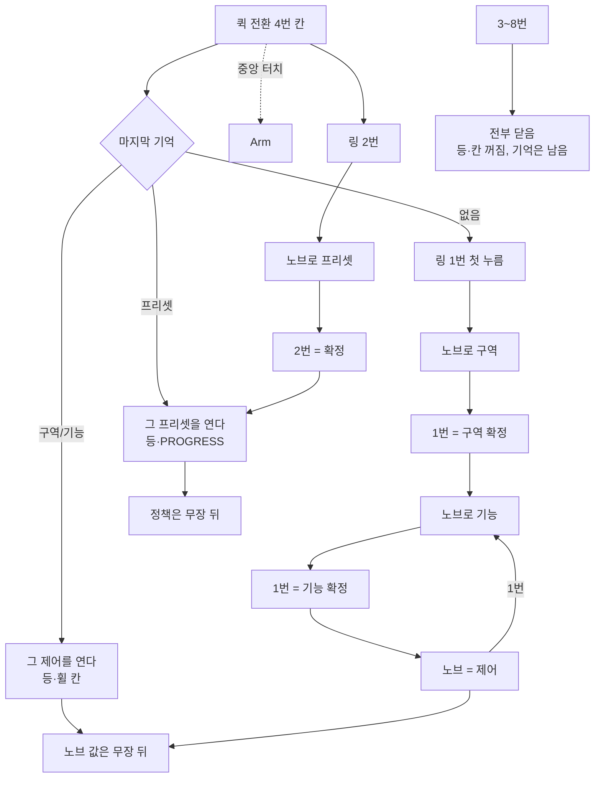
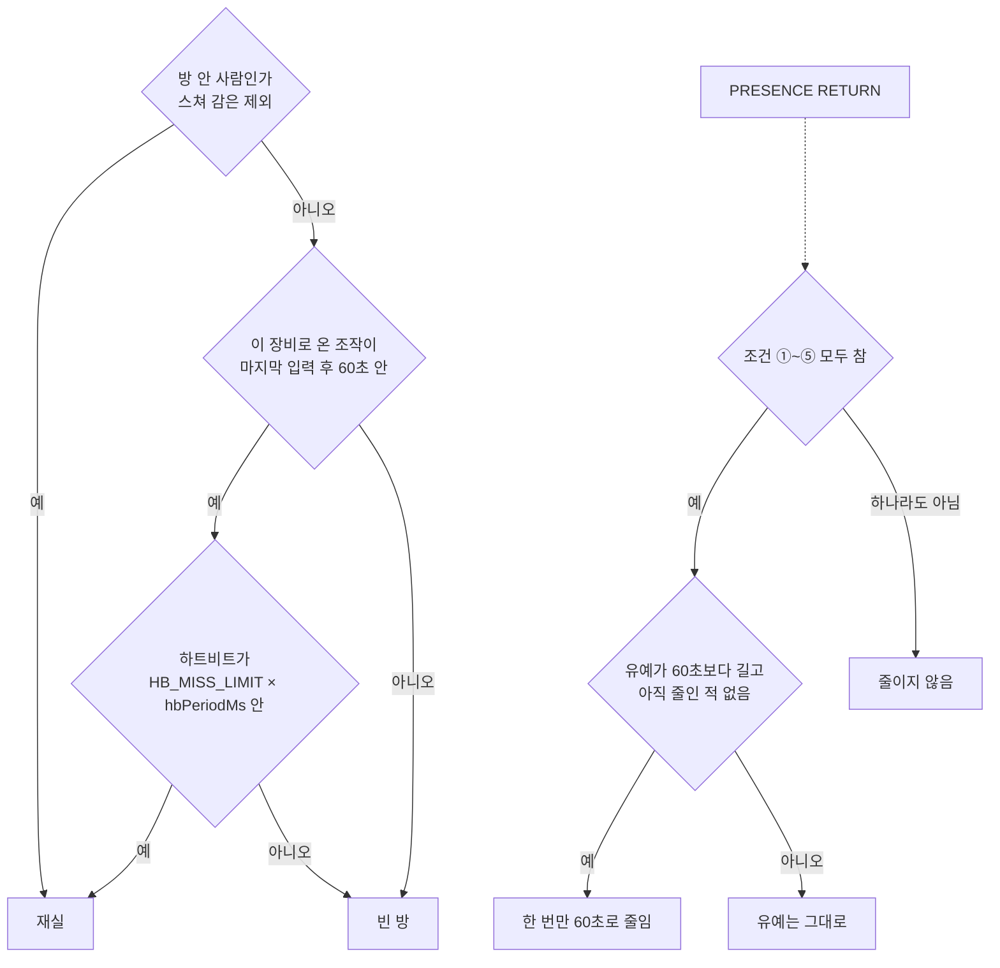

# 장비 — 칸탈 코일·필름 하이브리드 난방

이 장비는 220 V 니크롬 코일과 난방필름을 한 덕트 안에서 함께 쓰는 온풍기다. 코일이 온도를 빠르게 올리고, 필름이 그 온도를 유지한다. 송풍은 낮은 단에서 미풍이고 부스트에서는 유량을 올린다. 이 바람이 SSR 을 식힌다. 방열판은 두지 않는다.

방에 사람이 있는지는 두 가지를 함께 보아 판단한다. 이 장비의 mmWave 와, 이 장비로 들어오는 로터의 조작 입력이다. 로터가 " 곁에 사람이 있다 " 고 방송하는 신호만으로는 이 방의 재실을 유지하지 않는다. 조준 레이더는 온풍 조준과 **출구 근접·최적 거리 안전**에도 쓴다(「보안」).

기본 동작은 단순하다. 방이 비어 있으면 난방은 꺼진다. 다만 목표 온도를 한 번 확정하면, 사람이 없어도 그 온도를 맞춘다. 이 유지 시간은 `HEAT_HOLD_S`(기본 10 분) 까지다. 시간 값은 브라우저가 정한다.

옆에서 직접 만지는 조종은 NEXA Rotor 의 ESP-NOW 직결로 처리한다. 로터는 표준 패킷만 보내고, 이 장비가 그 패킷을 읽는다. 로터 펌웨어에는 난방을 위한 분기를 넣지 않는다. 상세한 온도와 주기 설정은 스마트폰 브라우저가 맡는다.

퀵 전환의 장비 슬롯은 4 번이다. 터치 링의 4 번 칸과는 다른 번호다. 슬롯은 " 이 장비를 고르는 자리 " 이고, 터치 링은 " 고른 뒤에 쓰는 기능 " 이다.

## 용어집

읽기 전에 아래 일곱 개만 알면 문장이 훨씬 빨리 읽힌다. 그 다음은 본문에 나오는 전문 용어다. 뜻은 이 문서에서 쓰는 뜻이다.

| 말              | 뜻                                                                                                                                      |
| :-------------- | :-------------------------------------------------------------------------------------------------------------------------------------- |
| **재실**        | 사람이 있다고 판정한 상태. 이 문서에서는 mmWave 와 로터 조작으로만 판단한다                                                             |
| **빈 방 유예**  | 사람이 떠난 뒤 곧바로 끄지 않고 기다리는 시간 (`ROOM_ABSENT_S`, 기본 10 분)                                                             |
| **선풍 / 후풍** | 선풍은 열원을 켜기 전에 팬만 먼저 돌리는 것. 후풍은 열원을 끈 뒤 팬으로 식히는 것                                                       |
| **확정 / 대기** | 대기는 확정 전의 임시 목표값이다. 확정은 그 값을 실제 목표로 고정하는 동작이다                                                          |
| **홀트**        | 과열이나 고장으로 스스로 멈춘 상태. 정해진 절차를 거치기 전에는 다시 켜지 않는다                                                        |
| **창 / 묶음**   | 창은 SSR 을 켜고 끄는 최소 시간 단위다. 묶음은 그 창 여러 개를 모은 상위 주기다                                                         |
| **하한 / 상한** | 값이 움직일 수 있는 아래끝과 위끝이다. 공기 목표에서는 `AIR_MIN_C`·`AIR_MAX_C` 이고, 체감 목표에서는 브라우저가 넣는 체감 상한·하한이다 |

### 열과 공기

| 말                | 뜻                                                                                                              |
| :---------------- | :-------------------------------------------------------------------------------------------------------------- |
| **덕트**          | 바람이 지나가는 통로. 순서는 흡기, 팬, SSR, 필름, 격벽, 코일, 출구다                                            |
| **흡기 / 출구**   | 흡기는 방 공기가 덕트로 들어오는 쪽이다. 출구는 데운 공기가 방으로 나가는 쪽이다. 둘 다 방의 온도로 쓰지 않는다 |
| **열원**          | 열을 내는 부품. 이 장비에서는 코일과 필름이다                                                                   |
| **칸탈 (니크롬)** | 전류가 흐르면 뜨거워지는 합금 선. 코일의 재료다                                                                 |
| **면상 발열체**   | 면처럼 얇게 편 발열체. 이 문서의 난방필름이다                                                                   |
| **미풍**          | 팬의 낮은 단. 정격 속도보다 낮춰 쓰는 약한 바람이다                                                             |
| **부스트**        | 상태 이름 `BOOST`. 목표까지 빨리 올리려고 출력을 높인 가열이다                                                  |
| **유지 가열**     | 상태 이름 `HOLD`. 목표 근처에서 그 온도를 붙잡는 가열이다                                                       |
| **체감 온도**     | 사람이 느끼는 온도. 노브와 브라우저가 정하는 목표 숫자다                                                        |
| **공기 목표**     | 실내 공기 센서가 쫓는 온도. 체감에서 보정을 뺀 값을 공기 하한과 상한 안에 둔 것이다                             |
| **복사**          | 공기 온도가 아니라, 따뜻한 면에서 몸으로 바로 오는 열                                                           |
| **보정**          | 체감 목표와 공기 목표의 차이. 덕트 안과 덕트 밖 면상에서 상한이 다르다                                          |
| **상류**          | 바람 흐름의 앞쪽. 덕트 안에서는 필름이 코일보다 먼저다                                                          |
| **유량 / CFM**    | 단위 시간에 지나가는 공기의 양. CFM 은 1 분에 지나는 부피다                                                     |
| **정압**          | 막힌 덕트에서 팬이 밀어내는 압력. 단위는 inH₂O 다. 자유 풍량과 같은 운전점이 아니다                             |
| **RPM**           | 팬이 1 분에 도는 횟수                                                                                           |
| **dBA**           | 소음 크기. 이 문서는 1 m 거리에서 잰 값이다                                                                     |
| **온도 차 ΔT**    | 출구 공기 온도에서 흡기 온도를 뺀 값. 유량이 작으면 같은 전력에서도 커진다                                      |
| **오버슈트**      | 목표를 지나 온도가 더 오르는 것                                                                                 |
| **히스테리시스**  | 목표 근처에서 코일을 껐다 켰다 하지 않으려고 두는 온도 폭. 기본은 1 °C 다                                       |
| **시정수 τ**      | 코일 듀티를 한 단계 올린 뒤, 방 공기가 새 온도로 따라오는 빠르기                                                |
| **리드타임**      | 도착 시각에 목표가 맞도록 그 시각보다 일찍 켜 두는 시간. 기호는 \(t\_{lead}\) 다                                |
| **평형 온도**     | 기호 \(T\_{eq}\). 그 가열을 그대로 두면 공기가 결국 머무는 온도                                                 |
| **승온률**        | 공기가 1 분에 오르는 온도                                                                                       |
| **유효 외기**     | 밖에 둔 온도 센서 없이 쓰는 바깥 온도. 기상 API 또는 방이 식는 곡선에서 얻는다                                  |
| **소프트스타트**  | 꺼져 있던 열원을 다시 켤 때, 목표 듀티로 한 번에 가지 않고 낮은 단부터 올리는 절차                              |

### 전기와 부품

| 말                  | 뜻                                                                                                               |
| :------------------ | :--------------------------------------------------------------------------------------------------------------- |
| **SSR**             | solid state relay. 금속 접점이 맞닿지 않고 반도체로 교류를 켜고 끄는 스위치                                      |
| **제로 크로싱**     | 교류 전압이 0 V 를 지나는 순간에 켜는 방식. 켜질 때의 소음이 작다                                                |
| **반사이클**        | 60 Hz 교류의 절반. 약 8 ms. 새로 켜는 SSR 은 이미 켜진 SSR 보다 반사이클 하나 뒤에 닫는다                        |
| **듀티**            | 한 주기 가운데 켜 둔 비율. 0 이면 꺼짐이고, 100 % 면 계속 켜짐이다                                               |
| **PWM**             | pulse width modulation. 아주 빠르게 켜고 끄며 평균 세기를 만드는 신호. 팬은 25 kHz 다. 열원 SSR 은 PWM 이 아니다 |
| **정격**            | 부품에 적힌, 버티도록 만든 전력·전압·전류                                                                        |
| **전력 W**          | 단위 시간에 나오는 에너지의 빠르기. 코일 정격은 600 W 다                                                         |
| **전압 V / 전류 A** | 전압은 전기를 미는 힘이고, 전류는 흐르는 양이다. 코일은 220 V, 약 2.73 A 다                                      |
| **Wh**              | 1 W 를 1 시간 쓴 에너지. 누적 전력량의 단위다                                                                    |
| **적산**            | 지금 전력을 시간에 따라 더해 Wh 로 남기는 것. 계량 인증은 아니다                                                 |
| **SMPS**            | switched-mode power supply. 220 V 를 12 V, 5 V, 3.3 V 로 바꾸는 전원                                             |
| **GPIO**            | 칩이 밖으로 내는 신호 핀. 켜기·끄기와 팬 PWM 이 여기로 나간다                                                    |
| **오픈 컬렉터**     | open collector. 높은 전압은 스스로 내지 못하고, 끌 때만 0 V 로 붙는 출력. 타코 선이 여기 해당한다                |
| **풀업**            | pull-up. 오픈 컬렉터 선이 쉬고 있을 때 3.3 V 로 올려 두는 저항                                                   |
| **타코**            | 팬이 돌 때마다 펄스를 내는 신호선. 펄스가 없으면 멈춘 것이다                                                     |
| **펄스**            | 잠깐 나타났다가 사라지는 신호 하나                                                                               |
| **킥**              | 멈춘 팬에 0.5 초 동안 100 % 를 주어 돌리기 시작하는 것                                                           |
| **하드와이어**      | 프로그램이 아니라 전선으로 직접 이은 연결. 버섯 스위치가 220 V 열원을 끊는 방식이다                              |
| **접점**            | 스위치 안에서 붙었다 떨어지는 자리. 팬과 MCU 전원은 버섯 스위치의 접점 밖에 둔다                                 |
| **융착**            | 끄라는 명령인데도 SSR 이 붙어 열이 계속 나는 고장                                                                |
| **SSR 개방**        | 켜라는 명령인데도 SSR 케이스가 데워지지 않는 고장                                                                |
| **방열판**          | 열을 넓게 퍼뜨려 식히는 금속. 이 장비는 두지 않고 덕트 바람으로 SSR 을 식힌다                                    |
| **마이카**          | 열에 버티고 전기가 통하지 않는 판. 코일 열이 필름과 SSR 로 되돌아가지 않게 막는 격벽의 재료다                    |
| **원와이어**        | 선 하나로 온도 센서 여러 개를 읽는 방식. 센서마다 주소가 달라야 한다                                             |
| **버스**            | 여러 센서가 나누어 쓰는 통신선 한 줄                                                                             |
| **DS18B20**         | `T_ssr` 과 `T_duct` 로 쓰는 온도 센서의 품번                                                                     |

### 통신, 보안, 저장

| 말              | 뜻                                                                                                      |
| :-------------- | :------------------------------------------------------------------------------------------------------ |
| **ESP-NOW**     | 로터와 장비가 가까이서 직접 주고받는 무선. Wi-Fi 와 같은 2.4 GHz 를 쓴다                                |
| **Wi-Fi**       | 포털에 물을 때 쓰는 무선. ESP-NOW 와 주파수가 같아 채널을 공유기의 AP 에 맞춘다                         |
| **AP**          | access point. 공유기가 뿌리는 무선이다                                                                  |
| **MQTT**        | 짧은 메시지를 토픽이라는 주소로 주고받는 규약. 장비와 포털이 쓴다                                       |
| **브로커**      | MQTT 메시지를 받아 구독하는 쪽으로 넘기는 서버                                                          |
| **토픽**        | MQTT 메시지가 실리는 주소                                                                               |
| **발행 / 구독** | 발행은 토픽에 메시지를 올리는 것이다. 구독은 그 토픽을 받는 것이다. 명령 구독은 상시로 열어 두지 않는다 |
| **텔레메트리**  | 장비가 포털로 올리는 온도, 듀티, 고장 이름 같은 측정값                                                  |
| **텔레커맨드**  | 포털에서 장비로 내려오는 명령                                                                           |
| **retain**      | 브로커가 마지막 값을 남겨 두는 것. 설정만 남기고, 가열 명령은 남기지 않는다                             |
| **nonce**       | 요청마다 새로 만드는 번호. 응답의 번호가 다르면 그 응답을 버린다                                        |
| **TLS**         | 통신 내용을 암호화하는 연결. 장비가 포털에 먼저 걸 때 쓴다                                              |
| **HTTPS**       | 브라우저와 포털 사이의 TLS 웹 연결                                                                      |
| **HMAC**        | 패킷이 바뀌지 않았고, 키를 아는 쪽이 보냈는지 확인하는 암호 꼬리표                                      |
| **AES-CCM**     | HMAC 자리에 쓸 수 있는 암호. 패킷 내용과 순서 번호를 함께 지킨다                                        |
| **seq**         | 패킷의 순서 번호. 기대하는 범위 밖이거나 같은 번호가 다시 오면 버린다                                   |
| **패킷**        | 한 번에 오가는 데이터 묶음                                                                              |
| **표준 패킷**   | 로터가 장비 종류와 상관없이 보내는 조종. 누른 칸과 노브 칸 수만 있고, 페이지 번호와 온도 숫자는 없다    |
| **하트비트**    | 로터가 아직 연결되어 있다고 반복해서 보내는 짧은 패킷                                                   |
| **hbPeriodMs**  | 하트비트에 실리는 다음 간격. 방금 걸린 간격이 아니라 다음 간격이다                                      |
| **링크**        | 하트비트가 정한 시간 안에 도착하는 연결                                                                 |
| **페어링**      | 로터와 이 장비를 서로 등록해 두는 것                                                                    |
| **방송**        | 장비 하나에게만 보내지 않고, 깨어 있는 장비가 모두 받게 보내는 것                                       |
| **PRESENCE**    | 로터 곁에 사람이 나타났거나 떠났다는 방송. 값은 `RETURN` 또는 `AWAY` 다. 이 방의 재실이 아니다          |
| **sleepHold**   | 로터가 잠들지 않게 붙잡아 둔 상태. 이때 하트비트 간격은 1 초다                                          |
| **docked**      | 로터가 거치대 위에 있음. 전원 패킷 `0x2A` 에 실린다                                                     |
| **NVS**         | 전원이 꺼져도 남는 저장. 설정과 누적 전력량은 남고, `HEAT_HOLD` 표시 자체는 남지 않는다                 |
| **포털**        | 브라우저의 설정을 받아 두었다가, 장비가 물어볼 때 건네는 서버                                           |

### 조작

| 말             | 뜻                                                                                    |
| :------------- | :------------------------------------------------------------------------------------ |
| **퀵 전환**    | 로터 옆면의 짧은 누름으로 장비를 고르는 것. 터치 링의 칸 번호와 다르다                |
| **슬롯**       | 퀵 전환 목록에서 이 장비가 앉는 자리. 첫 페이지의 4 번이다                            |
| **터치 링**    | 로터 위의 여덟 칸. 1 번은 구역과 기능, 2 번은 프리셋, 3 번부터 8 번은 고르기를 닫는다 |
| **노브**       | 돌려 한 칸씩 세는 손잡이. 시계 방향이 증가다                                          |
| **눈금**       | 노브가 한 칸 걸릴 때의 물리적 걸림. 장비의 수락 표시보다 먼저 들린다                  |
| **중앙 터치**  | 로터 한가운데를 누르는 것. 이 장비에서는 Arm 만 하고, 온도와 구역을 고르지 않는다     |
| **무장 (Arm)** | SSR 을 켜도 된다고 허용한 상태. 중앙 터치 한 번이다. 이 터치만으로 열은 나가지 않는다 |
| **원격 무장**  | 브라우저로 무장할 때, 포털에서 한 번 더 확인하는 절차                                 |
| **프리셋**     | 브라우저가 만든 묶음. 조건이 맞을 때 여러 구역을 대신 켠다                            |
| **수동**       | 프리셋 목록의 맨 끝. 고르면 1 번의 구역 제어로 돌아간다                               |
| **sector**     | 로터 아래 휠의 칸 번호. 0 부터 센다. 구역 1 번은 sector 0 이다                        |
| **피드백**     | 장비가 로터의 LED 를 직접 켜지 않고, 패턴 번호만 보내는 일                            |
| **ACCEPT**     | 조작이 받아들여졌다는 짧은 리듬. 눈금 클릭 뒤에 붙는다                                |
| **REJECT**     | 그 조작을 거절했다는 패턴                                                             |
| **LIMIT**      | 그 방향으로는 더 갈 수 없다는 패턴. 수락과 리듬이 다르다                              |
| **DONE**       | 확정이 끝났다는 완료 한 번                                                            |
| **FAULT**      | 고장 패턴. 로터의 장애 칸을 점멸한다. 고장 이름은 포털에만 있다                       |
| **PROGRESS**   | 지금 고르는 칸 하나만 낮게 켜는 패턴                                                  |
| **구역 등**    | 난방기 몸체에서 그 구역만 보여주는 등. 로터의 LED 가 아니다                           |

### 상태 이름

| 말                 | 뜻                                              |
| :----------------- | :---------------------------------------------- |
| **IDLE**           | 열이 꺼져 있고, 스스로 다시 켜지지 않는 쉼      |
| **PRE_PURGE**      | 선풍. 열을 켜기 전에 팬만 도는 시간. 기본 3 초  |
| **BOOST**          | 부스트. 위 「열과 공기」의 부스트와 같은 상태다 |
| **HOLD**           | 유지 가열 상태. 목표 근처를 유지한다            |
| **PAUSED_ABSENCE** | 빈 방 유예 동안. 직전 듀티를 유지한다           |
| **POST_PURGE**     | 후풍. 열을 끈 뒤 덕트를 식히는 동안             |
| **HALT**           | 홀트의 상태 이름. 위 표의 홀트와 같다           |

### 센서

| 말            | 뜻                                                                                                |
| :------------ | :------------------------------------------------------------------------------------------------ |
| **T_ssr**     | SSR 케이스의 온도. 융착과 SSR 개방을 본다. 방 공기도 아니고, 코일이 데운 공기도 아니다            |
| **T_duct**    | 코일을 지난 덕트 공기의 온도. 팬 강제, 홀트, 후풍 종료, 소프트스타트 생략을 본다                  |
| **실내 공기** | 사람이 있는 방의 공기 온도. 센서는 덕트 밖에 둔다. 목표와 리드타임의 기준이다                     |
| **mmWave**    | 짧은 전파로 사람과 거리를 보는 센서. **실내 mmWave** 는 재실, **조준 LD2450** 은 좌우 조준(X)과 **출구 근접 가드(Y·급접근)** 에 쓴다. `PRESENCE` 는 재실이 아니다 |
| **PIR**       | 움직임만 보는 센서. 앉아 있는 사람을 놓치므로 이 장비는 쓰지 않는다                               |

## 구성

| 위치        | 역할                                                                                                                                                                                                                                                                                                                                                                                                          |
| :---------- | :------------------------------------------------------------------------------------------------------------------------------------------------------------------------------------------------------------------------------------------------------------------------------------------------------------------------------------------------------------------------------------------------------------ |
| 난방 ESP32  | 콘센트 전원을 쓴다. 코일 SSR, 필름 SSR, 팬 PWM, 온도 센서, 실내 mmWave, 포털 MQTT 를 맡는다                                                                                                                                                                                                                                                                                                                   |
| NEXA Rotor  | 표준 패킷을 보낸다. 퀵 전환 4 번 칸이 이 장비다. 이 장비로 온 조작은 재실로 인정한다. `PRESENCE` 는 빈 방 유예를 줄이는 데만 쓴다. 절차는 「장비 슬롯」과 「재실」에 있다                                                                                                                                                                                                                                     |
| 코일        | 칸탈 (니크롬) 600 W, 220 V. 정격 전류는 약 2.73 A 다. 빠르게 가열하는 역할이다                                                                                                                                                                                                                                                                                                                                |
| 난방필름    | 보유 중인 면상 발열체다. 전력은 실측으로 정한다. 유지 가열을 맡는다                                                                                                                                                                                                                                                                                                                                           |
| SSR         | FOTEK SSR-40 DA 를 코일과 필름에 각각 하나씩 쓴다. 제로 크로싱 방식이라 소음이 없다                                                                                                                                                                                                                                                                                                                           |
| 팬          | 75×75×30 mm 원심 블로워. 품번은 실장할 때 정한다. 필요 사양은 다음과 같다. 12 V, 최대 0.45 A, 최대 5.4 W, 4 선. 빨강은 12 V, 검정은 0 V, 파랑은 PWM, 노랑은 타코다. 자유 풍량 **30 CFM 이상**, 정압 **0.45 inH₂O 이상**, 3200 RPM. 정격 소음은 1 m 거리에서 32 dBA 이하이고, 평소 단은 그보다 낮춰 미풍으로 쓴다. 흡기 쪽에 둔다. 사용 온도는 −10~70 °C 다. 잠기면 스스로 다시 돌지 않는 품번을 고르지 않는다 |
| `T_ssr`     | DS18B20 이다. SSR 케이스에 붙인다. 방열판은 쓰지 않는다. 융착과 SSR 개방을 판정하는 센서이며, 실내 공기를 재는 센서가 아니다                                                                                                                                                                                                                                                                                  |
| `T_duct`    | DS18B20 이다. 코일을 지난 덕트 공기를 잰다. 니크롬 선과 출구 그릴에는 붙이지 않는다. 50 °C 팬 강제, 65 °C 홀트, 팬 막힘, 후풍 종료를 판정한다. 실내 공기를 재는 센서가 아니다                                                                                                                                                                                                                                 |
| 실내 공기   | 사람이 머무는 실내 전체의 공기를 잰다. 케이블로 덕트 밖까지 뺀다. `T_ssr`, `T_duct` 와 다른 원와이어 주소를 쓴다. 품번은 실장할 때 정한다                                                                                                                                                                                                                                                                     |
| 실내 mmWave | 방의 재실을 본다. 이 장비로 온 로터의 조작과 함께 판단한다. `PRESENCE` 는 재실이 아니다. 온도 센서도 아니다. 배치와 시나리오는 「재실」에 있다                                                                                                                                                                                                                                                                |
| 구역 등     | 배정된 열원 구역마다 하나씩 붙는다. 그 구역이 지금 다루는 대상일 때만 켜진다. 핀은 실장할 때 정한다                                                                                                                                                                                                                                                                                                           |
| SMPS        | 220 V 를 12 V, 5 V, 3.3 V 로 바꾼다. 12 V 는 팬에 쓰고 0.5 A 이상을 확보한다. 5 V 와 3.3 V 는 MCU 에 쓴다. 팬 전원은 버섯 접점 밖에 둔다                                                                                                                                                                                                                                                                      |

공기는 흡기, 팬, SSR 과 `T_ssr`, 필름 예열, 마이카 격벽, 타공 반사판과 코일, `T_duct`, 전면 배출 순으로 지나간다. 격벽은 코일 복사열이 필름과 SSR 로 되돌아가는 것을 막는다. mmWave 는 이 덕트 안에 두지 않는다. 이 팬의 정압은 0.45 inH₂O 다. 그 압력으로 바람이 나가지 않으면 팬을 키우지 않고 덕트를 바꾼다.

실내 공기 센서는 위 공기 경로에 두지 않는다. 출구의 온풍과 들이쉬는 입구의 공기를 방의 온도로 쓰지 않는다. 케이블을 사람이 머무는 실내까지 빼서, 그 방의 공기를 읽는다. 케이블 길이는 통신이 깨지지 않는 범위에서 가장 길게 잡는다. `T_ssr`, `T_duct`, 실내 공기가 한 버스에 물리면, 셋이 모두 읽히는 길이까지만 쓴다. 목표 온도, 승온, 리드타임, 체감 온도의 기준이 되는 공기 온도는 이 센서의 값이다.

## 부품 목록

| 부품             | 수량              | 품번            | 요구                                                                                                                                                                        |
| :--------------- | :---------------- | :-------------- | :-------------------------------------------------------------------------------------------------------------------------------------------------------------------------- |
| 코일             | 구역마다 1        |                 | 칸탈 (니크롬). 600 W, 220 V, 약 2.73 A                                                                                                                                      |
| 난방필름         | 구역마다 1        |                 | 보유 중인 면상. 전력과 면적은 실측                                                                                                                                          |
| SSR              | 구역마다 2        | FOTEK SSR-40 DA | 코일 하나, 필름 하나. 제로 크로싱                                                                                                                                           |
| SSR 구동 스위치  | 구역마다 2        |                 | 5 V 이상. 3.3 V GPIO 에 바로 물리지 않음                                                                                                                                    |
| 팬               | 구역마다 1        |                 | 75×75×30 mm 원심. 12 V, 최대 0.45 A, 최대 5.4 W, 4 선. 자유 풍량 30 CFM 이상, 정압 0.45 inH₂O 이상, 3200 RPM, 1 m 에서 32 dBA 이하. −10~70 °C. 잠기면 스스로 다시 도는 품번 |
| 타코 풀업 저항   | 팬마다 1          |                 | 1 kΩ~10 kΩ. 3.3 V 에 연결. 12 V 에는 연결하지 않음                                                                                                                          |
| `T_ssr`          | 구역마다 1        | DS18B20         | SSR 케이스. 방열판 없음                                                                                                                                                     |
| `T_duct`         | 구역마다 1        | DS18B20         | 코일을 지난 덕트 공기                                                                                                                                                       |
| 실내 공기 센서   | 장비마다 1        |                 | 덕트 밖, 사람이 머무는 실내. `T_ssr`, `T_duct` 와 다른 원와이어 주소                                                                                                        |
| 실내 mmWave      | 장비마다 1        |                 | 하우징 옆면 또는 흡기 쪽 외벽. 덕트 안은 아님                                                                                                                               |
| 구역 등          | 배정된 구역마다 1 |                 |                                                                                                                                                                             |
| 난방 ESP32       | 장비마다 1        |                 | 콘센트 전원                                                                                                                                                                 |
| SMPS             | 장비마다 1        |                 | 220 V 를 12 V, 5 V, 3.3 V 로. 12 V 는 0.5 A 이상. 이 전류는 팬 한 대의 최대 0.45 A 에 맞춘 값. 팬 전원은 버섯 접점 밖                                                       |
| 적색 버섯 스위치 | 장비마다 1        |                 | 220 V 열원 라인에 직렬. 팬과 MCU 용 SMPS 는 이 접점 밖                                                                                                                      |
| 마이카 격벽      | 구역마다 1        |                 | 코일 복사열이 필름과 SSR 로 되돌아가지 않게 함                                                                                                                              |
| 타공 반사판      | 구역마다 1        |                 | 코일 앞                                                                                                                                                                     |

### 공기와 발열의 정합

덕트 안의 공기 온도 상승은 유량과 발열량이 정한다. 외우기 쉬운 형태는 다음과 같다. 공기 1 CFM 은 약 0.57 W/K 이므로,

\[
\Delta T \approx \frac{P}{0.57 \times \text{CFM}}
\]

이 식으로 이 설계를 검산하면 다음과 같다.

| 조건                         | 계산          | 출구 공기 (흡기 20 °C 기준) |
| :--------------------------- | :------------ | :-------------------------- |
| 600 W, 30 CFM                | ΔT ≈ 35 K     | 55 °C                       |
| **480 W(듀티 80 %), 30 CFM** | **ΔT ≈ 28 K** | **48 °C**                   |
| 필름 200 W, 30 CFM           | ΔT ≈ 12 K     | 32 °C                       |

그래서 코일 듀티에 상한을 둔다. 상한은 `COIL_MAX_PCT`(기본 80) 이고, 이 값이 600 W 를 480 W 로 낮춰 출구를 48 °C 에 둔다. 흡기가 30 °C 인 여름에도 58 °C 라 `T_duct` 65 °C 홀트에 여유가 남는다. 이 상한은 소프트스타트의 목표에도 적용한다. 필름 정격을 넣을 때도 같은 식으로 출구 온도를 확인한다. 30 CFM 은 위 표의 기준 유량이고, 실제 유량이 이보다 적으면 상한을 더 낮춘다. 흡기 30 °C 에서 65 °C 에 닿는 유량은 약 24 CFM 이므로, 그 아래로 떨어지면 덕트를 바꾸거나 상한을 내린다.

## 통신

현장 직결은 ESP-NOW 다. 로터가 이 장비를 활성 dest(패킷을 받는 대상) 로 둔 동안의 조종은 이 경로로 온다.

포털 MQTT 는 이 ESP32 가 직접 연다. 콘센트 전원이므로 이중 무선을 감수한다. 명령은 장비가 포털에 물어볼 때 가져온다. 명령 구독은 상시로 열어 두지 않는다. 로컬 브로커가 있으면 그 브로커를 쓰고, 없으면 외부에 직접 묻는다. ESP-NOW 와 Wi-Fi 는 같은 2.4 GHz 를 쓰므로 채널은 AP 에 맞춘다. SSR 을 켜는 짧은 구간에는 이 요청을 미루고, 그 구간이 끝나면 다음 주기에 다시 묻는다.

텔레메트리로 올리는 값은 다음과 같다. `T_ssr`, `T_duct`, 실내 공기 온도, 코일 듀티, 필름 듀티, 팬 단, 상태 이름, 재실, 빈 방 유예, `HEAT_HOLD`, 유지 남은 시간, 고장 이름, 공기 승온률, `T_ssr` 승온률, `T_duct` 승온률, 체감 목표, 공기 목표, 복사 보정, 시정수, 리드타임, 프리셋 번호, 켜진 구역, 구역별 열원 제원과 지금 전력과 누적 전력량, 그리고 조준 근접 가드의 `NEAR_LEVEL`·최근접 Y(동등 필드)다. 열 모델은 「열 모델」에, 적산은 「에너지 계량」에 정리되어 있다. 컨트롤러 표준 패킷에는 온도 샘플과 재실을 넣지 않는다. 재실은 이 장비의 mmWave 와 이 장비로 온 조작으로만 정한다. `PRESENCE` 는 그 값에 넣지 않는다.

로터의 직결 명령과 포털 명령이 겹치면 현장 ESP-NOW 가 우선이다. 전체 순위는 [모듈형 오픈 컨트롤러](<모듈형%20오픈%20컨트롤러(Modular%20Open%20Controller).md>) §0.2.2 를 따른다. `T_duct` 과열 차단은 안전정지이므로 그 순위보다도 위다.

로터는 이 장비를 조종하려고 Wi-Fi 를 열지 않는다. 배터리가 로터에 있기 때문이다.

## 텔레커맨드 (MQTT)

스마트폰 웹브라우저가 포털에 붙는다. 명령은 이 장비가 포털에 물어보고 가져온다. 가열 명령을 토픽에 올려 구독시키는 방식은 쓰지 않는다. 로터가 쓰는 설정용 MQTT 와는 다른 연결이다.

| 구간            | 방향           | 실리는 것                                                                                                                                                                                                                                                                                           |
| :-------------- | :------------- | :-------------------------------------------------------------------------------------------------------------------------------------------------------------------------------------------------------------------------------------------------------------------------------------------------- |
| 브라우저 → 포털 | HTTPS          | 목표 온도, 도착 시각, 도착 유예, 리드 상한, 상한·하한, 공기 하한·상한, 릴레이 배정, 허용, 풍량 단 수, 팬 최소 기동, 주기, 코일 최소 온·오프 시간, 코일 묶음 시간, 코일 듀티 상한, 필름 기본 듀티, 필름 배치, 프리셋, 총 전력 상한, 빈 방 유예, 유지 시간, 프리셋 빈 방 상한, 연장, 구역별 열원 정격 |
| 장비 → 포털     | 요청           | nonce. 대기 중인 명령이 있는지만 묻는다                                                                                                                                                                                                                                                             |
| 포털 → 장비     | 그 요청의 응답 | 같은 nonce 의 표준 패킷, 또는 설정. 이 응답만 받는다                                                                                                                                                                                                                                                |
| 장비 → 브로커   | MQTT 발행      | 텔레메트리 토픽                                                                                                                                                                                                                                                                                     |

가열 명령은 retain 하지 않는다. 설정만 retain 한다. 설정에 해당하는 항목은 다음과 같다. 상한·하한, 공기 하한·상한, 주기, 코일 최소 온·오프 시간, 코일 묶음 시간, 코일 듀티 상한, 필름 기본 듀티, 필름 배치, 도착 시각, 도착 유예, 리드 상한, 프리셋, 총 전력 상한, 팬 최소 기동, 프리셋 빈 방 상한, 릴레이 배정, 열원 정격이다. 명령 구독은 상시로 열어 두지 않는다.

## 보안

공통 항목은 패밀리 문서 §11.6 을 따른다. 이 장비의 코드에서 지켜야 할 것은 다음 일곱 가지다.

- 장비가 먼저 발신하고 TLS 를 쓴다. 수신 포트를 열지 않는다.
- 요청 nonce 와 응답 nonce 가 다르면 그 응답을 버린다.
- 장비마다 자격을 따로 둔다. 공통 비밀번호를 쓰지 않고, 와일드카드 구독도 하지 않는다.
- HMAC 또는 AES-CCM 을 `controller_id‖dest_id‖seq‖payload` 에 적용한다. `seq` 가 창 밖이거나 중복이면 버린다.
- 무장 전에는 SSR 을 켜지 않는다. 원격 무장은 포털에서 한 번 더 확인한다.
- 하트비트가 끊기면 열원 듀티를 0 으로 두고 후풍으로 넘어간다.
- 로그에는 페어링, 무장, 원격 전원, 홀트만 남긴다. 키와 비밀번호는 로그에 남기지 않는다.

적색 버섯 스위치는 220 V 열원 라인에 하드와이어로 직렬로 넣는다. 로터 패킷으로 그 차단을 만들지 않는다. 팬과 MCU 의 SMPS 는 그 접점 밖에 둔다. 그래서 차단 뒤에도 후풍과 `T_duct` 감시는 계속된다.

### 출구 근접·효율·최적 거리

**철학:** 방을 데우지 말고 **사람 가까이** 온풍한다. 다만 그 거리는 **안전 바닥(`D_opt`) 밖**에만 둔다.

| 항목 | 요지 |
| :--- | :--- |
| **근접 가드** | 조준 LD2450 의 Y·급접근. 경고 → derate / 컷 → **열 0 + 후풍 강(잔열 냉각, 온풍 부스트 아님) + 축 hold**. 재개는 명령. `PRESENCE` 로 켜·끄지 않음 |
| **단열** | 하우징·덕트 단열을 강화해 **효율**(손실↓)과 **표면 화상 여유**를 기계적으로 확보. 출구 온풍·충돌 마진을 없애지는 않음 |
| **최적 거리** | `D_opt ≥ D_brake + 열 마진 + 충돌 마진`. **`D_brake`**(제동거리, 산업 E-stop 과 무관한 문서 기호) = (레이더 확정 지연 + 제어 + **액추에이터 정지·후퇴 시간**) × 가정 접근 속도. 추종 목표 `D_track` 은 `D_opt` 바로 밖(효율↑) |
| **다축·상시 추종** | 충돌이 본류. 조준 레이더 + **공간(버블)용 레이더·센서** 보강, 축 리밋. 밀착 추종이 아니라 **스탠드오프 추종** |

수치(`NEAR_*`, `D_brake`, `D_opt`)는 실측 전 프로파일 초안. 우선 층·표는 [Path 기획](기획-NEXA%20Path%20템플릿%20—%20SVG%20키프레임·JSON·G방언.md), 코드 쪽 안내는 [추적 코드](코드-온풍%20조준%20—%20mmWave%20추적%20코드.md) 「안전 안내」. 텔레메트리: `NEAR_LEVEL`, 최근접 Y.

## 장비 슬롯

이 장비는 퀵 전환 첫 페이지의 4 번 칸에 둔다. 공간의 위가 그 페이지의 첫 칸이고, 로터의 `SlotEntry.index` 는 위가 0 이다. 따라서 `page` 는 0, `index` 는 3 이다.

슬롯 색은 포털이 정한다. 로터 펌웨어에 이 `deviceID` 와 칸을 심지 않는다. 포털의 `slot` 표에 그 칸으로 넣으면, 로터가 설정 MQTT 로 NVS 에 받는다. 절차는 [NEXA Rotor](모듈형%20오픈%20컨트롤러%20NEXA%20Rotor.md) 「퀵 전환」에 있다.

이 칸을 누르면 무장 LED 가 슬롯 색으로 낮게 켜진다. 링크 LED 는 하트비트가 돌아올 때까지 ESP-NOW 색으로 점멸한다. 중앙 터치를 한 번 누르면 Arm 이 되고, 그때 무장 LED 가 밝아진다. 이 터치는 목표 온도 입력이 아니다. 고르다가 취소하면 DISARM 상태로 남는다. 터치 링의 기능은 슬롯을 고른 뒤에만 읽는다.

## 장비 컨트롤 맵

로터는 터치 링 1 번으로 열원 구역을 고르고, 이어서 그 구역의 기능을 고른 다음 노브로 값을 다룬다. 터치 링 2 번은 프리셋이다. 주기, 상한·하한, 필름 전력, 프리셋 내용 같은 설정은 브라우저가 맡는다.

그림 1. 기억이 없으면 링 1 번 세 번으로 구역·기능·제어에 간다. 기억이 있으면 그 화면만 연다. 링 2 번은 프리셋을 새로 고른다. 중앙 터치는 Arm 이며 이 흐름을 열거나 닫지 않는다. 프리셋 정책과 노브 값은 무장 뒤에만 나간다.

페어링할 때 이 장비는 `DeviceConfigPacket` 으로 템플릿과 눈금을 알린다. 이 패킷은 이 맵의 자식이고, 로터 UI 에만 쓴다. 기능 행은 이 장비가 읽는다. 로터는 누른 칸과 노브 칸 수만 보내고, 페이지 번호는 보내지 않는다. 열원 구역은 물리적인 난방 자리이며, 릴레이·목표 온도·풍량·X·Y·Z·C·추적 가운데 어느 것도 아니다. 로터는 구역과 기능을 구분하지 않는다. 구분은 브라우저의 배정이 만든다. 칸을 누르기 전에 돌린 노브는 값에 더하지 않는다. 중앙 터치는 구역 고르기도, 기능 고르기도, 온도 입력도 아니다.

터치 링 1 번의 첫 누름은 구역 고르기를 연다. 노브를 한 칸 돌리면 다음 구역으로 간다. 1 번을 다시 누르면 그 구역이 확정되고, 노브는 그 구역의 기능을 고르는 역할로 바뀐다. 기능 순서는 릴레이, 목표 온도, 풍량, X, Y, Z, C, 추적 다. 1 번을 한 번 더 누르면 그 기능이 확정되고, 그때부터 노브가 실제 제어가 된다. 즉 클릭은 모두 세 번이다. 세 번째 클릭까지 한 번이라도 가면, 장비는 그 구역과 기능을 기억한다. 프리셋을 확정한 경우에는 그 프리셋을 기억하고, 이 기억이 구역 기억보다 나중 것이다. 다음에 이 난방 슬롯을 고르면 마지막 기억으로 바로 돌아오므로, 세 번을 다시 누를 필요가 없다. 그때 무장 전에 구역 등과 로터 휠의 칸이 켜진다. 기억은 NVS 에 남지 않는다. 부팅하면 비어 있고, 그때는 세 번 클릭부터 시작한다. 고르는 동안에 돌린 노브는 출력을 바꾸지 않는다. 제어 중에 돌린 노브는 구역과 기능을 바꾸지 않는다. 2 번은 프리셋이며 절차는 「프리셋」에 있다. 3·4·5·6·7·8 번은 비어 있다. 그 칸을 누르면 구역 고르기, 기능 고르기, 제어, 프리셋 고르기가 모두 닫힌다. 구역 등과 기능 칸도 꺼진다. 다만 기억은 남는다. 기능 페이지는 없다. 절차는 「열원 구역」에 있다.

릴레이는 코일 SSR 과 필름 SSR 을 한 기능으로 묶는다. 로터에서 둘을 따로 고르지 않는다. 켜고 끄는 기능은 시계 방향 한 칸이 켜짐이고 반대 한 칸이 꺼짐이다. 단계가 있는 기능은 시계 방향이 더하고 반대가 뺀다.

| 기능          | 우선                                             | 로터 (펌웨어 기본)                                                                                                                                                                                                                                                                                                                                                                                                                                                                                                                                                 | 브라우저                                                                                 | Deck | 적용                                                                                                                                                                                                                                                                                                                                                                                                                                                                                                          |
| :------------ | :----------------------------------------------- | :----------------------------------------------------------------------------------------------------------------------------------------------------------------------------------------------------------------------------------------------------------------------------------------------------------------------------------------------------------------------------------------------------------------------------------------------------------------------------------------------------------------------------------------------------------------- | :--------------------------------------------------------------------------------------- | :--- | :------------------------------------------------------------------------------------------------------------------------------------------------------------------------------------------------------------------------------------------------------------------------------------------------------------------------------------------------------------------------------------------------------------------------------------------------------------------------------------------------------------ |
| 열원 구역     | 직결. 끔과 홀트가 위                             | 터치 링 1 번의 첫 누름. 노브는 다음 구역. 시계는 큰 번호, 반대는 작은 번호. 끝의 다음 한 칸은 반대 끝. 1 번을 다시 눌러 구역을 확정                                                                                                                                                                                                                                                                                                                                                                                                                                | 구역 배정. retain                                                                        | 미정 | 물리적 구역이며 기능이 아니다. 번호는 1 부터 24 까지다. 배정된 수가 상한이다. 기본은 구역 하나다. 지금 고르는 구역의 등만 켜진다. 절차는 「열원 구역」                                                                                                                                                                                                                                                                                                                                                        |
| 기능 고르기   | 직결. 그 구역 안                                 | 구역이 확정된 뒤의 노브. 순서는 릴레이, 목표 온도, 풍량, X, Y, Z, C, 추적. 1 번을 다시 눌러 기능을 확정. 휠 버텀 LED 는 그 순서 칸                                                                                                                                                                                                                                                                                                                                                                                                                                 | 그 구역에 있는 기능. retain                                                              | 미정 | 배정되지 않은 축은 고르기에 없다. 처음이거나 기억이 없으면, 세 번째 1 번 뒤에 노브가 제어가 된다. 슬롯을 다시 고르면 마지막 세 번째 클릭의 제어로 바로 오고, 무장 전에 구역 등과 기능 칸이 켜진다                                                                                                                                                                                                                                                                                                             |
| 릴레이        | 직결 켬·끔. 홀트는 안전                          | 기능 확정 뒤. 시계 한 칸은 켜짐, 반대 한 칸은 꺼짐                                                                                                                                                                                                                                                                                                                                                                                                                                                                                                                 | 같은 켜짐·꺼짐. 켜짐 명령은 retain 하지 않음                                             | 미정 | 그 구역의 코일과 필름. 무장 뒤에만 두 SSR 을 켠다. 빈 방에서 켜는 한 칸은 `HEAT_HOLD` 가 0 이면 `REJECT` 다. 켜면 선풍 뒤 「열 모델」의 분배로 가열한다. 끄는 한 칸은 둘 다 0 으로 두고 `HEAT_HOLD` 를 0 으로 한 뒤 후풍한다                                                                                                                                                                                                                                                                                  |
| 목표 온도     | 직결 > 포털. 확정하면 빈 방에서도 가열           | 기능 확정 뒤. 시계 한 칸은 대기 +1 °C, 반대는 대기 −1 °C. 대기가 바뀐 뒤 1 번을 다시 눌러 확정하고 기능 고르기로 돌아간다. 대기가 그대로면 확정하지 않는다                                                                                                                                                                                                                                                                                                                                                                                                         | 목표를 쓰면 확정과 같다. 체감 상한·하한, 공기 하한·상한, 유지 시간 `HEAT_HOLD_S`. retain | 미정 | 그 구역의 체감 온도다. 공기가 쫓는 값은 「열 모델」에서 정한다. 대기 칸은 가열을 바꾸지 않는다. 확정하면 `HEAT_HOLD` 가 1 이 되고 `HEAT_HOLD_S` 를 다시 잰다. 꺼져 있어도 선풍부터 켠다. 체감 상한·하한과 공기 하한·상한을 넘는 칸은 `LIMIT` 다. 다른 칸으로 닫으면 대기는 버린다                                                                                                                                                                                                                             |
| 풍량          | 직결. 과열 팬이 위                               | 기능 확정 뒤. 시계 한 칸은 +1 단, 반대는 −1 단                                                                                                                                                                                                                                                                                                                                                                                                                                                                                                                     | 단 수. retain                                                                            | 미정 | 그 구역. 펌웨어 기본은 5 단이다. 열원이 켜져 있는데 0 단이면 `LIMIT` 다. `T_duct` 가 50 °C 를 넘으면 100 % 로 둔다                                                                                                                                                                                                                                                                                                                                                                                            |
| X, Y, Z, C    | 직결. 끊김과 홀트가 위                           | 기능 확정 뒤. 시계 한 칸은 +, 반대는 −                                                                                                                                                                                                                                                                                                                                                                                                                                                                                                                             | 그 구역의 축. retain                                                                     | 미정 | 배정된 축만 기능 고르기에 있다. 한 칸의 이동량은 그 축의 배정이 정한다. 끝 위치는 장비가 정한다. 하트비트 끊김과 홀트는 그 구역의 축 출력을 0 으로 둔다                                                                                                                                                                                                                                                                                                                                                       |
| 추적 (열풍기) | 직결. 홀트가 위                                  | 기능 확정 뒤. 노브 대기 1~5 는 Focus, Scan, Centroid, Path, Manual. 시계 +1·반대 −1. 1·5 끝에서 한 칸 더면 `LIMIT`. 대기가 바뀐 뒤 1 번으로 모드 확정. Path(4) 확정 뒤 노브는 Path 프리셋 번호 ±, 대기가 바뀐 뒤 1 번으로 그 경로 적용 후 모드 대기로 복귀. Manual(5) 확정 뒤 노브 한 칸은 각 ±(즉시). Focus·Scan·Centroid 확정 뒤 노브는 다시 모드 대기 ±. 추적 중 1 번 길게 (또는 1 초 안 두 번) 는 재탐색. 짧게 1 번만이고 대기가 그대로면 모드 대기로만 복귀 (Path·Manual). 로터는 이름을 안 보내고 칸 수만 보낸다. 링 2 번 장비 프리셋과 Path 프리셋은 다르다 | 다섯 모드. Path 경로 (펄스·머무름) 목록. retain                                          | 미정 | 모터는 하나다. 최소 Δx 이하면 한 덩어리. Focus 대표 1, Scan 호 스윕·걸리면 머무름, Centroid 중심, Path 는 고른 경로 순회, Manual 각 고정. 재탐색은 초기 탐색을 다시 열고 끝나면 확정 모드로 돌아온다. 코드는 LD2450 절                                                                                                                                                                                                                                                                                        |
| 재실          | 장비 로컬. `HEAT_HOLD`, 명시적 끔, 홀트보다 아래 | 기능 칸 없음. 이 장비로 온 조작은 재실로 인정한다. `PRESENCE` 는 유예를 줄일 뿐이다. 로터에 난방 분기는 없다                                                                                                                                                                                                                                                                                                                                                                                                                                                       | 빈 방 유예, 유지 시간, 프리셋 빈 방 상한. retain. 연장은 retain 하지 않음                | 미정 | 난방기 mmWave 가 보거나, 이 장비를 찍은 조작이 있으면 사람이 있는 것으로 본다. 조작 몫의 끝은 마지막 입력 시각 + 60 초이고, 새 조작이 들어오면 그 시각을 다시 잡는다. `PRESENCE` 는 재실을 유지하지 않는다. 유예가 60 초보다 길게 남아 있으면 60 초로 줄인다. 거치와 `sleepHold` 는 그 줄이기에 쓰지 않는다. 담요로 장비 센서만 가려도 조작이 있으면 재실이다. 빈 방 유예는 `HEAT_HOLD` 가 0 일 때만 연다. 유지 시간이 끝나면 유예로 넘기지 않는다. 연장이 없으면 열원 0 과 후풍이다. 스스로 다시 켜지 않는다 |
| 프리셋        | 직결. 그 프리셋의 조건. 홀트는 위                | 터치 링 2 번. 노브는 다음 프리셋. 2 번을 다시 눌러 확정. 휠은 그 순서 칸                                                                                                                                                                                                                                                                                                                                                                                                                                                                                           | 개수, 순서, 조건, 우선 또는 순환. retain. 이름은 브라우저에만 둔다                       | 미정 | 장비 프리셋이다. 추적 Path 의 경로 목록과 다르다. Path 경로는 「추적」에서 모드 4 확정 뒤 노브로 고른다. 동시에 켜는 구역 수를 제한한다. 고르는 동안 출력은 그대로다. 목록 끝의 수동은 브라우저 정책이 아니라 1 번의 구역 제어다. 절차는 「프리셋」                                                                                                                                                                                                                                                           |
| 빈 칸         | 없음                                             | 터치 링 3·4·5·6·7·8                                                                                                                                                                                                                                                                                                                                                                                                                                                                                                                                                | 미정                                                                                     | 미정 | 기능이 없다. 누르면 구역 고르기, 기능 고르기, 제어, 프리셋 고르기를 모두 닫는다. 구역 등과 기능 칸도 꺼진다. 기억은 남는다                                                                                                                                                                                                                                                                                                                                                                                    |
| 끊김          | 열원 0, 후풍, 축 출력 0                          | 하트비트 끊김                                                                                                                                                                                                                                                                                                                                                                                                                                                                                                                                                      | 명령 시각이 끊김                                                                         | 미정 | 새 가열을 받지 않는다. 후풍은 계속한다                                                                                                                                                                                                                                                                                                                                                                                                                                                                        |

무장 전에는 SSR 을 켜지 않는다. 선풍, 후풍, 과열 팬, 홀트는 안전 기능이므로 무장이 풀려도 계속 돈다. 이 팬들은 열을 더하지 않는다.

### 조작과 장비 피드백

로터 자신의 눈금 클릭과 터치 링 진동은 [NEXA Rotor](모듈형%20오픈%20컨트롤러%20NEXA%20Rotor.md) 「피드백」을 따른다. 로터의 인디케이터 LED 와 휠 버텀 LED 는 이 장비가 직접 켜지 않는다. 이 장비는 결과만 `FeedbackEvent` 로 되돌리고, 로터가 그것을 그린다. 예외는 구역 등이다. 구역 등은 이 장비 몸체의 각 구역에 있고, 이 장비가 직접 켠다. 배정된 구역마다 등이 하나씩 있다. 지금 고르고 있거나, 확정했거나, 기억으로 연 구역의 등만 켜지고 나머지는 꺼진다. 몸체의 등은 구역만 보여 준다. 기능은 로터 휠 버텀 LED 의 `PROGRESS` 칸으로 보여 준다. 순서는 릴레이, 목표 온도, 풍량, 그다음 배정된 X, Y, Z, C, 이어서 추적이다. 1 이 `sector` 0 이다. 배정되지 않은 축은 빠지므로 뒤 칸이 앞으로 당겨진다.

| 되돌리는 것                                                          | 패턴              | 로터                                                                                                                                                                                                                |
| :------------------------------------------------------------------- | :---------------- | :------------------------------------------------------------------------------------------------------------------------------------------------------------------------------------------------------------------ |
| 켜짐이 받아들여짐                                                    | `DONE` `0x04`     | 완료를 한 번 낸다. 눈금 클릭 뒤에 붙는다                                                                                                                                                                            |
| 목표를 확정함                                                        | `DONE` `0x04`     | `HEAT_HOLD` 가 켜졌다는 뜻이다. 눈금 클릭 뒤에 붙는다                                                                                                                                                               |
| 제어로 넘김                                                          | `DONE` `0x04`     | 구역 또는 기능이 확정되었다는 뜻이다. 눈금 클릭 뒤에 붙는다                                                                                                                                                         |
| 단계 한 칸을 받아들임                                                | `ACCEPT` `0x01`   | 대기 값이나 한 단이 바뀌었다는 짧은 틱이다. 이 틱은 듀티가 아니다                                                                                                                                                   |
| 빈 방 켜짐, 또는 배정 없음                                           | `REJECT` `0x02`   | 낮고 끊긴 틱을 낸다. 값은 바뀌지 않는다                                                                                                                                                                             |
| 체감 상한·하한, 공기 하한·상한, 끝 단, 구역이 하나뿐임, 총 전력 상한 | `LIMIT` `0x03`    | `sector` 는 `0xFF` 다. 수락 틱과 리듬이 다르다. 고르기의 양 끝은 이 패턴이 아니다. 총 전력을 넘는 켜짐은 나가지 않는다. 공기 하한·상한은 사람이 체감을 바꾸는 칸에만 보낸다                                         |
| 고르는 번호와 제어 중 기능을 보여 줌                                 | `PROGRESS` `0x06` | 구역 고르기면 구역 번호−1, 기능 고르기와 제어는 기능 순서−1, 프리셋 고르기와 확정은 프리셋 순서−1 이다. 1 이 `sector` 0 이다. 그 칸만 낮게 남는다. 기억 복귀는 무장 전에 보낸다. `sector` 가 `0xFF` 면 그 칸을 끈다 |
| 홀트, SSR 개방, 팬 정지, 팬 막힘                                     | `FAULT` `0x05`    | 장애 칸을 점멸한다. 필름 열화는 여기에 넣지 않고 포털로만 알린다                                                                                                                                                    |

## 열원 구역

열원 구역은 물리적으로 나뉜 난방 자리다. 그래서 순서는 항상 같다. 먼저 어느 구역인지 고르고, 그다음에 그 구역의 릴레이, 목표 온도, 풍량, X, Y, Z, C, 추적 가운데 무엇을 다룰지 노브로 고른다.

구역 번호는 1 부터 24 까지다. 이 상한은 로터 하단 링의 `sector` 0~23 과 같다. 25 부터는 포털이 받지 않는다. SSR 개수를 상수로 두지 않는다. 브라우저에 배정된 구역 수가 상한이다. 로터 펌웨어에는 이 수와 난방 분기를 심지 않는다. 24 는 구역을 고르는 최대치이고, 더 필요하면 나중에 반영한다. 이 보드의 GPIO 에 SSR 을 24 개 바로 물린다는 뜻은 아니다.

기본은 구역 하나다. 그 구역의 기능 순서는 릴레이, 목표 온도, 풍량, X, Y, Z, C, 추적 다. 구역을 배정에서 빼면 고르기에서도 빠진다.

로터는 구역 번호도, 기능 이름도, 듀티도 모른다. 로터에서 오는 것은 터치 링 1 번의 클릭과, 그 뒤에 돌린 노브 칸 수뿐이다. 페이지 번호는 오지 않는다 (24 이하 제한). 사이드 버튼의 짧은 누름은 퀵 전환이며 구역과는 관계가 없다.

### 손으로 다루는 흐름

1. 퀵 전환 첫 페이지의 4 번 칸으로 이 난방기를 고른다. `page` 는 0, `index` 는 3 이다. 무장 LED 는 슬롯 색 (장비 색) 으로 낮게 켜지고, 링크 LED 는 하트비트가 올 때까지 점멸한다. 마지막 기억이 프리셋이면 그 프리셋으로 바로 열어 빠르게 제어할 수 있게 한다. 허용 구역의 등을 낮게 켜고, 프리셋 순서−1 을 `PROGRESS` `0x06` 으로 보낸다. 마지막 기억이 구역과 기능이면 그 제어로 바로 연다. 그 구역의 등을 켜고 기능 순서−1 을 보낸다. 두 경우 모두 무장 전에 표시가 보인다. 프리셋이면 무장 뒤에 그 정책이 돌고, 구역과 기능이면 무장 뒤의 노브가 그 제어가 된다. 1 번을 세 번 다시 누를 필요는 없다. 무장 전에 돌린 노브는 값에 더하지 않는다. 기억이 없거나 그 구역·기능이 배정에서 빠졌으면 등을 끈 채로 두고, 아래 3 번 또는 「프리셋」부터 시작한다. 기억은 NVS 에 남지 않으므로 부팅하면 빈다.
2. 중앙 터치를 한 번 누르면 Arm 이 된다. 무장 LED 가 밝아진다. 이 터치만으로 SSR 이 나가지는 않는다. 구역 고르기, 기능 고르기, 목표 온도 어디로도 들어가지 않는다. 이미 열려 있는 제어를 이 터치가 닫지도 않는다.
3. 터치 링 1 번을 한 번 누른다. 퀵 전환 도중이 아니고 구역이 하나 이상일 때만 들어간다. 구역이 없으면 `REJECT` 다. 장비는 지금 구역을 `PROGRESS` `0x06` 으로 보내고, `sector` 는 구역 번호−1 이다. 로터는 그 칸만 낮게 켜고, 그 구역의 등도 켜진다. 이 칸이 보이기 전에 돌린 노브는 구역에 더하지 않는다. 들어갈 때의 구역은 마지막으로 다루던 구역이다. 그 구역이 배정에서 빠졌으면 가장 작은 번호로 시작한다.
4. 칸이 보인 뒤에 노브를 한 칸 돌리면 다음 구역으로 간다. 시계 방향은 더 큰 번호, 반대는 더 작은 번호다. 끝에서 한 칸 더 가면 반대 끝으로 넘어간다. 넘기는 동안 출력은 바뀌지 않는다. 구역 등과 `sector` 는 그 구역을 따라간다. 구역이 하나뿐이면 양쪽 모두 `LIMIT` `0x03` 이다.
5. 1 번을 다시 누르면 그 구역이 확정된다. `DONE` `0x04` 다. 이제 노브는 그 구역의 기능을 고른다. 순서는 릴레이, 목표 온도, 풍량, X, Y, Z, C, 추적 이고, 배정되지 않은 축은 빠진다. 기능을 고르는 동안의 노브도 출력을 바꾸지 않는다. 구역 등은 확정된 구역에 남는다. `sector` 는 그 기능 순서−1 이고, 노브가 기능을 옮기면 그 칸을 따라간다.
6. 1 번을 한 번 더 누르면 그 기능이 확정된다. `DONE` `0x04` 다. 여기까지 클릭은 세 번이다. 장비는 이 구역과 기능을 기억한다. 구역 등은 그 구역에 남고, 기능 칸은 낮게 남는다. 이때부터 시계 방향 한 칸은 켜짐 또는 더하기이고, 반대 한 칸은 꺼짐 또는 빼기다. 제어 중에 돌린 노브는 구역과 기능을 옮기지 않는다.
7. 릴레이는 시계 한 칸이 켜짐, 반대 한 칸이 꺼짐이다. 사람이 있거나 `HEAT_HOLD` 가 1 일 때만 켤 수 있고, 그때는 `PRE_PURGE` 뒤에 그 구역의 코일과 필름이 함께 가열한다. 둘 다 아니면 `REJECT` 이고 `IDLE` 에 남는다. 반대 한 칸은 코일과 필름을 0 으로 두고 `HEAT_HOLD` 를 0 으로 한 뒤 `POST_PURGE` 로 간다.
8. 목표 온도는 시계 한 칸이 대기 +1 °C, 반대가 대기 −1 °C 다. 대기만 바뀌어서는 가열이 달라지지 않는다. 대기가 바뀐 뒤 1 번을 다시 누르면 그 대기를 확정하고 같은 구역의 기능 고르기로 돌아간다. 확정은 `HEAT_HOLD` 를 1 로 두고 `HEAT_HOLD_S` 를 다시 재는 것이다. 꺼져 있어도 선풍부터 켜고 그 목표를 맞춘다. 대기가 그대로면 1 번은 확정 없이 기능 고르기로만 돌아간다. 어느 쪽이든 구역 등은 그 구역에 남고, 휠 칸은 기능 고르기의 그 순서를 가리킨다.
9. 풍량과 X, Y, Z, C 는 시계가 더하고 반대가 뺀다. 그 칸을 돌리는 것이 곧 적용이다. 1 번을 다시 누르면 같은 구역의 기능 고르기로 돌아가고, 이미 적용된 단과 축은 그대로 남는다. 구역 등은 그 구역에 남고, 휠 칸은 고르는 기능을 따라간다. 다른 구역으로 가려면 3 번부터 8 번으로 닫은 뒤 1 번부터 다시 고른다. 2 번은 닫지 않고 프리셋 고르기를 연다. 이렇게 닫아도 기억은 지워지지 않는다. 닫을 때 구역 등을 끄고, `PROGRESS` 의 `sector` 를 `0xFF` 로 보내 기능 칸을 끈다. 슬롯을 다시 고르면 마지막 기억으로 돌아온다.
10. 하트비트 끊김, 끄기, 홀트는 코일과 필름을 0 으로 두고 그 구역의 축 출력도 0 으로 둔다. 끄기와 끊김은 후풍으로 이어진다. 홀트는 스스로 다시 켜지 못한다. `T_duct` 가 50 °C 아래로 내려온 뒤에, 그 구역의 릴레이를 세 번의 클릭으로 다시 골라 시계 한 칸으로 켜야 풀린다. 그 켜짐도 선풍부터 시작한다.

브라우저가 구역이나 기능을 쓰면 나중에 쓴 쪽이 덮는다. 구역과 기능 배정은 retain 이고, 가열 명령은 retain 이 아니다. 구역을 고르는 것만으로는 `HEAT_HOLD` 가 켜지지 않는다.

한 구역의 릴레이를 손으로 다루는 동안에는 프리셋이 그 구역을 끄지 않는다. 프리셋으로 돌아오면 개수와 순서를 다시 적용한다.

## 프리셋

열원이 한 몸에 가깝게 몰려 있을 수 있다. 머리 위, 의자 등받이, 의자 받침, 책상 아래, 책상 사이드 같은 배치가 그렇다. 이것은 배치에 대한 가정이다. 이름과 순서는 브라우저가 구역에 붙이고, 펌웨어에는 이 이름을 심지 않는다. 실내 mmWave 는 방에 사람이 있는지만 보고, 어느 열원 앞에 있는지는 가리지 못한다. 그래서 동시에 몇 개를 켤지는 프리셋이 맡는다. 전력 합은 프리셋과 수동이 같은 상한을 따른다.

프리셋은 브라우저가 만들고 retain 한다. 이름은 브라우저에만 있다. 프리셋 하나에는 동시 허용 개수, 구역 순서, 켜는 조건, 우선 또는 순환이 들어간다. 조건은 재실, 실내 공기가 공기 목표보다 낮음, 도착 시각의 예열, 도착 시각의 바깥 기온 네 가지다. 그 프리셋에서 켜 둔 조건이 모두 참일 때만 켠다. 꺼 둔 조건은 보지 않는다. 여기서 재실은 이 장비의 mmWave 가 보았거나, 이 장비로 온 노브·터치 링·원형 터치 입력이 60 초 안에 있었던 경우다. `PRESENCE` 는 이 조건에 쓰지 않는다. 프리셋의 「구역 근접」조건 칸은 아직 쓰지 않는다. **출구 근접 가드**는 프리셋 조건이 아니라 조준 LD2450 의 안전 층이다(「보안」·추적 코드). 목록 끝의 수동은 브라우저 정책이 아니라 1 번의 구역 제어다.

우선 방식은 순서의 앞부터 켠다. 허용 개수를 넘지 않고, 총 전력 상한도 넘지 않는다. 개수에 여유가 있어도 전력을 넘으면 그 구역은 켜지 않는다. 이미 켜진 구역이 더 올릴 듀티가 없는데도 실내 공기가 목표보다 낮을 때만 다음 구역을 켠다. 실내 공기가 목표에 들어오면 순서의 뒤부터 끈다. 순환은 다른 프리셋이다. 브라우저가 정한 시간마다 허용 개수만큼 다음 구역으로 넘어간다. 빠지는 구역은 열원 0 과 `POST_PURGE` 로 가고, 들어오는 구역은 선풍과 소프트스타트부터 시작한다. 구역마다 코일이 다르므로 빠지는 쪽의 후풍을 생략하지 않고, 들어오는 쪽의 소프트스타트도 생략하지 않는다.

빈 방이면 프리셋도 열원을 켜지 않는다. 목표를 확정했거나 도착 시각 예열일 때만 사람이 없어도 켠다. 목표 확정으로 빈 방에서 켠 프리셋 가열은 `HEAT_HOLD_S` 와 `PRESET_EMPTY_MAX_S`(기본 30 분) 중 더 짧은 쪽에서 끝난다. 두 값 모두 브라우저가 바꾸고 retain 한다. 그 시각이 되면 열원 0 과 후풍으로 간다. 도착 시각 예열은 이 둘을 타지 않고, 도착 시각 + `ARRIVAL_GRACE_S` 만 따른다. `PRESENCE` 만으로는 이 빈 방을 채우지 않는다. 무장 전에는 SSR 이 나가지 않는다. 고르는 동안 출력은 그대로다.

터치 링 2 번을 누르면 프리셋 고르기가 열린다. 프리셋이 없으면 `REJECT` 다. 노브를 한 칸 돌리면 다음 프리셋이다. 시계는 뒤, 반대는 앞이고, 끝의 다음은 반대 끝이다. 하나뿐이면 `LIMIT` 다. `sector` 는 프리셋 순서−1 이다. 그 프리셋에 든 구역의 등만 낮게 켠다. 2 번을 다시 누르면 확정이고 `DONE` `0x04` 다. 이때 이 프리셋을 기억한다. 허용 구역의 등은 낮게 남고, 실제로 가열 중인 구역은 더 밝게 켠다. 수동을 확정하면 구역 등을 끄고, 1 번의 세 번 클릭부터 시작한다.

포털은 쌓인 프리셋 번호, 켜진 구역, 실내 공기, 전력량으로 프리셋을 제안할 수 있다. 다만 브라우저가 수락하기 전에는 정책을 바꾸지 않는다.

## 열원 실행

상태 이름은 `IDLE`, `PRE_PURGE`, `BOOST`, `HOLD`, `PAUSED_ABSENCE`, `POST_PURGE`, `HALT` 다.

릴레이를 시계 한 칸으로 켜면 `PRE_PURGE` 다. 사람이 있거나 `HEAT_HOLD` 가 1 일 때만 그렇게 한다. 둘 다 아니면 `REJECT` 이고 `IDLE` 에 남는다. 멈춰 있던 팬은 먼저 0.5 초 동안 100 % 로 킥한 뒤 명령 단으로 내린다. 이 킥은 `PRE_PURGE_S`(기본 3 초) 안에 들어간다. 그 3 초 동안 타코 펄스가 있어야 열원이 나간다. 펄스가 없으면 열원을 열지 않고 `HALT` 로 간다. 열원은 코일과 필름이며, 로터는 둘 중 하나만 고르지 않는다.

가열하는 동안이고 필름이 덕트 안이면, 필름은 상류 예열로 `FILM_BASE_PCT` 이상을 유지한다. 덕트 밖 면상은 공기 상류가 아니므로 그 기본을 두지 않는다. 덕트 안에서는 공기가 모자라면 필름을 먼저 올리고, 그래도 느리면 코일이 더한다. 공기가 목표에 가까워지면 코일부터 내린다. 히스테리시스 기본 1 °C 안으로 들어오면 코일 듀티는 0 이 되고 필름이 유지한다. 필름만으로 그 띠를 지키지 못하면 코일을 다시 연다. 나누는 방식은 「열 모델」에 있다. 릴레이가 꺼지면 코일과 필름의 듀티는 0 이다.

배정되지 않은 구역은 고르기에 없다. 구역이 없으면 1 번은 `REJECT` 다. 고르는 절차는 「열원 구역」에 있다.

`HEAT_HOLD` 가 0 이고, 한 번이라도 재실이 보인 운전에서 방이 `ROOM_ABSENT_S`(기본 10 분) 동안 비면 `PAUSED_ABSENCE` 다. 유예 동안은 직전 듀티를 유지한다. 그 안에 이 장비의 mmWave 가 사람을 보거나 이 장비로 온 조작이 돌아오면, 직전 `BOOST` 또는 `HOLD` 를 이어 간다. `PRESENCE` 만으로는 이 유예를 닫지 않는다. 유예가 60 초보다 길게 남아 있으면 60 초로 줄인다. 이미 60 초 안이면 늘리지 않는다. 이 줄이기는 이어지지 않는다. 유예가 끝나면 열원 0 과 `POST_PURGE` 다. 그 뒤 `IDLE` 에서는 스스로 다시 켜지 않는다.

`HEAT_HOLD` 가 1 이면 이 유예를 열지 않는다. 사람이 없어도 확정된 목표를 `HEAT_HOLD_S` 까지 맞춘다. 기본은 10 분이다. 이 값은 브라우저가 바꾸고 retain 한다. 빈 방 유예와는 다른 시간이다. 프리셋으로 빈 방에서 켠 가열은 이 시간과 `PRESET_EMPTY_MAX_S` 중 더 짧은 쪽에서 끝난다. 절차는 「프리셋」에 있다. 도착 시각 예열은 이 10 분으로 끝나지 않고, 만료는 「예측 예열」을 따른다. 그 시간 안에 재실이 보이면 알림 없이 `HEAT_HOLD` 를 0 으로 둔다. 가열은 사람이 있으므로 그대로 남는다.

시간이 지나도 재실이 없으면 포털에 알림을 한 번 보낸다. 글은 브라우저에 있다. 로터 펌웨어에 난방 알림 분기를 넣지 않는다. 연장이 없으면 그 시각에 `HEAT_HOLD` 를 0 으로 두고 열원 0 과 `POST_PURGE` 로 간다. 직전 듀티를 유예로 붙잡지 않는다. 알림이 나가지 않아도 종료는 그 시각에 한다. 브라우저의 연장은 같은 `HEAT_HOLD_S` 를 다시 잰다. 이미 꺼졌으면 선풍부터 그 목표를 맞춘다. 연장 명령은 retain 하지 않는다.

가열 릴레이의 반대 한 칸은 코일과 필름을 0 으로 둔다. 그때 `HEAT_HOLD` 도 0 으로 두며, 이 동작은 위의 유지 시간보다 우선한다. 홀트는 그보다도 위다.

다음 경우에는 열원 듀티를 0 으로 두고 `POST_PURGE` 로 간다. 끄기, 하트비트 끊김, 끄기 명령, 빈 방 유예 종료, 연장 없는 유지 시간 종료가 여기 해당한다. 후풍은 120 초로 고정하지 않는다. 종료 조건은 `T_duct` 가 45 °C 미만이 되거나, `T_duct` 기울기의 크기가 0.2 °C/분 미만이 될 때다. 기울기는 최근 3 분의 이동평균으로 낸다. 3 분이 모이기 전에는 기울기로 끝내지 않는다. 최대가 180 초이므로, 기울기만으로는 그 상한보다 일찍 끝나지 않는다. 일찍 끝나는 경우는 최소 60 초가 지난 뒤 `T_duct` 가 45 °C 미만일 때뿐이다. 즉 최소 60 초, 최대 180 초다. 식히는 중에도 기울기는 크기로 본다. 내려가는 1 °C/분은 0.2 보다 크다. 그 뒤 `IDLE` 이 된다. `T_duct` 50 °C 이상일 때의 강제 팬은 이 종료보다 우선하므로, 180 초가 되어도 그 팬은 100 % 로 남는다. `T_ssr` 은 흡기 쪽에 있어 덕트보다 먼저 식으므로 이 종료 판정에 쓰지 않는다.

시간은 제로 크로싱 SSR 에 맞춘 느린 주기를 쓴다. 코일 창, 최소 온·오프, 묶음의 값과 그 값을 바꿀 때의 결과는 「설정」에 있다.

코일 듀티의 상한은 `COIL_MAX_PCT`(기본 80) 다. 「공기와 발열의 정합」의 출구 온도 검산에서 나온 값이고, 브라우저가 바꾸고 retain 한다. 이 상한은 소프트스타트의 목표에도 적용하며, 목표 듀티가 상한을 넘으면 상한으로 자른다. 필름은 이 상한을 타지 않고 「체감 온도」와 `FILM_BASE_PCT` 를 따른다.

켜져서 듀티가 0 보다 큰 코일과 필름의 정격 전력 합은 `ZONE_TOTAL_W_MAX` 를 넘지 않는다. 프리셋과 수동이 같다. 이 값은 브라우저가 정하고 retain 한다. 합은 묶음 평균이 아니라 정격으로 계산한다. 듀티가 남아 있는 소자는 켜진 창에서 정격 전류를 그대로 뽑으므로, 정격 전체를 합에 넣는다. 듀티가 0 인 코일은 합에 넣지 않는다. 필름이 20 % 여도 듀티가 남아 있으면 필름 정격 전체를 넣는다. 코일과 필름을 한 소자로 합쳐 세지 않고, 둘 다 듀티가 남아 있으면 둘 다 넣는다. 창이 지금 겹치지 않아도 겹칠 수 있으므로 미리 막는다. 이 제한 때문에 다음 구역이 켜지지 못할 수 있는데, 이는 의도된 안전 여유다. 넘는 켜짐은 나가지 않고 `LIMIT` 다. 이미 켜진 구역은 끄지 않는다. 값이 없으면 구역 하나만 가열한다. 정격이 비어 있는 필름은 합을 알 수 없으므로 그 SSR 을 켜지 않고, 포털에 필름 정격을 넣으라는 알림을 한 번 보낸다. 정격을 넣기 전에는 그 알림을 반복하지 않는다. 모르는 와트는 합에 넣지 않는다. 코일 600 W 는 합에 넣는다.

같은 220 V 에서 새로 닫는 열원 SSR 은, 이미 이 반사이클에 닫히기로 한 SSR 과 같은 제로크로싱을 쓰지 않는다. 코일과 필름, 다른 구역이 모두 같다. 다음 제로크로싱 한 번, 60 Hz 기준 약 8 ms 뒤로 미룬다. 이미 도통 중인 소자는 끄지 않는다. 코일과 필름을 함께 가열하는 것은 그대로다. 닫힌 뒤에는 코일 창과 필름 창이 수 초 동안 같은 반사이클에 같이 도통한다. 이 밀림은 전력 합에서 둘 중 하나를 빼는 규칙이 아니다.

- 필름 주기 `FILM_PERIOD_MS` 는 기본 4000 이다. 2000 에서 5000 사이만 받는다. 코일이 중간 듀티를 낼 수 있으므로 필름과 나누어 가열한다. 중간 듀티는 「설정」에 있다.
- 팬은 75×75×30 mm 원심 블로워다. PWM 은 파랑 선이고 25 kHz 를 쓴다. 하이 전압이 2.8 에서 10 V 이므로 3.3 V GPIO 가 하이로 충분하다. 가청 고주파를 피하고, 단을 낮추면 미풍이 된다. 단 수는 기본 5 이고 포털이 바꾼다. 1 단은 `FAN_MIN_START_PCT`(기본 30) 보다 낮지 않다. 이 값은 브라우저가 바꾸고 retain 하며, 그보다 낮은 단은 `LIMIT` 다. 5 단은 그 최소 단에서 100 % 까지다. 멈춘 뒤 돌릴 때는 0.5 초 동안 100 % 로 킥한 다음 그 단으로 내린다. 이미 돌고 있을 때의 단 변경에는 킥을 넣지 않는다. 정격 속도에서 자유 풍량 30 CFM, 정압 0.45 inH₂O, 3200 RPM, 소음 32 dBA 이하이고, 평소 단은 그보다 낮게 둔다. `T_duct` 50 °C 이상과 고장 냉각만 100 % 다. 노랑 타코는 오픈 컬렉터 (open collector) 출력이다. 3.3 V 에 1 kΩ에서 10 kΩ 사이의 풀업 저항 (pull-up) 을 달고, 12 V 에는 연결하지 않는다. 4 극이고 회전당 2 펄스다. 정지는 펄스가 없는 것으로 본다. 잠기면 스스로 다시 돌지 않는 품번은 고르지 않는다. 데이터시트에 최소 기동 듀티가 있으면 그 값을 `FAN_MIN_START_PCT` 의 최소값으로 쓴다. 없으면 30 % 를 기본으로 두고, 타코가 살아 있으면 브라우저가 더 내릴 수 있다. 팬 5.4 W 는 `ZONE_TOTAL_W_MAX` 에 넣지 않는다.

열원이 듀티 0 에서 다시 켜질 때마다 소프트스타트를 탄다. 코일과 필름이 각자 탄다. 선풍이 끝난 뒤의 첫 가열도 같다. 그 구역의 `T_duct` 가 50 °C 이상이면 소프트스타트를 생략한다. 덕트가 아직 뜨거운 히스테리시스 재점화가 여기 해당한다. `T_ssr` 은 흡기 쪽 케이스라 코일 열을 보지 못하므로 이 생략 판정에 쓰지 않는다. 생략하지 않을 때, 목표 듀티가 50 % 이하이면 그 목표로 바로 간다. 50 % 를 넘으면 첫 15 초는 40 %, 다음 15 초는 70 % 와 목표 중 낮은 쪽, 그다음은 목표다. 목표를 넘는 단은 두지 않는다. 40 % 는 30 에서 50 사이만 받는다. 코일의 40 % 와 70 % 는 묶음에서 가장 가까운 창 수로 맞춘다. 70 % 가 두 칸의 한가운데면 낮은 칸을 쓴다. 기본 5 창에서 40 % 는 2 창, 70 % 는 3 창 (60 %) 이다. 창을 세는 법은 「설정」에 있다. 이 방식은 수축 소음, 열충격, SSR 스트레스를 줄인다. 켜진 반사이클의 전류는 정격 그대로다. 제로 크로싱이라 피크를 따로 깎지 않는다. 첫 15 초는 듀티가 50 % 를 넘지 않으므로 SSR 개방의 5 분에 넣지 않는다. 70 % 단은 그 5 분에 넣는다.

노브 한 칸이 곧 듀티 한 칸은 아니다. 목표 온도로 넘어간 뒤의 시계 한 칸은 대기 중인 +1 °C 이고, 반대 한 칸은 대기 중인 −1 °C 다. 고르는 중의 칸과, 그 전에 돌아간 칸은 온도에 더하지 않는다. 중앙 터치의 각도와 떼는 동작도 온도에 더하지 않는다. 1 번을 다시 눌러야 그 대기가 확정되고 `HEAT_HOLD` 가 1 이 된다. 그때 `HEAT_HOLD_S` 를 다시 잰다. 브라우저가 목표를 써도 같은 확정이다. 확정된 뒤에만 듀티가 온도를 맞춘다. 노브와 브라우저의 목표 숫자는 체감 온도이고, 공기가 쫓는 값은 「열 모델」에서 정한다. `HEAT_HOLD` 는 NVS 에 남지 않는다. 가열 릴레이를 모두 끄는 한 칸, 유지 시간 종료, 예열 만료, 부팅이 0 으로 둔다. 목표 숫자, `HEAT_HOLD_S`, `ARRIVAL_GRACE_S` 는 retain 이다.

SSR 입력은 3.3 V GPIO 에 바로 물리지 않는다. FOTEK SSR-40 DA 의 구동 여유는 5 V 또는 그 이상의 스위치로 확보한다. 핀 번호는 실장할 때 정한다.

## 재실

이 문서에서 " 사람이 있다 " 는 아래 신호를 함께 본 결과다. 하나라도 사람이면 재실이다. 빈 방 `REJECT`, 빈 방 유예를 닫는 재실, `HEAT_HOLD` 를 끄는 재실은 모두 이 값이다. `PRESENCE` 는 이 값에 넣지 않는다.

그림 2. 재실은 방 안의 mmWave 이거나, 이 장비로 온 조작이 마지막 입력 후 60 초 안이고 하트비트가 살아 있을 때다. 스쳐 가는 것은 재실이 아니다. `PRESENCE` 는 재실이 아니다. 조건을 모두 만족하고 이번 유예가 60 초보다 길게 남았을 때 한 번만 60 초로 줄인다.

- 이 장비의 mmWave 가 방 안의 사람을 보면 재실이다. 담요 등으로 가리면 이 센서만으로는 빈 방이다. 복도를 스쳐 가는 것은 재실이 아니다.
- 이 로터가 이 장비로 보내는 노브, 터치 링, 원형 터치 입력이 들어오는 동안도 재실이다. 이것은 이 장비를 찍은 패킷이므로 방송 `PRESENCE` 와 다르게 다룬다. `RETURN` 을 놓쳐도 조작은 남는다. 이 몫의 끝은 마지막 입력 시각 + 60 초이고, 새 조작이 들어오면 그 시각을 다시 잡는다. 하트비트가 `HB_MISS_LIMIT` × 마지막으로 받은 `hbPeriodMs` 안에 없으면, 그 60 초가 남아 있어도 이 몫은 끝난다.
- 페어링된 로터의 `PRESENCE` 가 `RETURN` 이어도 그것만으로는 재실이 아니다. 아래 ①~⑤를 모두 만족할 때만 빈 방 유예를 줄인다.
  - ① 링크가 살아 있어야 한다. 즉 하트비트가 `HB_MISS_LIMIT` × 마지막 `hbPeriodMs` 안에 있어야 한다.
  - ② 유효 하트비트가 `HB_IDLE_FLOOR_MS`(1000 ms) 이하여야 한다.
  - ③ `docked` 를 알 수 있어야 한다. 마지막으로 받은 `0x2A` 가 `POWER_REFRESH_S` 두 번 (기본 120 초) 보다 오래되지 않아야 한다.
  - ④ 그 `docked` 값이 거치가 아니어야 한다.
  - ⑤ `sleepHold` 가 0 이어야 한다.
- 유효 하트비트는 최근 도착 간격 둘의 평균과, 그 패킷의 `hbPeriodMs` 중 큰 쪽으로 잡는다. `hbPeriodMs` 는 다음 간격을 실어 보내므로, 필드만 보면 한 박자 빠르게 믿게 된다. 도착 간격이 둘보다 적으면 이 줄이기를 쓰지 않는다.
- 줄이기는 유예가 60 초보다 길게 남았을 때 60 초로 줄이고, 이미 더 짧으면 늘리지 않는다. 이 줄이기는 이어지지 않는다. 간격이 최소 간격보다 길어지거나 하트비트가 끊기면, `AWAY` 가 없어도 그 몫은 끝난다.
- ③④⑤의 근거다. 1 초 최소 간격은 재실 전용이 아니다. 거치와 잠들기 금지도 그 최소 간격을 만든다. `docked` 는 `0x2A` 로 온다. 마지막으로 받은 `0x2A` 가 `POWER_REFRESH_S` 두 번 (기본 120 초) 보다 오래되면 `docked` 를 모르는 것으로 보고 이 줄이기를 쓰지 않는다. `sleepHold` 는 매 하트비트의 `0x2C` 에 실린다.
- 로터가 곁을 스쳐 지나간 것은 방송하지 않으므로 줄이기도 없다.
- 가까운 거리가 비어도 단기 비움 30 초가 지나야 간격이 최소 간격을 넘어선다. 이 지연은 그대로 둔다. `AWAY` 를 놓쳐도 그 뒤에 그 몫은 끝난다. 하트비트가 끊기면 열원 0 과 후풍이라는 끊김 규칙이 그대로 적용된다.
- 이 방송은 " 로터 곁 " 이지 " 이 방 " 이 아니다. 간격을 1 초로 유지한 채 다른 방에서 로터를 쥐면, 이 규칙은 방을 가르지 못한다. 그래서 프리셋의 재실 조건과, 유예를 닫는 재실에는 이 방송을 쓰지 않는다.
- 방송 규칙은 [NEXA Rotor](모듈형%20오픈%20컨트롤러%20NEXA%20Rotor.md) 「존재 감지 mmWave」와 「비움 사다리」에 있다. 이 장비가 그 이벤트를 받는다. 로터 펌웨어에 난방 분기를 넣지 않는다.
- 매트의 침대 mmWave 는 쓰지 않는다. 하트비트가 `HB_MISS_LIMIT` × 마지막 `hbPeriodMs` 안에 없으면 그 로터 몫을 지운다. " 잠들었다 " 는 패킷은 따로 없다. 그때 남는 재실은 이 장비의 mmWave 와, 아직 60 초 안인 조작뿐이다.
- 표준 패킷과 `STREAM` 에 재실 필드를 넣지 않는다. 온도를 재지 않는다. 과열 팬과 홀트는 `T_duct` 가 닫는다.

이 센서는 난방 ESP32 에 있다. 로터 본체의 자리 비움 mmWave 가 아니고, 매트의 침대 mmWave 도 아니다.

두는 곳은 하우징 옆면이나 흡기 쪽 외벽이다. 창은 비도전이어야 하고, 사람이 앉아 있는 실내를 본다. 알루미늄 벽 뒤에는 두지 않는다. 전파가 막힌다.

덕트 안, 코일 앞, 출구 그릴 안에도 두지 않는다. 금속이 전파를 되돌리고, 열풍과 팬 진동이 사람을 가린다. 출구를 바라보면 뜨거운 바람이 재실로 읽힌다.

보는 값은 거리 칸과 움직임이다. 복도를 스쳐 가는 것은 재실이 아니다. 앉아 있는 사람은 움직임이 없어도 재실이다. PIR 은 그 사람을 놓치므로 쓰지 않는다. 거리 칸의 경계는 설치 각도에 맞춰 실측한다. 품번과 핀은 실장할 때 정한다.

시나리오는 다음과 같다.

- 기본은 사람이 없으면 난방이 꺼져 있는 상태다. 빈 방에서 릴레이를 시계 한 칸으로 켜면 `REJECT` 이고, 가열로 가지 않는다. 담요로 가려 이 장비의 mmWave 만 빈 방이어도, 페어링된 로터로 이 장비를 만지면 재실이다. 그 켜짐은 받아들여진다. 조작이 끊긴 뒤 60 초가 지나면 그 몫은 끝난다. 곁에 두기만 한 `PRESENCE` 로는 켜지지 않는다.
- 사람이 있으면 그 시계 한 칸이 켜진다. 이때 `HEAT_HOLD` 는 0 이다. 앉아 있어도 가열은 유지된다.
- 목표 온도로 넘어간 뒤 1 번을 다시 누르거나 브라우저가 목표 온도를 쓰면, 그것이 확정이다. `HEAT_HOLD` 가 1 이 되고 `HEAT_HOLD_S` 를 잰다. 사람이 없어도 선풍 뒤에 그 목표를 맞춘다.
- `HEAT_HOLD` 가 1 인 동안에는 빈 방 유예를 열지 않는다. 그 안에 재실이 보이면 유지를 끄고, 가열은 사람이 있으므로 남긴다.
- `HEAT_HOLD_S` 가 지나도 재실이 없으면 포털에 알림을 한 번 보낸다. 연장이 없으면 그 시각에 열원을 끄고 후풍한 뒤 `IDLE` 로 간다. 직전 듀티를 유지하지 않는다.
- 브라우저의 연장은 같은 `HEAT_HOLD_S` 를 다시 잰다. 이미 꺼졌으면 선풍부터 그 목표를 맞춘다. 연장 명령은 retain 하지 않는다.
- 가열 릴레이를 모두 끄는 반대 한 칸은 유지를 0 으로 두고 후풍한다. 이때의 유지 시간은 브라우저가 바꾸고 retain 하며 기본은 10 분이다.
- `HEAT_HOLD` 가 0 이고 사람이 떠난 뒤 `ROOM_ABSENT_S` 까지는 `PAUSED_ABSENCE` 다. 직전 듀티를 유지한다.
- 유예 안에 돌아오면 직전 `BOOST` 또는 `HOLD` 를 이어 간다.
- 유예가 끝나면 열원을 끄고 후풍한 뒤 `IDLE` 로 간다. 사람이 다시 들어와도 스스로 켜지지 않는다. 재실 상태에서 릴레이를 시계 한 칸으로 켜거나, 목표를 다시 확정해야 켜진다.
- 유예 중에 목표를 확정하면 `HEAT_HOLD` 가 1 이 되고 유예는 닫힌다. 가열 릴레이를 모두 끄는 한 칸은 곧바로 후풍이다.
- 홀트와 과열 팬은 재실과 `HEAT_HOLD` 에 관계없이 돈다. 빈 방이라는 사실이 홀트를 풀지 못한다.

`ROOM_ABSENT_S` 기본은 10 분이다. 포털이 바꾸고 retain 한다.

## 공기와 안전

`T_duct` 가 50 °C 를 넘으면 풍량 지령을 무시하고 팬을 100 % 로 둔다. 공기 목표가 이미 맞아 있어도 이 팬은 줄이지 않는다.

65 °C 기준도 `T_duct` 다. 그 온도에서 열원을 0 으로 두고 `HALT` 로 간다. 70 °C 를 넘긴 뒤에 끄기 시작하지는 않는다. 홀트 중에는 코일과 필름을 다시 켜지 않는다. 포털 원격은 홀트를 풀지 못한다. `T_duct` 가 50 °C 아래로 내려온 뒤에, 가열 릴레이를 골라 시계 한 칸으로 켜야 풀린다. 그 켜짐도 선풍부터다. 융착으로 들어간 홀트는 이 풀림 절차를 타지 않는다. 그 풀림은 「고장 감지」에 있다.

위 문장과 「열원 실행」, 「고장 감지」에 흩어진 온도 숫자는 다음과 같다. 절차는 각 문장이 기준이다.

| 센서     | 기준                       | 하는 일                                                                                                                                              | 적힌 곳       |
| :------- | :------------------------- | :--------------------------------------------------------------------------------------------------------------------------------------------------- | :------------ |
| `T_duct` | 50 °C 를 넘음              | 풍량 지령을 무시하고 팬을 100 % 로 둔다. 공기 목표가 맞아도 줄이지 않는다                                                                            | 이 절         |
| `T_duct` | 50 °C 이상                 | 소프트스타트를 생략한다. 후풍 중이면 180 초가 되어도 팬은 100 % 로 남는다                                                                            | 「열원 실행」 |
| `T_duct` | 65 °C                      | 열원 0, `HALT`. 70 °C 까지 기다리지 않는다. 포털은 풀지 못한다. 50 °C 아래로 내려온 뒤 릴레이 시계 한 칸, 선풍부터. 융착 홀트의 풀림은 「고장 감지」 | 이 절         |
| `T_duct` | 45 °C 미만                 | 후풍이 60 초를 지난 뒤의 이른 종료                                                                                                                   | 「열원 실행」 |
| `T_duct` | 기울기 크기 0.2 °C/분 미만 | 최근 3 분의 이동평균. 3 분이 모이기 전에는 이 조건으로 끝내지 않는다. 180 초보다 일찍 끝나지 않는다                                                  | 「열원 실행」 |
| `T_ssr`  | 50 °C 미만                 | 융착 홀트를 푸는 온도. 상승이 0.3 °C/분 아래로 내려온 뒤의 시계 한 칸이고, 선풍부터다. 팬 100 % 강제는 `T_duct` 가 맡는다                            | 「고장 감지」 |

`T_duct` 가 끊기면 열원을 0 으로 두고 `HALT` 와 같이 본다. `T_ssr` 이 끊기면 융착과 SSR 개방을 판정하지 못하므로 열원 0 과 후풍으로 간다. 실내 공기 센서가 끊기면 새 가열을 멈추고 후풍으로 간다. 이미 돌고 있던 팬의 후풍은 끝까지 간다. 실내 공기 센서가 끊긴 동안에는 필름 열화와 " 방에 열이 안 들어온다 " 는 보조 알림을 하지 않는다. SSR 개방은 `T_ssr` 로 판정하므로 공기 센서가 끊겨도 판정한다. 융착도 `T_ssr` 라 공기 센서가 끊겨도 판정한다. `T_duct` 가 끊기면 팬 막힘은 따로 보지 않는다. 팬 정지는 타코로 판정하므로 `T_duct` 가 끊겨도 본다.

위 문장을 표로 모으면 다음과 같다. 빈 칸은 그 문장이 적지 않은 항목이다.

| 끊긴 센서 | 가열                   | 후풍                          | 계속 판정                     | 판정을 멈춤                    |
| :-------- | :--------------------- | :---------------------------- | :---------------------------- | :----------------------------- |
| `T_duct`  | 열원 0. `HALT` 와 같이 |                               | 팬 정지. 타코                 | 팬 막힘                        |
| `T_ssr`   | 열원 0                 | 후풍                          |                               | 융착, SSR 개방                 |
| 실내 공기 | 새 가열을 멈춤         | 후풍. 이미 돌던 후풍은 끝까지 | SSR 개방, 융착. 둘 다 `T_ssr` | 필름 열화, 방에 열이 안 들어옴 |

## 고장 감지

판정은 구역마다 한다. 공기 온도의 변화는 실내 공기 센서로, SSR 케이스의 변화는 `T_ssr` 로, 덕트 공기의 변화는 `T_duct` 로 본다. 실내 공기 센서 하나로는 코일 SSR 과 필름 SSR 중 어느 쪽인지 가르지 못한다. 알림 글은 브라우저에 있다. 로터 펌웨어에 난방 알림 분기를 넣지 않는다.

| 이상                                             | 판정                                                                                                                                                                                       | 조치                                                                                                                                                                                                                                                                                                                                                                                                                                                                                                                                                                             |
| :----------------------------------------------- | :----------------------------------------------------------------------------------------------------------------------------------------------------------------------------------------- | :------------------------------------------------------------------------------------------------------------------------------------------------------------------------------------------------------------------------------------------------------------------------------------------------------------------------------------------------------------------------------------------------------------------------------------------------------------------------------------------------------------------------------------------------------------------------------- |
| SSR 개방. 명령은 켜졌는데 케이스가 데워지지 않음 | 코일 듀티와 필름 듀티 중 하나라도 50 % 를 넘는데, 90 초 동안 `T_ssr` 상승이 0.5 °C 미만                                                                                                    | `fault` `SSR_OPEN`. 텔레메트리에 남기고 포털 알림을 한 번 보낸다. 로터에 `FAULT` `0x05`. 그 구역 열원 명령은 0 으로 두고 후풍한다. 65 °C 홀트와는 별개다. 10 분 뒤 자동 재시도는 한 번이고, 그 재시도도 선풍부터다. 재시도는 소프트스타트를 생략하고 그 구역 코일을 100 % 로 90 초 인가해 판정한다. 총 전력 상한 때문에 100 % 를 낼 수 없으면 재시도하지 않고, 그때 자동 재시도는 끝난다. 다시 같은 고장이면 자동은 더 없다. 포털이 지우거나, 그 구역 릴레이를 시계 한 칸으로 켜면 선풍부터 다시 켠다. 그 켜짐도 같은 판정을 탄다. 실내 공기가 오르지 않는 것은 이 고장이 아니다 |
| 방에 열이 안 들어옴                              | `T_ssr` 은 오르는데, 코일 듀티와 필름 듀티 중 하나라도 50 % 를 넘고, 공기가 목표보다 낮은데, 5 분 동안 공기 상승이 0.3 °C 미만                                                             | 보조 알림이다. 포털 알림을 한 번 보낸다. 가열을 끄지 않고, 홀트나 `FAULT` 가 아니다. 문이 열려 있거나 방의 열용량이 크거나 외기가 낮으면 공기가 늦게 오를 수 있다                                                                                                                                                                                                                                                                                                                                                                                                                |
| SSR 융착. 명령은 0 인데 `T_ssr` 이 계속 상승     | 코일 듀티와 필름 듀티가 둘 다 0 이고, 상태가 `PRE_PURGE` 도 `POST_PURGE` 도 아니다. `T_ssr` 상승이 0.3 °C/분보다 큰 상태가 3 분 지속. 후풍의 잔열은 `T_ssr` 이 내려가므로 이 상승이 아니다 | `HALT`. `fault` `SSR_WELD`. 안전이다. 명령 0 으로는 붙들린 접점이 열리지 않는다. 열을 끊는 것은 적색 버섯으로 그 220 V 를 여는 것이다. 팬은 100 % 로 둔다. 포털은 이 홀트를 풀지 못한다. `T_ssr` 이 50 °C 아래로 내려와도 릴레이 시계 한 칸으로 풀지 않는다. 상승이 그 기준 아래로 내려온 뒤에만, `T_ssr` 50 °C 미만에서 그 시계 한 칸이 선풍부터 다시 켠다                                                                                                                                                                                                                      |
| 팬 정지. 날개가 돌지 않음                        | PWM 을 보냈는데 타코 펄스가 없다. 선풍 3 초 안에 한 번도 없거나, 가열 중 1 초 동안 없다                                                                                                    | 그 즉시 열원 0, 팬 100 %. `fault` `FAN_STALL`. 로터에 `FAULT` `0x05`. 100 % 에서 다시 1 초 안에 펄스가 없으면 `HALT`. 펄스가 돌아오면 열원은 켜지 않은 채 그 100 % 로 식힌다. 65 °C 를 기다리지 않는다. 포털은 이 홀트를 풀지 못한다. `T_duct` 50 °C 미만에서 릴레이 시계 한 칸이 선풍부터 다시 켠다. 그때도 펄스가 없으면 다시 홀트다                                                                                                                                                                                                                                           |
| 팬 막힘·필터. 날개는 도는데 바람이 막힘          | 타코 펄스는 있는데, 팬이 100 % 이고 `T_duct` 상승이 1 °C/분보다 큰 상태가 1 분 지속                                                                                                        | `fault` `FAN_BLOCK`. 안전이다. 열원 0, 팬 100 %. 로터에 `FAULT` `0x05`. 포털 알림을 한 번 보낸다. 가열을 유지하지 않는다. 65 °C 홀트는 그대로 위다. 상승이 기준 아래로 내려오고 `T_duct` 가 50 °C 미만이면 릴레이 시계 한 칸이 선풍부터 다시 켠다                                                                                                                                                                                                                                                                                                                                |
| 필터 막힘 추세                                   | 타코는 돌고, 같은 팬 단과 같은 열원 듀티 구간에서 1 분 평균 `T_duct` 가 그 구간의 처음 3 회 중앙값보다 5 °C 이상 높은 가열이 3 회 연속                                                     | 예지 보전이다. 포털 알림을 한 번 보낸다. 가열을 끄지 않고, 홀트가 아니다. 기준은 NVS 에 남고 브라우저가 지울 수 있다. 지우면 다시 3 회로 잡는다. 급성 1 °C/분 인터록은 그대로 위다                                                                                                                                                                                                                                                                                                                                                                                               |
| 필름 열화                                        | 코일 듀티가 0 인 같은 필름 듀티이고, 실내 공기와 유효 외기 차의 절대값이 기준을 잡은 구간과 ±2 °C 안인 가열에서, 1 분 공기 승온률이 그 구간 중앙값의 70 % 미만인 것이 3 회 연속            | 예지 보전이다. 포털 알림을 한 번 보낸다. 가열은 끄지 않고, 홀트가 아니다. 기준은 그 듀티와 그 온도차 구간에서 처음 3 회 승온률의 중앙값이며 NVS 에 남는다. 구간이 다르면 기준을 나누어 둔다. 그 구간에 3 회가 없으면 판정하지 않는다. 유효 외기는 「열 모델」의 도착 기온 또는 식는 곡선의 외기다. 외기 센서는 없다. 브라우저가 기준을 지울 수 있고, 지우면 다시 3 회로 잡는다                                                                                                                                                                                                   |

공기가 목표에 닿아 오르지 않는 것은 SSR 개방이 아니다. 그 5 분은 보조 알림이다. 듀티가 50 % 아래로 내려가거나 공기가 0.3 °C 이상 오르면 다시 센다. 소프트스타트의 첫 15 초는 이 5 분에 넣지 않는다. SSR 개방의 90 초는 `T_ssr` 로 보며, 그 첫 15 초도 듀티가 50 % 를 넘지 않으므로 넣지 않는다. 코일 듀티는 한 창의 켜짐이 아니라 묶음 평균이다.

## 에너지 계량

구역마다, 열원마다 적산한다. 코일과 필름을 한 줄로 합치지 않는다. 포털이 이 텔레메트리로 통계를 낸다. 표준 패킷에는 넣지 않는다.

한 줄에 실리는 값은 구역 번호, 열원 이름, 정격 전력, 정격 전압, 정격 전류, 지금 듀티, 지금 전력, 누적 전력량이다. 지금 전력은 정격 전력에 지금 듀티를 곱한 값이다. 이 적산은 정격 기준 근사이며, 전력은 전압의 제곱에 비례하고 코일과 필름의 저항은 온도에 따라 변한다. 오차는 ±10 % 로 본다. 요금 정산에 쓸 때는 이 오차를 함께 보여 주며, 계량 인증은 아니다. 코일의 지금 듀티는 한 창의 켜짐이 아니라 묶음 평균이다. 누적 전력량은 그 전력을 시간에 따라 더한 Wh 이고, 구역과 열원마다 NVS 에 남는다. 부팅해도 0 으로 만들지 않는다. 브라우저가 누적을 지울 수 있다.

코일 정격은 600 W, 220 V, 약 2.73 A 다. 필름 정격 전력은 포털이 넣은 실측값이다. 비어 있으면 그 필름의 지금 전력과 누적 전력량을 숫자로 보내지 않는다. 정격을 넣은 뒤의 듀티부터 적산한다.

## 설정

아래 값은 브라우저가 바꾸고 retain 한다. 로터 펌웨어에 이 값을 심지 않는다. 코일 듀티의 창과 시간을 바꿀 때는 이 절을 본다.

코일 창이 2 초이고 켜고 끄는 시간이 1 초보다 짧을 수 없으면, 한 창 안에서 쪼갤 수 있는 듀티는 0, 50, 100 % 뿐이다. 그 세 칸으로는 오버슈트를 줄이거나 필름과 나누어 가열하기 어렵다. 그래서 2 초 창은 그대로 두고, 창 여러 개 가운데 몇 개만 통째로 켠다. 한 창 안을 1 초 미만으로 쪼개지 않는다.

| 이름                          | 기본          | 장비 보호                                                                                                                            | 사람 체감                                                                                                                                                                                       |
| :---------------------------- | :------------ | :----------------------------------------------------------------------------------------------------------------------------------- | :---------------------------------------------------------------------------------------------------------------------------------------------------------------------------------------------- |
| 코일 창 `COIL_PERIOD_MS`      | 2000 / 2 초   | 올린다. 한 번 켜지는 시간이 길어지고, 같은 묶음 안의 창 수가 줄어 SSR 이 덜 켜지고 덜 꺼진다                                         | 최소 온·오프까지 내린다. 같은 묶음에 창이 늘어 칸이 촘촘해진다. 그 아래로는 창이 이어 붙어 더 섬세해지지 않는다                                                                                 |
| 최소 온·오프 `COIL_MIN_ON_MS` | 1000 / 1 초   | 올린다. 이 값이 보호의 기준이다. 창보다 길면 켜진 창이 이어져 수축과 SSR 스트레스가 줄어든다. 창보다 짧게만 내리면 동작은 그대로다   | 창과 함께 내린다. 혼자 창보다 짧게 두면 체감은 변하지 않는다. 창도 같이 줄여야 펄스가 짧아지고, 그때 수축 소음과 SSR 스트레스가 돌아온다                                                        |
| 묶음 `COIL_BURST_MS`          | 10000 / 10 초 | 줄이지 않는다. 짧아지면 0, 50, 100 % 에 가까워져 코일이 한 번에 오래 켜진다. 길게 두면 20 %, 40 % 처럼 중간에 머문다                 | 섬세하게 하려면 올린다. 창 수가 늘어 칸이 촘촘해지고 오버슈트가 줄어 필름과 나누기 쉽다. 평균이 늦게 바뀌어 방이 따라오는 느낌은 느려진다. 빨리 따라오게 하려면 내리면 되고, 대신 칸이 성겨진다 |
| 코일 듀티 상한 `COIL_MAX_PCT` | 80 %          | 출구 공기가 65 °C 에 닿지 않게 두는 값이다. 「공기와 발열의 정합」의 식으로 정한다. 올리면 출구가 뜨거워지고, 내리면 승온이 느려진다 | 올리면 더 뜨거운 바람이 빨리 나온다. 내리면 바람이 부드럽고 대신 늦게 데워진다                                                                                                                  |

숫자는 밀리초다. 창 수 = 묶음 ÷ 창이다. 10000 ÷ 2000 = 5 이므로 기본 묶음은 10 초, 5 창이다. 50000 은 50 초이고 창이 2 초이면 25 창이다. 5 창이 되려면 창 하나가 10 초여야 한다.

기본 묶음은 5 창이다. 5 창 가운데 1 창이면 20 %, 2 창이면 40 % 다. 해상도는 창 수의 역수다. 켜는 창은 묶음 안에 고르게 둔다. 창이 최소 시간보다 짧으면 켜진 창을 이어 그 시간을 채운 뒤에만 끈다. 꺼진 구간도 같다. 최소 1 초와, 그보다 빨리 켜고 끄지 않는 한계는 이렇게 지킨다.

소프트스타트의 40 % 는 이 묶음에서 가장 가까운 창 수다. 기본 5 창에서 2 창이다. 70 % 는 한가운데라 낮은 칸인 3 창 (60 %) 을 쓴다. 전력량과 SSR 개방 판정은 한 창이 지금 켜졌는지가 아니라 이 묶음 평균을 본다.

## 열 모델

필름마다 온도 센서를 두지 않는다. `T_ssr` 과 `T_duct` 를 필름 표면 온도로 쓰지도 않는다. 추정에 쓰는 입력은 실내 공기 센서, 코일과 필름 듀티, 재실 중 사람이 목표를 올리는지 내리는지, 포털이 넣어 주는 도착 시각의 바깥 기온이다. 출구의 온풍을 방의 공기로 쓰지 않는다.

### 예측 예열

도착 시각은 브라우저가 정하고 retain 한다. 고정 타이머로 끊지 않는다. 그 시각에 체감 목표가 맞도록, 리드타임만큼 일찍 선풍부터 켠다. 빈 방이어도 가열은 허용된다. 이때 `HEAT_HOLD` 가 1 이 된다. 다만 만료는 `HEAT_HOLD_S` 가 아니다. 예열의 기본은 도착까지 유지하는 것이다.

예열 중 만료 시각은 도착 시각 + `ARRIVAL_GRACE_S` 다. `HEAT_HOLD_S` 를 더하지 않는다. `ARRIVAL_GRACE_S` 기본은 5 분이고, `HEAT_HOLD_S` 기본 10 분과는 다른 시간이다. 이 값은 브라우저가 바꾸고 retain 한다. 도착 예약이 없는 목표 확정은 이 식을 쓰지 않고 `지금 + HEAT_HOLD_S` 만 잰다.

재실이 보이면 예열의 종료 시각만 해제한다. `HEAT_HOLD` 는 0 이 되고, 가열은 사람이 있으므로 그대로 남는다. 그 뒤의 빈 방은 `ROOM_ABSENT_S` 를 따른다. 도착 시각과 `ARRIVAL_GRACE_S` 가 지났는데도 재실이 없으면 포털에 알림을 한 번 보내고, 그 시각에 `HEAT_HOLD` 를 0 으로 두고 열원 0 과 `POST_PURGE` 로 간다. 알림이 나가지 않아도 종료는 그 시각에 한다. 가열 릴레이를 끄는 한 칸은 이 예열보다 우선한다.

시정수 τ는 코일 듀티가 한 단계 오른 뒤 공기 온도가 따라오는 곡선에서 구역마다 갱신한다. 평형 공기 온도를 \(T*{eq}\), 지금 공기를 \(T*{air}\), 공기가 쫓는 목표를 \(T*{air}^\*\) 라 하면 리드는 다음 식이다. 이 식은 \(T*{eq}\) 가 \(T*{air}^\*\) 보다 높고, \(T*{eq}\) 가 \(T*{air}\) 보다 높고, \(T*{air}\) 가 \(T*{air}^\*\) 보다 낮을 때만 계산한다. 세 조건 가운데 하나라도 어긋나면 \(t*{lead}\) 는 0 이다. 계산한 값은 0 에서 `LEAD_MAX_S`(기본 6 시간) 사이로 자른다. 이 상한은 브라우저가 바꾸고 retain 한다. 목표가 평형 온도에 가까우면 로그 값이 커지므로, 자르지 않으면 예열이 지나치게 일찍 시작된다.

\[
t*{lead} = \tau \ln \frac{T*{eq} - T*{air}}{T*{eq} - T\_{air}^\*}
\]

바깥 기온은 포털의 기상 API 에서 가져온다. 장비는 그 API 를 직접 부르지 않고, 명령을 물어보는 응답에서 도착 시각의 기온만 받는다. 로터는 이 기온을 보지 않는다. 장소가 없으면 API 를 쓰지 않는다. 제공처는 포털이 정한다.

열이 꺼진 뒤 공기가 식는 곡선은 그 집의 손실을 뜻한다. 기상 API 의 기온과 이 손실로 \(T\_{eq}\) 를 낸다. 도착 시각의 기온이 낮으면 리드가 길어져 더 일찍 켜고, 높으면 짧아져 일찍 켜 두지 않는다. API 가 없거나 오래되었으면 식는 곡선에서 얻은 유효 외기를 쓴다. 외기 센서는 따로 없다. τ가 없으면 직전 승온률로 나누고, 승온률도 없으면 `LEAD_FALLBACK_S`(기본 20 분) 를 쓴다. 이 값은 브라우저가 바꾸고 retain 한다. 남은 시간이 리드보다 짧으면 바로 켠다.

도착 시각의 기온이 낮아 필름 기본만으로 \(T\_{eq}\) 가 공기 목표에 미치지 못하면, 그 예열에서는 코일을 더 일찍 더한다. 기온이 충분하면 필름을 먼저 두고 코일 피크를 늦춘다.

### 코일과 필름의 나눔

공기는 필름을 먼저 지나 코일로 간다. 이것은 덕트 안 배치다. 가열 중 필름 듀티는 `FILM_BASE_PCT`(기본 20) 이상이다. 이 값은 브라우저가 바꾸고 retain 한다. 이 기본값이 상류 예열이며, 코일 피크를 낮춘다. 덕트 밖 면상은 공기 상류가 아니므로 `FILM_BASE_PCT` 를 두지 않는다. 그 배치의 필름은 「체감 온도」의 복사 보정만 따른다.

코일은 출력이 크고 빨리 올리지만 오버슈트가 나기 쉽다. 필름은 출력이 작고 덕트 안에서 공기를 데우므로 느리지만 오버슈트가 작다. 그래서 덕트 안에서는 공기가 모자라면 필름을 기본 위로 먼저 올리고, 그래도 느릴 때만 코일을 더한다. 목표에 가까워지면 코일부터 0 으로 내린다. 비용은 공기 오차의 제곱, 코일 듀티의 제곱, 필름이 기본에서 벗어난 양의 제곱으로 본다. 코일 항의 무게가 더 크다. 이렇게 나온 코일 듀티는 「설정」의 묶음 칸으로 맞춘다. 덕트 밖 면상은 이 나눔을 타지 않는다.

### 체감 온도

노브와 브라우저의 목표는 체감 온도다. 공기가 쫓는 목표는 체감 목표에서 보정을 뺀 값이다. 보정은 배치마다 다르고, 배치는 브라우저가 정하며 retain 한다. 기본 배치는 덕트 안이다. 필름 표면 온도는 재지 않는다.

덕트 안 배치에서는 필름의 복사가 덕트 벽과 반사판을 거쳐 공기에 들어간다. 실내 공기 센서가 그 열을 이미 읽으므로, 방 전체에 대한 복사 보정은 0 이다. 남는 것은 취출구와 몸 근처의 온풍이 그 센서보다 따뜻한 몫뿐이다. 상한은 1 °C 이고, 이 상한은 풍량 1 단을 기준으로 한다. 코일과 필름이 둘 다 0 이면 보정은 0 이다. 둘 중 큰 듀티가 100 % 이고 아직 가감이 없으면 그 단의 상한이 된다. 그 사이는 그 듀티에 비례한다. 단이 올라가면 공기가 섞여 국소 차이가 줄어들므로, 상한에 단 계수를 곱한다. 1 단은 1 이고 맨 윗단은 0.5 이며, 그 사이는 단에 비례한다. 기본 5 단에서 5 단은 0.5 다. `T_duct` 때문에 팬이 100 % 로 밀리면 맨 윗단 계수를 쓴다. 미풍이 피부에 닿아 체감이 내려가는 효과는 넣지 않는다.

필름을 덕트 밖 면상 발열체로 두면 그 면이 사람에게 직접 복사한다. 이 배치에서만 상한이 2 °C 다. 필름 듀티 0 이면 0 이고, 100 % 이며 아직 가감이 없으면 2 °C 다. 그 사이는 필름 듀티에 비례한다.

보정은 그 상한 안에서 줄이거나 늘린다. 코일 듀티가 0 인데 필름을 켜 둔 채 공기가 계속 내려가면, 그 필름은 체감 몫을 주지 못하는 것으로 보고 보정을 0 으로 둔다. 재실 중에 사람이 체감 목표를 올리면 보정이 과했던 것이므로, 다음부터 그 듀티의 보정을 줄인다. 목표를 내리면 보정을 늘리되 그 배치의 상한을 넘기지 않는다. 필름 정격이 있으면 듀티 대신 그 전력 비율로 같은 보정을 낸다.

체감 상한·하한은 노브와 브라우저가 정하는 체감 숫자에 걸리고, 그 밖은 `LIMIT` 다. 공기가 쫓는 값은 따로 둔다. 공기 하한 `AIR_MIN_C` 기본은 17 °C, 공기 상한 `AIR_MAX_C` 기본은 30 °C 이며, 브라우저가 바꾸고 retain 한다. 체감에서 보정을 뺀 값이 이 안에 있으면 그 값이 공기 목표가 된다. 밖이면 공기 목표를 그 경계에 둔다. 체감 18 °C 에 보정 2 °C 면 계산은 16 °C 이고, 쫓는 값은 17 °C 다. 체감 17 °C 에 보정 1 °C 도 계산은 16 °C 라 공기 목표는 17 °C 에 남고, 그 보정이 있는 동안 브라우저가 보여 주는 유효 체감 하한은 18 °C 다. 브라우저는 확정 전에 `AIR_MIN_C` + 지금 보정과 `AIR_MAX_C` + 지금 보정을 유효 체감 범위로 보여 준다. 로터에는 그 숫자를 보내지 않는다. 사람이 체감을 한 칸 바꿔 그 계산이 경계 밖으로 나가면, 그 칸은 `LIMIT` 이고 체감은 바뀌지 않는다. 보정이 혼자 커져 계산이 하한 아래로 가면 공기 목표만 하한에 둔다. 이때는 노브를 돌리지 않았으므로 `LIMIT` 를 보내지 않는다. 상한도 같은 방식이다.

## 아직 실행으로 닫지 않은 것

- 난방필름의 정격 전력과 면적. 전력이 비어 있는 동안 그 필름 SSR 은 켜지지 않고, 전력량도 적산하지 않는다. 알림은 「열원 실행」에, 적산 규칙은 「에너지 계량」에 있다.
- 실내 공기 센서의 품번과 원와이어 주소, 그리고 `T_ssr` 과 `T_duct` 의 원와이어 주소. 실내 공기를 재는 센서의 위치는 사람이 머무는 실내이고, 케이블은 통신이 깨지지 않는 범위에서 가장 길게 뺀다. 출구와 흡기는 실내 공기 측정에 쓰지 않는다. 세 센서를 한 버스에 둘지는 실장할 때 정한다. 위치는 「구성」에 있다.
- 코일 SSR, 필름 SSR, 팬 PWM, 팬 타코, 구역 등의 GPIO 번호. 팬 품번은 아직 없다. 필요 사양 (30 CFM, 0.45 inH₂O, 5.4 W 이하, 32 dBA 이하) 은 「구성」에 있다. 구역마다 배정할 X, Y, Z, C 의 선과 한 칸의 이동량. 구역 번호의 상한 24, 배정된 수가 상한이라는 것, 세 번 클릭 뒤의 노브 제어, 릴레이가 코일과 필름을 한 기능으로 묶는 것, 구역 등과 로터 기능 칸이 무장 전에 켜지는 것은 「열원 구역」과 「조작과 장비 피드백」에 있다.
- 슬롯 색. 칸은 4 번으로 정해져 있고 `r` `g` `b` 는 포털이 넣는다.
- 터치 링과 노브 배정을 브라우저에서 바꾸는 화면.
- 예측 예열, 기상 API 의 도착 시각 기온, 코일·필름 나눔, 체감 온도와 배치별 보정, 공기 하한·상한은 「열 모델」에 있다. 덕트 안 상한 1 °C 는 실측으로 확정할 가정이다. 필름 표면 센서는 두지 않는다. 기상 API 제공처는 포털이 정한다. 체감 상한·하한의 숫자는 브라우저가 넣는다.
- 실내 mmWave 의 품번, 핀, 거리 칸 경계. 두는 곳과, 로터의 조작을 재실에 더하고 `PRESENCE` 는 유예만 줄이는 규칙은 「재실」에 있다.
- SSR 개방, SSR 융착, 팬 정지, 팬 막힘, 필름 열화의 판정과 조치는 「고장 감지」에 있다. 팬 품번과 4 선 배선은 「구성」과 「열원 실행」에 있다. 정압이 모자라면 덕트를 바꾼다.
- 코일·필름 소프트스타트와 `T_duct` 로 끝나는 후풍은 「열원 실행」에 있다. 코일 창, 최소 온·오프, 묶음과 그 값을 바꿀 때의 결과는 「설정」에 있다.
- 프리셋의 개수, 순서, 조건, 링 2 번과 노브 선택은 「프리셋」에 있다. 총 전력 상한과 제로크로싱을 나눠 닫는 규칙은 「열원 실행」에 있다. 상한의 와트 숫자는 브라우저가 회로에 맞춰 넣는다. 구역마다의 근접 센서와 포털 제안의 알고리즘은 아직 없다.

---
