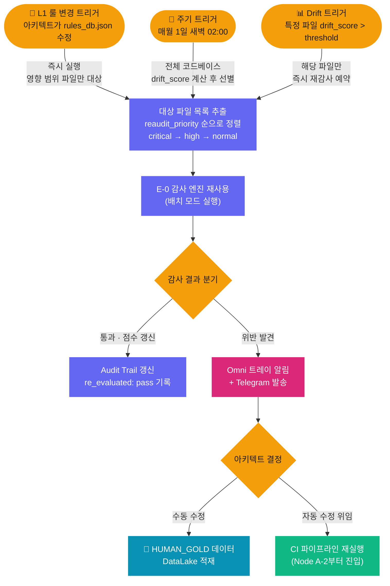

# Retro Auditor · 소급 감사 시스템 설계 문서

> **NEXA OS Dev 시스템 · E-0 Rule Validator 연관 시스템**
> E-0 이 " 지금 변경된 코드 " 를 감사한다면,
> Retro Auditor 는 **" 기존에 통과한 코드가 아직도 NEXA 답게 유효한가 "** 를 소급 재평가합니다.

---

## 1. 존재 이유 — E-0 과의 책임 분리

```json
E-0 (실시간)                        Retro Auditor (비동기·배치)
─────────────────────               ──────────────────────────────
현재 변경된 코드 감사                기존 통과 코드 소급 재감사
매 CI 실행마다 동작                  L1 변경 시 / 주기적 / drift 초과 시
비용 예측 가능 (변경분만)            비용 백그라운드 (CI와 무관)
reaudit_priority 데이터 생산         reaudit_priority 데이터 소비
```

> **E-0 을 Retro Auditor 기능까지 합치면 안 되는 이유:**
> E-0 은 이미 " 가장 비싼 노드 " 입니다. 소급 스캔까지 얹으면 CI 한 번 실행할 때마다
> 전체 코드베이스 재감사가 함께 실행되어 비용이 예측 불가능해집니다.

---

## 2. 트리거 — 언제 실행되는가

Retro Auditor 는 3 가지 조건 중 하나라도 충족되면 실행됩니다.



---

## 3. Drift Score — 노후도 점수 체계

기존 통과 파일이 현재 룰셋과 얼마나 멀어졌는지를 수치화합니다.

### Drift Score 산출 방식

```python
def calculate_drift_score(file_meta: dict, current_ruleset_version: str) -> int:
    """
    통과 당시 룰셋과 현재 룰셋 간 버전 거리를 누적 점수로 환산
    """
    audit_version   = file_meta["audit_ruleset_version"]   # 통과 당시 버전
    current_version = current_ruleset_version               # 현재 버전
    days_since_audit = (today - file_meta["last_audit_pass"]).days

    # 룰셋 버전 거리 (major · minor · patch 가중치 다름)
    version_delta = calc_version_distance(audit_version, current_version)

    # 시간 경과 가중치 (30일마다 +5점)
    time_weight = (days_since_audit // 30) * 5

    # 약점 차원 가중치 (structure 약점이면 가속)
    weakness_weight = 20 if "structure" in file_meta["weak_dimensions"] else 0

    return version_delta + time_weight + weakness_weight
```

### Drift Score 임계값

| drift_score | 의미 | 재감사 시점 |
|------------|------|-----------|
| 0 ~ 29 | 최신 상태 | 주기 트리거 (월 1 회) 만 |
| 30 ~ 49 | 주의 필요 | 다음 L1 변경 시 포함 |
| 50 ~ 74 | 재감사 권고 | 즉시 예약 |
| **75 이상** | **재감사 필수** | **즉시 실행** |

### 파일별 메타데이터 구조

```python
{
  "file":                   "ontex/service.ts",
  "last_audit_pass":        "2026-01-15",
  "audit_ruleset_version":  "v2.1",       # 통과 당시 룰셋
  "current_ruleset_version":"v3.5",       # 현재 룰셋
  "drift_score":            58,           # 현재 노후도 점수
  "drift_threshold":        50,           # 재감사 트리거 임계값

  # E-0 감사 분류 체계에서 가져옴
  "audit_score":            82,
  "weak_dimensions":        ["structure"],
  "reaudit_priority":       "critical",   # structure 약점 → critical 자동 부여
}
```

---

## 4. 재감사 대상 선별 전략

전체 코드베이스를 한 번에 재감사하면 비용이 급증합니다.
**우선순위 기반 단계적 선별**로 비용을 통제합니다.

```json
전체 파일 목록
    │
    ├─ Step 1: reaudit_priority = "critical" 먼저 처리
    │          (structure 점수 < 75인 파일)
    │
    ├─ Step 2: drift_score ≥ 75 파일 추가
    │
    ├─ Step 3: L1 변경 시 → 영향 범위 파일만 추가
    │          (Scope Resolver 로직 재사용)
    │
    └─ Step 4: 월 1회 주기 실행 시 → 나머지 전체
               (priority = "normal" 포함)
```

---

## 5. E-0 감사 엔진 재사용

Retro Auditor 는 E-0 의 감사 로직을 **배치 모드**로 재사용합니다.
별도 감사 로직을 만들지 않으므로 유지보수 포인트가 하나로 통일됩니다.

```python
async def retro_audit_batch(file_list: list[str]) -> list[dict]:
    results = []
    for file_path in file_list:
        # E-0 감사 엔진을 배치 모드로 호출
        result = await run_e0_audit(
            target=file_path,
            mode="retro",           # 실시간 CI가 아닌 소급 감사 모드
            skip_hitl=True,         # HITL 없이 자동 판정
            notify_on_fail=True,    # 위반 시 즉시 알림
        )
        results.append(result)

        # 결과 즉시 Audit Trail 갱신
        await update_audit_trail(file_path, result, tag="re_evaluated")

    return results
```

**배치 모드와 실시간 모드의 차이:**

| 항목 | 실시간 (E-0) | 배치 (Retro Auditor) |
|------|------------|---------------------|
| 대상 | 현재 변경 diff | 기존 전체 파일 |
| HITL | 옵션 (hitl_enabled) | 항상 스킵 (자동 판정) |
| 실패 시 | C-2 재수정 루프 | 아키텍트 알림 후 수동/자동 결정 |
| 실행 주체 | CI 파이프라인 | 독립 스케줄러 |
| Checkpoint | PostgresSaver | 불필요 (배치 자체가 재시작 가능) |

---

## 6. 위반 발견 시 처리 흐름

```json
소급 감사 위반 발견
    │
    ├─ Omni 트레이 알림 발행
    │   └─ 파일명 · 위반 차원 · drift_score · 감사 근거 포함
    │
    ├─ Telegram 알림 발송 (Node F 재사용)
    │
    └─ 아키텍트 결정 대기
        ├─ 수동 수정 → HUMAN_GOLD 데이터로 DataLake 적재
        │              └─ 다음 학습 루프에서 고품질 데이터로 활용
        │
        └─ 자동 수정 위임 → CI 파이프라인 재실행
                            └─ Node A-2 (Scope Resolver)부터 진입
                               (A-1 스캔 생략 · 대상 파일 이미 확정됨)
```

---

## 7. Audit Trail 갱신 구조

소급 감사 결과는 기존 Audit Trail 에 `re_evaluated` 태그로 누적됩니다.

```json
s3://nexa-audit-trail/
  └─ year=2026/month=06/day=24/
       └─ run_id=retro_abc456/
            ├─ decision.json          ← 판정 결과 + re_evaluated: true
            ├─ original_pass.json     ← 최초 통과 당시 기록 참조
            ├─ drift_delta.json       ← 통과 당시 vs 현재 룰셋 차이
            └─ rag_chunks.parquet     ← 현재 기준 RAG 회수 원문
```

**이력 비교 활용:**

```python
# 최초 통과 vs 소급 감사 결과 비교
original = load_audit("run_id=abc123")   # 최초 통과 기록
retro    = load_audit("run_id=retro_abc456")  # 소급 감사 기록

delta = {
    "structure_score_change": retro["structure"] - original["structure"],
    "new_violations":         retro["violations"] - original["violations"],
    "ruleset_gap":            f"{original['ruleset_version']} → {retro['ruleset_version']}",
}
# → "룰셋 v2.1 → v3.5 사이에 structure 점수가 82 → 61로 하락"
```

---

## 8. 설정값 (Logex 노드 설정)

```python
RETRO_AUDITOR_CONFIG = {
    # 트리거
    "scheduled_cron":         "0 2 1 * *",   # 매월 1일 02:00
    "drift_threshold":        50,             # 즉시 재감사 트리거
    "drift_critical_threshold": 75,           # 즉시 실행 임계값

    # 배치 제어
    "batch_size":             20,             # 한 번에 처리할 파일 수
    "inter_batch_delay_sec":  5,              # 배치 간 대기 (CI 간섭 방지)
    "max_files_per_run":      200,            # 단일 실행 최대 파일 수

    # Drift Score 가중치
    "time_weight_per_30days": 5,             # 30일마다 +5점
    "structure_weakness_bonus": 20,          # structure 약점 시 +20점
    "l2_deprecation_days":    180,           # L2 룰 자동 강등 기준일
}
```

---

## 9. 전체 시스템 연결 지도

```json
E-0 Rule Validator (CI 실시간)
    └─ 감사 완료마다 → reaudit_priority + drift_score → S3 Audit Trail

Retro Auditor (비동기 배치)
    ├─ 입력: S3 Audit Trail의 reaudit_priority 인덱스
    ├─ 트리거: L1 변경 / 월 1회 / drift_score 초과
    ├─ 실행: E-0 감사 엔진 배치 모드 재사용
    └─ 출력:
        ├─ 통과 → Audit Trail 갱신 (re_evaluated: pass)
        └─ 위반 → 알림 → 수동/자동 수정 → DataLake 또는 CI 재실행

DataLake (학습 데이터)
    └─ Retro Auditor 위반 후 수동 수정 → 💎 HUMAN_GOLD 데이터 적재
       └─ 다음 TrainLoop에서 가장 높은 품질 데이터로 활용
```

---

## 10. 미확정 사항

| 항목 | 현재 상태 | 결정 필요 내용 |
|------|----------|--------------|
| 배치 실행 시점 | 월 1 회 02:00 제안 | CI 실행 빈도 보고 조정 |
| `batch_size` | 20 개 제안 | 실전 GPU 부하 측정 후 조정 |
| drift_threshold | 50 점 제안 | 초기 운영 후 false positive 보고 조정 |
| 자동 수정 위임 범위 | 전체 허용 제안 | 파일 유형별 제한 고려 가능 |
| Production 확장 | 미설계 | Dev 검증 완료 후 별도 문서 작성 |

---

*문서 버전: v1.0 | 작성일: 2026-06-24*
*상위 문서: Node E-0 심층 설계 · E-0 감사 분류 체계*
*연관 문서: NEXA OS CI 파이프라인 v9 (Dev 전용)*
