```mermaid
graph TD

    %% ━━━━━━━━━━━━━━━━━━━━━━━━━━━━━━━━━━━━━━
    %% 1. 파이프라인 진입
    %% ━━━━━━━━━━━━━━━━━━━━━━━━━━━━━━━━━━━━━━
    ScheduledTrigger(["🕘 스케줄 트리거
    매일 09:00 자동 실행
    또는 수동 Push"])
    --> InitState

    InitState["② 장부 초기화 · State
    hitl_enabled · max_retries · current_retry
    error_log · code_diff · audit_score"]
    --> NodeEnvChecker

    %% ━━━━━━━━━━━━━━━━━━━━━━━━━━━━━━━━━━━━━━
    %% 2. 환경 검증
    %% ━━━━━━━━━━━━━━━━━━━━━━━━━━━━━━━━━━━━━━
    NodeEnvChecker["Node 0 · Env Checker
    DB연결 · 포트 가용 · 의존성 버전 확인"]

    NodeEnvChecker -->|"✅ 환경 정상 → 파이프라인 진입"| NodeScanner
    NodeEnvChecker -->|"❌ 환경 이상 → 즉시 중단 후 알림"| NodeNotifier

    %% ━━━━━━━━━━━━━━━━━━━━━━━━━━━━━━━━━━━━━━
    %% 3. 핵심 자가 수복 루프
    %% ━━━━━━━━━━━━━━━━━━━━━━━━━━━━━━━━━━━━━━
    subgraph CoreLoop ["🔁 핵심 노드 생태계 · 자가 수복 루프"]
        direction TB

        NodeScanner["Node A-1 · File Scanner
        전체 소스 파일 읽기 (결정론적)"]

        NodeScope["Node A-2 · Scope Resolver
        에러 로그 + 기획서 기반
        수정 대상 파일 목록 확정 (룰·LLM 판단)"]

        NodeTester["Node B · E2E Tester ♥ 심장
        Playwright (UI) + Supertest (API) + K6 (Load) 병렬 구동"]

        CheckRetry{"retry < max_retries?
        재시도 횟수 초과 여부 확인"}

        NodeNoiseFilter["Node C-1 · Noise Filter
        정규식 보수적 필터
        확실한 노이즈 로그만 제거 · 의심 로그는 통과"]

        NodeLLMAnalyzer["Node C-2 · LLM Analyzer
        생존 로그 의미 분석
        error_type 태깅 · 수정 전략 프롬프트 초안 생성"]

        NodePromptOpt["Node C-3 · Prompt Optimizer
        LLMLingua 압축 · XML 규격화 · 캐시 정렬
        D-1에 전달할 프롬프트 최종 정제"]

        NodeCodeFixer["Node D-1 · Code Fixer LLM
        정제된 프롬프트 수령
        알고리즘 수정 후 파일 덮어쓰기"]

        NodePatchValidator["Node D-2 · Patch Validator
        문법 · 린트 · import 사전 검증
        E2E 전 빠른 필터 (비용 절감)"]

        NodeScanner -->|"📂 전체 파일 트리 → Scope Resolver로 전달"| NodeScope
        NodeScope -->|"🎯 수정 대상 파일 목록 확정 → E2E 테스트 시작"| NodeTester
        NodeTester -->|"❌ 테스트 실패 → 재시도 횟수 확인"| CheckRetry
        CheckRetry -->|"🔄 재시도 가능 → 에러 로그 분석 시작"| NodeNoiseFilter
        NodeNoiseFilter -->|"🧹 노이즈 제거 완료 → LLM 분석으로 전달"| NodeLLMAnalyzer
        NodeLLMAnalyzer -->|"📝 프롬프트 초안 생성 → 최적화 단계로 전달"| NodePromptOpt
        NodePromptOpt -->|"✨ 정제된 프롬프트 → Code Fixer로 전달"| NodeCodeFixer
        NodeCodeFixer -->|"🔧 수정 코드 생성 → 사전 검증 시작"| NodePatchValidator
        NodePatchValidator -->|"✅ 문법·린트 통과 → E2E 재테스트"| NodeTester
        NodePatchValidator -->|"❌ 문법·린트 실패 → LLM 재분석으로 반송"| NodeLLMAnalyzer
    end

    %% ━━━━━━━━━━━━━━━━━━━━━━━━━━━━━━━━━━━━━━
    %% 4. Checkpoint
    %% ━━━━━━━━━━━━━━━━━━━━━━━━━━━━━━━━━━━━━━
    NodeTester -.->|"💾 테스트 실행마다 State 스냅샷 자동 저장"| Checkpoint[("💾 Checkpoint
    PostgresSaver
    자동 저장")]

    %% ━━━━━━━━━━━━━━━━━━━━━━━━━━━━━━━━━━━━━━
    %% 5. 롤백
    %% ━━━━━━━━━━━━━━━━━━━━━━━━━━━━━━━━━━━━━━
    CheckRetry -->|"🚨 재시도 횟수 초과 → 마지막 안전 Checkpoint로 복귀"| Rollback["↩ 자동 롤백
    update_state() 복귀"]
    Rollback -->|"롤백 완료 → 결과 알림 발송"| NodeNotifier

    %% ━━━━━━━━━━━━━━━━━━━━━━━━━━━━━━━━━━━━━━
    %% 6. PASS → HITL → E-0
    %% ━━━━━━━━━━━━━━━━━━━━━━━━━━━━━━━━━━━━━━
    NodeTester -->|"✅ 모든 테스트 통과 → HITL 옵션 확인"| HITLCheck{"HITL 옵션 분기
    hitl_enabled?"}

    HITLCheck -->|"True: 사람 승인 모드 → 승인 대기"| Interrupt["⏸ interrupt()
    사람 승인 대기"]
    HITLCheck -->|"False: 자동 모드 → 룰 검증으로 직행"| NodeRuleValidator

    Interrupt -->|"👍 승인 → 비기능 룰 검증 시작"| NodeRuleValidator
    Interrupt -->|"👎 거부 → 파이프라인 중단 후 알림"| NodeNotifier

    %% ━━━━━━━━━━━━━━━━━━━━━━━━━━━━━━━━━━━━━━
    %% 7. E-0 Rule Validator
    %% ━━━━━━━━━━━━━━━━━━━━━━━━━━━━━━━━━━━━━━
    NodeRuleValidator["Node E-0 · Rule Validator
    NEXA 설계 룰 검증 (비기능)
    Structure · Data · Sync · Expression 4축 감사"]

    NodeRuleValidator -->|"✅ 룰 통과 → PR 머지 진행"| NodePR
    NodeRuleValidator -->|"❌ 룰 위반 → 위반 사유 첨부 후 LLM 재분석"| NodeLLMAnalyzer

    %% ━━━━━━━━━━━━━━━━━━━━━━━━━━━━━━━━━━━━━━
    %% 8. E-0 → DataLake 학습 데이터 분기
    %% ━━━━━━━━━━━━━━━━━━━━━━━━━━━━━━━━━━━━━━
    NodeRuleValidator -.->|"🥇 audit_score ≥ 90 · 모범 정답 데이터"| DataLake
    NodeRuleValidator -.->|"🥈 audit_score 50~89 · 가치 있는 오답 데이터"| DataLake
    NodeRuleValidator -.->|"⚠️ D-2 통과 + E-0 위반 · 설계 원칙 위반 패턴"| DataLake
    NodeRuleValidator -.->|"🗑️ audit_score < 50 · 품질 미달 즉시 폐기"| DataReject["🗑️ 즉시 폐기
    품질 미달 데이터"]

    Interrupt -.->|"💎 사람이 직접 수정한 GOLD 데이터"| DataLake

    %% ━━━━━━━━━━━━━━━━━━━━━━━━━━━━━━━━━━━━━━
    %% 9. PR Merger → Notifier → 완료
    %% ━━━━━━━━━━━━━━━━━━━━━━━━━━━━━━━━━━━━━━
    NodePR["Node E · PR Merger
    최종 검수 후 메인 브랜치 머지"]
    -->|"머지 완료 → 결과 알림 발송"| NodeNotifier

    NodeNotifier["Node F · Notifier
    Telegram · Slack 결과 발송
    완료 · 실패 · 롤백 · 거부 유형 구분"]
    -->|"파이프라인 종료"| End(["③ 파이프라인 완료"])

    %% ━━━━━━━━━━━━━━━━━━━━━━━━━━━━━━━━━━━━━━
    %% 10. 데이터 레이크 & DVC
    %% ━━━━━━━━━━━━━━━━━━━━━━━━━━━━━━━━━━━━━━
    DataLake[("🌊 CoT 데이터 레이크
    sdel_data/YYYY-MM-DD.jsonl
    🥇SUCCESS · 🥈VALUABLE_FAIL · ⚠️ARCH_VIOLATION · 💎HUMAN_GOLD")]

    DataLake -.->|"DVC 해시만 Git 추적 · 데이터 버전 스냅샷"| DVC[("📦 DVC 버전 스냅샷
    .dvc 해시만 Git 추적")]

    %% ━━━━━━━━━━━━━━━━━━━━━━━━━━━━━━━━━━━━━━
    %% 11. 학습 루프
    %% ━━━━━━━━━━━━━━━━━━━━━━━━━━━━━━━━━━━━━━
    DataLake -->|"누적 데이터 → 학습 트리거 조건 확인"| TrainTrigger

    subgraph TrainLoop ["🌙 자가 학습 루프 · 야간 배치 (03:00 또는 N개 누적)"]
        direction TB

        TrainTrigger{"트리거 판정
        누적 데이터 ≥ N개
        또는 매일 03:00?"}

        SleepNode["💤 대기
        다음 트리거 조건까지 휴면"]

        QualityGate{"품질 하한 체크
        데이터 평균 Score ≥ 0.6?"}

        AbortTrain["⛔ 학습 거부
        데이터 부족 또는 품질 저하
        다음 사이클까지 대기"]

        LoadData["① Data Loader
        JSONL → HuggingFace Dataset 변환"]

        ExternalLLMCheck{"외부 LLM 보강
        필요 여부 판단"}

        ExtLLMNode["② External LLM Teacher
        Claude / GPT-4 선택적 사용
        하네스 문제 자동 생성
        질 좋은 오답 합성 · Teacher Forcing"]

        SFTNode["③ SFT Trainer · QLoRA
        Unsloth + TRL + PEFT
        r=16 · α=32 · lr=2e-4
        1~3 epoch · CoT 정답 학습"]

        SFTEval{"SFT 회귀 테스트
        Pass@1 점수 유지 여부"}

        DPONode["④ DPO Trainer · QLoRA
        🥇정답 vs 🥈오답 1:1 대조 학습
        β=0.1 · lr=5e-5 · 0.5~1 epoch
        변별력 · 판단력 강화"]

        DPOEval{"DPO 회귀 테스트
        규정 위반률 감소 여부"}

        LoRASave["⑤ LoRA Adapter 저장
        sdel_lora_YYYY-MM-DD/
        adapter_model.safetensors
        20~100MB"]

        LoRAAbort["↩ LoRA 롤백
        이전 안정 Adapter 복원"]

        TrainTrigger -->|"⏳ 조건 미충족 → 다음 트리거까지 대기"| SleepNode
        SleepNode -->|"⏰ 다음 트리거 조건 재확인"| TrainTrigger
        TrainTrigger -->|"🟢 조건 충족 → 데이터 품질 확인"| QualityGate
        QualityGate -->|"❌ 품질 미달 → 학습 거부 후 대기"| AbortTrain
        AbortTrain -->|"🔁 다음 사이클 재시도"| TrainTrigger
        QualityGate -->|"✅ 품질 통과 → 데이터 로딩 시작"| LoadData
        LoadData -->|"📊 데이터셋 준비 완료 → 외부 LLM 보강 여부 판단"| ExternalLLMCheck
        ExternalLLMCheck -->|"✅ 보강 불필요 → SFT 학습 시작"| SFTNode
        ExternalLLMCheck -->|"🌐 보강 필요 → 외부 LLM 데이터 합성"| ExtLLMNode
        ExtLLMNode -->|"💡 합성 데이터 추가 완료 → SFT 학습 시작"| SFTNode
        SFTNode -->|"🧪 SFT 완료 → 회귀 테스트 실행"| SFTEval
        SFTEval -->|"❌ Pass@1 하락 → 학습 중단 후 LoRA 롤백"| LoRAAbort
        SFTEval -->|"✅ Pass@1 유지 → DPO 대조 학습 시작"| DPONode
        DPONode -->|"🧪 DPO 완료 → 회귀 테스트 실행"| DPOEval
        DPOEval -->|"❌ 위반률 상승 → 학습 중단 후 LoRA 롤백"| LoRAAbort
        DPOEval -->|"✅ 위반률 감소 → LoRA Adapter 저장"| LoRASave
    end

    %% ━━━━━━━━━━━━━━━━━━━━━━━━━━━━━━━━━━━━━━
    %% 12. 핫스왑 → 다음 사이클
    %% ━━━━━━━━━━━━━━━━━━━━━━━━━━━━━━━━━━━━━━
    LoRASave -->|"새 Adapter 준비 완료 → 핫스왑 실행"| HotSwap

    HotSwap["⑥ 🌅 새벽 5시 핫스왑
    Ollama Modelfile 재생성
    1~2초 내 두뇌 교체 완료"]

    HotSwap -.->|"✅ 핫스왑 완료 → 다음 날 09:00 CI 자동 재시작"| ScheduledTrigger

    %% ━━━━━━━━━━━━━━━━━━━━━━━━━━━━━━━━━━━━━━
    %% 스타일
    %% ━━━━━━━━━━━━━━━━━━━━━━━━━━━━━━━━━━━━━━
    classDef pipelineStartEnd fill:#0891b2,stroke:#22d3ee,stroke-width:2px,color:#fff
    classDef initState        fill:#475569,stroke:none,color:#fff
    classDef envChecker       fill:#4f46e5,stroke:none,color:#fff
    classDef coreNode         fill:#6366f1,stroke:none,color:#fff
    classDef heartNode        fill:#e11d48,stroke:#fff,stroke-width:2px,color:#fff
    classDef validator        fill:#0e7490,stroke:none,color:#fff
    classDef llmNode          fill:#db2777,stroke:none,color:#fff
    classDef promptOpt        fill:#a855f7,stroke:none,color:#fff
    classDef decision         fill:#f59e0b,stroke:none,color:#1a1a1a
    classDef hitlNode         fill:#eab308,stroke:none,color:#1a1a1a
    classDef interrupt        fill:#ca8a04,stroke:none,color:#fff
    classDef ruleNode         fill:#10b981,stroke:none,color:#fff
    classDef notifier         fill:#2563eb,stroke:none,color:#fff
    classDef checkpoint       fill:#065f46,stroke:none,color:#fff
    classDef rollback         fill:#991b1b,stroke:none,color:#fff
    classDef dataLake         fill:#0891b2,stroke:none,color:#fff
    classDef dvc              fill:#155e75,stroke:none,color:#fff
    classDef dataReject       fill:#52525b,stroke:none,color:#fff
    classDef trainTrigger     fill:#f59e0b,stroke:none,color:#1a1a1a
    classDef sleepNode        fill:#3f3f46,stroke:none,color:#fff
    classDef trainNode        fill:#7c3aed,stroke:none,color:#fff
    classDef trainEval        fill:#a855f7,stroke:none,color:#fff
    classDef trainAbort       fill:#7f1d1d,stroke:none,color:#fff
    classDef loraRollback     fill:#991b1b,stroke:none,color:#fff
    classDef externalLLM      fill:#c2410c,stroke:none,color:#fff
    classDef hotSwap          fill:#16a34a,stroke:#bbf7d0,stroke-width:2px,color:#fff

    class ScheduledTrigger,End pipelineStartEnd
    class InitState initState
    class NodeEnvChecker envChecker
    class NodeScanner,NodeScope coreNode
    class NodeTester heartNode
    class NodeNoiseFilter,NodePatchValidator validator
    class NodeLLMAnalyzer,NodeCodeFixer llmNode
    class NodePromptOpt promptOpt
    class CheckRetry,HITLCheck decision
    class Interrupt hitlNode
    class NodeRuleValidator,NodePR ruleNode
    class NodeNotifier notifier
    class Checkpoint checkpoint
    class Rollback rollback
    class DataLake dataLake
    class DVC dvc
    class DataReject dataReject
    class TrainTrigger,ExternalLLMCheck trainTrigger
    class SleepNode sleepNode
    class QualityGate trainEval
    class LoadData,SFTNode,DPONode,LoRASave trainNode
    class SFTEval,DPOEval trainEval
    class ExtLLMNode externalLLM
    class AbortTrain trainAbort
    class LoRAAbort loraRollback
    class HotSwap hotSwap

    linkStyle default stroke:#666666,stroke-width:2px
```

# NEXA OS · CI + 자가 학습 파이프라인 통합 다이어그램 v9

> ⚠️ **이 다이어그램은 개발 (Dev) 시스템 전용입니다.**
> Production 시스템은 별도 다이어그램으로 분리 예정 (Dev 검증 완료 후 작성)

> **목적:** NEXA OS 코드 자동 수복 · 검증 · 병합 · LoRA 자가 학습
> **대상:** 개발자 단독 사용 환경 · 야간 학습 중 추론 중단 허용
> **특징:** 베이스 모델과 학습이 같은 GPU 공유 · 무중단 불필요

---



---

## LangGraph 구현 구조 — 노드 분리 설계

> 다이어그램은 전체 흐름을 한눈에 보기 위해 하나로 합쳤지만,
> 실제 LangGraph 구현은 **두 개의 독립 그래프**로 분리합니다.
> DataLake 가 두 그래프를 연결하는 브릿지 역할을 합니다.

### 노드 수 분석

| 구분 | 다이어그램 노드 | LangGraph 실제 노드 | 비고 |
|------|--------------|-------------------|------|
| CI 파이프라인 | 16 개 | **14 개** | CheckRetry·HITLCheck → 조건부 엣지 함수로 처리 |
| 분기 조건 | 3 개 | **0 개** | Interrupt → `interrupt()` 함수 / Checkpoint → 컴파일 옵션 |
| 학습 루프 | 12 개 | **8 개** | SleepNode·DVC·DataReject·ExternalLLMCheck → 노드 내부 흡수 |
| **합계** | **31 개** | **약 22 개** | |

### 다이어그램 노드 → LangGraph 변환 규칙

| 다이어그램 노드 | LangGraph 구현 방식 |
|--------------|-------------------|
| `CheckRetry` | `add_conditional_edges()` 함수 |
| `HITLCheck` | `add_conditional_edges()` 함수 |
| `Interrupt` | `interrupt()` 함수 호출 (노드 아님) |
| `Checkpoint` | `PostgresSaver` 컴파일 옵션 |
| `DataReject` | C-2 노드 내부 로직으로 흡수 |
| `DVC` | LoRASave 노드 내부 로직으로 흡수 |
| `SleepNode` | `asyncio.sleep()` 스케줄러 처리 |
| `ExternalLLMCheck` | LoadData 노드 내부 분기로 흡수 |

---

### Graph 1 · CI 파이프라인 (14 개 노드)

```python
from langgraph.graph import StateGraph
from langgraph.checkpoint.postgres import PostgresSaver

def build_ci_graph(checkpointer: PostgresSaver) -> StateGraph:
    builder = StateGraph(PipelineState)

    # ── 노드 등록 ──
    builder.add_node("env_checker",      node_env_checker)       # Node 0
    builder.add_node("file_scanner",     node_file_scanner)      # Node A-1
    builder.add_node("scope_resolver",   node_scope_resolver)    # Node A-2
    builder.add_node("e2e_tester",       node_e2e_tester)        # Node B
    builder.add_node("noise_filter",     node_noise_filter)      # Node C-1
    builder.add_node("llm_analyzer",     node_llm_analyzer)      # Node C-2
    builder.add_node("prompt_optimizer", node_prompt_optimizer)  # Node C-3
    builder.add_node("code_fixer",       node_code_fixer)        # Node D-1
    builder.add_node("patch_validator",  node_patch_validator)   # Node D-2
    builder.add_node("rule_validator",   node_rule_validator)    # Node E-0
    builder.add_node("pr_merger",        node_pr_merger)         # Node E
    builder.add_node("notifier",         node_notifier)          # Node F
    builder.add_node("rollback",         node_rollback)          # Rollback
    builder.add_node("hitl",             node_hitl)              # interrupt()

    # ── 엣지 연결 ──
    builder.set_entry_point("env_checker")
    builder.add_conditional_edges("env_checker", route_env, {
        "ok":     "file_scanner",
        "failed": "notifier",
    })
    builder.add_edge("file_scanner",     "scope_resolver")
    builder.add_edge("scope_resolver",   "e2e_tester")
    builder.add_conditional_edges("e2e_tester", route_test_result, {
        "fail":  "check_retry",   # 조건부 엣지 함수
        "pass":  "hitl",
    })
    builder.add_conditional_edges("check_retry", route_retry, {
        "continue": "noise_filter",
        "exceeded": "rollback",
    })
    builder.add_edge("noise_filter",     "llm_analyzer")
    builder.add_edge("llm_analyzer",     "prompt_optimizer")
    builder.add_edge("prompt_optimizer", "code_fixer")
    builder.add_edge("code_fixer",       "patch_validator")
    builder.add_conditional_edges("patch_validator", route_patch, {
        "pass":   "e2e_tester",
        "failed": "llm_analyzer",
    })
    builder.add_conditional_edges("hitl", route_hitl, {
        "approved": "rule_validator",
        "rejected": "notifier",
        "auto":     "rule_validator",
    })
    builder.add_conditional_edges("rule_validator", route_rule, {
        "pass":     "pr_merger",
        "violated": "llm_analyzer",
    })
    builder.add_edge("pr_merger",  "notifier")
    builder.add_edge("rollback",   "notifier")
    builder.add_edge("notifier",   END)

    return builder.compile(checkpointer=checkpointer)
```

---

### Graph 2 · 학습 루프 (8 개 노드)

```python
def build_train_graph() -> StateGraph:
    builder = StateGraph(TrainState)

    # ── 노드 등록 ──
    builder.add_node("quality_gate",  node_quality_gate)   # 품질 하한 체크
    builder.add_node("data_loader",   node_data_loader)    # ① Data Loader
    builder.add_node("ext_llm",       node_ext_llm)        # ② External LLM Teacher
    builder.add_node("sft_trainer",   node_sft_trainer)    # ③ SFT Trainer
    builder.add_node("dpo_trainer",   node_dpo_trainer)    # ④ DPO Trainer
    builder.add_node("lora_save",     node_lora_save)      # ⑤ LoRA Adapter 저장
    builder.add_node("lora_abort",    node_lora_abort)     # LoRA 롤백
    builder.add_node("hot_swap",      node_hot_swap)       # ⑥ 핫스왑

    # ── 엣지 연결 ──
    builder.set_entry_point("quality_gate")
    builder.add_conditional_edges("quality_gate", route_quality, {
        "ok":     "data_loader",
        "failed": END,             # AbortTrain → 종료
    })
    builder.add_conditional_edges("data_loader", route_ext_llm, {
        "needed":     "ext_llm",
        "not_needed": "sft_trainer",
    })
    builder.add_edge("ext_llm",    "sft_trainer")
    builder.add_conditional_edges("sft_trainer", route_sft_eval, {
        "pass":       "dpo_trainer",
        "regression": "lora_abort",
    })
    builder.add_conditional_edges("dpo_trainer", route_dpo_eval, {
        "pass":       "lora_save",
        "regression": "lora_abort",
    })
    builder.add_edge("lora_save",  "hot_swap")
    builder.add_edge("hot_swap",   END)
    builder.add_edge("lora_abort", END)

    return builder.compile()
```

---

### 두 그래프 연결 — DataLake 브릿지

```python
# DataLake가 두 그래프를 연결하는 브릿지
# CI 그래프가 데이터를 생산하고, 학습 그래프가 소비

class DataLakeBridge:
    def write(self, data: dict, label: str):
        """CI 그래프 → DataLake 적재"""
        # label: SUCCESS / VALUABLE_FAIL / ARCH_VIOLATION / HUMAN_GOLD
        append_jsonl(f"sdel_data/{today}.jsonl", {**data, "label": label})

    def should_trigger_train(self) -> bool:
        """학습 트리거 조건 확인"""
        count = count_today_entries()
        hour  = datetime.now().hour
        return count >= TRAIN_TRIGGER_N or hour == 3

    def load_for_training(self) -> Dataset:
        """학습 그래프 → DataLake 소비"""
        return load_jsonl_as_dataset("sdel_data/")


# 실행 진입점
async def main():
    ci_graph    = build_ci_graph(checkpointer)
    train_graph = build_train_graph()
    bridge      = DataLakeBridge()

    # CI 실행
    await ci_graph.ainvoke(initial_state)

    # 학습 트리거 확인 → 조건 충족 시 학습 실행
    if bridge.should_trigger_train():
        train_state = {"dataset": bridge.load_for_training()}
        await train_graph.ainvoke(train_state)
```

---

*문서 버전: v9.0 | 작성일: 2026-06-24*
*CI 파이프라인 v8 + 자가 학습 루프 통합 · Dev 시스템 전용*
*연관 문서: Node E-0 심층 설계 · E-0 감사 분류 체계 · Retro Auditor*
