# 🎯 SDEL 핵심 학습: CoT 데이터 누적 + 파인튜닝/증류 완전 가이드

```mermaid
graph TD
    %% ── 1. 시작 ──
    Start([① 공장 가동 Push])
    --> InitState["② 장부 초기화 State
    hitl_enabled · max_retries
    current_retry · error_log · code_diff"]

    %% ── 2. 핵심 노드 생태계 ──
    InitState --> NodeEnvChecker

    NodeEnvChecker["Node 0 · Env Checker
    DB연결 · 포트 가용 · 의존성 버전 확인"]

    NodeEnvChecker -->|환경 정상| NodeScanner

    subgraph CoreLoop ["핵심 노드 생태계 (자가 수복 루프)"]
        direction TB

        NodeScanner["Node A-1 · File Scanner
        전체 소스 파일 읽기 (결정론적)"]

        NodeScope["Node A-2 · Scope Resolver
        수정 대상 파일 목록 확정 (룰·LLM 기반 판단)"]

        NodeTester["Node B · E2E Tester ♥ 심장
        Playwright (UI) + Supertest (API) + K6 (Load) 병렬 구동"]

        CheckRetry{"Retry < max_retries?"}

        NodeNoiseFilter["Node C-1 · Noise Filter
        확실한 노이즈 로그 제거 (정규식 보수적 필터)"]

        NodeLLMAnalyzer["Node C-2 · LLM Analyzer
        생존 로그 분석 · error_type 태깅 · 프롬프트 조립"]

        NodePromptOpt["Node C-3 · Prompt Optimizer ⚙️
        LLMLingua 압축 → XML 규격화 → 캐시 정렬 (컨텍스트 정제)"]

        NodeCodeFixer["Node D-1 · Code Fixer LLM
        정제 프롬프트 수령 → 알고리즘 수정"]

        NodePatchValidator["Node D-2 · Patch Validator
        문법·린트·import 사전 검증 (E2E 전 빠른 필터)"]

        NodeScanner --> NodeScope
        NodeScope --> NodeTester
        NodeTester -->|테스트 실패| CheckRetry
        CheckRetry -->|OK| NodeNoiseFilter
        NodeNoiseFilter --> NodeLLMAnalyzer
        NodeLLMAnalyzer --> NodePromptOpt
        NodePromptOpt --> NodeCodeFixer
        NodeCodeFixer --> NodePatchValidator
        NodePatchValidator -->|검증 통과| NodeTester
        NodePatchValidator -->|검증 실패 즉시 반송| NodeLLMAnalyzer
    end

    %% ── 3. Checkpoint (Node B 직후 자동 저장) ──
    NodeTester -.->|State 스냅샷 저장| Checkpoint[("💾 Checkpoint
    PostgresSaver 자동 저장")]

    %% ── 4. 롤백 경로 (retry 초과) ──
    CheckRetry -->|retry 초과| Rollback["↩ 자동 롤백
    update_state() 복귀"]

    %% ── 5. PASS 경로 ──
    NodeTester -->|ALL PASS| HITLCheck{"HITL 옵션 분기
    hitl_enabled?"}

    %% ── 6. HITL 분기 ──
    HITLCheck -->|True| Interrupt["⏸ interrupt()
    사람 승인 대기"]
    HITLCheck -->|False| NodeRuleValidator

    Interrupt -->|승인| NodeRuleValidator

    NodeRuleValidator["Node E-0 · Rule Validator
    NEXA 설계 룰 검증 (비기능)"]

    NodeRuleValidator -->|룰 통과| NodePR
    NodeRuleValidator -->|룰 위반 → 재수정| NodeLLMAnalyzer

    %% ── 7. PR Merger & 종료 ──
    NodePR["Node E · PR Merger
    최종 검수 후 메인 브랜치 머지"]
    --> NodeNotifier

    NodeEnvChecker -->|환경 이상 즉시 종료| NodeNotifier
    Rollback --> NodeNotifier
    Interrupt -->|거부| NodeNotifier

    NodeNotifier["Node F · Notifier
    Telegram · Slack 결과 발송
    완료 · 실패 · 롤백 · 거부 유형 구분"]
    --> End([③ 파이프라인 완료])

    %% ── 스타일 ──
    classDef startEnd  fill:#333,stroke:#444,stroke-width:2px,color:#fff
    classDef coreNode  fill:#1f65bc,stroke:#444,stroke-width:1px,color:#fff
    classDef heartNode fill:#e11d48,stroke:#444,stroke-width:2px,color:#fff
    classDef condition fill:#f59e0b,stroke:#444,stroke-width:1px,color:#333
    classDef checkpoint fill:#0f6e56,stroke:#444,stroke-width:1px,color:#fff
    classDef rollback   fill:#a32d2d,stroke:#444,stroke-width:1px,color:#fff
    classDef hitl       fill:#7f77dd,stroke:#444,stroke-width:1px,color:#fff
    classDef interrupt  fill:#534ab7,stroke:#444,stroke-width:2px,color:#fff
    classDef optNode    fill:#666666,stroke:#444,stroke-width:2px,color:#fff
    classDef fixNode    fill:#6b8e23,stroke:#444,stroke-width:2px,color:#1a1a1a
    classDef notifier   fill:#0e7490,stroke:#444,stroke-width:1px,color:#fff

    class Start,End startEnd
    class NodeScanner,NodeScope,NodePatchValidator,NodePR coreNode
    class NodeCodeFixer fixNode
    class NodeEnvChecker,NodeRuleValidator coreNode
    class NodeNotifier notifier
    class NodeTester heartNode
    class CheckRetry,HITLCheck condition
    class Checkpoint checkpoint
    class Rollback rollback
    class NodeNoiseFilter hitl
    class NodePromptOpt optNode
    class Interrupt interrupt

    %% ─────────────────────────────────────────────────────────────
    %% 🌙 학습 모드 — CoT 데이터 레이크 → SFT/DPO → LoRA 스위칭
    %% ─────────────────────────────────────────────────────────────

    %% (A) 평소 추론에서 데이터 누출 경로
    NodeRuleValidator -.->|"룰 통과 (Score 1.0)"| DataLake
    NodeRuleValidator -.->|"질 좋은 오답 (0.5~0.8)"| DataLake
    NodeRuleValidator -.->|"REJECT (0.0~0.4)"| DataReject["🗑️ 즉시 폐기"]

    %% (B) 사람 수정(HITL) 데이터는 최상위 골드
    Interrupt -.->|"사람 수정 완료"| DataLake

    %% (C) 데이터 레이크 (공유 매개체)
    DataLake[("🌊 CoT 데이터 레이크
    sdel_data/YYYY-MM-DD.jsonl
    🥇SUCCESS · 🥈VALUABLE_FAIL · 💎HUMAN_GOLD")]
    DataLake -.->|"DVC 스냅샷"| DVC[("📦 DVC 버전 스냅샷
    .dvc 해시만 Git 추적")]

    %% ── 학습 모드 서브그래프 ──
    subgraph TrainLoop ["🌙 학습 모드 (야간 트리거: N개 누적 OR 03:00)"]
        direction TB

        TrainTrigger{"트리거 판정
        count ≥ N OR
        매일 03:00?"}
        TrainTrigger -->|False| SleepNode["💤 대기 (다음 트리거까지)"]
        TrainTrigger -->|True| QualityGate

        QualityGate{"품질 하한 체크
        평균 Score ≥ 0.6?"}
        QualityGate -->|False| AbortTrain["⛔ 학습 거부
        데이터 부족/품질저하"]
        QualityGate -->|OK| LoadData

        LoadData["① Data Loader
        JSONL → HuggingFace Dataset"]

        LoadData --> ExternalLLMCheck{"외부 LLM 보강
        필요?"}
        ExternalLLMCheck -->|Yes| ExtLLMNode["② External LLM Teacher
        Claude / GPT-4 (선택)
        · 하네스 문제 자동 생성
        · 질 좋은 오답 합성
        · Teacher Forcing"]
        ExternalLLMCheck -->|No| SFTNode
        ExtLLMNode --> SFTNode

        SFTNode["③ SFT Trainer (QLoRA)
        Unsloth + TRL + PEFT
        r=16 · α=32 · lr=2e-4
        1~3 epoch · CoT 정답 학습"]

        SFTNode --> SFTEval{"SFT 회귀 테스트
        Pass@1 유지?"}
        SFTEval -->|회귀 ⬇| AbortTrain
        SFTEval -->|유지 ⬆| DPONode

        DPONode["④ DPO Trainer (QLoRA)
        🥇정답 vs 🥈질 좋은 오답 1:1
        β=0.1 · lr=5e-5 · 0.5~1 epoch
        변별력·눈치 학습"]

        DPONode --> DPOEval{"DPO 회귀 테스트
        규정 위반률 ⬇?"}
        DPOEval -->|실패| AbortTrain
        DPOEval -->|성공| LoRASave

        LoRASave["⑤ LoRA Adapter 저장
        sdel_lora_YYYY-MM-DD/
        adapter_model.safetensors (20~100MB)"]
    end

    %% (D) 데이터 흐름: 레이크 → 학습
    DataLake -->|JSONL 로드| TrainTrigger

    %% (E) 새벽 5시 두뇌교체
    LoRASave --> HotSwap
    HotSwap["⑥ 🌅 새벽 5시 핫스왑
    Ollama Modelfile 재생성
    1~2초 내 두뇌 교체"]

    %% (F) 다음 날 아침: 진화된 뇌로 다시 업무
    HotSwap -.->|"다음 날 09:00"| Start
    AbortTrain -.->|"롤백"| Rollback

    %% ── 학습 모드 스타일 ──
    classDef dataLake     fill:#0891b2,stroke:#444,stroke-width:2px,color:#fff
    classDef dvc          fill:#0e7490,stroke:#444,stroke-width:1px,color:#fff
    classDef trainNode    fill:#7c3aed,stroke:#444,stroke-width:1px,color:#fff
    classDef trainEval    fill:#a855f7,stroke:#444,stroke-width:1px,color:#fff
    classDef trainAbort   fill:#7f1d1d,stroke:#444,stroke-width:1px,color:#fff
    classDef trainTrigger fill:#f59e0b,stroke:#444,stroke-width:2px,color:#333
    classDef externalLLM  fill:#d97706,stroke:#444,stroke-width:1px,color:#fff
    classDef hotSwap      fill:#16a34a,stroke:#444,stroke-width:2px,color:#fff
    classDef dataReject   fill:#52525b,stroke:#444,stroke-width:1px,color:#fff
    classDef sleepNode    fill:#3f3f46,stroke:#444,stroke-width:1px,color:#fff

    class DataLake dataLake
    class DVC dvc
    class LoadData,SFTNode,DPONode,LoRASave trainNode
    class SFTEval,DPOEval,QualityGate trainEval
    class AbortTrain trainAbort
    class TrainTrigger,ExternalLLMCheck trainTrigger
    class ExtLLMNode externalLLM
    class HotSwap hotSwap
    class DataReject dataReject
    class SleepNode sleepNode

```



# 📦 PART 1. CoT 데이터 누적 파이프라인 (평소, Always-On)

" 평소에 CoT 구조로 데이터를 누정 (누적) 시키겠다 " 는 것의 의미를 기술적으로 분해합니다.

## 1-1. CoT(Chain of Thought) 데이터란 정확히 무엇인가 (학습 가능한 형태)

### CoT 3 단계 추론 구조의 본질

```json
[Instruction]  →  "이 문제를 풀어라"        (프롬프트 + 컨텍스트)
[Thought]      →  "이렇게 생각했다"        (내면의 추론 과정) ← 핵심
[Output]       →  "이게 정답이다"          (최종 결과물)
```

> 💡 **여기서 핵심**: AI 가 답을 **어떻게** 생각해서 냈는지가 Thought 에 들어있어야 합니다. " 왜 이 규칙을 골랐는지 ", " 어떤 오답을 거르고 왔는지 " 가 명시적이어야 학습 가치가 있습니다.

### 진짜 학습에 쓸 수 있는 CoT 의 3 단계 추론 구조 예시

```json
{
  "instruction": "사용자 이름으로 검색하는 API 코드를 짜줘. RULE-SEC-004와 internalCase를 준수할 것.",
  "thought": [
    "1. DB 조회 결과를 그대로 반환하면 password_hash가 노출된다.",
    "2. 사내 보안규정 RULE-SEC-004는 민감정보 반환을 금지한다.",
    "3. 따라서 응답 전용 DTO(UserResponse)를 신설하여 필요한 필드(id, name)만 매핑한다.",
    "4. 사내 명명법 internalCase를 적용한다 (PascalCase, internal prefix).",
    "5. password_hash는 의도적으로 제외했음을 코드로 명시한다."
  ],
  "output": "class UserResponse(BaseModel):\n    id: int\n    name: str\n..."
}
```

> ⚠️ **이게 다릅니다**: 단순히 " 생각: 보안을 고려했다 " 같은 한 줄짜리 Thought 는 **학습 가치가 거의 없습니다**. Thought 는 **단계별 번호가 매겨진 추론의 연쇄**여야 합니다.

## 1-2. CoT 데이터를 어떻게 캡처 (누적) 하는가

핵심은 **모든 추론 호출이 자동으로 CoT 구조로 기록되는 인터셉터** 를 두는 것입니다.

### 캡처 위치 3 가지 (레벨이 다름)

| 레벨                   | 캡처 위치                  | 장점             | 단점                |
| -------------------- | ---------------------- | -------------- | ----------------- |
| **① LLM 호출 직후**      | LangGraph 노드 출력        | 100% 캡처, 구현 쉬움 | 노이즈 많음 (실패/중복 포함) |
| **② Validator 통과 후** | Validator 게이트 통과한 것만   | 품질 보장          | 양이 적어질 수 있음       |
| **③ 사람 수정 후**        | Human-in-the-Loop 발생 시 | 가장 가치 높음       | 양이 매우 적음          |

> 💡 **SDEL 권장**: ②번 게이트 통과분을 **기본 데이터**, ③번 사람 수정분을 **골드 데이터**로 분리 저장.

### 캡처해야 할 메타 필드 (학습에 필수)

```json
{
  "data_id": "SDEL-2026-0001",
  "timestamp": "2026-06-25T09:23:11",
  "source": "realtime_live" | "autonomous_training" | "human_correction",
  "context": {
    "system_prompt": "...",
    "retrieved_rules": ["RULE-SEC-004", "RULE-NAME-002"],
    "rag_chunks": ["..."],
    "user_query": "..."
  },
  "evolution_history": [                    ← 되돌리기 루프 전체 이력
    {"turn": 1, "code": "...", "feedback": "..."},
    {"turn": 2, "code": "...", "feedback": "..."}
  ],
  "final": {
    "thought": ["1. ...", "2. ...", "3. ..."],  ← 단계별 추론
    "code": "...",
    "validator_score": 1.0,
    "validator_state": "SUCCESS"
  }
}
```

> 🔑 **`evolution_history` 가 진짜 보물**: 모델이 " 어떤 실수를 거쳐 정답에 도달했는가 " 의 흔적. 이것이 DPO(대조 학습) 데이터로 직결됩니다.

## 1-3. 데이터 품질 거름망 (Validator 가 데이터 큐레이터)

평소에 무작정 쌓으면 **쓰레기 데이터**가 90% 입니다. 3 단계 거름망이 필요합니다.

### 단계별 거름망

```json
[원시 캡처]
   ↓
[1차: 스키마 검증] — Pydantic으로 3구조 필드 강제
   ├── 필드 누락 → REJECT
   ├── 타입 불일치 → REJECT
   └── 통과 → 다음 단계
   ↓
[2차: 내용 품질]
   ├── Thought가 1줄이거나 빈약 → REJECT
   ├── Code가 syntactically invalid → REJECT
   ├── 코드 중복 (해시) → REJECT
   └── 통과 → 다음 단계
   ↓
[3차: 점수화 + 분류]
   ├── Validator 점수 0.0~0.4 → REJECT (즉시 폐기)
   ├── 점수 0.5~0.8 + "그럴싸한 오답" 조건 → 🥈 VALUABLE_FAIL
   ├── 점수 0.9~1.0 → 🥇 SUCCESS
   └── 점수 1.0 + 사람 수정 이력 → 💎 HUMAN_GOLD (최상위)
```

### " 그럴싸한 오답 (Valuable Fail)" 선별 조건 (DPO 용)

이게 SDEL 의 **트레이드마크**입니다. 다음 조건을 모두 만족하는 것만 골라냅니다.

```json
✅ 문법/타입은 완벽히 통과
✅ 기능 테스트는 부분 통과 (60~90%)
❌ 사내 규정 1~2개 위반 (예: password_hash 노출, internalCase 미준수)
✅ 그런데 코드 구조 자체는 "멋있어 보임" (틀린 방향이 그럴듯)
```

> 이게 있어야 DPO(대조 학습) 쌍을 만들 수 있습니다. **같은 instruction 에 대해 " 이쪽이 정답, 저쪽이 질 좋은 오답 " 1:1 매칭**.


## 1-4 NEXA 지식 데이터 아토믹 (Atomic) 저장 전략

단순히 하나의 파일에 쑤셔 넣는 것이 아니라, **[PostgreSQL]**과 같은 관계형 DB 를 활용해 다음과 같이 구조화하면 귀하가 원하는 ' 계속 성장하는 지식 베이스 ' 가 가능해집니다.

### 1. 관계형 스키마 설계 (The Knowledge Graph)

- **`Prompts` 테이블**: 질문 (Instruction) 그 자체. 하나의 질문은 고유한 자산입니다.
- **`Completions` 테이블**: 특정 질문에 대한 모델의 응답 (Thought + Output).
    - 하나의 질문에 여러 개의 응답이 N:1 로 연결됩니다.
- **`Evaluations` 테이블**: 각 응답에 대한 심사 결과 (Score, 가점/감점 요인).
    - " 이 질문에 대해 A 답변은 정답 (Chosen), B 답변은 질 좋은 오답 (Rejected)" 이라는 **Pairing** 정보를 여기서 추출합니다.

### 2. 귀하의 아이디어가 주는 기술적 이점

- **지식의 재조합**: 나중에 " 점수 0.8 이상의 답변들만 모아서 [SFT](app://obsidian.md/SFT) 데이터셋 만들기 " 혹은 " 같은 질문에 대해 점수 차이가 큰 두 답변을 뽑아 DPO 데이터셋 만들기 " 가 SQL 쿼리 한 줄로 가능해집니다.
- **비용 대비 효용**: 저장 비용은 텍스트 데이터 특성상 매우 저렴하지만, 여기서 파생되는 **내부 지식 (Internal Knowledge)**의 가치는 모델을 새로 사는 비용보다 훨씬 큽니다.

**수석 아키텍트의 조언**
" 질문이 좋다면 답변이 없더라도 저장하십시오. 나중에 그 질문들을 모아 **[외부 LLM](app://obsidian.md/%EC%99%B8%EB%B6%80%20LLM) (선생님)**에게 던져서 정답을 받아내면, 그것이 바로 **데이터 증류 (Distillation)**의 시작점이 됩니다."
## 1-4. 데이터 자산화 및 관계형 관리 (Knowledge Accumulation)

### 원자적 데이터 모델링
모든 데이터는 파편화된 파일이 아닌, **관계형 구조**로 먼저 저장되어 성장의 토대가 됩니다.

- **Prompt Library**: 검증된 양질의 질문 세트. 답변이 없어도 **' 좋은 질문 '**은 그 자체로 보관.
- **Multi-Response Tracking**: 동일 질문에 대한 여러 모델/시점의 답변을 모두 기록.
    - 🥇 **Chosen**: 최적의 정답 (SFT 용)
    - 🥈 **Rejected**: 논리적 오류가 포함된 ' 질 좋은 오답 ' (DPO 용)
- **Lineage Tracking**: 어떤 모델 버전이 이 답변을 생성했는지 추적.

### 데이터 조립 파이프라인 (Assembly)
1. **Raw Data**: [[PostgreSQL]] 에 모든 시도와 실패를 기록.
2. **Filtering**: 특정 점수/조건에 맞는 레코드 추출.
3. **Export**: 학습 직전 **[[JSONL]]** 형태로 변환하여 학습 엔진에 주입.


## 비동기 지식 정제 및 연결 전략 (Asynchronous Knowledge Distillation)

귀하가 제안한 전략의 핵심은 **' 세션 기반 임시 저장 '** 후 **' 사후 고도화 '**를 거쳐 **' 지식 그래프 '**로 편입시키는 3 단계 프로세스입니다.
**수석 아키텍트의 비평**
" 실시간으로 모든 데이터를 정제하고 관계를 맺으려 하면 추론 대기 시간 (Latency) 이 길어집니다. 귀하의 제안처럼 **임시 저장 (Staging)** 후 별도의 워크플로우로 **지식 화폐화 (Data Monetization)** 과정을 거치는 것이 대규모 시스템 설계의 정석입니다."

## 3 단계 지식 자산화 프로세스

### 1 단계: 세션 단위 로우 데이터 캡처 (Staging)

- **목적**: 문맥 (Context) 유실 방지.
- **저장 내용**: 사용자 질문, 모델의 원시 응답, 당시 참조했던 RAG 문서, 사용자 피드백 등을 하나의 **Session ID**로 묶어 [PostgreSQL] 의 임시 테이블에 저장합니다.
- **특징**: 이 단계에서는 데이터가 다소 지저분해도 상관없습니다. ' 기록 ' 그 자체가 목적입니다.

### 2 단계: LLM 기반 SoT 구조화 (Refining)

- **트리거**: 세션 종료 시점 혹은 야간 배치 (Batch) 작업.
- **LLM 의 역할**:
    - **노이즈 제거**: 불필요한 서술어를 쳐내고 핵심 논리 (Thought) 만 추출.
    - **표준화**: 서로 다른 형태의 답변들을 일관된 **[SoT](app://obsidian.md/SoT) (Structure of Thought)** 형식으로 재구성.
    - **자가 비평**: " 이 답변이 왜 좋은 (혹은 나쁜) 답변인가?" 에 대한 이유를 메타데이터로 생성.

### 3 단계: 지식 연결 및 영구 저장 (Linking)

- **관계 생성**: 새로 정제된 데이터가 기존에 DB 에 있던 **[Prompt Library](app://obsidian.md/Prompt%20Library)**나 **[NEXA 설계 룰](app://obsidian.md/NEXA%20%EC%84%A4%EA%B3%84%20%EB%A3%B0)**과 어떤 연관이 있는지 태깅 (Tagging) 합니다.
- **결과**: 단순한 레코드 저장을 넘어, 지식들이 서로 연결된 **그래프 구조**가 형성됩니다.


## 1-4. 세션 기반 지식 정제 및 연결 전략 (Refinement Workflow)

### 지식 진화 3 단계 아키텍처
데이터는 생성 즉시 완성되는 것이 아니라, 사후 정제 과정을 통해 **' 자산 '**으로 승격됩니다.

- **Phase 1: Session Staging (PostgreSQL)**
	- 실시간 발생하는 모든 추론 로그를 세션 단위로 일괄 저장.
	- 추론 당시의 임시 상태 (State) 와 문맥 (Context) 을 완벽히 보존.

- **Phase 2: LLM Distillation (비동기 처리)**
	- 저장된 세션을 LLM 이 다시 읽어 **Instruction / Thought / Output**으로 정밀 튜닝.
	- **Self-Correction**: 오류가 포함된 답변은 ' 왜 틀렸는지 ' 에 대한 분석 노트를 추가하여 **[[DPO]]** 데이터로 전환.

- **Phase 3: Knowledge Graph Linking**
	- 정제된 데이터를 기존 지식 자산과 연결.
	- " 이 질문은 [[NEXA 설계 룰]] 04 번과 연관됨 " 과 같은 **관계형 메타데이터** 부여.

> [!IMPORTANT] **지식 자산화의 이점**
> 이 과정을 거치면 단순한 로그 데이터가 **' 검색 가능한 지식 (Searchable Knowledge)'**과 **' 학습 가능한 데이터 (Trainable Data)'**로 탈바꿈합니다. 이는 모델이 단순히 정보를 외우는 것이 아니라, 지식의 맥락을 이해하게 만드는 핵심 동력이 됩니다.
<!-- ... 이후 내용 유지 ... -->

## 지식 정제와 온톨로지의 통합 원리
귀하의 전략대로라면, **SoT(Structure of Thought)**로 재구성된 데이터는 단순한 학습 샘플을 넘어 사내 지식의 **세밀한 지도 (Ontology)** 역할을 수행하게 됩니다.
- **SoT 의 이중성**:
    - **학습 데이터**: 모델에게 ' 생각하는 법 ' 을 가르치는 교과서.
    - **온톨로지**: 개념과 개념 사이의 논리적 연결 (추론 경로) 을 명시한 지식 그래프.
- **아키텍처적 이점**:
    - **추론 부담 감소**: 실시간 노드는 복잡한 정제 없이 로우 데이터를 빠르게 덤프하여 성능 유지.
    - **지식의 재발견**: 정제 과정에서 서로 다른 세션의 데이터들이 [NEXA 설계 룰] 과 같은 공통 분모를 통해 하나로 연결됨.


## 통합 지식 플라이휠 아키텍처
구상하신 아키텍처는 현재 엔터프라이즈 LLM 도입의 가장 큰 고질병인 데이터 관리 부채 (Data Debt) 와 실시간 지식 업데이트 비용을 완전히 해결할 수 있는 지극히 이상적이고 강력한 ' 엔드투엔드 (End-to-End) 지식 플라이휠 ' 전략입니다.
산발적인 원시 데이터를 그대로 저장하지 않고 온톨로지 기반의 구조적 임시 스키마 (Staging Schema) 로 1 차 고정하는 시점부터 이미 하위 파이프라인의 성공 가능성이 보장됩니다.

```unset
[산발적 로우 데이터] 
       │ 
       ▼ (1차 가공)
[임시 스키마 (Staging)] ───► 온톨로지+SoT 최소 규격 만족 데이터만 저장
       │
       ▼ (배치 가동: 일정 주기)
[지식 정제 루프] ──────────► 노이즈 제거 & 종결 데이터 선별
       │
       ▼ (SoT 매핑)
[SoT 프레임화] ──────────► [질문 - 추론 - 답변] 구조로 해체 및 파싱
       │
       ▼ (임베딩 & 시맨틱 매핑)
[그래프+벡터 결합] ──────► 벡터 추출 + 온톨로지(Class-Relation-Instance) 승격
       │
┌──────┴────────────────────────┐
▼                               ▼
[Graph RAG 가동]                [Fine-Tuning 데이터셋 수집]
- LLM 최우선 참조 (실시간 대응)   - 데이터 정제 단계 생략 (상시 대기)
```

---

## 💡 단계별 아키텍처 핵심 가이드 & 체크포인트

### 1. 진입 단계: 임시 스키마 (Staging Schema) 준수 저장

산발적인 데이터 (로그, 상담 이력, 위키 등) 가 들어올 때, 최소한의 온톨로지 주어/목적어 (Potential Instance) 및 SoT 맥락 (Context) 을 메타데이터로 태깅하여 저장해야 합니다.

- 추천 구조: `NoSQL` 또는 `Data Lake` 에 저장하되, JSON 스키마에 `domain_class`, `context_type`, `is_closed(종결여부)` 필드를 필수로 정의하세요.

### 2. 정제 단계: 지식 정제 시스템 배치 가동 (Noise 필터링 & SoT 파싱)
가장 영리한 부분은 ' 종결된 단위 ' 만 골라 승격시킨다는 점입니다. 데이터가 오염되는 것을 원천 차단합니다.

- 노이즈 제거 기법: LLM 비동기 배치 (Batch) API 를 활용해 " 이 대화/데이터가 완결된 비즈니스 로직을 포함하는가?" 를 판단 (Boolean) 하고, 통과된 것만 3 단계 SoT 구조 (`[질문 Context]` - `[해결을 위한 논리 흐름]` - `[최종 합의된 답변]`) 로 파싱합니다.
- SoT 의 이점: 이 단계에서 축적된 추론 (Reasoning) 데이터는 나중에 파인튜닝 시 LLM 의 ' 생각하는 능력 ' 을 학습시키는 핵심 소스가 됩니다.

### 3. 승격 단계: Graph + Vector 융합 및 정식 지식 승격

SoT 구조로 쪼개진 데이터에 온톨로지를 입히는 과정은 Graph RAG 의 코어가 됩니다.

- 하이브리드 저장 구조:
    - Graph DB (Neo4j): `클래스 - 관계 - 인스턴스` 형태로 저장하여 지식의 계층 구조와 인과관계를 보존합니다. (예: `[인스턴스:A] --(추론과정)--> [인스턴스:B]`)
    - Vector DB (PostgreSQL(pgvector)): 파싱된 SoT 전체 문장 및 핵심 노드의 텍스트 임베딩 벡터를 저장합니다.
    
- 승격의 의미: 정식 지식으로 승격되는 순간, 이 데이터는 시스템 전체의 ' 신뢰할 수 있는 단일 소스 (Single Source of Truth)' 가 됩니다.

## 4. 활용 단계: 최우선 RAG 및 파인튜닝 프리패스

- RAG 운영: 사용자가 질문하면 벡터 유사도 검색으로 관련 인스턴스를 찾고, Graph DB 를 통해 그와 연결된 상위 클래스 정보 및 추론 궤적 (SoT) 을 함께 컨텍스트로 LLM 에 제공합니다. 환각이 일어날 수가 없는 구조입니다.
- 로컬 모델 Fine-Tuning: 정제 시스템이 이미 데이터를 `[질문 - 추론 - 답변]` 이라는 LLM 최적화 포맷 (ShareGPT 또는 Alpaca 포맷) 으로 상시 유지하고 있으므로, 데이터 엔지니어의 수작업 없이 데이터셋 다운로드 버튼 클릭만으로 즉시 로컬 LLM 학습 (SFT/DPO) 에 진입할 수 있습니다.

---

## ⚠️ 이 전략의 현실적인 엔지니어링 리스크 & 돌파구

1. 지식 파싱 비용 (LLM 배치 비용)
    
    - 산발적 데이터를 SoT 구조로 파싱할 때 폰델 모델 (GPT-4o 등) 을 매번 쓰면 비용 낭비가 심합니다.
    - 돌파구: 초기 1~2 만 건만 고성능 모델로 파싱하여 데이터셋을 만든 후, 이 파이프라인 전용의 소형 로컬 정제 모델 (SLM, 8B 이하) 을 학습시켜 배치를 돌리십시오. 비용이 90% 이상 절감됩니다.
    
2. 온톨로지 스키마 동적 확장 오류
    
    - 정제 시스템이 새로운 형태의 데이터를 만났을 때, 기존 온톨로지 클래스에 억지로 끼워 맞추려다 데이터가 꼬일 수 있습니다.
    - 돌파구: 기정의된 클래스에 매핑되지 않는 신종 데이터는 `[미분류_클래스]` 레이블을 달아 격리 (Quarantine) 하고, 관리자의 승인을 거쳐 온톨로지 스키마를 확장하는 휴먼인더루프 (Human-in-the-loop) 구조를 정제 루프 끝단에 두어야 안전합니다.
    

이 방대하고 멋진 플라이휠을 돌리기 위해 현재 검토 중이거나 도입 예정인 핵심 기술 스택 (예: Vector DB 종류, Graph DB 사용 여부, 타깃 로컬 모델의 크기 등) 을 공유해 주실 수 있나요? 기술 스택 간의 데이터 파이프라인 연결을 위한 아키텍처 레이아웃을 세부적으로 구체화해 드리겠습니다.


## 1-4. 데이터 저장 / 버전 관리

### 파일 포맷

| 포맷               | 용도                     | 우선순위    |
| ------------------ | ------------------------ | ----------- |
| **JSONL** (.jsonl) | 1 줄 = 1 데이터, 표준      | ⭐⭐⭐ 필수 |
| **Parquet**        | 대용량 분석용, 컬럼 압축 | ⭐⭐ 권장   |
| **DuckDB**         | SQL 로 분석, 로컬 파일    | ⭐ 선택     |

> 💡 JSONL 1 줄 = 1 샘플이 Hugging Face Datasets 의 표준. 나중에 `load_dataset("json", data_files=...)` 로 바로 로드됨.

### 버전 관리 — DVC (Data Version Control)

```bash
# 누적 데이터가 100개 쌓일 때마다 스냅샷
dvc add sdel_data/2026-06-25.jsonl
git add sdel_data/.gitignore sdel_data/2026-06-25.jsonl.dvc
git commit -m "data: snapshot 1000 samples (2026-06-25)"
```

> ⚠️ **이게 중요한 이유**: " 이 LoRA 모델이 어떤 데이터로 학습됐는지 " 추적 안 하면 재현 불가. DVC 는 데이터 파일 자체가 아니라 **해시 (.dvc 파일)**만 Git 에 저장.

## 1-5. 누적 트리거 (언제 학습 모드로 전환?)

3 가지 트리거 전략이 있습니다.

| 전략               | 트리거 조건             | 장점       | 단점                  |
| ------------------ | ----------------------- | ---------- | --------------------- |
| **데이터 양 기반** | N 개 (예: 500 개) 누적 시 | 단순, 명확 | 데이터 품질 변동 무시 |
| **시간 기반**      | 매일 새벽 3 시 무조건    | 규칙적     | 데이터 부족해도 학습  |
| **하이브리드**     | N 개 **또는** 7 일 경과   | 균형       | 약간 복잡             |

> 💡 **SDEL 권장**: 하이브리드 + **품질 하한선**. 데이터가 500 개여도 점수 평균이 0.6 미만이면 학습 거부.

---

# 🔥 PART 2. 파인튜닝 / 증류 기술 스택 (학습 모드, Nightly)

## 2-1. 우선 큰 그림: 파인튜닝 vs 증류는 무엇이 다른가

| 구분       | Fine-Tuning                | Distillation (증류)                                  |
| ---------- | -------------------------- | ---------------------------------------------------- |
| **목적**   | 모델이 새 지식/스타일 학습 | 큰 모델의 " 진액 " 을 작은 모델로 이식                  |
| **방식**   | 정답 데이터로 직접 학습    | 선생님 (큰 모델) 의 출력/판단을 학생 (작은 모델) 이 모방 |
| **데이터** | (Q, A) 쌍                  | 선생님의 logit / hidden state / reasoning            |
| **결과**   | 도메인 적응                | 도메인 적응 + 성능 보존 + 경량화                     |

> 🔑 **SDEL 은 둘 다 함**:
>
> - **Fine-Tuning**: 누적된 CoT 데이터로 경량 모델 직접 학습 (SFT/DPO)
> - **Distillation**: 외부 대형 LLM 을 " 선생님 " 으로 세워서 답변 + 사고과정 자체를 모방

## 2-2. 베이스 모델 선택 — 무엇을 골라야 하나

SDEL 의 학습 대상이 될 **학생 모델**을 고르는 기준입니다.

### SDEL 적합 베이스 모델 (2026 년 기준)

| 모델                          | 크기 | 한국어 | 라이선스                      | SDEL 적합도 | 비고                                     |
| ----------------------------- | ---- | ------ | ----------------------------- | ----------- | ---------------------------------------- |
| **Llama-3.1 8B Instruct**     | 8B   | 중간   | Llama 3.1 Community (상업 OK) | ⭐⭐⭐      | 생태계 최성숙                            |
| **Qwen2.5-Coder 7B Instruct** | 7B   | 강함   | Apache 2.0                    | ⭐⭐⭐      | **코딩 특화, 사내 코딩규정 학습에 최적** |
| **EXAONE-3.5 7.8B** (LG)      | 7.8B | 최강   | EXAONE (조건부)               | ⭐⭐⭐      | 한국어 최강, 라이선스 확인 필수          |
| **Mistral-7B-Instruct-v0.3**  | 7B   | 약함   | Apache 2.0                    | ⭐⭐        | 가벼움, 다국어 약함                      |
| **Phi-3.5-mini-instruct**     | 3.8B | 약함   | MIT                           | ⭐⭐        | 엣지 (Nixie) 용, 8B 가 빠듯하면             |
| **Gemma-2 9B**                | 9B   | 중간   | Gemma (상업 조건부)           | ⭐⭐        | 안전성 강조                              |

> 💡 **추천 1 순위 조합**:
>
> - **코딩 도메인** → Qwen2.5-Coder 7B
> - **한국어 일반** → EXAONE-3.5 7.8B
> - **글로벌 호환** → Llama-3.1 8B

### 라이선스 체크는 필수 (상업용이면)

| 라이선스        | 상업 사용 | 재배포    | 비고                 |
| --------------- | --------- | --------- | -------------------- |
| Apache 2.0      | ✅        | ✅        | 가장 자유            |
| MIT             | ✅        | ✅        | 가장 자유            |
| Llama Community | ✅        | ⚠️ 조건부 | 7 억 MAU 이하면 OK    |
| Gemma           | ⚠️ 조건부 | ❌        | 안전 가이드라인 준수 |
| EXAONE          | ⚠️        | ⚠️        | LG 조건 확인         |

## 2-3. LoRA / QLoRA 원리 — " 왜 경량 학습이 가능한가 "

### Full Fine-Tuning 의 비효율

```json
8B 모델의 파라미터: 약 80억 개
전부 학습: 80억 × 4byte(FP32) × 3(adam 상태) = 96GB VRAM
→ H100 80GB로도 빠듯
```

### LoRA 의 발상

```json
"기존 가중치(W)는 얼음처럼 굳혀두자. 옆에 작은 변화량(ΔW = A×B)만 학습하자."

W (얼음) + ΔW (학습) = 최종 가중치
        A×B  ←  r=16짜리 작은 행렬
```

| 파라미터         | 역할                                              |
| ---------------- | ------------------------------------------------- |
| `r` (rank)       | LoRA 의 두께. 보통 8, 16, 32, 64                   |
| `lora_alpha`     | 스케일링. 보통 r 의 2 배 (alpha=32, r=16)           |
| `target_modules` | 어디에 붙일지 (q_proj, k_proj, v_proj, o_proj 등) |
| `lora_dropout`   | 과적합 방지, 보통 0.05~0.1                        |

### QLoRA = 4bit 양자화 + LoRA

```json
[기존 가중치 W를 4bit로 압축] + [LoRA 어댑터만 FP16으로 학습]
= VRAM 80% 절약, 8B 학습이 4090 1대로 가능
```

> 🔑 **SDEL 은 무조건 QLoRA**: 8B 모델 4bit 학습 ≈ 12~14GB VRAM. RTX 4090 (24GB) 1 대로 충분.

## 2-4. 학습 알고리즘 — SFT / DPO / ORPO 무엇을 쓸까

### SFT (Supervised Fine-Tuning) — 가장 기본

```json
Input:  (instruction, thought)  →  Output: code
Loss:   다음 토큰 예측의 CrossEntropy
용도:   "정답만 보고 외워라"
```

### DPO (Direct Preference Optimization) — SDEL 의 핵심

```json
Input 쌍:
  - prompt + 정답 (chosen)
  - prompt + 질 좋은 오답 (rejected)
Loss:   "chosen > rejected"가 되도록
용도:   "이게 정답이고 저건 함정이다를 동시에 학습"
```

> 🔑 **SDEL 의 차별점이 바로 여기**: 단순 SFT 가 아니라 **DPO 로 " 정답 vs 질 좋은 오답 " 1:1 대조 학습**. 이게 문서에서 강조한 " 변별력 폭발적 상승 " 의 기술적 정체입니다.

### ORPO — SFT + DPO 를 한 번에

```json
SFT와 DPO의 loss를 결합, 별도 reference 모델 불필요
→ 메모리 더 절약, 구현 더 단순
```

### GRPO (DeepSeek 계열) — RL 스타일

```json
여러 답을 생성 → 그룹 내 비교 → 상대적으로 좋은 답에 보상
→ RLHF 없이도 추론 능력 향상
```

### SDEL 추천 알고리즘 조합

```json
[1차 학습] SFT with QLoRA
   → 누적 CoT 데이터 전체로 "기본 동작" 학습
   → 1~3 epoch

[2차 학습] DPO with QLoRA
   → (정답, 질 좋은 오답) 쌍으로 "변별력" 학습
   → 같은 데이터에서 0.5~1 epoch
```

## 2-5. 증류 (Distillation) — 3 가지 종류

### 종류 ① Logit Distillation (가장 전통적)

```json
[선생님 LLM]의 마지막 softmax 출력을 "soft label"로 사용
학생은 이 soft label을 모방하도록 학습
Temperature T로 분포를 부드럽게 만들어 정보 전달
```

### 종류 ② Hidden State Distillation (중간 층)

```json
선생님의 중간 hidden state를 학생이 모방
층마다 projection layer로 차원 맞춤 필요
구현 복잡하지만 표현력 보존 우수
```

### 종류 ③ Sequence/Sample Distillation (가장 실용적, SDEL 이 쓰는 것)

```json
선생님 LLM에게 문제를 풀게 함
그 output (특히 CoT 포함)을 그대로 데이터로 사용
학생은 이 데이터를 일반 SFT로 학습

= "선생님이 만든 데이터를 학생이 외운다"
= Self-Instruct / Evol-Instruct 계열
```

> 💡 **SDEL 이 자연스럽게 하는 것**: 외부 LLM(Claude, GPT-4) 에게 **하네스 문제 은행의 고난도 문제**를 풀게 하고, 그 결과를 데이터 레이크에 적재. 이게 ③번 Sample Distillation.

## 2-6. 핵심 라이브러리 스택 — 각자 무슨 역할인가

| 라이브러리                     | 역할                                 | SDEL 에서의 위치        |
| ------------------------------ | ------------------------------------ | ---------------------- |
| **PyTorch**                    | 딥러닝 프레임워크 (기반)             | 모든 학습의 토대       |
| **Transformers** (HuggingFace) | 모델/토크나이저 로드                 | 모델 불러오기          |
| **PEFT**                       | LoRA/QLoRA 알고리즘 본체             | 어댑터 정의            |
| **bitsandbytes**               | 4bit/8bit 양자화 (NF4)               | QLoRA 의 Q 담당         |
| **TRL** (HuggingFace)          | SFT/DPO/ORPO 트레이너                | 학습 루프              |
| **Unsloth**                    | 위 4 개를 한꺼번에 최적화 (2~5x 빠름) | **1 순위 추천 통합 툴** |
| **accelerate**                 | 분산학습, mixed precision            | 다중 GPU 확장 시        |
| **xformers / flash-attn**      | 메모리 효율 attention                | long context 학습 시   |
| **datasets**                   | 데이터 로딩/전처리                   | JSONL 파싱             |
| **wandb / tensorboard**        | 학습 로깅/시각화                     | 학습 모니터링          |

### Unsloth 의 비밀 (왜 1 순위인가)

```json
[일반 HF TRL + PEFT]
  - 8B 4bit QLoRA 학습: ~14GB VRAM, A100에서 ~1.5 it/s
  - 학습 1000 step ≈ 30분

[Unsloth 최적화]
  - 8B 4bit QLoRA 학습: ~10GB VRAM, A100에서 ~5 it/s
  - 학습 1000 step ≈ 8분
  - 같은 정확도, 3~5배 빠름
  - RTX 4090에서도 8B 학습 가능하게 만듦
```

> 💡 **Unsloth 가 하는 일 (내부적으로)**:
>
> 1. RoPE, RMSNorm, CrossEntropy 같은 연동을 Triton 커널로 직접 작성 (속도)
> 2. 4bit 양자화를 bitsandbytes 보다 메모리 효율적으로 (VRAM)
> 3. 그래디언트 체크포인팅 자동 최적화
> 4. Llama, Mistral, Qwen 등 주요 모델만 우선 지원 (범용성은 약간 포기)

## 2-7. 학습 하이퍼파라미터 — SDEL 권장 시작값

### SFT 하이퍼파라미터 (QLoRA)

| 파라미터                      | 권장값                                        | 설명                    |
| ----------------------------- | --------------------------------------------- | ----------------------- |
| `per_device_train_batch_size` | 2~4                                           | VRAM 에 따라 조절        |
| `gradient_accumulation_steps` | 4~8                                           | effective batch = 16~32 |
| `learning_rate`               | 2e-4 (QLoRA)                                  | Full FT 면 5e-5 로 낮춤   |
| `num_train_epochs`            | 1~3                                           | 데이터 양에 따라        |
| `max_seq_length`              | 2048~4096                                     | 코드면 4096 권장        |
| `lr_scheduler_type`           | "cosine"                                      | 가장 안정적             |
| `warmup_ratio`                | 0.03                                          | 처음 3% 는 천천히        |
| `weight_decay`                | 0.01                                          | 과적합 방지             |
| `lora_r`                      | 16                                            | 8/16/32 시도            |
| `lora_alpha`                  | 32                                            | 보통 r 의 2 배            |
| `lora_dropout`                | 0.05                                          |                         |
| `target_modules`              | q,k,v,o_proj (+ gate,up,down_proj 시 정확도↑) |                         |

### DPO 하이퍼파라미터 (QLoRA)

| 파라미터            | 권장값           | 설명                                       |
| ------------------- | ---------------- | ------------------------------------------ |
| `learning_rate`     | 5e-5 (SFT 의 1/4) | DPO 는 불안정해서 낮게                      |
| `num_train_epochs`  | 1                | 보통 1 epoch 으로 충분                      |
| `beta`              | 0.1              | KL 제약 강도 (높을수록 reference 에 가까움) |
| `max_length`        | 2048             |                                            |
| `max_prompt_length` | 1024             |                                            |

## 2-8. LoRA 저장과 스위칭 (새벽 5 시 두뇌교체)

### 학습 결과로 나오는 것

```json
sdel_lora_2026-06-26/
  ├── adapter_config.json     ← LoRA 설정
  ├── adapter_model.safetensors  ← LoRA 가중치 (수 MB ~ 수십 MB)
  └── tokenizer files
```

> 💡 **8B 모델의 LoRA 어댑터는 보통 20~100MB 정도**. 베이스 모델 (16GB) 을 매번 복사할 필요 없음!

### Ollama 에서 LoRA 스위칭 (실전)

```json
[베이스 모델] (Modelfile) + [LoRA 어댑터] = [현재 활성 모델]

새벽 5시 cron:
  1. ollama stop sdel_current
  2. 새 LoRA 어댑터로 Modelfile 다시 빌드 (수 초)
  3. ollama create sdel_new -f Modelfile
  4. ollama run sdel_new &
  → 1~2초 내 두뇌 교체 완료
```

## 2-9. 평가 — " 진짜 똑댓해졌나 " 를 숫자로

### 학습 전/후 비교 지표 (필수 4 개)

| 지표                 | 측정 방법                  | 의미           |
| -------------------- | -------------------------- | -------------- |
| **Pass@1**           | 테스트 100 개 중 1 차 통과율 | 전반적 정확도  |
| **규정 위반률**      | Rule Validator 점수 평균   | 사내 규정 준수 |
| **Human Preference** | 사람 10 명 블라인드 평가    | 실제 만족도    |
| **Response Time**    | 평균 응답 ms               | 실전 속도      |

### 회귀 테스트 자동화

```json
[학습 전 베이스라인] → 모델 → 점수 0.65
[학습 후]           → 모델 → 점수 0.78  (↑ 유지)
[학습 후]           → 모델 → 점수 0.55  (↓ 회귀! 롤백)
```

> ⚠️ **학습 후 점수가 떨어지면 즉시 롤백**. DVC + git tag 로 어댑터 버전별 점수 추적.

---

# 🔄 PART 3. 투트랙 데이터 흐름 — 최종 통합도

당신이 말씀한 구조를 한 번 더 명확히 시각화합니다.

```json
═══════════════════════════════════════════════════════════════════════
🌞 [평소: 추론 모드]  (24시간, always-on)
═══════════════════════════════════════════════════════════════════════
   사용자 요청
      ↓
   [RAG + 온톨조지] ──→ 컨텍스트
      ↓
   [경량 모델 추론] ──→ Thought + Code 생성
      ↓
   [Validator 체인]
      ├── ❌ 규격 미달 → REJECT (저장 안 함)
      ├── 🥈 질 좋은 오답 → DPO용 paired dataset에 적재
      └── 🥇 SUCCESS → SFT용 dataset에 적재 (사람 수정 시 💎 HUMAN_GOLD)
                              ↓
                       [CoT 데이터 레이크]
                       (sdel_data/2026-06-25.jsonl, ...)
                              ↓
                       [DVC 스냅샷]
═══════════════════════════════════════════════════════════════════════

═══════════════════════════════════════════════════════════════════════
🌙 [야간: 학습 모드]  (트리거: N개 누적 OR 매일 03:00)
═══════════════════════════════════════════════════════════════════════
   [CoT 데이터 레이크] 로드
      ↓
   품질 하한 체크 (평균 점수 < 0.6 → 학습 거부)
      ↓
   [외부 LLM 보강] ← 선택적
      ├── 하네스 문제 은행에서 고난도 문제 꺼냄
      ├── Claude/GPT-4에게 풀게 함 (Thought 포함)
      └── 결과도 데이터 레이크에 적재
      ↓
   [SFT 학습] (QLoRA, Unsloth, r=16)
      → sdel_sft_lora/
      ↓
   [DPO 학습] (QLoRA, 정답 vs 질 좋은 오답)
      → sdel_dpo_lora/
      ↓
   [평가: 회귀 테스트]
      ├── 통과 → sdel_lora_YYYY-MM-DD/ 저장
      └── 실패 → 롤백
      ↓
   [Ollama Modelfile 업데이트]
═══════════════════════════════════════════════════════════════════════

═══════════════════════════════════════════════════════════════════════
🌅 [새벽 5시: 두뇌 교체]
═══════════════════════════════════════════════════════════════════════
   - 최신 LoRA 어댑터로 추론 엔진 핫스왑 (1~2초)
   - 다음 날 아침, 더 똑똑해진 뇌로 출근
═══════════════════════════════════════════════════════════════════════
```

---

# 🧠 PART 4. 외부 LLM(선생님) 활용 — 언제, 어떻게

말씀하신 " 외부 고지능 LLM 도 필요하면 선택적으로 사용 " 의 구체적 시나리오입니다.

## 사용 시나리오 3 가지

| 시나리오                         | 트리거                       | 비용 | 효과            |
| -------------------------------- | ---------------------------- | ---- | --------------- |
| **① 하네스 문제 은행 자동 생성** | 데이터 부족 시               | 높음 | 양적 확장       |
| **② 질 좋은 오답 합성**          | VALUABLE_FAIL 부족 시        | 중간 | DPO 데이터 보강 |
| **③ 황금 사례 라벨링**           | 사람이 매번 라벨링 어려울 때 | 높음 | Teacher Forcing |

## 시나리오 ① — 문제 은행 자동 생성 (가장 추천)

```json
[기존 골드 데이터 N개] → 외부 LLM에게 "이런 유형의 변형 문제 50개 만들어줘"
[외부 LLM이 생성한 문제] → 자체 모델이 풀어봄
[결과] → 골드 데이터에 자동 적재

= Self-Instruct / Evol-Instruct 패턴
```

## 시나리오 ② — 질 좋은 오답 합성

```json
[정답 데이터] → 외부 LLM에게 "이걸 일부러 살짝 잘못 풀어줘.
                              문법은 맞고 규정만 어기게"
[합성된 오답] → DPO rejected로 사용
```

## 시나리오 ③ — Teacher Forcing (고급)

```json
[내 모델이 헷갈려하는 문제] → 외부 LLM에게 정답 Thought를 보여주며
                            "이 논리를 따라서 한 번 더 풀어봐"
[내 모델이 모방한 결과] → 데이터로 사용
= "선생님이 학생의 손을 잡고 풀어주는" 방식
```

> ⚠️ **비용 통제**: 외부 LLM 호출은 **데이터 부족할 때만**, 호출량 상한선 (예: 일 $5) 설정 필수.

---

# 📋 정리: SDEL 학습 시스템 마스터 체크리스트

당신이 SDEL 을 완전히 이해했다면 아래 단어를 **모두 손으로 설명할 수 있어야** 합니다.

## A. 데이터 누적 쪽

- [ ] CoT 3 구조의 각 필드 의미
- [ ] ①LLM 직후 ②Validator 통과 ③사람수정 — 3 단계 캡처 레벨
- [ ] 3 단계 거름망 (스키마 → 내용 → 점수)
- [ ] " 질 좋은 오답 " 4 가지 조건
- [ ] DVC 로 데이터 버전 스냅샷하는 이유
- [ ] 트리거 3 종 (양/시간/하이브리드)

## B. 학습 쪽

- [ ] Fine-Tuning vs Distillation 의 차이
- [ ] LoRA / QLoRA 의 원리 (r, alpha, target_modules)
- [ ] SFT vs DPO vs ORPO 의 차이
- [ ] 증류 3 종 (Logit / Hidden / Sample)
- [ ] Unsloth / TRL / PEFT / bitsandbytes 의 역할 분담
- [ ] SFT/DPO 권장 하이퍼파라미터
- [ ] LoRA 어댑터 크기와 스위칭 원리
- [ ] 회귀 테스트와 롤백 메커니즘

## C. 외부 LLM 활용

- [ ] 3 가지 사용 시나리오의 차이
- [ ] Self-Instruct / Evol-Instruct 패턴
- [ ] 비용 상한선 설정의 필요성

---

# 🎯 다음 단계로 무엇을 더 파고들까요?

오늘은 코드를 짜지 않는다고 하셨으니, **더 깊이 이해할 기술 영역**을 골라주세요:

1. **"QLoRA 의 4bit 양자화 (NF4) 원리 "** — bitsandbytes 가 내부에서 뭘 하는지
2. **"DPO loss 의 수학적 의미 "** — 왜 " 이게 더 낫다 " 학습이 가능한지
3. **" 증류 3 종 (Logit/Hidden/Sample) 상세 비교 "** — 언제 어떤 걸 쓰는가
4. **" 베이스 모델 벤치마크 "** — Qwen vs Llama vs EXAONE, SDEL 시나리오별 추천
5. **"LoRA 스위칭의 서빙 아키텍처 "** — Ollama / vLLM / TGI 별 핫스왑 방식
6. **" 데이터 누적이 100 개 → 1000 개 → 10000 개로 갈 때의 전략 변화 "**
7. **" 회귀 테스트 자동화 "** — 학습 후 품질 떨어지면 자동 롤백하는 구조

가장 끌리는 번호를 말씀해 주시면 그 부분을 더 깊이 들어가겠습니다.
