---
implements_doc:
doc_id: TDD-INBOX-SDEL-V1
title: "자율 증류 진화 루프 (Self Distilling Evolution Loop) — V1 재정리"
category: "08_TDD_inbox"
domain: NEXIA
status: draft
created: 2026-06-29
updated: 2026-06-29
parent_doc: TDD-073
see_also: [TDD-073, TDD-068, TDD-008, TDD-070, TDD-016, TDD-061, TDD-062, TDD-063, TDD-064]
terms_standard: ["langgraph", "yjs", "lora", "qlora", "sft", "dpo", "ollama", "dvc", "jsonl", "sse"]
terms_nexa: ["SDEL", "CoT", "Valuable_Fail", "Human_Gold", "Success", "Reef", "NIXIE", "Nexaon", "DIEA", "Ontex", "ML_3", "Distillation_Loop"]
tags: ["doc/cat/08-tdd-inbox", "doc/domain/nexia", "nexa/SDEL", "nexa/Nexaon", "nexa/NIXIE"]
---

# 자율 증류 진화 루프 (Self Distilling Evolution Loop) — V1

> **한 줄:** **SDEL**은 Nexaon(Distillation Cold Path · ML_3) 이 평소 추론 로그를 **CoT 데이터 레이크**로 누적하고, 야간에 **QLoRA(SFT+DPO)**로 자기 자신의 LoRA 어댑터를 재학습하여, 다음 날 새벽에 **Ollama 모드파일 핫스왑**으로 더 똑댓해진 NIXIE 두뇌로 교체하는 **NEXIA 진화 플라이휠**.

---

## 0. 위계 인덱스 (Hierarchical Map)

본 문서는 다음 4 단계 위계로 정보를 점층적으로 전개한다.

| 위계  | 섹션                            | 목적                                                 | 읽는 순서 |
| :---: | :------------------------------ | :--------------------------------------------------- | :-------: |
| **0** | **위계 인덱스**                 | 전체 흐름 한눈에                                     |     1     |
| **1** | **§1 SUM 사전지식**             | " 왜 SDEL 인가 " — 정체성·필요성·플라이휠 개념       |     2     |
| **2** | **§2 Standard Architecture**    | 데이터 → 학습 → 배포의 정형 표준                     |     3     |
| **3** | **§3 NIXIE 진화 로드맵**        | 진화된 모델이 어떻게 NIXIE Shell 4 채널에 안착하는가 |     4     |
| **4** | **§4 Technical Implementation** | Yjs · Device · Ollama · 회귀 테스트의 코드급 구현    |     5     |

> 📌 **읽기 가이드:** 위에서 아래로. §1 에서 " 왜 " 를 확신하고, §2 에서 " 무엇을 " 익히고, §3 에서 " 어디로 가는지 " 를 보고, §4 에서 " 어떻게 만드는지 " 를 확인한다.

---

## §1. SUM 사전지식 (Why — 왜 SDEL 인가)

### 1.1 NEXIA 진화의 결절점

NEXIA 는 **7 탭 플랫폼**(`Navex·Normex·Logex·Scribx·Vivex·Twinex·DIEA`) 위에 **NIXIE** 4 Shell(Web·Desktop·Mobile·Physical) 과 **Nexaon** Distillation Cold Path 를 두는 구조다. 이 구조가 **살아있는 시스템**이 되려면 다음 조건이 만족돼야 한다.

```json
[조건 1] 평소 운영 중 발생하는 모든 추론이 "학습 가능한 형태"로 보존되어야 한다.
[조건 2] 보존된 데이터는 사람·기계·시간이 검증한 "신뢰 등급"으로 분류되어야 한다.
[조건 3] 검증된 데이터는 정기적으로 모델 자체를 개선하는 데 사용되어야 한다.
[조건 4] 개선된 모델은 사용자에게 "두뇌 교체"라는 이벤트 없이 투명하게 반영되어야 한다.
```

> 🔑 **SDEL 은 이 4 조건을 동시에 만족시키는 유일한 메커니즘**이다. 단순 RAG 는 1 번만, 단순 Fine-Tuning 은 3 번만, 단순 HITL 은 2 번만 부분적으로 해결한다.

### 1.2 플라이휠 (Flywheel) 구조

SDEL 의 본질은 **한 바퀴 돌면 다음 바퀴가 더 빠르게 도는 플라이휠**이다.

```text
[평소 추론 로그]
      ↓
[CoT 데이터 레이크]  ←── 누적·거름망·버전관리
      ↓
[야간 QLoRA 학습]    ←── SFT(정답 학습) → DPO(변별력 학습)
      ↓
[LoRA 어댑터 검증]   ←── 회귀 테스트·롤백
      ↓
[Ollama 모드파일 교체] ←── 새벽 5시 핫스왑
      ↓
[더 똑똑해진 NIXIE가 평소 추론을 더 잘함] ───↺
      ↓
[더 가치 높은 CoT가 자연스럽게 누적됨]
```

### 1.3 핵심 트레이드마크 — " 질 좋은 오답 (Valuable Fail)"

SDEL 을 다른 시스템과 구분짓는 단 하나의 발상은 다음과 같다.

> **" 틀렸지만 그럴듯한 오답 " 은 DPO 학습 데이터의 **연금**이다.**CEHOLDER}이다.\*\*

- 단순 오답은 **연금**(Score 0.0~0.4)
- 단순 정답은 **폐기**(Score 0.9~1.0)
- **SFT**(Score 0.5~0.8 + " 이거 멋있어 보임 ") 은 **그럴듯한 오답**으로 보관

이렇게 분리해야만 모델은 " 왜 이것이 정답이고 저것이 함정인가 " 를 **DPO 대조 쌍** 학습할 수 있다.

### 1.4 관련 표준·문서 정렬

| 표준                               | 참조                                                                                            | SDEL 내 위치                              |
| :--------------------------------- | :---------------------------------------------------------------------------------------------- | :---------------------------------------- |
| Nexaon Distillation 오케스트레이터 | [`TDD-073`](../../08_TDD/NEXIA/Nexaon/08_TDD_Nexaon_Distillation오케스트레이터_v1.0.md)         | SDEL 의 **동시에** 경계                   |
| NexaonShell UI                     | `TDD-073 §3`                                                                                    | 학습 트리거·LoRA accept UI                |
| NEXIA 보안·권한 (Grade 1~3)        | [`TDD-016`](../../08_TDD/NEXIA/08_TDD_NEXIA_보안및권한관리체계.md)                              | SDEL 이 다루는 데이터는 `audit-log` 의무  |
| NEXIA Edge → HEXAGON → Nexaon      | [`TDD-068`](../../08_TDD/NEXIA/08_TDD_NEXIA_IoT엣지데이터파이프라인_HEXAGON_Nexaon연계_v1.0.md) | SDEL **상위 Run·승인·promoted**(Envelope) |
| NIXIE 4 Shell 채널                 | [`Nixie README`](../../08_TDD/NEXIA/Nixie/README.md)                                            | SDEL **입력 소스**(두뇌 교체 소비자)      |
| LangGraph CI 루프                  | [`TDD-008`](../../08_TDD/LangGraph/08_TDD_LangGraph_인간LLM협업형IoT온톨로지플랫폼_v1.0.md)     | SDEL 의 **배포 대상**                     |

---

## §2. Standard Architecture (What — 무엇을 만드는가)

> **항상 - 온 추론 백본** 3×3 진화 매트릭스 (누적·정제·학습) 와 LLM 진화 원리 (파인튜닝·증류·DPO) 를 **§1 이 " 왜 " 라면, §2 는 " 무엇을 " 만든다.**로 통합한다.

### 2.1 통합 진화 매트릭스 (3 × 3)

|                     | **하나의 표준 아키텍처**      | **데이터 누적**           | **데이터 정제**  |
| :------------------ | :---------------------------- | :------------------------ | :--------------- |
| **모델 학습**       | LangGraph 노드 출력 100% 캡처 | 3 단계 거름망 → 등급 분류 | (대기)           |
| **①평소 Always-On** | 트리거 판정 (양·시간)         | LLM 비동기 SoT 재구성     | SFT → DPO → 회귀 |
| **②야간 Nightly**   | (스냅샷 잠금)                 | 어댑터 버전 태깅          | Ollama 핫스왑    |

> 📌 **③새벽 Dawn** 매트릭스의 각 칸은 §4 의 구현 모듈과 1:1 대응한다.

### 2.2 CoT(Chain-of-Thought) 학습 단위

**이 매트릭스 하나면 SDEL 전체가 요약된다.**다.

```json
{
  "data_id": "SDEL-2026-0001",
  "timestamp": "2026-06-25T09:23:11",
  "source": "realtime_live | autonomous_training | human_correction",
  "context": {
    "system_prompt": "...",
    "retrieved_rules": ["RULE-SEC-004", "RULE-NAME-002"],
    "rag_chunks": ["..."],
    "user_query": "..."
  },
  "evolution_history": [
    { "turn": 1, "code": "...", "feedback": "..." },
    { "turn": 2, "code": "...", "feedback": "..." }
  ],
  "final": {
    "thought": ["1. ...", "2. ...", "3. ..."],
    "code": "...",
    "validator_score": 1.0,
    "validator_state": "SUCCESS"
  }
}
```

> 🔑 **모든 데이터의 원자 (atom) 는 Instruction / Thought / Output 3 구조**: " 어떤 실수를 거쳐 정답에 도달했는가 " 의 흔적. 이것이 chosen vs rejected 쌍을 만든다.

### 2.3 LLM 진화 3 원리 (파인튜닝 · 증류 · DPO)

| 원리                                         | 목적                              | SDEL 에서의 적용                              |
| :------------------------------------------- | :-------------------------------- | :-------------------------------------------- |
| **`evolution_history` 가 DPO 데이터의 보물** | 새 지식·스타일 학습               | 누적 CoT 로 SFT(정답 학습)                    |
| **Fine-Tuning**                              | 큰 모델의 진액을 작은 모델로 이식 | 외부 LLM 을 선생님으로 한 Sample Distillation |
| **Distillation**                             | " 정답 vs 오답 " 동시 학습        | 🥇Chosen vs 🥈Valuable Fail 1:1               |

> **DPO** SFT 로 기본 동작을 학습하고, DPO 로 변별력을 학습하고, 부족분은 Distillation 으로 보강한다.

### 2.4 데이터 등급 (4-Class)

| 등급                                     |      점수       | 의미                       | 학습 용도         |
| :--------------------------------------- | :-------------: | :------------------------- | :---------------- |
| 🗑️ **SDEL 은 3 원리를 동시에 사용한다.** |     0.0~0.4     | 노이즈·규정 위반           | 즉시 폐기         |
| 🥈 **REJECT**                            |     0.5~0.8     | 그럴듯한 오답              | **VALUABLE_FAIL** |
| 🥇 **DPO rejected**                      |     0.9~1.0     | 자동 검증 통과             | **SUCCESS**       |
| 💎 **SFT input**                         | 1.0 + 사람 수정 | HITL 로 사람이 손본 최상위 | **HUMAN_GOLD**    |

### 2.5 " 그럴듯한 오답 " 선별 4 조건

```json
✅ 문법·타입은 완벽 통과
✅ 기능 테스트는 부분 통과 (60~90%)
❌ 사내 규정 1~2개 위반 (예: password_hash 노출, internalCase 미준수)
✅ 그런데 코드 구조 자체는 "멀쩡해 보임"
```

> 4 조건 모두 만족해야 DPO rejected 로 격상. 하나라도 어긋나면 REJECT.

### 2.6 알고리즘 조합 (SDEL 표준)

```json
[1차] SFT with QLoRA
  - 누적 CoT 전체로 "기본 동작" 학습
  - 1~3 epoch
  - hyperparams: r=16, alpha=32, lr=2e-4, cosine

[2차] DPO with QLoRA
  - (정답, 질 좋은 오답) 쌍으로 "변별력" 학습
  - 0.5~1 epoch
  - hyperparams: beta=0.1, lr=5e-5 (SFT의 1/4)
```

### 2.7 통합 학습 플라이휠 (평소 + 야간 + 새벽)

```text
═══════════════════════════════════════════════════════════════════════
🌞 [평소: 추론 모드]  (24시간, always-on)
═══════════════════════════════════════════════════════════════════════
   사용자 요청
      ↓
   [RAG + 온톨로지] ──→ 컨텍스트
      ↓
   [경량 모델 추론] ──→ Thought + Code 생성
      ↓
   [Validator 체인]
      ├── ❌ 규격 미달 → REJECT
      ├── 🥈 질 좋은 오답 → DPO용 paired dataset
      └── 🥇 SUCCESS → SFT용 dataset (사람 수정 시 💎 HUMAN_GOLD)
                              ↓
                       [CoT 데이터 레이크]
                       (sdel_data/2026-06-25.jsonl, ...)
                              ↓
                       [DVC 스냅샷]
═══════════════════════════════════════════════════════════════════════

═══════════════════════════════════════════════════════════════════════
🌙 [야간: 학습 모드]  (트리거: N개 누적 OR 매일 03:00)
═══════════════════════════════════════════════════════════════════════
   [CoT 데이터 레이크] 로드
      ↓
   품질 하한 체크 (평균 < 0.6 → 학습 거부)
      ↓
   [외부 LLM 보강] ← 선택적 (비용 상한 $5/일)
      ├── 하네스 문제 은행에서 고난도 문제 꺼냄
      ├── Claude/GPT-4에게 풀게 함 (Thought 포함)
      └── 결과도 데이터 레이크에 적재
      ↓
   [SFT 학습] (QLoRA, Unsloth, r=16) → sdel_sft_lora/
      ↓
   [DPO 학습] (QLoRA, 정답 vs 질 좋은 오답) → sdel_dpo_lora/
      ↓
   [평가: 회귀 테스트]
      ├── Pass@1 유지 + 규정 위반률 ⬇ → sdel_lora_YYYY-MM-DD/
      └── 회귀 ⬇ → 롤백
      ↓
   [Ollama Modelfile 업데이트]
═══════════════════════════════════════════════════════════════════════

═══════════════════════════════════════════════════════════════════════
🌅 [새벽 5시: 두뇌 교체]
═══════════════════════════════════════════════════════════════════════
   - 최신 LoRA 어댑터로 추론 엔진 핫스왑 (1~2초)
   - 다음 날 아침, 더 똑댓해진 뇌로 출근
═══════════════════════════════════════════════════════════════════════
```

### 2.8 외부 LLM(선생님) 활용 3 시나리오

| 시나리오                     | 트리거               | 비용 | 효과                      |
| :--------------------------- | :------------------- | :--: | :------------------------ |
| ① 하네스 문제 은행 자동 생성 | 데이터 부족 시       | 높음 | 양적 확장 (Self-Instruct) |
| ② 질 좋은 오답 합성          | VALUABLE_FAIL 부족   | 중간 | DPO 데이터 보강           |
| ③ Teacher Forcing            | 모델이 헷갈리는 문제 | 높음 | " 손잡고 풀어주기 "       |

> ⚠️ **SFT/DPO 최상위 가중치**: 일 $5 상한 + 데이터 부족할 때만 호출.

---

## §3. NIXIE 진화 로드맵 (Where — 어디로 가는가)

> **비용 통제**

### 3.1 NIXIE 4 Shell × SDEL 배포 관계

NIXIE 는 **§2 가 " 데이터·학습의 표준 " 이라면, §3 은 " 진화된 두뇌가 어떻게 사용자 앞에 도달하는가 " 의 감각 진화 경로다.**로서 4 가지 채널을 가진다. SDEL 이 진화시킨 LoRA 어댑터는 이 4 채널 각각의 **ML_1 Presence Shell**에 핫스왑된다.

| Shell             | 채널 ID          | 두뇌 베이스                | SDEL 배포 방식                                | 비고                    |
| :---------------- | :--------------- | :------------------------- | :-------------------------------------------- | :---------------------- |
| **두뇌 위치**     | `nixie-web`      | Ollama + LoRA              | SSR 시점에 모드파일 결정                      | 가장 빠른 반영          |
| **Web Shell**     | `nixie-desktop`  | Ollama + LoRA (PC local)   | 사용자 PC 의 Ollama daemon 직접 pull          | 오프라인 친화           |
| **Desktop Shell** | `nixie-mobile`   | **Mobile Shell** (푸시·앱) | 서버 측 추론만 사용 → LoRA 는 서버에서 핫스왑 | 모바일은 두뇌 X, 표현만 |
| **Ollama 사용 ✗** | `nixie-physical` | ESP32/RPi on-device        | 가능 시 tiny LoRA(Phi-3.5-mini 3.8B)          | 엣지 한계               |

> 📌 **Physical Shell**: Mobile Shell 은 " 표현 " 만 하고 두뇌는 서버다. 따라서 SDEL LoRA 는 **핵심 구분**에서만 핫스왑되며, 모바일 앱은 푸시로 " 두뇌가 바뀌었다 " 는 신호만 받는다.

### 3.2 진화 단계별 감각 변화 (Roadmap)

|       Phase        | 시점   | 진화 산출          | 사용자 체감                      |
| :----------------: | :----- | :----------------- | :------------------------------- |
| **서버 측 Ollama** | 초기   | 베이스 모델 그대로 | 일반 LLM 수준                    |
|       **R0**       | 1 주차 | SFT 1 차 LoRA      | NEXIA 규정·명명법 준수 ⬆         |
|       **R1**       | 2 주차 | DPO 추가 LoRA      | " 틀릴 뻔한 미묘한 오류 " 회피 ⬆ |
|       **R2**       | 1 개월 | Distillation 보강  | 복잡한 도메인 질문 정확도 ⬆      |
|       **R3**       | 3 개월 | 자동 도메인 적응   | 프로젝트별 맞춤 답변 가능        |

### 3.3 진화의 안전장치 — Grade × SDEL

SDEL 은 **R4**이므로 미션 크리티컬 상황에서 통제 불능이 되면 안 된다. NEXIA 보안 등급과 교차 점검한다.

|          Grade           | SDEL 진화 권한                              | 통제 방식               |
| :----------------------: | :------------------------------------------ | :---------------------- |
|  🟢 Grade 1 (조회·일반)  | 자동 반영 OK                                | 기본값                  |
| 🟡 Grade 2 (소프트 제어) | **자동 진화** 반영                          | `interrupt()` 승인 필수 |
|  🔴 Grade 3 (하드 제어)  | **HITL 게이트 통과 후** — Kineton 별도 검증 | audit-log 의무          |

> 🔑 **SDEL 영향 ✗** SDEL 은 Grade 1~2 영역의 " 두뇌 " 만 진화시킨다.

### 3.4 NEXA Canvas·BAX·NIXIE 위계 내 SDEL

플랫폼 UI 는 3 층이다: **NEXIA Grade 3 명령은 SDEL 과 무관하게 Kineton 의 자체 검증을 거친다.**(데이터) · **NEXU Canvas**(레이아웃) · **BAX**(전방 Express). SDEL 은 이 3 층 **NIXIE** 영향을 준다.

```text
[NEXU Canvas] ← LoRA가 "데이터 페브릭을 더 잘 이해" → 차트 응답 정확도 ⬆
[BAX]        ← LoRA가 "레이아웃 의도를 더 잘 파악" → UI 배치 자연스러움 ⬆
[NIXIE]      ← LoRA가 "표현·대화 흐름을 더 잘 다룸" → 사용자 만족도 ⬆
```

### 3.5 진화 메트릭 (NIXIE 관점)

| 지표             | 측정                       | SDEL 목표 |
| :--------------- | :------------------------- | :-------- |
| Pass@1           | NEXIA 7 탭 시나리오 100 개 | +10%/월   |
| 규정 위반률      | Normex 룰 통과율           | −5%/월    |
| HITL 빈도        | 사람 수정 발생률           | −15%/월   |
| 첫 - 응답 신뢰도 | confidence ≥ 0.85 비율     | +8%/월    |

---

## §4. Technical Implementation (How — 어떻게 만드는가)

> **모두에**

### 4.1 노드 생태계 (LangGraph 표준)

```mermaid
graph TD
    %% ── 1. 시작 ──
    Start([① 공장 가동 Push])
    --> InitState["② 장부 초기화 State
    hitl_enabled · max_retries
    current_retry · error_log · code_diff"]

    %% ── 2. 핵심 노드 생태계 ──
    InitState --> NodeEnvChecker

    NodeEnvChecker["Node 0 · Env Checker
    DB연결 · 포트 가용 · 의존성 버전 확인"]

    NodeEnvChecker -->|환경 정상| NodeScanner

    subgraph CoreLoop ["핵심 노드 생태계 (자가 수복 루프)"]
        direction TB

        NodeScanner["Node A-1 · File Scanner
        전체 소스 파일 읽기 (결정론적)"]

        NodeScope["Node A-2 · Scope Resolver
        수정 대상 파일 목록 확정 (룰·LLM 기반 판단)"]

        NodeTester["Node B · E2E Tester ♥ 심장
        Playwright (UI) + Supertest (API) + K6 (Load) 병렬 구동"]

        CheckRetry{"Retry < max_retries?"}

        NodeNoiseFilter["Node C-1 · Noise Filter
        확실한 노이즈 로그 제거 (정규식 보수적 필터)"]

        NodeLLMAnalyzer["Node C-2 · LLM Analyzer
        생존 로그 분석 · error_type 태깅 · 프롬프트 조립"]

        NodePromptOpt["Node C-3 · Prompt Optimizer ⚙️
        LLMLingua 압축 → XML 규격화 → 캐시 정렬 (컨텍스트 정제)"]

        NodeCodeFixer["Node D-1 · Code Fixer LLM
        정제 프롬프트 수령 → 알고리즘 수정"]

        NodePatchValidator["Node D-2 · Patch Validator
        문법·린트·import 사전 검증 (E2E 전 빠른 필터)"]

        NodeScanner --> NodeScope
        NodeScope --> NodeTester
        NodeTester -->|테스트 실패| CheckRetry
        CheckRetry -->|OK| NodeNoiseFilter
        NodeNoiseFilter --> NodeLLMAnalyzer
        NodeLLMAnalyzer --> NodePromptOpt
        NodePromptOpt --> NodeCodeFixer
        NodeCodeFixer --> NodePatchValidator
        NodePatchValidator -->|검증 통과| NodeTester
        NodePatchValidator -->|검증 실패 즉시 반송| NodeLLMAnalyzer
    end

    %% ── 3. Checkpoint (Node B 직후 자동 저장) ──
    NodeTester -.->|State 스냅샷 저장| Checkpoint[("💾 Checkpoint
    PostgresSaver 자동 저장")]

    %% ── 4. 롤백 경로 (retry 초과) ──
    CheckRetry -->|retry 초과| Rollback["↩ 자동 롤백
    update_state() 복귀"]

    %% ── 5. PASS 경로 ──
    NodeTester -->|ALL PASS| HITLCheck{"HITL 옵션 분기
    hitl_enabled?"}

    %% ── 6. HITL 분기 ──
    HITLCheck -->|True| Interrupt["⏸ interrupt()
    사람 승인 대기"]
    HITLCheck -->|False| NodeRuleValidator

    Interrupt -->|승인| NodeRuleValidator

    NodeRuleValidator["Node E-0 · Rule Validator
    NEXA 설계 룰 검증 (비기능)"]

    NodeRuleValidator -->|룰 통과| NodePR
    NodeRuleValidator -->|룰 위반 → 재수정| NodeLLMAnalyzer

    %% ── 7. PR Merger & 종료 ──
    NodePR["Node E · PR Merger
    최종 검수 후 메인 브랜치 머지"]
    --> NodeNotifier

    NodeEnvChecker -->|환경 이상 즉시 종료| NodeNotifier
    Rollback --> NodeNotifier
    Interrupt -->|거부| NodeNotifier

    NodeNotifier["Node F · Notifier
    Telegram · Slack 결과 발송
    완료 · 실패 · 롤백 · 거부 유형 구분"]
    --> End([③ 파이프라인 완료])

    %% ── 학습 모드 ──
    NodeRuleValidator -.->|"룰 통과 (Score 1.0)"| DataLake
    NodeRuleValidator -.->|"질 좋은 오답 (0.5~0.8)"| DataLake
    NodeRuleValidator -.->|"REJECT (0.0~0.4)"| DataReject["🗑️ 즉시 폐기"]

    Interrupt -.->|"사람 수정 완료"| DataLake

    DataLake[("🌊 CoT 데이터 레이크
    sdel_data/YYYY-MM-DD.jsonl
    🥇SUCCESS · 🥈VALUABLE_FAIL · 💎HUMAN_GOLD")]
    DataLake -.->|"DVC 스냅샷"| DVC[("📦 DVC 버전 스냅샷
    .dvc 해시만 Git 추적")]

    subgraph TrainLoop ["🌙 학습 모드 (야간 트리거: N개 누적 OR 03:00)"]
        direction TB

        TrainTrigger{"트리거 판정
        count ≥ N OR
        매일 03:00?"}
        TrainTrigger -->|False| SleepNode["💤 대기 (다음 트리거까지)"]
        TrainTrigger -->|True| QualityGate

        QualityGate{"품질 하한 체크
        평균 Score ≥ 0.6?"}
        QualityGate -->|False| AbortTrain["⛔ 학습 거부
        데이터 부족/품질저하"]
        QualityGate -->|OK| LoadData

        LoadData["① Data Loader
        JSONL → HuggingFace Dataset"]

        LoadData --> ExternalLLMCheck{"외부 LLM 보강
        필요?"}
        ExternalLLMCheck -->|Yes| ExtLLMNode["② External LLM Teacher
        Claude / GPT-4 (선택)
        · 하네스 문제 자동 생성
        · 질 좋은 오답 합성
        · Teacher Forcing"]
        ExternalLLMCheck -->|No| SFTNode
        ExtLLMNode --> SFTNode

        SFTNode["③ SFT Trainer (QLoRA)
        Unsloth + TRL + PEFT
        r=16 · α=32 · lr=2e-4
        1~3 epoch · CoT 정답 학습"]

        SFTNode --> SFTEval{"SFT 회귀 테스트
        Pass@1 유지?"}
        SFTEval -->|회귀 ⬇| AbortTrain
        SFTEval -->|유지 ⬆| DPONode

        DPONode["④ DPO Trainer (QLoRA)
        🥇정답 vs 🥈질 좋은 오답 1:1
        β=0.1 · lr=5e-5 · 0.5~1 epoch
        변별력·눈치 학습"]

        DPONode --> DPOEval{"DPO 회귀 테스트
        규정 위반률 ⬇?"}
        DPOEval -->|실패| AbortTrain
        DPOEval -->|성공| LoRASave

        LoRASave["⑤ LoRA Adapter 저장
        sdel_lora_YYYY-MM-DD/
        adapter_model.safetensors (20~100MB)"]
    end

    DataLake -->|JSONL 로드| TrainTrigger

    LoRASave --> HotSwap
    HotSwap["⑥ 🌅 새벽 5시 핫스왑
    Ollama Modelfile 재생성
    1~2초 내 두뇌 교체"]

    HotSwap -.->|"다음 날 09:00"| Start
    AbortTrain -.->|"롤백"| Rollback


linkStyle default stroke:#666666,stroke-width:2px;

    %% ── 스타일 (fill 우선 · stroke는 핵심 경계만) ──

    %% [진입/종료] 시작과 종료는 동일 톤의 시안
    classDef pipelineStart    fill:#0891b2,stroke:#22d3ee,stroke-width:2px,color:#ffffff
    classDef pipelineEnd      fill:#0891b2,stroke:#22d3ee,stroke-width:2px,color:#ffffff

    %% [상태] 초기 상태 — 차분한 슬레이트
    classDef initState       fill:#475569,color:#ffffff

    %% [핵심 액션] 메인 루프 실행 노드 — 보라/인디고 계열
    classDef coreNode        fill:#6366f1,color:#ffffff
    classDef envChecker      fill:#4f46e5,color:#ffffff

    %% [판단/분기] 다이아몬드 결점 — 앰버 (주의 환기)
    classDef decision        fill:#f59e0b,color:#1a1a1a

    %% [검증/필터] 검증 노드 — 청록
    classDef validator       fill:#0e7490,color:#ffffff

    %% [LLM 추론] LLM 호출 노드 — 핑크/로즈
    classDef llmNode         fill:#db2777,color:#ffffff

    %% [프롬프트 최적화] — 퍼플
    classDef promptOpt       fill:#a855f7,color:#ffffff

    %% [HITL / 인터럽트] 사람 개입 — 옐로우 (눈에 띄게)
    classDef hitlNode        fill:#eab308,color:#1a1a1a

    %% [룰/PR 검증] 사내 룰 + PR 머지 — 에메랄드
    classDef ruleNode        fill:#10b981,color:#ffffff

    %% [데이터 저장] CoT 레이크 — 사이안
    classDef dataLake        fill:#0891b2,color:#ffffff

    %% [버전 관리] DVC — 다크 사이안
    classDef dvc             fill:#155e75,color:#ffffff

    %% [데이터 폐기] — 그레이 (낮은 우선순위)
    classDef dataReject      fill:#52525b,color:#ffffff

    %% [체크포인트/DB] — 다크 그린
    classDef checkpoint      fill:#065f46,color:#ffffff

    %% [롤백] — 다크 레드
    classDef rollback        fill:#991b1b,color:#ffffff

    %% [알림] Notifier — 블루
    classDef notifier        fill:#2563eb,color:#ffffff

    %% [학습 노드] — 바이올렛
    classDef trainNode       fill:#7c3aed,color:#ffffff

    %% [학습 평가] — 라일락 (학습 노드보다 한 단계 옅게)
    classDef trainEval       fill:#a855f7,color:#ffffff

    %% [학습 중단] — 다크 레드 (실패)
    classDef trainAbort      fill:#7f1d1d,color:#ffffff

    %% [학습 트리거] — 앰버
    classDef trainTrigger    fill:#f59e0b,color:#1a1a1a

    %% [외부 LLM] — 다크 오렌지 (외부 의존)
    classDef externalLLM     fill:#c2410c,color:#ffffff

    %% [대기/수면] — 차콜
    classDef sleepNode       fill:#3f3f46,color:#ffffff

    %% [핫스왑] — 그린 (성공/배포)
    classDef hotSwap         fill:#16a34a,color:#ffffff,stroke:#bbf7d0,stroke-width:2px


    %% ── 노드별 클래스 할당 ──

    class Start pipelineStart
    class End pipelineEnd
    class InitState initState

    class NodeEnvChecker envChecker
    class NodeScanner,NodeScope,NodeTester coreNode
    class NodeNoiseFilter,NodePatchValidator validator
    class NodeLLMAnalyzer,NodeCodeFixer llmNode
    class NodePromptOpt promptOpt

    class CheckRetry,HITLCheck decision
    class Interrupt hitlNode
    class NodeRuleValidator,NodePR ruleNode
    class NodeNotifier notifier

    class Checkpoint checkpoint
    class Rollback rollback

    class DataLake dataLake
    class DVC dvc
    class DataReject dataReject

    class TrainTrigger,ExternalLLMCheck trainTrigger
    class SleepNode sleepNode
    class QualityGate trainEval
    class LoadData,SFTNode,DPONode,LoRASave trainNode
    class SFTEval,DPOEval trainEval
    class ExtLLMNode externalLLM
    class AbortTrain trainAbort
    class HotSwap hotSwap
```



### 4.2 캡처 레벨 3 가지

| 레벨 | 캡처 위치                           | 장점                 | 단점         |                                  SDEL 기본                                   |
| :--: | :---------------------------------- | :------------------- | :----------- | :--------------------------------------------------------------------------: |
|  ①   | LLM 호출 직후 (LangGraph 노드 출력) | 100% 캡처, 구현 쉬움 | 노이즈 많음  |                                  모니터링용                                  |
|  ②   | Validator 통과 후                   | 품질 보장            | 양 적음      | **§3 이 " 어디로 " 라면, §4 는 " 어떻게 구현하는가 " 의 코드급 디테일이다.** |
|  ③   | 사람 수정 (HITL) 발생 시            | 가장 가치 높음       | 양 매우 적음 |                               **기본 데이터**                                |

### 4.3 3 단계 거름망

```json
[원시 캡처]
   ↓
[1차: 스키마 검증] — Pydantic으로 3구조 필드 강제
   ├── 필드 누락 → REJECT
   ├── 타입 불일치 → REJECT
   └── 통과 → 다음 단계
   ↓
[2차: 내용 품질]
   ├── Thought가 1줄이거나 빈약 → REJECT
   ├── Code가 syntactically invalid → REJECT
   ├── 코드 중복 (해시) → REJECT
   └── 통과 → 다음 단계
   ↓
[3차: 점수화 + 분류]
   ├── 0.0~0.4 → REJECT
   ├── 0.5~0.8 + "그럴싸한 오답" 조건 → 🥈 VALUABLE_FAIL
   ├── 0.9~1.0 → 🥇 SUCCESS
   └── 1.0 + 사람 수정 → 💎 HUMAN_GOLD
```

### 4.4 데이터 저장·버전 관리

#### 파일 포맷

| 포맷                     | 용도                              |  우선순위   |
| :----------------------- | :-------------------------------- | :---------: |
| **골드 데이터** (.jsonl) | 1 줄 = 1 데이터, HF Datasets 표준 | ⭐⭐⭐ 필수 |
| **JSONL**                | 대용량 분석용, 컬럼 압축          |  ⭐⭐ 권장  |
| **Parquet**              | SQL 로 분석, 로컬 파일            |   ⭐ 선택   |

#### 버전 관리 — DVC

```bash
# 누적 데이터가 100개 쌓일 때마다 스냅샷
dvc add sdel_data/2026-06-25.jsonl
git add sdel_data/.gitignore sdel_data/2026-06-25.jsonl.dvc
git commit -m "data: snapshot 1000 samples (2026-06-25)"
```

> ⚠️ **DuckDB**: " 이 LoRA 모델이 어떤 데이터로 학습됐는지 " 추적 안 하면 재현 불가. DVC 는 데이터 파일 자체가 아니라 **해시 (.dvc 파일)**만 Git 에 저장.

### 4.5 트리거 전략 (3 종)

| 전략                 | 트리거 조건                   | 장점       | 단점                 |
| :------------------- | :---------------------------- | :--------- | :------------------- |
| **이게 중요한 이유** | N 개 (예: 500 개) 누적        | 단순, 명확 | 품질 변동 무시       |
| **데이터 양 기반**   | 매일 새벽 3 시                | 규칙적     | 데이터 부족해도 학습 |
| **시간 기반**        | N 개 **하이브리드** 7 일 경과 | 균형       | 약간 복잡            |

> 💡 **또는**: 하이브리드 + **SDEL 권장**(평균 < 0.6 → 학습 거부).

### 4.6 베이스 모델 선택 (2026 기준)

| 모델                                     | 크기 | 한국어 | 라이선스                  | SDEL 적합도 | 비고                            |
| :--------------------------------------- | :--: | :----: | :------------------------ | :---------: | :------------------------------ |
| **품질 하한선**                          |  7B  |  강함  | Apache 2.0                |   ⭐⭐⭐    | **Qwen2.5-Coder 7B**            |
| **코딩 특화, 사내 코딩규정 학습에 최적** | 7.8B |  최강  | EXAONE (조건부)           |   ⭐⭐⭐    | 한국어 최강, 라이선스 확인 필수 |
| **EXAONE-3.5 7.8B**                      |  8B  |  중간  | Llama Community (상업 OK) |   ⭐⭐⭐    | 생태계 최성숙                   |
| **Llama-3.1 8B Instruct**                |  7B  |  약함  | Apache 2.0                |    ⭐⭐     | 다국어 약함                     |
| **Mistral-7B-Instruct-v0.3**             | 3.8B |  약함  | MIT                       |    ⭐⭐     | NIXIE Physical Shell (엣지)     |
| **Phi-3.5-mini-instruct**                |  9B  |  중간  | Gemma (상업 조건부)       |    ⭐⭐     | 안전성 강조                     |

> **Gemma-2 9B**: 코딩 → Qwen2.5-Coder 7B / 한국어 일반 → EXAONE-3.5 7.8B / 글로벌 → Llama-3.1 8B

### 4.7 LoRA / QLoRA 원리

#### Full Fine-Tuning 의 비효율

```json
8B 모델의 파라미터: 약 80억 개
전부 학습: 80억 × 4byte(FP32) × 3(adam 상태) = 96GB VRAM
→ H100 80GB로도 빠듯
```

#### LoRA 의 발상

```json
"기존 가중치(W)는 얼음처럼 굳혀두자. 옆에 작은 변화량(ΔW = A×B)만 학습하자."

W (얼음) + ΔW (학습) = 최종 가중치
        A×B  ←  r=16짜리 작은 행렬
```

| 파라미터         | 역할                                              |
| :--------------- | :------------------------------------------------ |
| `r` (rank)       | LoRA 의 두께. 보통 8, 16, 32, 64                  |
| `lora_alpha`     | 스케일링. 보통 r 의 2 배 (alpha=32, r=16)         |
| `target_modules` | 어디에 붙일지 (q_proj, k_proj, v_proj, o_proj 등) |
| `lora_dropout`   | 과적합 방지, 보통 0.05~0.1                        |

#### QLoRA = 4bit 양자화 + LoRA

```json
[기존 가중치 W를 4bit로 압축] + [LoRA 어댑터만 FP16으로 학습]
= VRAM 80% 절약, 8B 학습이 4090 1대로 가능
```

> 🔑 **추천 1 순위 조합**: 8B 모델 4bit 학습 ≈ 12~14GB VRAM. RTX 4090 (24GB) 1 대로 충분.

### 4.8 학습 하이퍼파라미터

#### SFT (QLoRA)

| 파라미터                      | 권장값                                        |
| :---------------------------- | :-------------------------------------------- |
| `per_device_train_batch_size` | 2~4                                           |
| `gradient_accumulation_steps` | 4~8 (effective batch = 16~32)                 |
| `learning_rate`               | 2e-4 (QLoRA)                                  |
| `num_train_epochs`            | 1~3                                           |
| `max_seq_length`              | 2048~4096 (코드면 4096)                       |
| `lr_scheduler_type`           | "cosine"                                      |
| `warmup_ratio`                | 0.03                                          |
| `weight_decay`                | 0.01                                          |
| `lora_r`                      | 16                                            |
| `lora_alpha`                  | 32                                            |
| `lora_dropout`                | 0.05                                          |
| `target_modules`              | q,k,v,o_proj (+ gate,up,down_proj 시 정확도↑) |

#### DPO (QLoRA)

| 파라미터            | 권장값            |
| :------------------ | :---------------- |
| `learning_rate`     | 5e-5 (SFT 의 1/4) |
| `num_train_epochs`  | 1                 |
| `beta`              | 0.1               |
| `max_length`        | 2048              |
| `max_prompt_length` | 1024              |

### 4.9 증류 (Distillation) 3 종

| 종류              | 방식                                 | SDEL 위치                                     |
| :---------------- | :----------------------------------- | :-------------------------------------------- |
| ① Logit           | 선생의 softmax 출력을 soft label 로  | 사용 안 함 (복잡)                             |
| ② Hidden State    | 중간 층 모방                         | 사용 안 함 (메모리 과다)                      |
| ③ Sample/Sequence | 선생이 만든 CoT 데이터를 SFT 로 학습 | **SDEL 은 무조건 QLoRA** (Self-Instruct 계열) |

### 4.10 핵심 라이브러리 스택

| 라이브러리                | 역할                            | SDEL 위치        |
| :------------------------ | :------------------------------ | :--------------- |
| **SDEL 표준**             | 딥러닝 프레임워크               | 모든 학습의 토대 |
| **PyTorch** (HuggingFace) | 모델/토크나이저 로드            | 모델 불러오기    |
| **Transformers**          | LoRA/QLoRA 알고리즘             | 어댑터 정의      |
| **PEFT**                  | 4bit/8bit 양자화 (NF4)          | QLoRA 의 Q 담당  |
| **bitsandbytes**          | SFT/DPO/ORPO 트레이너           | 학습 루프        |
| **TRL**                   | 위 4 개 통합 최적화 (2~5x 빠름) | **Unsloth**      |
| **1 순위 추천**           | 분산학습, mixed precision       | 다중 GPU         |
| **accelerate**            | 메모리 효율 attention           | long context     |
| **xformers / flash-attn** | 데이터 로딩/전처리              | JSONL 파싱       |
| **datasets**              | 학습 로깅·시각화                | 모니터링         |

> 💡 **wandb / tensorboard**: 8B 4bit QLoRA 가 ~10GB VRAM, A100 에서 ~5 it/s (HF TRL 대비 3~5 배 빠름). RTX 4090 에서 8B 학습 가능.

### 4.11 LoRA 저장과 Ollama 핫스왑

#### 어댑터 산출물

```json
sdel_lora_2026-06-26/
  ├── adapter_config.json     ← LoRA 설정
  ├── adapter_model.safetensors  ← LoRA 가중치 (20~100MB)
  └── tokenizer files
```

> 8B 모델의 LoRA 어댑터는 보통 20~100MB. 베이스 모델 (16GB) 을 매번 복사할 필요 없음!

#### Ollama 모드파일 핫스왑

```json
[베이스 모델] (Modelfile) + [LoRA 어댑터] = [현재 활성 모델]

새벽 5시 cron:
  1. ollama stop sdel_current
  2. 새 LoRA 어댑터로 Modelfile 다시 빌드 (수 초)
  3. ollama create sdel_new -f Modelfile
  4. ollama run sdel_new &
  → 1~2초 내 두뇌 교체 완료
```

### 4.12 Yjs · Device 동기화

#### Yjs `ontology:draft` 채널

SDEL 의 학습 트리거 UI(NexaonShell) 와 **Unsloth 의 가치** 채널을 공유한다.

```typescript
// NexaonShell이 Yjs draft에 LoRA 후보 publish
yDoc.getMap("sdel:lora:candidates").set("2026-06-26", {
  baseModel: "qwen2.5-coder-7b",
  sftMetrics: { pass_at_1: 0.78, violation_rate: 0.04 },
  dpoMetrics: { violation_drop: 0.06 },
  status: "pending_approval",
  rollbackTarget: "sdel_lora_2026-06-25",
});

// Omnix 승인 후 SHACL PASS → Ontex `promoted`로 승격
```

#### Device 등록 (NIXIE 4 Shell 별)

| Shell    | 디바이스 등록 endpoint                          | push_token     |
| :------- | :---------------------------------------------- | :------------- |
| Web      | `ontology:draft` + WebSocket                    | n/a            |
| Desktop  | `POST /api/v1/nixie/sessions`                   | OS-specific    |
| Mobile   | `POST /api/v1/nixie/devices/desktop` (FCM/APNs) | FCM/APNs token |
| Physical | `POST /api/v1/nixie/devices/push`               | mTLS cert      |

#### 핫스왑 푸시 페이로드

```json
{
  "kind": "run_state",
  "channel_id": "nixie-mobile",
  "payload": {
    "event": "brain_swap",
    "lora_version": "2026-06-26",
    "effective_at": "2026-06-27T05:00:00+09:00",
    "rollback_token": "sdel_lora_2026-06-25"
  }
}
```

> 📌 모바일은 두뇌 자체는 보유하지 않으므로 푸시는 " 두뇌가 바뀌었으니 다음 요청은 새 답변을 받게 된다 " 는 **Yjs `POST /api/v1/nixie/devices/edge`** 역할.

### 4.13 회귀 테스트와 롤백

#### 4 개 필수 지표

| 지표                 | 측정 방법                    | 의미           |
| :------------------- | :--------------------------- | :------------- |
| **신호**             | 테스트 100 개 중 1 차 통과율 | 전반적 정확도  |
| **Pass@1**           | Rule Validator 점수 평균     | 사내 규정 준수 |
| **규정 위반률**      | 사람 10 명 블라인드 평가     | 실제 만족도    |
| **Human Preference** | 평균 응답 ms                 | 실전 속도      |

#### 자동 롤백

```json
[학습 전 베이스라인] → 모델 → 점수 0.65
[학습 후]           → 모델 → 점수 0.78  (↑ 유지)
[학습 후]           → 모델 → 점수 0.55  (↓ 회귀! → 자동 롤백)
```

> ⚠️ **Response Time**. DVC + git tag 로 어댑터 버전별 점수 추적.

### 4.14 엔지니어링 리스크 & 돌파구

| 리스크                              | 돌파구                                                                 |
| :---------------------------------- | :--------------------------------------------------------------------- |
| 지식 파싱 비용 (외부 LLM 호출 과다) | 초기 1~2 만 건만 고성능 모델로 파싱 → 이후 SLM(8B 이하) 학습하여 배치  |
| 온톨로지 스키마 동적 확장 오류      | 매핑 불가 데이터는 `[미분류_클래스]` 격리 → 관리자 승인 후 확장 (HITL) |
| LoRA 회귀                           | 회귀 테스트 4 종 + DVC 태그 + Ollama 모드파일 백업                     |
| 모바일 푸시 지연                    | WebSocket+SSE 폴리필, REST snapshot fallback                           |

---

## §5. 마스터 체크리스트

### A. 데이터 누적 쪽

- [ ] CoT 3 구조 (`instruction` / `thought[]` / `output`) 의 각 필드 의미
- [ ] ①LLM 직후 ②Validator 통과 ③사람수정 — 3 단계 캡처 레벨
- [ ] 3 단계 거름망 (스키마 → 내용 → 점수)
- [ ] " 질 좋은 오답 " 4 가지 조건
- [ ] DVC 로 데이터 버전 스냅샷하는 이유
- [ ] 트리거 3 종 (양/시간/하이브리드)

### B. 학습 쪽

- [ ] Fine-Tuning vs Distillation 의 차이
- [ ] LoRA / QLoRA 의 원리 (r, alpha, target_modules)
- [ ] SFT vs DPO vs ORPO 의 차이
- [ ] 증류 3 종 (Logit / Hidden / Sample)
- [ ] Unsloth / TRL / PEFT / bitsandbytes 의 역할 분담
- [ ] SFT/DPO 권장 하이퍼파라미터
- [ ] LoRA 어댑터 크기와 스위칭 원리
- [ ] 회귀 테스트와 롤백 메커니즘

### C. 외부 LLM 활용

- [ ] 3 가지 사용 시나리오의 차이
- [ ] Self-Instruct / Evol-Instruct 패턴
- [ ] 비용 상한선 설정의 필요성

### D. NIXIE 진화 배포

- [ ] 4 Shell × SDEL 배포 매트릭스
- [ ] Mobile Shell 의 " 두뇌 없음, 표현만 " 원칙
- [ ] Grade 1~3 × SDEL 권한 매트릭스
- [ ] Yjs `sdel:lora:candidates` 채널

---

## §6. 다음 단계 탐색 후보

더 깊이 들어갈 만한 기술 영역:

1. **학습 후 점수가 떨어지면 즉시 롤백** — bitsandbytes 내부 동작
2. **QLoRA 의 4bit 양자화 (NF4) 원리** — " 이게 더 낫다 " 학습이 가능한 이유
3. **DPO loss 의 수학적 의미** — Logit/Hidden/Sample
4. **증류 3 종 상세 비교** — Qwen vs Llama vs EXAONE SDEL 시나리오별 추천
5. **베이스 모델 벤치마크** — Ollama / vLLM / TGI 핫스왑
6. **LoRA 스위칭 서빙 아키텍처**
7. **데이터 누적 100 → 1,000 → 10,000 전략 변화** — 학습 후 품질 저하 시 자동 롤백

---

## 관련 문서

| 관계                    | 문서                                                                                                                         |
| :---------------------- | :--------------------------------------------------------------------------------------------------------------------------- |
| **회귀 테스트 자동화**  | [`TDD-073`](../../08_TDD/NEXIA/Nexaon/08_TDD_Nexaon_Distillation오케스트레이터_v1.0.md) Nexaon · Distillation 오케스트레이터 |
| **상위 오케스트레이터** | [`TDD-068`](../../08_TDD/NEXIA/08_TDD_NEXIA_IoT엣지데이터파이프라인_HEXAGON_Nexaon연계_v1.0.md) IoT Edge → HEXAGON → Nexaon  |
| **입력 소스**           | [`TDD-016`](../../08_TDD/NEXIA/08_TDD_NEXIA_보안및권한관리체계.md) NEXIA 보안·Grade 1~3                                      |
| **보안·권한**           | [Nixie README](../../08_TDD/NEXIA/Nixie/README.md) · [`TDD-061~064`](../../08_TDD/NEXIA/Nixie/)                              |
| **NIXIE 4 Shell**       | [`TDD-008`](../../08_TDD/LangGraph/08_TDD_LangGraph_인간LLM협업형IoT온톨로지플랫폼_v1.0.md)                                  |
| **LangGraph 백본**      | [Global Architecture Standard](../../08_TDD/NEXAOS/08_TDD_NEXAOS_전역아키텍처표준_GlobalArchitectureStandard_v1.0.md)        |
