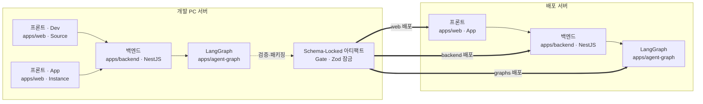
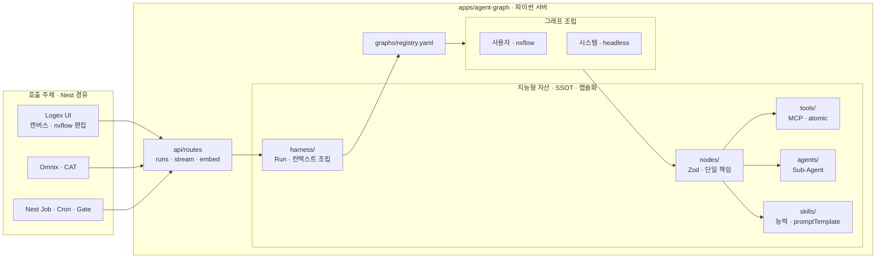

# NEXA Logex 노드 분류 및 특징 명세

> **로직 원천 (Source) 설계를 위한 노드 정형화**
> 본 분류표는 리벳의 유연성과 NEXA 의 엄격한 **[[NEXA-UI_레이아웃_정의서(Web App UI Layout Specification)]]** 규격을 결합한 노드 아키텍처의 기초입니다.


## 노드들의 위계 카테고리
### 에이전트 & 지휘 레이어 (추상화 적용 영역)

사용자의 도메인 맥락 (CAT) 을 인지하고, 흐름을 조율하며, 말단 도구들을 조립하는 영리한 노드들입니다.

- Meta (NEXA OS 제어):
    - 분석: 가장 상위의 레이어입니다. 화면 (Surface UI) 과 작업 맥락 (CAT Logger) 전체를 관장하는 뼈대 노드입니다.
    
- Agent (지능형 도구 연동) & Brain (LLM 지능 처리):
    - 분석: 바로 이 부분이 추상화의 핵심입니다. `Agent` 노드는 말단 MCP 들을 직접 품지 않고, " 지금 맥락에서는 어떤 도구가 필요한지 " 판단하여 일을 하청 주는 ' 추상화된 컨트롤러 ' 역할을 합니다.
    
- Control (흐름 제어):
    - 분석: 조건부 분기 (`If`, `Match`) 와 반복 (`Loop`) 을 통해 에이전트와 말단의 통신 흐름을 설계하는 교통정리 노드입니다.
    


### 말단 & 실행 레이어 (구체적 물리 벽돌, 단일 책임)

외부 세계 (하드디스크, 인프라, 센서, 다른 API) 와 직접 소통하며 무식하고 안전하게 명령만 수행하는 말단 노드들입니다.

- MCP (지능형 도구 연동) — 핵심 :
    - 분석: 표에 ' 지능형 도구 연동 ' 이라고 적혀있지만, 우리가 정의한 대로 말단 MCP(예: 파일 시스템 MCP) 는 철저히 이 자리에 위치해야 합니다. `Agent` 노드가 내린 추상적 명령을 받아 실제 컴퓨터의 파일 (MD) 을 읽고 쓰는 ' 단일 책임 물리 벽돌 ' 입니다.
    
- IO (데이터 인입/배출) & Logic (데이터 순수 가공):
    - 분석: 리벳의 `Input`, `Output`, `String` 등과 매핑되는 가장 기초적이고 구체적인 데이터 조각들입니다.
    
- Service (외부 시스템 연동) & Edge (현장 물리 장치 연동):
    - 분석: 외부 웹 API 나 현장의 물리 센서 (MQTT/Modbus) 등 구체적인 외부 인프라와 1:1 로 매핑되는 말단 영역입니다. 이 역시 철저히 단일 책임으로 쪼개져야 합니다.
    

### 통합 Logex 노드 매트릭스 (Standard Matrix)

| 대분류         | 역할 및 정의             | 주요 특징                                | 리벳 대응 예시                     |
| :---------- | :------------------ | :----------------------------------- | :--------------------------- |
| **IO**      | 데이터 인입/배출           | **Zod 스키마** 강제, 사용자 입력/출력            | Input, Output                |
| **Logic**   | 데이터 순수 가공           | **Shared Core** 로직, 결정론적 연산          | String, Math, Object         |
| **Brain**   | LLM 및 지능 처리/ 텍스트 생성 | **[[Omnix]]** 연동, 프롬프트/스트리밍 (결과반한)   | Chat, Prompt, Match          |
| Agent       | 지능형 도구 연동/추상화       | CAT 기록을 보고 말단 MCP 들을 조립하는 뇌           | ReAct, Plan & Execute        |
| **Control** | 흐름 제어               | 조건부 분기, 루프, 에러 핸들링                   | If, Match, Loop              |
| **Service** | 외부 시스템 연동           | **[[Servicex]]** API 호출, 외부 DB 연결    | HTTP Request, Database       |
| **Code**    | 커스텀 확장              | **Sandbox** 실행, **C2N** 양방향 동기화      | Code, JavaScript             |
| MCP         | **말단 단일 도구**        | 표준 프로토콜 기반 단일 목적 기능 실행 (Atomic Tool) | MCP Client/Server, Tool Bind |
| **Meta**    | **NEXA OS 제어**      | **CAT** 기록, **Surface** UI 바인딩       | Surface Designer, CAT Logger |

### 환경별 확장 분류 (Contextual Extensions)

| 확장 분류 | 소속 환경          | 역할 및 정의           | 특징                         |
| :-------- | :----------------- | :--------------------- | :--------------------------- |
| **Edge**  | **현장 (Physical)** | 물리 장치 및 센서 연동 | 실시간 스트림, MQTT/Modbus   |
| **Dev**   | **생산 (Dev-Only)** | App 생산 및 배포 제어  | Validation Gate, Source Sync |

| **Edge (에지/현장)** | 물리 장치 및 센서 연동 | **실시간 스트리밍**, 프로토콜 (MQTT/Modbus) 변환 | (없음/Custom Plugin) |

> 현장의 장비를 제어하고 펌웨어를 업데이트를 위한 노드들로 구성

- **일관성:** 우리 시스템의 물리적 접점을 담당하는 **[NEXA-Edge](app://obsidian.md/NEXA-Edge)** 및 **[Twinex](app://obsidian.md/Twinex)** 페싯과 용어적 통일성을 유지합니다.
- **범위성:** 단순한 IoT 장비를 넘어, 공장 설비, 스마트 홈, 모바일 센서 등 모든 ' 현장 데이터 ' 를 포괄합니다.
- **차별성:** **Service (연동)**가 주로 클라우드 기반 API(HTTP) 를 다룬다면, **Edge**는 로컬 네트워크 및 물리적 신호를 다룬다는 점에서 명확히 분리됩니다.

| **Dev (생산/검증)** | App 생산 및 배포 제어 | **Source-to-Instance** 전이, 배포 게이트 통과 | (없음/Dev 전용) |

> **생산 및 검증의 엄격성**
> 이 노드들은 오직 **[[NEXA_Dev_UI-Driven_기능설계및_전이_로드맵]]**의 생산 파이프라인 내에서만 작동하며, 실제 배포된 앱의 런타임에는 포함되지 않는 ' 메타 공정 ' 노드입니다.

- **Validation Gate Node:** 설계된 로직이 **Zod 스키마** 및 보안 규정을 통과하는지 검증.
- **Source Sync Node:** 수정된 로직 원본 (Source) 을 실체 (Instance) 로 이식하거나 Git 과 동기화.
- **Scribx Codegen Node:** Logex 그래프를 바탕으로 실제 실행 가능한 코드를 자동 생성 및 주입.
- **Audit Logger Node:** 개발 과정에서의 모든 결정 히스토리와 변경 사항을 기록.

> **추상화의 한계를 넘는 코드의 힘**
> 비주얼 프로그래밍의 직관성과 텍스트 코딩의 강력함을 결합합니다. 모든 코드 노드는 보안을 위해 **격리된 샌드박스**에서 실행됩니다.

- **Script Node (JS/TS):** 런타임에서 즉시 실행 가능한 자바스크립트/타입스크립트 조각을 작성.
- **Python Node:** 데이터 분석이나 AI 전처리 등을 위한 파이썬 스크립트 실행 (Server-side Bridge 활용).
- **Regex Node:** 복잡한 문자열 패턴 매칭 및 변환을 위한 정규표현식 전용 노드.
- **Shared Core Node:** 프로젝트 전역에서 재사용되는 공통 라이브러리 함수 호출.

## 노드 아키텍처 구현 로드맵 (Phased Roadmap)

> [!IMPORTANT] **단계별 학습 및 구현 전략**
> 무작정 모든 노드를 만드는 대신, **데이터가 흐르는 길**부터 먼저 닦는 것이 아키텍처적 정석입니다.

### 1 단계: Foundation (기초 체력)

- **목표:** 데이터가 들어와서 변환되고 나가는 최소 순환 고리 완성.
- **대상:** IO 노드 전체 + Logic(String/Math) 기본 노드.
- **학습 포인트:** Zod 를 통한 데이터 무결성 검증 및 **[[DEV_Logex_Node_&_Surface_제작및배포가이드]]**의 3 대 요소 이해.

### 2 단계: Intelligence (핵심 가치)

- **목표:** LLM 을 로직 흐름에 태워 지능형 결과물 산출.
- **대상:** Brain 노드 전체 + Control(If/Match) 분기 노드.
- **학습 포인트:** 프롬프트 엔지니어링의 노드화 및 컨텍스트 유지 기법.

### 3 단계: Integration & Meta (확장 및 고도화)

- **목표:** 외부 세계와 연결하고 실제 UI(Surface) 로 배포.
- **대상:** Service 노드 + Meta(Surface Designer) 노드.
- **학습 포인트:** 외부 API 보안 (Sandbox) 및 **[[NEXA-UI_레이아웃_정의서(Web App UI Layout Specification)]]**에 따른 렌더링.

---

<!-- ... 기존 포트 설계 표준 하단 ... -->

## 선택 기반 입력 설계 표준 (Select-driven Input)

> [!TIP] **구조화된 자유도**
> 모든 입력 포트는 ' 무 (無)' 에서 시작하지 않고, 현재 컨텍스트에서 사용 가능한 데이터 목록을 **드롭다운 (Select)**으로 우선 제시합니다.

- **Context-Aware Selection:** **[[Graphx]]**나 **[[Servicex]]**에서 정의된 기존 데이터 스키마를 자동으로 불러와 선택지로 제공.
- **On-demand Extension:** 목록에 없는 새로운 데이터가 필요할 때만 ' 직접 입력 ' 모드를 활성화하여 포트를 추가.
- **Type Suggestion:** 직접 입력 시에도 기존 데이터를 기반으로 **Zod 타입**을 추천하여 데이터 일관성 유지.

> [!QUOTE] **수석 아키텍트의 비평**
> " 무엇이든 할 수 있는 자유는 때로 설계자를 길을 잃게 만듭니다. ' 셀렉트 기반 ' 은 설계자에게 **가이드라인**을 제공하는 동시에 **확장성**을 열어두는 지능적인 설계입니다. 이는 **[[NEXA OS]]**가 추구하는 ' 초보자도 아키텍트처럼 설계하게 만드는 ' 사용자 경험의 핵심이 될 것입니다."

> [!CHECK] **아키텍트의 비평**
> " 리벳을 공부할 때 가장 중요한 것은 **' 데이터 타입이 어떻게 전이되는가 '**를 추적하는 것입니다. 특히 1 단계의 IO 노드에서 정의한 스키마가 3 단계의 Surface 노드까지 오염되지 않고 전달되는지를 확인하십시오. 이것이 곧 **[[NEXA OS]]**가 추구하는 **데이터 주권 및 무결성**의 핵심입니


## 시스템 통합 아키텍처 및 재사용 다이어그램

> [!IMPORTANT] **Run 경로**
> **`프론트 → 백엔드 → LangGraph`** — UI 가 LangGraph **직접 호출 ✗** ([`TDD-007` §2④](../APP_V2.0/08_TDD/NEXAOS/08_TDD_NEXAOS_모노레포폴더구조_v1.0.md)).

### 통합 배포 토폴로지

> **개발 PC:** Dev·App 프론트 분리 · 백엔드·LangGraph **공유 (논리적 격리)** · Gate 후 **Schema-Locked 아티팩트** 생성
> **배포 서버:** **App 만** · Dev UI **없음** · Schema-Locked 아티팩트 **3 단 분리 배포**
> LangGraph 실행 엔진 상세 → [[#파이썬 서버 내부 구조 · 노드 재사용]]



> [!tip] Schema-Locked 아티팩트
> Validation Gate 통과 후 **Zod 스키마·그래프·manifest 가 잠긴 Instance 번들** — Source 편집과 분리된 **배포 단위**. (NEXA **Source → Instance** 전이의 산출물)

---

## 파이썬 서버 내부 구조 · 노드 재사용

> [!abstract] **설계 의도: 지능형 자산의 SSOT 및 캡슐화**
> **Logex UI 는 지능의 일부를 시각화하고 조합하는 ' 추상화된 편집기 ' 일 뿐입니다.**
> 노드 (Node), MCP, 서브 에이전트 (Sub-Agent), 스킬 (Skill), 그리고 이를 구동하는 하네스 (Harness) 까지 — 모든 **지능형 원천 자산의 SSOT 와 실행체는 `apps/agent-graph` 에 집중**됩니다.
> 이를 통해 내부 시스템, 배치 프로세스, **[[Omnix]]** 등이 파편화 없이 동일한 로직적 유산 (Legacy) 을 공유하고 재사용합니다.

| 원칙 | 내용 |
| :--- | :--- |
| **SSOT 집중** | Node · MCP · Sub-Agent · Skill · Harness — **구현·등록·실행의 단일 원천** = `apps/agent-graph` |
| **캡슐화** | Logex·Omnix·Nest Job 은 **HTTP 계약만** 소비 · 내부 `tools/`·`agents/`·`skills/` **직접 import ✗** |
| **UI ≠ 전체** | Logex 팔레트 = `exposeInLogex` **허용 서브셋** · 파일 MCP 등은 **메타만 등록 · UI 미노출** |
| **노드 = 라이브러리** | `nodes/` = **Zod 계약 + 단일 책임** · `graphs/`·`.nxflow` 는 **조립·배선만** |
| **스킬·하네스 분리** | `skills/` = 재사용 **능력 단위**(promptTemplate · tool 바인딩) · `harness/` = Run **컨텍스트·오케스트레이션** |
| **호출 경로** | Logex · Omnix · Nest Job · Cron — 모두 **Nest → agent-graph** (브라우저·UI 직접 호출 ✗) |

### Logex UI vs 실행 엔진

| 구분 | Logex UI (`domains/nexia` · `.nxflow`) | agent-graph (Python) |
| :--- | :--- | :--- |
| **역할** | 지능의 **일부를 시각화·조합**하는 추상 편집기 · Source 설계 | 지능형 자산 **SSOT** · 실행·오케스트레이션 |
| **자산 범위** | 팔레트에 올린 노드·연결만 | `nodes/` · `tools/` · `agents/` · `skills/` · `harness/` **전체 등록체** |
| **그래프** | 사용자 `.nxflow` (Source) | `graphs/` 시스템 그래프 + nxflow **런타임 조립** (`harness/runner`) |
| **스킬·에이전트** | Brain·Agent 노드로 **표현된 조각**만 | `skills/` · `agents/` **전체** — Omnix·배치·ingest 가 **동일 유산** 재사용 |
| **예** | IO · Logic · Brain · Control … | + 파일 MCP · `validation_static` · Nexaon ingest · headless Cron |

### 파이썬 서버 내부 구조 다이어그램



### 디렉터리 매핑 (To-Be)


> **Phase 0 (지금):** 1 안 디렉터리만 생성 · 파일은 평탄 배치 가능
> **Phase 1:** `harness/` 3 파일 · `tools/registry.py` + MCP 분리
> **Phase 2:** `graphs/compiler.py` · `skills/{name}/` 모듈 · 노드 `kind/` 서브폴더

```text
apps/agent-graph/                               ← ① 모노레포 "앱" (배포 단위)
├── pyproject.toml
├── Dockerfile
├── tests/
└── src/agent_graph/                            ← ② Python "패키지" (import 단위)
    ├── main.py
    ├── api/routes/                             # runs · stream · embed — Nest만
    ├── harness/                                # ★ 실행·캡슐화 (2안 흡수)
    │   ├── runner.py                           # StateGraph 조립 · SSE
    │   ├── context.py                          # CAT · 스킬 · Run 컨텍스트
    │   └── metrics.py                          # CAT 수치·진행률 (2안 metrics_tracker)
    ├── graphs/
    │   ├── registry.yaml                       — graph_id SSOT
    │   ├── compiler.py                         # Phase 2 · nxflow → 런타임
    │   ├── nexaon_ingest.py · …
    │   ├── validation_static.py                — ★ Dev
    │   └── deploy_promote.py                   — ★ Dev
    ├── nodes/                                  # Phase 0 flat · Phase 2 kind/ 서브폴더
    ├── tools/
    │   ├── registry.py                         # MCP 메타 · exposeInLogex · deployProfile
    │   ├── core_mcp/                           # Phase 1 · 내부·파일 (dev only)
    │   └── service_mcp/                        # Phase 1 · 외부 API
    ├── agents/                                 # 1안 유지 — 2안 누락 보완
    ├── skills/                                 # Phase 1 모듈화
    │   └── {skill_id}/
    │       ├── manifest.yaml                   # promptTemplate · tool 바인딩
    │       └── prompt.jinja                    # 스킬 전용 (공통은 prompts/)
    ├── adapters/                               # llm/ · embedder · neo4j read
    └── prompts/                                # graph·agent 글로벌 Jinja (TDD-007)
```

| 디렉터리 | 지능형 자산 | Logex 노출 | 소비 주체 |
| :--- | :--- | :--- | :--- |
| `nodes/` | Node · Zod 계약 | `exposeInLogex` 서브셋 | nxflow · 시스템 그래프 |
| `tools/` | MCP · atomic tool | 대부분 **false** (파일 MCP = dev) | Agent 노드 · `skills/` |
| `agents/` | Sub-Agent 조립 | 선택적 | `harness/` · headless Job |
| `skills/` | Skill · 능력 단위 | Brain·Agent 로 **추상 표현** | Omnix · CAT · 오케스트레이터 |
| `harness/` | Harness · 실행기 | **없음** (내부 전용) | `api/routes` · 모든 Run |
| `graphs/` | 그래프 배선 | `.nxflow` 는 UI · `.py` 는 코드 | `harness/` 가 registry 조회 |
| `adapters/` | LLM·임베딩 인프라 | **없음** | nodes · agents · skills |

| 메타데이터 (노드·MCP 등록 시) | 용도 |
| :--- | :--- |
| `nodeId` · Zod 스키마 | 실행 계약 · `packages/shared` 정합 |
| `exposeInLogex: true/false` | Logex 팔레트 노출 여부 |
| `deployProfile: dev/prod/all` | 배포 서버 포함 여부 (파일 MCP = **dev only**) |
| `kind` | IO · Logic · Brain · MCP · Agent · Dev … |

> [!check] **설계 요약**
> * **Logex**는 지능을 **만드는 곳이 아니라 꺼내 조합하는 편집기**다.
> * 개발 단에서 Node·MCP·Sub-Agent·Skill·Harness 는 **`agent-graph` 에 먼저 등록·캡슐화**하고, Logex·Omnix·배치는 **동일 HTTP·동일 라이브러리**를 재사용한다.
> * UI 에는 `exposeInLogex` 로 필요한 조각만 올려 **단순화·배포 안전**을 확보한다.


---

## Logex 캔버스 노드 ↔ 백엔드 아키텍처 최종 매핑 명세

> [!ABSTRACT] 1. 서비스 노드 ──▶ **BFF** (Backend For Frontend) / NestJS 서비스
> 화면 UI: `[Service] 온톨로지 맵 조회`, `[Service] 사용자 권한 체크`, `[Service] 텍스트 청소` 등
>
> - 백엔드 실체: 외부 AI 나 복잡한 추상화 없이, NestJS 내부 메모리에 상주하는 백엔드 핵심 컴포넌트 (Service) 함수를 직접 찌릅니다.
> - 아키텍처 효과: 통신 비용이 0 원이며 0.001 초 만에 반응합니다. 랭그래프 엔진을 깨울 필요가 없는 무식하고 안전한 고속 데이터 연산을 담당합니다.

> [!IMPORTANT] 2. 지능 노드 ──▶ **에이전트** 그래프 (Agent Graph) / 파이썬 랭그래프
> 화면 UI: `[Brain] 의도 분석`, `[Agent] 자율형 인사 온보딩`, `[Control] 3회 루프 교정` 등
>
> - 백엔드 실체: LLM(두뇌) 과 비즈니스 논리 흐름이 결합하여 스스로 상황을 판단하고 라우팅을 수행하는 파이썬 랭그래프 엔진입니다.
> - 아키텍처 효과: 유저가 캔버스에서 지능 노드들의 선 (Edge) 을 복잡하게 엮는 행위가 백엔드에서는 정교한 평가 - 최적화 (Evaluator-Optimizer) 패턴이나 오케스트레이터 - 워커 패턴의 실행 코드로 그대로 변환되어 작동합니다.

> [!SUCCESS] 3. 파일 관련 노드 ──▶ **MCP** (Model Context Protocol) / 보안 샌드박스 도구
> 화면 UI: `[File] 마크다운 문서 읽기`, `[File] 외부 로컬 DB 동기화` 등
>
> - 백엔드 실체: 서버 하드디스크나 로컬 파일 시스템에 직접 접근하는 표준 규격의 말단 MCP 서버 (Atomic Tool) 입니다 [Anthropic MCP Integration].
> - 아키텍처 효과: 에이전트 그래프 (지능 노드) 가 컴퓨터 내부 파일을 난도질하지 못하도록 명시적인 허용 경로 (Allowed Paths) 울타리를 쳐주는 보안 격리벽 역할을 수행합니다.

---


## 앤트로픽 5 대 패턴 기반 NEXA 오케스트레이션 지침
> 랭그래프 엔진이 노드들을 조립하는 5 가지 마스터 빌딩 블록입니다.

- **1. 프롬프트 체이닝 (Chaining):** 작업을 단계별로 쪼개어 순차적으로 처리하는 선형 파이프라인.
- **2. 라우팅 (Routing):** LLM 이 판단하여 조건에 맞는 다음 노드로 흐름을 동적으로 분기.
- **3. 병렬처리 (Parallelization):** 대량의 작업을 여러 노드로 동시 실행 후 결과를 하나로 취합.
- **4. 오케스트레이터 - 워커 (Orchestrator-Workers):** 중앙 지휘관이 계획을 세우고 하부 에이전트들에게 업무를 배정.
- **5. 평가 - 최적화 (Evaluator-Optimizer):** 검증 노드가 결과물을 채점하여 기준 미달 시 루프를 돌며 품질 개선.

> [!CHECK] **아키텍트의 비평**
> " 복잡한 에이전트 설계도 결국 이 5 가지 패턴의 조합입니다. **[[Logex]]** 캔버스 위에서 노드를 연결할 때, 내가 지금 어떤 패턴을 만들고 있는지 명확히 인지하는 것만으로도 설계의 오류를 절반 이상 줄일 수 있습니다."<!-- ... 기존 5대 패턴 하단 ... -->

<!-- ... 기존 NEXA 지능 진화 전략 섹션 교체 ... -->

## NEXA 지능 진화 5 대 전략 (Intelligence Evolution Strategy)

> [!ABSTRACT] **의도 파악에서 품질 자립까지**
> 모든 노드 배선은 사용자의 숨은 의도를 읽고, 시간이 흐를수록 스스로 정답에 가까워지는 ' 성장형 아키텍처 ' 를 지향합니다.

- **전략 1: 다차원 의도 파악 (Intent Capture)**
    - **[[CAT]] (Context Awareness Tracker)** 로그와 **Surface UI**의 상태값을 결합하여 사용자의 추상적 명령을 구체적 실행 맥락으로 변환합니다.
- **전략 2: 폐루프 품질 진화 (Closed-loop Evolution)**
    - **평가 - 최적화 패턴**을 통해 도출된 실패 사례를 **[[NEXA_Dev_UI-Driven_기능설계및_전이_로드맵]]**의 피드백 루프로 환류시켜 로직 원본을 자동 고도화합니다.
- **전략 3: 도메인 격리형 도구 필터링 (Domain-Locked Filtering)**
    - 현재 진입한 비즈니스 도메및 카테고리 선택 에 따라 사용 가능한 **MCP** 목록을 실시간 필터링하여 **LLM 의 환각 (Hallucination)**을 원천 차단합니다.
- **전략 4: 성능 중심 비동기 예열 (Performance Warming)**
    - 부하가 큰 AI 모델이나 데이터 컨텍스트를 백그라운드에서 미리 로딩 (Lazy Loading) 하여, 사용자 체감 응답 속도를 0.5 초 이내로 유지합니다.
- **전략 5: 하이브리드 검증 가드레일 (Hybrid Guardrail)**
    - 결정론적 **Zod 스키마 검증**과 비결정론적 **LLM 심사**를 결합하여, 기계적 무결성과 논리적 타당성을 동시에 확보합니다.


> [!QUOTE] **수석 아키텍트의 결론**
> " 단순히 ' 잘 작동하는 ' 그래프를 만드는 것에 만족하지 마십시오. 진정한 아키텍처는 **데이터가 쌓일수록 똑똑해지는 구조 (Self-Improving Structure)**를 가져야 합니다. 위의 5 대 전략은 사용자가 시스템을 쓰면 쓸수록 **[[NEXA OS]]**에 더 깊이 의존하게 만드는 강력한 락인 (Lock-in) 장치가 될 것입니다."


> CAT 분석 전략 : 타이핑을 쉬거나 바쁘지 않을때 더많은 분석
[유저가 프롬프트를 타이핑 시작]
       │
       ├─▶ (InputEvent) 단어 사이 간격 측정 ➔ 망설임 지수 수학적 계산
       ├─▶ (Transformers.js) 엔터 치기 전 글자들의 감정과 토큰 수 실시간 수치화
       └─▶ (Debounce 0.3 초) 타이핑 멈추는 순간 문법 규격 점수 자동 채점
                               │
                               ▼
            [보내기 버튼을 누르기도 전에 CAT 데이터 세팅 완료!]
            하단 ACT 바의 프로그레스 바와 인디케이터가
            유저의 타이핑 리듬에 맞춰 실시간으로 반응하며 움직임 🌊
