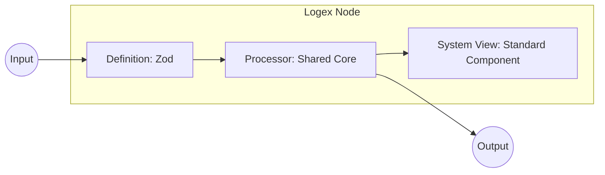
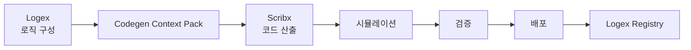
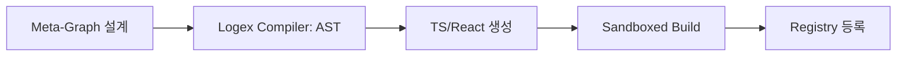

# Logex Node & Surface 제작 및 배포 가이드

> [!abstract] 하위 정본
> **Logex 탭** 범위의 Node·Surface 공정. Dev **동형 셸**에서 시뮬레이션·검증 후 App 배포. 전체 조망 → [[NEXA_Dev-System_of_Systems(SoS)_아키텍처비전#Dev 이중 역할 · 구조 동형]].

> [!info] 읽기 가이드 · 데이터 성격
>
> | 표식 | 성격 | 스캔 포인트 |
> | :--- | :--- | :--- |
> | `정의` | Node · Surface · Registry | 온보딩 |
> | `구조` | 3 요소 · 내부 아키텍처 | 노드 제작 |
> | `원칙` | No Custom Design · Sandbox | 리뷰·보안 |
> | `운영` | 그래프 → 배포 → 배치 | 사용자 워크플로 |
> | `구현` | 메타 프로그래밍 · 컴파일 | 고급 제작 |

> [!summary] 문서 지도
>
> - [[#용어 · 범위]]
> - [[#Logex Node 3대 구성 요소]]
> - [[#노드 제작 표준 공정]]
> - [[#NEXA Logic Editor]]
> - [[#Logex → Scribx · LLM 코드 생성 가이드라인]]
> - [[#노드 생태계 · Registry]]
> - [[#로직 그래프 → Surface 패키징]]
> - [[#배포 · 레지스트리 · 배치]]
> - [[#메타 프로그래밍 — Self-Generating Nodes]]

## 용어 · 범위

> `정의`

| 용어 | 역할 |
| :--- | :--- |
| **NEXA Logic Editor** | **Logex**(로직 구성) + **Scribx**(코드 산출) 를 통합한 제작 워크스페이스 |
| **Logex** | 로직 **구성** + **Logex Node 제작** — 노드·그래프·Meta-Graph 를 같은 캔버스에서 다루는 레이어 |
| **Scribx** | Logex 설계의 코드 **산출** · 편집 레이어 |
| **Codegen Context Pack** | Logex→Scribx LLM 코드 생성용 내부 SSOT — 프롬프트 컨텍스트·룰·스타일·산출 계약 |
| **Logex Node** | Definition + Processor + System View 가 결합된 독립 실행 모듈 |
| **Surface** | 노드 그래프 최종 출력을 UI 단위로 패키징한 배포·배치 대상 |
| **Logex Registry** | 노드·서피스 메타데이터 등록소 (마켓·인벤토리 공급) |
| **Asset Ledger** | 배포 산출물 (Manifest) 의 SSOT — 노드·서피스 등록 기록 |
| **Layout Metadata** | 사용자별 슬롯·크기·배치 — 기기 간 동기화 |


---

## Logex Node 3 대 구성 요소

> `구조` — 제작자 용어 고정. **System View** = UI-Driven 정본의 **Standard Component**(노드 캔버스 맥락).

| 구성 요소 | 기술적 실체 | 제작자 권한 | 시스템 역할 |
| :--- | :--- | :--- | :--- |
| **Definition** (데이터 명세) | Zod Schema | 포트 (In/Out) 타입·이름 정의 | 노드 간 연결·무결성 강제 |
| **Processor** (연산 로직) | Shared Core (JS/TS) | 변환·수집 알고리즘 구현 | Sandbox 실행 · 결정론 보장 |
| **System View** (표준 UI) | Standard Component | 위젯 선택·데이터 매핑 | **커스텀 디자인 ✗** · 일괄 UI 갱신 |



> [!info] `정의`
> 하나의 노드 = 데이터 명세 + 연산 로직 + 시각적 표현. Zod SSOT 는 [[NEXA_Dev_UI-Driven_기능설계및_전이_로드맵]] 과 동일.

---

## 노드 제작 표준 공정

> `구조` · Definition → Processor → Interface Mapping

> [!important] `원칙` · No Custom Design
> 제작자는 UI 를 그리지 않는다. **System View** 라이브러리 위젯에 Processor 결과를 **바인딩**만 한다.

| 단계 | 작업 | 산출 |
| :--- | :--- | :--- |
| **Definition** | In/Out 을 Zod 로 선언 | 포트 이름 → System View 라벨 자동 매핑 |
| **Processor** | 변환·수집 로직 작성 | Shared Core 준수 · Sandbox 대상 |
| **Interface Mapping** | `Logex.Gauge` · `Logex.Status` · `Logex.Text` 등 선택 | 결과값 → 위젯 필드 연결 |

> [!tip] `원칙` · 아키텍처 이득
> NEXA OS 디자인 가이드 변경 시 **System View** 코어만 수정하면 등록된 사용자 노드 UI 가 일괄 갱신된다.

---

## NEXA Logic Editor

> `구조` · **Logex · Scribx 탭** 내 생산 축 — NEXIA 7 탭 중 **로직→코드** 구간의 상세 작업면. 전체 조망은 [[NEXA_Dev-System_of_Systems(SoS)_아키텍처비전#생산 파이프라인]].

| 레이어        | 담당                        | 산출                                                                  |
| :--------- | :------------------------ | :------------------------------------------------------------------ |
| **Logex**  | 로직 구성 **· Logex Node 제작** | 그래프·Surface 파이프라인 **또는** Meta-Graph → 신규 노드 Definition·Processor 연결 |
| **Scribx** | 코드 산출                     | Shared Core · Processor 구현체 · 보조 스크립트                               |

> [!tip] `원칙` · Logex 이중 역할
> **Logex Node 제작도 Logex 를 통해 가능**하다. Scribx 는 산출된 코드를 편집·확정하는 레이어이며, 노드의 포트·로직 블록·내부 구조 설계는 **Logex 캔버스**에서 먼저 이루어진다.
>
> | Logex 용도 | 대상 | 후속 |
> | :--- | :--- | :--- |
> | **노드 제작** | Meta Nodes 조합 → 신규 Logex Node | Scribx → 시뮬레이션 → 검증 → 배포 |
> | **로직 구성** | Registry·인벤토리 노드 연결 → Surface·파이프라인 | Surface Designer → 배치 |
>
> → 노드 제작 상세: [[#메타 프로그래밍 — Self-Generating Nodes]]

> [!important] `원칙` · 제작 파이프라인
> **Scribx** 산출물은 반드시 **시뮬레이션 → 검증 → 배포** 순으로 통과한다. Registry·Asset Ledger 반영 전 게이트.



| 단계 | 내용 | 산출 |
| :--- | :--- | :--- |
| **시뮬레이션** | Sandbox 에서 Processor·그래프 실행 · 입출력 시나리오 재현 | Run 로그 · 예상 vs 실제 대조 |
| **검증** | Zod 스키마 · Static Analysis · 보안 검수 · Audit Trail | Validation Gate 통과 여부 |
| **배포** | Logex Registry 등록 · Asset Ledger Manifest · 마켓/인벤토리 반영 | 배포 가능 노드·Surface 패키지 |

### Logex → Scribx · LLM 코드 생성 가이드라인

> `구현` · Logex 설계를 Scribx 코드로 변환할 때 LLM 이 따를 **내부 SSOT** — 시스템이 수립·버전 관리·검증 게이트와 연동해야 한다.

> [!warning] `원칙` · 내부 수립 필수
> **Logex → Scribx** 구간에서 LLM 이 Processor·Shared Core 코드를 생성할 때, 임의 프롬프트에 의존하지 않는다. **프롬프트 컨텍스트 · 룰 · 스타일 가이드 · 산출 계약**을 **Codegen Context Pack**으로 묶어 내부 규격으로 고정·갱신한다.

| 구성 | 역할 | 포함 예 |
| :--- | :--- | :--- |
| **Prompt Context** | LLM 에 주입할 설계 스냅샷 | Meta-Graph/그래프 JSON · Zod Definition · In/Out 포트·엣지 · System View 매핑 · `Source`/`Instance` 스코프 |
| **Rules** | 생성 코드의 불변 제약 | Shared Core · Sandbox 격리 · No Custom Design · 금지 API(`window.fetch` 등) · 결정론·타입 안전 |
| **Style Guide** | 코드 형태·구조 규약 | Processor/Definition 파일 레이아웃 · 네이밍 · import · [[NEXA_Dev_UI-Driven_기능설계및_전이_로드맵#Logex 개발 소통 언어]] 용어 정합 |
| **Output Contract** | Scribx 가 받을 산출물 스펙 | TypeScript 대상 · 편집 단위 (파일/모듈) · 시뮬레이션·Zod 검증 훅 연결 지점 |

> [!check] `운영` · 유지·검증
>
> - **버전 관리** — Context Pack 변경 시 Audit Trail · 기존 노드 재생성·회귀 검증 정책 명시
> - **Validation Gate 연동** — 생성 직후 Zod·Static Analysis 가 Pack 룰 위반을 1 차 차단
> - **사람 검토** — Scribx 에서 최종 확정 전 diff·시뮬레이션으로 LLM 산출물 보정

> [!info] `정의`
> **Codegen Context Pack**은 제품 내부 자산 — Logex Graph Inputs·코딩 규칙·Logex 3 요소가 누적·정제되며, 로컬 LLM 전환 후에도 생성 품질 SSOT 로 유지한다. Logex 에서 **무엇을** 연결할지 정의하고 (그래프 조합·Meta-Graph 노드 제작), Scribx 에서 **어떻게** 실행할지 코드로 확정한다. 이후 단계는 UI-Driven 정본의 Source → Instance·Sandbox·Validation Gate 와 동일 축.

---

## 노드 생태계 · Registry

> `운영` · 검증·배포 통과 후 공유

### 마켓플레이스 · 커뮤니티

| 단계 | 내용 |
| :--- | :--- |
| **Registry 배포** | 제작 노드를 Logex Registry 에 등록 · 구독·재사용 |
| **커뮤니티 검증** | 평점·리뷰 → 신뢰도 · 인기 노드는 표준 라이브러리 승격 |

> [!warning] `보안` · 공급자 원칙
> 배포 노드는 **Sandbox** 필수 · 불필요한 시스템 자원 접근 차단 · 보안 검수 통과 후 Registry 반영

---

## 로직 그래프 → Surface 패키징

> `운영` · 기존·신규 노드를 조합해 Surface 로 패키징

### 그래프 구성

- **노드 탐색:** Logex Registry·인벤토리에서 기능 노드 선택
- **데이터 바인딩:** 포트를 엣지로 연결해 파이프라인 설계
- **SSOT:** 모든 노드는 동일 Zod 스키마 체계 → 타입 충돌 없이 연결

### Surface Designer Node

그래프 **최종 단**에 Surface Designer Node 를 연결해 UI 단위로 변환한다.

> [!info] `운영` · 서피스 설정
>
> - **Display Mode** — Sidebar: Compact · Dashboard: Full
> - **Refresh Policy** — 실시간 (Yjs) 또는 Polling
> - **Access Control** — 개인 / 팀 공유 · 편집 권한

---

## 배포 · 레지스트리 · 배치

> `운영` · Manifest → 인벤토리 → Layout Editor

### 배포 · 등록

| 단계 | 저장소 | 내용 |
| :--- | :--- | :--- |
| **Manifest 발행** | Asset Ledger | Surface 고유 ID · 메타데이터 |
| **인벤토리 반영** | Surface Registry (사용자 뷰) | 즉시 ' 서피스 인벤토리 ' 에 추가 |

### Universal Placement

> [!success] `운영` · 배치 가능 거점
>
> - **Sidebar Slot** — 뉴스 구독 · 투두 · 시스템 모니터 등 상시 참조
> - **Dashboard Slot** — 통계 그래프 · 지식 네트워크 등 넓은 분석 뷰

- **Layout Editor** — 인벤토리 Surface 를 슬롯으로 드래그 앤 드롭
- **Layout Metadata** — 슬롯·크기·순서를 사용자 전역 설정에 저장 → 기기 간 동기화

> [!check] `원칙` · 무결성
>
> - **실행 격리** — 각 Surface 는 독립 Sandbox · 커스텀 배치가 코어 안정성에 영향 **✗**
> - **Audit Trail** — 제작→배포→배치 전 과정 기록 · 오류 시 롤백·원인 분석

---

## 메타 프로그래밍 — Self-Generating Nodes

> `구현` · **Logex Node 제작 경로** — Logex 캔버스에서 Meta-Graph 를 설계하면 실행 가능 노드 패키지로 컴파일

> [!abstract] `정의`
> **Logex Node 제작은 Logex 만으로 시작한다.** 캔버스에서 **정의용 노드 (Meta Nodes)**를 조합하면 시스템이 Zod + Processor + System View 패키지를 생성하고, 필요 시 Scribx 로 코드 산출 후 동일 파이프라인 (시뮬레이션 → 검증 → 배포) 을 탄다.

### Graph-to-Code 컴파일

> [!important] `구현` · 생성 3 단계
>
> 1. **Meta-Schema Design** — `Port Definition` · `State` · `Logic Block` 등으로 청사진 구성
> 2. **Transpilation** — 그래프 (JSON) → AST → TypeScript/React
> 3. **Dynamic Registration** — HMR 로 재시작 없이 Logex Registry 등록



> `보안`
> 실행 전 **Static Analysis** — `window.fetch` 등 비허용 시스템 호출 검증

---
## 브라우저 AI

- Web Worker: 브라우저의 메인 UI 스레드와 분리된 ' 독립된 백그라운드 작업실 ' 입니다. 대용량 파일 다운로드나 무거운 연산을 처리해도 화면이 멈추거나 버벅거리는 렉 (Lag) 현상이 전혀 발생하지 않습니다.
- Chrome & Edge 내장 AI API (`AI Summarizer`): 사용자의 브라우저에 이미 내장된 초경량 AI 모델 (Gemma Nano 등) 을 자바스크립트 코드 한 줄로 깨우는 기술입니다 [Google AI Edge Overview]. 서버 통신 비용이 0 원이며, 인터넷 없이도 0.5 초 만에 문장을 요약합니다. [1, 2]


### NEXA 시스템을 위한 단계별 응용 전략

초기 로딩 스트레스와 결과 글자 잘림 문제를 완벽하게 해결하는 프론트엔드 파이프라인 아키텍처입니다.

```text
[1단계: 0.1초 초고속 접속] ➔ 메인 UI(React Flow 캔버스, ACT 바)만 즉시 렌더링
       │
       ▼ [2단계: 유저 몰래 예열]
[Web Worker 백그라운드 구동] ➔ 메인 화면 렉 없이 내장 AI 모델 엔진 비동기 활성화
       │
       ▼ [3단계: 데이터 수신 및 실시간 압축]
[랭그래프 원본 결과 도착] ➔ 내장 AI API 가동 ➔ 0.5초 만에 글자 잘림 없는 '100자 요약 카드' 생성
```

### 유사/대체 기술 및 장단점 비교

내장 AI API 외에 브라우저단에서 독립적인 AI 환경을 구축할 수 있는 현대적 대안 기술들입니다.

>  WebLLM (WebGPU 기반 오픈소스)

- 개념: 브라우저의 그래픽카드 가속 (`WebGPU`) 을 직접 활용하여 Llama 3 나 Qwen 같은 검증된 압축 모델을 구동하는 라이브러리입니다.
- 응용처: 크론/엣지 외에 사파리 (Safari), 파이어폭스, 모바일 브라우저까지 완벽하게 호환되는 크로스 플랫폼 대시보드를 구축할 때 사용합니다.

> Transformers.js (Hugging Face)

- 개념: 파이썬의 허깅페이스 환경을 브라우저 (자바스크립트) 로 그대로 옮겨온 웹 전용 딥러닝 라이브러리입니다.
- 응용처: 문장 요약뿐만 아니라 사용자가 입력한 프롬프트의 감정 분석 (긍정/부정), 텍스트 임베딩 (벡터화), 토큰 수 실시간 계산을 서버를 거치지 않고 프론트엔드 단에서 처리할 때 유용합니다. [3]

### 대분류 매트릭스 (Logex) 기반 추가 응용처 제안
이 온디바이스 (On-device) 브라우저 AI 기술은 결과 요약 외에도 시스템 전반의 핵심 분류 레이어와 결합하여 폭발적인 시너지를 낼 수 있습니다.

> 프롬프트 입력 자동 슬롯 파싱 (Input Layer)
- 사용자가 ' 드롭존 ' 에 수만 자의 지저분한 레시피나 기획 문서를 대충 복사해서 던졌을 때 활용합니다.
- 브라우저 AI 가 백그라운드에서 이를 즉시 분석하여 `[페르소나]`, `[제약조건]`, `[참고 데이터]` 카드로 쪼개어 서피스 (Surface) 작업대 위에 정렬해 줍니다.

> 캔버스 노드 실시간 문법/오류 검증 (Control Layer)
- 사용자가 리액트 플로우 캔버스에서 노드와 선 (Edge) 을 복잡하게 연결할 때 작동합니다.
- `Control` 노드나 `MCP` 진입부에서 데이터 타입이 맞지 않거나 루프가 무한히 돌 위험이 있는 구조를 브라우저 AI 가 실시간으로 감지하여, 하단 ACT 바에 옐로카드 (`[!WARNING]` 콜아웃) 를 즉시 띄워주는 지능형 린터 (Linter) 로 활용합니다.

>온톨로지 지식 그래프 미니 검색 (Brain Layer)
- 수백 개의 온톨로지 개념 (Concept) 노드 중 사용자가 검색창에 대충 단어를 입력했을 때 활용합니다.
- 서버 DB 를 매번 치지 않고, 브라우저 AI 가 메모리에 적재된 지식 체계의 전후 맥락을 인지하여 가장 연관성이 높은 서피스 카드를 화면 중앙으로 스무스하게 정렬 (Focusing) 해 줍니다.
