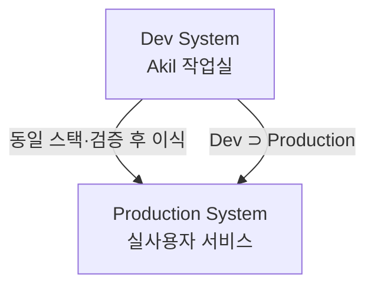

# NEXA OS 2원화 전략

> Dev System(내부)이 Production System(외부)을 품는 구조.  
> **지금 구축 중인 NEXA Rivet 앱은 Dev System 의 1차 구성요소**다.

---

## 구조

```
Dev System (내부)
  └── Production System (외부)
```



---

## Dev System

```
목적
  → NEXA OS 를 만들고 유지보수하는 도구
  → Akil 전용 로컬·원격(Cloudflare) 환경

구성 (현재·계획)
  → NEXA Rivet 앱 (지금) — 문서 선택·Rivet/Batch 분석
  → Obsidian + Knowledge_Fabric 볼트
  → LangGraph (개발/유지보수 파이프라인 — 중기)
  → RAG + Ontology (NEXA OS 지식 내재화 — 중기)
  → pgvector (기획서, 코드, 설계 문서 벡터화 — 중기)
  → Next.js + NestJS (Rivet 앱부터 동일 스택)
  → Cloudflare Tunnel + Access (작업실 원격 접속)
  → 생체 인증 (처음부터 보안 내재화 — 계획)

역할
  → 기획서 정제/분류/저장 ← Rivet/Batch 가 담당하는 영역
  → 코드 분석/개선안 제시
  → 설계 결정 히스토리 축적
  → Production 배포 전 검증
```

### Rivet 앱이 Dev System 에서 맡는 일

| Dev 역할 | Rivet 구현 |
|----------|------------|
| 기획서 정제·요약 | Rivet Graph + Chat 노드 |
| 대량 문서 처리 | OpenAI Batch |
| 볼트 문서 접근 | Nest Explorer + Obsidian `DOCS/` |
| 원격 작업 | Next 모바일 UI + Cloudflare |
| 파이프라인 실험 | `.rivet-project` 그래프 (Akil 직접 설계) |

상세: [[NEXA Rivet 앱 방향 종합]]

---

## Production System

```
목적
  → 실제 사용자가 쓰는 서비스

구성 (중장기)
  → LangGraph (서비스 파이프라인)
  → RAG + Ontology (서비스 지식)
  → pgvector
  → Yjs (실시간 협업)
  → Cloudflare (인프라)
  → Next.js + NestJS (Dev 와 동일 스택)
  → 생체 인증

역할
  → NEXIA 7탭 서비스
  → 사용자 AI 파이프라인 실행
  → IoT 제어 (Twinex)
  → 협업 편집 (Scribx)
```

---

## 핵심 원칙

```
1. 기술 스택 완전 통일
   → Dev 에서 검증 = Production 바로 적용
   → Rivet 앱: Next.js + NestJS (v2.1 확정)

2. Dev Ontology = NEXA OS 두뇌
   → 기획서, 코드, 결정 히스토리 전부 축적
   → Rivet 분석 결과 → Results/ → 향후 pgvector 입력

3. Dev 가 Production 을 품는 구조
   → Dev ⊃ Production

4. 로컬 LLM 중심 (중장기)
   → 클라우드 의존 최소화
   → 지금은 OpenAI (Rivet/Batch), 점진 전환

5. 처음부터 완전한 통제
   → 자율형 에이전트 배제
   → 모든 노드 Akil 이 직접 설계 (Rivet 그래프)
```

---

## 시간축

```
지금
  → Dev System 구축 (NEXA Rivet 앱 — 모노레포·Batch·Graph Inputs)
  → Obsidian + Knowledge_Fabric 운영
  → Ontology 씨앗 심기

중기
  → LangGraph 로 Dev 파이프라인 확장
  → Dev 가 Production 개발 보조
  → 로컬 LLM 이 NEXA OS 구조 학습

장기
  → "말로만 해도 되는 시스템"
  → Dev Ontology 가 Akil 의 분신
```

---

## Rivet → NEXA OS 진화 경로

| 단계 | Rivet / Dev | NEXA OS |
|------|-------------|---------|
| **현재** | Express 레거시 → Nest/Next 전환 | Rivet = 문서 작업대 |
| **근기** | Batch + Graph Inputs 완성, Cloudflare | 기획서 정제 자동화 |
| **중기** | LangGraph 병행, pgvector 연동 | Dev Ontology 축적 |
| **장기** | Production 과 모듈 공유 | NEXIA 서비스 파이프라인 |
