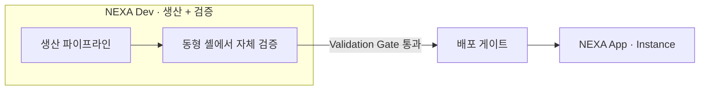
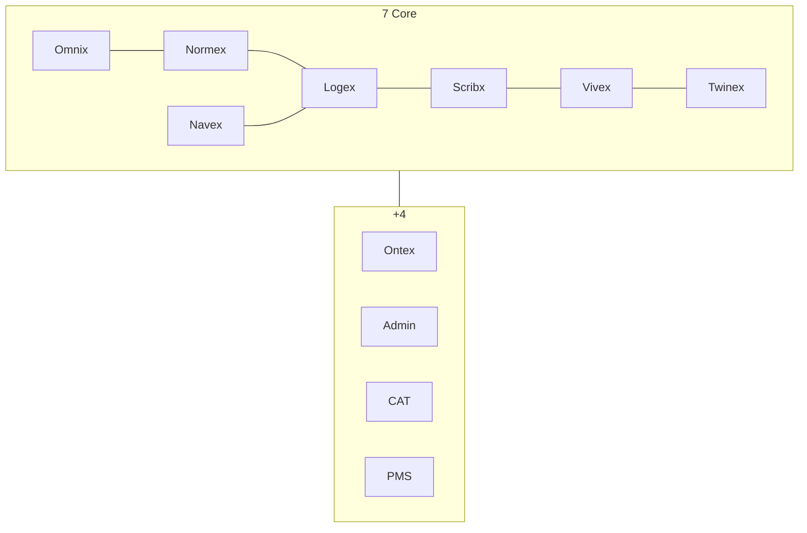
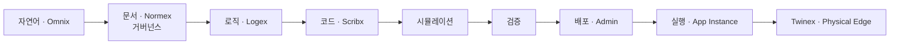
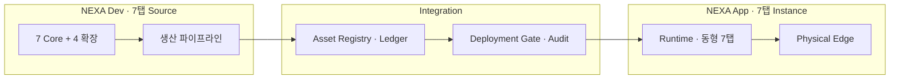

# NEXA OS: System of Systems (SoS) 아키텍처 비전

> [!abstract] Normative 비전
> **NEXIA 7탭 동형 셸**로 Dev가 App을 **생산**하고, 배포 전 **동일 구조**에서 **자체 검증**한다. 자연어→문서→로직→코드 **생산 파이프라인** 위에 Facet이 맞물린 **System of Systems(SoS)**.

> [!info] 읽기 가이드 · 데이터 성격
>
> | 표식 | 성격 | 스캔 포인트 |
> | :--- | :--- | :--- |
> | `정의` | SoS · NEXIA · Dev/App | 온보딩 |
> | `구조` | 7탭 · 생산 파이프라인 | 전체 조망 |
> | `원칙` | Dev ⊃ App · Source → Instance | 정책 대조 |
> | `운영` | 배포 게이트 · Audit | 실행·관제 |

> [!summary] 문서 지도
>
> - [[#비전 · 범위]]
> - [[#SoS 철학]]
> - [[#Dev 이중 역할 · 구조 동형]]
> - [[#NEXIA 7+4 — Core · 확장 레이어]]
> - [[#생산 파이프라인]]
> - [[#체계 종합 오케스트레이션]]
> - [[#Dev ⊃ App · Source → Instance]]
> - [[#하위 정본]]

## 비전 · 범위

> `정의`

| 용어 | 역할 |
| :--- | :--- |
| **System of Systems (SoS)** | NEXIA Facet·특화 툴이 독립 경계를 유지한 채 연결되어 **창발적 가치**를 내는 상위 체계 |
| **NEXA OS** | SoS를 구현하는 지능형 운영체제 — **Dev(설계·검증)** 와 **App(실행·운영)** 을 포괄 |
| **NEXIA** | `domainKey: nexia` — **7+4 작업면** (7 Core + Ontex · Admin · CAT · PMS) · Dev·App **동형 UI** SSOT |
| **Dev System** | App **생산** + 배포 전 **자체 검증** — NEXIA **동형** 셸 · Source 스코프 — **Dev ⊃ App** |
| **App System** | 동일 NEXIA 셸의 **실행 실체(Instance)** · Physical Edge 연동 |

> [!tip] `원칙` · 관점 전환
> Logex만이 아니라 **NEXIA 7탭 전체**를 본다. Dev는 App 기획과 **같은 구조** 위에서 Normex·Logex·Scribx·Twinex 등 **특화 툴**을 쓴다. 외부 에디터·서드파티 워크벤치에 의존하지 않는다.

> [!tip] `원칙` · 문서 계층
> 본 문서 = **전체 조망**. UI·Dual-View·PMS → [[NEXA_Dev_UI-Driven_기능설계및_전이_로드맵]]. Logex Node·Surface 세부 → [[DEV_Logex_Node_&_Surface_제작및배포가이드]].

---

## SoS 철학

> `원칙` — **전체는 부분의 합보다 크다.**

| 축 | 내용 |
| :--- | :--- |
| **동형 셸** | Dev·App **7 Core + 4 확장** 동일 구조 · **검증 환경 = 배포 대상 미리보기** |
| **Dev 이중 역할** | ① App **생산** ② 배포 전 **자체 검증** — 별도 툴체인 ✗ |
| **탭별 특화** | 각 `tabId`는 독립 전문성(Omnix 허브 · Normex 거버넌스 · Logex 로직 …)을 유지 |
| **창발적 가치** | 탭·파이프라인이 연결되면 **상황 인지형 지능 서비스**가 생성 |
| **검증 후 전이** | Dev에서 완성·검증된 산출만 App·Edge로 — Source → Instance 축 |

---

## Dev 이중 역할 · 구조 동형

> [!important] `원칙` · Dev가 존재하는 이유
>
> 1. **생산** — NEXA App(Instance)을 만드는 도구
> 2. **검증** — App에 배포하기 **전**, Dev 안에서 **동일 구조**로 스스로 검증

> `구조` — **가능한 한 구조를 같게** 유지한다. Dev에서 통과한 Run·UI·파이프라인이 App에서 재현 실패하지 않도록 한다.

| 구분 | Dev | App | 동형 여부 |
| :--- | :--- | :--- | :---: |
| **7탭 셸** | Omnix … Navex | 동일 `tabId` | ✓ |
| **3-Column · Dual-View** | Explorer · Canvas · Inspector | 동일 | ✓ |
| **Facet UI · 편집기** | Normex · Logex · Scribx … | 동일 컴포넌트 | ✓ |
| **Run · 시뮬레이션** | Logex Run · LangGraph | 동일 런타임 경로 | ✓ |
| **Validation Gate** | Zod · Sandbox · Audit | 배포 후에도 동일 규칙 | ✓ |
| **데이터 스코프** | **Source** (원천) | **Instance** (실체) | 분리 |
| **Admin** | 전역 · 배포·게이트 | 운영·실체 | 역할 분리 |

> [!tip] `원칙`
> Dev를 “가벼운 설계 툴”로 축소하지 않는다. **App과 같은 NEXIA** 위에서 만들고, **같은 NEXIA** 위에서 검증한 뒤 배포한다.

---

## NEXIA 7+4 — Core · 확장 레이어

> `구조` — **7 Core** = App `tabId` SSOT. **+4** = Ontex · Admin · **CAT** · **PMS**. Dev에서도 **전 레이어** 사용.

### 7 Core Facets

| `tabId` | Facet | Dev · App 공통 역할 |
| :---: | :--- | :--- |
| **omnix** | Omnix | 소통·허브·오케스트레이션 · **자연어 인입** |
| **normex** | Normex | 규범·정책·시방서 · **거버넌스 문서** |
| **logex** | Logex | 추론·관계·워크플로 · **로직·노드·Surface** |
| **scribx** | Scribx | 코드·명세·스크립트 · **코드 산출·확정** |
| **vivex** | Vivex | 미디어·시각·청각 산출 |
| **twinex** | Twinex | 디지털 트윈·엣지·NEXA-CELL · **Physical Edge** |
| **navex** | Navex | 파일·자산·노드 탐색 · **Dual-View** 좌축 |

### +4 확장 레이어

| # | 레이어 | 역할 |
| :---: | :--- | :--- |
| 1 | **Ontex** | 지식 허브 · 온톨로지 장기 SSOT |
| 2 | **Admin** | 전역·배포 · Validation Gate |
| 3 | **CAT** | 상황 인지 타임라인 · LLM 합성 (Read-only) |
| 4 | **PMS** | WBS · Asset Ledger · Sprint · Audit |

> [!warning] `미정` · UI 배치
> +4를 7 Core **TabBar 옆**에 둘지 **별도 거점**(CAT→하단 · PMS→패널 등)에 둘지 **미정**. → [[NEXA_Dev_UIUX_레이아웃구조규격#7+4 배치 정책 (미정)]]

---

## 생산 파이프라인

> `구조` · NEXA OS의 **주 생산 축** — 자연어에서 실행·배포까지

| 단계 | Facet | 산출 |
| :--- | :--- | :--- |
| **자연어** | Omnix | 의도·요구·협업 스레드 |
| **문서(거버넌스)** | Normex · Ontex | 정본·시방서·정책 · Grounded Context |
| **로직** | Logex | `.nxflow` · 노드 · Surface 설계 |
| **코드** | Scribx | Processor · Shared Core · 명세 |
| **시뮬레이션 · 검증** | Logex Run · Validation Gate | Sandbox Run · Zod · Audit |
| **배포** | Admin · Registry | Source → Instance · Asset Ledger |
| **실행 · 물리** | NEXIA Runtime · Twinex | Instance · Edge 동기화 |

> [!important] `원칙`
> 파이프라인은 **7탭 중 일부만이 아니다**. Vivex·Navex는 병렬·후속 Facet으로 미디어·자산·탐색을 담당하며, Omnix가 전 구간 오케스트레이션한다.

> [!info] `매핑`
> Logex · Scribx 구간 상세(Codegen Context Pack · Node · Surface) → [[DEV_Logex_Node_&_Surface_제작및배포가이드]]

---

## 체계 종합 오케스트레이션

> `구조` · Dev(NEXIA Source) → Integration → App(NEXIA Instance)

| 구간 | 담당 | 산출 |
| :--- | :--- | :--- |
| **Dev** | NEXIA 전 탭 · Source 스코프 | 문서 · 로직 · 코드 · Surface · 온톨로지 |
| **Integration** | Registry · Validation Gate | 배포 승인 · Manifest · Audit |
| **App** | NEXIA 전 탭 · Instance 스코프 | 서비스 · 운영 실체 · Edge |

---

## Dev ⊃ App · Source → Instance

> [!important] `원칙` · 전이 축
> Dev = **생산 + 검증**. **원천(Source)** 은 Dev NEXIA 셸에 있고, 검증 통과 후 App **실행 실체(Instance)** 로 전이한다. **구조는 동형** · 스코프·Audit만 분리.

| 구분 | Dev (Source) | App (Instance) |
| :--- | :--- | :--- |
| **셸** | NEXIA **7+4** | **동형** |
| **상태** | **Mutable** (원천 · Yjs+AI) | **Mutable** (실체 · Audit) |
| **변경** | Normex·Logex·Scribx에서 원천 수정 → 게이트 | 운영 실체 편집 · 필요 시 Dev 역전이 |

> [!check] `원칙` · 무결성
> 배포 게이트 · Zod · Sandbox · Audit & Rollback — [[NEXA_Dev_UI-Driven_기능설계및_전이_로드맵#Dev · App 환경 분리 · Source → Instance]]

---

## 하위 정본

| 주제 | 정본 |
| :--- | :--- |
| Dev/App · UI · Dual-View · PMS · 타임라인 | [[NEXA_Dev_UI-Driven_기능설계및_전이_로드맵]] |
| **구현 파일 구조** · Source/Instance | [[NEXA_Dev_구현파일구조뼈대]] |
| **v0 토큰 · 컴포넌트 매핑** | [[NEXA_Dev_UI컴포넌트토큰및매핑명세]] |
| Logex Node · Surface · Registry | [[DEV_Logex_Node_&_Surface_제작및배포가이드]] |
| 7+4 · Facet · CAT · PMS 배치 | [[NEXA_Dev_UIUX_레이아웃구조규격]] |

> [!summary] `운영`
> SoS는 **NEXIA 골격 + 생산 파이프라인 + Source→Instance** 원칙이다. Facet이 성숙할수록 탭 간 Context·Registry·Gate 연결을 강화한다.
