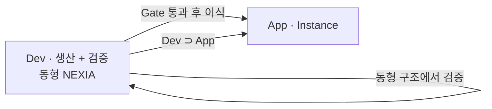
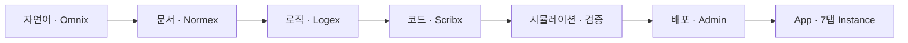
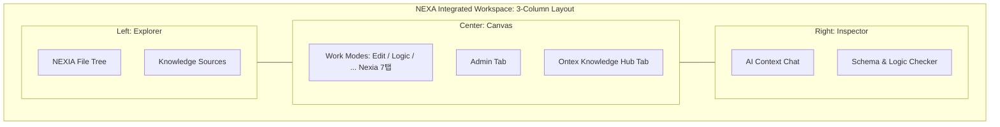
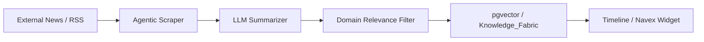

# NEXA OS UI-Driven 기능 설계 및 전이 로드맵

> [!abstract] Normative SSOT
> **NEXIA 7탭 동형 셸** — Dev가 App을 **생산**하고 배포 전 **동일 구조에서 자체 검증**. 검증 통과 산출만 App(Instance)으로 이식. **Dev ⊃ App** · 생산 파이프라인의 **단일 정본**.

> [!info] 읽기 가이드 · 데이터 성격
>
> | 표식 | 성격 | 스캔 포인트 |
> | :--- | :--- | :--- |
> | `정의` | 용어·개념 고정 | 첫 읽기 · 온보딩 |
> | `구조` | 시스템·레이아웃·다이어그램 | 아키텍처 파악 |
> | `원칙` | 불변 규칙·정책 | 구현·리뷰 시 대조 |
> | `매핑` | 외부 사례·전이 관계 | 벤치마크·설계 근거 |
> | `운영` | Dev/App 분리·PMS·타임라인 | 실행·관제 |
> | `구현` | 컴포넌트·스택·용어 | 개발 소통 |
> | `보안` | 격리·에이전트·선택 가이드 | 인프라·FS |
> | `부록` | 논의 원문 · SSOT ✗ | 맥락 참고만 |

> [!summary] 문서 지도
>
> - [[#용어 체계]] · [[#Dev · App 2원화]]
> - [[#Dev 이중 역할 · 구조 동형]]
> - [[#NEXIA 7+4 · 작업면]]
> - [[#생산 파이프라인 · NEXIA 7탭]]
> - [[#UI/UX 철학 · 시스템 전이]] · [[#NEXIA Facet 역할]]
> - [[#레이아웃 아키텍처 (NEXA Dev & App 공통)]]
> - [[#PMS (Project Management System) 프레임워크 항목]]
> - [[#지능형 상황 인지 타임라인 (Contextual Awareness Timeline)]]
> - [[#Dev · App 환경 분리 · Source → Instance]]
> - [[#공통 UI · 핵심 컴포넌트]] · [[#저장소 · 보안 · Python Bridge]]
> - [[#Logex 개발 소통 언어]] · [[#부록]]

## 용어 체계

> `정의` — 3축 용어. 이하 본문은 **순수 기술명** 기준.

| 용어 | 역할 |
| :--------------------------- | :--------------------------------------------------------------------- |
| **Dev (Development System)** | App **생산** + 배포 전 **자체 검증** · NEXIA **7+4 동형** · Source 스코프 · NEXA OS 제작·유지보수. |
| **App (Application System)** | **동형 NEXIA 7+4** · Instance 스코프 · Dev 검증 **통과** 실행 실체 · **Mutable** 운영 편집. |
| **Physical Edge** | 현실 HW·데이터 동기화·제어 (Digital Twin). Data-Heavy. |

---

## Dev · App 2원화

> [!info] `구조` · 2원화
> Dev는 App을 **품는** 동시에 App을 **만든다**. Dev·App **구조는 동형** — 차이는 Source/Instance 스코프와 배포 게이트뿐.

### Dev 이중 역할 · 구조 동형

> [!important] `원칙` · Dev 존재 이유
>
> | 역할 | 내용 |
> | :--- | :--- |
> | **생산** | Normex·Logex·Scribx … 파이프라인으로 App 산출물(Source) 생성 |
> | **검증** | App 배포 **전** — **동일 7탭·동일 Run·동일 UI**에서 시뮬레이션·Validation Gate 통과 |

> `구조` · **가능한 한 같게** — Dev만의 축소 UI·별도 런타임 **✗**

| 동형 대상 | Dev | App |
| :--- | :--- | :--- |
| `tabId` · Facet | 7 Core + Ontex · Admin · **CAT** · **PMS** | **동일** |
| 3-Column · Dual-View | Explorer · Canvas · Inspector | **동일** |
| Logex Run · LangGraph | Source 스코프 실행 | Instance 스코프 실행 |
| 컴포넌트·편집기 | Shared UI 라이브러리 | **동일** |
| Validation Gate | Zod · Sandbox · Audit | 배포 후에도 동일 규칙 |

| **분리 항목** | Dev | App |
| :--- | :--- | :--- |
| 데이터 스코프 | **Source** | **Instance** |
| Admin | 배포·게이트·전역 | 운영·실체 |

→ 전체 조망: [[NEXA_Dev-System_of_Systems(SoS)_아키텍처비전#Dev 이중 역할 · 구조 동형]]

### Dev System — 구성·역할

> `구조` · Dev

| 구분 | 내용 |
| :--- | :--- |
| **구성** | NEXIA 7 Core · **+4**(Ontex · Admin · CAT · PMS) · LangGraph · RAG + Ontology _(중기)_ · pgvector _(중기)_ · Next.js + NestJS · Cloudflare · 생체 인증 _(계획)_ |
| **역할** | App **생산** · **동형 셸 자체 검증** · 설계 결정 히스토리 · 배포 게이트 발신 |

### Dev에서의 7탭 활용

> `구조` · App과 **동일 Facet** · Source 스코프

| `tabId` | Dev 활용 |
| :---: | :--- |
| **omnix** | 요구·자연어 인입 · 오케스트레이션 · 협업 허브 |
| **normex** | 거버넌스 문서 · 시방서 · 정책 정본 |
| **logex** | 워크플로·노드·Surface · `.nxflow` |
| **scribx** | Processor·Shared Core · 코드 확정 |
| **vivex** | 미디어·시각 산출물 프로토타입 |
| **twinex** | 트윈·엣지·Physical Edge 검증 |
| **navex** | 자산·파일 탐색 · Dual-View |

→ Logex·Scribx 공정 상세: [[DEV_Logex_Node_&_Surface_제작및배포가이드]]

### App System — 구성·역할

> `구조` · App

| 구분 | 내용 |
| :--- | :--- |
| **구성** | NEXIA 7탭 · LangGraph · RAG + Ontology · pgvector · Yjs · Cloudflare · Next.js + NestJS · 생체 인증 |
| **역할** | 사용자 AI 파이프라인 · IoT 제어 (Twinex) · 협업 (Omnix) · **Instance 운영** |

### 핵심 원칙

> [!tip] `원칙` · 2원화 불변 규칙
>
> 1. **구조 동형** — Dev 검증 = App 체험과 **동일 구조** · 별도 미니 툴·축소 UI **✗**
> 2. **기술 스택 통일** — Shared Core · LangGraph · Next.js + NestJS · Dev 통과 = App 즉시 적용
> 3. **Dev Ontology = NEXA OS 두뇌** — Normex·Ontex·Logex 산출 → Knowledge_Fabric · pgvector
> 4. **Dev ⊃ App** — Dev가 App을 품고 **생산**한다
> 5. **로컬 LLM 중심** _(중장기)_ — 현재 클라우드 API·Batch · 점진 전환
> 6. **완전한 통제** — 자율형 에이전트 배제 · Logex 노드 직접 설계

### 시간축

> `구조` · 로드맵

| 시기 | Dev | App / NEXA OS |
| :--- | :--- | :--- |
| **지금** | NEXIA 7탭 Dev 셸 · Logex·Scribx·Normex · Batch · Ontology 씨앗 | — |
| **중기** | LangGraph 확장 · Dev가 App 개발 보조 · 로컬 LLM 구조 학습 | Dev Ontology 축적 |
| **장기** | App과 모듈 공유 | NEXIA 7+4 서비스 파이프라인 · 「말로만 해도 되는 시스템」 |

### Dev → NEXA OS 진화

> `매핑` · 자체 스택 성숙도

| 단계 | Dev | NEXA OS |
| :--- | :--- | :--- |
| **현재** | Nest/Next · NEXIA 7탭 Dev | Source 스코프 작업대 |
| **근기** | Batch · Graph Inputs · Cloudflare | 기획서 정제 자동화 |
| **중기** | LangGraph · pgvector | Dev Ontology 축적 |
| **장기** | App과 모듈 공유 | NEXIA 서비스 파이프라인 |

---

## NEXIA 7+4 · 작업면

> `구조` · **7 Core** [`TDD-056`](../APP_V2.0/08_TDD/NEXIA/08_TDD_NEXIA_7탭범위확정_v1.0.md) + **+4** 확장

| 구분 | 레이어 | 역할 |
| :--- | :--- | :--- |
| **7 Core** | Omnix · Normex · Logex · Scribx · Vivex · Twinex · Navex | 생산·실행 Facet (`tabId`) |
| **+4** | Ontex · Admin · **CAT** · **PMS** | 지식 · 배포 · 상황 인지 · 프로젝트 관제 |

> [!warning] `미정` · +4 UI 배치
> CAT·PMS(및 Ontex·Admin)를 7 Core **TabBar 옆**에 둘지 **별도 거점**에 둘지 **미정**. → [[NEXA_Dev_UIUX_레이아웃구조규격#7+4 배치 정책 (미정)]]

---

## 생산 파이프라인 · NEXIA 7탭

> `구조` · [[NEXA_Dev-System_of_Systems(SoS)_아키텍처비전#생산 파이프라인]]과 동일 축

| 단계 | Facet | Dev 산출 | App 전이 |
| :--- | :--- | :--- | :--- |
| 자연어 | Omnix | 요구·의도·협업 | 동형 허브 |
| 문서 | Normex · Ontex | 거버넌스·정본 | Grounded Context |
| 로직 | Logex | `.nxflow` · Surface | 서비스 파이프라인 |
| 코드 | Scribx | Shared Core | Runnable Instance |
| 검증 | Validation Gate | Audit · Zod | 배포 승인 |
| 실행 | Twinex · Navex | Edge 검증 · 자산 | 운영 실체 |

> [!important] `원칙`
> Dev는 Logex **만** 쓰는 환경이 **아니다**. **App과 같은 NEXIA 7탭**에서 만들고, **같은 7탭**에서 검증한 뒤 배포한다.

---

## UI/UX 철학 · 시스템 전이

> [!tip] `원칙` · 한 줄
> **Dev + Physical Edge = App** — 사용자는 지능·물리 작용이 통합된 UI(7탭)를 소비.

| 전이 축 | 내용 |
| :--- | :--- |
| **Intelligence Migration** | Normex·Logex·Ontex 산출 → App 런타임 이식 |
| **Physical Integration** | App Physical Edge → 현실 컨텍스트를 Dev 논리에 주입 |
| **Source → Instance** | **로직 원천(Dev)** → 검증·배포·관리 API → **실행 실체(App)** — Draft/Published **✗** |

> [!check] `원칙` · 전이·관리 검증
> Zod 스키마 · 생체 인증·아키텍트 승인(배포 게이트) · 에이전트 Sandbox 권한 · Audit Trail

---

## NEXIA Facet 역할

> `매핑` · 7 Core + +4 — **자체 스택** (외부 워크벤치 ✗)

| Facet | 핵심 역할 | 생산 파이프라인 |
| :--- | :--- | :--- |
| **Omnix** | 오케스트레이션 · 자연어 | **시작** |
| **Normex** | 거버넌스 · 시방서 | **문서** |
| **Ontex** | 지식 허브 · 온톨로지 | 문서·지식 |
| **Logex** | 결정론 로직 · Surface | **로직** |
| **Scribx** | 코드 · Processor | **코드** |
| **Vivex** | 미디어·시각 | 병렬 |
| **Twinex** | 트윈 · Edge | **실행·물리** |
| **Navex** | 자산 · Dual-View | 횡단 |
| **CAT** | 상황 인지 · LLM 타임라인 | **횡단·관제** |
| **PMS** | WBS · Ledger · Sprint | **횡단·관제** |
| **Admin** | 배포 게이트 · 전역 | **배포** |

> [!example] `매핑` · 통합 전략
> **Normex 문서** ↔ **Logex 노드** ↔ **Navex 자산** — Omnix가 맥락을 묶어 NEXIA 대시보드로 표출

---

## 레이아웃 아키텍처 (NEXA Dev & App 공통)

### 3-Column 통합 워크스페이스

> `구조` · Dev & App 공통 3-Column

| 영역                  | 역할                                                                                           |
| :------------------ | :------------------------------------------------------------------------------------------- |
| **Left Explorer**   | TreeView · File Tree · Knowledge Sources — [Dual-View · 전 탭 동기화](#dual-view--전-탭-동기화) 좌측 축   |
| **Center Canvas**   | 7 Core + `Ontex`·`Admin` · **CAT**·**PMS** 배치 **미정** · **Navex** = Dual-View 메인 · **Twinex** Preview |
| **Right Inspector** | AI Context · Schema Checker · Source Grounding                                               |

### 설계 이득 (요약)

> [!tip] `원칙` · 레이아웃 이득
>
> - **도구의 연속성** — Dev 구조·편집기 → App 그대로
> - **동일 보안 정책** — Soft Delete·Audit Trail · Ontex 통합 근거
> - **Dual-View·전 탭 동기화** — Explorer ↔ Navex · 컨텍스트 공유

### Dual-View · 전 탭 동기화

> [!important] `구조` · Dual-View 정의
> 동일 `assetId` · **Explorer** = 물리 계층 · **Navex** = Card/Table/Graph(논리). 선택·편집 즉시 양축 갱신.

| 동기화 축 | 규칙 |
| :--- | :--- |
| **Selection** | Explorer ↔ Navex 상호 포커스·하이라이트 |
| **Context** | `assetId` · `domainKey` · Facet → **7+4** 단일 세션 |
| **Edit** | Dev·App **동일 편집기** — Dev=로직 원천 · App=운영 실체 (Immutable **✗**) |
| **뷰 모드** | Navex Card/Table/Graph 전환 = 로컬 UI · Selection·Context 유지 |

> [!check] `원칙`
> 탭 전환 시 컨텍스트 **초기화 ✗** — 각 Facet이 동일 자산을 다른 렌즈로 표현

---

## PMS (Project Management System) 프레임워크 항목

> `운영` · 프로젝트·자산·품질 관제 — **+4 확장 레이어** · UI 배치 **미정** ([[NEXA_Dev_UIUX_레이아웃구조규격#7+4 배치 정책 (미정)]])

> [!note]+ 기획 및 가치 사슬 (Planning & Governance)
> - **WBS** — `.nx*` 로직·문서화 단계 분할
> - **Roadmap & Milestone** — Dev→App 전이·배포 지점
> - **Backlog** — 논리 노드·지식 객체 우선순위

> [!note]+ 공정 및 실행 관리 (Execution & Workflow)
> - **Task Tracking** — 인간·AI 협업 작업 단위
> - **Sprint / Kanban** — 7 Nexis 탭별 진행 상태
> - **Source → Instance Workflow** — Dev → QA → App 공정 승인

> [!note]+ 자산 및 형상 관리 (Configuration & Asset)
> - **Asset Ledger** — 산출물 인벤토리·메타데이터
> - **Version Control** — Yjs 이력·스냅샷
> - **Dependency Map** — 참조·영향도 그래프

> [!note]+ 품질 및 리스크 관리 (Quality & Risk)
> - **Audit Trail** — 편집·실행 로그·책임 추적
> - **Validation Gate** — Zod·AI 검증 노드
> - **Issue & Bug Tracking** — App 결함 → Dev 피드백

> [!note]+ 리소스 및 협업 (Resource & Collaboration)
> - **Resource Matrix** — 인간·AI 권한·할당
> - **Communication Thread** — 자산/태스크 단위 토론·결정 히스토리

---

## 지능형 상황 인지 타임라인 CAT (Contextual Awareness Timeline)

> `운영` · 상황 인지 · LLM 합성 · Read-only — **+4 확장 레이어** · UI 배치 **미정** (하단 StatusBar vs Tab Rail 후보)

> [!abstract] `원칙` · 타임라인 설계
>
> - **LLM 완전 위임** — Current Task · Strategic Direction = LLM 전담 · 사용자 직접 수정 **✗**
> - **가벼운 시작** — [Dual-View](#dual-view--전-탭-동기화) Selection · Facet · `assetId`만 → 이후 스킬 추가
> - **스킬 확장** — Ontology·벡터·PMS·Audit = 선택 스킬 · 코어 UI 교체 **✗**

| Phase | 입력 (LLM 컨텍스트) | 스킬 |
| :---: | :--- | :--- |
| **0** | Selection · 탭 · Explorer 경로 | — |
| **1** | + Run/검증 이벤트 | Audit |
| **2** | + PMS WBS·Asset Ledger | PMS |
| **3** | + pgvector 이웃 | Knowledge_Fabric |
| **4** | + Ontex·Normex | Ontology Reasoner |

### 핵심 기술 스택 (목표·스킬 로드맵)

> `구현` · 코어 vs 스킬

| 구분 | 기술 | 비고 |
| :--- | :--- | :--- |
| **코어** | LLM Intent Synthesis | 유일한 텍스트 생성 주체 |
| 스킬 | Yjs Event Streaming | MVP 비필수 |
| 스킬 | pgvector | 의미적 이웃 |
| 스킬 | Ontology Reasoner (Ontex) | WBS 공정 위치 |
| 스킬 | Active Metadata Fabric | `docs/` ↔ WBS |

> [!check] `원칙` · 갱신 트리거
> 탭 전환 · Selection · idle _(30s)_ · Refresh — **키 입력마다 ✗**

### UI 구성 (Read-only · 배치 미정)

> [!warning] `미정`
> 현재 가설 = **하단 고정** (`SystemStatusBar` 확장). Tab Rail 병치는 [[NEXA_Dev_UIUX_레이아웃구조규격#7+4 배치 정책 (미정)]] 참고.

| 필드 | 성격 | 예시 |
| :--- | :--- | :--- |
| **Current Task** | LLM 요약 | "로그인 로직 무결성 검증 중" |
| **Active Location** | 내비만 · 클릭 → Navex/Explorer | `Project A > Sprint 2 > Auth` |
| **Strategic Direction** | LLM 방향성 | "Zod 후 Source→Instance 배포 게이트 대기" |

---

## Dev · App 환경 분리 · Source → Instance

> [!check] `운영` · Dev vs App 대조표

| 구분 | Dev (Control Center) | App (Managed Service) |
| :--- | :--- | :--- |
| **역할** | 설계·실험·App 관리 · **로직 원천** | 서비스·관리 API · **실행 실체** |
| **관리 대상** | 프로토타입·온톨로지·그래프·배포 설정 | 라이브 자산·필드·현장 정책·인스턴스 |
| **전이** | Source · 배포 게이트 **발신** | Instance · Mutable 편집 **수신** |
| **API** | Management API 클라이언트 | Management API 서버 |
| **Admin** | 전역·배포·원천 | 로컬·운영·실체 |
| **상태** | **Mutable** (원천 · Yjs+AI) | **Mutable** (실체 · Audit) |
| **UI** | **동형** — 전 Facet·편집기·Run | **동형** — 쓰기 **스코프(Instance)** 만 분리 |
| **검증** | 동형 셸에서 시뮬레이션 · Gate **발신** | Gate **수신** · 운영 Audit |

## 기술 동향 인텔리전스 (Tech Trend Intelligence)

> [!INFO] 정의
> 외부 기술 뉴스(Hacker News, GitHub Trending 등)를 수집하여 **NEXA 도메인**에 맞게 요약 및 분류하여 제공하는 외부 지능 통합 레이어.

### 데이터 흐름도

### 핵심 기술 스택

> [!IMPORTANT] 기술 요구사항
> - **Agentic Scraper (Python/Node.js):** Firecrawl 또는 Browserless를 활용하여 동적 웹사이트의 콘텐츠를 마크다운으로 추출.
> - **Domain Relevance Filter (LLM):** 수집된 뉴스가 **[[NEXA OS]]**의 핵심 기술(Next.js, LangGraph, Yjs 등)과 관련이 있는지 판별하여 노이즈 제거.
> - **Semantic Clustering (pgvector):** 유사한 주제의 뉴스를 그룹화하고, 기존 **[[Ontex]]** 문서와의 연관성을 계산.
> - **TTL (Time-To-Live) Cache:** 최신성 유지를 위해 일정 시간이 지난 뉴스는 자동으로 아카이브하거나 삭제하는 관리 로직.

### UI 표출 전략
- **Timeline Integration:** 하단 CAT(Contextual Awareness Timeline)에 현재 작업과 관련된 최신 기술 뉴스 한 줄 요약 노출.
- **Navex Insight Tab:** 기술 동향만 모아보는 전용 페싯(Facet) 제공.

---

## 공통 UI · 핵심 컴포넌트

> `구현` · Next.js 공통 라이브러리 · Logex · LangGraph 연동

### 우선순위 (UI-Driven)

| 순위 | 컴포넌트 | Dev / App |
| :---: | :--- | :--- |
| 1 | **Context Navigator** | Navex 관계 탐색 · 자산 링크 |
| 2 | **Logic Canvas** | Logex · 원천 vs 실체 스코프 |
| 3 | **Source Grounding Panel** | AI 근거 원천 표시 |
| 4 | **LLM Pre/Post-processor** | Dev — Zod·프롬프트 |
| 5 | **Digital Twin Sync · Streaming** | App — State·스트리밍 |

---

## 저장소 · 보안 · Python Bridge

> [!warning] `보안` · 전제
> 브라우저 샌드박스 → 로컬 FS 직접 접근 **✗** · **로컬 OS 권한 대리인** 필수

### Local-First Cloud Bridge

> `구조` · 3계층

| 계층 | 담당 |
| :--- | :--- |
| **Dev Server (Next.js)** | UI·비즈니스 로직 (TS) |
| **Local Agent** | PC 실행 · FS ↔ 브라우저 (WS/gRPC) |
| **Security Layer** | Whitelist · API 키 · Physical Edge 이중 인증 |

### Logex 노드 기반 보안

> `보안` · Storage Node = FS 접근 유일 게이트 · Whitelist 경로만

### 기술 선택 가이드

| 목적 | 권장 |
| :--- | :--- |
| 대용량·로컬 AI | **Python** |
| Markdown·Shared Core | **Node.js** |
| 최고 보안 (서버 무저장) | 로컬 **스트리밍**만 |

> [!check] `원칙`
> Hybrid: UI=TS · I/O=Python/Node · Isolation · Zero Trust

---

## Logex 개발 소통 언어

> `구현` · 프론트(React Flow) ↔ 백엔드(LangGraph) 통일 용어

### 핵심 용어 (프론트 ↔ 백엔드)

| 프론트 | 백엔드 | 팀 통일 | 의미 |
| :--- | :--- | :--- | :--- |
| Canvas / Viewport | Graph / StateGraph | 워크스페이스 | 도화지 |
| Node | Node | 노드 | 기능 단위 상자 |
| Handle | State Keys / Channels | 포트 | In/Out |
| Edge | Edge / Conditional | 엣지 | 데이터 흐름 |

###  로젝스 노드 3대 요소 최종 정립 (Strict Standardization)

제작자가 사용하는 모든 용어와 구성 요소는 시스템의 일괄 업데이트를 위해 다음과 같이 고정됩니다.

| 구성 요소                   | 기술적 실체                     | 제작자 권한                | 시스템 역할                           |
| :---------------------- | :------------------------- | :-------------------- | :------------------------------- |
| **Definition** (데이터 명세) | **Zod Schema**             | 포트(In/Out) 타입 및 이름 정의 | 노드 간 데이터 무결성 및 연결성 강제            |
| **Processor** (연산 로직)   | **Shared Core** (JS/TS) | 데이터 처리 로직 및 알고리즘 구현   | 샌드박스 내 실행 및 환경 간 결정론적 결과 보장      |
| **System View** (표준 UI) | **Standard Component**     | 시스템 제공 위젯 선택 및 데이터 매핑 | **커스텀 디자인 불가.** 전체 UI 일괄 변경 및 관리 |

---

### 제작 가이드 교정

| 요소             | 공유                             | 원칙                  |
| :------------- | :----------------------------- | :------------------ |
| **Definition** | Zod SSOT                       | TS + 런타임 검증         |
| **Processor**  | Shared Core                    | 결정론 · 에이전트 컨텍스트만 FS |
| **Component**  | React · scope(Source/Instance) | 편집기 동일 · 스코프 분리     |

### 상태 · 런타임 용어

| 용어 | 정의 |
| :--- | :--- |
| **Graph State** | LangGraph 공유 메모리 — UI는 Dataflow처럼 보여도 State R/W |
| **Invocation / Run** | 실행 버튼 1회 = 1 세션 |

### 팀 한 줄 가이드

> [!quote] `구현` · 소통 규약
>
> 1. 상자 = **노드** · 선 = **엣지** · 연결점 = **포트**
> 2. Definition · Processor · Component = **Dev·App 100% 공유**

---

## 부록

> [!quote] `부록` — 논의 원문 · **Normative SSOT ✗** · 본문만 정본

### 수석 아키텍트 비평 — Python · 보안

_"파이썬과 연결되어야 하나"라는 의구심은 타당합니다._ 복잡한 전처리·로컬 AI 제어 → **Python** · Markdown·노드·Shared Core → **Node.js** · 최고 보안 → 로컬 **스트리밍**만.

→ [기술 선택 가이드](#기술-선택-가이드)

### 설계 검토 메모 — 레이아웃 · Dev-App 연속성

1. **동일 보안 정책** — Dev Soft Delete·Audit · Ontex 실험 이력 통합 근거
2. **Python Bridge** — 로컬 OS 결합 하이브리드 워크벤치
3. **사이드바 전역 동기화** — 물리 위치 + 논리 기능 실시간 결합

→ [Dual-View · 전 탭 동기화](#dual-view--전-탭-동기화) · [Dev · App 환경 분리 · Source → Instance](#dev--app-환경-분리--source--instance)
