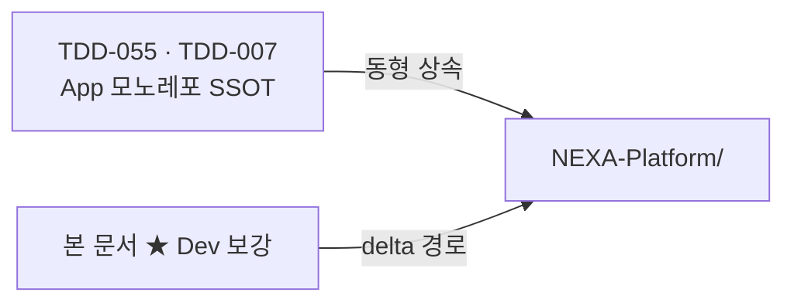

# NEXA Dev · 구현 파일 구조 뼈대

> [!abstract] Normative · Dev 코드 트리 SSOT
> **App 모노레포**를 **원천**으로 Dev·App **동형** 구현 경로를 고정한다. App 골격 = [`TDD-007`](../APP_V2.0/08_TDD/NEXAOS/08_TDD_NEXAOS_모노레포폴더구조_v1.0.md) · [`TDD-055`](../APP_V2.0/08_TDD/NEXIA/08_TDD_NEXIA_구현파일구조뼈대.md). 본 문서는 **★ Dev 보강 경로** · **Source/Instance 스코프** · **7+4 모듈**만 Normative.

> [!summary] 문서 지도
>
> - [[#App 원천 · Dev 관계]]
> - [[#모노레포 루트]]
> - [[#Source · Instance 데이터 축]]
> - [[#domains/nexia — 프론트 트리]]
> - [[#+4 · CAT · PMS · Validation]]
> - [[#Logex · Scribx · Codegen Context Pack]]
> - [[#engines · frame · shared]]
> - [[#backend · agent-graph · sync]]
> - [[#구현 체크리스트]]

표식: **■** MVP · **★** Dev 보강 · **◇** Phase 2 · **○** 후속 · **—** App 정본과 동일(위임)

---

## App 원천 · Dev 관계

> `정의`

| 원칙 | 내용 |
| :--- | :--- |
| **단일 모노레포** | Dev·App **별도 저장소 ✗** — `NEXA-Platform/` 동일 트리 |
| **동형 경로** | `frame/` · `domains/nexia/tabs/*` · `modules/nexaon/` = App [`TDD-055`](../APP_V2.0/08_TDD/NEXIA/08_TDD_NEXIA_구현파일구조뼈대.md) **그대로** |
| **Dev 보강** | `scope/` · `modules/cat|pms/` · `scribx/codegen/` · `validation-gate/` · `projects/.../source/` |
| **스코프 분리** | 런타임·API·DB에서 `scope: source \| instance` — UI 셸은 동일 |



---

## 모노레포 루트

> `구조` · [`TDD-007` §3](../APP_V2.0/08_TDD/NEXAOS/08_TDD_NEXAOS_모노레포폴더구조_v1.0.md) 계승 — **★** 만 Dev 추가

```text
NEXA/
├── NEXA-Platform/                            ▲ pnpm-workspace
│   ├── apps/
│   │   ├── web/                              — App TDD-055 §2–3
│   │   ├── backend/                          — App TDD-055 §7 + ★ §backend
│   │   ├── sync/                             — App TDD-055 §8
│   │   └── agent-graph/                      — App TDD-055 §8 + ★ validation graphs
│   ├── packages/shared/                      — App TDD-055 §6 + ★ dev/ · codegen/
│   ├── database/                             — Prisma · pgvector
│   ├── projects/{projectId}/                 ★ source/ · instance/ (§데이터 축)
│   ├── firmware/esphome/
│   └── docs/                                 — App specs (비배포)
│
├── NEXA V2.0/
│   ├── APP_V2.0/                             — App 기획·TDD 정본
│   └── DEV_V2.0/                             — Dev 기획·본 문서 등 (비배포 메타)
│
└── NEXA-Edge/                                — Twinex · Physical Edge
```

| 레이어 | App 정본 | Dev 보강 |
| :--- | :--- | :--- |
| **App Router** | `apps/web/src/app/(shell)/nexia/` | `scope` query · Source 배지 (◇) |
| **도메인 UI** | `domains/nexia/` | `scope/` · `modules/cat|pms/` · `scribx/codegen/` |
| **frame** | `frame/registry/` | Dev `headerActions` · Gate 연동 — 동일 파일 |
| **engines** | `engines/` | Logex Run · 시뮬레이션 훅 (동형) |
| **계약** | `packages/shared/schemas/` | `dev/` · `codegen/` |
| **백엔드** | `modules/nexaon/` · `agent-graph/` | `validation-gate/` · `pms/` · `cat/` |
| **프로젝트 데이터** | `projects/{id}/ontology/` … | **`source/`** · **`instance/`** |

---

## Source · Instance 데이터 축

> `구조` · Dev **Source** 산출 → Validation Gate → App **Instance** 전이

```text
projects/{projectId}/
├── source/                                   ★ Dev SSOT · Mutable 원천
│   ├── normex/                               # 거버넌스 문서 · Tiptap export
│   ├── logex/
│   │   ├── flows/*.nxflow
│   │   ├── surfaces/
│   │   └── registry/                         # Node · Surface 정의 (Logex 가이드)
│   ├── scribx/                               # Processor · Shared Core 초안
│   ├── ontology/                             # draft (Yjs 미러 export 선택)
│   └── manifest.json                         # assetId · 버전 · 의존성 요약
│
├── instance/                                 ★ Gate 통과 후 App 실체
│   ├── deployed/                             # 배포 스냅샷
│   ├── runs/                                 # Instance Run 감사
│   └── esphome/builds/                       # OTA 산출 (Twinex)
│
├── ontology/                                 — App TDD-007 (promoted TTL 등)
├── esphome/
└── runs/{run_id}/                            — 감사 미러 (DB SSOT 병행)
```

| 경로 | 스코프 | 소비 Facet |
| :--- | :--- | :--- |
| `source/normex/` | Source | Normex · Omnix 컨텍스트 |
| `source/logex/` | Source | Logex · Nexaon |
| `source/scribx/` | Source | Scribx · Codegen Pack 출력 |
| `instance/deployed/` | Instance | App 런타임 · Navex |
| `manifest.json` | Source | PMS Asset Ledger · Validation Gate |

---

## domains/nexia — 프론트 트리

> `구현` · App [`TDD-055` §3](../APP_V2.0/08_TDD/NEXIA/08_TDD_NEXIA_구현파일구조뼈대.md) **동형** — **—** 는 정본 위임 · 변경 시 양쪽 동시 갱신

```text
apps/web/src/domains/nexia/
├── config/nexiaTabs.ts                       ■ 7 Core tabId SSOT
├── types/                                    ■ tabId · nexiaContext · logexSubMode
├── scope/                                    ★ Dev
│   ├── dataScope.ts                          ■ source | instance
│   └── useDataScope.ts                       ■ API · store 연동
├── components/
│   ├── NexiaTabBar.tsx                       ■
│   ├── NexiaHeaderActions.tsx                ■ Dev: Run · Export · Gate
│   └── NexiaProviders.tsx                    ■
├── views/
│   ├── left/NexiaLeftNav.tsx                 ■
│   ├── content/NexiaContent.tsx              ■ TabBar + Workspace
│   ├── right/NexiaRightPanel.tsx           ■ + PMS 패널 후보
│   └── status/
│       ├── NexiaStatusBar.tsx                ■ + CAT 후보
│       └── NexiaStatusPanel.tsx              ■
├── tabs/                                     # 7 Core — TDD-055 동일
│   ├── omnix/OmnixTab.tsx                    ■
│   ├── normex/NormexTab.tsx                  ■
│   ├── logex/                                ■ LogexTab · NexaonEntry
│   ├── scribx/ScribxTab.tsx                  ■ + codegen/ 연동
│   ├── vivex/VivexTab.tsx                    ■
│   ├── twinex/TwinexTab.tsx                  ■
│   └── navex/NavexTab.tsx                    ■ Dual-View
├── modules/
│   ├── nexaon/                               — TDD-055 §3 전체
│   ├── cat/                                  ★ +4
│   │   ├── CatTimeline.tsx                   ◇ StatusBar 또는 독립 슬롯
│   │   ├── hooks/useCatSynthesis.ts          ◇ LLM Read-only
│   │   └── services/catClient.ts             ◇
│   ├── pms/                                  ★ +4
│   │   ├── PmsShell.tsx                      ◇ Drawer · 패널 후보
│   │   ├── views/WbsTree.tsx                 ◇
│   │   ├── views/AssetLedger.tsx             ◇
│   │   ├── views/SprintBoard.tsx             ◇
│   │   └── store/usePmsStore.ts              ◇
│   └── scribx/
│       └── codegen/                          ★ Codegen Context Pack
│           ├── contextPackLoader.ts          ■ Pack 로드·버전
│           ├── packs/                        ■ 프롬프트·룰·스타일·계약 manifest
│           └── hooks/useCodegenRun.ts        ■ Logex → Scribx LLM 파이프
├── hooks/useNexiaTab.ts                      ■
├── services/nexiaApi.ts                      ■ scope 헤더 주입
└── store/useNexiaTabStore.ts                 ■
```

### 7 Core `tabId` · Dev 파일 매핑

| `tabId` | 핵심 경로 | Dev 보강 |
| :---: | :--- | :--- |
| **omnix** | `tabs/omnix/` | `source/` 인입 · Run 트리거 |
| **normex** | `tabs/normex/` | `projects/.../source/normex/` |
| **logex** | `tabs/logex/` · `modules/nexaon/` | `source/logex/` · Run 검증 |
| **scribx** | `tabs/scribx/` · `modules/scribx/codegen/` | Codegen Pack · `source/scribx/` |
| **vivex** | `tabs/vivex/` | — |
| **twinex** | `tabs/twinex/` | `instance/esphome/` |
| **navex** | `tabs/navex/` | Dual-View · Ledger 연동 |

---

## +4 · CAT · PMS · Validation

> `구조` · 7 Core **외부** — UI 배치 [[NEXA_Dev_UIUX_레이아웃구조규격#확장 탭 배치 전략]]

| 레이어 | 프론트 (★) | 백엔드 (★) | 비고 |
| :--- | :--- | :--- | :--- |
| **Ontex** | `domains/ontex/` (◇) | `modules/ontology/` | NEXAOS `domainKey` — App TDD-071 |
| **Admin** | `domains/admin/` (◇) | `modules/auth/` · Gate 발신 | Header · 배포 |
| **CAT** | `modules/cat/` | `modules/cat/synthesis.service.ts` | LLM **Read-only** |
| **PMS** | `modules/pms/` | `modules/pms/` | WBS · Ledger · Sprint |
| **Validation Gate** | `NexiaHeaderActions` · Status | `modules/validation-gate/` | Zod · Sandbox · Deploy |

```text
apps/backend/src/modules/
├── validation-gate/                          ★
│   ├── validation-gate.module.ts
│   ├── gate.service.ts                       # Zod · Static Analysis · 승인 상태
│   ├── deploy.controller.ts                  # source → instance promote
│   └── sandbox.service.ts                    ◇ 격리 Run
├── pms/                                      ★
│   ├── pms.module.ts
│   ├── wbs.service.ts
│   ├── asset-ledger.service.ts
│   └── sprint.service.ts
├── cat/                                      ★
│   ├── cat.module.ts
│   └── synthesis.service.ts                  # Read-only LLM 합성
├── nexaon/                                   — TDD-055 §7
├── agent-graph/                              — TDD-055 §7
└── ontology/ · esphome/ · auth/              — TDD-007
```

---

## Logex · Scribx · Codegen Context Pack

> `구현` · [[DEV_Logex_Node_&_Surface_제작및배포가이드#Logex → Scribx · LLM 코드 생성 가이드라인]]

```text
projects/{projectId}/source/logex/registry/   ★ Node · Surface 정의
domains/nexia/modules/scribx/codegen/packs/   ★ 내부 SSOT (버전 관리)
packages/shared/src/schemas/codegen/          ★ Output Contract Zod
packages/shared/src/schemas/dev/              ★ Gate · scope
```

| Pack 구성 | 경로 패턴 | 역할 |
| :--- | :--- | :--- |
| **Prompt Context** | `packs/{id}/context.json` | Graph 스냅샷 · 포트 · scope |
| **Rules** | `packs/{id}/rules.md` | 코딩·아키텍처 룰 |
| **Style** | `packs/{id}/style.md` | TS/React 스타일 |
| **Output Contract** | `schemas/codegen/context-pack.schema.ts` | Scribx 산출 스펙 |

**파이프라인:** Logex → Pack 로드 → Scribx 생성 → 시뮬레이션 → `validation-gate` → `instance/deployed/`

---

## engines · frame · shared

> `구현` · App 정본 **동형** — Dev 전용 엔진 분리 **✗**

| 영역 | 경로 | Dev |
| :--- | :--- | :--- |
| **frame** | `apps/web/src/frame/` | `domainLayoutRegistry.nexia` 6슬롯 — [[NEXA_Dev_UIUX_레이아웃구조규격#frame · Registry · 상태]] |
| **engines** | `engines/react-flow/` · `tiptap/` · `monaco/` | Logex 캔버스 스킨 · Run SSE |
| **shared** | `packages/shared/src/schemas/` | 아래 Dev 스키마 |

```text
packages/shared/src/schemas/
├── nexia/ · nexaon/ · agent-graph/           — TDD-055 §6
├── dev/                                      ★
│   ├── source-scope.schema.ts
│   ├── validation-gate.schema.ts
│   ├── pms/
│   │   ├── wbs-item.schema.ts
│   │   └── asset-ledger.schema.ts
│   └── cat/
│       └── timeline-event.schema.ts
└── codegen/
    └── context-pack.schema.ts                ★
```

---

## backend · agent-graph · sync

> `구현` · App TDD-055 §7–8 + ★ Dev 모듈

```text
apps/agent-graph/src/agent_graph/graphs/
├── registry.yaml                             — App SSOT
├── nexaon_ingest.py · nexaon_refine.py       — App
├── validation_static.py                      ★ Zod · lint 노드
└── deploy_promote.py                         ◇ source→instance 오케스트레이션

apps/sync/src/rooms/
└── ontologyDraftRoom.ts                      — App · Source draft Yjs
```

| HTTP (예) | 모듈 | Dev 소비 |
| :--- | :--- | :--- |
| `POST /validation-gate/check` | validation-gate | Scribx · Logex Run 후 |
| `POST /validation-gate/deploy` | validation-gate | Admin · HeaderActions |
| `GET /pms/wbs` · `/ledger` | pms | `modules/pms/` |
| `GET /cat/synthesis` | cat | `CatTimeline` |
| `POST /nexaon/runs` | agent-graph | `useNexaonRun` (동형) |

---

## 구현 체크리스트

| # | 항목 | 경로·모듈 | Dev |
| :-: | :--- | :--- | :---: |
| 1 | App nexia 골격 | TDD-055 §9 1–10 | 동형 |
| 2 | `scope/` · dataScope | `domains/nexia/scope/` | ★ |
| 3 | `projects/.../source/` | 프로젝트 루트 | ★ |
| 4 | Codegen Context Pack | `scribx/codegen/` + shared | ★ |
| 5 | Validation Gate | `backend/validation-gate/` | ★ |
| 6 | PMS · CAT 모듈 | `modules/pms/` · `cat/` | ★ |
| 7 | Gate → instance promote | `deploy.controller` | ★ |
| 8 | shared `dev/` · `codegen/` Zod | `packages/shared` | ★ |

---

## 관련 문서

| 관계 | 문서 |
| :--- | :--- |
| **App 원천** | [TDD-055 NEXIA 구현 파일 구조](../APP_V2.0/08_TDD/NEXIA/08_TDD_NEXIA_구현파일구조뼈대.md) |
| **모노레포** | [TDD-007 LangGraph 모노레포](../APP_V2.0/08_TDD/NEXAOS/08_TDD_NEXAOS_모노레포폴더구조_v1.0.md) |
| **7탭 SSOT** | [TDD-056 7탭 범위](../APP_V2.0/08_TDD/NEXIA/08_TDD_NEXIA_7탭범위확정_v1.0.md) |
| **레이아웃** | [NEXA_Dev_UIUX_레이아웃구조규격](NEXA_Dev_UIUX_레이아웃구조규격.md) |
| **생산 파이프라인** | [NEXA_Dev_UI-Driven_기능설계및_전이_로드맵](NEXA_Dev_UI-Driven_기능설계및_전이_로드맵.md) |
| **Logex · Scribx** | [DEV_Logex_Node_&_Surface_제작및배포가이드](DEV_Logex_Node_&_Surface_제작및배포가이드.md) |
| **SoS 조망** | [NEXA_Dev-System_of_Systems(SoS)_아키텍처비전](NEXA_Dev-System_of_Systems(SoS)_아키텍처비전.md) |
