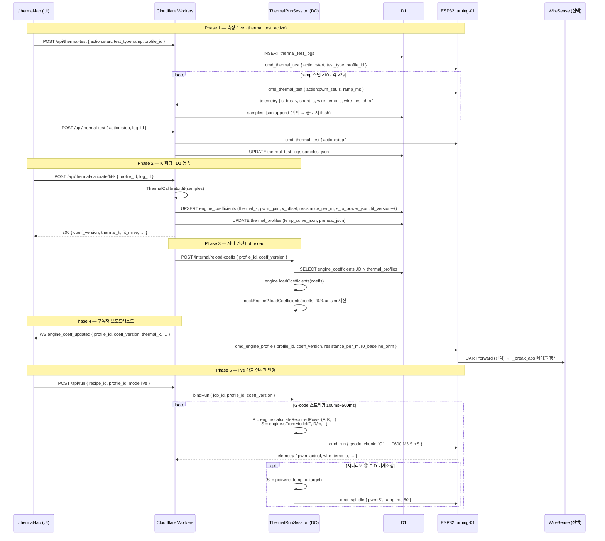
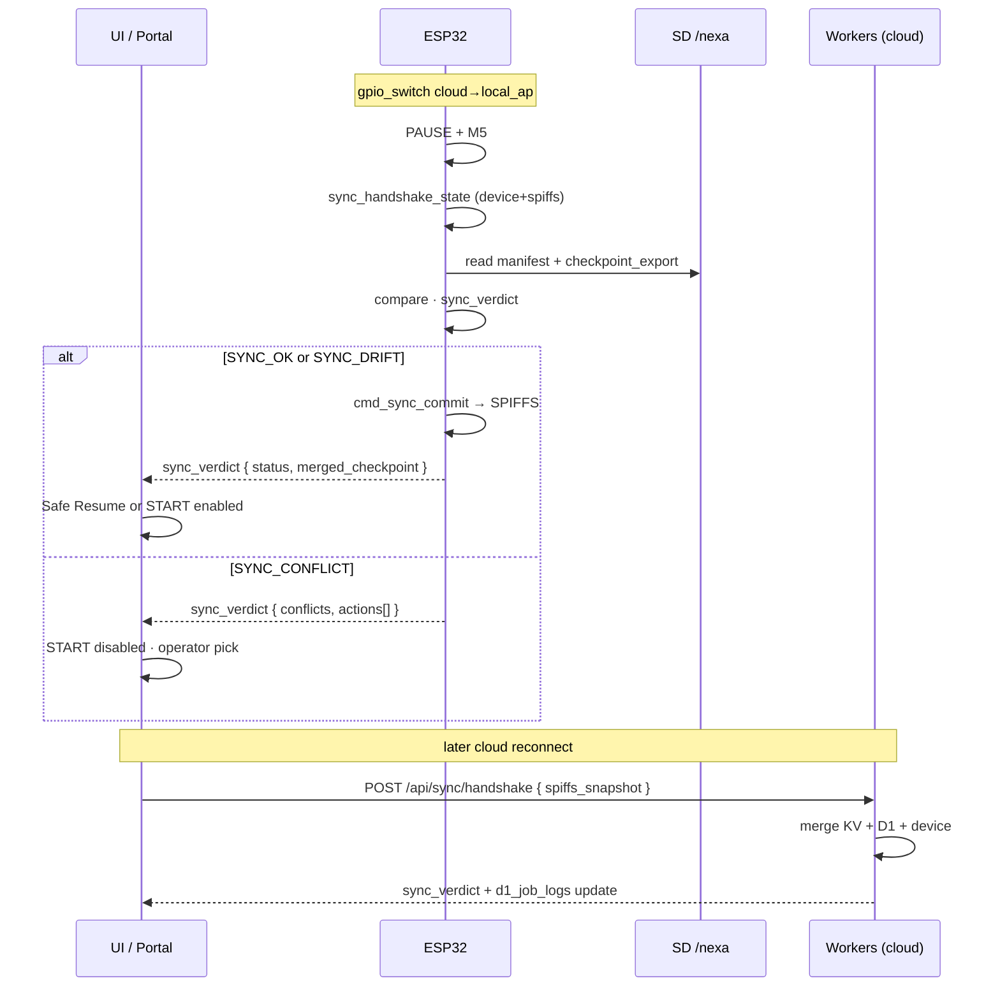
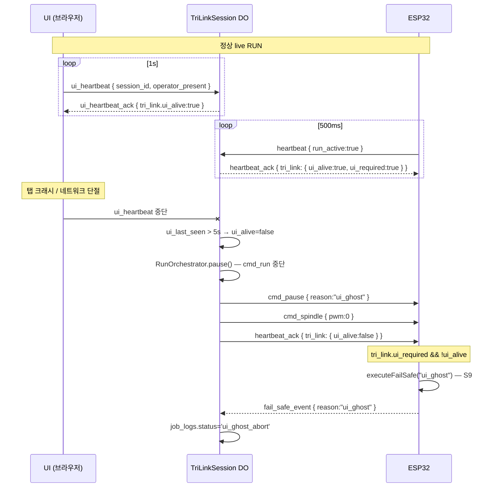
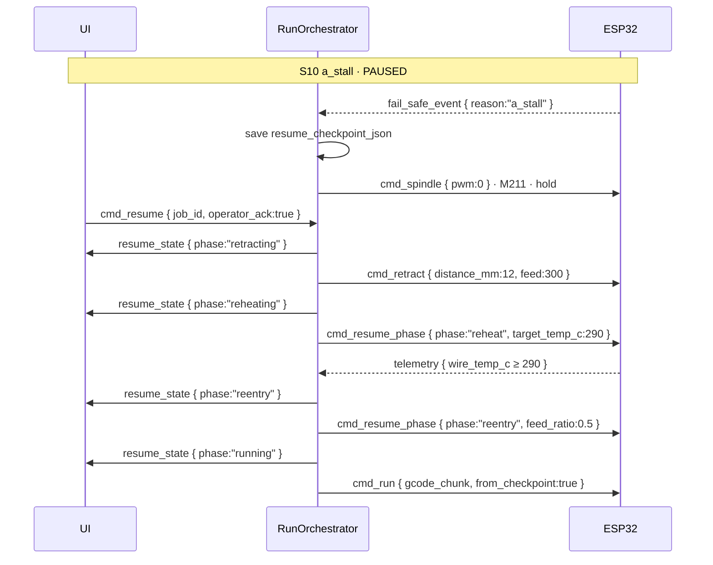

# Software & Protocol 규약

Hot-Blade Turning Machine 의 **클라우드 아키텍처**, **WebSocket·REST 프로토콜**, **운영 모드**, **Manual Overdrive(후가공)**, **통신 Fail-safe** 를 정의합니다.

> 하드웨어 좌표·모터: [01 Hardware & Motion](01-Hardware-Motion.md)
> 열선·센서·인터록: [02 Thermal Engine & Sensing](02-Thermal-Engine-Sensing.md)
> D1 스키마·현장 운영: [04 Data & Operations](04-Data-Operations.md)
> **인증·RBAC·Device Provisioning**: [06 Auth & Security](06-Auth-Security.md)
> **연결 모드·Local Portal·SD 오프라인**: [§ 연결 모드 3단계](#연결-모드-3단계--cloud--local-ap--sd-오프라인-mvp-v01-필수)
> **KV ↔ SD 정합성**: [§ Sync-Handshake](#sync-handshake--kv-checkpoint--sd-manifest-정합성-mvp-v01-필수)

---


## MVP v0.1 vs Phase 2 — 서버 아키텍처

| 구분 | 명칭 | 목표 | 핵심 스택 | 완료 기준 |
| :--- | :--- | :--- | :--- | :--- |
| **MVP v0.1** | Cloudflare 조기 운영 | **실제 가공기 기동·현장 운영** | Next.js 단일 + Cloudflare 무료 플랜 | 스마트폰 START/E-STOP, 레시피 가공, 텔레메트리 |
| **Phase 2** | NEXA 본 플랫폼 확장 | MES, AI, 멀티디바이스, NEXIA 연동 | Next.js + NestJS + AI 서버 | 정식 웹서버 오픈, D1→PostgreSQL 이전 |

### MVP v0.1 — Cloudflare 무료 서버

**목표**: NEXA 본 플랫폼 정식 오픈 전, **Cloudflare 무료 플랜만으로 터닝 머신 1 대 실제 가동**.

**운영 완료 정의 (Definition of Done)**
- [ ] ESP32 부팅 시 Cloudflare WebSocket Inbound 연결 유지
- [ ] **Tri-Link Fail-safe**: UI↔Server↔Device 3-Way Heartbeat · Ghost Job 방지
- [ ] **네트워크 복원력**: Sequence ID 멱등성 · KV checkpoint · [Adaptive Telemetry](#3-가변-텔레메트리-전송-adaptive-telemetry-rate-mvp-v01-필수)
- [ ] 통신 단절 Fail-safe: Device↔Server 끊김 시 ESP32 로컬 **M5·모션정지·M211** (3s 이내)
- [ ] 드라이런·모의 시뮬레이션: PWM OFF · 모재 없이 UI·G-code 검증
- [ ] PWM·온도 테스트 랩: `/thermal-lab` (`ui_sim` / `live`)
- [ ] 스마트폰 START / PAUSE / E-STOP
- [ ] 열선 PWM (`M3 Sxxx`) · Jog X/Y/Z/A
- [ ] 실시간 V/A/온도 (K-Type)/저항 (Ω) 텔레메트리
- [ ] 10 종 레시피 → `ThermalCutterEngine` → 가공 실행
- [ ] `.gcode` 업로드 → ESP32 스트리밍
- [ ] **연결 모드**: Cloud / **Local AP** / **SD 오프라인** 분리 · 물리 AP 스위치
- [ ] **Local Portal**: ESP32 AP + 로컬 UI 호스팅 · SD G-code 워크플로
- [ ] D1 작업 일지 최소 1 건 기록

**MVP v0.1 스택**

| 역할 | 기술 | MVP 범위 |
| :--- | :--- | :--- |
| 프론트엔드 | Next.js → Cloudflare Pages | 제어 패널, 텔레메트리, 레시피, 시뮬 뷰 |
| 백엔드 API | Next.js Route Handlers → Workers | ESP32 중계, MockDeviceEngine, CAM |
| 실시간 통신 | Durable Objects + WebSocket | ESP32 리버스 연결 (Inbound) |
| 데이터 저장 | Cloudflare D1 / KV | 작업 일지, 레시피, 열선 ON 누적 시간 |
| 도메인 로직 | `ThermalCutterEngine` + `WireHealthMonitor` | 예열·속도 - 전력 동기화 · 센서 인터록 |

```text
[MVP v0.1 — Cloudflare 조기 운영]

[모바일 브라우저] 📱 <---(WebSocket)---> [Cloudflare Workers] ☁️ <---(WebSocket)---> [ESP32 터닝머신] 🛠️
                                                  │
                                          [D1 / KV] 🗄️
```

**MVP v0.1 에서 하지 않는 것** (Phase 2 이월)
- NestJS, AI 서버, NEXIA 도메인·컨트롤러 자동 파싱
- DXF CAM, Phase 2 3D DXF 시뮬레이터
- 멀티 디바이스 허브, NIXIE 대화형 UI
- PostgreSQL, Dead-man WebRTC

### Phase 2 — NEXA 본 플랫폼

| 역할 | 기술 | 비고 |
| :--- | :--- | :--- |
| 프론트엔드 | Next.js (NEXA Platform) | MVP UI 재사용·확장 |
| 백엔드 API / MES | **NestJS** | 디바이스, 작업 일지, Recipe, 알림, 권한 |
| AI 연동 | **AI 서버** | NestJS REST/gRPC — 시뮬, 도면 분석, Recipe 추천 |
| NEXIA 연동 | NEXIA 도메인 ↔ 컨트롤러 도메인 | 기획서 파싱, 프로젝트 - 장비 매핑 |
| 실시간 통신 | NestJS WebSocket Gateway | **MVP 프로토콜 동일** |
| 데이터 저장 | PostgreSQL / TimescaleDB | D1 마이그레이션 |

```text
[Phase 2 — NEXA 본 플랫폼]

[모바일] 📱 ──► [Next.js / NEXA UI] ──► [NestJS API / MES] ──► [PostgreSQL]
                              │         │              │
                              │         │              └──► [AI 서버] 🤖
                              │         └──► [NEXIA 기획 도메인]
                              └──── WebSocket Gateway ────► [ESP32 · …] 🛠️
```

**MVP → Phase 2 전환 원칙**
- `ThermalCutterEngine` · WebSocket 메시지 포맷 · `device_id` → **변경 없이** NestJS 이전
- D1 → PostgreSQL 마이그레이션 스크립트
- MVP Cloudflare 중계는 Phase 2 완료 전 **병행 운영** (ESP32 URL 전환만 cutover)
- UI 섹션 E·F·Orchestration 은 Phase 2 점진 추가

---

## 구현 로드맵 (소프트웨어 순서)

| 순서 | 작업 | 산출물 | 운영 가능 수준 |
| :---: | :--- | :--- | :--- |
| **0** | 드라이런·UI 모의 시뮬레이션 | `MockDeviceEngine`, 모드 토글 UI | ESP32·열선·모재 없이 UI·G-code 검증 |
| **1** | ESP32 ↔ Workers WebSocket + **Tri-Link** Fail-safe | heartbeat · ui_heartbeat · `heartbeat_ack.tri_link` · **seq_id** | 3 자 세션 · Ghost Job · [명령 멱등성](#1-로컬-커맨드-시퀀싱-sequence-id--buffering-mvp-v01-필수) |
| **2** | 모바일 UI 섹션 B: E-STOP / START / Jog / 열선 | `M3 Sxxx` 원격 PWM | 열선·모터 수동 제어 |
| **2b** | PWM·온도 테스트 랩 + 엔진 K 피드백 | `/thermal-lab`, `fit-k`, **K-Factor DO reload** | S·V/A·T → `thermal_k` → `cmd_run` S 반영 |
| **2c** | INA219 + K-Type 인라인 센싱 | `WireSense`, 인터록 | 직접 온도·저항 기반 PID |
| **3** | 섹션 C: 텔레메트리 + Ping | 실시간 게이지 | 상태 모니터링 |
| **4** | 10 종 레시피 + `ThermalCutterEngine` | 레시피 API | 레시피 기반 가공 |
| **5** | 10 종 수식 CAM → G-code | Route Handler CAM · [05 Material_Aware_CAM](05-GCode-CAM-Pipeline.md#material_aware_cam-알고리즘-mvp-v01-필수) · [Edge Case](05-GCode-CAM-Pipeline.md#edge-case-cam--비정형-자재--편심-보정-mvp-v01-필수) | 원터치 · 비정형 보정 |
| **6** | `.gcode` 업로드 → 스트리밍 | 파일 업로드 API · [05 Chunk Streaming](05-GCode-CAM-Pipeline.md#g-code_pipeline--기술-스택-mvp-v01-필수) | 외부 CAM 실행 |
| **7** | Manual Overdrive · 후가공 | 4 축 Jog·RPM·인덱싱 · [03 Manual Overdrive](03-Software-Protocol.md#manual-overdrive--후가공-세션-mvp-v01-필수) | 샌딩·도색·테이핑 |
| **8** | D1 작업 일지 | `projects`·`devices`·`job_logs` | 프로젝트·기기별 이력 |

---

## G-code · UI · 프로토콜 정합

G-code, UI Jog, FluidNC, WebSocket 은 **01 Hardware & Motion** 좌표계를 기준으로 작성합니다.

| 항목 | 규칙 |
| :--- | :--- |
| Jog | X/Y/Z: mm · **A: ° (`A_POS` 만)** · 연속 회전은 UI RPM→`M210` |
| A 축 모드 | `A_POS`=`G00/G01 A` · `A_VEL`=`M210 R`/`M211` |
| 텔레메트리 | `{ x,y,z,a, a_mode,a_rpm_actual,a_load_pct, voltage,current,load_pct, run_mode, … }` |
| 운영 모드 | `ui_sim` · `device_dry` · `live` — [운영 모드 3단계](#운영-모드-3단계) |
| **연결 모드** | `cloud` · `local_ap` · `sd_offline` — [연결 모드 3단계](#연결-모드-3단계--cloud--local-ap--sd-오프라인-mvp-v01-필수) |
| 통신 안전 | `tri_link` · `comm_state` · [Tri-Link Fail-safe](#tri-link-fail-safe--3-way-heartbeat--ghost-job-방지-mvp-v01-필수) · [네트워크 복원력](#네트워크-불안정-대비-network-resilience-mvp-v01-필수) |
| Phase 2 | 3 축 프리폼 CNC = 별도 장비 · 현재는 4 축 터닝 |

> **HFS · 헬리컬 · CAM · Three.js 시각화**: [05 G-code & CAM Pipeline](05-GCode-CAM-Pipeline.md)

### G-code 시뮬레이션 규칙 (모드별)

| 명령 | `ui_sim` | `device_dry` | `live` |
| :--- | :--- | :--- | :--- |
| `G01 X… Y… Z… A…` | 가상 좌표 (`A_POS`) | 모터 이동 | 모터 이동 |
| `M210 R…` | `a_mode=vel` · RPM 시뮬 | A 연속 회전 | A 연속 회전 |
| `M211` | `a_mode=pos` · RPM 정지 | A 정지 | A 정지 |
| `M3 S…` | 가상 PWM·V/A 계산 | **무시 (OFF)** | LASER 출력 |
| `M5` | 가상 OFF | OFF 유지 | OFF |
| `F` (피드) | 재생 속도 배율 | 실제 피드 | 실제 피드 |

---

## 리버스 WebSocket 아키텍처

공인 서버에서 ESP32(사설 IP) 로 직접 접속 불가 → **ESP32 가 Cloudflare 로 먼저 연결**.

```text
[모바일 웹브라우저] 📱 <---(WebSocket)---> [Cloudflare Workers] ☁️ <---(WebSocket Inbound)---> [현장 ESP32] 🛠️
                                                  │
                                          [Cloudflare D1 / KV] 🗄️
```

1. **최초 부팅**: ESP32 → `wss://*.pages.dev/device/{device_id}` Inbound 연결 — [06 Device Provisioning](06-Auth-Security.md#장비-등록--device-provisioning-mvp-v01-필수)
2. **채널 유지**: Durable Objects WebSocket 파이프라인 상시 유지
3. **명령 하향**: START 시 G-code chunk·열선 PWM (`cmd_spindle`) 전송
4. **데이터 상향**: `telemetry` → UI 브로드캐스트 + D1 기록 · **Adaptive tier** — [§3](#3-가변-텔레메트리-전송-adaptive-telemetry-rate-mvp-v01-필수)
5. **Tri-Link Watchdog**: Device `heartbeat` + UI `ui_heartbeat` → DO `TriLinkSession` → `heartbeat_ack.tri_link` — [Tri-Link Fail-safe](#tri-link-fail-safe--3-way-heartbeat--ghost-job-방지-mvp-v01-필수)
6. **명령 seq_id**: Server→Device 전 `cmd_*` · ESP32 멱등성 — [§1](#1-로컬-커맨드-시퀀싱-sequence-id--buffering-mvp-v01-필수)

> Phase 2: NestJS WebSocket Gateway 가 동일 프로토콜 중계. ESP32 연결 URL 만 전환.

**식별자 규칙**
- WebSocket `heartbeat.device_id` 와 D1 `devices.id` **동일 문자열** (예: `turning-01`)
- 작업 시작: `POST /api/run` 시 `{ project_id?, device_id?, recipe_id, … }` — 생략 시 기본값

---

## WebSocket 메시지 — 통합 명세 (Canonical)

> **Sequence ID**: 모든 **Server→Device 제어** 메시지에 `seq_id` (uint32, 단조 증가) 필수 — [§1 로컬 커맨드 시퀀싱](#1-로컬-커맨드-시퀀싱-sequence-id--buffering-mvp-v01-필수).

### 공통 · 가공 제어

| 방향 | type | payload 예시 | 비고 |
| :--- | :--- | :--- | :--- |
| Device→Server | `telemetry` | `{ x,y,z,a, …, telemetry_tier?, rtt_ms?, scan_phase?, scan_sample_index? }` | 가변 주기 — Scan Pass 중 `scan_phase` — [04 Scan 카드](04-Data-Operations.md#scan-pass-카드-ui-와이어프레임-mvp-v01-필수) |
| Device→Server | `heartbeat` | `{ device_id, uptime_ms, run_mode?, comm_seq?, run_active?, last_exec_seq_id? }` | 500ms · RTT 측정 |
| Server→Device | `heartbeat_ack` | `{ comm_seq, server_ts, tri_link?, rtt_ms? }` | Watchdog 리셋 · **RTT** |
| Device→Server | `cmd_ack` | `{ seq_id, status:"ok"\|"stale"\|"rejected", last_exec_seq_id }` | 명령 멱등성 확인 |
| Server→Device | `telemetry_policy` | `{ seq_id, tier, critical_hz, secondary_hz, rtt_ms }` | [§3 Adaptive Telemetry](#3-가변-텔레메트리-전송-adaptive-telemetry-rate-mvp-v01-필수) · tier 변경 시에만 전송 |
| Server→Device | `cmd_set_connectivity` | `{ seq_id, connectivity_mode, source }` | 연결 모드 전환 — [§ 연결 모드](#연결-모드-3단계--cloud--local-ap--sd-오프라인-mvp-v01-필수) |
| Server→Device | `cmd_reconnect_handshake` | `{ job_id, kv_checkpoint, seq_id }` | 재연결 동기화 — [§2](#2-상태-복구-프로토콜-safe-resume--checkpoint-mvp-v01-필수) · **연결 모드 전환 시** [Sync-Handshake](#sync-handshake--kv-checkpoint--sd-manifest-정합성-mvp-v01-필수) 선행 |
| Device→Server | `reconnect_state` | `{ last_exec_seq_id, x,y,z,a, line_index?, path_t? }` | 장치 실측 vs KV |
| Device→UI/Server | `sync_handshake_state` | `{ trigger, from_mode, to_mode, sources }` | [Sync-Handshake](#sync-handshake--kv-checkpoint--sd-manifest-정합성-mvp-v01-필수) Phase 1 |
| UI/Server→Device | `sync_handshake_request` | `{ trigger, force? }` | Handshake 수동 재실행 |
| Device→UI/Server | `sync_verdict` | `{ status, merged_checkpoint?, conflicts, sync_epoch }` | 정합성 판정 |
| Server→Device | `cmd_sync_commit` | `{ seq_id, merged_checkpoint, sync_epoch }` | SPIFFS·SD sync 확정 |
| UI→Server | `ui_heartbeat` | `{ session_id, tab_id, operator_present, run_ack? }` | 1000ms · JWT·[Take-control](06-Auth-Security.md#take-control--장비-제어권-획득-mvp-v01-필수) |
| Server→UI | `ui_heartbeat_ack` | `{ session_id, tri_link, comm_state, run_guard }` | UI Watchdog 리셋 |
| Server→Device | `cmd_run_guard` | `{ seq_id, ui_required, session_id, ui_ttl_ms }` | live RUN 시 UI 필수 선언 |
| Server→Device | `cmd_stall_policy` | `{ seq_id, diameter_mm, material_density_factor, a_load_warn_pct, a_load_crit_pct, scan_mode? }` | **A_VEL** Ø·ρ 동적 임계 · `scan_mode:true` 시 warn/crit **×1.15** 완화 — [05 Scan Pass](05-GCode-CAM-Pipeline.md#scan-pass--비정형-외경-인식--f-자동-감속) · [01](01-Hardware-Motion.md#scan-pass-연동-edge-case-cam) |
| Server→Device | `cmd_pause` | `{ seq_id, reason?, save_checkpoint?:true }` | PAUSE · checkpoint 저장 |
| UI→Server | `cmd_resume` | `{ job_id, operator_ack:true }` | **안전 재개** — [Safe Resume](#안전-재개-프로토콜-safe-resume--pause--resume-mvp-v01-필수) |
| Server→Device | `cmd_retract` | `{ seq_id, axis_path:"x"\|"path_t", distance_mm, feed }` | Safe Resume Phase 1 — 후퇴 |
| Server→Device | `cmd_resume_phase` | `{ seq_id, phase:"reheat"\|"reentry"\|"run", … }` | 재가열·저속 진입·본 가공 |
| Server→UI | `resume_state` | `{ phase, progress_pct, pitting_guard:true }` | 재개 진행 UI |
| Device→Server | `fail_safe_checkpoint` | `{ failsafe_checkpoint_id, reason, checkpoint }` | S8/S9 **0 단계** — [Dual-Checkpoint](03-Software-Protocol.md#fail-safe-dual-checkpoint--s8s9-로컬서버-동기-기록-mvp-v01-필수) |
| Device→Server | `fail_safe_event` | `{ reason, run_mode, actions[], failsafe_checkpoint_id? }` | S8/S9·인터록 로그 |
| Server→Device | `cmd_jog` | `{ seq_id, axis, delta_mm\|delta_deg, feed }` | X/Y/Z mm · A ° (`A_POS`) · [Manual Overdrive](03-Software-Protocol.md#manual-overdrive--후가공-세션-mvp-v01-필수) |
| Server→Device | `cmd_goto` | `{ seq_id, x?, y?, z?, a?, feed_mm_min?, feed_deg_min? }` | work frame **절대 좌표** — Manual Overdrive |
| Server→Device | `cmd_a_vel` | `{ seq_id, action:"start"\|"stop"\|"set_rpm", rpm?, dir? }` | **RPM 모드** → `M210`/`M211` |
| Server→Device | `cmd_a_vel_rpm_live` | `{ seq_id, rpm }` | RPM 슬라이더 실시간 (≤10Hz) |
| Server→Device | `cmd_a_index` | `{ seq_id, target_deg, feed_deg_min?, preset? }` | **인덱싱 모드** → `G01 A` |
| Server→Device | `cmd_set_session` | `{ seq_id, session:"machining"\|"manual_overdrive" }` | [후가공 세션](03-Software-Protocol.md#manual-overdrive--후가공-세션-mvp-v01-필수) · [Control Handshake](03-Software-Protocol.md#제어권-전환-안전-핸드셰이크-control-handshake-mvp-v01-필수) |
| Device→UI | `session_state` | `{ work_session, post_process_session_id?, gcode_executor_state, a_submode, coords, heater_lock, foot_armed }` | Manual Overdrive 패널 |
| Device→Server | `control_handshake_ack` | `{ seq_id, ok, gcode_executor_state, post_process_session_id? }` | Utility Mode 진입·복귀 확인 |
| Device→Server | `post_process_session_end` | `{ session_id, energy_consumption_wh, coordinate_drift_check, jog_ledger_summary }` | 후공정 종료 · D1 기록 |
| Server→Device | `cmd_spindle` | `{ seq_id, pwm: 0–1000, ramp_ms? }` | `device_dry`/`ui_sim` 가공 중 무시 |
| UI→Server | `cmd_override_sync` | `{ feed_override_pct: 50–150, job_id? }` | Feed Override — [05 Real-time Sync](05-GCode-CAM-Pipeline.md#real-time_sync_override--실시간-동기화-mvp-v01-필수) |
| Server→Device | `cmd_override_sync` | `{ seq_id, feed_override_pct, s_base, target_f_eff, ramp_ms? }` | F·S 동시 동기화 · **100ms SLA** |
| Server→UI | `override_sync_ack` | `{ applied, s_base, latency_ms, held? }` | 보류 시 `held:true` |
| Server→Device | `cmd_run` | `{ seq_id, gcode_chunk, mode?, from_checkpoint? }` | G-code 스트리밍 · Lead-in/out — [05 Entry/Exit](05-GCode-CAM-Pipeline.md#thermal_entry_exit--진입퇴출-알고리즘-mvp-v01-필수) |
| Device→UI/Server | `scan_pass_sample` | `{ job_id, a_deg, a_load_pct, index, total }` | Scan Pass 샘플 — [04 Scan 카드](04-Data-Operations.md#scan-pass-카드-ui-와이어프레임-mvp-v01-필수) |
| Server→UI | `scan_pass_result` | `{ job_id, scan_result, eccentricity?: { e_mount_mm, e_shape_mm }, pass_feed_plan? }` | Workers `decomposeEccentricity` · `buildPassFeedPlan` — [05](05-GCode-CAM-Pipeline.md#edge-case-cam--비정형-자재--편심-보정-mvp-v01-필수) |
| UI→Server | `cmd_scan_ack` | `{ job_id, operator_ack: true }` | 본 가공 chunk 재개 게이트 |
| Server→Device | `cmd_estop` | `{ seq_id }` | |
| Server→Device | `cmd_set_mode` | `{ seq_id, mode }` | |
| Server→Device | `cmd_clear_failsafe` | `{ seq_id, operator_ack: true }` | latch 해제 |

### 열선 테스트 랩 (프로토콜)

| 방향 | type | payload | 비고 |
| :--- | :--- | :--- | :--- |
| Server→Device | `cmd_thermal_test` | `{ seq_id, action, test_type?, profile_id?, s?, ramp_ms? }` | start / pwm_set / stop |
| Server→Device | `cmd_temp_pid` | `{ seq_id, enable, target_temp_c, kp?, ki?, kd? }` | |
| Server→Device | `cmd_wire_health_check` | `{ seq_id, action:"cold_r0" }` | |
| Server→UI | `engine_coeff_updated` | `{ profile_id, coeff_version, thermal_k, pwm_gain, resistance_per_m, fit_rmse }` | fit-k 후 — [K-Factor 동기화](#테스트-랩--k-factor--실시간-제어-동기화-시퀀스-mvp-v01-필수) |
| Server→Device | `cmd_engine_profile` | `{ seq_id, profile_id, coeff_version, resistance_per_m, r0_baseline_ohm }` | WireSense shadow · S1 임계 |
| Server→UI | `run_coeff_bind` | `{ job_id, profile_id, coeff_version }` | 가공 시작 바인딩 |
| Device→Server | `engine_profile_ack` | `{ profile_id, coeff_version }` | (선택) |
| Device→Server | `telemetry` | `{ …, wire_temp_c, wire_res_ohm, resistance_drift_pct, sensor_flags, engine_bind? }` | 테스트 랩·가공 확장 |

> `ui_sim` = Workers `MockDeviceEngine` (ESP32 불필요). **Tri-Link UI leg** + **S8/S9 Fail-safe** 는 ESP32·DO 공동.

---

## REST API 요약

| Method | Path | Body / 용도 |
| :--- | :--- | :--- |
| `POST` | `/api/run` | `{ recipe_id, gcode?, mode, … }` — `material_density_factor` 는 D1 `recipes` 에서 bind |
| `POST` | `/api/run/resume` | `{ job_id, operator_ack:true }` — **안전 재개** · [§ Safe Resume](#안전-재개-프로토콜-safe-resume--pause--resume-mvp-v01-필수) |
| `POST` | `/api/jobs/:id/scan-ack` | `{ operator_ack: true }` — Scan Pass 완료 후 본 가공 재개 — [04 Scan 카드](04-Data-Operations.md#scan-pass-카드-ui-와이어프레임-mvp-v01-필수) |
| `POST` | `/api/run/reconnect-sync` | `{ job_id, device_id }` — **Sync-Handshake 완료 후** checkpoint 대조 |
| `POST` | `/api/sync/handshake` | `{ device_id, trigger, spiffs_snapshot? }` → `sync_verdict` |
| `POST` | `/api/sync/commit` | SPIFFS→KV·D1 역동기화 (cloud 복귀) |
| `GET/PUT` | `/api/recipes/:id` | CRUD · `material_density_factor` · `resume_policy_json` |
| `GET/PUT` | `/api/thermal-profiles/:id` | 프로파일 CRUD |
| `POST` | `/api/thermal-test` | 테스트 세션 시작·종료, 로그 저장 |
| `POST` | `/api/thermal-calibrate` | S·°C 포인트 → `temp_curve_json` |
| `POST` | `/api/thermal-calibrate/fit-k` | `{ profile_id, log_id }` → `engine_coefficients` 피팅 · **§ K-Factor 동기화 트리거** |

> D1 테이블 정의: [04 Data & Operations](04-Data-Operations.md)

---

## 테스트 랩 → K-Factor → 실시간 제어 동기화 시퀀스 `[MVP v0.1 필수]`

`/thermal-lab` 에서 측정·피팅된 **저항·열 보정 계수 (K-Factor 등)** 가 Cloudflare 를 거쳐 **서버 `ThermalCutterEngine` 물리 상수**를 갱신하고, 그 결과가 **실시간 제어 메시지 (`cmd_run` / `cmd_spindle`)** 로 ESP32 에 반영되는 end-to-end 흐름입니다.

> 랩 UI·피팅 수식·계수 정의: [02 테스트 랩 → K 피드백](02-Thermal-Engine-Sensing.md#테스트-랩--엔진-k-피드백-루프-mvp-v01-필수) · [ThermalCutterEngine](02-Thermal-Engine-Sensing.md#thermalcutterengine--열-속도-동기화-엔진)

### 아키텍처 전제

| 계층 | K-Factor 역할 | 비고 |
| :--- | :--- | :--- |
| **`/thermal-lab` (UI)** | ramp/rec 측정 · `fit-k` 요청 | 가공 START 와 분리 |
| **Cloudflare Workers + D1** | `ThermalCalibrator.fit()` · `engine_coefficients` 영속 · **엔진 hot reload** | **엔진은 서버에서만 실행** |
| **Durable Object `ThermalRunSession`** | `profile_id` 별 `ThermalCutterEngine` 인스턴스 · `coeff_version` | device_id 1:1 바인딩 |
| **ESP32 (FluidNC)** | `M3 S` / `cmd_spindle` **실행만** | K 상수 미보유 — 산출 S 수신 |
| **WireSense ESP32** *(선택)* | `resistance_per_m` · `r0` → `I_break_abs(s)` 재계산 | `cmd_engine_profile` shadow |

```text
[02 랩] samples_json  →  [Workers] fit-k → D1  →  Engine.loadCoefficients()
                                                      ↓
                                            sFromModel(F, K, R/m, L) → S
                                                      ↓
                              [03 WS] cmd_run { gcode_chunk: "… M3 S420 …" }
                                    or cmd_spindle { pwm: 420 }
                                                      ↓
                                            [ESP32] LASER PWM
```

### End-to-end 시퀀스 (5 Phase)



### Phase 별 상세

#### Phase 1 — 랩 측정 (Device ↔ Server)

| 단계 | 주체 | 동작 |
| :---: | :--- | :--- |
| 1 | UI | `POST /api/thermal-test` → `thermal_test_logs` 행 생성 |
| 2 | Workers | `cmd_thermal_test { action:"start", test_type:"ramp", profile_id }` |
| 3 | ESP32 | `thermal_test_active=1` — **모터 거부**, LASER 만 |
| 4 | Workers | ramp 시퀀스대로 `cmd_thermal_test { action:"pwm_set", s, ramp_ms }` |
| 5 | ESP32 | 100ms `telemetry` uplink — `wire_temp_c`, `wire_res_ohm`, `shunt_a`, `bus_v` |
| 6 | Workers | 샘플 `{ t, s, v, a, wire_temp_c, wire_res_ohm }` 버퍼 |
| 7 | UI | stop → D1 `samples_json` flush |

`ui_sim` Phase 1: ESP32 생략. Workers `MockDeviceEngine` 이 동일 스키마 가상 telemetry 생성 → **fit-k 파이프라인 동일 검증**.

#### Phase 2 — `fit-k` · D1 `engine_coefficients`

```typescript
// POST /api/thermal-calibrate/fit-k
interface FitKRequest { profile_id: number; log_id: number; }
interface FitKResponse {
  profile_id: number;
  coeff_version: number;       // engine_coefficients.fit_version
  thermal_k: number;           // K-Factor — calculateRequiredPower
  pwm_gain: number;
  v_offset: number;
  resistance_per_m: number;      // Ω/m — convertPowerToTargetVoltage
  fit_rmse: number;
  temp_curve_updated: boolean;
}
```

| D1 필드 | 피팅 입력 | `ThermalCutterEngine` 사용처 |
| :--- | :--- | :--- |
| `thermal_k` | F/RPM + `wire_temp_c` 회귀 | `calculateRequiredPower()` |
| `pwm_gain`, `v_offset` | (s, bus_v) 잔차 | `sFromModel()` → **M3 S** |
| `resistance_per_m` | `wire_res_ohm` + L | `convertPowerToTargetVoltage()` |
| `s_to_power_json` | (s, W) 실측 곡선 | 모델 vs 실측 검증 UI |
| `temp_curve_json` | (s, T) | 예열·PID — [02 시나리오 ⑧](02-Thermal-Engine-Sensing.md#⑧-자동-st-캘리브-테스트-랩) |

**최소 데이터**: ramp ≥10 S 스텝 · 각 ≥2s · `wire_temp_c` 유효율 >80% — [02](02-Thermal-Engine-Sensing.md#테스트-랩--엔진-k-피드백-루프-mvp-v01-필수).

#### Phase 3 — 서버 `ThermalCutterEngine` hot reload

Workers 는 **요청마다** D1 을 읽지 않고, `ThermalRunSession` Durable Object 가 세션 단위 캐시를 유지합니다.

```typescript
// Durable Object: device_id 1:1 (예: turning-01)
class ThermalRunSession {
  private engine = new ThermalCutterEngine();
  private mockEngine?: MockDeviceEngine;
  private coeffVersion = 0;
  private profileId: number | null = null;

  async reloadCoeffs(profileId: number): Promise<void> {
    const row = await d1.getEngineCoefficients(profileId);
    this.engine.loadCoefficients(row);
    this.mockEngine?.loadCoefficients(row);
    this.coeffVersion = row.fit_version;
    this.profileId = profileId;
  }
}
```

| 트리거 | reload 시점 |
| :--- | :--- |
| `POST /api/thermal-calibrate/fit-k` 성공 직후 | **즉시** `/internal/reload-coeffs` |
| `POST /api/run` | `bindRun` 시 `coeff_version` 불일치면 reload |
| Workers cold start | DO 첫 접근 시 D1 lazy load |
| UI `/thermal-lab` 프로파일 전환 | `profile_id` 변경 시 reload |

> **장치 펌웨어에 K 를 쓰지 않음** — 물리 상수 갱신은 **서버 DO 메모리**에서만 일어납니다.

#### Phase 4 — 장치·UI 동기화 메시지

기존 WebSocket 표에 **추가**되는 타입:

| 방향 | type | payload | 용도 |
| :--- | :--- | :--- | :--- |
| Server→UI | `engine_coeff_updated` | `{ profile_id, coeff_version, thermal_k, pwm_gain, resistance_per_m, fit_rmse, ts }` | 섹션 C·랩 UI 「적용됨 vN」 |
| Server→Device | `cmd_engine_profile` | `{ seq_id, profile_id, coeff_version, resistance_per_m, r0_baseline_ohm, wire_length_mm? }` | WireSense **shadow** — S1 `I_break_abs(s)` · L_eff |
| Device→Server | `engine_profile_ack` | `{ coeff_version, profile_id }` | ESP32 수신 확인 (선택) |
| Server→UI | `run_coeff_bind` | `{ job_id, profile_id, coeff_version }` | 가공 시작 시 바인딩 표시 |

`cmd_engine_profile` 은 **ThermalCutterEngine 대체가 아님**. DLC32 는 여전히 S 만 실행하고, WireSense 가 저항 기준·단선 임계만 shadow 갱신 — [02 S1 · I_break_abs](02-Thermal-Engine-Sensing.md#s1--열선-단선-wire-break--상세).

#### Phase 5 — live 실시간 제어 반영

가공 중 서버 `RunOrchestrator` (DO 내부) 가 **매 G-code 세그먼트**마다 갱신된 K 로 S 를 재산출합니다.

```text
G-code 파싱 (F, XYZA, 곡률) — [05 GCodeInterpreter](05-GCode-CAM-Pipeline.md#g-code_pipeline--기술-스택-mvp-v01-필수)
    → targetSpeed = F [mm/min] 또는 A_RPM×360 [deg/min]
    → Base_S = engine.sFromModel(P, …)
    → [05 HFS] Target_S — 선형 또는 √(코너) — [Corner_Dwell](05-GCode-CAM-Pipeline.md#corner_dwell_control--코너-부하-보정-mvp-v01-필수)
    → chunk = "G1 X… Y… Z… A… F… M3 S" + Target_S
    → cmd_run { gcode_chunk: chunk } · cmd_spindle { HFS 갱신 }
```

| 경로 | 메시지 | when |
| :--- | :--- | :--- |
| **사전 CAM** | 레시피 `gcode_template` 재생성 | fit-k 직후 UI 「레시피에 적용」 |
| **스트리밍 (권장)** | `cmd_run` chunk 내 `M3 S` | live 가공 중 F 변화 구간 |
| **폐루프 미세조정** | `cmd_spindle { pwm, ramp_ms:50 }` | [02 시나리오 ⑩](02-Thermal-Engine-Sensing.md#ina219--k-type-열전대-인라인-센싱-및-관리-시나리오) PID ±10% |
| **device_dry** | `cmd_run` (M3 **로그만**) | K 검증 · ESP32 PWM OFF |
| **ui_sim** | MockDeviceEngine 가상 S | coeff reload 즉시 telemetry 반영 |

**fit-k 직후 진행 중 가공이 있을 때**

| 상태 | 동작 |
| :--- | :--- |
| IDLE | reload → 다음 `POST /api/run` 에 자동 반영 |
| PAUSE | reload → 재개 시 **남은 chunk** 부터 새 K 적용 |
| RUNNING (live) | reload 허용 · **다음 chunk 경계**부터 `coeff_version` 전환 (chunk 중 S 급변 방지) |
| `thermal_test_active=1` | 가공 거부 — fit-k reload 는 DO 만 갱신 |

### `coeff_version` · 일관성 검증

```json
// telemetry (100ms) — 서버가 기대 S vs 실측 비교
{
  "pwm_actual": 418,
  "engine_bind": { "profile_id": 2, "coeff_version": 7, "s_model": 420 }
}
```

| 검증 | 조건 | UI |
| :--- | :--- | :--- |
| 버전 drift | `telemetry.engine_bind.coeff_version < DO.coeffVersion` | 「계수 갱신 대기」 |
| 모델 vs 실측 | `\|pwm_actual − s_model\| > 50` 지속 3s | 「PWM 괴리」 경고 |
| fit-k stale | `fit_version` > 30 일 & drift>10% | 「재캘리브 권고」 |

### 운영 모드별 K-Factor 경로 요약

| 모드 | Phase 1 랩 | Phase 2~3 fit-k | Phase 5 S 반영 |
| :--- | :---: | :---: | :--- |
| `ui_sim` | Mock telemetry | DO + MockEngine reload | 가상 `telemetry.pwm` |
| `device_dry` | live 동일 | DO reload | `cmd_run` M3 **미구동** |
| `live` | live 동일 | DO reload + `cmd_engine_profile` | `cmd_run` / `cmd_spindle` **실 PWM** |

### 구현 체크리스트

- [ ] `fit-k` 성공 → D1 UPSERT → DO `/internal/reload-coeffs` **동기 호출**
- [ ] UI·랩 화면 `engine_coeff_updated` 구독 · `coeff_version` 표시
- [ ] `POST /api/run` body 에 `profile_id` · optional `coeff_version` pin
- [ ] `RunOrchestrator` chunk 빌더가 `engine.sFromModel` 사용 (하드코드 S 금지)
- [ ] live reload 시 chunk 경계에서만 `coeff_version` 전환
- [ ] WireSense 연동 시 `cmd_engine_profile` → `I_break_abs` 재계산
- [ ] `job_logs` + `engine_coefficients.fit_version` 스냅샷 (사후 추적)

---

## 운영 모드 3 단계

하드웨어 (열선 PWM, 모재) 없이 **UI·G-code·레시피·텔레메트리** 먼저 검증.

> **2 축 분리**: **연결 모드** (`cloud` / `local_ap` / `sd_offline`) 와 **운영 모드** (`ui_sim` / `device_dry` / `live`) 는 **독립** 입니다.
> 예: `local_ap` + `live` = 공장 Wi-Fi·인터넷 없이 스마트폰으로 실가공. 상세: [연결 모드 3단계](#연결-모드-3단계--cloud--local-ap--sd-오프라인-mvp-v01-필수).

| 모드 | 코드 | ESP32 | 모터 | LASER PWM | 모재 | 용도 |
| :--- | :--- | :---: | :---: | :---: | :---: | :--- |
| **UI 모의** | `ui_sim` | ❌ | 가상 좌표 | 가상 V/A | 가상 | UI·CAM·레시피, Cloudflare 만 데모 |
| **장비 드라이런** | `device_dry` | ✅ | ✅ 이동 | ❌ **강제 OFF** | 불필요 | 4 축 Jog·G-code 궤적, 발열 없음 |
| **라이브 가공** | `live` | ✅ | ✅ | ✅ | ✅ | 실제 열선 가공 |

```text
UI 모드 토글 ──► Workers (cmd_set_mode)
                    ├─ ui_sim    → MockDeviceEngine
                    ├─ device_dry → ESP32 (M3/M5 무시)
                    └─ live      → ESP32 (정상 PWM + 모터)
```

### UI 모드 토글 (섹션 B 상단)

> **Human Error 방지 UX** (상태 전이·에러 카피): [04 섹션 F · UI/UX](04-Data-Operations.md#섹션-f-현장-특화-uiux--human-error-방지-mvp-v01-필수)

- **3 단 세그먼트**: `UI 모의` | `드라이런` | `라이브`
  - `ui_sim`: 주황 배너 「모의 시뮬레이션 — **열선·모터 미구동**」
  - `device_dry`: 노랑 배너 「드라이런 — **열선 OFF** · 모터만 이동」
  - `live`: 빨강 배너 「**라이브 가공** · E-Stop 항상 확인」
- **전환 규칙 (요약)**:
  - `run_active` · `/thermal-lab` REC 중 → 토글 **disabled**
  - **`ui_sim → live` 직접 전환 금지** — 반드시 `device_dry` 경유
  - `→ live` — 4 항목 체크리스트 다이얼로그 · latch 없을 것
  - `live → device_dry` — 「열선 OFF」 확인 · G-code 버퍼 flush
- START / Jog / Override: 세 모드 공통 UI — 백엔드만 분기
- `ui_sim` 열선 슬라이더: 가상 PWM (`cmd_spindle` 미전송)

### MockDeviceEngine (Workers · `ui_sim`)

> **열적 관성**: S→T **1 차 지연 (τ≈2s)** 적분 · 오버슈트 예측 — [02 Thermal_Inertia_Model](02-Thermal-Engine-Sensing.md#thermal_inertia_model--열적-관성-및-지연-모델링-mvp-v01-필수)

| 기능 | 동작 |
| :--- | :--- |
| G-code 파싱 | `G01 X/Y/Z/A`, `M3 S`, `M5`, `M210 R`, `M211`, `F` |
| 좌표 업데이트 | 100ms `telemetry` (`simulated: true`) |
| 전력 모델 | `ThermalCutterEngine` 가상 V/A/W |
| **열 관성** | `ThermalInertiaModel.stepT()` → `wire_temp_c` · `overshoot_risk` |
| **A 축 SG** | `a_load_pct ∝ (d/ d_ref)^α × RPM` · 동적 warn/crit — [01 StallGuard](01-Hardware-Motion.md#stallguard--모재-지름-동적-부하-임계-a_vel-mvp-v01-필수) |
| **Pre-heating** | `preheat_json` 재생 → gate 통과 후 RUN |
| 진행률 | G-code 라인 인덱스 → 프로그레스 바 |
| 작업 일지 | D1 `run_mode: 'ui_sim'` |

```typescript
type RunMode = 'ui_sim' | 'device_dry' | 'live';

interface SimState {
  x: number; y: number; z: number; a: number;
  aMode: 'pos' | 'vel'; aRpm: number;
  pwm: number; lineIndex: number;
  voltage: number; current: number;
  wireTempC: number; wireTempPredictC: number;
  tauSec: number; overshootRisk: boolean;
  preheatPhase: 'idle' | 'preheat' | 'gate' | 'run';
}
```

### ESP32 드라이런 (`device_dry`)

| 항목 | 설정 |
| :--- | :--- |
| 모드 수신 | `cmd_set_mode { mode: "device_dry" }` |
| PWM 차단 | `M3`/`M5` 로그만, LASER **미구동** |
| 모터 | `G01`/`G00`/Jog/`M210`/`M211` 정상 |
| 안전 | 리미트·E-Stop 라이브와 동일 |
| 텔레메트리 | `voltage:0`, `current:0`, `pwm_actual:0` |

FluidNC: `$DryRun=1` 시 Laser PWM Hi-Z.

### 2D 궤적 미리보기 `[선택]`

- `ui_sim` / `device_dry`: 캔버스 X–Z 또는 X–Y 단면 궤적
- Phase 2 3D DXF 시뮬레이터와 구분

---

## Manual Overdrive · 후가공 세션 `[MVP v0.1 필수]` {#manual-overdrive-- 후가공 - 세션 -mvp-v01- 필수}

터닝 **가공 완료 후** 동일 장비에서 **샌딩·도색·테이핑** 등 후가공을 수행합니다. G-code 스트리밍과 분리된 **수동 조작 세션** 으로, 4 축 독립 Jog·A 축 RPM/인덱싱을 제공합니다.

> **3 축 분리**: **연결 모드** × **운영 모드** (`ui_sim`/`device_dry`/`live`) × **`work_session`** (`machining` | `manual_overdrive` = **Utility Mode**)
> UI 상세: [04 섹션 G · Manual Overdrive](04-Data-Operations.md#섹션-g-manual-overdrive--후가공-mvp-v01-필수) · A 축: [01 후가공](01-Hardware-Motion.md#후가공--manual-overdrive-a축-활용-mvp-v01-필수)

### `work_session` 상태

| `work_session` | 별칭 | 설명 | G-code RUN | G-code Executor |
| :--- | :--- | :--- | :---: | :--- |
| **`machining`** | 가공 모드 | 레시피·CAM·`.gcode` 스트리밍 | ✅ | `IDLE` \| `RUNNING` |
| **`manual_overdrive`** | **Utility Mode** | 후가공·수동 4 축·RPM/인덱싱 | ❌ | **`LOCKED`** |

| `work_session` | 열선 |
| :--- | :--- |
| **`machining`** | `live` 시 PWM ✅ |
| **`manual_overdrive`** | **S12 릴레이 차단** — [Post-Process Interlock](02-Thermal-Engine-Sensing.md#s12--post-process-interlock--열선-릴레이-차단-mvp-v01-필수) |

```text
가공 완료 (job status=completed)
    │
    ├─ UI 「후가공」→ cmd_set_session { session: "manual_overdrive" }
    │       → [Control Handshake] Soft-Stop · Queue flush · Executor LOCKED
    │       → post_process_session_id 발급 · Soft-Lock Zero (NVS) · jog ledger 초기화
    │
    ├─ 4축 Jog / Goto · RPM 슬라이더 · 각도 휠 · 프리셋
    │
    └─ cmd_set_session { session: "machining" }
            → coordinate_drift_check · post_process_session_end
            → Executor UNLOCK · work_offset 검증 · 다음 job 대기
```

**전환 규칙**

| 전환 | 조건 |
| :--- | :--- |
| `machining → manual_overdrive` | `run_active=false` · PAUSE/완료/중단 후만 · Handshake `ok=true` |
| `manual_overdrive → machining` | `M211` (RPM 정지) · `M5` 확인 · Executor `LOCKED→IDLE` |
| `manual_overdrive` 중 START | **차단** — `gcode_executor_state=LOCKED` · 「Utility Mode — G-code 실행 불가」 |
| `manual_overdrive` 중 `cmd_run` | **거부** — `reason: executor_locked` |
| `ui_sim` | Manual Overdrive **UI 검증만** (가상 좌표) |

### 제어권 전환 안전 핸드셰이크 (Control Handshake) `[MVP v0.1 필수]` {#제어권 - 전환 - 안전 - 핸드셰이크 -control-handshake-mvp-v01- 필수}

운영자가 UI 에서 **Utility Mode** (`manual_overdrive`) 로 전환할 때, ESP32 는 G-code 실행 경로를 **원자적 (atomic)** 으로 정지·격리합니다.

#### Request Utility Mode

```text
UI 「후가공」탭 / Request Utility Mode
    │
    ├─ 1. Server→Device: cmd_set_session { session: "manual_overdrive", seq_id }
    │
    ├─ 2. G-code Executor: SOFT_STOP 신호 (즉시)
    │       · 현재 라인 인덱스·path_t 폐기하지 않음 (감사용 RAM 스냅샷만)
    │       · Planner·Ring Buffer **Queue 전량 flush**
    │       · run_active = false
    │
    ├─ 3. gcode_executor_state: RUNNING → SOFT_STOPPING → LOCKED  (목표 ≤200ms)
    │
    ├─ 4. post_process_session_id = uuid()  ; 가공 job_id 와 **별도**
    │       Soft-Lock Zero · jog_ledger 초기화
    │
    └─ 5. Device→UI: control_handshake_ack { ok:true, gcode_executor_state:"LOCKED", post_process_session_id }
```

| 단계 | 실패 시 |
| :--- | :--- |
| Soft-Stop 타임아웃 (>500ms) | `ok:false` · `reason: soft_stop_timeout` · Utility Mode **진입 거부** |
| `run_active` 잔존 | 큐 재 -flush 1 회 · 재시도 후에도 실패 시 거부 |

#### Resource Locking

제어권이 Utility Mode 로 이전되면 G-code 실행기는 **`LOCKED`** 상태가 됩니다.

| `gcode_executor_state` | 허용 | 차단 |
| :--- | :--- | :--- |
| `IDLE` | 버퍼 로드 대기 | — |
| `RUNNING` | G-code 스트리밍·실행 | Utility Mode 진입 중 |
| `SOFT_STOPPING` | — (과도 상태) | 모든 신규 명령 |
| **`LOCKED`** | `cmd_jog` · `cmd_goto` · `cmd_a_*` · `cmd_home` | **`cmd_run`** · G-code 파일 로드 · CAM chunk 스트리밍 · `cmd_resume` |

```text
LOCKED 상태에서 cmd_run 수신
    → rejected { reason: "executor_locked", work_session: "manual_overdrive" }

Utility Mode 명시 종료 (cmd_set_session → machining) 전까지
    → 어떠한 G-code 파일도 로드·실행 불가
```

복귀 시: `M211` 확인 → `gcode_executor_state: LOCKED → IDLE` → `control_handshake_ack` · 이후 새 job `cmd_run` 허용.

---

### 후공정 좌표계 유지 규약 `[MVP v0.1 필수]` {#후공정 - 좌표계 - 유지 - 규약 -mvp-v01- 필수}

가공 모드와 후공정 모드가 **동일 Work Offset (G54)** 을 공유합니다. 수동 조작 후에도 복귀 좌표가 어긋나지 않도록 아래 3 규약을 적용합니다.

#### 1. Soft-Lock Zero (NVS 고정)

후공정 모드 **진입 순간** 의 Work Offset·기준 좌표를 ESP32 **비휘발성 메모리 (NVS / Preferences)** 에 고정합니다.

```text
cmd_set_session → manual_overdrive
    │
    ├─ snapshot = { G54: {x,y,z,a}, machine_pos, captured_at }
    ├─ NVS.write("soft_lock_zero", snapshot)     ; 전원 OFF 후에도 유지
    ├─ soft_lock_active = true
    └─ G92 · work offset 변경 명령 **거부**
```

| 필드 (NVS `soft_lock_zero`) | 설명 |
| :--- | :--- |
| `g54` | 진입 시점 Work Offset |
| `machine_at_entry` | 진입 시 기계 좌표 |
| `work_at_entry` | 진입 시 작업 좌표 (표시용) |
| `lock_epoch` | 세션 ID · 전원 재가동 후에도 추적 |

- **해제**: `machining` 복귀 성공 시 `soft_lock_active=false` (NVS 스냅샷은 감사용 보존)
- **금지**: 후공정 중 `$G54` 변경 · `G92` · 홈 없이 offset 리셋

#### 2. 수동 이송 기록 (Jog Ledger)

조그·Goto 로 이동한 **모든 변위** 를 **상대 좌표 (Δ)** 로 누적합니다.

```typescript
interface JogLedgerEntry {
  axis: 'X' | 'Y' | 'Z' | 'A';
  delta: number;          // mm or deg
  source: 'jog' | 'goto' | 'index';
  ts: string;
}

// work_pos_reported = soft_lock.work_at_entry + Σ(ledger.delta per axis)
```

| 이벤트 | ledger 기록 |
| :--- | :--- |
| `cmd_jog` | `delta_mm` / `delta_deg` 누적 |
| `cmd_goto` | `target − current` 를 해당 축 Δ 로 기록 |
| `cmd_a_index` | A 축 Δ 기록 |
| `M210` 회전 | `a_cumulative_deg` 펌웨어 누적 (ledger 보조) |

**가공 모드 복귀 시** UI·서버는 `work_pos_reported` 와 telemetry 실측을 대조해 **현재 위치를 정확히 보고**합니다.

```text
machining 복귀 리포트:
  X/Y/Z/A (work)  — ledger 합산
  Δ vs telemetry  — |Δ| > 0.05mm / 0.5° → 「좌표 불일치」경고
```

#### 3. 탈조 감지 (StallGuard) · Homing 권고

샌딩 등 **RPM 모드** 에서 과도한 물리 부하로 **모터 탈조 (stall) 의심** 시:

| 단계 | 동작 |
| :---: | :--- |
| **1** | `a_load_pct ≥ crit` 200ms → `M211` · RPM 정지 |
| **2** | UI **즉시 알림** — 「A 축 탈조 의심 — 원점 복귀 필요」 |
| **3** | `post_process_stall` 이벤트 · `job_logs` / D1 기록 |
| **4** | CTA: **[Homing 실행]** (`$H` / `G28`) · 수동 복귀 **금지** (soft_lock 무효화 방지) |
| **5** | Homing 완료 후 soft_lock 재캡처 또는 운영자 확인 |

> 가공 중 S10 과 동일 StallGuard 하드웨어 · 후공정은 **Homing 유도** UX 가 다름 — [01 S10·후공정](01-Hardware-Motion.md#후가공--manual-overdrive-a축-활용-mvp-v01-필수).

### Post-Processing Session Detail `[MVP v0.1]` {#post-processing-session-detail-mvp-v01}

가공 `job_id` 와 **별도** 인 후공정 세션 메타데이터입니다. 예지 보전·좌표 감사에 사용합니다.

| 필드 | 타입 | 설명 |
| :--- | :--- | :--- |
| **`session_id`** | UUID | `post_process_session_id` — Utility Mode 진입 시 발급 |
| **`parent_job_id`** | INTEGER? | 직전 가공 `job_logs.id` (연결용·필수 아님) |
| **`energy_consumption_wh`** | REAL | 후공정 중 **모터 구동** 추정 전력량 (Wh) — A RPM·XYZ jog 적분 |
| **`coordinate_drift_check`** | JSON | 종료 후 Homing 시 측정된 **좌표 오차** (mm/°) |

```typescript
interface CoordinateDriftCheck {
  /** Homing 완료 후 machine_pos − soft_lock.machine_at_entry */
  x_mm: number;
  y_mm: number;
  z_mm: number;
  a_deg: number;
  /** |Δ| > threshold → drift_warning */
  threshold_mm: 0.05;
  threshold_deg: 0.5;
  homing_required: boolean;   // 탈조·E-Stop 후 true
  checked_at: string;
}

interface PostProcessSessionEnd {
  session_id: string;
  energy_consumption_wh: number;
  coordinate_drift_check: CoordinateDriftCheck;
  jog_ledger_summary: { x: number; y: number; z: number; a: number };
  utility_preset_ids: string[];
  ended_at: string;
}
```

**에너지 추정** (펌웨어·1Hz 샘플):

```text
P_motor_w ≈ Σ (I_axis × V_bus × η⁻¹)   ; INA219·TMC 전류 추정
energy_consumption_wh += P_motor_w × Δt / 3600
```

**종료 시퀀스**:

```text
cmd_set_session → machining
    ├─ (선택) $H / G28 → coordinate_drift_check 산출
    ├─ post_process_session_end → D1 INSERT
    └─ UI: drift > threshold → 「좌표 편차 확인」배너
```

D1: [04 `post_process_sessions`](04-Data-Operations.md#post_process_sessions--후공정-세션-mvp-v01) · WS: `post_process_session_end`.

---

### Post-Process Interlock · 하드웨어 안전 `[MVP v0.1 필수]` {#post-process-interlock-- 하드웨어 - 안전 -mvp-v01- 필수}

소프트웨어 `M5` 만으로는 부족합니다. 후공정 중 **물리적 열선 차단** 이 필수입니다.

| 조건 | 하드웨어 | 소프트웨어 |
| :--- | :--- | :--- |
| `a_submode=rpm` (`M210` 활성) | **Heater 릴레이 OPEN** · PSU 경로 차단 | `cmd_spindle` 거부 · S12 |
| `a_submode=index` (각도 이동 중) | 동일 릴레이 차단 | 인덱싱 완료 후 해제 |
| `manual_overdrive` + 발 스위치 ARM | 릴레이 차단 유지 | RPM 대기 중에도 OFF |

상세: [02 S12 Post-Process Interlock](02-Thermal-Engine-Sensing.md#s12--post-process-interlock--열선-릴레이-차단-mvp-v01-필수).

---

### User-Defined `utility_presets` `[MVP v0.1]`

사용자 정의 후공정 RPM·**가속도 프로파일** — D1 또는 KV `devices.utility_presets_json`.

```json
{
  "utility_presets": [
    {
      "id": "Sanding_High",
      "label": "샌딩 고속",
      "rpm": 12,
      "accel_rpm_per_s": 4.0,
      "dir": 0,
      "a_submode": "rpm"
    },
    {
      "id": "Painting_Low",
      "label": "도색 저속",
      "rpm": 3,
      "accel_rpm_per_s": 0.8,
      "dir": 0,
      "a_submode": "rpm"
    },
    {
      "id": "Tape_90",
      "label": "테이핑 90°",
      "target_deg": 90,
      "feed_deg_min": 60,
      "a_submode": "index"
    }
  ]
}
```

| 필드 | 설명 |
| :--- | :--- |
| `rpm` | A 축 RPM — **클램프** `config.a_max_rpm` (MVP **15**) |
| `accel_rpm_per_s` | RPM 램프 가속도 · `cmd_a_vel` 시작 시 적용 |
| `a_submode` | `rpm` \| `index` |

> UI 예시 `500rpm`/`30rpm` 은 **다축 스핀들 일반값** 참고용입니다. 본 장비 A 축 MVP 상한은 [01](01-Hardware-Motion.md#a축-제어-규정--tmc2209--각도-위치--연속-rpm) **`a_max_rpm=15`** — 프리셋 저장 시 자동 클램프.

---

### 양손 자유 · 발 스위치 · 음성 (Phase 2) `[MVP v0.1 / Phase 2]`

후공정은 **양손이 샌딩·도색·테이핑에 사용** 되므로, 화면 터치 없이 회전을 제어합니다.

#### Hands-Free · 발 스위치 (Foot Pedal) `[MVP v0.1]`

```text
[설정 단계 — 화면 터치]
  RPM·방향·프리셋 선택 → 「발 스위치 대기」ARM

[가동 단계 — 발만 사용]
  페달 DOWN (GPIO) → cmd_foot_trigger { action:"rpm_start" }
  페달 UP            → cmd_foot_trigger { action:"rpm_stop" }  → M211
```

| 항목 | 규격 |
| :--- | :--- |
| 입력 | DLC32 **GPIO** (NC 접점 권장) · 50ms 디바운스 |
| ARM | UI 「발 스위치 연결」토글 · 미 ARM 시 페달 **무시** |
| 안전 | ARM 중에도 **S12 릴레이** 유지 · E-Stop 최우선 |
| Telemetry | `foot_pedal_pressed: boolean` |

배선: [01 발 스위치](01-Hardware-Motion.md#발-스위치-foot-pedal--gpio-mvp-v01-필수).

#### 음성 제어 `[Phase 2]`

정식 **NEXA 플랫폼** 연동 시 NIXIE·음성 인터페이스로 후공정 명령:

- 「샌딩 시작」→ `utility_presets.Sanding_High` + 발 스위치 ARM
- 「90 도 회전」→ `cmd_a_index`
- 「정지」→ `M211`

MVP v0.1 은 **발 스위치 + 터치 UI** 만. 음성은 Phase 2 — [04 Phase 2](04-Data-Operations.md#phase-2--nexa-본-플랫폼-확장).

---

### WebSocket — Manual Overdrive 명령

| 방향 | type | payload | 비고 |
| :--- | :--- | :--- | :--- |
| UI→Server | `cmd_set_session` | `{ session: "machining"\|"manual_overdrive", operator_ack? }` | Request Utility Mode · [Handshake](03-Software-Protocol.md#제어권-전환-안전-핸드셰이크-control-handshake-mvp-v01-필수) |
| Server→Device | `cmd_set_session` | `{ seq_id, session }` | Soft-Stop · Queue flush · Executor LOCKED |
| Device→Server | `control_handshake_ack` | `{ seq_id, ok, gcode_executor_state, post_process_session_id? }` | Utility Mode 진입·복귀 확인 |
| Server→Device | `cmd_jog` | `{ seq_id, axis, delta_mm\|delta_deg, feed }` | X/Y/Z mm · A ° (`A_POS`) |
| Server→Device | `cmd_goto` | `{ seq_id, x?, y?, z?, a?, feed_mm_min?, feed_deg_min? }` | **절대 좌표** 이동 (work frame) |
| Server→Device | `cmd_a_vel` | `{ seq_id, action, rpm?, dir?, accel_rpm_per_s? }` | **RPM 모드** — S-Curve · [아래](#a축-특화-프로토콜--rpm--인덱싱-mvp-v01-필수) |
| Server→Device | `cmd_a_index` | `{ seq_id, target_deg, feed_deg_min?, preset? }` | **인덱싱 모드** |
| Server→Device | `cmd_a_vel_rpm_live` | `{ seq_id, rpm }` | 슬라이더 **실시간** RPM 변경 (`M210` 유지) |
| Device→UI | `session_state` | `{ work_session, post_process_session_id?, gcode_executor_state, a_submode, coords, heater_lock, foot_armed }` | 패널 상태 |
| Device→Server | `post_process_session_end` | `{ session_id, energy_consumption_wh, coordinate_drift_check, jog_ledger_summary }` | [Session Detail](03-Software-Protocol.md#post-processing-session-detail-mvp-v01) |
| UI→Server | `cmd_foot_arm` | `{ armed: boolean }` | 발 스위치 ARM |
| Device→Server | `foot_pedal_event` | `{ pressed: boolean }` | GPIO 엣지 |
| Server→Device | `cmd_foot_trigger` | `{ seq_id, action:"rpm_start"\|"rpm_stop" }` | 페달 연동 |
| Device→UI | `post_process_stall` | `{ a_load_pct, suggest:"homing" }` | 탈조 의심 · Homing CTA |
| Server→Device | `cmd_home` | `{ seq_id, axes? }` | `$H` / `G28` — 탈조 후 |

`cmd_jog` · `cmd_goto` · `cmd_a_*` 는 `work_session=manual_overdrive` **또는** `device_dry`/`live` + `run_active=false` 일 때만 수락.

### A 축 특화 프로토콜 — RPM · 인덱싱 `[MVP v0.1 필수]` {#a 축 - 특화 - 프로토콜 --rpm-- 인덱싱 -mvp-v01- 필수}

A 축은 후가공에서 **연속 회전** 과 **각도 고정** 이 교대로 필요하므로, UI·프로토콜을 **서브모드** 로 분리합니다.

| 서브모드 | 코드 | G-code / 명령 | 용도 |
| :--- | :--- | :--- | :--- |
| **RPM 모드** | `a_submode: "rpm"` | `M210 R{rpm}` · `M211` · `cmd_a_vel_rpm_live` | **샌딩** 고속 회전 · **도색** 저속 균일 회전 |
| **인덱싱 모드** | `a_submode: "index"` | `G01 A{deg}` · `cmd_a_index` | **테이핑** 90° 스텝 · **부분 보수** 특정 각도 고정 |

#### RPM 모드 (Continuous Rotation)

**A 축 RPM 연속 회전 안전 로직**

| 항목 | 동작 |
| :--- | :--- |
| **Soft-Start / Soft-Stop** | 목표 RPM 까지 **S-Curve** 가속·감속 — `utility_presets.accel_rpm_per_s` · 급가속 시 모재 이탈 방지 |
| **Emergency Brake** | Utility Mode 에서도 **E-Stop (L0)** 즉시 작동 · **≤0.1s** 내 A 회전 정지 + 열선·모터 전원 차단 — [01 E-Stop](01-Hardware-Motion.md#후가공--manual-overdrive-a축-활용-mvp-v01-필수) |

```typescript
// S-Curve RPM 램프 (펌웨어)
function rpmSCurveStep(
  current: number,
  target: number,
  accel: number,   // rpm/s (preset)
  dt_ms: number,
): number {
  const jerk_limited = scurveRamp(current, target, accel, dt_ms);
  return clamp(jerk_limited, 0, config.a_max_rpm);
}
```

#### Axis Isolation (축 격리) `[MVP v0.1]`

**A-RPM 모드** (`a_submode=rpm`, `M210` 활성) 시:

| 축 | 하드웨어 | 소프트웨어 |
| :--- | :--- | :--- |
| **X / Y / Z** | 스테퍼 **Enable 유지** — Holding Torque 로 물리 위치 고정 | `cmd_jog`·`cmd_goto` **만** 허용 · G-code·플래너 이동 **차단** |
| **A** | `A_VEL` 연속 회전 | RPM S-Curve · StallGuard |

```text
M210 활성 + a_submode=rpm
    → XYZ: ENABLE=HIGH (토크 홀드)
    → XYZ: planner motion BLOCK (G0/G1 거부)
    → XYZ: cmd_jog / cmd_goto 만 ACCEPT
    → A: S-Curve ramp → target RPM
```

인덱싱 모드 (`a_submode=index`) 시 XYZ 동일 홀드 규칙 · A 는 `A_POS` 각도 이동.

```text
[시퀀스 — 샌딩/도색]

UI RPM 슬라이더 (0.5–15 RPM)
    → cmd_a_vel { action:"start", rpm, dir, accel_rpm_per_s? }
    → ESP32: M211 선행(있다면) → Axis Isolation ON → S-Curve M210 R{rpm}
    → S12: Heater **릴레이 OPEN** + PWM Hi-Z
    → 슬라이더 드래그 중: cmd_a_vel_rpm_live { rpm } (100ms throttle, S-Curve 재목표)
    → STOP: cmd_a_vel { action:"stop" } → S-Curve decel → M211
```

| 프리셋 (시드) | RPM | `accel_rpm_per_s` | `id` |
| :--- | :---: | :---: | :--- |
| 샌딩 고속 | **12** | 4.0 | `Sanding_High` |
| 도색 저속 | **3** | 0.8 | `Painting_Low` |
| 범용 | **6** | 2.0 | `general_mid` |

`utility_presets` — 사용자 정의 JSON · [04 §G](04-Data-Operations.md#utility_presets--사용자-정의-후공정-프로파일-mvp-v01).

#### 인덱싱 모드 (Angle Snap)

```text
[시퀀스 — 테이핑/부분 보수]

RPM 정지 (M211) 선행 필수
    → cmd_a_index { target_deg: 90, feed_deg_min: 60 }
    → ESP32: M211 → G90 G01 A90 F60
    → a_submode → "index" · 목표 각도 도달 시 홀드
```

| UI | 동작 |
| :--- | :--- |
| **각도 조그 휠** | 원형 휠 드래그 → `target_deg` 미리보기 → 릴리즈 시 `cmd_a_index` |
| **스냅 버튼** | 0° · 90° · 180° · 270° 원터치 |
| **수치 입력** | 임의 각도 (0–360°) |

`G01 A` 수신 시 펌웨어는 **자동 `M211` 선행** — [01 A 모드 전환](01-Hardware-Motion.md#a축-제어-규정--tmc2209--각도-위치--연속-rpm).

### REST

| Method | Path | 용도 |
| :--- | :--- | :--- |
| `POST` | `/api/session` | `{ session: "manual_overdrive" }` |
| `GET` | `/api/session` | `{ work_session, coords, a_submode }` |
| `POST` | `/api/goto` | `{ x?, y?, z?, a? }` 절대 이동 |
| `GET` | `/api/post-process/presets` | RPM 프리셋 목록 |

### 검증 체크리스트

- [ ] Control Handshake: Soft-Stop · Queue flush · Executor `LOCKED` ≤200ms
- [ ] `LOCKED` 중 `cmd_run`·G-code 로드 **거부**
- [ ] A-RPM 시 XYZ Enable 홀드 · 조그 외 이동 차단
- [ ] S-Curve Soft-Start/Stop · 급가속 시 모재 이탈 없음
- [ ] Utility Mode E-Stop **≤0.1s** 전축·열선 차단
- [ ] `post_process_session_id` 발급 · `energy_consumption_wh` · `coordinate_drift_check` D1 기록
- [ ] Soft-Lock Zero NVS · Jog Ledger · 복귀 좌표 리포트
- [ ] RPM·인덱싱 · S12 **릴레이** 차단 · 발 스위치 ARM/트리거
- [ ] 탈조 의심 → UI 알림 · Homing CTA
- [ ] `utility_presets` 사용자 저장 · RPM 클램프

---

## 연결 모드 3 단계 — Cloud / Local AP / SD 오프라인 `[MVP v0.1 필수]` {#연결 - 모드 -3 단계 --cloud--local-ap--sd- 오프라인 -mvp-v01- 필수}

**목표**: 인터넷·Cloudflare **완전 단절** 또는 **현장 Wi-Fi 불안** 시에도 **가공·드라이런·E-STOP** 을 유지합니다.
운영 모드 (`ui_sim`/`device_dry`/`live`) 와 **직교 (orthogonal)** 하는 **연결 축**을 분리합니다.

```text
[2축 운영 모델]

         ui_sim    device_dry    live
cloud      ✅         ✅          ✅   ← MVP 기본 (Cloudflare Tri-Link)
local_ap   ❌         ✅          ✅   ← ESP32 AP + Local Portal
sd_offline ❌         ✅          ✅   ← SD manifest · 최소 UI

물리 AP 스위치: CLOUD ↔ LOCAL (즉시 전환 · RUN 중 PAUSE 필수)
```

| 연결 모드 | 코드 | 인터넷 | 제어 경로 | UI 호스트 | 레시피·일지 |
| :--- | :--- | :---: | :--- | :--- | :--- |
| **클라우드** | `cloud` | **필수** (CF Workers) | UI → Workers → ESP32 WSS | Cloudflare Pages | D1 · KV 전체 |
| **로컬 AP** | `local_ap` | **불필요** | 스마트폰 → ESP32 AP → 로컬 HTTP/WS | **Local Portal** (ESP32) | SD `cache/` + 로컬 job log |
| **SD 오프라인** | `sd_offline` | **불필요** | SD manifest → ESP32 직접 실행 | Local Portal **경량** 또는 장비 LCD | SD `jobs/` 만 |

### 물리 AP 전환 스위치 (Cloud ↔ Local) `[MVP v0.1 필수]`

| 항목 | 사양 |
| :--- | :--- |
| **부품** | SPDT 토글 스위치 (방진 커버) · 라벨 **CLOUD** / **LOCAL** |
| **배선** | ESP32 `GPIO_LINK_MODE` — LOW=`cloud` · HIGH=`local_ap` ([01 배선](01-Hardware-Motion.md#연결-하드웨어--ap-스위치--sd-연장-가이드-mvp-v01-필수)) |
| **동작** | 스위치 변경 → **즉시** `connectivity_mode` 갱신 · Wi-Fi STA/AP **핫스왑** |
| **RUN 중** | `run_active` → **자동 PAUSE** + (`live` 시 **M5**) — [전환 매트릭스](#연결-모드-전환--pausem5-매트릭스-mvp-v01-필수) |
| **기본 부팅** | 스위치 위치 읽기 → 해당 모드로만 Wi-Fi 스택 기동 |

```text
[CLOUD]  ESP32 STA ──► 현장 Wi-Fi ──► Cloudflare Workers (Tri-Link)
[LOCAL]  ESP32 AP  ──► SSID NEXA-TURNING-01 ──► http://192.168.4.1 (Local Portal)
```

**전환 시퀀스 (의사코드)**

```text
on_connectivity_change(new_mode, source):  // gpio_switch | cmd_set_connectivity | sd_mount
  if run_active:
    cmd_pause { save_checkpoint: true }   // 항상
    if run_mode == "live": M5             // 열선 OFF
    if run_mode == "device_dry":           // M5 생략 (원래 OFF)
  flush_ws_buffers()
  sync_handshake({ trigger: source, from: old_mode, to: new_mode })
  ...
```

#### 연결 모드 전환 · PAUSE/M5 매트릭스 `[MVP v0.1 필수]` {#연결 - 모드 - 전환 --pausem5- 매트릭스 -mvp-v01- 필수}

| `run_active` | `run_mode` | **자동 PAUSE** | **M5** | Sync-Handshake |
| :---: | :--- | :---: | :---: | :---: |
| false | * | — | — | ✅ (부팅·idle 전환) |
| true | `live` | ✅ **필수** | ✅ **필수** | ✅ |
| true | `device_dry` | ✅ **필수** | ❌ (PWM 원래 OFF) | ✅ |
| true | `ui_sim` | N/A (cloud only) | — | — |

**트리거 통일**: `gpio_switch` · `cmd_set_connectivity` · `sd_mount`/`sd_unmount` · L3→LOCAL — **동일 시퀀스**.

#### Local AP · Safe Resume 데이터 가용성 `[MVP v0.1 필수]` {#local-ap--safe-resume- 데이터 - 가용성 -mvp-v01- 필수}

클라우드 없이 `local_ap`/`sd_offline` 에서 Safe Resume 4 단계를 수행하려면 아래 데이터가 **SPIFFS 또는 SD** 에 있어야 합니다.

| Safe Resume 단계 | 필요 데이터 | SPIFFS | SD |
| :--- | :--- | :---: | :---: |
| Phase 0 PAUSE | checkpoint | `sync_state` · `failsafe_checkpoint` | `checkpoint_export.json` |
| Phase 1 Retract | `resume_policy_json` | `cache/resume_policy.json` | `recipe.json` |
| Phase 2 Reheat | `preheat_json` | `cache/recipes/` | `recipe.json` |
| Phase 3 Re-entry | `line_index`·`path_t` | checkpoint | `checkpoint_export` |
| Phase 4 Run | `program.nc` | — | `jobs/{id}/program.nc` |

```text
/sd/nexa/cache/resume_policy.json    ← D1 스냅샷
/spiffs/failsafe_checkpoint.json      ← S8/S9 직후
/spiffs/cache/resume_policy.json     ← Export·Sync-Handshake 시 복제
```

- [ ] SPIFFS + SD 만으로 Safe Resume 4 단계 완료
- [ ] `resume_policy` 없음 → 기본 `{ retract_mm:12, … }` fallback

---

### Local Portal — 로컬 AP 및 UI 호스팅 `[MVP v0.1 필수]` {#local-portal-- 로컬 -ap- 및 -ui- 호스팅 -mvp-v01- 필수}

ESP32 가 **SoftAP + 경량 HTTP/WebSocket** 으로 제어 패널을 호스팅합니다. Cloudflare 없이 **동일 UX 서브셋** 제공.

| 항목 | 값 |
| :--- | :--- |
| SSID | `NEXA-TURNING-{device_id}` (예: `NEXA-TURNING-01`) |
| AP IP | `192.168.4.1` |
| Portal URL | `http://192.168.4.1/` · WS `ws://192.168.4.1/ws` |
| 정적 UI | SPIFFS `/www/` 또는 SD `/nexa/www/` (PWA 캐시 번들) |
| 인증 | 장비 **PIN 6 자리** · [06 Local Auth](06-Auth-Security.md#local-portal-인증--local_ap--sd_offline-mvp-v01-필수) |
| **UI 차이** | Cloud 대비 메뉴·배너 — [04 Cloud vs Local UI](04-Data-Operations.md#cloud-vs-local--온라인오프라인-ui-기능-차이-mvp-v01-필수) |

**Local Portal 제공 기능 (MVP)**

| 기능 | `local_ap` | `sd_offline` |
| :--- | :---: | :---: |
| Jog X/Y/Z/A · 홈 | ✅ | ✅ |
| `device_dry` / `live` 전환 | ✅ | ✅ |
| SD job 목록 · START | ✅ | ✅ |
| E-STOP · PAUSE | ✅ | ✅ |
| 실시간 텔레메트리 | ✅ | ✅ (Tier-1) |
| `/thermal-lab` 전체 | △ 캐시 프로파일만 | ❌ |
| CAM·HFS 재계산 | ❌ (사전 SD 빌드) | ❌ |
| D1 원격 일지 | ❌ | ❌ (SD `job_log.ndjson` 로컬) |
| `ui_sim` | ❌ | ❌ |

**Local-Link Watchdog** (Tri-Link 대체)

```text
cloud 모드:  UI ↔ Workers ↔ Device  (Tri-Link S8/S9)
local 모드:  UI ↔ Device 직결       (Local-Link L1)

Local-Link:
  - ui_heartbeat 1s → ESP32 직접 (Workers 생략)
  - ui_ttl 8s (cloud 5s 보다 여유 — AP 단일 홉)
  - live RUN + ui_ghost → 동일 S9 동작 (M5·pause)
  - cloud WS 끊김 알림 **없음** (의도적 오프라인)
```

---

### SD 카드 기반 G-code 워크플로 `[MVP v0.1 필수]` {#sd- 카드 - 기반 -g-code- 워크플로 -mvp-v01- 필수}

**완전 오프라인** 가공: PC 에서 G-code·레시피를 SD 에 기록 → 장비에 삽입 → Local Portal 또는 **장비 버튼** 으로 실행.

#### SD 디렉터리 레이아웃

```text
/sd/nexa/
  manifest.json           ← job 인덱스 (필수)
  www/                    ← Local Portal 정적 파일 (선택 · OTA 동기화)
  cache/
    engine_profiles/      ← thermal coeff 스냅샷
    recipes/              ← Ø·ρ·preheat JSON
  jobs/
    {job_id}/
      program.nc          ← G-code (M3 S 포함 · HFS 사전 반영)
      recipe.json         ← diameter_mm, material_density_factor, preheat_json
      meta.json           ← label, operator, created_at
  logs/
    job_log.ndjson        ← 오프라인 일지 append-only
```

#### `manifest.json` (canonical)

```json
{
  "version": 1,
  "device_id": "turning-01",
  "sync_epoch": 7,
  "default_job": "string-34-v1",
  "jobs": [
    {
      "id": "string-34-v1",
      "path": "jobs/string-34-v1",
      "label": "Ø34 스트링바 · 표준",
      "run_mode_default": "live",
      "d1_job_id": 42,
      "program_sha256": "a1b2c3…",
      "recipe_sha256": "d4e5f6…",
      "exported_at": "2026-07-07T12:00:00Z",
      "checkpoint_export": "jobs/string-34-v1/checkpoint_export.json"
    }
  ]
}
```

| 필드 | 용도 |
| :--- | :--- |
| `sync_epoch` | manifest 전체 **리비전** — KV `sync_epoch` 와 **일치 필수** (불일치 → `SYNC_MANIFEST_STALE`) |
| `d1_job_id` | cloud `job_logs.id` — 모드 전환 시 job 동일성 |
| `program_sha256` | `program.nc` 무결성 · KV `program_sha256` 대조 |
| `checkpoint_export` | cloud PAUSE 시 Export 된 checkpoint 스냅샷 (선택 · 이어받기용) |

#### 오프라인 가공 시퀀스

```text
1. PC: CAM → program.nc + recipe.json → SD 복사
2. 장비 전원 OFF → SD 삽입 (외부 연장 슬롯) → AP 스위치 LOCAL
3. 부팅: manifest 검증 · checksum OK
4. 스마트폰 → NEXA-TURNING-01 Wi-Fi → PIN 로그인
5. job 선택 → device_dry 궤적 확인 (선택) → live START
6. 완료: logs/job_log.ndjson 에 1행 append
7. SD 탈거 → PC에서 일지·NC 백업 (cloud 복귀 시 D1 동기화)
```

**ESP32 SD 실행기**

| 단계 | 동작 |
| :--- | :--- |
| 마운트 | `/sd/nexa/manifest.json` 필수 · 없으면 `sd_offline` **거부** |
| 검증 | `program.nc` SHA256 · `recipe.json` schema |
| 실행 | FluidNC 파일 피드 · `connectivity_mode=sd_offline` |
| 청크 | **로컬** 8KB ring buffer — cloud `cmd_run` **미사용** |
| 완료 | `job_log.ndjson` + SPIFFS `last_job.json` 스냅샷 |

> CAM·HFS 실시간 재계산은 **cloud/local_ap+ 온라인 UI** 전용. SD job 은 **사전 빌드 NC** (S 값·F 포함) 를 전제합니다 — [05 SD Export](05-GCode-CAM-Pipeline.md#sd-오프라인-익스포트-mvp-v01-필수).

---

### Cloud 모드 · 네트워크 불안 시 대응 (Link Degradation Ladder) `[MVP v0.1 필수]` {#cloud- 모드 -- 네트워크 - 불안 - 시 - 대응 -link-degradation-ladder-mvp-v01- 필수}

`cloud` 연결 중 Wi-Fi·인터넷 지터가 있어도 **가공 중단 없이** 버티는 단계와, **물리 LOCAL 전환**을 권고하는 단계를 분리합니다.

```text
[Link Degradation Ladder — cloud 모드 전용]

L0  COMM_OK          RTT < 200ms · Tri-Link 정상
L1  COMM_DEGRADED     RTT 200–500ms · Adaptive Telemetry (기존 §3)
L2  COMM_BUFFERING    RTT > 500ms · ESP32 로컬 chunk 버퍼 ≥3 · seq_id 멱등
L3  COMM_ISLAND       인터넷↓ · LAN OK · CF unreachable > 15s
L4  COMM_LOST         Device↔Server > 3s → S8 Fail-safe (M5)
```

| 단계 | UI 배너 | ESP32 동작 | 운영자 조치 |
| :--- | :--- | :--- | :--- |
| **L1 DEGRADED** | 🟡 「네트워크 지연」 | Tier 하향 telemetry | 계속 관망 |
| **L2 BUFFERING** | 🟠 「버퍼 가공 중」 | 미수신 chunk **로컬 큐** 실행 (최대 **30s**) | AP 스위치 준비 |
| **L3 ISLAND** | 🔴 「클라우드 불가 — **LOCAL 전환 권고**」 | 신규 chunk **거부** · RUN hold | **AP→LOCAL** · Portal 재접속 |
| **L4 LOST** | 🔴 S8 | M5 · pause · latch | LOCAL 전환 후 Safe Resume |

**L2 로컬 버퍼 (cloud 전용)**

- Workers 가 미리 전송한 chunk **≥3 개** 가 ESP32 NVS ring 에 있으면 **최대 30s** cloud 무응답 동안 계속 실행
- 버퍼 소진 → **자동 PAUSE** (M5 아님) · UI 「버퍼 소진 — PAUSE」
- L3 진입 시: 버퍼 유지 · **신규 START 금지** until LOCAL or cloud 복구

**L3 → Local AP 전환 (현장 절차)**

1. PAUSE 확인 (자동 또는 수동)
2. 물리 스위치 **LOCAL**
3. **Sync-Handshake** 자동 실행 — [§ Sync-Handshake](#sync-handshake--kv-checkpoint--sd-manifest-정합성-mvp-v01-필수)
4. `sync_verdict=SYNC_OK` 또는 `SYNC_DRIFT` (Safe Resume 허용) 확인
5. 스마트폰 Wi-Fi → `NEXA-TURNING-01` · Local Portal
6. 「클라우드 job 이어받기」— merged checkpoint 로 Safe Resume
7. `SYNC_CONFLICT` 시 — SD job **신규 START** 또는 운영자 수동 선택

---

### Sync-Handshake — KV Checkpoint ↔ SD Manifest 정합성 `[MVP v0.1 필수]` {#sync-handshake--kv-checkpoint--sd-manifest- 정합성 -mvp-v01- 필수}

**문제**: `cloud` ↔ `local_ap` ↔ `sd_offline` 전환 직후 **KV checkpoint** · **D1 `resume_checkpoint_json`** · **SD `manifest.json`** · **ESP32 SPIFFS 스냅샷** · **장치 실측** 이 서로 다른 `job_id`·`line_index`·`program_sha256` 을 가리키면 **잘못된 위치 재개·NC 불일치** 가 발생합니다.

**원칙**: 모드 전환·부팅·재연결 시 **START / Safe Resume 전** 반드시 **Sync-Handshake** 를 완료합니다. `sync_verdict` 가 `SYNC_OK` 또는 `SYNC_DRIFT`(허용 drift 내) 가 아니면 **가공 재개 차단**.

```text
[Sync-Handshake — 4원천 대조]

  ┌─ KV checkpoint ─────────────┐  cloud Workers (캐시: SPIFFS mirror)
  ├─ SD manifest + checkpoint_export ─┤  /sd/nexa/
  ├─ SPIFFS sync_state.json ────┤  ESP32 NVS (local_ap 권위)
  └─ Device live state ─────────┘  x,y,z,a, line_index, path_t

         ▼  Sync-Handshake Engine
    sync_verdict + merged_checkpoint
```

#### 트리거 (필수 실행)

| 트리거 | `from` → `to` | 주체 |
| :--- | :--- | :--- |
| `gpio_switch` | `cloud` ↔ `local_ap` | ESP32 |
| `sd_mount` | `*` → `sd_offline` | ESP32 |
| `sd_unmount` | `sd_offline` → `local_ap` | ESP32 |
| `cloud_reconnect` | `local_ap` → `cloud` | Workers + ESP32 |
| `l3_island` | `cloud`(hold) → `local_ap` | ESP32 (PAUSE 후) |
| `portal_boot` | — → `local_ap`/`sd_offline` | Local Portal UI |
| `import_offline` | SD log → D1 | Workers |

#### 정합성 키 (Canonical Keys)

모든 원천이 **동일**해야 `SYNC_OK`. 하나라도 불일치 시 아래 규칙으로 판정.

| 키 | 설명 | 불일치 시 |
| :--- | :--- | :--- |
| `manifest_job_id` | SD `jobs[].id` | `SYNC_CONFLICT` |
| `d1_job_id` | D1 `job_logs.id` | `SYNC_CONFLICT` (SD·KV 간) |
| `program_sha256` | `program.nc` 해시 | `SYNC_MANIFEST_STALE` — START **거부** |
| `recipe_sha256` | `recipe.json` 해시 | `SYNC_MANIFEST_STALE` |
| `sync_epoch` | manifest 리비전 | `SYNC_MANIFEST_STALE` |
| `line_index` | G-code 진행 행 | `SYNC_DRIFT` 또는 `SYNC_CONFLICT` (Δ>0) |
| `path_t` | 경로 파라미터 0–1 | `SYNC_DRIFT` (Δ≤0.02 허용) |
| `x,y,z,a` | 기계 좌표 | `SYNC_DRIFT` (Δpos·ΔA 허용 내) |

#### KV Checkpoint 확장 스키마

[§2 KV Checkpoint](#kv-checkpoint-실시간-기록) 에 아래 필드를 **필수** 추가합니다.

```json
{
  "job_id": 42,
  "manifest_job_id": "string-34-v1",
  "d1_job_id": 42,
  "program_sha256": "a1b2c3…",
  "recipe_sha256": "d4e5f6…",
  "sync_epoch": 7,
  "connectivity_mode": "cloud",
  "x": 120.4, "y": 0, "z": 28.2, "a": 145.0,
  "line_index": 842,
  "path_t": 0.73,
  "last_exec_seq_id": 1042,
  "ts_ms": 1720310400123
}
```

#### SPIFFS `sync_state.json` (로컬 권위)

`local_ap` / `sd_offline` 에서 KV 접근 불가 시 **ESP32 SPIFFS** 가 마지막 확정 checkpoint 를 보관합니다.

```json
{
  "sync_epoch": 7,
  "manifest_job_id": "string-34-v1",
  "d1_job_id": 42,
  "program_sha256": "a1b2c3…",
  "checkpoint": { "x": 120.4, "y": 0, "z": 28.2, "a": 145.0, "line_index": 842, "path_t": 0.73 },
  "source": "kv_mirror|sd_export|device_pause",
  "committed_at_ms": 1720310400500
}
```

| 규칙 | 설명 |
| :--- | :--- |
| **쓰기** | `sync_verdict=SYNC_OK` 후 **만** `cmd_sync_commit` 으로 갱신 |
| **cloud 복귀** | SPIFFS → Workers `POST /api/sync/handshake` 업링크 |
| **우선순위** | `device live` > `SPIFFS` > `SD checkpoint_export` > `KV cache` (충돌 시) |

#### SD `checkpoint_export.json` (Export 시 동봉)

cloud PAUSE·Export-SD 시 job 폴더에 기록 — Local 이어받기용.

```json
{
  "sync_epoch": 7,
  "d1_job_id": 42,
  "manifest_job_id": "string-34-v1",
  "program_sha256": "a1b2c3…",
  "exported_from": "kv_checkpoint",
  "checkpoint": {
    "x": 120.4, "y": 0, "z": 28.2, "a": 145.0,
    "line_index": 842, "path_t": 0.73,
    "feed_at_checkpoint": 400, "s_at_checkpoint": 620
  },
  "ts_ms": 1720310400123
}
```

---

#### Handshake 시퀀스 (6 단계)

```text
Phase 0  PREPARE
  run_active → cmd_pause + M5 (live) · G-code 버퍼 flush
  block START / RESUME until handshake complete

Phase 1  COLLECT
  ESP32 → sync_handshake_state {
    device: { x,y,z,a, line_index, path_t, last_exec_seq_id },
    spiffs: read /spiffs/sync_state.json,
    sd: { manifest, active_job checkpoint_export? } if mounted,
    kv_cache: last_kv_mirror from SPIFFS (cloud 단절 시)
  }
  cloud 복귀 시 Workers 추가:
    kv: GET checkpoint:{device_id}
    d1: job_logs.resume_checkpoint_json

Phase 2  COMPARE
  SyncEngine.compare(sources) → field_diff[]

Phase 3  VERDICT
  sync_verdict { status, merged_checkpoint, conflicts[], recommended_action }

Phase 4  COMMIT (SYNC_OK | SYNC_DRIFT only)
  ESP32: write SPIFFS sync_state.json
  SD: optional jobs/{id}/.sync_ack (sync_epoch, ts)
  cloud: PUT kv + D1 mirror if online

Phase 5  UI GATE
  SYNC_OK      → 「이어받기」·START 활성
  SYNC_DRIFT   → Safe Resume 4단계 **필수** · drift 요약 표시
  SYNC_CONFLICT / SYNC_MANIFEST_STALE → START **disabled** · 운영자 선택
```



---

#### `sync_verdict` 상태 · 조치

| `status` | 조건 | START | Safe Resume |
| :--- | :--- | :---: | :---: |
| **SYNC_OK** | 전 키 일치 · Δpos ≤0.5mm · ΔA ≤1° · `line_index` 일치 | ✅ | ✅ |
| **SYNC_DRIFT** | `program_sha256` 일치 · 좌표·line **미세 drift** | ✅ | ✅ **4 단계 필수** |
| **SYNC_MANIFEST_STALE** | `program_sha256` / `sync_epoch` / `recipe_sha256` 불일치 | ❌ | ❌ |
| **SYNC_CONFLICT** | `d1_job_id` / `manifest_job_id` / `line_index` **상충** | ❌ | ❌ |
| **SYNC_NO_JOB** | 활성 job 없음 · idle | ✅ (신규) | — |

**자동 병합 규칙 (`merged_checkpoint`)**

```typescript
type SyncSource = 'device' | 'spiffs' | 'sd_export' | 'kv' | 'd1';

interface SyncVerdict {
  status: 'SYNC_OK' | 'SYNC_DRIFT' | 'SYNC_CONFLICT' | 'SYNC_MANIFEST_STALE' | 'SYNC_NO_JOB';
  merged_checkpoint?: JobCheckpoint;
  conflicts: Array<{ field: string; sources: Record<SyncSource, unknown> }>;
  recommended_action: 'resume' | 'safe_resume' | 'new_job' | 're_export_sd' | 'abort';
}

function mergeCheckpoint(sources: SyncSources): SyncVerdict {
  // 1. program_sha256 불일치 → SYNC_MANIFEST_STALE (재 Export)
  if (!allMatch(sources, 'program_sha256')) {
    return { status: 'SYNC_MANIFEST_STALE', recommended_action: 're_export_sd', conflicts: [...] };
  }
  // 2. job_id 계열 불일치 → SYNC_CONFLICT
  if (!jobIdsAligned(sources)) {
    return { status: 'SYNC_CONFLICT', recommended_action: 'new_job', conflicts: [...] };
  }
  // 3. line_index 상충 (양쪽 모두 유효·다름) → SYNC_CONFLICT
  if (lineIndexConflict(sources)) {
    return { status: 'SYNC_CONFLICT', recommended_action: 'abort', conflicts: [...] };
  }
  // 4. 좌표만 drift → device 우선 + SPIFFS 보조
  const merged = preferDeviceThenSpiffs(sources);
  const drift = posDrift(merged, sources.kv ?? sources.sd_export);
  if (drift.mm > 0.5 || drift.deg > 1.0) {
    return { status: 'SYNC_DRIFT', merged_checkpoint: merged, recommended_action: 'safe_resume', conflicts: [...] };
  }
  return { status: 'SYNC_OK', merged_checkpoint: merged, recommended_action: 'resume', conflicts: [] };
}
```

---

#### WebSocket · REST (Sync-Handshake)

| 방향 | `type` | 페이로드 | 비고 |
| :--- | :--- | :--- | :--- |
| Device→UI/Server | `sync_handshake_state` | `{ trigger, from_mode, to_mode, sources }` | Phase 1 |
| UI/Server→Device | `sync_handshake_request` | `{ trigger, force?: boolean }` | 수동 재실행 |
| Device→UI/Server | `sync_verdict` | `{ status, merged_checkpoint?, conflicts, sync_epoch }` | Phase 3 |
| Server→Device | `cmd_sync_commit` | `{ seq_id, merged_checkpoint, sync_epoch }` | Phase 4 |
| Device→Server | `sync_handshake_ack` | `{ status, spiffs_written: true }` | 완료 |

| Method | Path | 용도 |
| :--- | :--- | :--- |
| `POST` | `/api/sync/handshake` | cloud — KV+D1+device 상태 병합 |
| `POST` | `http://192.168.4.1/api/sync/handshake` | Local Portal |
| `POST` | `/api/sync/commit` | cloud 복귀 후 SPIFFS→KV·D1 역동기화 |
| `POST` | `/api/gcode/export-sd` | manifest + `checkpoint_export` 동봉 — [05](05-GCode-CAM-Pipeline.md#sd-오프라인-익스포트-mvp-v01-필수) |

**`sync_verdict` 예시 (SYNC_DRIFT)**

```json
{
  "type": "sync_verdict",
  "status": "SYNC_DRIFT",
  "sync_epoch": 7,
  "manifest_job_id": "string-34-v1",
  "merged_checkpoint": {
    "x": 120.45, "y": 0, "z": 28.2, "a": 145.0,
    "line_index": 842, "path_t": 0.73
  },
  "conflicts": [
    { "field": "x", "sources": { "device": 120.45, "kv": 120.4, "sd_export": 120.4 } }
  ],
  "recommended_action": "safe_resume"
}
```

---

#### 모드 전환별 Sync 정책

| 전환 | KV | SD manifest | SPIFFS | 판정 우선 |
| :--- | :--- | :--- | :--- | :--- |
| **cloud → local_ap** | mirror (SPIFFS cache) | 선택 | **쓰기** | device + KV cache |
| **local_ap → cloud** | **복구** | 선택 | **읽기→업링크** | SPIFFS → KV merge |
| **→ sd_offline** | 무시 | **필수** | 병합 | manifest + checkpoint_export |
| **sd_offline → local_ap** | — | job 유지 | 갱신 | manifest |
| **L3 ISLAND → local** | stale 가능 | 동일 job SD 있으면 대조 | device | `SYNC_DRIFT` 허용 |

> cloud [§2 재연결 Handshake](#재연결-handshake) 는 **동일 job·동일 connectivity** 내 복구. **연결 모드가 바뀌면** 반드시 본 절 **Sync-Handshake** 를 먼저 수행한 뒤 `reconnect-sync` 또는 Safe Resume.

---

#### Sync-Handshake 검증 체크리스트

- [ ] cloud→LOCAL: PAUSE 후 `sync_verdict` **없이** START **거부**
- [ ] `program_sha256` 불일치 → `SYNC_MANIFEST_STALE` · UI 「SD 재 Export」
- [ ] KV `line_index=842` · device `843` → `SYNC_CONFLICT` · START disabled
- [ ] KV·device Δx=0.3mm · 동일 `program_sha256` → `SYNC_DRIFT` · Safe Resume 만
- [ ] Export-SD `checkpoint_export` + LOCAL 이어받기 → `merged_checkpoint` 일치
- [ ] cloud 복귀: SPIFFS→`POST /api/sync/commit` → D1 `resume_checkpoint_json` 갱신
- [ ] `sync_epoch` manifest 6 · KV 7 → `SYNC_MANIFEST_STALE`

---

### 연결 모드 × 운영 모드 매트릭스

| | `ui_sim` | `device_dry` | `live` |
| :--- | :---: | :---: | :---: |
| **`cloud`** | ✅ MockEngine | ✅ | ✅ Tri-Link |
| **`local_ap`** | ❌ | ✅ | ✅ Local-Link |
| **`sd_offline`** | ❌ | ✅ | ✅ SD feed |

**UI 표시 (섹션 B 상단 · 연결 세그먼트)** — Visual Cues 상세: [04 § Visual Cues](04-Data-Operations.md#연결-모드별-ui-ux--visual-cues-mvp-v01-필수)

| 모드 | 상단 바 | 배너 문구 |
| :--- | :--- | :--- |
| `cloud` + COMM_OK | **Blue** `#2563EB` | ☁️ 「클라우드 연결」 |
| `cloud` + DEGRADED | Blue + 🟡 | ☁️🟡 「클라우드 · 지연」 |
| `cloud` + ISLAND | Blue + 🔴 CTA | ☁️🔴 「클라우드 단절 — **LOCAL 전환**」 |
| `local_ap` | **Amber** `#D97706` | 📡 「로컬 AP · 단독 운영」 |
| `sd_offline` | **Gray** `#6B7280` | 💾 「SD 오프라인」 |

### WebSocket · REST 확장

**`cmd_set_connectivity`**

```json
{
  "type": "cmd_set_connectivity",
  "seq_id": 1201,
  "connectivity_mode": "local_ap",
  "source": "gpio_switch|ui|manifest"
}
```

**telemetry 확장**

```json
{
  "connectivity_mode": "cloud",
  "link_state": "COMM_DEGRADED",
  "cloud_rtt_ms": 380,
  "local_chunk_buffer_depth": 2,
  "sd_mounted": true,
  "manifest_job_id": "string-34-v1"
}
```

| API | `cloud` | `local_ap` | `sd_offline` |
| :--- | :---: | :---: | :---: |
| `POST /api/run` | Workers | `POST http://192.168.4.1/api/run` | SD manifest |
| `ui_heartbeat` | Workers DO | ESP32 직접 | ESP32 직접 |
| D1 `job_logs` | ✅ | △ 복귀 시 sync | SD ndjson → sync |

### 연결 모드 검증 체크리스트

- [ ] AP 스위치 CLOUD → LOCAL · RUN 중 **자동 PAUSE** + M5 (`live`)
- [ ] LOCAL: 스마트폰 Portal → Jog · `device_dry` G-code
- [ ] LOCAL: `live` START · Local-Link ui_ghost 8s → S9
- [ ] SD: manifest + `program.nc` → `sd_offline` START
- [ ] cloud L2: 500ms RTT mock · 버퍼 3chunk · 20s 무응답 계속 가공
- [ ] cloud L3: CF block 15s → ISLAND · LOCAL 전환 → **Sync-Handshake** → 이어받기
- [ ] SD job 완료 → `job_log.ndjson` · cloud 복귀 `sync/commit` + D1 import
- [ ] `SYNC_CONFLICT` 시 START **disabled** 확인
- [ ] `SYNC_MANIFEST_STALE` → SD 재 Export 후 재시도

---

## Tri-Link Fail-safe · 3-Way Heartbeat · Ghost Job 방지 `[MVP v0.1 필수]`

**원칙**: 원격 제어가 끊겨도 **ESP32·DLC32 가 로컬에서 안전 상태**로 전환.
기존 Fail-safe 는 **Device↔Server** 2 자만 감시 → UI(브라우저) 단독 이탈 시 **Ghost Job**(가공·열선 지속) 가능.
**Tri-Link** 는 **UI ↔ Server ↔ Device** 삼각 세션을 Durable Object 가 통합 감시하고, **UI 상태를 장치 Fail-safe 입력**에 포함합니다.

> 센서·통신 인터록 S1~S9: [02 Thermal Engine](02-Thermal-Engine-Sensing.md#센서-기반-인터록-interlock--로컬-fail-safe-통합)

### Ghost Job 시나리오

| 끊김 | 기존 (2-leg) | Tri-Link 후 |
| :--- | :--- | :--- |
| Device↔Server | ✅ 3s M5·정지 | 동일 (S8) |
| UI↔Server (Device↔Server 정상) | ❌ 가공 **계속** | ✅ **S9** · pause → M5 |
| UI 탭 백그라운드·크래시 | ❌ Ghost Job | ✅ `ui_heartbeat` TTL |
| Server 재시작 | Device Fail-safe | DO 세션 소실 → Device Fail-safe + UI 재바인딩 |

```text
[안전 우선순위 — 갱신]

  L0  물리 E-Stop (NC 릴레이·모터 Enable 차단)
  L1  Tri-Link Fail-safe (Device 로컬 + Server orchestration)
        ├─ S8  Device↔Server comm_timeout
        └─ S9  UI 세션 상실 (Ghost Job) — live RUN 중
  L2  센서 인터록 S1~S7 (단선·과전류·열폭주)     ← 02 Thermal Engine
  L3  서버/UI cmd_estop · PAUSE
  L4  UI 표시 전용 (degraded 경고)
```

### Tri-Link 토폴로지

```text
        ui_heartbeat (1s)
    ┌──────────────────────────┐
    │                          │
    ▼                          │
 [UI 브라우저] ◄──ui_heartbeat_ack──► [Cloudflare Workers / TriLinkSession DO]
                                          │
                        heartbeat (500ms) │ heartbeat_ack { tri_link }
                                          ▼
                                    [ESP32 turning-01]
```

| Leg | 방향 | 주기 | 타임아웃 (live RUN) |
| :--- | :--- | :--- | :--- |
| **UI→Server** | `ui_heartbeat` | **1000ms** | `$UiWatchdogMs` **5000ms** |
| **Device→Server** | `heartbeat` | **500ms** | `$CommWatchdogMs` **3000ms** |
| **Server→Device** | `heartbeat_ack.tri_link` | Device heartbeat 응답마다 | ESP32 로컬 `ui_alive` TTL |

### `TriLinkSession` (Durable Object)

`device_id` 1:1. Device heartbeat · UI heartbeat · RunOrchestrator 상태를 **단일 진실 원천**으로 유지.

```typescript
interface TriLinkState {
  device_id: string;
  session_id: string | null;       // POST /api/run 발급
  run_active: boolean;
  run_mode: 'ui_sim' | 'device_dry' | 'live';
  ui_connected: boolean;
  ui_last_seen_ms: number;
  device_last_seen_ms: number;
  ui_tab_id: string | null;
  run_guard: { ui_required: boolean; ui_ttl_ms: number };
}

interface TriLinkPayload {
  run_active: boolean;
  ui_alive: boolean;              // ui_last_seen within ui_ttl
  ui_required: boolean;             // live RUN 시 true
  session_id: string | null;
  server_ts: number;
}
```

```typescript
class TriLinkSession {
  state: TriLinkState;

  onUiHeartbeat(msg: UiHeartbeat): void {
    this.state.ui_last_seen_ms = Date.now();
    this.state.ui_connected = true;
    if (msg.session_id !== this.state.session_id && this.state.run_active) {
      this.triggerGhostJob('session_mismatch');
      return;
    }
    this.broadcastUiAck();
  }

  onDeviceHeartbeat(msg: DeviceHeartbeat): TriLinkPayload {
    this.state.device_last_seen_ms = Date.now();
    const ui_alive = this.isUiAlive();
    const tri_link: TriLinkPayload = {
      run_active: this.state.run_active,
      ui_alive,
      ui_required: this.state.run_guard.ui_required,
      session_id: this.state.session_id,
      server_ts: Date.now(),
    };
    if (this.state.run_active && this.state.run_mode === 'live'
        && this.state.run_guard.ui_required && !ui_alive) {
      this.triggerGhostJob('ui_timeout');
    }
    return tri_link;
  }
}
```

### WebSocket 페이로드 (Tri-Link 확장)

**UI→Server `ui_heartbeat`**

```json
{
  "type": "ui_heartbeat",
  "session_id": "run-7f3a…",
  "tab_id": "tab-uuid",
  "operator_present": true,
  "run_ack": true,
  "page": "control|thermal-lab"
}
```

| 필드 | 설명 |
| :--- | :--- |
| `session_id` | `POST /api/run` 응답 · 가공 세션 바인딩 |
| `tab_id` | 다중 탭 시 **마지막 active 탭** 만 `run_controller` |
| `operator_present` | `document.visibilityState==='visible'` ∧ 포그라운드 |
| `run_ack` | live RUN 중 **운영자 확인** (Phase 2 Dead-man 확장) |

**Server→UI `ui_heartbeat_ack`**

```json
{
  "type": "ui_heartbeat_ack",
  "session_id": "run-7f3a…",
  "tri_link": {
    "device_alive": true,
    "ui_alive": true,
    "run_active": true,
    "run_mode": "live",
    "comm_state": "ok",
    "ghost_job": false
  },
  "run_guard": { "ui_required": true, "ui_ttl_ms": 5000 }
}
```

**Server→Device `heartbeat_ack` (확장)**

```json
{
  "type": "heartbeat_ack",
  "comm_seq": 1842,
  "server_ts": 1719812345678,
  "tri_link": {
    "run_active": true,
    "ui_alive": true,
    "ui_required": true,
    "session_id": "run-7f3a…",
    "server_ts": 1719812345678
  }
}
```

**`POST /api/run` 응답 확장**

```json
{
  "job_id": 42,
  "session_id": "run-7f3a…",
  "run_guard": { "ui_required": true, "ui_heartbeat_ms": 1000, "ui_ttl_ms": 5000 }
}
```

live RUN 시작 직후 Workers → ESP32: `cmd_run_guard { ui_required:true, session_id, ui_ttl_ms:5000 }`.

### ESP32 로컬 Tri-Link Watchdog (Device leg)

Device↔Server heartbeat 는 **기존과 동일**. `heartbeat_ack.tri_link` 로 **UI 생존**을 shadow 입력.

```text
매 500ms: heartbeat { comm_seq++ } ──► Workers
Workers: heartbeat_ack { comm_seq, tri_link } ──► ESP32

매 100ms (ESP32):
  // Leg 1: Server comm (기존 S8)
  if (now - last_server_ack > $CommWatchdogMs)
    → executeFailSafe("comm_timeout")          // S8

  // Leg 2: UI ghost (신규 S9) — live + ui_required 일 때만
  else if (run_active && tri_link.ui_required && !tri_link.ui_alive
           && (now - last_ui_alive_ts > $UiGhostMs))
    → executeFailSafe("ui_ghost")                // S9

  else if (tri_link.ui_alive)
    → last_ui_alive_ts = now
```

| 파라미터 | 기본값 | 설명 |
| :--- | :--- | :--- |
| `$CommDegradedMs` | **1500ms** | Device↔Server 지연 경고 |
| `$CommWatchdogMs` | **3000ms** | **S8** Fail-safe |
| `$UiHeartbeatMs` | **1000ms** | UI→Server 주기 |
| `$UiWatchdogMs` | **5000ms** | Server DO UI TTL |
| `$UiGhostMs` | **6000ms** | ESP32 `ui_alive=false` 허용 (ack 지연 버퍼) |

> **Device↔Server 정상 + UI 만 소실** → Server 가 **1s 내** `cmd_pause` + `cmd_spindle{0}` 선행 → ESP32 **6s 내** S9 로컬 M5 (이중 차단).

### Ghost Job 차단 시퀀스



### Server 측 Ghost Job orchestration

| 단계 | 조건 | Workers 동작 |
| :---: | :--- | :--- |
| 1 | `now - ui_last_seen > $UiWatchdogMs` ∧ `run_active` | `ui_alive=false` |
| 2 | 즉시 | `RunOrchestrator.pause()` · G-code chunk **중단** |
| 3 | | `cmd_pause` + `cmd_spindle { pwm:0 }` → Device |
| 4 | | UI 채널에 `ghost_job_alert` (재접속 시) |
| 5 | | D1 `fail_safe_events` · `job_logs.status='ui_ghost_abort'` |
| 6 | UI 재접속 | **새 `session_id` 필수** · latch 해제 후 재 START |

`ui_sim`: Device 없음 — UI TTL 만료 시 `MockDeviceEngine.pause()` 동일 적용.

### 통합 인터록 · Tri-Link ↔ S8/S9

| ID | 이벤트 | 감지 주체 | 임계 | 대응 | `reason` |
| :---: | :--- | :--- | :--- | :--- | :--- |
| **S8** | Device↔Server 단절 | ESP32 Watchdog | ack **>3s** | M5→M211→latch | `comm_timeout` |
| **S9** | **UI 세션 상실 (Ghost Job)** | DO + ESP32 shadow | UI TTL **>5s** ∧ `run_active` ∧ `live` | pause→M5→latch | `ui_ghost` |
| **S9b** | session_id 불일치 | DO | 다른 탭·세션 hijack | RUN 거부·pause | `session_mismatch` |

S1~S7 정의: [02 센서 인터록](02-Thermal-Engine-Sensing.md#센서-기반-인터록-interlock--로컬-fail-safe-통합).

### `executeFailSafe(reason)` 시퀀스 (S8 · S9 공통)

| 순서 | 동작 | `live` | `device_dry` | `ui_sim` |
| :---: | :--- | :---: | :---: | :---: |
| **0** | **Dual-Checkpoint Commit** — [§ Fail-safe 체크포인트](#fail-safe-dual-checkpoint--s8s9-로컬서버-동기-기록-mvp-v01-필수) | ✅ | ✅ | D1 only |
| 1 | `M5` — LASER OFF | ✅ | — | 가상 OFF |
| 2 | `M211` — A RPM 정지 | ✅ | ✅ | 가상 |
| 3 | Feed Hold | ✅ | ✅ | ✅ |
| 4 | G-code 버퍼 폐기 | ✅ | ✅ | ✅ |
| 5 | `thermal_test_active=0` | ✅ | — | — |
| 6 | `fail_safe_event` uplink | ✅ | ✅ | D1 only |
| 7 | `FAILSAFE_LATCHED` | ✅ | ✅ | DO latch |
| 8 | `run_active=0` · session invalidate | ✅ | ✅ | ✅ |

### Fail-safe Dual-Checkpoint — S8/S9 로컬·서버 동기 기록 `[MVP v0.1 필수]` {#fail-safe-dual-checkpoint--s8s9- 로컬서버 - 동기 - 기록 -mvp-v01- 필수}

S8/S9 발생 시 **M5 이전** 로컬 (SPIFFS)·서버 (KV·D1) 에 **동일 내용**의 checkpoint 를 남깁니다. `failsafe_checkpoint_id` (UUID) 로 쌍을 추적합니다.

```text
executeFailSafe(reason) 진입
    │
    ├─ 0a. ESP32 snapshotCheckpoint(reason)
    │      device live → SPIFFS /spiffs/failsafe_checkpoint.json
    │      sync_state.json 동시 갱신 (source: failsafe)
    │      failsafe_checkpoint_id = uuid4()
    │
    ├─ 0b. uplink fail_safe_checkpoint { id, reason, checkpoint }  (cloud 도달 가능 시)
    │
    ├─ 0c. Workers (S9·서버 선행 pause 경로)
    │      마지막 telemetry ⊕ KV → KV checkpoint:{device_id}
    │      D1 job_logs.resume_checkpoint_json
    │      동일 failsafe_checkpoint_id 부여 (uplink 수신 시 검증)
    │
    └─ 1..8 기존 M5·M211·latch 시퀀스
```

#### 체크포인트 스키마 (로컬·서버 **동일**)

```json
{
  "failsafe_checkpoint_id": "fc-7f3a-…",
  "reason": "comm_timeout",
  "job_id": 42,
  "manifest_job_id": "string-34-v1",
  "program_sha256": "a1b2…",
  "sync_epoch": 7,
  "x": 120.4, "y": 0, "z": 28.2, "a": 145.0,
  "line_index": 842, "path_t": 0.73,
  "feed_at_checkpoint": 400, "s_at_checkpoint": 620,
  "ts_ms": 1720310400123
}
```

| 저장소 | 경로 | S8 (cloud 단절) | S9 (Ghost Job) |
| :--- | :--- | :--- | :--- |
| **ESP32 SPIFFS** | `/spiffs/failsafe_checkpoint.json` | ✅ **항상** | ✅ |
| **ESP32 SPIFFS** | `/spiffs/sync_state.json` | ✅ 동시 | ✅ |
| **KV** | `checkpoint:{device_id}` | △ 재연결 후 uplink 반영 | ✅ **즉시** (DO pause 경로) |
| **D1** | `job_logs.resume_checkpoint_json` | △ 재연결 후 | ✅ 즉시 |

**정합성 규칙**

| 규칙 | 설명 |
| :--- | :--- |
| `failsafe_checkpoint_id` | 로컬·서버 **동일 UUID** — 불일치 시 `SYNC_CONFLICT` |
| `line_index` · `program_sha256` | 양쪽 **±0** · NC 해시 불일치 → Safe Resume **거부** |
| 좌표 | `|Δpos| ≤ 0.5mm` · `|ΔA| ≤ 1°` — 초과 시 `SYNC_DRIFT` (Safe Resume 만) |
| **S9 재개** | session **폐기** — checkpoint 는 **감사용 보존** · RESUME **금지** (신규 job) |
| **S8 재개** | latch 해제 후 Safe Resume — [§2 reconnect](#재연결-handshake) |

```typescript
async function onFailSafeCheckpoint(device: CheckpointSnapshot, reason: string): Promise<void> {
  const id = device.failsafe_checkpoint_id;
  await spiffs.write('failsafe_checkpoint.json', device);
  await spiffs.mergeSyncState(device, { source: 'failsafe', id });
  if (cloudReachable()) {
    await ws.send({ type: 'fail_safe_checkpoint', ...device });
  }
}

// Workers — S9 pause 선행 또는 fail_safe_checkpoint 수신
async function mirrorFailSafeCheckpoint(cp: CheckpointSnapshot): Promise<void> {
  await kv.put(`checkpoint:${cp.device_id}`, JSON.stringify(cp), { expirationTtl: 86400 });
  await d1.updateJob(cp.job_id, { resume_checkpoint_json: cp, status: 'paused', pause_reason: cp.reason });
}
```

---

### `comm_state` · `tri_link` UI 표시

| `comm_state` | Tri-Link 조건 | ESP32 | UI (섹션 C·F) |
| :--- | :--- | :--- | :--- |
| `COMM_OK` | Device·UI 모두 alive | 정상 | 🟢 연결 |
| `COMM_DEGRADED` | Device ack 1.5~3s **또는 RTT 200–500ms** | 경고·유지 | 🟡 지연 · **telemetry tier↓** |
| `UI_LOST` | Device OK · UI TTL 초과 | S9 진행/완료 | 🔴 **Ghost Job 차단** |
| `COMM_LOST` | Device ack >3s | S8 Fail-safe | 🔴 단절 |
| `FAILSAFE_LATCHED` | S8/S9 후 | 원격 START 거부 | 「현장 확인 후 해제」 |

```typescript
interface Telemetry {
  comm_state: 'ok' | 'degraded' | 'ui_lost' | 'lost' | 'failsafe_latched';
  tri_link?: {
    ui_alive: boolean;
    device_alive: boolean;
    run_active: boolean;
    session_id: string | null;
  };
  fail_safe_reason?: 'comm_timeout' | 'ui_ghost' | 'session_mismatch' | 'ws_closed' | 'server_cmd';
}
```

### 복구 절차 (S9 Ghost Job 후)

1. UI 재접속 — **새 WebSocket** · `ui_heartbeat` 재개
2. `ghost_job_alert` 확인 · 현장 육안 (열선·모재·환기)
3. ESP32 latch: UI 「Fail-safe 해제」→ `cmd_clear_failsafe` + **새 `session_id`**
4. `POST /api/run` 재시작 (동일 job 이어하기 **금지** — 안전상 신규 job)
5. D1 `fail_safe_events.recovered_at` · `job_logs.status='ui_ghost_abort'`

### 운영 모드별 Tri-Link

| 모드 | `ui_required` | UI TTL 만료 시 |
| :--- | :---: | :--- |
| `ui_sim` | △ 권장 | MockEngine pause · D1 기록 |
| `device_dry` | ✅ RUN 중 | pause · 모션 정지 (PWM 원래 OFF) |
| `live` | ✅ **필수** | S9 full · M5 · latch |
| `/thermal-lab` | ✅ 테스트 중 | `cmd_thermal_test stop` · M5 |

### FluidNC · Workers 설정 (초안)

```yaml
# ESP32
$CommWatchdogMs=3000
$CommDegradedMs=1500
$UiGhostMs=6000
$FailSafeOnCommLoss=1
$FailSafeOnUiGhost=1      # live RUN · ui_required
```

```typescript
// Workers TriLinkSession env
UI_HEARTBEAT_MS = 1000;
UI_WATCHDOG_MS = 5000;
UI_GHOST_GRACE_MS = 1000;  // Server pause → Device S9 사이
```

### Tri-Link 검증 체크리스트

- [ ] live RUN 중 UI 탭 강제 종료 → **5s 내** Server pause + **6s 내** ESP32 M5
- [ ] Device↔Server 단절 (Wi-Fi OFF) → **3s 내** S8 (UI 상태 무관)
- [ ] UI 만 단절 · Device↔Server 정상 → **Ghost Job 미발생** (가공 정지 확인)
- [ ] `session_id` 불일치 탭에서 START → 거부
- [ ] `ui_sim` UI TTL → MockEngine pause
- [ ] S9 latch 중 원격 START 거부
- [ ] 재접속 시 **새 session_id** 로만 재개
- [ ] D1 `fail_safe_events.reason='ui_ghost'` 기록
- [ ] 물리 E-Stop ≥ Tri-Link Fail-safe 차단 속도

---

## 통신 단절 · Device↔Server Fail-safe (S8 leg)

> **Tri-Link 통합 정의**: [Tri-Link Fail-safe](#tri-link-fail-safe--3-way-heartbeat--ghost-job-방지-mvp-v01-필수).
> 본 절은 **Device↔Server 2-leg** 상세 (S8) — ESP32 로컬 Watchdog.

**원칙**: Device↔Server 가 끊겨도 **ESP32·DLC32 가 로컬에서 안전 상태**로 전환. UI 연결과 **무관**하게 3s 내 정지.

### Watchdog (ESP32 로컬 · S8)

```text
매 500ms: heartbeat { comm_seq++ } ──► Workers
Workers: heartbeat_ack { comm_seq, tri_link } ──► ESP32 → last_ack 갱신

매 100ms:
  if (now - last_ack > $CommWatchdogMs)  → executeFailSafe("comm_timeout")   // S8
  else if (now - last_ack > $CommDegradedMs) → comm_state = DEGRADED
```

| 파라미터 | 기본값 | 설명 |
| :--- | :--- | :--- |
| heartbeat 주기 | **500ms** | Device→Server |
| `$CommDegradedMs` | **1500ms** | UI·Device 경고 |
| `$CommWatchdogMs` | **3000ms** | **S8 Fail-safe** |

### Workers · UI (Device leg 단절 시)

| 주체 | 단절 감지 | 동작 |
| :--- | :--- | :--- |
| **ESP32** | `last_ack` 타임아웃 | S8 Fail-safe |
| **Workers** | Device WS close | `device_offline` · `tri_link.device_alive=false` |
| **UI** | `ui_heartbeat_ack.tri_link.device_alive=false` | 🔴 배너 · START/Jog 비활성 |

### S8 검증 (Device leg)

- [ ] Wi-Fi AP OFF → 3s 이내 M5 + 모션 정지
- [ ] Workers 재시작 → S8 Fail-safe → 재연결 후 D1 기록
- [ ] `device_dry`: M5 없이 모션만 정지

---

## 네트워크 불안정 대비 (Network Resilience) `[MVP v0.1 필수]` {#네트워크 - 불안정 - 대비 -network-resilience-mvp-v01- 필수}

Wi-Fi 지터·패킷 재전송·일시 단절 (S8) 환경에서 **명령 순서 보장**, **좌표·진행률 복구**, **대역폭 적응** 을 Tri-Link·Safe Resume 위에 추가합니다.

```text
[Network Resilience 스택]

L0  물리 E-Stop
L1  Tri-Link (S8/S9) — cloud 모드만
L1b Local-Link — local_ap / sd_offline — [§ Local Portal](#local-portal--로컬-ap-및-ui-호스팅-mvp-v01-필수)
L2  Sequence ID 멱등성          ← §1
L3  KV Checkpoint + Reconnect   ← §2
L4  Adaptive Telemetry          ← §3
L5  Link Degradation L2–L3 버퍼 ← [§ Cloud 불안](#cloud-모드--네트워크-불안-시-대응-link-degradation-ladder-mvp-v01-필수)
L5b Sync-Handshake (모드 전환) ← [§ Sync-Handshake](#sync-handshake--kv-checkpoint--sd-manifest-정합성-mvp-v01-필수)
L6  Safe Resume (Pitting 방지)  ← 기존 절
```

---

### 1. 로컬 커맨드 시퀀싱 (Sequence ID & Buffering) `[MVP v0.1 필수]` {#1- 로컬 - 커맨드 - 시퀀싱 -sequence-id--buffering-mvp-v01- 필수}

**문제**: 네트워크 **지터 (Jitter)** 로 G-code·제어 메시지가 **순서 뒤바뀜·중복 도착** → 구버전 `cmd_run` 이 신규 chunk 를 덮어쓰는 리스크.

**보완**: 모든 **Server→Device 제어** 메시지에 **`seq_id`** (uint32, device_id 별 **단조 증가**) 부여. ESP32 는 **`last_exec_seq_id`** 보다 **낮거나 같은** `seq_id` 는 **실행하지 않고** `cmd_ack { status:"stale" }` 만 반환 — **멱등성 (Idempotency)**.

| 항목 | 규칙 |
| :--- | :--- |
| 발급 | Workers `CommandSequencer` · DO `ThermalRunSession` — device_id 별 독립 카운터 |
| 범위 | `cmd_run` · `cmd_jog` · `cmd_spindle` · `cmd_pause` · `cmd_estop` · `cmd_a_vel` · … **전체 `cmd_*`** + `telemetry_policy` |
| **제외** | `heartbeat_ack` · `ui_heartbeat_ack` — 감시 응답 (제어 아님) |
| **Local AP** | Local Portal→ESP32 도 **동일 `seq_id` 규칙** — ESP32 내 `LocalCommandSequencer` (cloud 와 **독립 카운터**) |
| ESP32 판정 | `seq_id > last_exec_seq_id` → 실행 후 `last_exec_seq_id = seq_id` |
| `seq_id ≤ last_exec_seq_id` | **무시** · `cmd_ack { status:"stale" }` |
| 동일 `seq_id` 재수신 | **재실행 금지** · `cmd_ack { status:"ok" }` (이미 처리됨) |
| `cmd_estop` | **예외 없음** — stale 이더라도 **항상 실행** (안전 우선) |
| 버퍼 | ESP32 수신 큐 **최대 8 건** · `seq_id` 오름차순 정렬 후 순차 처리 |

```text
Workers                          ESP32 (FluidNC custom)
    │                                  │
    │ cmd_run { seq_id:1042, chunk }   │
    ├─────────────────────────────────►│ seq 1042 > 1041 → EXEC → ack ok
    │                                  │
    │ cmd_run { seq_id:1041, chunk }   │  (지연 도착)
    ├─────────────────────────────────►│ 1041 ≤ 1042 → SKIP → ack stale
    │                                  │
    │ cmd_run { seq_id:1042, chunk }   │  (중복)
    ├─────────────────────────────────►│ already 1042 → ack ok (no-op)
```

```typescript
/** Workers — device별 seq 발급 */
class CommandSequencer {
  private next = new Map<string, number>();

  allocate(deviceId: string): number {
    const n = (this.next.get(deviceId) ?? 0) + 1;
    this.next.set(deviceId, n);
    return n;
  }
}

/** ESP32 — 명령 멱등성 (의사코드) */
bool acceptCommand(uint32_t seq_id, bool is_estop) {
  if (is_estop) return true;
  if (seq_id <= last_exec_seq_id) {
    sendCmdAck(seq_id, "stale");
    return false;
  }
  return true;
}

void onCommandDone(uint32_t seq_id) {
  last_exec_seq_id = max(last_exec_seq_id, seq_id);
  sendCmdAck(seq_id, "ok");
}
```

**Workers 재전송**: `cmd_ack` 미수신 **500ms** → 동일 `seq_id` **1 회** 재전송 (seq **증가 금지**). 2 회 실패 → `comm_state=DEGRADED` · [§3 Telemetry](#3-가변-텔레메트리-전송-adaptive-telemetry-rate-mvp-v01-필수) tier 하향.

#### `cmd_*` seq_id 적용 목록 (Canonical)

| `type` | seq_id | 비고 |
| :--- | :---: | :--- |
| `cmd_run` | ✅ | |
| `cmd_jog` | ✅ | |
| `cmd_spindle` | ✅ | |
| `cmd_pause` | ✅ | |
| `cmd_estop` | ✅ | stale 도 **항상 실행** |
| `cmd_a_vel` | ✅ | |
| `cmd_set_mode` | ✅ | |
| `cmd_set_connectivity` | ✅ | 모드 전환 |
| `cmd_run_guard` | ✅ | |
| `cmd_stall_policy` | ✅ | |
| `cmd_retract` | ✅ | Safe Resume |
| `cmd_resume_phase` | ✅ | Safe Resume |
| `cmd_reconnect_handshake` | ✅ | |
| `cmd_sync_commit` | ✅ | Sync-Handshake |
| `cmd_clear_failsafe` | ✅ | |
| `cmd_override_sync` | ✅ | |
| `cmd_thermal_test` | ✅ | |
| `cmd_temp_pid` | ✅ | |
| `cmd_wire_health_check` | ✅ | |
| `cmd_engine_profile` | ✅ | |
| `telemetry_policy` | ✅ | tier 변경 시 |
| `heartbeat_ack` | ❌ | `comm_seq` 로 매칭 |
| `ui_heartbeat_ack` | ❌ | UI leg |

---

### 2. 상태 복구 프로토콜 (Safe Resume & Checkpoint) `[MVP v0.1 필수]` {#2- 상태 - 복구 - 프로토콜 -safe-resume--checkpoint-mvp-v01- 필수}

**문제**: S8 일시 단절 후 재연결 시 **서버·장치 좌표·G-code line_index** 불일치 → 잘못된 위치에서 재개.

**보완**: 가공 **RUN** 중 **마지막 성공 상태**를 **Cloudflare KV** 에 **즉시** 기록. 재연결 시 장치 실측과 대조 후 **Safe Resume** 또는 **PAUSE+operator 확인**.
**연결 모드 전환** 시에는 [Sync-Handshake](#sync-handshake--kv-checkpoint--sd-manifest-정합성-mvp-v01-필수) 가 KV ↔ SD manifest ↔ SPIFFS 정합성을 **선행 강제**합니다.

#### KV Checkpoint (실시간 기록) {#kv-checkpoint- 실시간 - 기록}

| 항목 | 규칙 |
| :--- | :--- |
| KV 키 | `checkpoint:{device_id}` (단일 active job) |
| 기록 트리거 | ① `cmd_ack { status:"ok" }` 수신 ② RUN 중 **500ms** telemetry (line_index 변경 시) ③ S8 직전 ESP32 **로컬 스냅샷** |
| TTL | **24h** · job 종료 시 DELETE |
| D1 미러 | `job_logs.resume_checkpoint_json` — PAUSE·reconnect 시 **동기** |

```json
{
  "job_id": 42,
  "manifest_job_id": "string-34-v1",
  "d1_job_id": 42,
  "program_sha256": "a1b2c3…",
  "recipe_sha256": "d4e5f6…",
  "sync_epoch": 7,
  "connectivity_mode": "cloud",
  "device_id": "turning-01",
  "x": 120.4, "y": 0, "z": 28.2, "a": 145.0,
  "a_mode": "vel",
  "line_index": 842,
  "path_t": 0.73,
  "last_exec_seq_id": 1042,
  "feed_at_checkpoint": 400,
  "s_at_checkpoint": 620,
  "wire_temp_c": 305,
  "run_phase": "running",
  "ts_ms": 1720310400123
}
```

```typescript
/** Workers — KV 즉시 쓰기 (await 없이 edge put + D1 async) */
async function persistCheckpoint(kv: KVNamespace, cp: JobCheckpoint): Promise<void> {
  await kv.put(`checkpoint:${cp.device_id}`, JSON.stringify(cp), { expirationTtl: 86400 });
  // D1 job_logs.resume_checkpoint_json — debounce 500ms batch OK
}
```

#### 재연결 Handshake

> **연결 모드**가 `cloud` 로 **동일**할 때만 본 절을 직접 적용. `cloud` ↔ `local_ap` / `sd_offline` 전환 직후에는 [Sync-Handshake](#sync-handshake--kv-checkpoint--sd-manifest-정합성-mvp-v01-필수) **필수** → `sync_verdict` 후 `reconnect-sync` 또는 Safe Resume.

```text
ESP32 WS reconnect (connectivity_mode unchanged = cloud)
    │
    ├─ Device→Server: reconnect_state { last_exec_seq_id, x,y,z,a, line_index, path_t }
    │
    ├─ Server→Device: cmd_reconnect_handshake { job_id, kv_checkpoint, seq_id }
    │
    ├─ Δpos = |device − kv|  (mm / °)
    │     Δpos ≤ tolerance     → sync OK · seq_id 재동기화 · RUN hold 유지
    │     Δpos > tolerance     → cmd_pause · save_checkpoint · UI 「Safe Resume 필요」
    │
    └─ operator: POST /api/run/reconnect-sync → Safe Resume Phase 0~4
```

| 허용 오차 (MVP) | X/Y/Z | A |
| :--- | :---: | :---: |
| `reconnect_pos_tolerance` | **0.5 mm** | **1.0 °** |
| `line_index` | **±0** (불일치 시 PAUSE) | |

```typescript
interface ReconnectSyncResult {
  synced: boolean;
  drift_mm: number;
  drift_deg: number;
  line_match: boolean;
  action: 'continue_hold' | 'pause_safe_resume' | 'abort_new_job';
}

function evaluateReconnect(device: ReconnectState, kv: JobCheckpoint): ReconnectSyncResult {
  const drift = hypot3(device.x - kv.x, device.y - kv.y, device.z - kv.z);
  const driftA = Math.abs(device.a - kv.a);
  const lineOk = device.line_index === kv.line_index;
  if (drift <= 0.5 && driftA <= 1.0 && lineOk) {
    return { synced: true, action: 'continue_hold', /* … */ };
  }
  return { synced: false, action: 'pause_safe_resume', /* … */ };
}
```

**S8 재연결 vs S9 Ghost Job**

| 시나리오 | checkpoint | 재개 |
| :--- | :--- | :--- |
| S8 `comm_timeout` · latch 해제 | KV **유효** | ✅ Safe Resume — [§ Safe Resume](#안전-재개-프로토콜-safe-resume--pause--resume-mvp-v01-필수) |
| S9 `ui_ghost` | KV **폐기 권장** | △ 신규 session · 신규 job |
| 좌표 drift 초과 | KV 기준 PAUSE | ✅ Safe Resume 4 단계 |

> PAUSE 시 checkpoint: 기존 [Phase 0 — checkpoint 저장](#phase-0--pause--checkpoint-저장). KV 는 **RUN 중에도** 동일 스키마로 갱신.

---

### 3. 가변 텔레메트리 전송 (Adaptive Telemetry Rate) `[MVP v0.1 필수]` {#3- 가변 - 텔레메트리 - 전송 -adaptive-telemetry-rate-mvp-v01- 필수}

**문제**: 좁은 대역·높은 RTT 에서 **100ms full telemetry** 가 **cmd_run** 수신을 지연.

**보완**: **heartbeat RTT** 측정 → tier 하향 시 **Tier-1(필수)** 만 고주기 · **Tier-2(주변)** 저주기.

#### RTT 측정

```text
Device heartbeat { comm_seq, device_ts_ms }
    → Server heartbeat_ack { comm_seq, server_ts_ms, rtt_ms? }
    → Device: rtt_ms = now - device_ts_ms  (또는 server_ts − device_ts 왕복)
```

| RTT | `comm_state` | `telemetry_tier` |
| :---: | :--- | :--- |
| **< 200ms** | `COMM_OK` | **full** |
| **200–500ms** | `COMM_DEGRADED` | **degraded** |
| **> 500ms** | `COMM_DEGRADED` | **minimal** |
| **> 3000ms** | `COMM_LOST` | — (S8) |

#### Tier 별 필드 · 주기

| Tier | 주기 | 필드 (Device→Server) |
| :--- | :---: | :--- |
| **Tier-1 · Critical** | **100ms** (full/degraded) · **200ms** (minimal) | `x,y,z,a`, `a_mode`, `a_load_pct`, `a_load_warn_pct`, `a_load_crit_pct`, `wire_temp_c`, `pwm_actual`, `sensor_flags`, `interlock_active`, `line_index`, `run_phase` |
| **Tier-2 · Secondary** | **500ms** (degraded) · **1000ms** (minimal) · **100ms** (full) | `wire_res_ohm`, `resistance_drift_pct`, `shunt_a`, `bus_v`, `a_rpm_actual`, `engine_bind`, `fan_rpm?`, `tri_link` debug |

```text
RTT ↑
    → Server: telemetry_policy { tier:"degraded", critical_hz:10, secondary_hz:2 }
    → ESP32: Tier-1 @ 100ms + Tier-2 @ 500ms (번갈아 전송 또는 merged sparse)
    → cmd_run 우선: 텔레메트리 송신 큐 **cmd_ack·WS 수신** 보다 낮은 우선순위
```

```typescript
interface TelemetryPolicy {
  tier: 'full' | 'degraded' | 'minimal';
  critical_hz: number;    // 10 | 10 | 5
  secondary_hz: number;   // 10 | 2  | 1
  rtt_ms: number;
}

function policyFromRtt(rttMs: number): TelemetryPolicy {
  if (rttMs < 200) return { tier: 'full', critical_hz: 10, secondary_hz: 10, rtt_ms: rttMs };
  if (rttMs < 500) return { tier: 'degraded', critical_hz: 10, secondary_hz: 2, rtt_ms: rttMs };
  return { tier: 'minimal', critical_hz: 5, secondary_hz: 1, rtt_ms: rttMs };
}
```

**우선순위 큐 (ESP32 uplink)**

```text
P0  fail_safe_event · cmd_ack
P1  heartbeat (500ms)
P2  Tier-1 telemetry
P3  Tier-2 telemetry
```

**UI 표시**: `comm_state=COMM_DEGRADED` + `telemetry_tier≠full` → 🟡 「텔레메트리 절약 모드」·팬 RPM 등 회색 처리.

### Network Resilience 검증 체크리스트

- [ ] `cmd_run` seq 1042 → 1041 지연 도착 → **stale** · chunk 미실행
- [ ] 동일 seq_id 재전송 → **no-op** · ack ok
- [ ] RUN 중 Wi-Fi 2s flap → KV checkpoint · reconnect **Δpos ≤ 0.5mm** → hold
- [ ] reconnect drift **> 0.5mm** → PAUSE · Safe Resume UI
- [ ] RTT mock 400ms → `telemetry_policy tier=degraded` · Tier-2 **500ms**
- [ ] RTT mock 600ms → Tier-1 **200ms** · `cmd_run` 지연 **< 100ms** (텔레메트리보다 우선)
- [ ] `cmd_estop` stale seq → **항상 실행**
- [ ] cloud L3 ISLAND → LOCAL 스위치 → Local Portal Safe Resume
- [ ] `sd_offline` manifest checksum 실패 → START **거부**
- [ ] 모드 전환 Sync-Handshake: `SYNC_CONFLICT` → START disabled
- [ ] `sync_epoch` KV·manifest 불일치 → `SYNC_MANIFEST_STALE`

---

## 안전 재개 프로토콜 (Safe Resume) — PAUSE → RESUME `[MVP v0.1 필수]` {#안전 - 재개 - 프로토콜 -safe-resume--pause--resume-mvp-v01- 필수}

인터록 (S1~S10)·`cmd_pause`·Tri-Link S9 로 **PAUSE** 된 뒤, UI **RESUME** 을 눌러 **멈춘 G-code 좌표에서 즉시 재개하면** 열선이 이미 닿은 자국 위를 다시 녹이면서 **Pitting(움푹 패임·과용융)** 이 발생합니다.
MVP v0.1 은 **후퇴 (Retract) → 재가열 (Reheat) → 저속 재진입 (Re-entry) → 본 가공 재개** 4 단계 **안전 재개** 를 필수로 합니다.

> 레시피 파라미터: [04 `resume_policy_json`](04-Data-Operations.md#recipes--material_density_factor-mvp-v01) · checkpoint: `job_logs.resume_checkpoint_json` · **RUN 중 KV**: [§2 상태 복구](#2-상태-복구-프로토콜-safe-resume--checkpoint-mvp-v01-필수)

### 금지 · 허용

| 동작 | live | 이유 |
| :--- | :---: | :--- |
| PAUSE 직후 **동일 (X,Y,Z,A) 에서 RESUME** | ❌ | Pitting · 이중 절삭 |
| latch 미해제 RESUME | ❌ | S1/S9/S10 |
| **`wire_break`(S1) 후 RESUME** | ❌ | 열선 교체 · **신규 job** |
| **Safe Resume 4 단계** 완료 후 RESUME | ✅ | |
| `device_dry` | △ | 후퇴만 · PWM OFF |
| `ui_sim` | ✅ | MockEngine 동일 상태기 |

### RunOrchestrator 상태기

```text
RUNNING ──(interlock/pause)──► PAUSED
                                  │
                    cmd_resume + operator_ack
                                  ▼
                            RETRACTING ──► REHEATING ──► REENTRY ──► RUNNING
```

| `run_phase` | 설명 | PWM | 모터 |
| :--- | :--- | :---: | :---: |
| `paused` | checkpoint 저장 · M5 · M211 | OFF | Hold |
| `retracting` | 절삭 반대 방향 후퇴 | OFF | ON |
| `reheating` | `preheat_json` 축약 또는 gate T | ON | Hold |
| `reentry` | 저속·저출력 진입 구간 | ramp ON | ON · F×ratio |
| `running` | checkpoint line 이후 본 가공 | ON | ON |

### Phase 0 — PAUSE · checkpoint 저장 {#phase-0--pause--checkpoint- 저장}

`cmd_pause { reason, save_checkpoint: true }` 시 Workers:

```json
{
  "x": 120.4, "y": 0, "z": 28.2, "a": 145.0,
  "a_mode": "vel",
  "line_index": 842,
  "path_t": 0.73,
  "feed_at_pause": 400,
  "s_at_pause": 620,
  "wire_temp_c": 305,
  "ts": "2026-07-07T08:00:00Z"
}
```

→ D1 `job_logs.resume_checkpoint_json` · **KV** `checkpoint:{device_id}` · `status='paused'` · `pause_reason`

> RUN 중에도 동일 스키마가 KV 에 **500ms** 주기 갱신됨 — [§2 KV Checkpoint](#kv-checkpoint-실시간-기록).

**즉시**: `cmd_spindle {0}` · `M211` · Feed Hold.

### Phase 1 — Retract (후퇴)

절삭 진행 **반대 방향**으로 `retract_mm` (기본 **12 mm**) 이동. 열선이 정지 자국을 **벗어나게** 함.

```text
Δpath = − retract_mm  (G-code path tangent 또는 −X 단순 후퇴)
F = resume_policy.retract_feed_mm_min  (기본 300)
PWM = 0  (live)
```

**WebSocket**: `cmd_retract { axis_path:"path_t", distance_mm:12, feed:300 }`

| `axis_path` | when |
| :--- | :--- |
| `path_t` | G-code 경로 tangent 알려짐 (권장) |
| `-x` | MVP 단순 — 터닝 패스 X 역방향 |

### Phase 2 — Reheat (재가열)

[02 Pre-heating · Thermal_Inertia_Model](02-Thermal-Engine-Sensing.md#thermal_inertia_model--열적-관성-및-지연-모델링-mvp-v01-필수) gate 적용.

```text
preheat_json 축약 1~2 스텝  OR  cmd_temp_pid { target: reheat_min_temp_c }
until wire_temp_c ≥ reheat_min_temp_c (기본 290°C) AND soak ≥ 2s
```

**WebSocket**: `cmd_resume_phase { phase:"reheat", target_temp_c:290, use_preheat_json:true }`

live: K-Type 실측 · `ui_sim`: `ThermalInertiaModel` 적분.

### Phase 3 — Re-entry (저속 진입)

후퇴한 지점 → **원래 checkpoint 접근** — **F × reentry_feed_ratio** (기본 **50%**) · **S × 0.85**.

```text
G01 … F200  (원 F400 × 0.5)
M3 S527     (원 S620 × 0.85, ρ 보정 유지)
reentry_distance_mm (기본 8mm) 구간만 저속
```

**WebSocket**: `cmd_resume_phase { phase:"reentry", feed_ratio:0.5, s_ratio:0.85, distance_mm:8 }`

### Phase 4 — RUN (본 가공 재개)

`line_index` · `path_t` **checkpoint 부터** `cmd_run` chunk 재개 (이전 line **재실행 금지** — pitting 방지).

```typescript
// Workers — chunk 시작점 = checkpoint.line_index + ε
orchestrator.resumeFromCheckpoint(checkpoint, { skipRepeatLine: true });
```

**WebSocket**: `cmd_resume_phase { phase:"run", from_line:843, path_t:0.73 }`
**UI**: `resume_state { phase:"running", pitting_guard:false }`

### End-to-end 시퀀스



### REST · latch 연동

```typescript
// POST /api/run/resume
interface ResumeRequest {
  job_id: number;
  operator_ack: true;
  skip_retract?: boolean;  // device_dry 전용 · live 금지
}

// 선행 조건
// 1. job_logs.status === 'paused'
// 2. fail_safe latch 해제 (wire_break 제외)
// 3. cmd_clear_failsafe 완료 (S10/S9)
// 4. tri_link.ui_alive
```

| `pause_reason` | RESUME 허용 | 비고 |
| :--- | :---: | :--- |
| `a_stall` (S10) | ✅ Safe Resume | |
| `ui_ghost` (S9) | △ **신규 session** | checkpoint 폐기 권장 |
| `wire_break` (S1) | ❌ | 신규 job |
| `comm_timeout` (S8) | ✅ latch 해제 후 | KV checkpoint · [reconnect-sync](#2-상태-복구-프로토콜-safe-resume--checkpoint-mvp-v01-필수) |
| `overcurrent` (S2) | △ 육안 확인 후 | |

### UI (섹션 B)

- PAUSE 중: **RESUME** 버튼 — `operator_ack` 다이얼로그 「Pitting 방지 후퇴·재가열 수행」
- 인터록: `fail_safe_event` → [04 InterlockModal 카탈로그](04-Data-Operations.md#인터록-에러-메시지--조치-가이드-s1s11)
- 진행: `resume_state.phase` 프로그레스 (후퇴 → 재가열 → 진입 → 가공)
- **즉시 재개** 숨김 (개발자 플래그 `$AllowUnsafeResume=0`)

### 검증 체크리스트

- [ ] S10 PAUSE 후 **즉시 RESUME** UI 없음
- [ ] Retract 12mm — checkpoint X 대비 **후퇴** 확인
- [ ] Reheat gate 미달 시 RUN chunk **미전송**
- [ ] Re-entry F 50% · S 85% 8mm 후 본 F/S
- [ ] 동일 자국 Pitting **없음** (육안)
- [ ] `job_logs.resume_checkpoint_json` PAUSE 시 저장
- [ ] S1 후 RESUME API **403**
- [ ] S8 재연결 — KV vs device **Δpos** · Safe Resume 분기
- [ ] seq_id stale `cmd_run` — 구 chunk **미실행**
- [ ] RTT degraded — Tier-2 **500ms** · 온도·stall **100ms** 유지

---

## Cloudflare 웹서버 — 소프트웨어 레이어

### ① UI / UX 제어 레이어

- 모바일 대시보드: Jog, 열선 On/Off, 진행률, **운영 모드 토글**
- 10 종 레시피 선택기
- 원격 모니터링: X/Y/Z/A + V/A, 0.1s 게이지
- Tri-Link `ui_heartbeat` + `tri_link` · Ghost Job 배너
- 글러브 프렌들리 대형 버튼

### ② 데이터·연산 레이어

- 10 종 수식 CAM (Route Handlers)
- `.gcode` 직접 업로드·스트리밍
- D1 작업 일지
- 열선 ON 누적 시간 타이머

---

## 기술 스택 선택 가이드

| 항목 | MVP v0.1 | Phase 2 |
| :--- | :--- | :--- |
| **목표** | 실제 가공기 기동 | MES, AI, NEXIA 연동 |
| **프론트** | Next.js → Cloudflare Pages | Next.js (NEXA Platform) |
| **백엔드** | Next.js Route Handlers only | **NestJS** |
| **AI** | 없음 (`ThermalCutterEngine`) | **AI 서버** |
| **NEXIA** | 없음 (D1 수동 레시피) | 기획서 ↔ 컨트롤러 파싱 |
| **DB** | Cloudflare D1 / KV | PostgreSQL |
| **장비** | 4 축 터닝 1 대 | 멀티 디바이스 허브 |
| **시뮬** | UI 모의 + 드라이런 + 테스트 랩 | 3D DXF AI 시뮬레이터 |
| **NestJS** | ❌ | ✅ |

**핵심 원칙**: MVP 에서 검증한 UI·프로토콜·`ThermalCutterEngine` 을 Phase 2 로 **그대로 이전**.

---

## 모바일 웹 ↔ ESP32 연동 시나리오

### MVP v0.1

**`ui_sim`** (PWM·모재·ESP32 없음)
1. 레시피 선택 → `MockDeviceEngine` G-code 재생
2. 가상 `telemetry` → UI 게이지·2D 궤적
3. D1 `run_mode: 'ui_sim'`
4. `/thermal-lab`: 가상 S·예열·램프 — 스키마 동일 검증

**`device_dry` / `live`**
1. Next.js: 레시피 → `ThermalCutterEngine` → 전압 산출
2. Cloudflare Worker: WebSocket → ESP32 (`device_dry` 시 M3 무시)
3. ESP32: MOSFET PWM (`live` 만) · 4 축 구동

### Phase 2

1. Next.js UI: 동일. API → NestJS
2. NestJS `ThermalCutterService`: 엔진 + AI 서버
3. NestJS WebSocket Gateway: ESP32 실시간 (MVP 프로토콜 동일)
4. ESP32: **URL 전환만** — 펌웨어 변경 없음

---

## MVP v0.1 정합성 감사 (Compliance Audit) `[필수 체크]`

아래 4 항목은 구현·현장 검증 시 **반드시** 통과해야 합니다.

### ① Server→Device `seq_id` 멱등성

| 판정 | 내용 |
| :---: | :--- |
| ✅ | **전체 `cmd_*`** + `telemetry_policy` 에 `seq_id` — [적용 목록](#cmd_-seq_id-적용-목록-canonical) |
| ✅ | Local Portal→ESP32 도 `LocalCommandSequencer` 로 **동일 규칙** |
| ⚪ 제외 | `heartbeat_ack` · `ui_heartbeat_ack` (제어 아님) |
| ✅ | `cmd_estop` — stale 도 **항상 실행** |

### ② S8/S9 Fail-safe 시 로컬·서버 동일 checkpoint

| 판정 | 내용 |
| :---: | :--- |
| ✅ | `executeFailSafe` **0 단계** Dual-Checkpoint — [§ Fail-safe Dual-Checkpoint](#fail-safe-dual-checkpoint--s8s9-로컬서버-동기-기록-mvp-v01-필수) |
| ✅ | `failsafe_checkpoint_id` (UUID) 로 SPIFFS·KV·D1 **쌍 추적** |
| △ S8 | cloud 단절 시 SPIFFS **즉시** · KV 는 **재연결/uplink 후** 동기 (의도적) |
| ✅ S9 | DO pause 경로에서 KV·D1 **즉시** + ESP32 SPIFFS **동시** |
| ⚠ S9 재개 | checkpoint **보존**(감사) · session **폐기** — RESUME 금지 (신규 job) |

### ③ Local AP · Safe Resume 데이터 (cloud 없음)

| 판정 | 내용 |
| :---: | :--- |
| ✅ | checkpoint — SPIFFS `sync_state`/`failsafe_checkpoint` + SD `checkpoint_export` |
| ✅ | `resume_policy` — SD `recipe.json` + SPIFFS `cache/` — [§ Local AP Safe Resume](#local-ap--safe-resume-데이터-가용성-mvp-v01-필수) |
| ✅ | `preheat_json` · `program.nc` — SD `recipe.json` · `jobs/{id}/` |
| ✅ | Sync-Handshake 로 `program_sha256`·`sync_epoch` 검증 후 RESUME |

### ④ 모드 전환 시 PAUSE · M5 선행

| 판정 | 내용 |
| :---: | :--- |
| ✅ | `run_active` + `live` → **PAUSE + M5** 필수 |
| ✅ | `run_active` + `device_dry` → **PAUSE 만** (M5 생략) |
| ✅ | `gpio_switch` · `cmd_set_connectivity` · `sd_mount` — **동일 시퀀스** |
| ✅ | 이후 **Sync-Handshake** 필수 — [전환 매트릭스](#연결-모드-전환--pausem5-매트릭스-mvp-v01-필수) |

---

## 관련 모듈

| 주제 | 문서 |
| :--- | :--- |
| 모듈 인덱스 | [README.md](README.md) |
| 4 축·TMC2209·A 축 | [01 Hardware & Motion](01-Hardware-Motion.md) |
| ThermalCutterEngine·인터록·테스트 랩 | [02 Thermal Engine & Sensing](02-Thermal-Engine-Sensing.md) |
| **K-Factor · 랩→제어 동기화** | [03 § K-Factor 시퀀스](03-Software-Protocol.md#테스트-랩--k-factor--실시간-제어-동기화-시퀀스-mvp-v01-필수) |
| D1 스키마·`material_density_factor`·Safe Resume | [04 Data & Operations](04-Data-Operations.md) |
| **HFS · CAM · G-code Pipeline · Three.js** | [05 G-code & CAM Pipeline](05-GCode-CAM-Pipeline.md) |
| **Auth · RBAC · Take-control · JWT** | [06 Auth & Security](06-Auth-Security.md) |
| 비전 · MVP 전략 | [00 Vision & Overview](00-Vision-Overview.md) |
