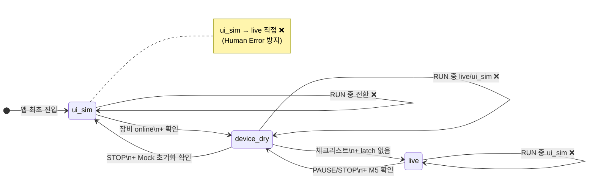

# Data & Operations

**D1 스키마**, **작업 일지 (`job_logs`)**, **열선 예방 유지보수 (PM)**, **UI 섹션 A~F**, **파일·CAM 워크플로**, **현장 운영 프로토콜**, **Phase 2 MES·멀티디바이스** 를 정의합니다.

> WebSocket·REST·운영 모드: [03 Software & Protocol](03-Software-Protocol.md)
> **인증·RBAC·장비 등록**: [06 Auth & Security](06-Auth-Security.md)
> 열선·센서·`thermal_*` 테이블 사용: [02 Thermal Engine & Sensing](02-Thermal-Engine-Sensing.md)
> 4 축·WireSense 배선: [01 Hardware & Motion](01-Hardware-Motion.md)

---

## 데이터 범위 · MVP vs Phase 2

| 영역 | MVP v0.1 (지금 구축) | Phase 2 (본 플랫폼 확장) |
| :--- | :--- | :--- |
| 저장소 | Cloudflare **D1** + KV | **PostgreSQL** MES |
| 대상 장비 | **4 축 터닝 머신 1 대** (`turning-01`) | 다기계 허브 (`devices` 다수) |
| G-code | 10 종 레시피 수식 CAM + `.gcode` 직접 실행 | DXF AI 분석, 3D 시뮬레이션 |
| UI | 섹션 B·C 전체, D 기본, F 일부, `/thermal-lab` | 섹션 E (3D DXF), NIXIE, NEXIA 연동 |
| 작업 기록 | D1 `job_logs` · 열선 센서 이력 (최소 필드) | PostgreSQL MES, NEXIA 도메인 동기화 |
| **열선 PM** | `wire_*` 누적 가동·에너지 · drift · **S1 전 교체 알림** | ML 수명 예측 · 라인별 PM 대시보드 |

> **다중 장비·프로젝트 선반영**: MVP v0.1 은 터닝 머신 1 대만 운영하지만, `projects`·`devices`·`job_logs.project_id`/`device_id` 를 두어 Phase 2 멀티 디바이스 허브·NEXIA 프로젝트 연동 시 **스키마 변경 없이** 확장합니다.

---


## MVP v0.1 D1 스키마 (canonical)

```sql
-- projects (MVP: 기본 1행 시드 · Phase 2 NEXIA 기획 프로젝트 매핑)
CREATE TABLE projects (
  id INTEGER PRIMARY KEY AUTOINCREMENT,
  slug TEXT NOT NULL UNIQUE,       -- 예: 'mvp-default', 'stringbar-line-01'
  name TEXT NOT NULL,
  description TEXT,
  created_at TEXT NOT NULL DEFAULT (datetime('now')),
  updated_at TEXT
);

-- devices (MVP: turning-01 · WebSocket device_id 와 1:1)
CREATE TABLE devices (
  id TEXT PRIMARY KEY,             -- 예: 'turning-01', 'wire-sense-01'
  project_id INTEGER NOT NULL,
  device_type TEXT NOT NULL,       -- 'turning_4axis' | 'wire_sense' | 'safety_io'
  display_name TEXT,
  is_active INTEGER NOT NULL DEFAULT 1,
  created_at TEXT NOT NULL DEFAULT (datetime('now')),
  FOREIGN KEY (project_id) REFERENCES projects(id)
);

CREATE INDEX idx_devices_project ON devices(project_id);

-- wire_installations (물리 열선 1회 장착 = 1행 · S1 전 PM 추적 단위)
CREATE TABLE wire_installations (
  id INTEGER PRIMARY KEY AUTOINCREMENT,
  device_id TEXT NOT NULL,
  profile_id INTEGER,
  serial_label TEXT,                 -- 현장 QR/라벨 (선택)
  installed_at TEXT NOT NULL,
  retired_at TEXT,
  retire_reason TEXT,                -- 'scheduled'|'s1_break'|'pm_replace'|'manual'
  r0_cold_ohm REAL NOT NULL,         -- 장착 직후 냉간 R₀ (시나리오 ⑨)
  wire_length_mm REAL,
  wire_diameter_mm REAL,
  rated_on_hours REAL DEFAULT 48,    -- 가용 ON 시간 기준 (현장·제조사)
  rated_energy_wh REAL,              -- 선택: 누적 에너지 예산
  notes TEXT,
  FOREIGN KEY (device_id) REFERENCES devices(id)
);

CREATE INDEX idx_wire_installations_device ON wire_installations(device_id);
CREATE INDEX idx_wire_installations_active ON wire_installations(device_id, retired_at);

-- wire_runtime_counters (장착별 누적 — retired NULL 인 설치 1행)
CREATE TABLE wire_runtime_counters (
  installation_id INTEGER PRIMARY KEY,
  on_time_sec REAL NOT NULL DEFAULT 0,       -- PWM>0 누적 (가열 가동)
  preheat_time_sec REAL NOT NULL DEFAULT 0,
  energy_wh REAL NOT NULL DEFAULT 0,         -- ∫(bus_v × shunt_a) dt
  thermal_stress_wh REAL NOT NULL DEFAULT 0, -- 고온·고출력 가중 ∫P·w(T) dt
  peak_power_w REAL DEFAULT 0,
  avg_power_w_ema REAL,                      -- 전력 EMA (가용 전력 추적)
  max_wire_temp_c REAL DEFAULT 0,
  last_resistance_ohm REAL,
  last_drift_pct REAL DEFAULT 0,
  pm_health_score REAL DEFAULT 1.0,          -- 1.0=신품 … 0.0=S1 임박
  s1_risk_estimate REAL DEFAULT 0,           -- 0~1, 단선(S1) 추정 위험도
  updated_at TEXT,
  FOREIGN KEY (installation_id) REFERENCES wire_installations(id)
);

-- wire_runtime_hourly (시간별 롤업 · 트렌드·Phase 2 ML 입력)
CREATE TABLE wire_runtime_hourly (
  id INTEGER PRIMARY KEY AUTOINCREMENT,
  installation_id INTEGER NOT NULL,
  hour_ts TEXT NOT NULL,
  on_time_sec REAL NOT NULL DEFAULT 0,
  energy_wh REAL NOT NULL DEFAULT 0,
  avg_power_w REAL,
  max_power_w REAL,
  avg_drift_pct REAL,
  avg_health_score REAL,
  sample_count INTEGER DEFAULT 0,
  UNIQUE(installation_id, hour_ts),
  FOREIGN KEY (installation_id) REFERENCES wire_installations(id)
);

CREATE INDEX idx_wire_runtime_hourly_inst ON wire_runtime_hourly(installation_id, hour_ts);

-- recipes (KV 대신 D1 사용 시)
CREATE TABLE recipes (
  id INTEGER PRIMARY KEY,
  name TEXT NOT NULL,
  length_mm REAL, diameter_mm REAL,
  material_density_factor REAL NOT NULL DEFAULT 1.0,  -- 자재 밀도 계수 (기준 EPS=1.0)
  target_voltage REAL, feed_rate REAL,
  gcode_template TEXT,
  stallguard_json TEXT,            -- Ø·밀도 캘리브 peak · warn/crit 오버라이드
  resume_policy_json TEXT,         -- 안전 재개 { retract_mm, reheat_min_temp_c, … }
  cam_edge_case_json TEXT          -- Scan Pass · 편심 Lead-in — [05 Edge Case CAM](05-GCode-CAM-Pipeline.md#edge-case-cam--비정형-자재--편심-보정-mvp-v01-필수)
);

-- job_logs (작업 일지 — 프로젝트·기기 관계 포함)
CREATE TABLE job_logs (
  id INTEGER PRIMARY KEY AUTOINCREMENT,
  project_id INTEGER NOT NULL DEFAULT 1,
  device_id TEXT NOT NULL DEFAULT 'turning-01',
  started_at TEXT, finished_at TEXT,
  recipe_id INTEGER,
  duration_sec REAL,
  power_wh REAL, max_temp REAL,
  wire_installation_id INTEGER,    -- 가공 시점 활성 열선 (PM 집계 연결)
  pause_reason TEXT,               -- 'a_stall'|'wire_break'|'ui_ghost'|…
  resume_checkpoint_json TEXT,     -- PAUSE 시점 { x,y,z,a, line_index, path_t }
  scan_result_json TEXT,           -- Scan Pass 부하 맵 · irregularity · F_adj — [05](05-GCode-CAM-Pipeline.md#scan-pass--비정형-외경-인식--f-자동-감속)
  status TEXT,                     -- 'completed'|'aborted'|'paused'|'error'|'ui_ghost_abort'
  run_mode TEXT NOT NULL DEFAULT 'live',  -- 'live' | 'device_dry' | 'ui_sim'
  FOREIGN KEY (project_id) REFERENCES projects(id),
  FOREIGN KEY (device_id) REFERENCES devices(id),
  FOREIGN KEY (recipe_id) REFERENCES recipes(id),
  FOREIGN KEY (wire_installation_id) REFERENCES wire_installations(id)
);

CREATE INDEX idx_job_logs_project ON job_logs(project_id);
CREATE INDEX idx_job_logs_device ON job_logs(device_id);
CREATE INDEX idx_job_logs_project_device ON job_logs(project_id, device_id);

-- MVP v0.1 시드 (배포 시 1회)
-- INSERT INTO projects (id, slug, name) VALUES (1, 'mvp-default', 'MVP 조기 운영');
-- INSERT INTO devices (id, project_id, device_type, display_name)
--   VALUES ('turning-01', 1, 'turning_4axis', '4축 핫블레이드 터닝 머신');

-- thermal_profiles (PWM·온도 테스트 랩 프로파일)
CREATE TABLE thermal_profiles (
  id INTEGER PRIMARY KEY AUTOINCREMENT,
  name TEXT NOT NULL,
  wire_length_mm REAL, wire_diameter_mm REAL,
  resistance_per_m REAL, psu_voltage_nom REAL DEFAULT 18,
  pwm_min INTEGER DEFAULT 0, pwm_max INTEGER DEFAULT 1000,
  pwm_ramp_ms INTEGER DEFAULT 500,
  current_limit_a REAL DEFAULT 3.5,
  preheat_json TEXT,
  preheat_gate_json TEXT,        -- START 잠금 { min_temp_c, soak_sec, … }
  thermal_tau_sec REAL DEFAULT 2.0,  -- 1차 지연 시상수 τ (s)
  t_ambient_c REAL DEFAULT 25,
  target_temp_c REAL DEFAULT 300,
  nichrome_alpha REAL DEFAULT 0.0001,
  r0_baseline_ohm REAL,
  ina219_ma_window INTEGER DEFAULT 5,
  i_break_floor_a REAL DEFAULT 0.02,
  i_break_ratio REAL DEFAULT 0.15,
  i_nom_max_a REAL DEFAULT 3.0,
  temp_curve_json TEXT,
  updated_at TEXT
);

-- wire_pm_policy (프로파일·장비별 S1 전 예방 임계)
CREATE TABLE wire_pm_policy (
  id INTEGER PRIMARY KEY AUTOINCREMENT,
  profile_id INTEGER,
  device_id TEXT,
  drift_warn_pct REAL DEFAULT 15,      -- [02 시나리오 ③] 교체 권고
  drift_crit_pct REAL DEFAULT 25,
  on_hours_warn REAL DEFAULT 40,
  on_hours_crit REAL DEFAULT 46,
  power_eff_warn REAL DEFAULT 0.85,    -- P_actual/P_expected @ 기준 S
  health_score_replace REAL DEFAULT 0.25,
  s1_risk_alert REAL DEFAULT 0.70,     -- 이상 시 replace_now 푸시
  lead_time_hours REAL DEFAULT 4,      -- S1 전 알림 리드타임 목표
  updated_at TEXT,
  FOREIGN KEY (profile_id) REFERENCES thermal_profiles(id),
  FOREIGN KEY (device_id) REFERENCES devices(id)
);

-- engine_coefficients (테스트 랩 피팅 → ThermalCutterEngine K)
CREATE TABLE engine_coefficients (
  id INTEGER PRIMARY KEY AUTOINCREMENT,
  profile_id INTEGER NOT NULL UNIQUE,
  thermal_k REAL,                -- 열용융 계수 K (fit 결과)
  pwm_gain REAL DEFAULT 1.0,     -- S→V 보정 이득
  v_offset REAL DEFAULT 0,
  v_offset_per_rho REAL DEFAULT 0.8,  -- material_density_factor 보정 V/ρ
  resistance_per_m REAL,
  s_to_power_json TEXT,          -- [{ s, power_w }, …]
  fit_source_log_id INTEGER,     -- thermal_test_logs.id
  fit_version INTEGER DEFAULT 1,
  fit_rmse REAL,
  updated_at TEXT,
  FOREIGN KEY (profile_id) REFERENCES thermal_profiles(id),
  FOREIGN KEY (fit_source_log_id) REFERENCES thermal_test_logs(id)
);

-- thermal_test_logs (테스트 세션 시계열·요약)
CREATE TABLE thermal_test_logs (
  id INTEGER PRIMARY KEY AUTOINCREMENT,
  profile_id INTEGER,
  started_at TEXT, finished_at TEXT,
  test_type TEXT,              -- 'manual'|'ramp'|'preheat'|'feed_sync'|'temp_pid'|'cold_r0'
  run_mode TEXT,
  max_current_a REAL, max_pwm INTEGER, max_wire_temp_c REAL,
  samples_json TEXT,           -- { t, s, v, a, wire_temp_c, wire_res_ohm }[]
  notes TEXT
);

-- wire_sensor_snapshots (INA219·K-Type 시계열 요약)
CREATE TABLE wire_sensor_snapshots (
  id INTEGER PRIMARY KEY AUTOINCREMENT,
  job_id INTEGER,
  test_log_id INTEGER,
  project_id INTEGER,              -- job_logs 와 동기 (조회 편의)
  device_id TEXT,                  -- 'turning-01' | 'wire-sense-01'
  ts TEXT,
  bus_v REAL, shunt_a REAL, wire_res_ohm REAL,
  wire_temp_c REAL, pwm_actual INTEGER,
  resistance_drift_pct REAL,
  scenario_flags TEXT,
  FOREIGN KEY (job_id) REFERENCES job_logs(id),
  FOREIGN KEY (project_id) REFERENCES projects(id),
  FOREIGN KEY (device_id) REFERENCES devices(id)
);

-- wire_pm_alerts (예방 알림 — S1 발생 **전** 교체·점검 유도)
CREATE TABLE wire_pm_alerts (
  id INTEGER PRIMARY KEY AUTOINCREMENT,
  installation_id INTEGER NOT NULL,
  device_id TEXT NOT NULL,
  ts TEXT NOT NULL DEFAULT (datetime('now')),
  level TEXT NOT NULL,               -- 'info'|'warn'|'critical'|'replace_now'
  trigger TEXT NOT NULL,             -- 'on_hours'|'drift_pct'|'power_eff'|'health_score'|'composite'
  message TEXT,
  metrics_json TEXT,                 -- { on_hours, drift_pct, energy_wh, health_score, ... }
  s1_risk_estimate REAL,
  acknowledged_at TEXT,
  acted_at TEXT,                     -- 교체·점검 완료 시각
  FOREIGN KEY (installation_id) REFERENCES wire_installations(id),
  FOREIGN KEY (device_id) REFERENCES devices(id)
);

CREATE INDEX idx_wire_pm_alerts_inst ON wire_pm_alerts(installation_id, ts);
CREATE INDEX idx_wire_pm_alerts_open ON wire_pm_alerts(device_id, acknowledged_at);

-- fail_safe_events (통신 단절·인터록)
CREATE TABLE fail_safe_events (
  id INTEGER PRIMARY KEY AUTOINCREMENT,
  project_id INTEGER,
  device_id TEXT NOT NULL,
  job_id INTEGER,
  ts TEXT NOT NULL DEFAULT (datetime('now')),
  reason TEXT NOT NULL,
  run_mode TEXT,
  actions_json TEXT,
  recovered_at TEXT,
  FOREIGN KEY (project_id) REFERENCES projects(id),
  FOREIGN KEY (device_id) REFERENCES devices(id),
  FOREIGN KEY (job_id) REFERENCES job_logs(id)
);
```

### `job_logs` 관계 필드

| 필드 | 타입 | MVP v0.1 기본값 | Phase 2 용도 |
| :--- | :--- | :--- | :--- |
| `project_id` | INTEGER FK → `projects` | `1` (`mvp-default`) | NEXIA 기획 프로젝트·라인 단위 집계 |
| `device_id` | TEXT FK → `devices` | `'turning-01'` | 멀티 허브에서 기기별 이력·필터 |
| `pause_reason` | TEXT | — | 인터록·PAUSE 원인 |
| `resume_checkpoint_json` | TEXT | — | [03 Safe Resume](03-Software-Protocol.md#안전-재개-프로토콜-safe-resume--pause--resume-mvp-v01-필수) 체크포인트 |
| `scan_result_json` | TEXT | — | Scan Pass 부하 맵 · `irregularity_index` · `f_adj` — [05 Scan Pass](05-GCode-CAM-Pipeline.md#scan-pass--비정형-외경-인식--f-자동-감속) |

### `recipes` · `material_density_factor` `[MVP v0.1]`

Ø(지름) 만으로는 **자재 종류**(EPS 밀도·재생 발포 등) 에 따른 절삭 부하·열용량 차이를 반영하지 못합니다.
10 종 레시피마다 **밀도 계수** `material_density_factor` 를 두어 **StallGuard 동적 임계**와 **ThermalCutterEngine 전압 오프셋**에 공통 가중치를 적용합니다.

| 필드 | 타입 | 기본 | 설명 |
| :--- | :--- | :--- | :--- |
| `material_density_factor` | REAL | **1.0** | 기준 = 현장 표준 EPS. 고밀도·재생料 = 1.1~1.35 |
| `diameter_mm` | REAL | — | StallGuard Ø 보정 — [01 StallGuard](01-Hardware-Motion.md#stallguard--모재-지름-동적-부하-임계-a_vel-mvp-v01-필수) |
| `stallguard_json` | TEXT | 선택 | per-recipe SG peak 오버라이드 |
| `resume_policy_json` | TEXT | 선택 | 안전 재개 파라미터 — [03 Safe Resume](03-Software-Protocol.md#안전-재개-프로토콜-safe-resume--pause--resume-mvp-v01-필수) |
| `cam_edge_case_json` | TEXT | 선택 | Scan Pass · 편심 Lead-in — [05 Edge Case CAM](05-GCode-CAM-Pipeline.md#edge-case-cam--비정형-자재--편심-보정-mvp-v01-필수) |

**10 종 레시피 밀도 예시 (현장 시드)**

| id | 모델 | Ø mm | `material_density_factor` | 비고 |
| :---: | :--- | :---: | :---: | :--- |
| 1 | 소형 | 8 | 1.00 | 기준 EPS |
| 3 | 중소 | 16 | 1.05 | |
| 5 | 중형 | 20 | 1.10 | |
| 8 | 대형 | 30 | 1.15 | |
| 10 | 최대 | 34 | 1.20 | 고밀 |

#### StallGuard 가중 (→ `cmd_stall_policy`)

밀도↑ → 정상 부하↑ → 임계 **상향** (오검출 방지).

```typescript
const { warn, crit } = dynamicStallThresholds(recipe.diameter_mm, policy);
const rho = recipe.material_density_factor;

return {
  a_load_warn_pct: clamp(warn * rho, policy.warn_min, 98),
  a_load_crit_pct: clamp(crit * rho, policy.crit_min, 99),
};
```

#### Thermal Engine 가중 (→ `ThermalCutterEngine`)

```typescript
// 목표 전력 — ρ 가 density·K 에 반영
const P = engine.calculateRequiredPower(F, {
  ...material,
  density: material.density * rho,
}, L_eff);

// S 산출 — v_offset 밀도 보정
const vOffsetAdj = coeffs.vOffset + (coeffs.vOffsetPerRho ?? 0.8) * (rho - 1.0);
const S = engine.sFromModel(P, wire, L_eff, { vOffset: vOffsetAdj });
```

| ρ | Ø20 warn/crit (예) | 열 영향 |
| :---: | :--- | :--- |
| 1.0 | 72 / 88 | 기준 |
| 1.2 | 86 / 99 (cap) | P↑ · v_offset +0.16V |

#### `resume_policy_json`

```json
{
  "retract_mm": 12,
  "retract_feed_mm_min": 300,
  "reheat_min_temp_c": 290,
  "reentry_feed_ratio": 0.5,
  "reentry_distance_mm": 8
}
```

#### `cam_edge_case_json`

비정형 외경 **Scan Pass** · 편심 **Lead-in 보정** — [05 Edge Case CAM](05-GCode-CAM-Pipeline.md#edge-case-cam--비정형-자재--편심-보정-mvp-v01-필수).

```json
{
  "scan_pass_enabled": true,
  "scan_a_step_deg": 45,
  "scan_f_ratio": 0.35,
  "irregularity_f_floor": 0.5,
  "eccentricity_lead_k": 1.5
}
```

### 작업 일지 운영 규칙

- 작업 시작 API: `POST /api/run` 시 `{ project_id?, device_id?, recipe_id, … }` — `material_density_factor` 는 `recipes` 에서 자동 로드
- PAUSE/인터록 시 `resume_checkpoint_json` 저장 · `status='paused'`
- **RESUME** 은 `POST /api/run/resume` — [03 안전 재개](03-Software-Protocol.md#안전-재개-프로토콜-safe-resume--pause--resume-mvp-v01-필수) (**동일 좌표 즉시 재개 금지**)
- WebSocket `heartbeat.device_id` 와 `devices.id` **동일 문자열** 유지 — 등록: [06 Provisioning](06-Auth-Security.md#장비-등록--device-provisioning-mvp-v01-필수)
- 가공 완료·중단·오류 시 `job_logs.status` 갱신 + `wire_sensor_snapshots` 요약 저장
- Phase 2 PostgreSQL 이전 시 `projects`·`devices`·`job_logs` FK 그대로 마이그레이션
- REST·WebSocket 상세: [03 REST API](03-Software-Protocol.md#rest-api-요약) · [WebSocket 명세](03-Software-Protocol.md#websocket-메시지--통합-명세-canonical)

---

## 예방적 유지보수 (Predictive Maintenance) — 열선 `[MVP v0.1 필수]`

**S1(단선) 인터록이 발생하기 전**에 교체·점검 시기를 알리기 위해, 열선 장착 단위로 **누적 가동 시간·가용 전력 (에너지)·저항 drift** 를 기록하고 **건강 점수 (`pm_health_score`)** 를 산출합니다.

> 실시간 센싱·S1 판정: [02 WireHealthMonitor · 시나리오 ③](02-Thermal-Engine-Sensing.md#ina219--k-type-열전대-인라인-센싱-및-관리-시나리오)
> 인터록 S1 정의: [02 S1 · 열선 단선](02-Thermal-Engine-Sensing.md#s1--열선-단선-wire-break--상세)

### 데이터 모델 관계

```text
devices ──< wire_installations (retired_at IS NULL = 현재 장착)
              │
              ├── wire_runtime_counters   ← 1Hz 누적 (ON·Wh·drift·health)
              ├── wire_runtime_hourly     ← 시간별 롤업
              └── wire_pm_alerts          ← S1 전 알림 이력

thermal_profiles ──< wire_pm_policy      ← drift/on_hours/power_eff 임계

job_logs.wire_installation_id ──> wire_installations  (가공별 PM 연결)
fail_safe_events (reason='wire_break') ──> 설치 retire_reason='s1_break'
```

| 테이블 | 역할 |
| :--- | :--- |
| `wire_installations` | 물리 열선 1 회 장착 이력 · `r0_cold_ohm` · `rated_on_hours` |
| `wire_runtime_counters` | **누적 ON 시간** · **에너지 (Wh)** · drift · health · **s1_risk** |
| `wire_runtime_hourly` | 트렌드·Phase 2 ML 피처 |
| `wire_pm_policy` | 경고/교체 임계 (프로파일·장비별) |
| `wire_pm_alerts` | `warn` → `replace_now` 단계 알림 |

### 누적 규칙 (1Hz · Workers)

[02 INA219 루프](02-Thermal-Engine-Sensing.md#ina219--k-type-인라인-센싱) 의 **1Hz ON 누적** 과 동기. `run_mode='live'` 이고 `pwm_actual > 0` 일 때만 집계.

| 카운터 | 산식 | 용도 |
| :--- | :--- | :--- |
| `on_time_sec` | `+= 1` (PWM ON) | 가용 **가동 시간** — `rated_on_hours` 대비 |
| `preheat_time_sec` | PWM ON ∧ T < T_preheat | 예열 부하 분리 (선택) |
| `energy_wh` | `+= bus_v × shunt_a / 3600` | **누적 전력 (에너지)** · 소모품 원가 |
| `thermal_stress_wh` | `+= P × w(T)` · `w(T)=1+(T−T_ref)/200` | 고온 가공 가중 스트레스 |
| `avg_power_w_ema` | `α=0.05` EMA of `P` | **가용 전력** 추세 (동일 S 대비 저하 감지) |
| `last_drift_pct` | `(R−R₀)/R₀×100` | [시나리오 ③](02-Thermal-Engine-Sensing.md#ina219--k-type-열전대-인라인-센싱-및-관리-시나리오) |

**가용 전력 (Power Availability)** 이란, 동일 PWM(S)·동일 `thermal_profile` 에서 기대 전력 `P_expected`(캘리브 `engine_coefficients` 또는 `s_to_power_json`) 대비 실측 `P_actual=bus_v×shunt_a` 비율:

```text
power_eff = P_actual / P_expected   (PWM 안정 구간 5s 이상만 샘플)
```

노화·접촉 불량·국부 단선 직전에는 `power_eff` 가 먼저 하락하는 경우가 많아 S1 **선행 지표**로 사용합니다.

### 건강 점수 · S1 위험도

`WirePmEngine` (Workers / Phase 2 NestJS) — `WireHealthMonitor` 와 **병렬**, 인터록 대신 **알림·UI** 전담.

```typescript
interface WirePmInput {
  onTimeSec: number;
  ratedOnHours: number;
  driftPct: number;
  powerEff: number;          // 0~1+, 1=신품 수준
  policy: WirePmPolicy;
}

function computeHealthScore(i: WirePmInput): { health: number; s1Risk: number } {
  const lifeRatio = i.onTimeSec / (i.ratedOnHours * 3600);
  const driftRatio = i.driftPct / i.policy.driftCritPct;
  const powerRatio = 1 - Math.min(1, i.powerEff / i.policy.powerEffWarn);

  const health = Math.max(0, Math.min(1,
    1 - Math.max(lifeRatio, driftRatio * 0.9, powerRatio * 0.8)
  ));
  const s1Risk = 1 - health;
  return { health, s1Risk };
}
```

| `pm_health_score` | `s1_risk_estimate` | UI · 알림 |
| :---: | :---: | :--- |
| ≥ 0.75 | < 0.25 | 정상 (녹색) |
| 0.50 ~ 0.75 | 0.25 ~ 0.50 | `warn` — drift 또는 ON 시간 주의 |
| 0.25 ~ 0.50 | 0.50 ~ 0.75 | `critical` — **다음 휴식 시 교체 권고** |
| < 0.25 | ≥ 0.75 | `replace_now` — **S1 전 교체** · START 잠금 권고 |

임계는 `wire_pm_policy` 로 프로파일·장비별 조정. 기본값은 [02 시나리오 ③](02-Thermal-Engine-Sensing.md#ina219--k-type-열전대-인라인-센싱-및-관리-시나리오) `drift +15%` 와 `rated_on_hours=48h` 에 정렬.

### 알림 트리거 (S1 전)

| trigger | 조건 (기본 policy) | level |
| :--- | :--- | :--- |
| `on_hours` | `on_time_sec/3600 ≥ on_hours_warn` (40h) | warn → critical (46h) |
| `drift_pct` | `last_drift_pct ≥ 15%` | warn → critical (25%) |
| `power_eff` | `power_eff < 0.85` (3 회 연속 5s) | warn |
| `health_score` | `pm_health_score < 0.25` | replace_now |
| `composite` | `s1_risk_estimate ≥ 0.70` | replace_now + 푸시 |
| **사후** | `fail_safe_events.reason='wire_break'` | 설치 `retire_reason='s1_break'` · PM 학습 |

동일 `installation_id`·동일 `level` 은 4h 쿨다운 후 재발행 (스팸 방지).

### REST · 운영 API

| 메서드 | 경로 | 설명 |
| :--- | :--- | :--- |
| `GET` | `/api/wire/active?device_id=` | 현재 장착 + `wire_runtime_counters` |
| `GET` | `/api/wire/pm/alerts?device_id=&open=1` | 미확인 PM 알림 |
| `POST` | `/api/wire/pm/alerts/:id/ack` | 알림 확인 |
| `POST` | `/api/wire/install` | 신규 장착 — [시나리오 ⑨](02-Thermal-Engine-Sensing.md#⑨-교대-전-냉간-건강검사) `R_cold` 필수 |
| `POST` | `/api/wire/replace` | 기존 `retired_at` + 신규 설치 + 카운터 리셋 |

**교체 워크플로** (S1 전 예방):

1. `replace_now` 알림 → 작업 중단·냉각
2. `/thermal-lab` 또는 현장 — 시나리오 ⑨ 냉간 R₀ 측정
3. `POST /api/wire/replace` — 구 설치 `retire_reason='pm_replace'`
4. `/thermal-lab` 예열·K 재확인 후 `live` 재개

**S1 발생 후**: `executeInterlock('wire_break')` → 구 설치 `retire_reason='s1_break'` → 교체 후 [02 S1 latch ACK](02-Thermal-Engine-Sensing.md#s1--열선-단선-wire-break--상세) 절차.

### WebSocket 텔레메트리 확장

`telemetry` 페이로드에 PM 필드 추가 (MVP v0.1):

```json
{
  "wire_pm": {
    "installation_id": 3,
    "on_hours": 41.2,
    "energy_wh": 128.5,
    "drift_pct": 16.8,
    "power_eff": 0.88,
    "health_score": 0.62,
    "s1_risk": 0.38,
    "alert_level": "warn"
  }
}
```

---

## 파일 · CAM 워크플로

> **상세 알고리즘 · 스택**: [05 G-code & CAM Pipeline](05-GCode-CAM-Pipeline.md) — HFS · 헬리컬 · Material_Aware_CAM · **Edge Case CAM** · Three.js

| 파일·기능 | MVP v0.1 | Phase 2 |
| :--- | :--- | :--- |
| `.gcode` / `.nc` 직접 실행 | ✅ 필수 | ✅ |
| 10 종 레시피 수식 CAM | ✅ 필수 | ✅ (NestJS 이전) |
| `.svg` 스케일 조절 | △ 선택 | ✅ |
| `.dxf` 파싱 + maker.js CAM | ❌ | ✅ + AI 분석 |
| Monaco 수동 편집 | △ 선택 | ✅ |

### 지원 파일 종류 (3 가지)

작업자가 모바일 웹 화면에서 업로드하여 가공 데이터로 변환할 수 있는 형식입니다.

- **① `.dxf` (2D CAD)** — [Phase 2 추천]
  - 스트링 바 유선형 단면을 **4 축 (XYZ + A 회전) 터닝 경로**로 변환하는 데 핵심
- **② `.svg` (웹 벡터)** — [모바일 최적화]
  - 용량 가벼움, 업로드 즉시 스마트폰에서 도면 시각화
- **③ `.gcode` / `.nc` (완성 G-code)** — [다이렉트 실행]
  - 외부 CAM 결과물을 ESP32 로 스트리밍 — MVP v0.1 **필수 경로**

### 치수·곡률 조정 라이브러리

| 용도 | 라이브러리 | 비고 |
| :--- | :--- | :--- |
| DXF 파싱/조작 | `dxf-parser` · `dxf-writer` | 좌표 스케일·오프셋 |
| SVG·기하 연산 | `paper.js` · **`maker.js`** | Scale·Rotate·Offset — CNC 친화 |
| G-code 생성 | `gcode-toolpath` · 커스텀 수식 노드 · [05 CAM](05-GCode-CAM-Pipeline.md) | Profile/Taper · **Z_final** · HFS |
| G-code 파싱·시각화 | **`gcode-parser`** · **Three.js** · `mathjs` | [05 Pipeline](05-GCode-CAM-Pipeline.md#g-code_pipeline--기술-스택-mvp-v01-필수) |
| 웹 수동 편집 | `Monaco Editor` · `CodeMirror` | G-code 구문 강조 |

---

## UI 구성 — 섹션 A~F

스마트폰 화면을 섹션 A~F 로 정의합니다.

| 태그 | 의미 |
| :--- | :--- |
| `[MVP v0.1 필수]` | Cloudflare 조기 운영 — 없으면 현장 기동 불가 |
| `[MVP v0.1 선택]` | MVP 완료 후 여유 시 추가 |
| `[Phase 2]` | NEXA 본 플랫폼 정식 오픈 시 구현 |

```text
## UI 구성 및 모바일 화면 동작 요약
MVP v0.1: 모드 선택(ui_sim·드라이런·라이브) → 레시피/G-code → START → 텔레메트리
  ui_sim: PWM·모재·ESP32 없이 UI 전체 검증
  /thermal-lab: S·예열·PID — INA219·K-Type 실측 온도·저항
Phase 2: 도면 3D 시뮬레이션·멀티디바이스 허브
```

### 섹션 A: 도면 및 G-code — `[MVP v0.1 선택]` / `[Phase 2]` DXF·AI

**MVP v0.1 최소 경로** (현장 운영):
1. 10 종 레시피 버튼 터치 → 수식 CAM → G-code 자동 생성 → 가공
2. 또는 `.gcode` 파일 업로드 → 즉시 스트리밍

**Phase 2 전체 워크플로**:
1. `.svg` / `.dxf` 업로드 → 스펙 조절 (`maker.js`) → AI 시뮬레이션
2. G-code 생성 → Monaco 수동 편집 → ESP32 전송

- **MVP v0.1**: 10 종 수식 CAM + `.gcode` 업로드만 (Workers 경량 연산)
- **Phase 2**: DXF 분석·시뮬레이션·AI Recipe → NestJS + AI 서버

### 섹션 B: 실시간 가공 제어 — `[MVP v0.1 필수]`

- **운영 모드 토글** (상단 고정): `UI 모의` | `드라이런` | `라이브` — [03 운영 모드](03-Software-Protocol.md#운영-모드-3단계) · **전이 제약**: [섹션 F · 상태 전이도](#운영-모드-상태-전이도)
- **열선 테스트** 탭 → [`/thermal-lab`](02-Thermal-Engine-Sensing.md#thermal-lab--pwm온도-테스트-랩-mvp-v01-필수) (가공 START 와 분리 · `device_dry` 진입 불가)
- 가공 마스터 스위치: `START` / `PAUSE` / **`RESUME`** (Safe Resume 4 단) / `EMERGENCY STOP`
- Override 슬라이더: `ui_sim` 은 가상 PWM·피드 · `device_dry`/`live` 는 실제 — **`cmd_override_sync`** [05](05-GCode-CAM-Pipeline.md#real-time_sync_override--실시간-동기화-mvp-v01-필수) · 100ms SLA
- **Scan Pass 카드** (`live` · `scan_pass_enabled`): 가공 전 부하 맵 · `F 400→348` · 편심 `e_mm` — [§ Scan Pass 카드 UI](#scan-pass-카드-ui-와이어프레임-mvp-v01-필수) · [05 Edge Case](05-GCode-CAM-Pipeline.md#edge-case-cam--비정형-자재--편심-보정-mvp-v01-필수)
- Jog: X/Y/Z (mm) · **A (° · `A_POS`)** · **A RPM** (`cmd_a_vel` / M210) — `ui_sim` 가상 동일

### 섹션 C: TMC2209 & 센서 모니터링 — `[MVP v0.1 필수]`

| 표시 | `ui_sim` | `device_dry` | `live` |
| :--- | :--- | :--- | :--- |
| X/Y/Z/A | 가상 좌표 | 실측 | 실측 |
| **a_mode** / **a_rpm** | `pos`/`vel` 가상 | 실측 | 실측 |
| **a_load_pct** (TMC SG) | 0 또는 — | StallGuard · **Ø 동적 임계** | StallGuard · **Ø 동적** |
| V/A/W | `ThermalCutterEngine` 가상 | **0** (PWM OFF) | INA219 실측 |
| **wire_temp_c** (K-Type) | 가상 | — | **실측** |
| **wire_res_ohm** / drift% | 계산 | — | INA219 · R₀ 대비 |
| sensor_health | simulated | — | OK / mismatch / fault |
| temp_est (폴백) | 가상 곡선 | — | K-Type 장애 시만 |
| **comm_state** / **tri_link** | — | 실측 | 실측 · [03 Tri-Link](03-Software-Protocol.md#tri-link-fail-safe--3-way-heartbeat--ghost-job-방지-mvp-v01-필수) |
| StallGuard 부하 | 0 또는 — | 실측 (모재 없으면 낮음) | 실측 |
| 모드 배너 | 🟠 UI 모의 | 🟡 드라이런 | 🟢 라이브 |

> 센서·인터록 로직: [02 Thermal Engine & Sensing](02-Thermal-Engine-Sensing.md)

### 섹션 D: 생산 현황 및 소모품 — `[MVP v0.1]` 기본 / `[Phase 2]` NEXIA 연동

**MVP v0.1** (D1 수동 레시피·카운터):
- 현재 작업 스펙 카드: 모델 번호 (1~10), 목표 규격 (L/Ø)
- 실시간 가공 카운터: 오늘/누적 생산량 (D1 `job_logs`)
- 가공 타임라인·프로그레스 바
- **열선 PM 패널** `[MVP v0.1 필수]`:
  - ON 누적 시간 / `rated_on_hours` 게이지
  - 누적 에너지 `energy_wh` (kWh)
  - `power_eff` · **저항 drift%** · `pm_health_score` 링 차트
  - `alert_level` 배너 (`warn` / `critical` / `replace_now`) — [PM 모델](#예방적-유지보수-predictive-maintenance--열선-mvp-v01-필수)
  - 「열선 교체」→ `POST /api/wire/replace` 플로우

**Phase 2** (NEXIA 도메인 연동):
- NEXIA 기획 문서 → 컨트롤러 도메인 자동 파싱 → UI 시각화
- 원가·불량 추적 (PostgreSQL)

### 섹션 E: 지능형 시각화 — `[Phase 2]`

- **3D DXF 가공 시뮬레이터**: Phase 2 — 충돌 검토·AI 연동
- MVP **2D 궤적 미리보기**: `ui_sim`/`device_dry` 에서 X–Z 단면 경로 표시 — [05 Three.js PathViz](05-GCode-CAM-Pipeline.md#③-visualization--threejs-pathviz)
- **열선 수명 ML 예보** · **가공 원가 트래킹**: Phase 2 — `wire_runtime_hourly` + PostgreSQL

### 섹션 F: 현장 특화 UI/UX — Human Error 방지 `[MVP v0.1 필수]` {#섹션 -f- 현장 - 특화 -uiux--human-error- 방지 -mvp-v01- 필수}

실제 사용자 **실수 (Human Error)** 를 UI 레벨에서 차단합니다. 모드 오전환·무시 재개·인터록 미해석을 **상태 전이 제약** + **명확한 에러 카피** 로 방지.

| 기능 | 단계 |
| :--- | :--- |
| **운영 모드 상태 전이도** · 전환 제약 · 데이터 초기화 | `[MVP v0.1 필수]` |
| **인터록 S1~S11 에러 메시지** · 조치 가이드 | `[MVP v0.1 필수]` |
| 글러브 프렌들리 모드 (대형 버튼) | `[MVP v0.1 필수]` |
| 네트워크 **Tri-Link** · Ghost Job · `comm_state` 시각화 | `[MVP v0.1 필수]` |
| **연결 모드** 세그먼트 · **Cloud/Local UI 차이** · Visual Cues | `[MVP v0.1 필수]` |
| 음성·모션·비전 센서 조작 | `[Phase 2]` — [00 웹캠 아이디어](00-Vision-Overview.md#phase-2-아이디어-메모--스마트폰-웹캠) |
| NIXIE 캐릭터 대화형 컨트롤 | `[Phase 2]` NEXA 본 플랫폼 |

> 프로토콜·`cmd_set_mode`: [03 운영 모드 3단계](03-Software-Protocol.md#운영-모드-3단계) · **연결 모드**: [03 연결 모드](03-Software-Protocol.md#연결-모드-3단계--cloud--local-ap--sd-오프라인-mvp-v01-필수) · 인터록 정의: [02 S1~S10](02-Thermal-Engine-Sensing.md#센서-기반-인터록-s1s9) · [01 S11](01-Hardware-Motion.md#홈-복귀-타임아웃-mvp-v01-필수)

---

#### UX 설계 원칙

| # | 원칙 | UI 구현 |
| :---: | :--- | :--- |
| 1 | **모드는 눈에 보이게** | 상단 고정 배너 색·아이콘 · `live` 는 🔴 |
| 2 | **RUN 중 전환 금지** | 모드 토글 **disabled** + 툴팁 「가공 중 — PAUSE 후 전환」 |
| 3 | **위험 전환은 2 단 확인** | `→ live` 체크리스트 다이얼로그 · `ui_sim → live` **직접 금지** |
| 4 | **인터록은 행동으로** | 모달: 원인 + **CTA 1~3 개** (해제·교체·신규 job) |
| 5 | **Pitting 방지** | `live` PAUSE 후 **즉시 RESUME 버튼 숨김** — [03 Safe Resume](03-Software-Protocol.md#안전-재개-프로토콜-safe-resume--pause--resume-mvp-v01-필수) |
| 6 | **연결 모드 가시화** | ☁️/📡/💾 세그먼트 · `COMM_ISLAND` 시 **LOCAL 전환** CTA 고정 |
| 7 | **Sync 게이트** | `sync_verdict` ≠ OK/DRIFT → START·RESUME **disabled** — [03 Sync-Handshake](03-Software-Protocol.md#sync-handshake--kv-checkpoint--sd-manifest-정합성-mvp-v01-필수) |

| 7 | **Sync 게이트** | `sync_verdict` ≠ OK/DRIFT → START·RESUME **disabled** — [03 Sync-Handshake](03-Software-Protocol.md#sync-handshake--kv-checkpoint--sd-manifest-정합성-mvp-v01-필수) |
| 8 | **연결=기능** | Cloud 전용 메뉴 **숨김/gray-out** · Local 전용 메뉴 **전면 배치** — [§ Cloud vs Local UI](#cloud-vs-local--온라인오프라인-ui-기능-차이-mvp-v01-필수) |

#### Cloud vs Local — 온라인·오프라인 UI 기능 차이 `[MVP v0.1 필수]` {#cloud-vs-local-- 온라인오프라인 -ui- 기능 - 차이 -mvp-v01- 필수}

**운영 모드**(`ui_sim`/`device_dry`/`live`) 와 **연결 모드**(`cloud`/`local_ap`/`sd_offline`) 는 독립입니다.
아래 표는 **연결 모드**에 따른 UI·기능 가용성입니다. 상세 프로토콜: [03 연결 모드](03-Software-Protocol.md#연결-모드-3단계--cloud--local-ap--sd-오프라인-mvp-v01-필수).

##### 기능 비교표 (Cloud · Local AP · SD Offline)

| 기능 / 메뉴 | `cloud` (Online) | `local_ap` (Local AP) | `sd_offline` (SD) |
| :--- | :---: | :---: | :---: |
| **UI 호스트** | Cloudflare Pages | ESP32 Local Portal `192.168.4.1` | Local Portal 경량 |
| **인증** | JWT · RBAC | PIN 6 자리 | PIN 6 자리 |
| **`ui_sim`** | ✅ | ❌ 숨김 | ❌ 숨김 |
| **Jog · 홈 · E-STOP** | ✅ | ✅ | ✅ |
| **`device_dry` / `live`** | ✅ | ✅ | ✅ |
| **10 종 레시피 원터치** | ✅ D1 | △ SD `cache/recipes/` | △ SD manifest job |
| **CAM·HFS 실시간 재계산** | ✅ Workers | ❌ | ❌ |
| **`.gcode` 클라우드 업로드** | ✅ | ❌ | ❌ |
| **SD G-code 실행** | △ Export 후 | ✅ job 목록 | ✅ **주 경로** |
| **`/thermal-lab` 전체** | ✅ | △ 캐시 프로파일만 | ❌ 숨김 |
| **Override F·S (`cmd_override_sync`)** | ✅ | △ F 만 · S 고정 | △ F 만 |
| **Tri-Link · Ghost Job** | ✅ | ❌ (Local-Link) | ❌ |
| **D1 `job_logs` · 원격 일지** | ✅ | △ SD ndjson | △ SD ndjson |
| **통계 보고서 · 생산 집계** | ✅ | ❌ **숨김** | ❌ **숨김** |
| **AI 레시피 추천** | `[Phase 2]` | ❌ **숨김** | ❌ **숨김** |
| **멀티 디바이스 허브** | `[Phase 2]` | ❌ | ❌ |
| **NEXIA 도메인 연동** | `[Phase 2]` | ❌ | ❌ |
| **Sync-Handshake UI** | ✅ | ✅ | ✅ |
| **Safe Resume 4 단** | ✅ | ✅ SPIFFS+SD | ✅ SPIFFS+SD |
| **cloud 복귀 D1 sync** | — | △ `sync/commit` | △ `import-offline` |
| **SD 카드 파일 탐색기** | △ Export 만 | ✅ **전면** | ✅ **전면** |
| **Wi-Fi 설정 (STA/AP)** | △ 읽기 전용 | ✅ **전면** | ✅ **전면** |
| **물리 AP 스위치 상태** | 표시 | 표시 + 안내 | 표시 |

범례: ✅ 전체 · △ 제한 · ❌ 숨김 또는 gray-out

##### 연결 모드별 UI UX · Visual Cues `[MVP v0.1 필수]` {#연결 - 모드별 -ui-ux--visual-cues-mvp-v01- 필수}

**2 층 배너**: (1) **연결 모드 상단 바** — 아래 색상 · (2) **운영 모드 서브 배너** — `ui_sim`🟠 / `device_dry`🟡 / `live`🔴 (기존).

###### 상단 바 · 배너 컬러 시스템

| `connectivity_mode` | 상단 바 색 | CSS 토큰 | 아이콘 | 기본 문구 |
| :--- | :--- | :--- | :---: | :--- |
| **`cloud`** | **Blue** `#2563EB` | `--conn-cloud` | ☁️ | 「클라우드 연결」+ `comm_state` |
| **`cloud` + DEGRADED** | Blue + 🟡 띠 | `--conn-cloud-warn` | ☁️🟡 | 「클라우드 · 지연」 |
| **`cloud` + ISLAND** | Blue + 🔴 띠 | `--conn-cloud-danger` | ☁️🔴 | 「클라우드 단절 — **LOCAL 전환**」 |
| **`local_ap`** | **Amber** `#D97706` | `--conn-local-ap` | 📡 | 「로컬 AP · 단독 운영」 |
| **`sd_offline`** | **Gray** `#6B7280` | `--conn-sd-offline` | 💾 | 「SD 오프라인 · 인터넷 없음」 |

```text
[상단 레이아웃 — Visual Stack]

┌─ 연결 모드 바 (전폭 · 48px) ─────────────────────────────┐
│  BLUE / AMBER / GRAY  +  아이콘  +  연결 문구  +  comm    │  ← connectivity_mode
├─ 운영 모드 서브 배너 (36px) ─────────────────────────────┤
│  🟠 UI모의 / 🟡 드라이런 / 🔴 라이브                      │  ← run_mode (기존)
├─ [ UI모의 | 드라이런 | 라이브 ]  [ START | PAUSE | E-STOP ]┤
└──────────────────────────────────────────────────────────┘
```

**`comm_state` 오버레이 (cloud 만)**

| `comm_state` | 상단 바 변형 |
| :--- | :--- |
| `COMM_OK` | Blue 단색 |
| `COMM_DEGRADED` | Blue + 우측 🟡 펄스 점 |
| `COMM_ISLAND` | Blue + **풀폭 빨간 CTA** 「AP→LOCAL」 |
| `FAILSAFE_LATCHED` | 어두운 Red 오버레이 (연결색 위) |

###### 기능 비활성화 (Gray-out · 숨김)

`local_ap` · `sd_offline` 진입 시 **클라우드 연산·D1 의존** 메뉴를 자동 처리합니다.

| 처리 | 대상 메뉴 | UI |
| :---: | :--- | :--- |
| **숨김** | 통계 보고서 · 생산 대시보드 (D1 집계) | 네비에서 **제거** |
| **숨김** | AI 레시피 추천 · NEXIA 연동 | `[Phase 2]` 항목 미표시 |
| **숨김** | `ui_sim` · 클라우드 CAM 업로드 | Local 불가 |
| **숨김** | `/thermal-lab` 전체 (`sd_offline`) | 탭 **제거** |
| **Gray-out** | 멀티 장비 선택 · 원격 알림 설정 | `opacity:0.4` + 툴팁 「클라우드 필요」 |
| **Gray-out** | Override **S** 슬라이더 | F 만 활성 · S 잠금 아이콘 |
| **Gray-out** | D1 작업 일지 **원격 조회** | 「SD 로그만」 안내 |

```typescript
/** 연결 모드 → UI capability gate */
const CLOUD_ONLY = [
  'nav.stats_report',
  'nav.ai_recipe',
  'nav.ui_sim',
  'nav.gcode_cloud_upload',
  'nav.multidevice_hub',
] as const;

function applyConnectivityUI(mode: 'cloud' | 'local_ap' | 'sd_offline') {
  if (mode === 'cloud') return { show: CLOUD_ONLY, promote: [] };
  const hide = [...CLOUD_ONLY, ...(mode === 'sd_offline' ? ['nav.thermal_lab'] : [])];
  const promote = ['nav.sd_explorer', 'nav.wifi_sta_ap'];
  return { hide, promote, grayOut: ['nav.remote_job_logs', 'control.override_s'] };
}
```

###### 로컬 전용 메뉴 (전면 배치)

`local_ap` · `sd_offline` 에서 **사이드·하단 네비 1·2 순위**로 고정합니다.

| 메뉴 | 경로 / 동작 | `local_ap` | `sd_offline` |
| :--- | :--- | :---: | :---: |
| **SD 카드 파일 탐색기** | `/local/sd` — `/nexa/jobs/` · manifest · checksum | ✅ | ✅ |
| **Wi-Fi 설정 (STA/AP)** | `/local/wifi` — SSID · PIN · **물리 스위치** 안내 · STA 테스트 | ✅ | ✅ |
| **Local job 목록** | manifest 카드 · START | ✅ | ✅ |
| **Sync-Handshake 상태** | `sync_verdict` · 이어받기 CTA | ✅ | ✅ |
| **오프라인 일지** | `job_log.ndjson` 뷰어 · export | ✅ | ✅ |

```text
[Local 네비 우선순위 — 하단 탭 5]

  [ 가공 ]  [ SD탐색 ]  [ Wi-Fi ]  [ 일지 ]  [ 설정 ]
              ↑ 전면      ↑ 전면
         (cloud 에서는 「레시피」「통계」가 앞쪽)
```

###### Cloud 전용 메뉴 (Online)

| 메뉴 | 비고 |
| :--- | :--- |
| 통계 보고서 · 생산 집계 | D1 `job_logs` · `wire_runtime_hourly` |
| AI 레시피 추천 | `[Phase 2]` |
| 클라우드 `.gcode` 업로드 · CAM generate | Workers |
| `ui_sim` | MockDeviceEngine |
| Tri-Link · Ghost Job 패널 | `tri_link` 시각화 |
| 원격 열선 PM 대시보드 | D1 전체 이력 |

#### 연결 모드 UI (섹션 B · 운영 모드 토글 **아래**)

| UI | 동작 |
| :--- | :--- |
| **연결 세그먼트** | `cloud` · `local_ap` · `sd_offline` — **읽기 전용** (물리 스위치·SD 상태 반영) |
| `cloud` + `link_state=COMM_ISLAND` | 🔴 풀폭 배너 「클라우드 불가 — **AP 스위치를 LOCAL 로**」 + [전환 절차](03-Software-Protocol.md#cloud-모드--네트워크-불안-시-대응-link-degradation-ladder-mvp-v01-필수) |
| `local_ap` | 📡 「`http://192.168.4.1` · PIN 로그인」 · SD job 목록 |
| `sd_offline` | 💾 manifest job 카드 · checksum 오류 시 START **disabled** |
| **`sync_verdict` pending** | ⏳ 「정합성 검사 중…」· START/RESUME **disabled** |
| **`SYNC_CONFLICT`** | 🔴 「KV·SD 불일치 — job 선택 또는 SD 재 Export」 |
| **`SYNC_MANIFEST_STALE`** | 🟠 「SD 프로그램 갱신 필요 — 재 Export」 |
| `ui_sim` | 연결 세그먼트 **숨김** (cloud 전용) |

```text
[섹션 B 상단 레이아웃]

  ┌─ 연결 바: BLUE(cloud) / AMBER(local_ap) / GRAY(sd_offline) ─┐
  ├─ 운영: [ UI모의 | 드라이런 | 라이브 ] ────────────────────┤
  ├─ 연결: [ ☁️ 클라우드 | 📡 로컬AP | 💾 SD ] (읽기전용) ────┤
  └─ comm: 🟢 OK / 🟡 DEGRADED / 🔴 ISLAND (cloud만) ──────────┘
```

---

#### 운영 모드 상태 전이도 {#운영 - 모드 - 상태 - 전이도}



**전역 잠금 (모드 전환 불가)**

| 조건 | UI | 해제 |
| :--- | :--- | :--- |
| `run_active=true` | 모드 토글 **disabled** | PAUSE 또는 STOP |
| `thermal_test_active=1` | 전환 **disabled** | `/thermal-lab` M5·종료 |
| `fail_safe_latched` | `→ live` **disabled** | 「Fail-safe 해제」+ `cmd_clear_failsafe` |
| `tri_link.device_alive=false` | `→ device_dry/live` **disabled** | ESP32 재연결 |
| `comm_state=UI_LOST` | START·모드 전환 제한 | UI 탭 복귀 |

**허용 전이 · 제약 · 데이터 처리**

| From → To | 허용 | UI 확인 문구 (요약) | 초기화 · 유지 |
| :--- | :---: | :--- | :--- |
| **ui_sim → device_dry** | ✅ | 「실제 장비로 전환합니다. 가상 좌표는 사용하지 않습니다.」 | **Reset**: MockEngine `lineIndex`·가상 T·progress · **Keep**: 레시피·`coeff_version` |
| **device_dry → ui_sim** | ✅ | 「UI 모의로 돌아갑니다. 장비는 연결 유지, 명령은 전송하지 않습니다.」 | **Reset**: MockEngine fresh start · **Keep**: D1 레시피 선택 |
| **device_dry → live** | ✅ | 🔴 **3 항목 체크** (아래) | **Reset**: Override → 레시피 기본 · **Keep**: 실측 XYZA·홈 · **Set**: `cmd_set_mode live` + preheat gate |
| **live → device_dry** | ✅ | 「열선 OFF 드라이런. 가공을 중단합니다.」 | **Reset**: G-code chunk 버퍼 · PWM=0 · **Keep**: 좌표 · job `paused`/`aborted` |
| **ui_sim → live** | ❌ | 「라이브는 드라이런 확인 후에만 가능합니다」 | — |
| **live → ui_sim** | ❌ | 「가공 완전 종료 후에만 UI 모의 가능」 | — |
| **\* → \*** (RUN 중) | ❌ | 「가공 중에는 모드를 바꿀 수 없습니다」 | — |

**`device_dry → live` 체크리스트 (다이얼로그 · 모두 필수)**

```text
□ 환기·소화기·비가연물 확인
□ 모재 장착·척 체결 확인
□ E-Stop 24h 내 동작 확인
□ /thermal-lab K·예열 프로파일 최신 (선택 경고)
```

확인 시: `POST /api/run/mode { mode:"live" }` → `cmd_set_mode { seq_id, mode:"live" }` · 배너 🔴 「**라이브 가공**」.

**데이터 초기화 상세**

| 객체 | ui_sim→dry | dry→live | live→dry |
| :--- | :--- | :--- | :--- |
| `MockDeviceEngine` | 세션 **dispose** | — | — |
| `SimState` (x,y,z,a,T,…) | **폐기** | — | — |
| ESP32 좌표 | — | **유지** (재홈 권장 UI) | **유지** |
| Override (F/S 슬라이더) | — | **레시피 기본값** | **잠금** |
| `job_logs.run_mode` | `device_dry` | `live` | `device_dry` 또는 `paused` |
| KV `checkpoint:*` | — | RUN 시 갱신 | PAUSE 시 저장 · **sync_epoch** 포함 |
| SPIFFS `sync_state` | — | Sync-Handshake commit | local_ap 권위 |
| SD `checkpoint_export` | Export-SD | 이어받기 | manifest 동봉 |
| UI 2D 궤적 캔버스 | dry 에서 **실측 trace** 로 교체 | live trace | dry trace |

```typescript
/** ModeSwitchGuard — 섹션 B 상단 토글 */
type ModeSwitchResult =
  | { ok: true; resets: string[] }
  | { ok: false; reason: 'run_active' | 'thermal_test' | 'failsafe' | 'device_offline' | 'direct_live_forbidden' };

function canSwitchMode(from: RunMode, to: RunMode, ctx: UiContext): ModeSwitchResult {
  if (ctx.runActive) return { ok: false, reason: 'run_active' };
  if (ctx.thermalTestActive) return { ok: false, reason: 'thermal_test' };
  if (to === 'live' && ctx.failSafeLatched) return { ok: false, reason: 'failsafe' };
  if (from === 'ui_sim' && to === 'live') return { ok: false, reason: 'direct_live_forbidden' };
  if (to !== 'ui_sim' && !ctx.deviceOnline) return { ok: false, reason: 'device_offline' };
  return { ok: true, resets: computeResets(from, to) };
}
```

---

#### 인터록 에러 메시지 · 조치 가이드 (S1~S11) {#인터록 - 에러 - 메시지 -- 조치 - 가이드 -s1s11}

`fail_safe_event.reason` 수신 시 **전면 모달** (`InterlockModal`) + 섹션 C 해당 게이지 **빨간 하이라이트** + 푸시 (선택).

**공통 UI 패턴**

```text
┌─ [🔴 S3 아크 감지] ─────────────────────────────┐
│  순간 과전류가 감지되어 열선 전원을 차단했습니다.   │
│  ─────────────────────────────────────────────  │
│  [조치] ① 열선·집게 절연 확인  ② 습기·오염 제거   │
│  ─────────────────────────────────────────────  │
│  [ Fail-safe 해제 ]   [ 작업 중단·일지 보기 ]     │
└─────────────────────────────────────────────────┘
```

| 필드 | 규칙 |
| :--- | :--- |
| 제목 | `{ID} · {한글명}` — 예: `S1 · 열선 단선` |
| 본문 | **무엇이** 일어났는지 + **왜** 위험한지 (1~2 문장) |
| 조치 | 번호 목록 **2~4 개** (현장 실행 가능) |
| CTA | `resume_allowed` → 「안전 재개」 / else 「신규 작업」 / 항상 「Fail-safe 해제」 |
| latch | S1/S9/S10 — 해제 전 START·Jog **disabled** |

**카탈로그 (MVP v0.1 canonical copy)**

| ID | `reason` | UI 제목 | 사용자 안내 (본문) | 조치 가이드 | RESUME |
| :---: | :--- | :--- | :--- | :--- | :---: |
| **S1** | `wire_break` | **S1 · 열선 단선** | 가공 중 전류가 거의 0 으로 떨어졌습니다. **열선이 끊어졌거나** 접촉이 불량합니다. | ① M5 확인 (자동) ② 열선·집게 육안 ③ **열선 교체** ④ `/thermal-lab` R₀·K 재확인 ⑤ **신규 job** | ❌ |
| **S2** | `overcurrent` | **S2 · 과전류** | 열선 전류가 **3.5A** 한계를 초과했습니다. 과부하·단락 가능성이 있습니다. | ① PSU·배선 과열 확인 ② `S`·레시피 출력 낮추기 ③ 습기·금속 이물 제거 ④ latch 해제 후 **저출력** 재시작 | △ |
| **S3** | `arc_detected` | **S3 · 아크 (순간 과전류)** | **순간 스파이크** 전류가 감지되었습니다. 아크·접촉 불량·습기 가능. | ① 열선·집게 **절연**·오염 확인 ② 가공면 습기 제거 ③ S 값 **10%↓** 후 재시도 | △ |
| **S4** | `tc_open` | **S4 · 온도 센서 단선** | K-Type **열전대가 끊어졌습니다**. 온도를 신뢰할 수 없어 가공을 중단했습니다. | ① K-Type 리드·용접점 ② MAX31855 배선 ③ `/thermal-lab` **2-Point** 재캘리브 | △ |
| **S4** | `tc_contact_fault` | **S4 · 센서 접촉 불량** | PWM 은 일정한데 **온도가 비정상 급변**했습니다. 센서 접촉·배선 흔들림 의심. | ① 접합점 압착·용접 재점검 ② 가공 중 진동·케이블 고정 ③ [02 Calibration](02-Thermal-Engine-Sensing.md#calibration_algorithm--실시간-온도-보정-알고리즘-mvp-v01-필수) | △ |
| **S5** | `thermal_runaway` | **S5 · 열폭주** | 온도 상승 속도가 **10°C/s** 를 넘었습니다. **과열·화재** 위험이 있습니다. | ① 환기·소화기 ② M5·냉각 **2 분** ③ S·예열 프로파일 검토 ④ latch 해제 전 **육안** | △ |
| **S6** | `resistance_fault` | **S6 · 저항 이상** | 열선 저항이 정상 대비 **10 배 이상**입니다. 단선 직전·접촉 불량 가능. | ① S1 과 동일 점검 ② `wire_res_ohm`·drift% 확인 ③ PM 「교체 권고」 확인 | ❌~△ |
| **S7** | `limit_hit` | **S7 · 리미트 스위치** | **리미트**에 도달했습니다. 축이 하드 스톱에 닿았거나 홈 오류 가능. | ① Jog **반대 방향** 5mm ② 장애물·벨트 확인 ③ `$H` **재홈** (S11 주의) | △ |
| **S8** | `comm_timeout` | **S8 · 서버 통신 두절** | 클라우드와 **3 초 이상** 연결이 끊겼습니다. **장치가 자동 정지**했습니다. | ① Wi-Fi·AP 확인 ② ESP32 재부팅 ③ 재연결 후 [reconnect-sync](03-Software-Protocol.md#2-상태-복구-프로토콜-safe-resume--checkpoint-mvp-v01-필수) ④ latch 해제 | ✅ |
| **S9** | `ui_ghost` | **S9 · 원격 화면 상실 (Ghost Job)** | **조작 화면이 사라진 채** 가공이 계속될 위험을 차단했습니다. | ① 현장 **육안** (열선·모재·연기) ② 환기 ③ **새 session** · checkpoint **폐기** ④ 신규 job 권장 | △ |
| **S10** | `a_stall` | **S10 · A 축 스톨** | 회전축 부하가 **한계**를 넘었습니다. **걸림·Ø 대비 과부하** 가능. | ① 모재·척 **걸림** 확인 ② Ø·RPM·`material_density_factor` ③ [Stall Recovery](01-Hardware-Motion.md#스톨-복구-stall-recovery-mvp-v01-필수) 후 **Safe Resume** | ✅ |
| **S10** | `a_stall_recovered` | **S10 · 스톨 탈출됨** | A 축 **1 회 탈출**에 성공했습니다. 자동 재개는 하지 않습니다. | ① **`LOCKED_POS`** 확인 ② Safe Resume 4 단계 ③ RPM **20%↓** 검토 | ✅ |
| **S11** | `home_timeout` | **S11 · 홈 복귀 타임아웃** | 홈 (`$H`) 이 **예상 시간 1.2 배** 내 완료되지 않았습니다. 벨트 슬립·리미트 오류. | ① 리미트·벨트·장애물 ② `$H` **수동** 재시도 ③ **신규 job** (RESUME 불가) | ❌ |

**CTA · 버튼 매핑**

| `resume_allowed` | Primary CTA | Secondary | 숨김 |
| :---: | :--- | :--- | :--- |
| ✅ | 「**안전 재개**」→ Safe Resume | 「Fail-safe 해제」 | 「즉시 재개」 |
| △ | 「Fail-safe 해제」 | 「작업 중단」 | RESUME (조건 충족 시만) |
| ❌ | 「**신규 작업**」 | 「Fail-safe 해제」 | RESUME |

```typescript
/** D1/UI 공용 — fail_safe_copy.json 또는 i18n ko */
interface InterlockCopy {
  id: string;
  reason: string;
  title: string;
  body: string;
  actions: string[];
  resumeAllowed: boolean | 'conditional';
  highlightFields: string[];  // telemetry keys — 섹션 C
}

const INTERLOCK_COPY: InterlockCopy[] = [
  {
    id: 'S1', reason: 'wire_break',
    title: 'S1 · 열선 단선',
    body: '가공 중 전류가 거의 0으로 떨어졌습니다. 열선이 끊어졌거나 접촉이 불량합니다.',
    actions: ['M5 확인(자동)', '열선·집게 육안', '열선 교체', '/thermal-lab R₀·K 재확인', '신규 job 시작'],
    resumeAllowed: false,
    highlightFields: ['shunt_a', 'wire_res_ohm'],
  },
  // … S2~S11 — 위 표와 1:1
];
```

**푸시 · 배너 (섹션 C 연동)**

| `comm_state` | 배너 (Human-readable) |
| :--- | :--- |
| `COMM_DEGRADED` | 🟡 「통신 지연 — 텔레메트리 절약 모드. **가공은 계속**, 화면 갱신이 느릴 수 있습니다.」 |
| `UI_LOST` | 🔴 「**조작 화면 연결 끊김** — 가공이 곧 정지됩니다. 탭을 다시 열어 주세요.」 |
| `FAILSAFE_LATCHED` | 🔴 「Fail-safe 활성 — 아래 **조치 완료** 후 「해제」를 누르세요.」 |

### 섹션 F 검증 체크리스트

- [ ] RUN 중 모드 토글 **disabled** + 툴팁
- [ ] `ui_sim → live` **차단** · 안내 토스트
- [ ] `device_dry → live` 체크리스트 **4 항목** 미체크 시 확인 버튼 disabled
- [ ] S1 모달 — 「신규 job」만 · RESUME **없음**
- [ ] S10 모달 — 「안전 재개」→ 4 단 progress
- [ ] 모든 S* — `highlightFields` 게이지 **빨간 테두리**
- [ ] latch 중 START·Jog **회색** · E-Stop **항상 활성**
- [ ] `cloud` — 상단 바 **Blue** · `local_ap` — **Amber** · `sd_offline` — **Gray**
- [ ] Local 모드 — 「통계 보고서」「AI 레시피」**숨김** · SD 탐색기·Wi-Fi **전면 탭**
- [ ] `sd_offline` — `/thermal-lab` 탭 **숨김** · Override S **gray-out**

---

## 모바일 웹 핵심 기능 (현장 운영)

> MVP v0.1·Phase 2 **공통 UI**. 백엔드: MVP = Next.js Workers / Phase 2 = NestJS + AI.

### ① 레시피 원터치 세팅 (Recipe Management)

- 화면에 1~10 번 스트링 바 모델 버튼 배치
- 레시피 터치 → Workers/NestJS → ESP32
- MVP: D1 `recipes` · Phase 2: PostgreSQL

### ② 실시간 계기판 · 원격 스위치 (Dashboard)

- V/A/W, 가공 진행률 (%) 그래픽 게이지
- `START` · `EMERGENCY STOP` 대형 버튼 — 글러브 조작

### ③ 지능형 가공 자동화 (Smart Automation)

- 예열: `M3 S…` 3 초 후 4 축 터닝 시작
- 구간별 가변 전력: `ThermalCutterEngine` + 실측 센서 피드백 — [02 엔진](02-Thermal-Engine-Sensing.md#thermalcutterengine--열-속도-동기화-엔진)

### ④ 푸시 알림 · 안전 셧다운 (Safety & Web Push)

- 가공 완료: 진동 + 팝업 ("X 번 스트링 바 가공 완료 ")
- 열선 단선·과전류: ESP32 로컬 인터록 — [02 S1~S9](02-Thermal-Engine-Sensing.md#센서-기반-인터록-interlock--로컬-fail-safe-통합)
- **S1 전 PM 푸시**: `wire_pm_alerts.level='replace_now'` · `s1_risk_estimate ≥ 0.70` — 가공 **중단 권고** (START 잠금은 운영 정책 선택)
- 통신 단절: 3s 내 [Fail-safe](03-Software-Protocol.md#통신-단절--하드웨어-fail-safe) (M5·정지). **최종 차단은 물리 E-Stop (L0)**

### ⑤ 작업 일지 자동 기록 (Analytics)

- 가공 완료 시 `job_logs` INSERT — `duration_sec`, `power_wh`, `max_temp`, `run_mode`
- 오늘/누적 생산량 집계 → 섹션 D 카운터

---

## 현장 운영 프로토콜 (MVP v0.1)

### 일일 기동 체크리스트

- [ ] **AP 스위치** 의도 위치 (CLOUD=일반 / LOCAL=오프라인·Wi-Fi 불안)
- [ ] 모드 전환 후 `sync_verdict` = **SYNC_OK** 또는 **SYNC_DRIFT** 확인
- [ ] `connectivity_mode` · `link_state` — ISLAND 배너 없음 (`cloud` 시)
- [ ] `tri_link` — UI·Device 모두 alive · Ghost Job 배너 없음 (`cloud` 시)
- [ ] live RUN 시 `ui_heartbeat` 1s 송신 확인 (백그라운드 탭 주의)
- [ ] `/thermal-lab` 에서 프로파일·K 피팅 최신 확인
- [ ] `wire_pm` 패널 — `health_score` · `replace_now` 배너 없음 확인
- [ ] `wire_res_ohm` drift% · `power_eff` · ON 시간 게이지 확인
- [ ] 운영 모드: 현장 작업은 **`live`** (교육·검증은 `device_dry`/`ui_sim`)
- [ ] 비정형 자재·편심 의심 시 `cam_edge_case_json.scan_pass_enabled` 확인 · `e_mm > 2` 이면 [07 정렬](07-Mechanical-Specs.md#mechanical-alignment--하드웨어-정렬-및-물리적-교정-mvp-v01-필수) 우선

### 가공 시작 · 종료

1. 레시피 선택 또는 `.gcode` 업로드
2. `POST /api/run` → `job_logs` 행 생성 (`started_at`)
3. WebSocket `run_start` → ESP32 G-code 스트리밍
4. 완료/중단 시 `finished_at` · `status` 갱신 · `wire_sensor_snapshots` 요약

### 이상 · 복구

| 상황 | 조치 | D1 기록 |
| :--- | :--- | :--- |
| UI Ghost Job (S9) | TriLink pause → ESP32 S9 | `fail_safe_events` + `job_logs.status='ui_ghost_abort'` |
| 통신 단절 (S8) | ESP32 Fail-safe M5 — [03 S8](03-Software-Protocol.md#통신-단절--deviceserver-fail-safe-s8-leg) | `fail_safe_events` |
| **클라우드 ISLAND (L3)** | AP **LOCAL** → **Sync-Handshake** → Local Portal 이어받기 — [03](03-Software-Protocol.md#sync-handshake--kv-checkpoint--sd-manifest-정합성-mvp-v01-필수) | SD `job_log.ndjson` 또는 D1 `sync/commit` |
| **완전 오프라인** | AP LOCAL + SD manifest · 부팅 Sync-Handshake | SD 로그 → `import-offline` + `sync/commit` |
| 인터록 S1~S11 | `executeInterlock` · latch · **PAUSE** · UI [에러 카탈로그](#인터록-에러-메시지--조치-가이드-s1s11) | `fail_safe_events` + `job_logs.status='paused'` + `pause_reason` |
| K-Type 오픈 | `tc_open` · 가공 중단 | `wire_sensor_snapshots.scenario_flags` |
| **안전 RESUME** | 후퇴→재가열→저속 진입 — [03 Safe Resume](03-Software-Protocol.md#안전-재개-프로토콜-safe-resume--pause--resume-mvp-v01-필수) | `resume_checkpoint_json` · latch 해제 후 |
| 인터록 UI | [섹션 F 에러 카탈로그](04-Data-Operations.md#인터록-에러-메시지--조치-가이드-s1s11) · `InterlockModal` | `pause_reason` ↔ copy 1:1 |
| S1 단선 후 | 열선 교체 · **신규 job** (RESUME 불가) | `wire_installations.retire_reason='s1_break'` |

### ESP32 보드 확장 검토 `[Phase 2]`

MKS DLC32 MAX 는 4 축·리미트·LASER(PWM) 에 최적화. 환기팬·다채널 온도·가스 센서·대형 SSR 확장 시:

- 메인 가공: DLC32 MAX
- 열선 INA219+K-Type: **WireSense ESP32** (`wire-sense-01`)
- 환기·가스·SSR: **3 번째 ESP32(안전)** — `device_type: 'safety_io'`
- 연동: WireSense UART JSON → DLC32 브릿지 → Workers 동일 WebSocket

---

## Phase 2: Project Orchestration — 멀티 디바이스 `[Phase 2]`

> NEXA 본 플랫폼 정식 오픈 후. MVP v0.1 은 **단일 터닝 머신**만 운영.

### 프로젝트 - 장비 연동

- **기획 기반 인프라**: NEXIA 기획서 → `projects`·`devices` 자동 시드
- **동적 컨트롤 패널**: `device_type` 별 UI 컴포넌트 병렬 배치
- **워크플로우 동기화**: 가공기 START → 환기 장치 연동 등 시나리오 규칙

### 멀티 컨트롤 프로젝트 허브

- 장비 리스트: 연결 상태·핵심 텔레메트리 요약 카드
- 컨트롤러 전환·분할 화면 (태블릿)
- **프로젝트 로그 통합**: `job_logs` + `fail_safe_events` 타임라인 — `project_id` 필터

---

## Phase 2 확장 전략

> NestJS MES + AI 서버 + NEXIA 연동 후 적용. MVP(Cloudflare) 는 **핵심 뼈대** 현장 검증.

### 1. 3 축 프리폼 CNC `[Phase 2 · 별도 장비]`

> 현재 장비는 **4 축 터닝 (X/Y/Z/A)**. 아래는 **A 축 없는 3 축 프리폼** 추가 시나리오.

- Feed-rate Compensation: 속도↔PWM 실시간 동기화
- 열선 Lag 보정: 소재별 저항 → 좌표 선행 Offset

### 2. 대형 FRP 마스터 몰드 열 관리

- 멀티 채널 독립 제어 (3 축 프리폼 전용)
- 소재별 Recipe DB: MVP D1 10 종 → PostgreSQL

### 3. 작업자 안전 · 화재 차단 (Super Safety)

- 열선 단선·누설: INA219·K-Type — [02 시나리오 ②](02-Thermal-Engine-Sensing.md#ina219--k-type-열전대-인라인-센싱-및-관리-시나리오)
- Voc/Smoke Interlock: 가스 센서 → 환기팬 + 일시 정지
- Dead-man's Switch: WebRTC + 주기적 터치 유지

### 4. FRP 후가공 · 치수 예측

- Shrinkage Compensation: 수축률 반영 레시피 자동 보정
- 수지 경화 열 모니터링: 무선 온도 센서 대시보드

### 5. 클라우드 MES

- 가공 시뮬: MVP = `ThermalCutterEngine` 수식 / Phase 2 = AI 서버
- 원격 소모품 관리: `wire_runtime_counters` · PM 알림 · 라인별 집계

### 설계 한 줄 조언

FluidNC 축명 **X/Y/Z/A** 와 [01 DLC32 매핑](01-Hardware-Motion.md#mks-dlc32-max--4축-모터--열선-매핑) 1:1 유지. **3 축 프리폼** 은 별도 보드·`device_id` 로 추가.

---

## MVP 데이터·운영 마일스톤

| 순서 | 목표 |
| :---: | :--- |
| 0 | D1 마이그레이션·시드 (`mvp-default`, `turning-01`) |
| 1 | `recipes` 10 종 + 수식 CAM → G-code |
| 2 | 섹션 B·C UI + `job_logs` 자동 기록 |
| 3 | 섹션 D PM 패널 · `wire_*` 1Hz 누적 · drift/on_hours 알림 |
| 3b | `WirePmEngine` · `replace_now` 푸시 · `/api/wire/replace` |
| 4 | `fail_safe_events` · S1→`s1_break` retire · 복구 프로토콜 |
| 5 | Phase 2: `projects` 멀티 허브·PostgreSQL 이전 |

---

## 관련 모듈

| 주제 | 문서 |
| :--- | :--- |
| 모듈 인덱스 | [README.md](README.md) |
| 4 축·TMC2209·배선 | [01 Hardware & Motion](01-Hardware-Motion.md) |
| ThermalCutterEngine·인터록·`/thermal-lab` | [02 Thermal Engine & Sensing](02-Thermal-Engine-Sensing.md) |
| **Tri-Link Fail-safe · Ghost Job** | [03 § Tri-Link](03-Software-Protocol.md#tri-link-fail-safe--3-way-heartbeat--ghost-job-방지-mvp-v01-필수) |
| WebSocket·운영 모드 | [03 Software & Protocol](03-Software-Protocol.md) |
| **HFS · CAM · G-code · Three.js** | [05 G-code & CAM Pipeline](05-GCode-CAM-Pipeline.md) |
| **Auth · RBAC · Take-control** | [06 Auth & Security](06-Auth-Security.md) |
| 비전 · MVP 전략 | [00 Vision & Overview](00-Vision-Overview.md) |
