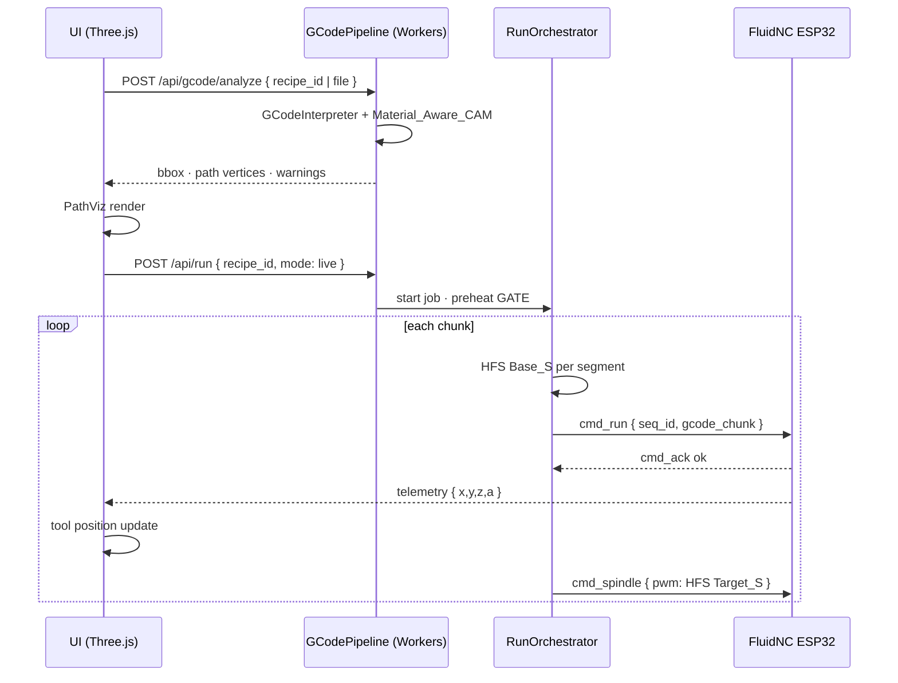

# G-code & CAM Pipeline

핫 블레이드 터닝은 **물리적 칼날 절삭이 아니라 열에 의한 용융 (Melting)** 입니다.
따라서 G-code 파이프라인의 핵심은 **이송 속도 F ↔ 열선 출력 S** 의 상관관계와 **[열적 지연(τ)](02-Thermal-Engine-Sensing.md#thermal_inertia_model--열적-관성-및-지연-모델링-mvp-v01-필수)** 을 반영한 **보간·동기화** 입니다.

> 좌표·A_POS/A_VEL: [01 Hardware & Motion](01-Hardware-Motion.md)
> `ThermalCutterEngine` · τ: [02 Thermal Engine](02-Thermal-Engine-Sensing.md)
> WebSocket chunk · `seq_id`: [03 Software & Protocol](03-Software-Protocol.md)
> 레시피 · `material_density_factor`: [04 Data & Operations](04-Data-Operations.md)
> A↔Z 동축 · `Z_ref`: [07 Mechanical Alignment](07-Mechanical-Specs.md#a축-z축열선-중심-정렬)
> **SD 오프라인 Export**: [05 SD Export](05-GCode-CAM-Pipeline.md#sd-오프라인-익스포트-mvp-v01-필수) · [03 연결 모드](03-Software-Protocol.md#sd-카드-기반-g-code-워크플로-mvp-v01-필수)

---

## 개요 · 데이터 흐름

```text
[입력]
  recipes.gcode_template  │  .gcode 업로드  │  Material_Aware_CAM
            │
            ▼
┌─────────────────────────────────────────────────────────────┐
│  Cloudflare Workers — GCodePipeline                          │
│  ① Static Interpreter (사전 분석)                             │
│  ② Material_Aware_CAM · Profile_Trig · Kerf/Wire Z · **Edge Case** │
│  ③ HFS · Corner_Dwell · Entry/Exit · Override Sync           │
│  ④ ChunkBuilder → cmd_run { seq_id, gcode_chunk }            │
└─────────────────────────────────────────────────────────────┘
            │
            ▼ WebSocket
┌──────────────────┐     ┌─────────────────────────────────────┐
│ ESP32 FluidNC    │     │ Next.js UI — Three.js PathViz        │
│ 4축 버퍼·실행    │     │ gcode-parser · 실시간 Tool Position  │
└──────────────────┘     └─────────────────────────────────────┘
```

| 계층 | 책임 | 실행 위치 |
| :--- | :--- | :--- |
| **CAM / 정적 분석** | F·S·Z 보정 · 헬리컬 경로 생성 | Workers (서버만) |
| **HFS 런타임** | 가속/감속 구간 S 동적 보간 | Workers `RunOrchestrator` |
| **G-code 실행** | X/Y/Z/A 동기 · M3/M210 | ESP32 **FluidNC** |
| **시각화** | 경로·현재 위치 | Browser **Three.js** |

---

## 물리 원칙 · 열 - 속도 결합

| 전통 CNC | 핫 블레이드 터닝 |
| :--- | :--- |
| 칼날 기하 · 절삭력 | **열 유입률** · 용융 깊이 |
| F↑ → 부하↑ | F↑ → **체류 시간↓** → 동일 S 에서 **과소용융** |
| F↓ → 부하↓ | F↓ → **체류 시간↑** → 동일 S 에서 **과용융·Pitting** |
| 즉시 반응 | **τ ≈ 2s** 열적 관성 — [02 Thermal_Inertia_Model](02-Thermal-Engine-Sensing.md#thermal_inertia_model--열적-관성-및-지연-모델링-mvp-v01-필수) |

**설계 목표**: 단위 길이당 흡수 열에너지 \(E' \approx P / F\) 를 구간마다 **일정**하게 유지.

```text
P ∝ S²  (PWM 근사)
E' = P/F  →  S ∝ √(F)  (정상 상태)

런타임 HFS (1차 근사 · 직선 구간):
  Target_S = Base_S × (Actual_F / Target_F)

코너·감속 (Actual_F < 0.8 × Target_F):
  S_adj = S_target × √(Actual_F / Target_F)  — [Corner_Dwell_Control](#corner_dwell_control--코너-부하-보정-mvp-v01-필수)
```

---

## HFS — Heat-Feed Sync 보간 알고리즘 `[MVP v0.1 필수]`

### 정의

**HFS (Heat-Feed Sync)** 는 FluidNC 가 보간하는 **실제 이송 속도 `Actual_F`** (가속·감속·코너 블렌드 반영) 에 맞춰 **열선 PWM `S`** 를 실시간으로 스케일링합니다.

```text
Target_S = clamp(
  Base_S × (Actual_Feedrate / Target_Feedrate) × α_accel,
  S_min, S_max
)

α_accel = getAccelerationCompensationRatio(v, a)  — [02 ThermalCutterEngine]
```

| 기호 | 의미 | 출처 |
| :--- | :--- | :--- |
| `Base_S` | 세그먼트 목표 정상상태 S | `ThermalCutterEngine.sFromModel()` |
| `Target_F` | G-code `F` (mm/min) | 파서 |
| `Actual_F` | 보간기 순간 피드 | FluidNC telemetry 또는 Workers 적분 |
| `S_min` / `S_max` | `thermal_profiles.pwm_min/max` | D1 |

### 가속·감속 구간

가속 시 `Actual_F < Target_F` → **S 자동 감소** → 감속 정지 구간에서 자재가 **과도하게 녹지 않음**.

```text
[속도 프로파일 vs HFS]

F
│     ╱──────╲        Target_F ─────────
│    ╱        ╲
│   ╱          ╲
└──────────────────► path

S (HFS)
│    ╱──╲              Base_S ────────
│   ╱    ╲             Actual_F 비례 스케일
│  ╱      ╲
└──────────────────► path
```

### 열적 지연 (τ) 선행 보상

S 변경 후 온도 도달까지 **τ** 지연 → Workers 가 **F 구간 진입 전** S 를 선행 적용.

```typescript
/** HFS + Thermal Inertia — RunOrchestrator */
import { evaluate, multiply, clamp } from 'mathjs';

interface HfsSegment {
  baseS: number;
  targetF: number;       // mm/min
  lengthMm: number;
  leadTauSec: number;    // profile.thermal_tau_sec
}

function hfsTargetS(
  baseS: number,
  actualF: number,
  targetF: number,
  accelRatio: number,
  sMin = 0,
  sMax = 1000,
): number {
  if (targetF <= 0) return baseS;
  const fRatio = actualF / targetF;
  const scale = fRatio < 0.8 ? Math.sqrt(fRatio) : fRatio; // Corner_Dwell
  const s = baseS * scale * accelRatio;
  return Math.round(clamp(s, sMin, sMax) as number);
}

/** 세그먼트 시작 전 lead time — 02 leadTimeSec */
function leadDistanceMm(targetF: number, tauSec: number, fraction = 0.63): number {
  const leadSec = tauSec * fraction;
  return (targetF / 60) * leadSec;
}
```

**chunk 삽입 패턴** (감속 진입 8mm 전 S 선행):

```gcode
; HFS lead — τ=2s, F=400, lead≈8.4mm
G01 X112 Y0 Z32 F400
M3 S420          ; Base_S at F=400
G01 X120 Y0 Z32 F400
```

### HFS 상태기 (Workers)

```text
SEGMENT_IDLE
    → parse G01 block { Base_S, Target_F, length }
    → HFS_ACTIVE
         매 100ms telemetry:
           Actual_F from device or planner mirror
           Target_S = hfsTargetS(...)
           if |S - pwm_actual| > 15 → cmd_spindle { seq_id, pwm: Target_S }
    → segment end → SEGMENT_IDLE
```

| 모드 | HFS |
| :--- | :--- |
| `ui_sim` | MockDeviceEngine 동일 수식 |
| `device_dry` | S 계산·로그만 · M3 무시 |
| `live` | `cmd_run` chunk + `cmd_spindle` HFS |

> **코너 √ 보정**: [Corner_Dwell_Control](#corner_dwell_control--코너-부하-보정-mvp-v01-필수) · **진입/퇴출**: [Thermal_Entry_Exit](#thermal_entry_exit--진입퇴출-알고리즘-mvp-v01-필수) · **UI Override**: [Real-time_Sync_Override](#real-time_sync_override--실시간-동기화-mvp-v01-필수)

---

## Thermal_Entry_Exit — 진입/퇴출 알고리즘 `[MVP v0.1 필수]` {#thermal_entry_exit-- 진입퇴출 - 알고리즘 -mvp-v01- 필수}

가공 경로 **첫 접촉**·**이탈** 구간은 열적 **비정상상태 (Transient)** 가 집중됩니다.
CAM·`RunOrchestrator` 가 **Lead-in / Lead-out** G-code 블록을 자동 삽입하여 **Steady State** 를 확보합니다.

### Lead-in (탄젠트 진입)

| 항목 | 규칙 |
| :--- | :--- |
| **가열 선행 거리** | 목표 가공점 **5mm 전방** (`lead_in_mm = 5`) — **편심 시** [보정](#편심eccentricity--lead-in-거리-보정) |
| **가열 시작** | `M3 S{Base_S}` — [preheat GATE](02-Thermal-Engine-Sensing.md#thermal_inertia_model--열적-관성-및-지연-모델링-mvp-v01-필수) 통과 후 |
| **접근 속도** | `F_approach` = `Target_F × approach_ratio` (기본 **0.4**) |
| **진입 형태** | 경로 **탄젠트** 접선 — 급격한 법선 진입 금지 |
| **Steady State** | `wire_temp_c ≥ T_target − margin` **연속 1s** 후 본 `Target_F` 전환 |

```text
[Lead-in 시퀀스 — X-Z 터닝 예]

P_cut (120, Z32)  ← 본 가공 시작점
    │
    │◄── 5mm lead_in ──► P_pre (115, Z32)
    │
P_heat (110, Z32)  ← M3 S{Base_S} ON (τ 선행)

G-code:
  G00 X110 Y0 Z32              ; 급속 접근 (열선 OFF)
  M3 S620                      ; 가열 시작 (5mm 전방)
  G4 P2                        ; τ soak (선택 · gate 미충족 시)
  G01 X115 Y0 Z32 F160         ; F_approach = 400×0.4
  G01 X120 Y0 Z32 F400         ; 본 Target_F · Steady State 진입
```

```typescript
interface LeadInPolicy {
  leadInMm: number;           // 5
  approachRatio: number;      // 0.4 → F_approach
  soakSec: number;            // 1.0 — steady state 확인
  tempMarginC: number;        // 15 — T_target 대비
}

function buildLeadInBlocks(
  pPre: Vec3,
  pCut: Vec3,
  baseS: number,
  targetF: number,
  policy: LeadInPolicy,
): string[] {
  const fApproach = Math.round(targetF * policy.approachRatio);
  return [
    `G00 X${pPre.x} Y${pPre.y} Z${pPre.z}`,
    `M3 S${baseS}`,
    `G01 X${pCut.x} Y${pCut.y} Z${pCut.z} F${fApproach}`,
    `;@nexa steady_gate min_temp margin=${policy.tempMarginC}`,
    `G01 X${pCut.x} Y${pCut.y} Z${pCut.z} F${targetF}`,
  ];
}
```

**D1 / 레시피** (`resume_policy_json` 확장 또는 `cam_entry_json`):

```json
{
  "lead_in_mm": 5,
  "f_approach_ratio": 0.4,
  "steady_soak_sec": 1.0,
  "lead_out_mm": 2,
  "cam_edge_case_ref": "default"
}
```

> Edge Case · Scan · 편심: [Material_Aware_CAM § Edge Case](#edge-case-cam--비정형-자재--편심-보정-mvp-v01-필수)

### Lead-out (잔열 완수 · 급속 탈출)

| 항목 | 규칙 |
| :--- | :--- |
| **가열 중단 선행** | 가공 종료점 **2mm 전** (`lead_out_mm = 2`) |
| **명령** | `M5` **선행 송신** (`cmd_spindle {0}` + chunk 내 `M5`) |
| **경로 완수** | 잔열 (residual heat) 로 **2mm 구간** 절삭 완료 |
| **탈출** | `G00` 급속 이송 — 열선이 자재에 **정지**하지 않도록 |

```text
[Lead-out 시퀀스]

P_end (160, Z28)     ← 가공 종료점
    │
    │◄── 2mm lead_out ──► P_off (158, Z28)  ← M5 here
    │
P_escape (180, Z34)  ← G00 탈출 (열선 OFF 상태)

G-code:
  G01 X158 Y0 Z28 F400         ; lead_out 시작
  M5                           ; 가열 중단 (2mm 전)
  G01 X160 Y0 Z28 F400         ; 잔열 완수
  G00 X180 Y0 Z34              ; 급속 탈출
```

```typescript
function buildLeadOutBlocks(
  pOff: Vec3,
  pEnd: Vec3,
  pEscape: Vec3,
  targetF: number,
): string[] {
  return [
    `G01 X${pOff.x} Y${pOff.y} Z${pOff.z} F${targetF}`,
    'M5',
    `G01 X${pEnd.x} Y${pEnd.y} Z${pEnd.z} F${targetF}`,
    `G00 X${pEscape.x} Y${pEscape.y} Z${pEscape.z}`,
  ];
}
```

### HFS · Entry/Exit 연동

| 구간 | HFS 모드 | S 정책 |
| :--- | :--- | :--- |
| Lead-in 접근 | 선형 HFS | `F_approach` 기준 `Base_S × (F_approach/Target_F)` |
| Lead-in → 본 가공 | τ gate | 온도 미달 시 **F 유지** · S ramp |
| 본 가공 | 선형 / √ 코너 | [HFS](#hfs--heat-feed-sync-보간-알고리즘-mvp-v01-필수) |
| Lead-out | **M5 고정** | S=0 · F 유지로 잔열 절삭 |

> Safe Resume 재진입: [03 Safe Resume Phase 3](03-Software-Protocol.md#phase-3--re-entry-저속-진입) — Lead-in 과 **동일** 저속·저출력 원칙.

---

## Corner_Dwell_Control — 코너 부하 보정 `[MVP v0.1 필수]` {#corner_dwell_control-- 코너 - 부하 - 보정 -mvp-v01- 필수}

코너·곡률 반경에서 FluidNC 가 **감속**하면 `Actual_F` 가 `Target_F` 보다 낮아집니다.
선형 HFS (`S ∝ F`) 만으로는 **E' = P/F** 가 여전히 높아 **코너 과용융** 이 발생할 수 있습니다.

### 동적 S-Sync (√ 감쇄)

**조건**: `Actual_F < Target_F × 0.8` (코너 감속 구간 진입)

```text
S_adj = S_target × √(Actual_F / Target_F)

S_target = Base_S (세그먼트 정상상태)
```

| Actual_F / Target_F | 선형 HFS `S` | **√ Corner_Dwell** `S_adj` |
| :---: | :---: | :---: |
| 1.0 | 100% | 100% |
| 0.8 | 80% | **89%** |
| 0.5 | 50% | **71%** |
| 0.25 | 25% | **50%** |

> **실험적 검증 필요**: √ 법칙은 \(E' \propto S^2/F\) 를 일정하게 유지하는 1 차 근사. 현장 Ø·ρ·코너 반경별 로그 회귀 권장.

```typescript
import { sqrt, clamp } from 'mathjs';

const CORNER_F_RATIO = 0.8;

function hfsTargetSWithCorner(
  baseS: number,
  actualF: number,
  targetF: number,
  accelRatio: number,
  sMin = 0,
  sMax = 1000,
): number {
  if (targetF <= 0) return baseS;
  const fRatio = actualF / targetF;
  let scale: number;
  if (fRatio < CORNER_F_RATIO) {
    scale = sqrt(fRatio);  // Corner_Dwell √
  } else {
    scale = fRatio;        // 선형 HFS
  }
  const s = baseS * scale * accelRatio;
  return Math.round(clamp(s, sMin, sMax) as number);
}
```

### 코너 감지 (Workers)

| 소스 | 방법 |
| :--- | :--- |
| **정적** | `GCodeInterpreter` — 연속 세그먼트 각도 Δθ > `corner_angle_deg` (기본 **30°**) |
| **동적** | telemetry `actual_f < 0.8 × target_f` **200ms** 연속 |

```text
CORNER_IDLE
    → actual_f / target_f < 0.8 for 200ms
    → CORNER_DWELL (√ S_adj 매 100ms)
    → actual_f / target_f ≥ 0.85
    → CORNER_IDLE (선형 HFS 복귀)
```

**G-code 메타**:

```gcode
;@nexa corner_dwell sqrt enabled threshold=0.8
G01 X140 Y0 Z30 F400
```

---

## Real-time_Sync_Override — 실시간 동기화 `[MVP v0.1 필수]` {#real-time_sync_override-- 실시간 - 동기화 -mvp-v01- 필수}

섹션 B **Feed Override** 슬라이더 (50–150%) 변경 시 **F 와 S 를 동시에** 재동기화합니다.
S 만 늦게 따라가면 **E' = P/F** 불균형 → 과용융·저온 끌림.

### WebSocket — `cmd_override_sync`

> 프로토콜 canonical: [03 WebSocket · `cmd_override_sync`](03-Software-Protocol.md#websocket-메시지--통합-명세-canonical)

| 방향 | type | payload |
| :--- | :--- | :--- |
| UI→Server | `cmd_override_sync` | `{ feed_override_pct: 50–150, job_id? }` |
| Server→Device | `cmd_override_sync` | `{ seq_id, feed_override_pct, s_base, target_f_eff, ramp_ms? }` |
| Server→UI | `override_sync_ack` | `{ applied: true, s_base, latency_ms, held?: boolean }` |

```json
{
  "type": "cmd_override_sync",
  "seq_id": 2105,
  "feed_override_pct": 120,
  "s_base": 744,
  "target_f_eff": 480,
  "ramp_ms": 80
}
```

### 로직 (Workers `RunOrchestrator`)

```text
UI Feed_Override 변경 (예: 100% → 120%)
    │
    ├─ target_f_eff = Target_F × (feed_override_pct / 100)
    ├─ s_base = ThermalCutterEngine.sFromModel(target_f_eff, …)
    │            × HFS ratio if actual_f already scaled
    │
    ├─ t0 = now
    ├─ cmd_override_sync { seq_id, feed_override_pct, s_base, target_f_eff }
    ├─ (optional) FluidNC feed override % — $J= or chunk F scale
    │
    ├─ await cmd_ack OR pwm_actual within ±20 of s_base
    │
    └─ latency = now - t0
         latency > 100ms → FEED_HOLD · override **보류**
         latency ≤ 100ms → override **적용**
```

```typescript
const OVERRIDE_SYNC_MAX_MS = 100;

interface OverrideSyncRequest {
  feedOverridePct: number;  // 50–150
  jobId?: number;
}

async function applyFeedOverride(
  req: OverrideSyncRequest,
  orch: RunOrchestrator,
): Promise<{ applied: boolean; held: boolean; sBase: number }> {
  const targetFEff = orch.targetF * (req.feedOverridePct / 100);
  const sBase = orch.engine.sFromModel(
    orch.engine.calculateRequiredPower(targetFEff, orch.material, orch.wireLen),
    orch.wire,
    orch.wireLen,
  );
  const t0 = Date.now();
  await orch.sendCmdOverrideSync({ feedOverridePct: req.feedOverridePct, sBase, targetFEff });
  const ok = await orch.waitPwmSettle(sBase, { timeoutMs: OVERRIDE_SYNC_MAX_MS, tolerance: 20 });
  const latency = Date.now() - t0;
  if (!ok || latency > OVERRIDE_SYNC_MAX_MS) {
    await orch.feedHold('override_sync_timeout');
    return { applied: false, held: true, sBase };
  }
  orch.setFeedOverride(req.feedOverridePct);
  return { applied: true, held: false, sBase };
}
```

### 제약 · E' 균형

| 규칙 | 설명 |
| :--- | :--- |
| **100ms SLA** | `cmd_override_sync` → `pwm_actual` 반영 **≤100ms** — 초과 시 F 변경 **보류** |
| **동시 갱신** | F scale 과 `s_base` **한 메시지** — S 만 선행/후행 금지 |
| **HFS 연속** | override 적용 후에도 [Corner_Dwell](#corner_dwell_control--코너-부하-보정-mvp-v01-필수) √ 규칙 유지 |
| **live only** | `device_dry` — F 만 · S 로그 · `ui_sim` — Mock 즉시 |
| **RUN 중** | override 허용 · PAUSE 중 — 다음 RESUME 에 반영 |

**UI (섹션 B Override 슬라이더)**:
- 드래그 종료 시 `cmd_override_sync` (매 프레임 X)
- 보류 시 토스트: 「열선 출력 동기화 지연 — 속도 변경 보류」
- 게이지: `feed_override_pct` · `s_base` · `E_prime_est` (P/F)

---

## 헬리컬 터닝 — Continuous Turning `[MVP v0.1 필수]`

원통·스트링 바 **연속 깎기** — A 축 **연속 회전** (`A_VEL` / `M210`) + X/Z 선형 이송 동기.

### 보간식

```text
G01 X{L} A{360 × n} F{f}

L  : X 방향 이송 길이 (mm)
n  : 나선 밀도 (turns/mm × L  또는 총 회전수)
A  : 누적 각도 (°) — 다회전 허용 (G90)
f  : 이송 속도 (mm/min) — Material_Aware_CAM 산출
```

**예**: L=120mm, n=2 (총 2 회전) → `A720`

```gcode
; Continuous helical pass — Ø34 string bar roughing
G90
M210 R5                    ; A_VEL 5 RPM (연속)
G01 X40  Y0 Z34 F0          ; 접근
G01 X160 Y0 Z32 F380        ; helical: ΔX=120, implicit ΔA via M210 sync
; 또는 명시적 각도 동기 (A_POS 블렌드):
G01 X160 Y0 Z32 A720 F380   ; 2 rev over 120mm
M211
```

### 나선 피치 · RPM · F 관계

```text
P = L / n                    ; mm/rev — L: X 이송 길이(mm), n: 총 회전수

pitch_mm = P = ΔX / (A_deg / 360)   ; 동치

F_mm_min = P × RPM           ; M210 A_VEL 동기 시
```

| 파라미터 | MVP 기본 | 설명 |
| :--- | :--- | :--- |
| `P` | `L/n` | **나선 피치** (mm/rev) — [Profile_Turning](#profile_turning_trigonometry--형상-보간-알고리즘-mvp-v01-필수) |
| `overlap_factor` | **0.35** | 인접 나선 간 겹침 |
| `melt_width_mm` | 0.8–1.2 | `f(S,F,ρ)` — [Kerf_&_Wire_Offset](#kerf__wire_offset--최종-좌표-보정-mvp-v01-필수) |
| `a_rpm` | 3–8 | StallGuard 한계 내 |

### `HelicalPathGenerator` (CAM)

```typescript
import { multiply, divide } from 'mathjs';

interface HelicalParams {
  xStart: number; xEnd: number;
  zStart: number; zEnd: number;
  revolutions: number;   // n — total turns
  feedMmMin: number;
  useAVel: boolean;      // M210 vs G01 A
  rpm?: number;
}

function generateHelicalBlock(p: HelicalParams): string[] {
  const dX = p.xEnd - p.xStart;
  const dZ = p.zEnd - p.zStart;
  const aDeg = 360 * p.revolutions;
  const lines: string[] = ['G90'];
  if (p.useAVel && p.rpm) {
    lines.push(`M210 R${p.rpm}`);
    lines.push(`G01 X${p.xEnd} Y0 Z${p.zEnd} F${p.feedMmMin}`);
    lines.push('M211');
  } else {
    lines.push(`G01 X${p.xEnd} Y0 Z${p.zEnd} A${aDeg} F${p.feedMmMin}`);
  }
  return lines;
}
```

> Ø 동적 StallGuard: [01 A_VEL · Ø](01-Hardware-Motion.md#stallguard--모재-지름-동적-부하-임계-a_vel-mvp-v01-필수) · `cmd_stall_policy` 선행.
> **테이퍼·유선형 Ø 변화**: [Profile_Turning_Trigonometry](#profile_turning_trigonometry--형상-보간-알고리즘-mvp-v01-필수).

---

## Profile_Turning_Trigonometry — 형상 보간 알고리즘 `[MVP v0.1 필수]` {#profile_turning_trigonometry-- 형상 - 보간 - 알고리즘 -mvp-v01- 필수}

스트링 바·테이퍼 구간처럼 **지름 Ø 가 X(길이) 에 따라 변하는** 프로파일에서 **X–Z–A 3 축 동기** 삼각함수 보간을 수행합니다.
(원통 고정 Ø 는 [헬리컬 터닝](#헬리컬-터닝--continuous-turning-mvp-v01-필수) · Phase 2 `diameter_profile_json` — [01 Ø(Z)](01-Hardware-Motion.md#stallguard--모재-지름-동적-부하-임계-a_vel-mvp-v01-필수))

### 좌표 · 기하

```text
R(x) = Ø(x) / 2                    ; 현재 X 위치 반경

Z_target(x) = R(x) + Kerf_Offset     ; 절삭점 높이 (Kerf 동적 보정)

θ = atan2( dR/dx, 1 )              ; 테이퍼 기울기 각 (rad)
   ≈ atan( ΔR / ΔX )               ; 세그먼트 근사
```

| 축 | 보간 |
| :--- | :--- |
| **X** | 독립 이동 · 패스 길이 `L` |
| **Z** | `Z_target(Ø_current)` — [Kerf_Offset](#kerf__wire_offset--최종-좌표-보정-mvp-v01-필수) |
| **A** | `G01 A{360×Δn}` 또는 `M210` + `P=L/n` 나선 |

### 나선 피치

```text
P = L / n        (mm/rev)

L : 패스 X 방향 총 이송 (mm)
n : 해당 구간 총 회전수 (turns)
```

**예**: L=120mm, n=2 → **P=60 mm/rev**

### 실시간 F 보정 (ρ · 기울기)

테이퍼에서 **표면 선속도**는 경사 θ 에 따라 유효 접선 속도가 달라집니다.
`material_density_factor` (ρ) 와 함께 가중:

```text
F_adj = F_base × (1 / ρ) × cos(θ)

F_base : Material_Aware F_max 또는 레시피 nominal F
ρ      : recipes.material_density_factor (≥0.7 clamp)
θ      : 테이퍼 기울기 — 0°=원통, θ→90° 시 cos→0 → F 하한 clamp
```

| θ | cos(θ) | 효과 |
| :---: | :---: | :--- |
| 0° | 1.0 | 원통 — `F_adj = F_base/ρ` |
| 30° | 0.87 | 완만 테이퍼 |
| 45° | 0.71 | 중간 테이퍼 |
| 60° | 0.50 | 급테이퍼 — Stall·과용융 주의 |

```typescript
import { cos, atan, clamp } from 'mathjs';

interface ProfileSegment {
  x0: number; x1: number;
  d0: number; d1: number;   // Ø at x0, x1
  nRev: number;             // turns over [x0,x1]
  fBase: number;
  rho: number;
}

function profileSegmentParams(seg: ProfileSegment) {
  const L = seg.x1 - seg.x0;
  const P = L / seg.nRev;                    // mm/rev
  const dR = (seg.d1 - seg.d0) / 2;
  const theta = atan(dR / L);                // rad
  const fAdj = seg.fBase * (1 / seg.rho) * cos(theta);
  const fClamp = clamp(fAdj, 50, 600) as number;
  return { pitchMm: P, thetaRad: theta, fAdj: fClamp };
}

function zTargetAtX(x: number, profile: { x: number; d: number }[], kerfOffset: number): number {
  const d = lerpDiameterAtX(x, profile);
  return d / 2 + kerfOffset;
}

function lerpDiameterAtX(x: number, profile: { x: number; d: number }[]): number {
  // diameter_profile_json — [01 dEffAtZ] 동형
  for (let i = 0; i < profile.length - 1; i++) {
    const a = profile[i], b = profile[i + 1];
    if (x >= a.x && x <= b.x) {
      const t = (x - a.x) / (b.x - a.x);
      return a.d + t * (b.d - a.d);
    }
  }
  return profile[profile.length - 1]?.d ?? profile[0].d;
}
```

### X–Z–A 동기 G-code 생성

```text
[x0,Ø0] ──θ──► [x1,Ø1]
     │  Z_target = R + Kerf_Offset
     │  A += 360×Δn  (또는 M210 + P)
     └─ G01 blocks: N_interp 점 (기본 20)
```

```gcode
;@nexa profile taper x0=40 x1=160 d0=34 d1=28 n=2 rho=1.0
; P=60mm/rev  θ≈2.4°  F_adj≈395
G90
G01 X40  Y0 Z17.10 F0          ; Z = 34/2 + kerf
G01 X80  Y0 Z16.40 A180 F392   ; Ø=31 중간점
G01 X120 Y0 Z15.70 A360 F390
G01 X160 Y0 Z14.70 A720 F388   ; Ø=28
```

```typescript
function generateProfilePass(
  seg: ProfileSegment,
  kerfOffset: number,
  steps = 20,
): string[] {
  const { fAdj } = profileSegmentParams(seg);
  const lines = ['G90'];
  const profile = [
    { x: seg.x0, d: seg.d0 },
    { x: seg.x1, d: seg.d1 },
  ];
  for (let i = 1; i <= steps; i++) {
    const t = i / steps;
    const x = seg.x0 + t * (seg.x1 - seg.x0);
    const z = zTargetAtX(x, profile, kerfOffset);
    const a = 360 * seg.nRev * t;
    lines.push(`G01 X${x.toFixed(3)} Y0 Z${z.toFixed(3)} A${a.toFixed(2)} F${fAdj}`);
  }
  return lines;
}
```

### 파이프라인 연동

```text
diameter_profile_json (recipe)
    → Profile_Turning_Trigonometry { P, θ, F_adj, Z_target }
    → [Kerf_&_Wire_Offset] Z_final per block
    → HFS Base_S(F_adj) · StallGuard Ø(x)
```

---

## Material_Aware_CAM 알고리즘 `[MVP v0.1 필수]` {#material_aware_cam-알고리즘-mvp-v01-필수}

레시피 `material_density_factor` (ρ), `diameter_mm` (D), `thermal_k` 를 반영한 **F·Z·S** 제약.

> **기본 형상**: 원통·테이퍼·헬리컬 — [Profile_Turning](#profile_turning_trigonometry--형상-보간-알고리즘-mvp-v01-필수) · [Helical](#헬리컬-터닝--continuous-turning-mvp-v01-필수)  
> **예외 형상**: 비정형 외경 · 편심 장착 — [Edge Case CAM](#edge-case-cam--비정형-자재--편심-보정-mvp-v01-필수)  
> 요약: Scan → `F_adj` · `e_mount`(장착, 상수) + `e_shape`(형상, 패스별 감쇠) · [Symmetry Convergence](#3-symmetry-convergence--패스별-대칭-수렴-mvp-v01-필수)

### Feedrate Optimization

```text
F_max = K / (ρ × D)

ρ  : material_density_factor (무차원, 1.0=기준 아이소핑크)
D  : diameter_mm
K  : engine_coefficients.thermal_k × cam_k_factor  (현장 튜닝)
```

| recipe Ø | ρ | K=42000 (예) | `F_max` |
| :---: | :---: | :---: | :---: |
| 8 mm | 1.0 | 42000 | **5250** mm/min → cap **800** |
| 20 mm | 1.0 | 42000 | **2100** |
| 34 mm | 1.1 | 42000 | **1124** |

**MVP 상한 clamp**: `F_max = min(K/(ρ×D), f_cap_recipe)` — 레시피별 `f_cap` 400–600 mm/min 권장.

```typescript
function fMaxMmMin(
  rho: number,
  diameterMm: number,
  thermalK: number,
  camKFactor = 1.0,
  fCap = 600,
): number {
  const k = thermalK * camKFactor;
  const raw = k / (rho * diameterMm);
  return Math.min(Math.round(raw), fCap);
}
```

### Kerf_&_Wire_Offset — 최종 좌표 보정 `[MVP v0.1 필수]` {#kerf__wire_offset-- 최종 - 좌표 - 보정 -mvp-v01- 필수}

실제 **G-code `G01 Z`** 값은 설계 프로파일 `Z_nominal` 에 **니크롬선 물리 두께** 와 **순수 용융폭** 을 합산해야 합니다.
`Z_nominal` 의 기준면 **C_W** (열선 헤드 중심) 는 [07 A↔Z 정렬](07-Mechanical-Specs.md#a축-z축열선-중심-정렬) 완료 후에만 유효합니다.
[Profile_Turning](#profile_turning_trigonometry--형상-보간-알고리즘-mvp-v01-필수) 의 `Z_target = R + Kerf_Offset` 에서 `Kerf_Offset` 은 본 절의 **동적 용융 보정** 입니다.

### 최종 Z 식

```text
Z_final = Z_nominal + (Wire_Diameter / 2) + (Melt_Width / 2)

Z_nominal     : CAM 설계 표면 (반경 기준 또는 축 기준 — 레시피 convention 통일)
Wire_Diameter : thermal_profiles.wire_diameter_mm (0.5–1.2 mm)
Melt_Width    : f(S, F, ρ) — 순수 용융 폭 (열선 외곽 제외)
```

| 항목 | D1 / 출처 | MVP 예 |
| :--- | :--- | :---: |
| `Wire_Diameter` | `thermal_profiles.wire_diameter_mm` | **0.5** |
| `Z_nominal` | CAM 프로파일 · `R = Ø/2` | 17.0 |
| `Melt_Width` | 런타임 `f(S,F,ρ)` | 0.9 mm |
| **`Z_final`** | G-code 출력 | **17.0 + 0.25 + 0.45 = 17.70** |

### Melt_Width 모델 — `f(S, F, ρ)`

```text
Melt_Width = melt_base × (S / S_ref)^γ × (F_ref / F)^β × ρ^δ

melt_base : 현장 캘리브 (Ø34 · F400 · S620 · ρ1.0) — 기본 0.8 mm
```

| 계수 | MVP | 설명 |
| :--- | :--- | :--- |
| `melt_base` | **0.80 mm** | 기준 용융폭 |
| `β` | **0.25** | F↑ → 용융폭↓ |
| `γ` | **0.15** | S↑ → 용융폭↑ |
| `δ` | **0.20** | ρ↑ → 용융폭↑ |
| `S_ref` / `F_ref` | 레시피 nominal | |

```typescript
import { pow } from 'mathjs';

function meltWidthMm(
  s: number,
  f: number,
  rho: number,
  meltBase = 0.8,
  sRef = 620,
  fRef = 400,
  beta = 0.25,
  gamma = 0.15,
  delta = 0.2,
): number {
  return meltBase * pow(s / sRef, gamma) * pow(fRef / f, beta) * pow(rho, delta);
}

/** G-code 출력 Z — CAM 후처리 · 런타임 chunk 빌더 */
function zFinalGcode(
  zNominal: number,
  wireDiameterMm: number,
  s: number,
  f: number,
  rho: number,
): number {
  const melt = meltWidthMm(s, f, rho);
  const kerfOffset = wireDiameterMm / 2 + melt / 2;
  return Number((zNominal + kerfOffset).toFixed(3));
}

/** Profile Z_target 과의 관계 */
function kerfOffsetFromMelt(wireDiameterMm: number, meltWidthMm: number): number {
  return wireDiameterMm / 2 + meltWidthMm / 2;
}
```

> **구분**: `Z_target = Ø/2 + Kerf_Offset` (프로파일 보간) 와 `Z_final = Z_nominal + wire/2 + melt/2` (G-code 출력) 는 **`Kerf_Offset = wire/2 + melt/2`** 로 동치 when `Z_nominal = Ø/2`.

### CAM 엔진 적용 순서

```text
1. CAM: Z_nominal 경로 생성 (Ø 프로파일 · 테이퍼)
2. 세그먼트별 Base_S = sFromModel(F_adj, …)
3. Melt_Width = meltWidthMm(Base_S, F_adj, ρ)
4. Z_final = zFinalGcode(Z_nominal, wire_d, Base_S, F_adj, ρ)
5. G01 … Z{Z_final} … M3 S{Base_S}
6. live: F/S 변화 시 chunk 경계에서 3–4 **재계산** (HFS 연동)
```

```gcode
;@nexa z_nom=17.000 melt=0.88 wire=0.5 z_final=17.690
G01 X120 Y0 Z17.690 F392 M3 S618
```

### 레거시 Kerf 보정 (단순 모델)

이전 `kerfCompZ` (용융폭 변화만 Z 미세조정) 는 **Melt_Width 동적 보정** 의 1 차 근사:

```text
Z_offset ≈ (melt_base - Melt_Width) / 2   ; F/S 변화 시 미세 trim
```

Phase 2: K-Type 실측 kerf 폭 피드백 → `melt_base` 자동 튜닝.

---

### Edge Case CAM — 비정형 자재 · 편심 보정 `[MVP v0.1 필수]` {#edge-case-cam--비정형-자재--편심-보정-mvp-v01-필수}

원통·테이퍼 **이상형(ideal)** 레시피는 `diameter_mm`·`Z_nominal = Ø/2` 를 **균일 반경** 으로 가정합니다.  
현장에서는 **비정형 단면**(찌그러진 스트링 바·이음매·부분 깎임)과 **A축 편심 장착** 이 빈번하므로, **본 가공 전** 스캔 패스와 **Lead-in 보정** 으로 F·진입 거리를 자동 조정합니다.

```text
[Edge Case CAM — 파이프라인 삽입점]

Recipe + cam_edge_case_json
    │
    ├─ (선택) Phase 0: ScanPassGenerator     ← StallGuard 부하 맵
    │       → irregularity_index · e_mm · φ₀
    │
    ├─ Material_Aware_CAM: F_adj = f(F_max, irregularity)
    ├─ [Symmetry Convergence] F_pass[i] · e_eff[i] · lead_in[i]
    ├─ LeadInPolicy: lead_in_mm += k_ecc × e_eff(pass)
    ├─ Profile / Helical 본 패스
    └─ HFS · Entry/Exit · chunk stream
```

| 시나리오 | 징후 | Edge Case 대응 |
| :--- | :--- | :--- |
| 편심 장착 | Ø 단면 **타원** · 4점 간극 차 | `e_mount` → **패스 전 구간 Lead-in** |
| 비정형 외경 | A 회전 중 `a_load_pct` **진폭 큼** | `e_shape` + Scan → F 감속 · **수렴 시 감쇠** |
| A↔Z 정렬 불량 | [07](07-Mechanical-Specs.md) TIR 초과 | 기계 정렬 **우선** · CAM 은 2차 보정 |
| 정상 원통 | `irregularity_index < 0.15` | Scan Pass **skip** · 기본 F |
| **패스 진행 · 대칭 수렴** | 깊은 패스에서 `a_load` 진폭 감소 | [Symmetry Convergence](#3-symmetry-convergence--패스별-대칭-수렴-mvp-v01-필수) — F·편심 보정 **단계적 완화** |

> **한계 (기존 설계)**: Scan Pass 는 **job 시작 1회** 만 수행 · `F_adj` 를 **전 패스에 고정** 적용하면 마지막 정삭 패스가 **불필요하게 느림**.  
> 대부분의 스트링 바는 **초기 단면은 비정형** 이지만 **깎기가 진행될수록 회전 대칭 원통** 에 수렴하므로, 아래 **Symmetry Convergence** 로 패스별 F·Lead-in 을 복원합니다.

---

#### 1. Scan Pass — 비정형 외경 인식 · F 자동 감속 `[MVP v0.1 필수]` {#scan-pass--비정형-외경-인식--f-자동-감속}

**목표**: 자재가 **완전 원통이 아닐** 때, 첫 패스에서 [StallGuard `a_load_pct`](01-Hardware-Motion.md#stallguard--모재-지름-동적-부하-임계-a_vel-mvp-v01-필수) 변화를 샘플링해 **이송 속도 F** 를 본 가공 전에 낮춥니다.

##### Scan Pass 시퀀스

| 단계 | 동작 | 파라미터 |
| :---: | :--- | :--- |
| **0** | preheat GATE 통과 · `device_dry` 궤적 확인 (선택) | — |
| **1** | **저출력** 접촉: `S_scan` = 레시피 `scan_s_pwm` (기본 **400**) | 열선 미용융 접촉 |
| **2** | `M210 R{rpm_scan}` (기본 **3 RPM**) · X 고정 · Z = `Z_nominal − 0.5mm` (얕은 터치) | |
| **3** | A축 **Δθ** 스텝 회전 (기본 **45°** × 8점) · 각 정지점 `a_load_pct` 샘플 | `scan_a_step_deg` |
| **4** | `F_scan = F_nominal × scan_f_ratio` (기본 **0.35**) | 저속 스캔 |
| **5** | 부하 맵 분석 → `irregularity_index` · `F_adj` 산출 | |
| **6** | Scan 종료 `M5` · 본 가공 `F_adj` 로 [Profile/Helical](#헬리컬-터닝--continuous-turning-mvp-v01-필수) 재생성 | |

```text
[Scan Pass — 부하 맵 (평면도)]

        A=0°   load 22%
        A=45°  load 38%  ← 돌출부
        A=90°  load 20%
        A=135° load 35%
        …
   irregularity_index = (max−min) / mean
```

```gcode
;@nexa phase=scan_pass recipe=string-34
G90
M210 R3                      ; 저속 회전
G01 X100 Y0 Z16.5 F0           ; Z_nominal=17.0 · 얕은 터치
M3 S400                        ; scan 저출력
G01 A0   F140 M3 S400          ; F_scan = 400×0.35
; telemetry sample a_load_pct @ A0
G01 A45  F140
; … A90 … A315 …
M5
;@nexa irregularity_index=0.42 f_adj=348
```

##### 부하 맵 · F 감속 모델

```text
samples[] = a_load_pct @ each A_stop          ; N = 360/scan_a_step_deg

load_mean = mean(samples)
load_span = max(samples) − min(samples)
irregularity_index = load_span / max(load_mean, 1)

F_adj = F_nominal × clamp(1 − k_irreg × irregularity_index, f_floor, 1.0)

k_irreg = 1.2    ; MVP
f_floor = 0.50   ; cam_edge_case_json.irregularity_f_floor
```

| `irregularity_index` | 판정 | `F_adj` (F=400 예) |
| :---: | :--- | :---: |
| **< 0.15** | 정상 원통 | **400** (변경 없음) |
| **0.15–0.30** | 경미 비정형 | **320–360** |
| **0.30–0.50** | 중간 | **240–320** |
| **> 0.50** | 심각 | **200** (`f_floor`) · UI 경고 |

```typescript
/**
 * Full reference: _ref/edge-case-cam.ts
 * Deploy target: packages/heating-cnc/cam/edge-case-cam.ts
 */
import {
  analyzeScanPass,
  eccentricityFromScan,
  buildLeadInWithEccentricity,
  generateScanPassGcode,
  runEdgeCaseCam,
  toScanResultJson,
  type ScanPassResult,
  type EccentricityModel,
} from './edge-case-cam';

// --- analyzeScanPass (요약) ---
const result = analyzeScanPass(
  [
    { aDeg: 0, aLoadPct: 22 },
    { aDeg: 45, aLoadPct: 38 },
    { aDeg: 90, aLoadPct: 20 },
  ],
  400,
  1.2,
  0.5,
);
// result.fAdj === 348, result.irregularityIndex ≈ 0.42

// --- pipeline ---
const output = runEdgeCaseCam({
  fNominal: 400,
  zNominal: 17,
  xCut: 100,
  yCut: 0,
  pPre: { x: 95, y: 0, z: 17 },
  pCut: { x: 100, y: 0, z: 17 },
  baseS: 800,
  leadInPolicy: { leadInMm: 5, approachRatio: 0.4, heatLeadMm: 5 },
  edgeCase: DEFAULT_CAM_EDGE_CASE,
  scanSamples: result.samples,
});
await db.updateJobLog(jobId, { scan_result_json: toScanResultJson(output) });
```

**StallGuard 연동**

- Scan 중 `a_load_pct` **> crit** → 즉시 `M5` · Scan **중단** · `irregularity_index = 1.0` · `F_adj = f_floor`
- `cmd_stall_policy` 는 scan 전용 **완화 임계** (`warn × 1.15`) — [01 동적 임계](01-Hardware-Motion.md#stallguard--모재-지름-동적-부하-임계-a_vel-mvp-v01-필수)
- Scan 결과 D1 `job_logs.scan_result_json` · UI 「비정형 감지 — F xxx」배너

---

#### 2. 편심(Eccentricity) · Lead-in 거리 보정 `[MVP v0.1 필수]` {#편심eccentricity--lead-in-거리-보정}

**목표**: 모재가 A축 회전 중심에서 어긋나거나 단면이 비정형일 때 **타원 절단·Pitting** 을 줄입니다.  
편심은 **두 가지 물리 원인** 으로 분리합니다 — 이후 [Symmetry Convergence](#3-symmetry-convergence--패스별-대칭-수렴-mvp-v01-필수) 에서 **감쇠 대상이 다릅니다**.

##### 이원화 편심 모델 (Dual Eccentricity)

| 구분 | 기호 | 물리 의미 | 패스별 변화 | 입력 소스 |
| :--- | :---: | :--- | :--- | :--- |
| **장착 편심** | `e_mount` | A축 회전 중심 ≠ 모재 중심 (클램프·정렬) | **상수** — 패스와 무관 | [07 4점 간극](07-Mechanical-Specs.md#a축-z축열선-중심-정렬) · 수동 |
| **형상 편심** | `e_shape` | 비정형 외경·돌출부 (단면이 원이 아님) | **감쇠** — 대칭 수렴 `s` 에 따라 0 으로 | Scan 부하 맵 · `irregularity_index` |

```text
[이원화 — 단면]

  C_A ●──────── e_mount ────────● C_w (모재 중심, 장착 오프셋)
       \                          /
        \   e_shape: 외곽 비대칭  /
         ╰──╮ 찌그러진 외경      ╭╯
            ╰────────────────────╯

e_effective(pass) = e_mount + e_shape × (1 − s)^α

lead_in_adj(pass) = lead_in_base + k_ecc × e_effective(pass)
```

> **핵심**: 마지막 finish 패스에서도 `e_mount > 0` 이면 Lead-in 보정이 **완전히 0이 되지 않음** — 장착 문제는 가공만으로 사라지지 않기 때문.

##### 편심 추정 · 분해 (`decomposeEccentricity`)

| 방법 | 입력 | `e_mount` | `e_shape` |
| :--- | :--- | :--- | :--- |
| **4점 간극** (장착) | 07 A↔Z 4점 | `(max−min)/2` | 0 (또는 scan 잔차) |
| **Scan Pass** (형상) | 부하 맵 `load_span` | 0 (gap4 없을 때) | `k_load × span` |
| **혼합** (권장) | gap4 + scan | gap4 값 | `max(0, e_scan − e_mount)` |
| **irregularity** (보조) | `I₀` | — | `k_shape × I₀` (scan 잔차 0 일 때) |
| **수동** | UI 슬라이더 2개 | 「장착 편심」 | 「형상 편심」 |

```typescript
import { decomposeEccentricity, effectiveEccentricityForPass } from './edge-case-cam';

const split = decomposeEccentricity({
  gap4: [1.2, 0.4, 1.0, 0.6],   // e_mount ≈ 0.4mm
  scanSamples: samples,          // e_shape ≈ 0.6mm (잔차)
  irregularityIndex: 0.42,
});
// { eMountMm: 0.4, eShapeMm: 0.6, phaseDeg: 0, … }

const p2 = effectiveEccentricityForPass(split, 1.0, 1.5);
// p2.eMountMm === 0.4  (유지)
// p2.eShapeEffMm === 0 (수렴)
// p2.eEffectiveMm === 0.4
```

```text
lead_in_base = cam_entry_json.lead_in_mm     ; 기본 5mm
k_ecc        = cam_edge_case_json.eccentricity_lead_k   ; 기본 1.5

F_approach_adj = F_approach × (1 − 0.1 × e_effective)   ; pass 0 기준
```

| `e_mount` | `e_shape` | `s` | `e_eff` | `lead_in` (base=5, k=1.5) |
| :---: | :---: | :---: | :---: | :---: |
| 0.4 | 0.6 | 0.0 | **1.0** | 6.5 mm |
| 0.4 | 0.6 | 0.5 | **0.55** | 5.8 mm |
| 0.4 | 0.6 | 1.0 | **0.4** | 5.6 mm |
| 0 | 0.6 | 1.0 | **0** | 5.0 mm |

**Z 미세 보정 (선택 · `e_mm > 0.8`)**

```text
Z_final(θ) = Z_nominal + kerf/2 + e_mm × sin(θ − phase_deg)   ; θ = A_pos
```

Phase 2: K-Type·Scan 융합으로 `Z(θ)` 실시간 보정. MVP 는 **Lead-in 연장** 만.

> **Phase 2 아이디어 (검토 대기)**: 스마트폰 웹캠 **Vision Scan** 으로 외형 1차 추정 → 기계 Scan Pass **하이브리드 검증** — [00 아이디어 메모](00-Vision-Overview.md#phase-2-아이디어-메모--스마트폰-웹캠).

> 기계 정렬 [07 Mechanical Alignment](07-Mechanical-Specs.md#mechanical-alignment--하드웨어-정렬-및-물리적-교정-mvp-v01-필수) 이 **1차** · CAM 편심 보정은 **2차 소프트웨어 완화**.

---

#### 3. Symmetry Convergence — 패스별 대칭 수렴 `[MVP v0.1 필수]` {#3-symmetry-convergence--패스별-대칭-수렴-mvp-v01-필수}

**물리적 근거**: 열선 터닝은 **목표 반경 `Z_nominal`** 을 기준으로 재료를 제거합니다.  
초기 외경이 찌그러져 있어도 **패스가 반복·깊어질수록** 단면은 설계 원통(또는 테이퍼 프로파일)에 **점진적으로 수렴**합니다.

```text
[단면 수렴 — 측면도]

  Pass 0 (rough)     Pass 1           Pass 2 (finish)
  ╭──╮               ╭─╮              ╭╮
  │  ╰╮  비정형      │ ╰╮  타원→원    ││  대칭 원통
  ╰───╯              ╰──╯             ╰╯
  F=F_adj            F↑               F≈F_nominal
  Lead-in 길게       Lead-in↓         Lead-in 기본
```

##### 대칭 수렴 진행도 `symmetry_progress` (s)

| 모델 | `symmetry_model` | 산출 |
| :--- | :--- | :--- |
| **깊이 기반** | `pass_depth` | `s = z_removed / stock_removal_mm` |
| **패스 인덱스** | (내부) | `s ≈ pass_index / (pass_total − 1)` |
| **텔레메트리** | `telemetry` | `s = 1 − (load_span_now / load_span_initial)` — M210 중 실시간 |
| **혼합 (권장)** | `blend` | `s = min(s_depth, s_telemetry)` — F 상향 **보수적** |

```text
symmetry_progress(s) = smoothstep(0, 1, s)

F(pass) = F_adj + (F_nominal − F_adj) × symmetry_progress(s)

irregularity_remaining = I₀ × (1 − s)^β        ; β = symmetry_irreg_decay

; --- 편심: 장착(상수) vs 형상(감쇠) 분리 ---
e_shape_eff(pass)  = e_shape × (1 − s)^α       ; α = symmetry_ecc_decay
e_effective(pass)  = e_mount + e_shape_eff(pass)   ; e_mount 는 감쇠 **안 함**
lead_in_adj(pass)  = lead_in_base + k_ecc × e_effective(pass)
```

| 패스 | `s` | `F` | `e_mount` | `e_shape_eff` | `e_eff` | `lead_in` |
| :---: | :---: | :---: | :---: | :---: | :---: | :---: |
| **0** | 0.00 | 348 | 0.4 | 0.60 | **1.0** | 6.5 mm |
| **1** | 0.50 | 374 | 0.4 | 0.15 | **0.55** | 5.8 mm |
| **2** | 1.00 | 400 | 0.4 | 0.00 | **0.4** | 5.6 mm |

> 예: `e_mount=0.4` (장착) + `e_shape=0.6` (비정형). finish 패스에서도 **0.4mm 장착 보정 유지**.

##### 헬리컬 다패스 연동

```text
[Symmetry Convergence — CAM 삽입]

Scan → I₀, e_mount, e_shape, F_adj
    │
    ├─ decomposeEccentricity(gap4, scan) → SplitEccentricity
    ├─ buildPassFeedPlan → effectiveEccentricityForPass (e_mount 상수 + e_shape 감쇠)
    │
    ├─ Pass 0: HelicalPathGenerator(F=fPass[0]) + LeadIn(e_eff[0])
    ├─ Pass 1: HelicalPathGenerator(F=fPass[1]) + LeadIn(e_eff[1])  ; 짧은 진입
    └─ Pass N−1: HelicalPathGenerator(F=fPass[N−1])               ; finish
```

- **Lead-in**: **Pass 0** 에만 전체 Lead-in · Pass ≥1 은 `lead_in_adj ≤ 3mm` 축소 진입 (이미 가열·접촉 상태).
- **재스캔** (`inter_pass_rescan`): Phase 2 — `pass_index % rescan_every_n_passes === 0` 시 **4점** 경량 Scan 으로 `I₀`·`F_adj` 재보정. MVP 기본 **false**.

```typescript
/** Full reference: _ref/edge-case-cam.ts — buildPassFeedPlan, fForPass */
import { buildPassFeedPlan, computeSymmetryProgress } from './edge-case-cam';

const plans = buildPassFeedPlan(scanResult, split, edgeCase, 5);
// plans[2].eMountMm === 0.4 (유지), plans[2].eShapeEffMm === 0, plans[2].fPass === 400
```

##### `cam_edge_case_json` 확장

```json
{
  "symmetry_convergence_enabled": true,
  "symmetry_model": "blend",
  "pass_total": 3,
  "stock_removal_mm": 2.0,
  "symmetry_ecc_decay": 1.5,
  "symmetry_irreg_decay": 1.8,
  "inter_pass_rescan": false,
  "rescan_every_n_passes": 2
}
```

| 필드 | 기본 | 설명 |
| :--- | :--- | :--- |
| `symmetry_convergence_enabled` | **true** | 다패스 F·Lead-in 수렴 |
| `symmetry_model` | **`blend`** | `pass_depth` \| `telemetry` \| `blend` |
| `pass_total` | **3** | rough / semi / finish |
| `stock_removal_mm` | **2.0** | Z 방향 총 제거량 (레시피별) |
| `symmetry_ecc_decay` | **1.5** | **e_shape** 감쇠 지수 α (`e_mount` 에 미적용) |
| `k_shape_from_irregularity` | **2.0** | `e_shape ≈ k × I₀` (scan 잔차 없을 때) |
| `symmetry_irreg_decay` | **1.8** | 비정형 잔여 지수 β |
| `inter_pass_rescan` | **false** | Phase 2 — 패스 간 재스캔 |

##### UI · telemetry

- Scan Pass 카드 하단 **패스 플랜 미리보기**: `P0 F348 → P1 F374 → P2 F400`
- 가공 중: 현재 패스 · `symmetry_progress` 프로그레스 바
- `job_logs.scan_result_json.pass_feed_plan[]` 저장

---

#### `cam_edge_case_json` (레시피 확장)

D1 `recipes` 또는 `cam_entry_json` 동급 필드 — [04 레시피](04-Data-Operations.md#recipes--material_density_factor-mvp-v01).

```json
{
  "scan_pass_enabled": true,
  "scan_a_step_deg": 45,
  "scan_f_ratio": 0.35,
  "scan_s_pwm": 400,
  "scan_rpm": 3,
  "scan_z_touch_offset_mm": 0.5,
  "irregularity_k": 1.2,
  "irregularity_f_floor": 0.5,
  "eccentricity_lead_k": 1.5,
  "auto_eccentricity_from_scan": true,
  "eccentricity_max_mm": 2.0
}
```

| 필드 | 기본 | 설명 |
| :--- | :--- | :--- |
| `scan_pass_enabled` | `true` | 비정형 의심 job 에 Scan Pass 삽입 |
| `scan_a_step_deg` | **45** | A 샘플 간격 (°) |
| `scan_f_ratio` | **0.35** | `F_scan / F_nominal` |
| `irregularity_f_floor` | **0.5** | F 최소 비율 |
| `eccentricity_lead_k` | **1.5** | mm lead-in / mm 편심 |
| `eccentricity_max_mm` | **2.0** | 초과 시 「기계 정렬 필요」·START 확인 |

---

#### Edge Case CAM 출력 · telemetry

```json
{
  "scan_result": {
    "irregularity_index": 0.42,
    "f_nominal": 400,
    "f_adj": 348,
    "samples": [{ "a_deg": 45, "a_load_pct": 38 }]
  },
  "eccentricity": {
    "e_mount_mm": 0.4,
    "e_shape_mm": 0.6,
    "e_mm": 1.0,
    "phase_deg": 45,
    "mount_source": "gap4",
    "shape_source": "scan"
  },
  "lead_in_adj_mm": 6.35
}
```

- D1: `job_logs.scan_result_json`
- UI: 가공 전 「스캔 완료 — F 400→348 · 편심 0.9mm」카드
- `device_dry`: Scan 궤적만 · M3 로그
- `sd_offline`: Export 시 **스캔 결과 고정** `f_adj` NC에 bake — 런타임 Scan **불가**

---

#### Edge Case 검증 체크리스트

- [ ] 정상 Ø34 · `irregularity < 0.15` → Scan **skip** · F 유지
- [ ] 찌그러진 모재 mock · `irregularity > 0.3` → `F_adj` 감속 · Stall 없음
- [ ] Scan 중 `a_load_pct > crit` → M5 · Scan 중단
- [ ] `decomposeEccentricity`: gap4 `e_mount` + scan `e_shape` 분리
- [ ] finish 패스: `e_shape_eff→0` 이어도 `e_mount` Lead-in **유지**
- [ ] `e_mm > 2.0` → UI 「정렬 점검」·2단 확인
- [ ] Scan 결과 `job_logs.scan_result_json` 기록
- [ ] 3패스 plan: P0 `F_adj` · P2 `F_nominal` · `symmetry_progress` 0→1
- [ ] Pass≥1 Lead-in **≤3mm** · Pass0 만 전체 `lead_in_adj`
- [ ] `blend` 모드: 텔레메트리 `load_span` 감소 시 F 상향 **지연** (보수적)

---

### CAM 출력 파이프라인 (갱신)

```text
Recipe + diameter_profile_json + cam_edge_case_json
    → (선택) [ScanPassGenerator] → irregularity · e_mm
    → [buildPassFeedPlan] → per-pass F · lead_in · symmetry_progress
    → Profile_Turning { P, θ, F_pass[i], Z_nominal }
    → fMax = K/(ρ×D) · min(1, F_adj/F_nominal)
    → HelicalPathGenerator | generateProfilePass
    → per segment: Base_S = sFromModel(F_adj, …)
    → Melt_Width = f(S, F, ρ)
    → Z_final = Z_nominal + wire/2 + melt/2
    → [LeadIn + Eccentricity] · Lead-out
    → HFS · chunk stream
```

---

## G-code_Pipeline — 기술 스택 `[MVP v0.1 필수]`

### 스택 총괄

| 계층 | 기술 | 패키지 / 버전 (권장) | 역할 |
| :--- | :--- | :--- | :--- |
| **Firmware** | **FluidNC** | v3.x (ESP32) | 4 축 실행 · G-code 버퍼 · `M3`/`M210` |
| **Interpreter** | Workers **GCodeInterpreter** | 내부 모듈 + [`gcode-parser`](https://www.npmjs.com/package/gcode-parser) ^1.3 | 정적 분석 · bbox · 시간 추정 |
| **Math** | **mathjs** | `^13` | F_max · profile `cos(θ)` · melt · kerf |
| **Edge Case CAM** | **`edge-case-cam`** | 내부 모듈 — [`_ref/edge-case-cam.ts`](_ref/edge-case-cam.ts) | Scan Pass · 편심 · **Symmetry Convergence** |
| **Streaming** | WebSocket | [03 `cmd_run`](03-Software-Protocol.md#websocket-메시지--통합-명세-canonical) | Chunk 전송 · `seq_id` |
| **Visualization** | **Three.js** | `^0.170` | WebGL 경로 · tool position |
| **G-code → mesh** | **gcode-parser** 또는 **three-gcode-loader** | parser ^1.3 / loader 커뮤니티 | UI 경로 로드 |
| **편집** | Monaco Editor | `^0.45` | `.gcode` 수동 편집 (선택) |
| **Phase 2 CAM** | maker.js · dxf-parser | — | DXF→경로 |

```text
┌─────────────────────────────────────────────────────────────┐
│ package.json (NEXA-Platform / Workers 번들)                  │
├─────────────────────────────────────────────────────────────┤
│ dependencies:                                                │
│   mathjs: ^13.2.0                                            │
│   gcode-parser: ^1.3.0      // Workers 정적분석 + UI 파싱   │
│   three: ^0.170.0           // PathViz (client only)         │
│ devDependencies:                                             │
│   @types/three: ^0.170.0                                     │
└─────────────────────────────────────────────────────────────┘
```

### ① Static Interpreter — 사전 정적 분석

Workers 내 **`GCodeInterpreter`** 가 실행 전 전체 프로그램을 분석합니다.

| 분석 항목 | 용도 |
| :--- | :--- |
| `line_count` · `block_types` | 진행률 · UI |
| `bbox` (X/Y/Z/A min/max) | Three.js 카메라 fit |
| `max_F` · `segments[]` | Material_Aware 검증 |
| `m3_s_values[]` | 열선 부하 예측 |
| `a_vel_blocks` | M210 구간 · StallGuard 정책 |
| `estimated_time_sec` | 작업 일지 |
| `hfs_segments[]` | HFS Base_S · Target_F 메타 |

```typescript
/** packages/heating-cnc/gcode/GCodeInterpreter.ts */
import GCodeParser from 'gcode-parser'; // 또는 자체 tokenizer

export interface StaticAnalysis {
  lines: number;
  bbox: { xmin: number; xmax: number; ymin: number; ymax: number; zmin: number; zmax: number };
  segments: Array<{ line: number; f: number; s?: number; lenMm: number }>;
  warnings: string[];
  estimatedTimeSec: number;
}

export class GCodeInterpreter {
  analyze(source: string): StaticAnalysis {
    const parser = new GCodeParser();
    parser.parse(source);
    // FluidNC 호환: G0/G1/G90/G91, M3/M5/M210/M211, F, S, X/Y/Z/A
  }
}
```

**REST**: `POST /api/gcode/analyze` `{ source | upload_id }` → `StaticAnalysis` JSON.

### ② Chunk-based Streaming

ESP32 FluidNC **RX 버퍼 ~4–8KB** — 대용량 파일은 **청크 분할** 전송.

| 파라미터 | MVP | 설명 |
| :--- | :--- | :--- |
| `chunk_max_bytes` | **2048** | UTF-8 G-code 문자열 |
| `chunk_max_lines` | **40** | 완결 라인 단위 |
| `inflight_max` | **2** | ack 대기 중 청크 |
| `ack_timeout_ms` | **500** | [03 seq 재전송](03-Software-Protocol.md#1-로컬-커맨드-시퀀싱-sequence-id--buffering-mvp-v01-필수) |

```text
RunOrchestrator
    │
    ├─ StaticAnalysis OK
    ├─ preheat GATE — [02]
    │
    └─ loop:
         chunk = nextChunk(program, cursor)
         cmd_run { seq_id, gcode_chunk, line_start, line_end }
         await cmd_ack { status: ok }
         cursor = line_end
         KV checkpoint — [03 §2]
```

```typescript
function buildChunks(source: string, maxLines = 40, maxBytes = 2048): string[] {
  const lines = source.split(/\r?\n/).filter(l => l.trim() && !l.trim().startsWith(';'));
  const chunks: string[] = [];
  let buf: string[] = [];
  let bytes = 0;
  for (const line of lines) {
    const add = line.length + 1;
    if (buf.length >= maxLines || bytes + add > maxBytes) {
      chunks.push(buf.join('\n'));
      buf = [];
      bytes = 0;
    }
    buf.push(line);
    bytes += add;
  }
  if (buf.length) chunks.push(buf.join('\n'));
  return chunks;
}
```

**FluidNC 측** (`config.yaml`):

```yaml
uart:
  rx_buffer_size: 8192
config:
  file_buffer_lines: 50
```

### ③ Visualization — Three.js PathViz

**목표**: X–Z 단면 (터닝) + 선택적 A 누적 각도 컬러맵 · **실시간 Tool Position**.

```text
[UI PathViz 컴포넌트]

.gcode / analyze API
      │
      ├─ gcode-parser → vertices[] (x,y,z)
      │
      ├─ THREE.BufferGeometry + Line2 (fat line)
      │
      └─ telemetry 100ms → tool mesh position (x,y,z,a)
```

```typescript
/** components/PathViz/HeatingCncViewer.tsx — 개념 */
import * as THREE from 'three';
import { Line2 } from 'three/examples/jsm/lines/Line2.js';
import GCodeParser from 'gcode-parser';

export function parsePathToXZ(source: string): THREE.Vector3[] {
  const parser = new GCodeParser();
  const { lines } = parser.parse(source);
  const pts: THREE.Vector3[] = [];
  let x = 0, y = 0, z = 0;
  for (const line of lines) {
    if (line.x != null) x = line.x;
    if (line.y != null) y = line.y;
    if (line.z != null) z = line.z;
    if (line.g === 1 || line.g === 0) pts.push(new THREE.Vector3(x, z, y)); // X-Z plane
  }
  return pts;
}

export function updateToolPosition(
  tool: THREE.Mesh,
  tel: { x: number; y: number; z: number; a: number },
) {
  tool.position.set(tel.x, tel.z, tel.y);
  tool.rotation.y = (tel.a * Math.PI) / 180;
}
```

| 뷰 | MVP | Phase 2 |
| :--- | :--- | :--- |
| **2D X–Z** | ✅ 궤적 + tool dot | — |
| **2D X–Y** | △ 단면 인덱싱 | — |
| **3D helix** | △ A→색상 | three-gcode-loader 풀 3D |
| **실시간** | telemetry sync 100ms | 보간 smooth lerp |

**`three-gcode-loader` 대안**: 커뮤니티 로더가 G-code→`THREE.Group` 변환 — MVP 는 **gcode-parser + 자체 Line2** 가 번들 크기·4 축 A 메타 제어에 유리.

### mathjs 사용 범위

| 함수 | 용도 |
| :--- | :--- |
| `multiply`, `divide`, `pow`, `cos`, `atan` | F_max · profile · melt · HFS |
| `clamp` | S · F 상한 |
| `sqrt` | `ThermalCutterEngine` V from P |
| `matrix` (Phase 2) | DXF 변환 · tool offset |

Workers 번들 크기 제한 → **tree-shaking** `import { multiply, pow, clamp } from 'mathjs/number'`.

---

## FluidNC — 디바이스 실행 계층

| 항목 | 설정 |
| :--- | :--- |
| 축 | X/Y/Z/A — [01 보드 매핑](01-Hardware-Motion.md#mks-dlc32-max--4축-모터--열선-매핑) |
| LASER | `M3 S0`–`S1000` · `M5` |
| A 축 | `G01 A` (pos) · `M210 R` / `M211` (vel) |
| 드라이런 | `$DryRun=1` · `device_dry` |
| 커스텀 | HFS 는 **서버** `cmd_spindle` — FluidNC 는 S 실행만 |

```gcode
; FluidNC 수신 chunk 예 (HFS 메타 주석)
;@nexa seg=12 base_s=620 target_f=400 line=842-881
G01 X100 Y0 Z30 F400
M3 S620
G01 X120 Y0 Z28 F400
```

---

## End-to-end 시퀀스



---

## SD 오프라인 익스포트 `[MVP v0.1 필수]` {#sd-오프라인-익스포트-mvp-v01-필수}

클라우드·CAM 파이프라인에서 생성한 G-code 를 **SD 카드용 번들**로보냅니다. 오프라인 모드에서는 **사전 빌드 NC** 만 실행합니다 (런타임 HFS **미적용**).

### Export 파이프라인

```text
POST /api/gcode/export-sd { recipe_id, include_checkpoint?: true }
    → Material_Aware_CAM + HFS + Kerf Z_final
    → program.nc (M3 S·F 포함)
    → bundle.zip:
         manifest.json          (sync_epoch, program_sha256, d1_job_id)
         jobs/{job_id}/program.nc
         jobs/{job_id}/recipe.json
         jobs/{job_id}/meta.json
         jobs/{job_id}/checkpoint_export.json   ← KV checkpoint 스냅샷 (PAUSE 시)
```

> `include_checkpoint=true` (기본): 활성 `job_logs` 의 `resume_checkpoint_json` 또는 KV checkpoint 를 `checkpoint_export.json` 으로 동봉 — [03 Sync-Handshake](03-Software-Protocol.md#sync-handshake--kv-checkpoint--sd-manifest-정합성-mvp-v01-필수).

### `recipe.json` (SD 동봉)

```json
{
  "recipe_id": "string-34",
  "diameter_mm": 34,
  "material_density_factor": 1.0,
  "preheat_json": { "target_c": 280, "s_pwm": 800 },
  "resume_policy": {
    "retract_mm": 12,
    "retract_feed_mm_min": 300,
    "reheat_min_temp_c": 290,
    "reentry_feed_ratio": 0.5,
    "reentry_distance_mm": 8
  },
  "cam_edge_case": {
    "scan_pass_enabled": true,
    "scan_f_ratio": 0.35,
    "eccentricity_lead_k": 1.5
  },
  "engine_profile_id": "ep-v3",
  "exported_at": "2026-07-07T12:00:00Z"
}
```

### 오프라인 제약

| 항목 | cloud/local_ap | sd_offline |
| :--- | :--- | :--- |
| HFS 런타임 | ✅ chunk 경계 재계산 | ❌ NC에 **고정 S** |
| Override 슬라이더 | ✅ `cmd_override_sync` | △ F만 · S 고정 |
| PathViz | ✅ | △ SD meta bbox 만 |
| D1 job_logs | ✅ | SD `job_log.ndjson` |

**검증**

- [ ] Export zip → SD `/nexa/` · **Sync-Handshake** `SYNC_OK`
- [ ] `checkpoint_export` + LOCAL 이어받기 → `merged_checkpoint` 일치
- [ ] `sync_epoch` 불일치 → `SYNC_MANIFEST_STALE` · 재 Export
- [ ] 완료 후 `job_log.ndjson` → `import-offline` + `POST /api/sync/commit`

---

## REST API (G-code 전용)

| Method | Path | Body / 응답 |
| :--- | :--- | :--- |
| `POST` | `/api/gcode/analyze` | `{ text?, upload_id? }` → `StaticAnalysis` |
| `POST` | `/api/gcode/generate` | `{ recipe_id }` → Material_Aware_CAM + Helical |
| `POST` | `/api/gcode/upload` | `multipart` → D1/KV `upload_id` |
| `POST` | `/api/run` | `{ recipe_id, gcode?, mode }` → chunk stream 시작 |
| `POST` | `/api/gcode/export-sd` | `{ recipe_id, include_checkpoint? }` → SD bundle + `checkpoint_export` |
| `POST` | `/api/jobs/import-offline` | SD `job_log.ndjson` → D1 sync (`cloud` 복귀) |
| `POST` | `/api/sync/handshake` | KV ↔ manifest ↔ SPIFFS 정합성 — [03](03-Software-Protocol.md#sync-handshake--kv-checkpoint--sd-manifest-정합성-mvp-v01-필수) |
| `POST` | `/api/sync/commit` | SPIFFS → KV·D1 역동기화 |

---

## 검증 체크리스트

- [ ] HFS: F 400→200 감속 구간 — 선형 구간 **50%** · 코너 (0.5F) **√ → 71%**
- [ ] Lead-in: **5mm** 전 M3 · `F_approach=0.4×F` · Steady State 1s
- [ ] Lead-out: 종료 **2mm** 전 M5 · 잔열 완수 · `G00` 탈출
- [ ] `cmd_override_sync`: 120% override · S 반영 **≤100ms**
- [ ] override 지연 mock >100ms → F 변경 **보류** · 토스트
- [ ] τ=2s: F 구간 **lead 8mm** S 선행 · 저온 끌림 없음
- [ ] Profile: **P=L/n** · 테이퍼 **F_adj=F_base/ρ×cos(θ)**
- [ ] `Z_final = Z_nom + wire/2 + melt/2` — G-code vs PathViz 일치
- [ ] Ø taper `diameter_profile_json` — Z_target lerp **±0.1mm**
- [ ] `F_max = K/(ρ×D)` — Ø8·ρ=1.1 **cap** 적용
- [ ] Melt_Width: F 2× → melt **↓** · Z_final 방향 일관
- [ ] Helical: `M210` + `G01 X` · telemetry `a_mode=vel`
- [ ] Chunk 2048B · FluidNC **overflow 없음**
- [ ] `seq_id` stale chunk **미실행**
- [ ] Three.js: analyze path vs telemetry **±0.5mm** 일치
- [ ] `device_dry`: analyze·PathViz·chunk **동작** · M3 OFF
- [ ] Scan Pass: 비정형 mock → `F_adj` 감속 · `irregularity_index` 기록
- [ ] 편심 `e_mm=1` → `lead_in_adj` **6.5mm** · approach F **20%↓**
- [ ] `e_mm > 2` → UI 정렬 경고 · 2단 확인

---

## 관련 모듈

| 주제 | 문서 |
| :--- | :--- |
| 모듈 인덱스 | [README.md](README.md) |
| 4 축 · A_POS/A_VEL · G-code 문법 | [01 Hardware & Motion](01-Hardware-Motion.md) |
| ThermalCutterEngine · τ · preheat | [02 Thermal Engine & Sensing](02-Thermal-Engine-Sensing.md) |
| WebSocket · chunk · seq_id · Safe Resume | [03 Software & Protocol](03-Software-Protocol.md) |
| recipes · CAM 워크플로 · UI 섹션 A/E | [04 Data & Operations](04-Data-Operations.md) |
