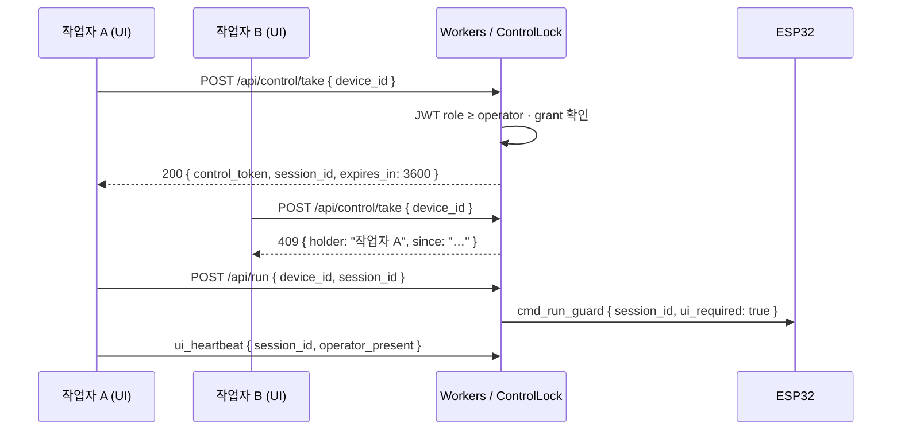

# Auth & Security

핫 블레이드 터닝 머신의 **장비 등록 (Device Provisioning)**, **RBAC 권한**, **Take-control(제어권)**, **WebSocket·REST 인증 (JWT)** 을 정의합니다.

> WebSocket · Tri-Link · `session_id`: [03 Software & Protocol](03-Software-Protocol.md)
> D1 `devices` · `projects`: [04 Data & Operations](04-Data-Operations.md)
> Ghost Job · Fail-safe: [03 Tri-Link](03-Software-Protocol.md#tri-link-fail-safe--3-way-heartbeat--ghost-job-방지-mvp-v01-필수)

---

## 개요 · 신뢰 경계

```text
[신뢰 영역]

  Operator UI (Browser)          Cloudflare Workers           ESP32 (현장)
  ─────────────────────          ──────────────────           ────────────
  JWT (사용자)                    RBAC · Take-control          Device Token
  ui_heartbeat + session_id       TriLinkSession DO            HMAC device_secret
  HTTPS / WSS                     D1 · KV                    WSS Inbound only

[비신뢰] 공용 Wi-Fi · 모바일 브라우저 · 물리적 E-Stop (L0 — 인증 무관)
```

| 주체 | 인증 수단 | MVP v0.1 | Phase 2 |
| :--- | :--- | :--- | :--- |
| **UI (사람)** | JWT (Access + Refresh) | Workers + D1 | NestJS + PostgreSQL |
| **Device (ESP32)** | Device Token + `device_secret` | Provisioning 1 회 | 동일 · cert rotation |
| **가공 세션** | `session_id` + Take-control lock | Tri-Link DO | 동일 |
| **Local Portal** | PIN + `device_secret` 파생 | `local_ap` / `sd_offline` | 동일 |

---

## Local Portal 인증 — `local_ap` / `sd_offline` `[MVP v0.1 필수]` {#local-portal-인증--local_ap--sd_offline-mvp-v01-필수}

클라우드 JWT 없이 ESP32 **SoftAP** 에 접속할 때의 **최소 인증** 입니다. 공장 Wi-Fi·인터넷이 없어도 **무인 제어**를 막습니다.

| 항목 | 규칙 |
| :--- | :--- |
| **PIN** | Provisioning 시 **6자리** 생성 · 장비 QR 라벨 · NVS 저장 (해시만) |
| **로그인** | `POST http://192.168.4.1/api/local/auth { pin }` → `local_session_token` (JWT 유사 · **1h TTL**) |
| **WS** | `Authorization: Bearer {local_session_token}` |
| **잠금** | 5회 실패 → **15분** 잠금 · telemetry `auth_lockout` |
| **역할** | Local Portal = **operator** 고정 (RBAC 단순화) · engineer 메뉴 **숨김** |
| **cloud 복귀** | CLOUD 스위치 + JWT 로그인 · local token **폐기** |

```text
[신뢰 경계 — local_ap]

  스마트폰 (PIN 알고 있음)  ──►  ESP32 AP  ──►  모터/PWM
  (공용 Wi-Fi 없음 · 인터넷 없음)

  device_secret: WSS cloud 서명용 · Local WS 는 PIN 파생 HMAC
```

**Provisioning 확장 (⑤ 단계)**

- [ ] QR 라벨: `device_id` + **PIN** + SSID
- [ ] Local Portal 로그인 → Jog 1mm (`device_dry`)
- [ ] PIN 분실: 엔지니어 **물리 USB** 또는 cloud `cmd_rotate_local_pin` (CLOUD 모드 시만)

---

## 장비 등록 · Device Provisioning `[MVP v0.1 필수]`

물리 장비를 **논리 `device_id`** 와 **암호 자격**에 바인딩합니다.
등록 없이는 WebSocket Inbound·`cmd_run` **거부**.

### 사전 조건

| 항목 | 내용 |
| :--- | :--- |
| 물리 | DLC32 + ESP32 FluidNC 부팅 · 현장 Wi-Fi |
| 서버 | Cloudflare Workers · D1 마이그레이션 |
| 권한 | **엔지니어** 또는 **관리자** 역할 (RBAC) |

### 등록 절차 (5 단계)

```text
① 프로젝트·장비 메타 (D1)
② device_secret 발급 (1회 표시)
③ ESP32 NVS 기록 + QR 라벨
④ Provisioning Handshake (WSS)
⑤ 운영자 Take-control 테스트
```

#### ① D1 장비 행 생성

```sql
-- devices — [04 canonical](04-Data-Operations.md#mvp-v01-d1-스키마-canonical)
INSERT INTO devices (id, project_id, device_type, display_name, is_active)
VALUES ('turning-01', 1, 'turning_4axis', '핫블레이드 터닝 #1', 1);
```

| 필드 | 규칙 |
| :--- | :--- |
| `id` | **전역 유일** · `heartbeat.device_id` 와 동일 (`turning-01`) |
| `device_type` | `turning_4axis` \| `wire_sense` \| `safety_io` |
| `is_active` | `0` 이면 연결·START **거부** |

#### ② `device_credentials` 발급

```sql
CREATE TABLE device_credentials (
  device_id TEXT PRIMARY KEY,
  secret_hash TEXT NOT NULL,          -- SHA-256(secret + pepper) — 평문 저장 금지
  provisioned_at TEXT NOT NULL,
  provisioned_by_user_id INTEGER,
  last_rotated_at TEXT,
  revoked_at TEXT,
  fw_version TEXT,
  FOREIGN KEY (device_id) REFERENCES devices(id)
);
```

**API** (엔지니어만):

```http
POST /api/admin/devices/provision
Authorization: Bearer {engineer_jwt}
{ "device_id": "turning-01", "project_id": 1 }

→ 201 {
  "device_id": "turning-01",
  "device_secret": "ds_8f3a…",   // ⚠ 1회만 표시 — 재조회 불가
  "expires_provision_window_h": 24
}
```

#### ③ 현장 ESP32 기록

| 방법 | 절차 |
| :--- | :--- |
| **권장 · QR** | 엔지니어 UI 「장비 등록」→ QR (`device_id` + `device_secret` + `wss_url`) |
| **수동** | FluidNC `$DeviceId` · NVS `device_secret` · `$WssUrl` |

```yaml
# FluidNC / NVS (예)
device_id: turning-01
wss_url: wss://nexa-heating.pages.dev/device/turning-01
# device_secret → NVS encrypted partition only
```

현장 라벨: **QR + `device_id` 텍스트** (비밀값은 QR 1 회 스캔 후 삭제).

#### ④ Provisioning Handshake

ESP32 **최초** (또는 secret rotation 후) 연결:

```text
ESP32 ──► WSS connect /device/turning-01
          Headers:
            X-Device-Id: turning-01
            X-Device-Signature: HMAC-SHA256(secret, timestamp||device_id)
            X-Device-Ts: {unix_ms}

Workers:
  1. devices.is_active = 1
  2. secret_hash 검증
  3. |now - ts| < 60s (replay 방지)
  4. OK → device_jwt (장수명·갱신) 발급 → WS upgrade
  5. fail → 401 · 연결 종료
```

```typescript
function verifyDeviceSignature(
  deviceId: string,
  secret: string,
  tsMs: number,
  signature: string,
  pepper: string,
): boolean {
  const payload = `${tsMs}||${deviceId}`;
  const expected = hmacSha256Hex(secret + pepper, payload);
  return timingSafeEqual(expected, signature) && Math.abs(Date.now() - tsMs) < 60_000;
}
```

성공 후 ESP32 NVS: `device_jwt` 저장 · 이후 연결은 **JWT** (secret 직접 전송 최소화).

#### ⑤ 등록 완료 검증

- [ ] `heartbeat { device_id: turning-01 }` 수신
- [ ] `tri_link.device_alive = true`
- [ ] **작업자** 계정 Take-control → Jog 1mm (`device_dry`)
- [ ] D1 `device_credentials.provisioned_at` 기록

### Secret Rotation · 폐기

| 이벤트 | 동작 |
| :--- | :--- |
| secret 유출 의심 | `revoked_at` 설정 · 즉시 WS disconnect |
| 정기 rotation (90 일) | 새 secret 발급 · 24h overlap · 구 secret 폐기 |
| 장비 매각/철거 | `devices.is_active=0` · credentials revoke |

---

## RBAC — 역할 · UI 접근 권한 `[MVP v0.1 필수]`

### 역할 정의

| 역할 | 코드 | 대상 | MVP 목적 |
| :--- | :--- | :--- | :--- |
| **현장 작업자** | `operator` | 오퍼레이터 | START/PAUSE/Jog · 레시피 실행 |
| **관리자** | `admin` | 라인장·소장 | 작업자 권한 + 레시피·PM·Fail-safe 해제 |
| **엔지니어** | `engineer` | 설비·NEXA | 관리자 + 장비 등록·`/thermal-lab`·캘리브 |

```sql
CREATE TABLE users (
  id INTEGER PRIMARY KEY AUTOINCREMENT,
  email TEXT UNIQUE,
  display_name TEXT NOT NULL,
  role TEXT NOT NULL CHECK(role IN ('operator','admin','engineer')),
  project_id INTEGER,                -- NULL = 전 프로젝트 (engineer)
  is_active INTEGER NOT NULL DEFAULT 1,
  created_at TEXT NOT NULL DEFAULT (datetime('now')),
  FOREIGN KEY (project_id) REFERENCES projects(id)
);

CREATE TABLE user_device_grants (
  user_id INTEGER NOT NULL,
  device_id TEXT NOT NULL,
  can_control INTEGER NOT NULL DEFAULT 0,  -- Take-control 후 1
  granted_at TEXT,
  PRIMARY KEY (user_id, device_id),
  FOREIGN KEY (user_id) REFERENCES users(id),
  FOREIGN KEY (device_id) REFERENCES devices(id)
);
```

### UI · API 권한 매트릭스

| 기능 / UI | `operator` | `admin` | `engineer` |
| :--- | :---: | :---: | :---: |
| 섹션 B START/PAUSE/Jog | ✅ | ✅ | ✅ |
| 섹션 B **live** 모드 | ✅ | ✅ | ✅ |
| E-Stop | ✅ | ✅ | ✅ |
| RESUME (Safe Resume) | ✅ | ✅ | ✅ |
| `cmd_clear_failsafe` | ❌ | ✅ | ✅ |
| 레시피 CRUD | ❌ | ✅ | ✅ |
| 섹션 D PM · 열선 교체 | △ 조회 | ✅ | ✅ |
| `/thermal-lab` · fit-k | ❌ | △ 조회 | ✅ |
| 장비 등록 · provision | ❌ | ❌ | ✅ |
| `device_dry` → `live` 체크리스트 | ✅ | ✅ | ✅ |
| `ui_sim` only 모드 | ✅ | ✅ | ✅ |
| D1 감사 로그 조회 | ❌ | ✅ | ✅ |
| Secret rotation | ❌ | ❌ | ✅ |

> **△**: 읽기 전용 또는 제한된 쓰기.

### JWT 클레임 (UI)

```json
{
  "sub": "user-42",
  "role": "operator",
  "project_id": 1,
  "device_grants": ["turning-01"],
  "iat": 1720310400,
  "exp": 1720314000
}
```

| 토큰 | TTL | 저장 |
| :--- | :--- | :--- |
| Access JWT | **1h** | memory (httpOnly cookie 권장) |
| Refresh | **7d** | httpOnly Secure cookie |

**Workers 검증**: 모든 `/api/*` · WebSocket UI leg — `Authorization: Bearer` 또는 쿼리 `?token=` (WS only).

---

## Take-control — 장비 제어권 획득 `[MVP v0.1 필수]`

동시에 **한 UI 세션만** `turning-01` 에 대해 START·Jog·Override 가능.
[Tri-Link `session_id`](03-Software-Protocol.md#tri-link-fail-safe--3-way-heartbeat--ghost-job-방지-mvp-v01-필수) 와 **직교** — Take-control 은 **사용자 간** 경합, session_id 는 **UI 탭·가공 세션** 바인딩.

### 상태 (Durable Object `ControlLock`)

```text
device_id: turning-01
  control_holder: { user_id, session_id, tab_id, since_ts }
  control_queue: []   // Phase 2
```

### 획득 절차



| 단계 | API / WS | 조건 |
| :---: | :--- | :--- |
| 1 | `POST /api/control/take` | `device_id` · JWT · `user_device_grants` |
| 2 | 응답 `control_token` | KV `control:{device_id}` · TTL **1h** |
| 3 | `POST /api/run` | `control_token` 일치 · `run_active=false` |
| 4 | `ui_heartbeat` | `session_id` = run 응답과 동일 |
| 5 | 해제 | `POST /api/control/release` 또는 TTL 만료 |

**거부 케이스**

| HTTP | 이유 |
| :---: | :--- |
| **401** | JWT 없음/만료 |
| **403** | role 부족 · `device_grants` 없음 |
| **409** | 다른 사용자가 Take-control 보유 |
| **423** | `fail_safe_latched` — 해제 전 제어권 불가 |

### UI 표시

```text
┌─ turning-01 ─────────────────────────────┐
│ 🔒 제어권: 김작업 (나) · 58분 남음          │
│ [제어권 해제]                               │
└───────────────────────────────────────────┘

┌─ turning-01 ─────────────────────────────┐
│ 🔐 제어권: 이관리자 사용 중 · [요청 대기]   │
│ START · Jog 비활성                          │
└───────────────────────────────────────────┘
```

### Take-control vs Tri-Link

| 구분 | Take-control | Tri-Link `session_id` |
| :--- | :--- | :--- |
| 목적 | **누가** 조작하는가 | **어느 탭**이 live RUN 감시 |
| 경합 | 사용자 A vs B | 탭 닫힘 → S9 Ghost Job |
| 저장 | KV `control:{device_id}` | DO `TriLinkSession` |
| live RUN | 제어권 **필수** | `ui_heartbeat` **필수** |

---

## 통신 보안 — WebSocket · JWT `[MVP v0.1 필수]`

### 연결 유형별 인증

| Leg | URL 예 | 인증 |
| :--- | :--- | :--- |
| **Device → Server** | `wss://…/device/{device_id}` | `X-Device-Signature` 또는 `Authorization: Device {jwt}` |
| **UI → Server** | `wss://…/ui` | `Authorization: Bearer {user_jwt}` |
| **Server → UI** | (동일 소켓) | 서버 발급 · subprotocol 검증 |

### UI WebSocket 핸드셰이크

```typescript
// Browser
const ws = new WebSocket(
  `wss://${host}/ui?device_id=turning-01`,
  ['nexa-heating.v1', accessJwt],  // subprotocol에 JWT (또는 첫 메시지 auth)
);

// 첫 메시지 (대안)
ws.send(JSON.stringify({
  type: 'auth',
  token: accessJwt,
  device_id: 'turning-01',
}));
```

**Workers**:

```text
on UI WS connect:
  1. verifyJwt(accessJwt) → user_id, role
  2. assertRole(api, role) — RBAC
  3. optional: assertControlLock(user_id, device_id)
  4. register ui_heartbeat leg in TriLinkSession
  5. reject expired / wrong aud
```

### Device WebSocket 핸드셰이크

```text
on Device WS connect:
  1. path device_id === header X-Device-Id
  2. verify device_jwt OR HMAC provision signature
  3. devices.is_active · credentials.revoked_at IS NULL
  4. bind ThermalRunSession(device_id)
  5. rate limit: 5 reconnect / min / IP
```

### 메시지 무결성 (선택 · Phase 2)

| 항목 | MVP | Phase 2 |
| :--- | :--- | :--- |
| TLS | **WSS 필수** | 동일 |
| `cmd_*` 페이로드 HMAC | ❌ (TLS 의존) | `seq_id` + HMAC |
| mTLS Device cert | ❌ | 공장 출하 cert |

### 환경 시크릿 (Workers)

| Secret | 용도 |
| :--- | :--- |
| `JWT_SECRET` | UI Access/Refresh 서명 |
| `JWT_DEVICE_SECRET` | Device JWT (별도 키) |
| `DEVICE_PEPPER` | `secret_hash` · HMAC pepper |
| `REFRESH_TOKEN_PEPPER` | Refresh 토큰 해시 |

**금지**: `device_secret` · `JWT_SECRET` 을 ESP32 펌웨어·프론트 번들에 **하드코딩** 금지.

---

## REST API — 인증 요약

| Method | Path | Auth | Role |
| :--- | :--- | :--- | :--- |
| `POST` | `/api/auth/login` | — | 공개 |
| `POST` | `/api/auth/refresh` | Refresh cookie | 공개 |
| `POST` | `/api/control/take` | JWT | `operator+` |
| `POST` | `/api/control/release` | JWT + control | holder |
| `POST` | `/api/run` | JWT + control + session | `operator+` |
| `POST` | `/api/admin/devices/provision` | JWT | `engineer` |
| `POST` | `/api/thermal-calibrate/fit-k` | JWT | `engineer` |
| `GET` | `/api/telemetry/stream` | JWT | `operator+` (read) |

**감사 로그** (`audit_events`):

```sql
CREATE TABLE audit_events (
  id INTEGER PRIMARY KEY AUTOINCREMENT,
  ts TEXT NOT NULL DEFAULT (datetime('now')),
  user_id INTEGER,
  device_id TEXT,
  action TEXT NOT NULL,    -- 'control.take'|'run.start'|'failsafe.clear'|…
  detail_json TEXT,
  ip TEXT
);
```

---

## MVP vs Phase 2

| 항목 | MVP v0.1 | Phase 2 |
| :--- | :--- | :--- |
| IdP | D1 `users` + 이메일/비밀번호 | NEXA Platform SSO · OIDC |
| RBAC | 3 역할 고정 | NestJS Guards · 세밀 permission |
| Take-control | KV lock | Redis + 알림 |
| Device | HMAC + device_jwt | mTLS + cert lifecycle |
| 감사 | D1 `audit_events` | PostgreSQL MES · SIEM |

---

## 보안 검증 체크리스트

- [ ] 미등록 `device_id` → WSS **401**
- [ ] 만료 JWT → REST **401** · WS close
- [ ] `operator` → `/api/admin/devices/provision` **403**
- [ ] Take-control 없이 `POST /api/run` **403**
- [ ] 사용자 B — A 가 제어권 보유 시 **409**
- [ ] `session_id` 불일치 `ui_heartbeat` → [03 S9b](03-Software-Protocol.md#tri-link-fail-safe--3-way-heartbeat--ghost-job-방지-mvp-v01-필수)
- [ ] revoked `device_secret` → Device WS **401**
- [ ] Replay: `X-Device-Ts` >60s skew **거부**
- [ ] `audit_events` — `control.take` · `run.start` 기록

---

## 관련 모듈

| 주제 | 문서 |
| :--- | :--- |
| 모듈 인덱스 | [README.md](README.md) |
| WebSocket · Tri-Link · `session_id` | [03 Software & Protocol](03-Software-Protocol.md) |
| D1 `devices` · `projects` · UI 섹션 F | [04 Data & Operations](04-Data-Operations.md) |
| Human Error · 모드 전이 | [04 섹션 F](04-Data-Operations.md#섹션-f-현장-특화-uiux--human-error-방지-mvp-v01-필수) |
