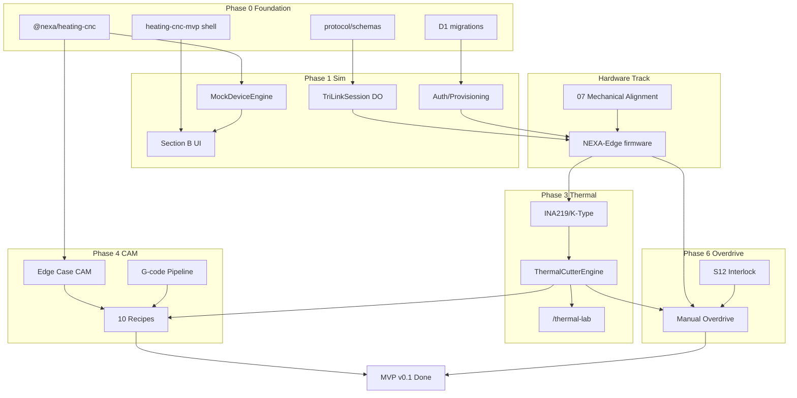

---
doc_id:
title: "Heating CNC — Implementation Roadmap"
category: "IoT / Manufacturing"
domain: controller
status: draft
created: 2026-07-17
updated: 2026-07-17
parent_doc: "README.md"
see_also:
  - "README.md"
  - "00-Vision-Overview.md"
  - "08-Project-Structure.md"
  - "03-Software-Protocol.md"
terms_standard: []
terms_nexa: []
---

# Heating CNC — 전체 작업 진행 로드맵

Hot-Blade Turning Machine(4축 핫 블레이드 터닝 머신)의 **설계 문서 → MVP v0.1 현장 가동 → Phase 2 NEXA 통합**까지의 구현 순서를 정리합니다.

> **현재 상태 (2026-07-17)**: 스펙 문서 `00`–`08`, `10` + README 완료. 코드는 `_ref/` 2파일(Edge Case CAM·ScanPassCard UI)만 존재. 펌웨어·Workers·MVP 앱 **미착수**.

---

## 1. 목표 · 완료 정의

| 단계           | 목표                                | 완료 기준 (요약)                                                                         |
| :----------- | :-------------------------------- | :--------------------------------------------------------------------------------- |
| **MVP v0.1** | Cloudflare만으로 **실제 가공기 1대 현장 운영** | 스마트폰 START/E-STOP, 10종 레시피 가공, Tri-Link Fail-safe, **D1(Cloudflare SQL DB) 작업 일지** |
| **Phase 2**  | NEXA 본 플랫폼·MES·NEXIA 연동           | NestJS API, PostgreSQL, Quasar 도메인 UI, 멀티 디바이스                                     |

MVP v0.1은 프로토타입이 아니라 **현장에서 돌아가는 최소 운영 버전**입니다. ([00-Vision-Overview](00-Vision-Overview.md))

---

## 2. 무엇부터 시작할까 — 권장 첫 작업

하드웨어 조립과 소프트웨어는 **병렬**로 진행하되, **소프트웨어는 하드웨어 없이도 먼저 착수**할 수 있습니다.

### 즉시 착수 (Week 1 — Critical Path)

| 순위 | 작업 | 이유 | 산출물 |
| :---: | :--- | :--- | :--- |
| **1** | `@nexa/heating-cnc` 패키지 스캐폴딩 + `_ref/edge-case-cam.ts` 이식 | CAM·프로토콜 타입의 **공유 SSOT** — Workers·UI·테스트가 모두 여기에 의존 | `packages/heating-cnc/` + 단위 테스트 |
| **2** | WS·REST **Zod 스키마** (`protocol/schemas/`) | [03](03-Software-Protocol.md) 메시지 표와 1:1 정합 — 이후 Mock·실장비·UI가 동일 계약 사용 | `session.ts`, `commands.ts`, `telemetry.ts` |
| **3** | D1 마이그레이션 | DB 없이는 레시피·장비 등록·작업 일지 불가 | `migrations/0001_init.sql` ([04 canonical](04-Data-Operations.md)) |
| **4** | `MockDeviceEngine` + `ui_sim` 모드 | ESP32·열선·모재 **없이** UI·G-code·Tri-Link 흐름 검증 | `apps/heating-cnc-mvp/workers/` |
| **5** | MVP 앱 뼈대 (Next.js + wrangler) | Cloudflare Pages/Workers 배포 파이프라인 확정 | `apps/heating-cnc-mvp/` |

> **핵심 원칙**: [03 § 구현 로드맵](03-Software-Protocol.md#구현-로드맵-소프트웨어-순서)의 **0단계(드라이런·UI 모의)** 를 먼저 완료하면, 펌웨어·기계 조립이 늦어져도 **프론트·백·CAM 로직**은 계속 진행할 수 있습니다.

### 하드웨어 병렬 트랙 (부품 확보 시)

| 순위 | 작업 | 관련 문서 |
| :---: | :--- | :--- |
| **H1** | 프레임 조립 + **Mechanical Alignment** (A↔Z 동축 ≤0.05mm) | [07](07-Mechanical-Specs.md#mechanical-alignment--하드웨어-정렬-및-물리적-교정-mvp-v01-필수) |
| **H2** | DLC32 MAX 배선·FluidNC `config.yaml` (4축 + LASER PWM) | [01](01-Hardware-Motion.md) |
| **H3** | INA219·K-Type·S12 릴레이 배선 | [01](01-Hardware-Motion.md) · [02](02-Thermal-Engine-Sensing.md) |
| **H4** | AP 스위치(Cloud↔Local) + SD 연장 슬롯 | [01](01-Hardware-Motion.md) · [03 연결 모드](03-Software-Protocol.md) |

---

## 3. 전체 타임라인 (개략)

```text
Phase 0 ─ Foundation          │ ████████░░░░░░░░░░░░  Week 1–3
Phase 1 ─ Sim + Protocol      │ ░░░░████████░░░░░░░░  Week 2–5
Phase 2 ─ Edge + Tri-Link     │ ░░░░░░░░████████░░░░  Week 4–8
Phase 3 ─ Thermal + Sensing   │ ░░░░░░░░░░░░████████  Week 6–10
Phase 4 ─ CAM + Recipes       │ ░░░░░░░░░░░░░░██████  Week 8–12
Phase 5 ─ Field MVP           │ ░░░░░░░░░░░░░░░░████  Week 10–14
Phase 6 ─ Overdrive + PM      │ ░░░░░░░░░░░░░░░░░░██  Week 12–16
──────────────────────────────┴───────────────────────────────
Phase 7 — NEXA Platform       │ (MVP 안정 후) TDD-007 정렬
```

일정은 1인·소규모 팀 기준 **상대적 순서**입니다. 인력·부품 입고에 따라 Phase 1–3은 겹칠 수 있습니다.

---

## 4. Phase별 상세 로드맵

### Phase 0 — Foundation (Week 1–3)

**목표**: 모노레포 골격·공유 패키지·DB·계약층 확립

| # | 작업 | 산출물 | 검증 |
| :---: | :--- | :--- | :--- |
| 0.1 | `packages/heating-cnc` 생성 (`package.json`, tsconfig, barrel export) | `@nexa/heating-cnc` | `pnpm build` 성공 |
| 0.2 | `_ref/edge-case-cam.ts` → `src/cam/` 분할 이식 | `decomposeEccentricity`, `runEdgeCaseCam` | `edge-case-cam.test.ts` |
| 0.3 | `protocol/schemas/*.ts` — [03 WS 표](03-Software-Protocol.md#websocket-메시지--통합-명세-canonical) 필드 1:1 | Zod 스키마 | 스키마 ↔ 문서 diff 체크 |
| 0.4 | D1 `0001_init.sql` — projects, devices, recipes, job_logs, thermal_* | migration | [04 CREATE TABLE](04-Data-Operations.md) 동형 |
| 0.5 | `0002_post_process_sessions.sql` | 후공정 세션 테이블 | [04 §G](04-Data-Operations.md) |
| 0.6 | `apps/heating-cnc-mvp` Next.js + `wrangler.toml` (D1·DO 바인딩) | 배포 가능 스켈레ton | `wrangler dev` 기동 |
| 0.7 | (선택) 문서 SSOT 이전 | `NEXA-Platform/docs/specs/manufacturing/heating-cnc/` | Rivet 파이프라인 |

**Phase 0 Exit**: `@nexa/heating-cnc` import 가능, D1 migrate 완료, MVP 앱 로컬 기동.

---

### Phase 1 — UI Sim + Protocol Shell (Week 2–5)

**목표**: 하드웨어 없이 **전체 제어 UX·WS 흐름** 검증

| # | 작업 | 산출물 | 검증 |
| :---: | :--- | :--- | :--- |
| 1.1 | `TriLinkSession` Durable Object 골격 | heartbeat · ui_heartbeat · seq_id | 3-leg 세션 유지 |
| 1.2 | `MockDeviceEngine` — 가상 좌표·텔레메트리·G-code ack | `ui_sim` 완전 동작 | E-STOP·Jog·START 시나리오 |
| 1.3 | 운영 모드 토글 UI (`ui_sim` / `device_dry` / `live`) | [03 운영 모드](03-Software-Protocol.md#운영-모드-3단계) | 모드별 명령 차단 |
| 1.4 | 모바일 패널 **섹션 B** — E-STOP / START / PAUSE / Jog X·Y·Z·A | 48px 터치 UI | 글러브 조작 |
| 1.5 | **Control Handshake** 스텁 — Take-control · G-code Executor LOCKED | WS `cmd_set_session` | Ghost Job 방지 시나리오 |
| 1.6 | Device Provisioning API 골격 ([06](06-Auth-Security.md)) | JWT + device_credentials | 등록 없이 WS 거부 |
| 1.7 | e2e: Handshake · Tri-Link 단절 → failsafe 시뮬 | `e2e/tri-link.spec.ts` | 3s 이내 정지 |

**Phase 1 Exit**: 스마트폰 브라우저에서 `ui_sim`으로 START/E-STOP/Jog/Tri-Link 배너 동작.

---

### Phase 2 — Edge Firmware + Real Tri-Link (Week 4–8)

**목표**: ESP32 ↔ Cloudflare **실연결**, 모션·Fail-safe 최소 동작

|  #  | 작업                                                | 산출물                                                                                     | 검증                        |
| :-: | :------------------------------------------------ | :-------------------------------------------------------------------------------------- | :------------------------ |
| 2.1 | `NEXA-Edge/heating-cnc/` PlatformIO 프로젝트          | FluidNC fork + `turning-4axis.yaml`                                                     | 4축 홈·Jog                  |
| 2.2 | A_POS / A_VEL 이원화 (`M210`/`M211`)                 | [01 A축](01-Hardware-Motion.md#a-축-제어-규정--tmc2209--각도-위치--연속-rpm)                        | 각도·RPM 전환                 |
| 2.3 | WSS Inbound — heartbeat · cmd_jog · cmd_run chunk | [03](03-Software-Protocol.md)                                                           | Device↔Workers 연결         |
| 2.4 | Tri-Link Fail-safe — 3s 단절 → M5·모션정지·M211         | `tri_link_watchdog.cpp`                                                                 | Wi-Fi 끊김 테스트              |
| 2.5 | `device_dry` 모드 — PWM OFF, 모션만                    | 운영 모드                                                                                   | 열선 없이 경로 검증               |
| 2.6 | StallGuard scan pass — 부하 맵 수집                    | `stall_guard.cpp`                                                                       | Scan → `scan_result_json` |
| 2.7 | Local AP Portal + PIN 인증                          | [06 Local Portal](06-Auth-Security.md#local-portal-인증--local_ap--sd_offline-mvp-v01-필수) | cloud 없이 Jog              |
| 2.8 | SD 오프라인 G-code 워크플로                               | [03 SD](03-Software-Protocol.md)                                                        | AP 스위치 + SD manifest      |

**Phase 2 Exit**: 실제 장비에서 Cloud WSS 연결, Jog, `device_dry` 경로 실행, Tri-Link 단절 시 3s 정지.

> **선행 조건**: Phase 0–1 완료 + [07 Mechanical Alignment](07-Mechanical-Specs.md) 최소 1회 (A↔Z 동축).

---

### Phase 3 — Thermal Engine + Sensing (Week 6–10)

**목표**: 열선 제어·센싱·인터록 — **live 가공 전 필수**

| # | 작업 | 산출물 | 검증 |
| :---: | :--- | :--- | :--- |
| 3.1 | `ThermalCutterEngine` + `ThermalInertiaModel` (τ≈2s) | `packages/…/thermal/` | S↔F 상관 단위 테스트 |
| 3.2 | `/thermal-lab` UI + `cmd_thermal_test` | [02](02-Thermal-Engine-Sensing.md) | 6종 시나리오 |
| 3.3 | INA219 + K-Type UART (`WireSense`) | 전류·온도·저항 텔레메트리 | S5/S1 인터록 |
| 3.4 | S12 Post-process 릴레이 — 후공정 시 열선 물리 차단 | [02 S12](02-Thermal-Engine-Sensing.md) | Manual Overdrive 진입 시 M5+릴레이 |
| 3.5 | `WireHealthMonitor` + `wire_installations` PM | D1 누적 ON 시간·drift | S1 교체 알림 |
| 3.6 | 예열 게이트 — START 잠금 (`preheat_gate_json`) | live START 차단/허용 | K-Type ≥ min_temp |
| 3.7 | HFS `RunOrchestrator` — Actual_F → S 스케일 | [05 HFS](05-GCode-CAM-Pipeline.md#hfs--heat-feed-sync-보간-알고리즘-mvp-v01-필수) | 가속 구간 S 감소 |

**Phase 3 Exit**: `/thermal-lab`에서 live PWM·온도 캘리브, 레시피 `thermal_k` 반영, S1~S9 인터록 동작.

---

### Phase 4 — CAM Pipeline + Recipes (Week 8–12)

**목표**: 10종 레시피 원터치 가공 + Edge Case CAM

| # | 작업 | 산출물 | 검증 |
| :---: | :--- | :--- | :--- |
| 4.1 | `GCodeInterpreter` + `chunker` | 정적 분석·seq_id 청크 | `.gcode` 업로드 |
| 4.2 | Material_Aware_CAM — Profile/Taper/Helical | [05](05-GCode-CAM-Pipeline.md) | 10종 레시피 시드 |
| 4.3 | **Edge Case CAM** — Scan → `e_mount`/`e_shape` → 대칭 수렴 | `@nexa/heating-cnc/cam/` | `_ref` 테스트 통과 |
| 4.4 | `ScanPassCard` UI 이식 | `_ref/ScanPassCard.tsx` → MVP components | scan_pass WS 연동 |
| 4.5 | Kerf·Wire Z · `Z_ref` ([07](07-Mechanical-Specs.md)) | CAM Z 보정 | Ø 정밀도 |
| 4.6 | SD Export — 오프라인 manifest + G-code | [05 SD Export](05-GCode-CAM-Pipeline.md) | Local/SD 모드 |
| 4.7 | (선택) Three.js PathViz — 경로 시각화 | Browser | 실시간 tool position |

**Phase 4 Exit**: 레시피 선택 → CAM 생성 → chunk 스트리밍 → live 가공 1회 완료 + `job_logs` 기록.

---

### Phase 5 — Field MVP Hardening (Week 10–14)

**목표**: **MVP v0.1 Definition of Done** 전항목 충족

| # | 작업 | DoD 출처 |
| :---: | :--- | :--- |
| 5.1 | 섹션 C 텔레메트리 게이지 + Adaptive Telemetry | [03](03-Software-Protocol.md) |
| 5.2 | Sync-Handshake — KV checkpoint ↔ SD manifest | [03](03-Software-Protocol.md#sync-handshake--kv-checkpoint--sd-manifest-정합성-mvp-v01-필수) |
| 5.3 | 연결 모드 3단계 — cloud / local_ap / sd_offline | [03](03-Software-Protocol.md) |
| 5.4 | RBAC + Take-control 운영 테스트 | [06](06-Auth-Security.md) |
| 5.5 | 현장 운영 체크리스트 UI ([10](10-Operational-Safety.md)) | 환기·PPE·S5 안내 |
| 5.6 | Ghost Job · Sequence ID 멱등성 · 네트워크 복원력 | [03](03-Software-Protocol.md) |
| 5.7 | D1 작업 일지 — scan_result_json · thermal 이력 | [04](04-Data-Operations.md) |
| 5.8 | 현장 1주일 soak test + 버그픽스 | — |

**Phase 5 Exit**: [03 MVP DoD](03-Software-Protocol.md#mvp-v01--cloudflare-무료-서버) 체크리스트 **전체 ✅**.

---

### Phase 6 — Manual Overdrive + PM (Week 12–16)

**목표**: 후공정 워크플로우·열선 PM 완성 (MVP v0.1 잔여)

| # | 작업 | 산출물 |
| :---: | :--- | :--- |
| 6.1 | Manual Overdrive UI (**섹션 G**) | Jog·Goto·발 스위치·RPM 슬라이더 |
| 6.2 | A축 S-Curve RPM + 축 격리 | `rpmSCurve.ts` + Edge |
| 6.3 | Soft-Lock Zero · Jog Ledger (NVS) | [03 후공정 좌표](03-Software-Protocol.md) |
| 6.4 | `utility_presets` — Sanding/Painting/Taping | [10 프리셋](10-Operational-Safety.md) |
| 6.5 | `post_process_sessions` D1 + UI 이력 | [04 §G](04-Data-Operations.md) |
| 6.6 | 열선 PM 대시보드 — `pm_health_score` · 교체 알림 | [04 wire_*](04-Data-Operations.md) |

**Phase 6 Exit**: 가공 완료 → Manual Overdrive → 샌딩/도색 프리셋 → 좌표계 보존 복귀.

---

### Phase 7 — Phase 2 NEXA Platform (MVP 안정 후)

**목표**: TDD-007 Greenfield 정렬 · MES · NEXIA

| # | 작업 | 경로 (TDD-007) |
| :---: | :--- | :--- |
| 7.1 | D1 → PostgreSQL (Prisma) 마이그레이션 | `database/` |
| 7.2 | Zod SSOT → `packages/shared/schemas/heating-cnc/` | 계약층 통합 |
| 7.3 | NestJS `modules/heating-cnc/` | device-bridge · REST |
| 7.4 | Quasar `domains/heating-cnc/` — MVP UI Vue 포팅 | ScanPassCard.vue 등 |
| 7.5 | NEXIA 기획서 → 레시피 동기화 | NEXIA 도메인 |
| 7.6 | (탐색) Vision Scan · 스마트폰 웹캠 | [00 Phase 2 아이디어](00-Vision-Overview.md#phase-2-아이디어-메모--스마트폰-웹캠) |

상세 경로 대응: [08 §11 TDD-007](08-Project-Structure.md#11-tdd-007-정합성-검토-2026-07-08).

---

## 5. 의존성 그래프



**Critical Path** (가장 긴 순서链):

```text
packages/heating-cnc → MockDeviceEngine → TriLinkSession DO
  → NEXA-Edge firmware → Mechanical Alignment
  → ThermalCutterEngine + sensing → CAM + Recipes → Field MVP
```

---

## 6. 트랙별 담당 · 병렬화

| 트랙 | Phase | 담당 역량 | 다른 트랙과의 접점 |
| :--- | :--- | :--- | :--- |
| **A. Shared Logic** | 0, 4 | TypeScript · 알고리즘 | Zod 스키마, CAM, Thermal |
| **B. Cloud (Workers/UI)** | 0–1, 4–6 | Next.js · CF | DO, D1, WS 클라이언트 |
| **C. Edge Firmware** | 2–3, 6 | C++ · FluidNC · ESP32 | 핀맵, Tri-Link, 인터록 |
| **D. Mechanical** | 2 전 | 기계·조립 | A↔Z 정렬, StallGuard 신뢰 |
| **E. Field Ops** | 5 | 현장·안전 | [10](10-Operational-Safety.md) 체크리스트 |

**1인 개발 시 권장 순서**: A → B(1) → C(최소 Jog) → B(3) → C(센서) → A(4) → B(4–6).

---

## 7. 마일스톤 체크리스트

### M1 — "브라우저에서 돌아간다" (Phase 1)

- [ ] `ui_sim`에서 E-STOP / START / Jog 동작
- [ ] Tri-Link 배너 — 3-leg heartbeat 표시
- [ ] `@nexa/heating-cnc` Edge Case CAM 단위 테스트 통과

### M2 — "장비가 움직인다" (Phase 2)

- [ ] ESP32 WSS Inbound 연결 유지
- [ ] 4축 Homing + Jog (live)
- [ ] Tri-Link 단절 3s → M5 + 모션 정지
- [ ] A↔Z Mechanical Alignment 완료 기록

### M3 — "열선이 제어된다" (Phase 3)

- [ ] `/thermal-lab` live — S·V·A·T·R 텔레메트리
- [ ] 예열 게이트 — 미달 시 START 거부
- [ ] S5 Thermal Runaway → M5 (≤0.1s E-Stop 경로)

### M4 — "가공이 된다" (Phase 4–5)

- [ ] 10종 레시피 1종 live 가공 완료
- [ ] Edge Case: Scan Pass → 편심 보정 → 다패스 수렴
- [ ] `job_logs` 1건 + `scan_result_json` 저장
- [ ] `.gcode` 업로드 스트리밍

### M5 — "운영 가능" (Phase 5–6 = MVP v0.1)

- [ ] [03 MVP DoD](03-Software-Protocol.md#mvp-v01--cloudflare-무료-서버) 전항목
- [ ] Manual Overdrive — S12 릴레이 + 4축 Jog + RPM
- [ ] Local AP / SD 오프라인 1회 성공
- [ ] 열선 PM — `wire_runtime_counters` 누적

---

## 8. 리스크 · 선행 결정

| 리스크 | 영향 | 완화 |
| :--- | :--- | :--- |
| A↔Z 정렬 미완 | CAM·Scan·Kerf 전부 편차 | Phase 2 **전** [07 3축 정렬](07-Mechanical-Specs.md) 필수 |
| Zod SSOT 이중화 | MVP↔Phase 2 마이그레이션 비용 | MVP는 패키지 내부 허용, Phase 2에서 `packages/shared` 이전 ([08 §11](08-Project-Structure.md)) |
| FluidNC A_VEL 커스텀 | M210/M211 지연 | Phase 2 초반 **스파이크** — A_POS만으로 1차 가공 가능 |
| Cloudflare DO 한계 | 동시 세션·비용 | MVP 1대는 무료 플랜 충분, Phase 2에서 NestJS bridge |
| StallGuard 오검출 | Edge Case CAM 오보정 | GT2 장력·[07](07-Mechanical-Specs.md) 벨트 점검 |

---

## 9. 문서 ↔ 구현 매핑 (빠른 참조)

| 우선 구현 | canonical 문서 | 코드 목표 |
| :--- | :--- | :--- |
| WS·Tri-Link | [03](03-Software-Protocol.md) | `workers/TriLinkSession.ts` |
| D1 스키마 | [04](04-Data-Operations.md) | `migrations/` |
| Edge Case CAM | [05](05-GCode-CAM-Pipeline.md) | `packages/…/cam/` |
| Device Auth | [06](06-Auth-Security.md) | `lib/auth.ts` |
| 핀맵·FluidNC | [01](01-Hardware-Motion.md) | `NEXA-Edge/config/` |
| Thermal·인터록 | [02](02-Thermal-Engine-Sensing.md) | `packages/…/thermal/` |
| Mechanical | [07](07-Mechanical-Specs.md) | 조립 체크리스트 (코드 없음) |
| 폴더 배치 | [08](08-Project-Structure.md) | 전체 To-Be |
| 현장 안전 | [10](10-Operational-Safety.md) | UI 배너·체크리스트 |

---

## 10. 다음 액션 (오늘 시작하기)

1. **`NEXA-Platform/packages/heating-cnc/`** 디렉터리 생성 — [08 §4.2](08-Project-Structure.md#42-공유-패키지--packagesheating-cnc) 구조대로
2. **`_ref/edge-case-cam.ts`** 복사 후 `pnpm test` 환경 구성
3. **`apps/heating-cnc-mvp/migrations/0001_init.sql`** — [04 SQL](04-Data-Operations.md#mvp-v01-d1-스키마-canonical) 그대로 적용
4. **`protocol/schemas/session.ts`** — `work_session`, `gcode_executor_state`, `run_mode` Zod 정의
5. **`MockDeviceEngine.ts`** — `ui_sim` heartbeat + 가상 `{x,y,z,a}` 텔레메트리

위 5건이 완료되면 Phase 0–1을 **2–3주 내** 마무리하고, 하드웨어 트랙(Phase 2)과 병렬 진행할 수 있습니다.

---

## 변경 이력

| 날짜 | 내용 |
| :--- | :--- |
| 2026-07-17 | 초안 — 전 Phase 로드맵·Critical Path·마일스톤 정의 |
