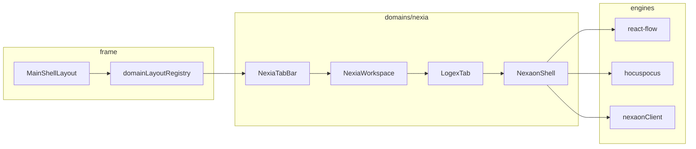

# NEXIA — MainShell · domains/nexia 레이아웃 v1.0

> **범위:** **`domainKey: nexia`** 전용 UI/UX SSOT — 7탭 · Omnix · Nexaon · Navex · Content 3층 분할.  
> **플랫폼 셸 (전 도메인):** [`UIX-006` NEXA 통합 레이아웃](./07_UIUX_NEXA_통합레이아웃구조규격.md).
> **명칭:** UI 도메인은 **`nexia`** (`domains/nexia/`). **Nexaon**(`modules/nexaon/`) 은 Logex 탭 **`ontology` 서브모드** 작업면 모듈명 — 별도 `domainKey` 아님. (구 프로젝트명 NEXAON 과 혼동 금지)
> **기능 상세:** [`05_PRD NEXIA UI 기능 명세`](../05_PRD/05_PRD_NEXIA_UI기능명세_MVPPhaseUI_v1.0.md)
> **상위:** [`TDD-002` 도메인 레지스트리](../08_TDD/NEXAOS/08_TDD_NEXAOS_도메인레지스트리명세.md) · [`08_TDD LangGraph 플랫폼`](../08_TDD/LangGraph/08_TDD_LangGraph_인간LLM협업형IoT온톨로지플랫폼_v1.0.md) · [`08_TDD 모노레포 폴더 구조`](../08_TDD/LangGraph/08_TDD_LangGraph_모노레포폴더구조_v1.0.md)

---

## 1. 목적

UI **1 순위 구현**을 위해 다음을 **한 문서에서 고정**한다.

1. **nexia 마운트** — `domainLayoutRegistry` 등록 · `domains/nexia/` 구조
2. **7 탭 셸** — TabBar · `tabId` · URL sync
3. **Content 분할** — **기본 2-pane** (Omnix 레일 \| 탭 작업면) · **동적 split/merge** · **PiP detach** (§3.4)
4. **Content Default** — §5 **Omnix \| 6탭** · 탭별 **서브패널 다중 창**
5. **Nexaon 작업면** — §6 Logex · `ontology` **3 분할** (캔버스 · 문서 · Run)

---

## 2. MainShell 마운트 (nexia)

플랫폼 5 영역·원칙·`frame/` 구조는 [`UIX-006`](./07_UIUX_NEXA_통합레이아웃구조규격.md). 본 절은 **nexia 슬롯 등록**만 다룬다.

### 2.1 `domainLayoutRegistry` — nexia 등록

```ts
// frame/registry/domainLayoutRegistry.ts
nexia: {
  left: () => import('@/domains/nexia/views/left/NexiaLeftNav'),
  content: () => import('@/domains/nexia/views/content/NexiaContent'),
  right: () => import('@/domains/nexia/views/right/NexiaRightPanel'),
  headerActions: () => import('@/domains/nexia/components/NexiaHeaderActions'),
  statusBar: () => import('@/domains/nexia/views/status/NexiaStatusBar'),
  statusPanel: () => import('@/domains/nexia/views/status/NexiaStatusPanel'),
  themePreset: 'office-light',
  drawerDefaults: {
    left:  { openPolicy: 'recommended', defaultOpen: true },
    right: { openPolicy: 'recommended', defaultOpen: true },
  },
},
```

---

## 3. `domains/nexia/` 전체 구조

### 3.1 역할

| 항목            | 값                                                                      |
| --------------- | ----------------------------------------------------------------------- |
| **domainKey**   | `nexia`                                                                 |
| **역할**        | 플랫폼 **핵심 지능** — 7 탭 · Omnix 허브 · **Logex → Nexaon(ontology)** |
| **themePreset** | `office-light`                                                          |
| **백엔드 연동** | Nest `modules/nexaon` · `agent-graph` proxy (UI 는 REST/SSE 만)         |

### 3.2 폴더 트리

```text
apps/web/src/domains/nexia/
├── config/
│   └── nexiaTabs.ts                  # 7탭 tabId SSOT · route · icon
├── components/
│   ├── NexiaHeaderActions.tsx        # Run · Save · Sync · Project
│   └── NexiaTabBar.tsx               # Content 상단 탭 스트립
├── views/
│   ├── left/
│   │   └── NexiaLeftNav.tsx          # tabId별 서브 내비 (§4.1)
│   ├── content/
│   │   ├── NexiaContent.tsx          # TabBar + NexiaWorkspace 호스트
│   │   ├── NexiaWorkspace.tsx        # 2-pane · 동적 split · panelId SSOT
│   │   ├── TabWorkspace.tsx          # activeTabId · SubTabStrip host
│   │   └── SubTabStrip.tsx           # subPaneId · +pane
│   ├── right/
│   │   ├── NexiaRightPanel.tsx       # tabId별 우측 (§4.2)
│   │   └── GlobalNavexPlugin.tsx     # Global Navex · Right 탐색 플러그인 (§4.5)
│   └── status/
│       ├── NexiaStatusBar.tsx        # 1줄 — room · run · sync
│       └── NexiaStatusPanel.tsx      # Run 타임라인 · 협업자 · 메트릭
├── tabs/                             # 탭별 Content 본문 (얇은 셸)
│   ├── omnix/OmnixTab.tsx
│   ├── normex/NormexTab.tsx
│   ├── logex/
│   │   ├── LogexTab.tsx              # Logex 셸 — 서브모드 스위치
│   │   └── NexaonEntry.tsx           # ★ Nexaon(ontology) 마운트 진입
│   ├── scribx/ScribxTab.tsx
│   ├── vivex/VivexTab.tsx
│   ├── twinex/TwinexTab.tsx
│   └── navex/NavexTab.tsx
├── modules/
│   └── nexaon/                       # ★ Logex·ontology 모듈 (§6)
│       ├── NexaonShell.tsx           # Toolbar + 3분할 작업면
│       ├── views/ · panels/ · hooks/ · store/
│       └── index.ts
├── hooks/
│   ├── useNexiaTab.ts                # tabId · URL sync
│   └── useNexiaContext.ts            # left/right에 tabId 전달
└── store/
    ├── useNexiaTabStore.ts           # activeTabId · logexSubMode
    └── useNexiaWorkspaceStore.ts     # omnixRail · split tree · panel sizes
```

### 3.3 7 탭 SSOT (`nexiaTabs.ts`)

| tabId       | 라벨      | Content          | Nexaon(ontology)        |
| ----------- | --------- | ---------------- | ----------------------- |
| `omnix`     | Omnix     | 허브 · 요청 분류 | 간접 — Run 트리거       |
| `normex`    | Normex    | 규범 · 용어      | SpecsPreview 연동       |
| **`logex`** | **Logex** | **로직·관계**    | **ontology 서브모드 ★** |
| `scribx`    | Scribx    | 문서 · Tiptap    | wikilink                |
| `vivex`     | Vivex     | 미디어           | —                       |
| `twinex`    | Twinex    | 3D 트윈          | Neo4j 자산 연동 (후속)  |
| `navex`     | Navex     | 인프라           | ESPHome 배포 (후속)     |

**Nexaon(ontology) 진입 URL (canonical home)**

```text
/nexia/logex                    # Logex 기본
/nexia/logex/ontology           # Nexaon 서브모드 (명시)
/nexia/logex/ontology/{projectId}
```

> **Deep link · 엣지 후보고:** Twinex·nexabo·Omnix·Navex 및 Nest **`nexaon_ingest`** 는 **동일 NexaonShell** 로 진입 — Logex 탭 **선행 ✗** (데이터 축). SSOT [`TDD-056` §4.1](../08_TDD/NEXIA/08_TDD_NEXIA_7탭범위확정_v1.0.md) · [`TDD-070` §3.4.1](../용어집_NEXA전용_v2.0.md).

### 3.4 Content 분할 · 병합 · 분리 (3층 모델)

> **범위:** `MainShell` **Content** 슬롯 **내부** (`NexiaTabBar` 아래). **Left/Right Drawer** 는 §4 그대로 — 본 절과 **독립**.
> **탭 역할 SSOT:** [`TDD-056` 7탭 범위](../08_TDD/NEXIA/08_TDD_NEXIA_7탭범위확정_v1.0.md) · **PiP/detach:** [`TDD-014`](../08_TDD/NEXIA/08_TDD_NEXIA_멀티윈도우DocumentPiP.md)

Content 레이아웃은 **한 가지 고정이 아니라 3층 능력**으로 정의한다.

| 층             | 이름             | 의미                                                   |
| :------------- | :--------------- | :----------------------------------------------------- |
| **L1 Default** | 기본 레이아웃    | 처음 열릴 때 **권장 구조** (정책)                      |
| **L2 Dynamic** | 동적 split/merge | 사용자가 패널 **추가·병합·리사이즈** (능력, 깊이 제한) |
| **L3 Detach**  | PiP · 독립 창    | 셸 밖으로 **완전 분리**, Sync-Bus·Yjs 로 상태 유지     |

```text
MainShell Content (nexia)
┌─ NexiaTabBar ─────────────────────────────────────────────────────────┐
├─ NexiaWorkspace ──────────────────────────────────────────────────────┤
│  L1 기본 2-pane                                                      │
│  ┌─ OmnixRail ─────┬─ TabWorkspace ───────────────────────────────┐  │
│  │ (고정·접기 가능)  │  activeTabId 본문 (Normex·Logex·…·Navex)      │  │
│  │ 채팅·Run 요약    │  · 탭별 서브패널 (§5) · logex→NexaonShell (§6)│  │
│  └─────────────────┴──────────────────────────────────────────────┘  │
│  L2: TabWorkspace·OmnixRail 내부 추가 split (상한 §3.4.3)             │
│  L3: panel detach → Document PiP / 멀티윈도우 (TDD-014)               │
└───────────────────────────────────────────────────────────────────────┘
```

#### 3.4.1 L1 — 기본 2-pane (Normative)

| Pane             | `panelId`             | 역할                                                                         | 비고                                              |
| :--------------- | :-------------------- | :--------------------------------------------------------------------------- | :------------------------------------------------ |
| **OmnixRail**    | `nexia.omnix-rail`    | L1 오케스트레이션 허브 · 채팅 · Run 트리거                                   | **다른 탭 작업 중에도** 옆에 유지 (기본 **open**) |
| **TabWorkspace** | `nexia.tab-workspace` | **현재 `tabId` 본문** — Normex · Logex · Scribx · Vivex · Twinex · **Navex** | 탭 전환 시 **Workspace만 교체**, OmnixRail 유지   |

**2-pane을 기본으로 하는 이유**

- **Omnix** — 위임·승인·대화 허브 ([`TDD-058`](../08_TDD/LangGraph/08_TDD_LangGraph_오케스트레이션설계_v1.0.md) L1) · 작업면과 **분리**하는 것이 자연스럽다.
- **Navex** — 기본은 **TabWorkspace 탭** (`tabId=navex`). 유저 설정 시 **Global Navex** 로 Right Drawer **탐색 플러그인** 상시 노출 가능 (§4.5).
- **나머지 5탭** — 편집·캔버스 중심 · Omnix 레일과 **병행** 사용.

**예외 — `tabId === omnix`**

- OmnixRail 과 TabWorkspace 가 **동일 주제** → Rail **접기** 또는 Workspace **full width** (Rail width → 0).
- URL `/nexia/omnix` 단독 진입 시 Rail-only 레이아웃 허용.

#### 3.4.2 L2 — 동적 split/merge

| 규칙                  | 값                                                                                              |
| :-------------------- | :---------------------------------------------------------------------------------------------- |
| **적용 범위**         | `TabWorkspace` 내부 · **탭별 서브패널** (§5.2) · `NexaonShell` (§6) · (선택) OmnixRail Run 분리 |
| **최대 중첩 깊이**    | **2** (가로·세로 합산 트리 깊이) — “무한 분할” **아님**                                         |
| **최소 패널 폭/높이** | 240px — 미만 시 **merge** 또는 **L3 detach** 유도                                               |
| **persist**           | `useNexiaWorkspaceStore` + `localStorage` (`nexia.workspace.v1`) · **`tabId`별** 기본 프리셋    |
| **금지**              | Content **밖**으로 pane 이동 (그건 L3) · MainShell L/R Drawer 를 split 트리에 **중복 포함** ✗   |

**탭별 L1/L2 권장 (초안)**

| tabId    | L1 (TabWorkspace)        | L2 추가 split (선택)                 |
| :------- | :----------------------- | :----------------------------------- |
| `omnix`  | full (Rail 접힘)         | —                                    |
| `normex` | Tiptap 단일              | 미리보기 pane                        |
| `logex`  | Flow 또는 Nexaon 진입    | NexaonShell 3분할 (§6) · 서브모드 탭 |
| `scribx` | Monaco **다중 서브패널** | diff · 터미널 · `+pane`              |
| `vivex`  | 미디어 뷰어              | 타임라인                             |
| `twinex` | 트윈 뷰포트              | 디바이스 목록 (좁으면 Left로)        |
| `navex`  | 탐색·릴레이 트리/그리드  | 미리보기 pane                        |

#### 3.4.3 L3 — PiP · detach (완전 분리)

| 항목       | 규격                                                                                                                    |
| :--------- | :---------------------------------------------------------------------------------------------------------------------- |
| **진입**   | 패널 헤더 **Detach** · 컨텍스트 메뉴 · 단축키 (TDD-014)                                                                 |
| **대상**   | `panelId` 단위 — OmnixRail · GraphCanvas · RunPanel · Navex 미리보기 등                                                 |
| **동기화** | `BroadcastChannel` / Yjs room · **`panelId`** SSOT ([`TDD-014`](../08_TDD/NEXIA/08_TDD_NEXIA_멀티윈도우DocumentPiP.md)) |
| **복귀**   | PiP 닫기 → **원래 split 슬롯**에 dock (크기는 L2 persist 복원)                                                          |
| **제약**   | PiP는 **보조·상시 가시성** — 메인 TabWorkspace **대체 편집** ✗                                                          |

**Global Navex (Right Drawer 플러그인)** — §4.5. Content 3-pane 고정 레일 방식은 **채택하지 않음**.

#### 3.4.4 스토어 · 컴포넌트

```ts
// useNexiaWorkspaceStore (요약)
type NexiaWorkspaceState = {
  omnixRail: { open: boolean; widthPx: number }; // L1
  tabWorkspace: { splitRoot: SplitNode | null }; // L2 트리
  detachedPanels: Record<panelId, DetachHandle>; // L3
};
```

| 컴포넌트            | 역할                                                        |
| :------------------ | :---------------------------------------------------------- |
| `NexiaWorkspace`    | L1 2-pane 호스트 · `react-resizable-panels` 또는 동등       |
| `OmnixRail`         | Omnix 채팅 · Run 요약 (얇은 셸)                             |
| `TabWorkspace`      | `activeTabId` → `tabs/*` · SubTabStrip · L2 split host (§5) |
| `SubTabStrip`       | `subPaneId` 탭 · `+pane`                                    |
| `PanelDetachButton` | L3 트리거 · `panelId` / `subPaneId`                         |

---

## 4. NEXIA 슬롯 — tabId 별 Left · Right

Left/Right 는 **동일 슬롯 컴포넌트**이나 **`useNexiaTabStore.activeTabId`** 로 **내부 패널만 교체**한다.

### 4.1 Left Drawer (`NexiaLeftNav`)

| tabId     | Left 패널                  | Nexaon(`logex`+ontology)                      |
| --------- | -------------------------- | --------------------------------------------- |
| omnix     | 요청 큐 · 최근 Run         | —                                             |
| normex    | 용어집 트리 · MOC          | specs 링크                                    |
| **logex** | **프로젝트 · 그래프 목록** | **`ExplorerTree`** — 클래스·자산·핀·edge 필터 |
| scribx    | 문서 트리                  | wikilink 대상                                 |
| 기타      | 도메인 기본 트리           | 축소 모드                                     |

**Nexaon ExplorerTree 구역**

```text
┌ LeftDrawer ─────────────┐
│ ▼ Project: factory-a    │
│   ▼ Ontology            │
│     Classes             │
│     Assets              │
│     PinMaps             │
│   ▼ Specs (read-only)   │
│   ▼ Runs (history)      │
└─────────────────────────┘
```

### 4.2 Right Drawer (`NexiaRightPanel`)

| tabId                | Right 기본                       | Nexaon 전용 탭                                                 |
| -------------------- | -------------------------------- | -------------------------------------------------------------- |
| omnix                | Agent · Time Axis                | —                                                              |
| **logex + ontology** | —                                | **Properties · Run Chat · Approvals · SHACL · Deploy**         |
| **(설정 시 전 tab)** | **Global Navex 플러그인** (§4.5) | `activeTabId` 와 **병행** — Nexaon 세그먼트와 **스택·탭 분할** |

**Nexaon Right — 세그먼트 탭**

```text
┌ RightDrawer ────────────────────┐
│ [Props][Chat][Approve][SHACL][⚡] │
├─────────────────────────────────┤
│  (선택 패널)                       │
│  · Properties: node/edge 필드     │
│  · Run Chat: SSE 스트림 · 프롬프트  │
│  · Approvals: A/B/C 게이트        │
│  · SHACL: violation 목록          │
│  · Deploy: ESPHome · OTA · Serial │
└───────────────────────────────────┘
```

### 4.5 Navex · Global Navex (배치 전략)

> **문제:** 기본 L1만 쓰면 자산 탐색은 **`Navex` 탭 클릭 시에만** 보인다.  
> **해결:** 동일 탐색 엔진을 **두 표면**으로 제공 — 명칭·역할을 분리해 혼동을 줄인다.

| 표면         | 명칭             | 기본 위치                             | 역할                                                      |
| :----------- | :--------------- | :------------------------------------ | :-------------------------------------------------------- |
| **탭**       | **Navex**        | `TabWorkspace` · `tabId=navex`        | 전체 화면 탐색·릴레이 작업면 · 서브패널 다중 창 (§5)      |
| **플러그인** | **Global Navex** | Right Drawer **탐색 플러그인** (옵션) | **다른 탭 작업 중**에도 상시 자산 트리·선택 컨텍스트 노출 |

**배치 규칙 (Normative)**

|  #  | 규칙                                                                                                                                                      |
| :-: | :-------------------------------------------------------------------------------------------------------------------------------------------------------- |
|  1  | **기본값** — `navexPlacement: 'tab'` (`Navex` 탭만).                                                                                                      |
|  2  | **유저 설정** — `navexPlacement: 'right-drawer-plugin'` 시 Right Drawer에 **Global Navex** 마운트.                                                        |
|  3  | **엔진 공유** — `GlobalFileExplorer` · `useGlobalFileExplorer` · 선택 컨텍스트 SSOT **동일** ([`UIX-002`](./07_UIUX_NEXIA_탐색기UI전략.md)).              |
|  4  | **릴레이** — Global Navex 선택 → Logex·Scribx·Twinex 등 **현재 `activeTabId`** 로 컨텍스트 전달 (탭 Navex 와 동일 계약).                                  |
|  5  | **Nexaon Right 와 공존** — `logex+ontology` 시 Properties/Run 등 세그먼트 **유지** · Global Navex 는 **상단 고정** 또는 **세그먼트 `[Explore]`** 로 병치. |

**반응형 (화면 파편화 방지)**

| viewport    | Global Navex 플러그인                                                                 |
| :---------- | :------------------------------------------------------------------------------------ |
| **≥1280px** | 설정 `right-drawer-plugin` 이면 **활성**                                              |
| **<1280px** | **강제 `tab` 전환** — 플러그인 **언마운트** · 설정 UI **비활성**(툴팁: 데스크톱 전용) |

```text
┌─ Right Drawer (navexPlacement = right-drawer-plugin, ≥1280px) ────────┐
│ ┌─ Global Navex ─────────────────────────────────────────────────────┐ │
│ │  GlobalFileExplorer · InfraTree · 선택 컨텍스트 → activeTab 릴레이   │ │
│ └────────────────────────────────────────────────────────────────────┘ │
│ ── (아래) tabId별 세그먼트 — logex+ontology 시 Nexaon 패널 등 ──        │
│ [Props][Chat][Approve] …                                               │
└────────────────────────────────────────────────────────────────────────┘
```

**설정 · 컴포넌트**

| 항목      | 값                                                                  |
| :-------- | :------------------------------------------------------------------ |
| 설정 키   | `settings.nexia.navexPlacement`: `'tab'` \| `'right-drawer-plugin'` |
| persist   | `useLayoutStore` 또는 `useNexiaWorkspaceStore` · `localStorage`     |
| 컴포넌트  | `GlobalNavexPlugin.tsx` — Right 주입 · `NexiaExplorerPanel` 래퍼    |
| MVP Phase | **P1** — P0 는 `Navex` 탭만                                         |

### 4.3 Header Actions (`NexiaHeaderActions`)

| tabId              | 액션                                             |
| ------------------ | ------------------------------------------------ |
| 공통               | 프로젝트 선택 · 협업자 아바타 · SYNC 표시        |
| **logex·ontology** | **Run ▶ · Export · 승인 · Auto-layout · Deploy** |

### 4.4 Status (`NexiaStatusBar` · `NexiaStatusPanel`)

| Strip (1 줄)                         | Panel (expanded)                   |
| ------------------------------------ | ---------------------------------- |
| `SYNC 42ms` · `room: ontology:draft` | Run 이벤트 타임라인                |
| `run:#abc · streaming`               | 협업 Awareness                     |
| `nodes:128 · edges:94`               | SHACL 요약 · Draft/Audit 단계      |
| `SHACL: OK \| 3 violations`          | graph_id · LLM_BACKEND (읽기 전용) |

### 4.6 Omnix · 채팅 레이어 (`tabId=omnix`)

> 구 **Cockpit** 레이어 규칙 — **`Omnix`** 명칭으로 통일 ([`TDD-010` §3.1](../08_TDD/NEXIA/08_TDD_NEXIA_구조기술스택운영방침.md)).

| 레이어          | 권한       | 설명                                       |
| :-------------- | :--------- | :----------------------------------------- |
| **Global Flow** | Read-Only  | 전역 스트림 관찰 · 쓰기/실행 입력 **금지** |
| **NEXIA Crew**  | Read/Write | 다중 Solo 병렬·순차 조율 · 결과 집계       |
| **NEXIA Solo**  | Read/Write | 단일 에이전트(`tabId`) 직접 대화·실행      |

- **NIXIE** — Omnix 필수 시각화 계층 · GlobalFlow/Crew/Solo 전환·운영 상태(대기/처리/승인/오류) 실시간 반영
- **승인 필요** — `NeedsApproval` 시 OmnixRail 상단 또는 AppHeader **승인 배너** ([`UIX-006` §7.2](./07_UIUX_NEXA_통합레이아웃구조규격.md))

**Solo 채팅 리스트 (Left · omnix)**

- 좌측 고정: **7 `tabId` 전문 채팅** (Omnix · Normex · Logex · Scribx · Vivex · Twinex · Navex)
- 타 `domainKey` 미니 채팅 — 해당 도메인에서 채팅 **시작 이벤트** 후 목록에 추가
- 항목 클릭 → **Solo** 전환 · 활성 항목 강조 · `lastAccessedAt desc` 정렬

### 4.7 Cross-Tab 유틸 (Right Drawer)

| 유틸                      | tabId                | 규칙                                                                                                                        |
| :------------------------ | :------------------- | :-------------------------------------------------------------------------------------------------------------------------- |
| **Time Axis Panel**       | 전 탭 (주로 `omnix`) | 타임라인·버전·이력·스트림 — Center 본문 **고정 ✗** ([`TDD-010` §3.2](../08_TDD/NEXIA/08_TDD_NEXIA_구조기술스택운영방침.md)) |
| Agent Intelligence Config | `omnix`              | 아코디언 · Pin persist                                                                                                      |
| Nexnap Pulse Monitor      | `omnix`              | 기본 접힘 · ≥1s 갱신                                                                                                        |

- 탭 전환 시 `activeTabId`·선택 객체에 맞춰 Time Axis **내용만 교체** · 패널 위치 유지(Pin 시)

### 4.8 탭 프로파일 (`layoutProfile`)

| 프로파일     | 탭 노출           | 용도        |
| :----------- | :---------------- | :---------- |
| **Lite**     | 핵심 `tabId` 만   | 모바일·경량 |
| **Standard** | 7탭 전체          | 기본        |
| **Extended** | 7탭 + 도메인 특화 | 후속 확장   |

설정 키: `settings.nexia.layoutProfile` · 오류 시 **Standard** 폴백.

---

## 5. Content 작업면 레이아웃 (Default)

> **범위:** `NexiaContent` 전체 — §3.4 **L1 2-pane** 의 **시각적 SSOT**.  
> **Omnix** 는 좌측 고정 레일 · **나머지 6탭** 은 우측 `TabWorkspace` 에 **탭 스트립**으로 배열.  
> 각 탭 내부는 **서브패널(자식 창)** 을 **추가·분할·병합**할 수 있다 (§5.2).

### 5.1 Content 내부 레이아웃 (ASCII)

**L1 Default — Omnix \| 나머지(탭) · 각 탭은 L2 서브패널 트리**

```text
┌─ MainShell Content (nexia) ─────────────────────────────────────────────┐
│ ┌─ NexiaTabBar (6탭 — omnix 제외, 좌측 레일 전용) ─────────────────────┐ │
│ │ [Normex][Logex][Scribx][Vivex][Twinex][Navex]              [+detach] │ │
│ └──────────────────────────────────────────────────────────────────────┘ │
│ ┌─ NexiaWorkspace (L1 · resizable split) ──────────────────────────────┐ │
│ │                                                                        │ │
│ │  ┌─ OmnixRail ─────────┬─ TabWorkspace (activeTabId) ──────────────┐  │ │
│ │  │ panelId:            │ ┌─ SubTabStrip (탭별 자식 · L2) ─────────┐ │  │ │
│ │  │ nexia.omnix-rail    │ │ 예 scribx: [main.ts][utils.ts][+pane]  │ │  │ │
│ │  │                     │ └───────────────────────────────────────┘ │  │ │
│ │  │ · Omnix 채팅        │ ┌──────────────┬──────────────┬─────────┐ │  │ │
│ │  │ · Run 요약/승인     │ │  subPane A   │  subPane B   │subPane C│ │  │ │
│ │  │ · (L2) 타임라인 분리│ │  (Monaco)    │  (Monaco)    │terminal │ │  │ │
│ │  │   가능              │ │              │              │         │ │  │ │
│ │  │                     │ └──────────────┴──────────────┴─────────┘ │  │ │
│ │  │                     │  ◀── scribx: 다중 에디터 창 (기본 패턴)     │  │ │
│ │  │                     │                                          │  │ │
│ │  │                     │  다른 tabId 예:                           │  │ │
│ │  │                     │  · normex → [doc-A][doc-B][+pane] Tiptap   │  │ │
│ │  │                     │  · logex  → [flow] | [ontology→§6 Nexaon] │  │ │
│ │  │                     │  · vivex  → [player] | [timeline]        │  │ │
│ │  │                     │  · navex  → [tree] | [preview]           │  │ │
│ │  └─────────────────────┴──────────────────────────────────────────┘  │ │
│ │                                                                        │ │
│ │  L3: subPane · OmnixRail → Detach (PiP) — §3.4.3                        │ │
│ └────────────────────────────────────────────────────────────────────────┘ │
└────────────────────────────────────────────────────────────────────────────┘
```

**읽는 법**

| 영역                    | 고정/가변                    | 설명                                                                     |
| :---------------------- | :--------------------------- | :----------------------------------------------------------------------- |
| **OmnixRail**           | L1 **항상 존재** (접기 가능) | `tabId=omnix` 가 아닐 때도 **우측 작업과 병행**                          |
| **NexiaTabBar**         | 6탭                          | `omnix` 는 레일이므로 **탭 스트립에 없음** — `/nexia/omnix` 시 Rail full |
| **TabWorkspace**        | `activeTabId` 1개 표시       | 탭 전환 시 **서브패널 트리는 `tabId`별 persist**                         |
| **SubTabStrip + split** | **탭마다 0~N 개**            | `scribx` 다중 파일 · `normex` 다중 문서 등                               |

### 5.2 서브패널 · 자식 창 (`subPaneId`)

탭 본문은 **단일 뷰가 아니라** `subPane` 배열 + **split 트리**로 확장한다.

| 개념         | ID          | 설명                                                              |
| :----------- | :---------- | :---------------------------------------------------------------- |
| **탭**       | `tabId`     | NexiaTabBar — Normex … Navex (6)                                  |
| **서브패널** | `subPaneId` | 탭 **내부** 자식 창 — `scribx:file:main.ts` · `scribx:terminal:1` |
| **분할**     | `SplitNode` | 서브패널 간 가로/세로 split (L2 · 깊이 상한 §3.4.2)               |

```ts
// useNexiaWorkspaceStore 확장 (요약)
type TabPaneState = {
  subPanes: { subPaneId: string; kind: string; title: string }[];
  splitRoot: SplitNode | null; // 서브패널 배치
};

type NexiaWorkspaceState = {
  omnixRail: { open: boolean; widthPx: number };
  activeTabId: TabId;
  tabPaneByTabId: Partial<Record<TabId, TabPaneState>>;
  detachedPanels: Record<string, DetachHandle>;
};
```

**탭별 서브패널 (초안)**

| tabId        | SubTabStrip 예                   | 서브패널 `kind`                           |
| :----------- | :------------------------------- | :---------------------------------------- |
| `normex`     | `[규범-A][+pane]`                | `tiptap-doc`                              |
| `logex`      | `[flow][ontology]`               | `flow-canvas` · `nexaon-entry` (→ §6)     |
| **`scribx`** | **`[main.ts][utils.ts][+pane]`** | **`monaco-editor`** · `diff` · `terminal` |
| `vivex`      | `[player][timeline]`             | `media-player` · `waveform`               |
| `twinex`     | `[twin][devices]`                | `twin-viewport` · `device-list`           |
| `navex`      | `[explorer][preview]`            | `asset-tree` · `preview`                  |

**규칙**

- **`[+pane]`** — 동일 `tabId` 안에 서브패널 추가 (새 파일·새 뷰).
- **탭 전환** — 우측 SubTabStrip·split 상태 **각 `tabId`에 저장** · OmnixRail **유지**.
- **PiP** — 개별 `subPaneId` 또는 OmnixRail 단위 detach (§3.4.3).
- **NexaonShell** — `logex` + `ontology` 서브모드 시 **TabWorkspace 안의 한 서브패널**이 §6 전체를 마운트.

| 컴포넌트       | 역할                                                |
| :------------- | :-------------------------------------------------- |
| `TabWorkspace` | `activeTabId` 라우터 + **SubTabStrip** + split host |
| `SubTabStrip`  | `subPane` 탭 UI · 닫기 · `+pane`                    |
| `SubPaneHost`  | `subPaneId` → 탭별 뷰 (Monaco, Tiptap, …)           |

---

## 6. Nexaon 작업면 (`modules/nexaon/`)

Logex 탭 **서브모드 `ontology`** 일 때 `NexaonEntry` → **`NexaonShell`** 마운트.  
TabWorkspace **서브패널 1칸**을 통째로 점유 (§5.2 `nexaon-entry`).

### 6.1 NexaonShell 내부 레이아웃 (ASCII)

```text
┌─ TabWorkspace › logex › subPane[ontology] (§5) ─────────────────────────┤
├─ NexaonToolbar ───────────────────────────────────────────────────────┤
│ [Select][Connect][Delete] │ [Auto-layout] [Fit] [Minimap toggle]      │
│ [Run▶][Stop] [graph: nexaon_ingest ▼]                                 │
├───────────────────────────────┬───────────────────────────────────────┤
│                               │ SpecsPreview (width: 0~40%, resizable)│
│                               │ TipTap · Yjs · wikilink preview       │
│   GraphCanvas                 │ ───────────────────────────────────── │
│   React Flow (@xyflow/react)  │ (접기 시 캔버스 full width)            │
│   · ontology:draft ↔ Yjs      │                                       │
│   · DiffOverlay (SSE)         │                                       │
│   · nodeTypes: class/asset/   │                                       │
│     pin/port/sensor           │                                       │
│   · Background · Controls     │                                       │
│   · MiniMap (optional)        │                                       │
├───────────────────────────────┴───────────────────────────────────────┤
│ RunPanel (height: 0~240px, collapsible)                             │
│ · SSE timeline · step · token chunk · shacl_violation jump            │
└───────────────────────────────────────────────────────────────────────┘
```

### 6.2 `NexaonShell` 컴포넌트 분해

| 컴포넌트        | 경로                                     | 역할                        |
| --------------- | ---------------------------------------- | --------------------------- |
| `NexaonShell`   | `modules/nexaon/NexaonShell.tsx`         | 분할·리사이즈·키보드 단축키 |
| `NexaonToolbar` | `modules/nexaon/views/NexaonToolbar.tsx` | 그래프 선택 · Run · layout  |
| `GraphCanvas`   | `modules/nexaon/views/GraphCanvas.tsx`   | React Flow host             |
| `SpecsPreview`  | `modules/nexaon/views/SpecsPreview.tsx`  | TipTap collab (선택)        |
| `RunPanel`      | `modules/nexaon/views/RunPanel.tsx`      | SSE 구독 UI                 |
| `DiffOverlay`   | `modules/nexaon/views/DiffOverlay.tsx`   | AI 제안 · 위반 highlight    |
| `EsphomeDeploy` | `modules/nexaon/views/EsphomeDeploy.tsx` | Right Deploy 탭 본문        |

### 6.3 React Flow · Yjs 바인딩 (레이아웃 관점)

```text
Yjs Map key: ontology:draft
       │
       ├── nodes[]  ──► useNexaonGraph ──► React Flow nodes
       ├── edges[]  ──► useNexaonGraph ──► React Flow edges
       └── meta     ──► viewport · selectedRunId

Hocuspocus room: project:{projectId}:ontology:draft
Provider: engines/hocuspocus/useOntologyRoom.ts
```

**레이아웃 규칙**

- 캔버스 **pan/zoom** = React Flow 내부 — Content scroll 과 **분리** (`preventScrolling` 등)
- **Auto-layout** = Dagre — `engines/react-flow/layout/dagreLayout.ts`
- SSE `shacl_violation` → 해당 node/edge **pulse** + Right SHACL 탭 auto-focus (옵션)

### 6.4 `modules/nexaon/` 상세 트리

```text
modules/nexaon/
├── NexaonShell.tsx
├── views/
│   ├── NexaonToolbar.tsx
│   ├── GraphCanvas.tsx
│   ├── SpecsPreview.tsx
│   ├── RunPanel.tsx
│   ├── DiffOverlay.tsx
│   └── EsphomeDeploy.tsx
├── panels/
│   ├── ExplorerTree.tsx              # → Left에 주입 가능
│   ├── NodePropertiesPanel.tsx       # → Right Props
│   ├── RunChatPanel.tsx
│   ├── ApprovalGatePanel.tsx
│   ├── ShaclViolationsPanel.tsx
│   └── DeployPanel.tsx
├── hooks/
│   ├── useNexaonYjs.ts
│   ├── useNexaonGraph.ts
│   ├── useNexaonRun.ts                 # SSE · run_id
│   └── useNexaonWikilink.ts
└── store/
    └── useNexaonStore.ts              # selection · subMode · panel sizes
```

---

## 7. 데이터·상태 흐름 (UI 레이어)



| Store                    | SSOT                          | UI 소비                |
| ------------------------ | ----------------------------- | ---------------------- |
| `useLayoutStore`         | 드로어·상태바                 | frame                  |
| `useNexiaTabStore`       | tabId · logexSubMode          | left/right/content     |
| `useNexiaWorkspaceStore` | OmnixRail · L2 split · detach | NexiaWorkspace         |
| `useNexaonStore`         | selection · split sizes       | NexaonShell            |
| Yjs `ontology:draft`     | 그래프 CRDT                   | GraphCanvas            |
| `useNexaonRun`           | SSE events                    | RunPanel · DiffOverlay |

**nexia 전용 상태 키 (추가)**

| 키               | 설명                                  |
| :--------------- | :------------------------------------ |
| `activeTabId`    | 7탭 SSOT                              |
| `activeLayer`    | `GlobalFlow` \| `Crew` \| `Solo`      |
| `soloChatList`   | 7탭 + cross-domain 채팅               |
| `layoutProfile`  | `Lite` \| `Standard` \| `Extended`    |
| `navexPlacement` | `tab` \| `right-drawer-plugin` (§4.5) |

**nexia 이벤트 (도메인)**

| 이벤트              | 설명                     |
| :------------------ | :----------------------- |
| `TAB_ACTIVATED`     | `activeTabId` · URL sync |
| `LAYER_SWITCHED`    | GlobalFlow ↔ Crew ↔ Solo |
| `SOLO_LIST_UPDATED` | Solo 리스트 변경         |
| `APPROVAL_REQUIRED` | 승인 게이트 → Omnix 배너 |

---

## 8. 반응형 · 브레이크포인트

| viewport      | Left       | Content (NexiaWorkspace)             | Right                              | Nexaon · Navex                         |
| ------------- | ---------- | ------------------------------------ | ---------------------------------- | -------------------------------------- |
| **≥1280px**   | open (rec) | **L1 2-pane** · OmnixRail ~280px     | open (rec) · **Global Navex 허용** | NexaonShell 3분할 · SpecsPreview 32%   |
| **1024~1279** | overlay    | 2-pane · OmnixRail **overlay**       | overlay · Global Navex **✗**       | SpecsPreview **접음** · **Navex 탭만** |
| **<1024**     | hidden     | TabWorkspace **full** · Omnix **탭** | bottom sheet · Global Navex **✗**  | RunPanel **drawer**로 승격             |

- Nexaon(ontology) **1 차 MVP** = **≥1280px desktop-first** — tablet 는 Phase UI-2.

---

## 9. 구현 순서 (레이아웃만)

| Phase       | 산출                                             | 검증                  |
| ----------- | ------------------------------------------------ | --------------------- |
| **UI-L0**   | `MainShellLayout` + home/nexia registry stub     | 4 영역·단일 scroll    |
| **UI-L1**   | `NexiaTabBar` + 7 탭 placeholder                 | URL `/nexia/[tabId]`  |
| **UI-L1.5** | `NexiaWorkspace` **2-pane** · `OmnixRail` 접기   | §3.4 L1 · §5.1        |
| **UI-L2**   | `SubTabStrip` + `SubPaneHost` · scribx 2-pane    | §5.2 `subPaneId`      |
| **UI-L3**   | `NexaonShell` + empty `GraphCanvas`              | Logex → ontology (§6) |
| **UI-L4**   | Left Explorer · Right segment tabs               | tabId 별 L/R 교체     |
| **UI-L5**   | Nexaon L2 split · SpecsPreview · RunPanel        | `useNexaonStore`      |
| **UI-L6**   | **Global Navex** Right 플러그인 · ≥1280px 게이트 | §4.5 · PRD F-GN-\*    |
| **UI-L7**   | L3 **PanelDetach** · PiP stub                    | TDD-014 `panelId`     |
| **UI-L8**   | StatusBar Nexaon strip                           | expanded panel        |

기능·API 연동 순서는 **PRD §Phase** 참조.

---

---

**결론:** **MainShell**은 V2.1 **4 영역 + 상태바**를 유지하고, **`nexia` Content** 는 **§3.4 3층** — **L1 기본 2-pane** (OmnixRail \| TabWorkspace) · **L2 동적 split/merge** (깊이 상한 2) · **L3 PiP detach** — 을 따른다. **§5** — L1 **Omnix \| 6탭** · **서브패널** (`subPaneId`). **§4.5 Global Navex** — 설정 시 Right Drawer 상시 탐색 (≥1280px). **§6 Nexaon** — `logex` 서브패널 3분할.

---

## 관련 문서

| 관계              | 문서                                                                                                            |
| :---------------- | :-------------------------------------------------------------------------------------------------------------- |
| 구현 PRD          | [NEXIA UI 기능 명세 — MVP Phase UI v1.0 (PRD-001)](../05_PRD/05_PRD_NEXIA_UI기능명세_MVPPhaseUI_v1.0.md)        |
| 7탭 범위          | [NEXIA · 7탭 범위 확정 (TDD-056)](../08_TDD/NEXIA/08_TDD_NEXIA_7탭범위확정_v1.0.md)                             |
| 탐색기 UI         | [탐색기 UI 전략 · Global Navex (UIX-002)](./07_UIUX_NEXIA_탐색기UI전략.md)                                      |
| PiP · 멀티윈도우  | [멀티윈도우 · Document PiP (TDD-014)](../08_TDD/NEXIA/08_TDD_NEXIA_멀티윈도우DocumentPiP.md)                    |
| 플랫폼 레이아웃   | [NEXA 통합 레이아웃 구조 규격 (UIX-006)](./07_UIUX_NEXA_통합레이아웃구조규격.md)                                |
| v0 프롬프트셋     | [NEXIA v0 UI 프롬프트셋 v1.0 (UIX-005)](./07_UIUX_NEXIA_v0UI프롬프트셋_v1.0.md)                                 |
| OS SSOT           | [NEXA OS 설계 표준 · 미션 크리티컬 전략 (TDD-001)](../08_TDD/NEXAOS/08_TDD_NEXAOS_설계표준_미션크리티컬전략.md) |
| 도메인 레지스트리 | [NEXA OS · 도메인 구조 레지스트리 (TDD-002)](../08_TDD/NEXAOS/08_TDD_NEXAOS_도메인레지스트리명세.md)            |
| 모노레포 구조     | [LangGraph 모노레포 폴더 구조 v1.0 (TDD-007)](../08_TDD/LangGraph/08_TDD_LangGraph_모노레포폴더구조_v1.0.md)    |
