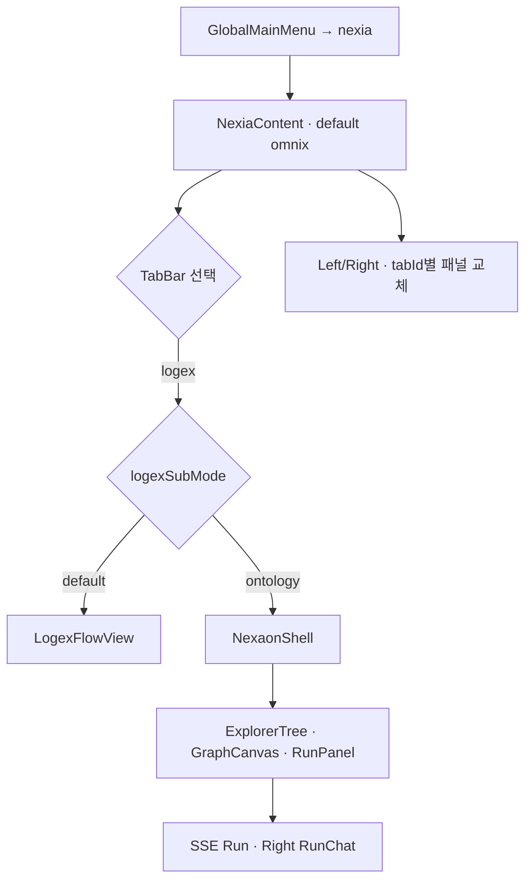

# NEXIA · UI/UX 컴포넌트 트리 뼈대

> **역할:** `domainKey` 별 **화면 컴포넌트 계층·소유 Store·슬롯 매핑** SSOT 뼈대. Props·상태 상세는 PRD·하위 UIUX 에 위임.
> **코드 대응:** [`TDD-055` 구현 파일 구조](../08_TDD/NEXIA/08_TDD_NEXIA_구현파일구조뼈대.md)
> **레이아웃 SSOT:** [`UIX-004` MainShell · nexia](./07_UIUX_NEXIA_MainShell_레이아웃_v1.0.md)

---

## 0. 도메인 공통 UI 골격

모든 `domainKey` 는 **MainShell 4 영역 + SystemStatusBar** 위에 아래 슬롯 트리를 가진다.

```text
MainShellLayout
├── AppHeader
│   ├── GlobalMainMenu                    # domainKey 전환
│   └── GlobalNavbarRight
│       └── {Domain}HeaderActions         # registry.headerActions
├── LeftDrawer
│   └── {Domain}LeftNav                   # registry.left
├── Content (유일한 main scroll)
│   └── {Domain}Content                   # registry.content
├── RightDrawer
│   └── {Domain}RightPanel                # registry.right
└── SystemStatusBar
    ├── {Domain}StatusBar                 # registry.statusBar (선택)
    └── StatusPanelHost
        └── {Domain}StatusPanel           # registry.statusPanel (선택)
```

| 도메인 유형 | Content 분기 | 예 |
| :--- | :--- | :--- |
| **탭 셸** | `tabId` | **nexia** 7 탭 |
| **subRoute** | URL 세그먼트 | erp · ontex |
| **단일 뷰** | 없음 | home · settings |

**범례:** **■** MVP · **◇** Phase 2 · **○** 후속

---

## 1. nexia — 루트 트리

```text
MainShellLayout [domainKey=nexia]
│
├─ AppHeader
│  └─ NexiaHeaderActions ■
│     ├─ ProjectSelector ■
│     ├─ CollaboratorAvatars ○
│     ├─ SyncIndicator ■
│     └─ (tabId=logex+ontology) NexaonRunActions ■
│        ├─ RunButton
│        ├─ ExportButton ○
│        ├─ ApprovalBadge ○
│        └─ DeployMenu ○
│
├─ LeftDrawer [openPolicy=rec]
│  └─ NexiaLeftNav ■
│     └─ switch(activeTabId)
│        ├─ omnix   → OmnixLeftPanel ■
│        ├─ normex  → NormexLeftPanel ■
│        ├─ logex   → LogexLeftPanel ■
│        │            └─ (subMode=ontology) ExplorerTree ■
│        ├─ scribx  → ScribxDocTree ■
│        ├─ vivex   → VivexAssetTree ○
│        ├─ twinex  → TwinexDeviceTree ■
│        └─ navex   → NavexInfraTree ○
│
├─ Content [overflow-auto]
│  └─ NexiaContent ■
│     ├─ NexiaTabBar ■
│     │  └─ TabItem ×7 (omnix … navex)
│     └─ switch(activeTabId)
│        ├─ omnix   → OmnixTab ■
│        ├─ normex  → NormexTab ■
│        ├─ logex   → LogexTab ■
│        │            ├─ (default) LogexFlowView ○
│        │            └─ (ontology) NexaonEntry → NexaonShell ■
│        ├─ scribx  → ScribxTab ■
│        ├─ vivex   → VivexTab ■
│        ├─ twinex  → TwinexTab ■
│        └─ navex   → NavexTab ■
│
├─ RightDrawer [openPolicy=rec]
│  └─ NexiaRightPanel ■
│     └─ switch(activeTabId)
│        ├─ omnix   → OmnixRightPanel ■
│        │            ├─ AgentPanel
│        │            └─ TimeAxisPanel ■
│        ├─ normex  → NormexRightPanel ■
│        ├─ logex   → LogexRightPanel ■
│        │            └─ (ontology) NexaonRightTabs ■
│        │               ├─ PropertiesPanel
│        │               ├─ RunChatPanel
│        │               ├─ ApprovalGatePanel ○
│        │               ├─ ShaclViolationsPanel ○
│        │               └─ DeployPanel → EsphomeDeploy ○
│        ├─ scribx  → ScribxRightPanel ■
│        ├─ vivex   → VivexRightPanel ○
│        ├─ twinex  → TwinexRightPanel ■
│        └─ navex   → NavexRightPanel ○
│
└─ SystemStatusBar
   ├─ NexiaStatusBar ■
   │  ├─ SyncLatencyStrip
   │  ├─ RunStatusStrip (ontology)
   │  ├─ GraphMetricsStrip (nodes/edges)
   │  └─ ShaclSummaryStrip ○
   └─ NexiaStatusPanel ■ (expanded)
      ├─ RunTimeline
      ├─ AwarenessList ○
      └─ DraftAuditSummary ○
```

---

## 2. NexaonShell — Content 하위 (logex · ontology)

`NexaonEntry` 가 마운트하는 **3 분할 작업면** (UIX-004 §5 정합).

```text
NexaonShell ■
├─ NexaonToolbar ■
│  ├─ GraphToolGroup (Select · Connect · Delete)
│  ├─ LayoutGroup (Auto-layout · Fit · MinimapToggle)
│  └─ RunGroup (Run ▶ · Stop · GraphSelector)
├─ NexaonWorkspace (horizontal split)
│  ├─ GraphCanvas ■
│  │  ├─ ReactFlowRoot (@xyflow/react)
│  │  ├─ nodeTypes → ClassNode · AssetNode · PinNode · SensorNode
│  │  ├─ Background · Controls · MiniMap ○
│  │  └─ DiffOverlay ○
│  └─ SpecsPreview ○ (resizable 0~40%)
│     └─ TiptapPreviewHost
└─ RunPanel ■ (collapsible 0~240px)
   ├─ SseEventList
   ├─ StepChipRow
   └─ ViolationJumpLink ○
```

---

## 3. tabId 별 패널 매트릭스

| tabId | Left (주) | Content (주) | Right (주) | Header 특화 |
| :--- | :--- | :--- | :--- | :--- |
| **omnix** | RequestQueue | ChatHub · IntentClassifier | Agent · TimeAxis | — |
| **normex** | TermTree · MOC | TiptapEditor | SpecInspector | — |
| **logex** | ProjectList / **ExplorerTree** | FlowView / **NexaonShell** | FlowProps / **NexaonRightTabs** | **Run·Deploy** |
| **scribx** | DocTree | MonacoEditor | Outline · Lint | — |
| **vivex** | MediaLibrary | MediaStage | Transcribe · Export | — |
| **twinex** | CellList | TwinViewport · YamlPreview | OTA · Serial | Deploy |
| **navex** | InfraTree | NavMap | ConnectionLog | — |

---

## 4. 상태 소유 (Store → UI)

| Store | 소유 상태 | 구독 컴포넌트 |
| :--- | :--- | :--- |
| **useLayoutStore** (frame) | L/R open · width · statusBar expanded | MainShell · Drawer |
| **useNexiaTabStore** | `activeTabId` · `logexSubMode` | TabBar · Left · Right · Content |
| **useNexiaSessionStore** | `projectId` · `roomId` | Header · ExplorerTree |
| **useNexaonStore** | graph selection · runId · layout split | NexaonShell 전체 |
| **useOmnixStore** | threads · streaming | OmnixTab · OmnixRight |
| **Yjs (ontology:draft)** | nodes · edges · meta | GraphCanvas · ExplorerTree |

> 도메인 Store 는 `domains/nexia/store/` · Nexaon 은 `modules/nexaon/store/` — **cross-import 금지** (engines·shared 경유).

---

## 5. 사용자 흐름 (뼈대)



---

## 6. 파일 ↔ 컴포넌트 매핑 (nexia)

| UI 컴포넌트 | 구현 파일 (To-Be) |
| :--- | :--- |
| NexiaHeaderActions | `components/NexiaHeaderActions.tsx` |
| NexiaTabBar | `components/NexiaTabBar.tsx` |
| NexiaLeftNav | `views/left/NexiaLeftNav.tsx` |
| NexiaContent | `views/content/NexiaContent.tsx` |
| NexiaRightPanel | `views/right/NexiaRightPanel.tsx` |
| NexiaStatusBar | `views/status/NexiaStatusBar.tsx` |
| NexiaStatusPanel | `views/status/NexiaStatusPanel.tsx` |
| OmnixTab … NavexTab | `tabs/{tabId}/*Tab.tsx` |
| NexaonShell | `modules/nexaon/NexaonShell.tsx` |
| GraphCanvas | `modules/nexaon/views/GraphCanvas.tsx` |
| ExplorerTree | `modules/nexaon/panels/ExplorerTree.tsx` |

---

## 7. UI 구현 체크리스트 (nexia MVP)

| # | UI 목표 | 컴포넌트 | 상태 |
| :-: | :--- | :--- | :---: |
| 1 | MainShell 슬롯 6 종 마운트 | L · C · R · Header · Status×2 | [ ] |
| 2 | 7 탭 TabBar + URL sync | NexiaTabBar · useNexiaTab | [ ] |
| 3 | tabId 별 L/R 패널 스위치 | NexiaLeftNav · NexiaRightPanel | [ ] |
| 4 | Omnix 허브 최소 UI | OmnixTab · OmnixRightPanel | [ ] |
| 5 | Nexaon 3 분할 | NexaonShell · GraphCanvas · RunPanel | [ ] |
| 6 | ExplorerTree + Graph 연동 | ExplorerTree · useNexaonGraph | [ ] |
| 7 | StatusBar 메트릭 1 줄 | NexiaStatusBar | [ ] |
| 8 | drawerDefaults rec/rec | useLayoutStore 연동 | [ ] |

---

## 8. 후속 도메인 UI 뼈대 (예정)

| domainKey | UIUX 뼈대 | 비고 |
| :--- | :--- | :--- |
| ontex | `07_UIUX_ONTEX_컴포넌트트리뼈대.md` | subRoute 4 뷰 |
| erp | `07_UIUX_ERP_컴포넌트트리뼈대.md` | subRoute 6 메뉴 |
| nexet | `07_UIUX_NEXET_컴포넌트트리뼈대.md` | 마켓 카탈로그 |
| nexabo | `07_UIUX_NEXABO_컴포넌트트리뼈대.md` | statusBar·Panel |

---

## 관련 문서

| 관계 | 문서 |
| :--- | :--- |
| 구현 파일 트리 | [NEXIA · 구현 파일 구조 뼈대 (TDD-055)](../08_TDD/NEXIA/08_TDD_NEXIA_구현파일구조뼈대.md) |
| MainShell · nexia | [NEXIA MainShell · 레이아웃 (UIX-004)](./07_UIUX_NEXIA_MainShell_레이아웃_v1.0.md) |
| 플랫폼 레이아웃 | [NEXA 통합 레이아웃 구조 규격 (UIX-006)](./07_UIUX_NEXA_통합레이아웃구조규격.md) |
| 도메인 레지스트리 | [도메인 구조 (TDD-002)](../08_TDD/NEXAOS/08_TDD_NEXAOS_도메인레지스트리명세.md) |
| v0 프롬프트 | [NEXIA v0 UI 프롬프트셋 (UIX-005)](./07_UIUX_NEXIA_v0UI프롬프트셋_v1.0.md) |
