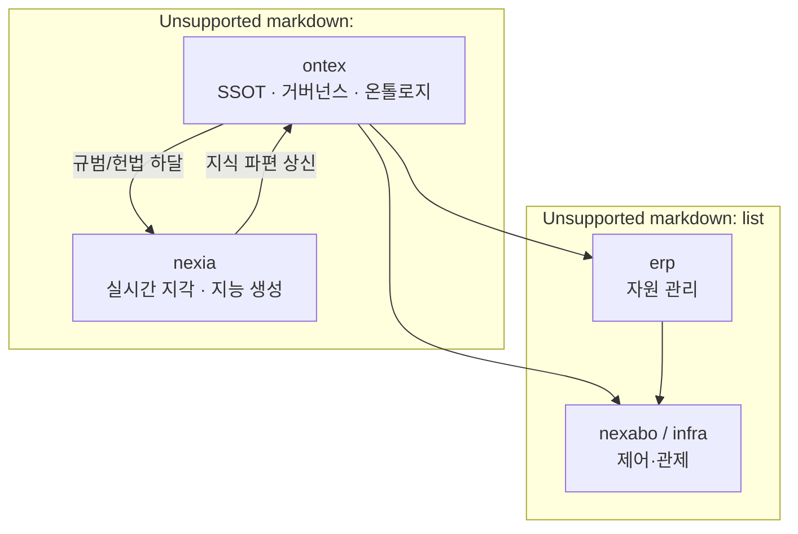
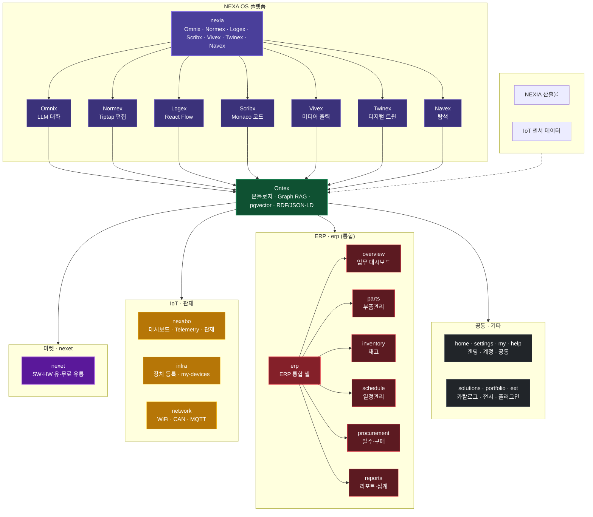

# NEXA OS · 도메인 마스터 맵 v1.0

> **역할:** nexia 와 Ontex 를 중심으로 전체 `domainKey` **관계·기술 맥락**을 정리하는 **참조 맵** (Concept Map).
> **레지스트리·드로어·폴더 SSOT**는 [`08_TDD_NEXAOS_도메인레지스트리명세`](./08_TDD_NEXAOS_도메인레지스트리명세.md)(TDD-002). **충돌 시 TDD-002 우선.** 도메인 추가·통합 시 **TDD-002 를 먼저** 갱신한 뒤 본 맵을 맞춘다.
>
> **작업 범위 (2026-06):** **NEXA V2.0/docs 문서만** 대상. `NEXA-Platform/src/` 레거시 (Vue) 코드 **마이그레이션·수정 없음** — 런타임은 **폐기 후 Greenfield** (`apps/web` Next.js) 로 신규 구현. To-Be 경로·키는 TDD·뼈대 문서가 SSOT.

---

## 0. 도메인 진화 모델 (v2)

| 단계        | 특성       | 핵심 도메인               | 아키텍처 역할                        |
| :-------- | :------- | :------------------- | :----------------------------- |
| **0. 인문** | 존재론 · 규범 | **ontex**, **nexia** | 지식의 뿌리 및 규범 (Constitutional) 정의 |
| **1. 산업** | 정밀 · 안전  | erp, nexabo, infra   | 미션 크리티컬 실행 및 데이터 검증            |
| **2. 아트** | 표현 · 공명  | solutions, portfolio | 센서 - 미디어 매핑 및 감성적 인터랙션           |
| **3. 일상** | 체화 · 습관  | my, help, home       | 기술의 비가시화 및 개인화된 경험             |

### ** [nexia](app://obsidian.md/nexia) 가 지식을 만들고 [ontex](app://obsidian.md/ontex) 가 이를 검증/보관한다. **상호 피드백 루프** 다이어그램



## NEXA 플렛폼 구조



---

## 1. 플랫폼 기반 기술 스택

> nexia 전체를 관통하는 핵심 엔진. 특정 탭이 아닌 플랫폼 레이어.

| 기술           | 역할                           | 적용 범위          |
| -------------- | ------------------------------ | ------------------ |
| **LangGraph**  | 탭 간 상태·흐름 오케스트레이션 | nexia 전체 + Ontex |
| **Yjs (CRDT)** | 실시간 멀티유저 동기화 기반    | nexia 전체 탭      |

```json
LangGraph  →  nexia 7탭 오케스트레이션
           →  Ontex 그래프 탐색 · 추론 흐름
Yjs        →  Tiptap(Normex) · React Flow(Logex) · Monaco(Scribx) 멀티유저 기반
```

---

## 2. nexia — 플랫폼 핵심

7 탭 구조. 모든 기능의 중심. **탭별 In/Out·MVP 범위 SSOT:** [`08_TDD_NEXIA_7탭범위확정_v1.0`](../NEXIA/08_TDD_NEXIA_7탭범위확정_v1.0.md) (TDD-056).

| 탭  | 이름   | 탭 엔진          | 역할                        |
| --- | ------ | ---------------- | --------------------------- |
| 1   | Omnix  | LLM              | 자연어 대화 · AI 인터페이스 |
| 2   | Normex | Tiptap + Yjs     | 문서 협력 편집              |
| 3   | Logex  | React Flow + Yjs | 로직 흐름 설계 (LangGraph Run) |
| 4   | Scribx | Monaco + Yjs     | 코드 편집 · 다언어          |
| 5   | Vivex  | 미디어 렌더러    | 미디어 출력 · 보기 · 편집   |
| 6   | Twinex | —                | 디지털 트윈                 |
| 7   | Navex  | —                | 네비게이션 · 탐색           |

---

## 3. Ontex vs nexia — 지식 거버넌스 체계

- **[nexia](app://obsidian.md/nexia) (Runtime Engine):** 7 탭 엔진을 통해 지식을 **동적으로 생성**하고 현장을 제어합니다. (지능의 용광로)
- **[ontex](app://obsidian.md/ontex) (Knowledge Anchor):** `nexia` 에서 올라온 지식을 **인문적 규범**에 따라 정제하여 전사적 온톨로지로 고착시킵니다. (지식의 금고)

| 기술            | 역할                     |
| ------------- | ---------------------- |
| LangGraph     | 그래프 탐색 · 추론 흐름 오케스트레이션 |
| pgvector      | 벡터 검색                  |
| Graph RAG     | 관계 기반 검색               |
| RDF / JSON-LD | 온톨로지 표현                |
| Zod 스키마       | 데이터 정합성                |

**데이터 소스:**
- Omnix 대화, Normex 문서, Logex 흐름, Scribx 코드, Vivex 미디어
- IoT 하드웨어 센서 데이터 (**nexabo**)
- ERP 마스터·재고·일정 이벤트 (**erp**)
- 외부 연동 데이터

**Content `subRoute` (`ontex`)** — L/R 드로어 공유 · `erp` 와 동일 패턴:

| subRoute | 역할                            | 구 domainKey |
| :------- | :------------------------------ | :----------- |
| canvas   | Nexion React Flow · 지식 데스크 | nexion       |
| explore  | Graph RAG · 온톨로지 탐색       | —            |
| trace    | 데이터 흐름 · Trace             | nexeed       |
| archive  | Tiptap·Hub·Sentinel 저장소      | nexa-archive |

---

## 4. nexet — 마켓 (넥셋)

> **정의:** `nexet` = NEXA **마켓** `domainKey`. NEXA OS 에서 쓸 수 있는 **소프트웨어**(위젯·템플릿·로직·워크플로·익스텐션…) 와 **하드웨어**를 **유료·무료**로 검색·구독·설치·유통하는 공간.
> 서사·자산 체계 상세: [Market SPEC](../../../NEXA-Platform/docs/Market/Market%20SPEC%20마켓%20지능%20유통%20및%20생태계%20통합%20규격서.md) (Nexara).

| **domainKey** | 폴더   | 역할                                                | 연결                   |
| :------------ | :----- | :-------------------------------------------------- | :--------------------- |
| **nexet**     | nexet/ | SW·HW 마켓플레이스 · 라이선스 · Capability(`cap.*`) | 설치 자산 족보 → Ontex |

**유통 자산 (요약):**

| 축     | 예시                                              |
| :----- | :------------------------------------------------ |
| **SW** | UI 위젯 · UCL 템플릿 · Map · Workflow · Extension |
| **HW** | 모듈 · 디바이스 · 센서 키트 · 펌웨어 번들         |

> 실행 (`nexia`)·온톨로지 (`ontex`) 와 **분리** — 소유권·버전·거버넌스 전담. `erp` 부품 마스터·`infra` 장치 등록과는 역할이 다름.

---

## 5. IoT · 관제 도메인

| **domainKey** | 폴더     | 역할                                              | Ontex 연결                    |
| :------------ | :------- | :------------------------------------------------ | :---------------------------- |
| **nexabo**    | nexabo/  | 대시보드 · IoT · Telemetry 관제 · `/nexabo/admin` | 센서·알람 데이터 → Ontex 피드 |
| **infra**     | infra/   | 장치 등록 · my-devices                            | nexabo 연계 · 장기 흡수 후보  |
| **network**   | network/ | WiFi · CAN · MQTT 프로토콜                        | nexabo / IoT 스택 하위        |

> **명칭:** 구 `nexage` → **nexabo** (넥사보드). `themePreset`: `power-grid` · `factory-night` · `control-room` 유지.

---

## 6. ERP 도메인 — `erp` 통합

> 구 **`nexa-erp`** + **`erp-parts`** 를 단일 **`erp`** 로 통합.
> **Left/Right 드로어·상태바**는 도메인 공통 · **Content**만 서브 메뉴 (`subRoute`) 로 분기.

### 6.1 통합 원칙

| 항목      | 규칙                                                   |
| :-------- | :----------------------------------------------------- |
| domainKey | **erp** (구 nexa-erp 폐기)                             |
| 폴더      | apps/web/src/domains/erp/ 단일                         |
| 레이아웃  | domainLayoutRegistry.erp — L/R 드로어 rec / rec 공유   |
| subRoute  | URL 세그먼트로 content 만 분기 (`overview` · `parts` …) |
| 백엔드    | Nest parts/ 모듈 유지 · 라우트 prefix `/erp/*`         |
| 폐기 키   | erp-parts — registry·라우터에서 제거                   |

### 6.2 서브 메뉴 (1 차 확정)

| `subRoute`    | 라벨 (KO)     | 역할                      | 구 대응                  |
| :------------ | :------------ | :------------------------ | :----------------------- |
| `overview`    | 업무 대시보드 | ERP 홈 · KPI · 바로가기   | `nexa-erp` 기본 뷰       |
| `parts`       | 부품관리      | 분류 · BOM · 부품 마스터  | **`erp-parts`** 핵심     |
| `inventory`   | 재고          | 입출고 · 창고 · 재고 조회 | `erp-parts` 재고 축 확장 |
| `schedule`    | 일정관리      | 생산·납기·작업 일정       | 신규 (ERP 통합 편익)     |
| `procurement` | 발주·구매     | 발주서 · 공급처 연동      | 신규 (후순위)            |
| `reports`     | 리포트·집계   | 재고·생산·비용 리포트     | 신규 (후순위)            |

### 6.3 라우트 예시 (초안)

```json
/erp                      → overview (redirect)
/erp/parts                → 부품관리
/erp/parts/:categoryId    → 분류 상세
/erp/inventory            → 재고
/erp/schedule             → 일정관리
/erp/procurement          → 발주·구매
/erp/reports              → 리포트
```

### 6.4 Left Nav 구조 (초안)

```json
erp
├── 업무 대시보드    (overview)
├── 부품관리        (parts)      ← ex erp-parts
├── 재고            (inventory)
├── 일정관리        (schedule)
├── 발주·구매       (procurement)  [Phase 2]
└── 리포트·집계     (reports)      [Phase 2]
```

---

## 7. 플랫폼 공통 도메인

| **domainKey** | 역할                        |
| :------------ | :-------------------------- |
| **home**      | 플랫폼 랜딩 · NexaBlock     |
| **settings**  | 계정 · 환경 · 레이아웃 설정 |
| **my**        | 프로필 · 개인 workspace     |
| **help**      | 가이드 · FAQ · 온보딩       |

---

## 8. 기타 도메인

| **domainKey** | 역할                          | 우선순위 |
| :------------ | :---------------------------- | :------- |
| **solutions** | 산업 · 라이프 솔루션 카탈로그 | 낮음     |
| **portfolio** | 프로젝트 성과 · 결과물 전시   | 낮음     |
| **extension** | 플러그인 UI                   | 낮음     |

---

## 9. 인프라 · 관리

| **domainKey** | 역할                           |
| :------------ | :----------------------------- |
| **dev**       | 문서 · DB · 테마 · 개발 가이드 |
| **admin**     | 슈퍼 관리자 · 멤버 · 리소스    |

---

## 10. `domainKey` 전체 인덱스 (v2 · 16)

> TDD-002 §3.0 과 **동일 키·동일 정렬** (레지스트리 등록 순). 그룹 열은 본 맵 탐색용.

|  #  | **domainKey** | 폴더       | 그룹        |
| :-: | :------------ | :--------- | :---------- |
|  1  | **home**      | home/      | 공통        |
|  2  | **nexia**     | nexia/     | 플랫폼 핵심 |
|  3  | **ontex**     | ontex/     | 온톨로지    |
|  4  | **nexabo**    | nexabo/    | IoT · 관제  |
|  5  | **nexet**     | nexet/     | **마켓**    |
|  6  | **erp**       | erp/       | ERP (통합)  |
|  7  | **infra**     | infra/     | IoT · 관제  |
|  8  | **network**   | network/   | IoT · 관제  |
|  9  | **solutions** | solutions/ | 기타        |
| 10  | **portfolio** | portfolio/ | 기타        |
| 11  | **extension** | extension/ | 기타        |
| 12  | **settings**  | settings/  | 공통        |
| 13  | **my**        | my/        | 공통        |
| 14  | **help**      | help/      | 공통        |
| 15  | **dev**       | dev/       | 인프라      |
| 16  | **admin**     | admin/     | 인프라      |

**흡수 완료 (별도 domainKey 없음):** nexion → ontex/canvas · nexeed → ontex/trace · nexa-archive → ontex/archive · erp-parts → erp/parts · nexage → nexabo · nexa-admin → admin

**Phase 2 예정:** u2bee (extension 통합)

---

## 11. 문서 분류 (전 도메인 공통)

| 번호 | 분류           | 구현 파일 구조 필요 |
| ---- | -------------- | ------------------- |
| 01   | BRD            | ❌                  |
| 02   | Legal & Policy | ❌                  |
| 03   | MVP Plan       | ❌                  |
| 04   | Decision Log   | ❌                  |
| 05   | PRD            | ⚠️ 부분             |
| 06   | Analytics Spec | ❌                  |
| 07   | UIUX Spec      | ✅ 필요             |
| 08   | TDD            | ✅ 최우선           |
| 09   | Admin & Ops    | ❌                  |
| 10   | QA Test Case   | ❌                  |
| 11   | User Guide     | ❌                  |

---

## 관련 문서

| 관계 | 문서 |
| :--- | :--- |
| 상위 SSOT | [NEXA OS · 도메인 구조 레지스트리 (TDD-002)](./08_TDD_NEXAOS_도메인레지스트리명세.md) |
| OS Normative | [NEXA OS 설계 표준 · 미션 크리티컬 전략 (TDD-001)](./08_TDD_NEXAOS_설계표준_미션크리티컬전략.md) |
| nexia 7 탭 | [NEXIA · 7탭 범위 확정 (TDD-056)](../NEXIA/08_TDD_NEXIA_7탭범위확정_v1.0.md) |
| Ontex | [Ontex · 기술 스택 (TDD-057)](../Ontex/08_TDD_Ontex_기술스택운영방침_v1.0.md) |
| 오케스트레이션 | [LangGraph · 오케스트레이션 설계 (TDD-058)](../LangGraph/08_TDD_LangGraph_오케스트레이션설계_v1.0.md) |
| 모노레포 | [LangGraph 모노레포 폴더 구조 (TDD-007)](../LangGraph/08_TDD_LangGraph_모노레포폴더구조_v1.0.md) |
