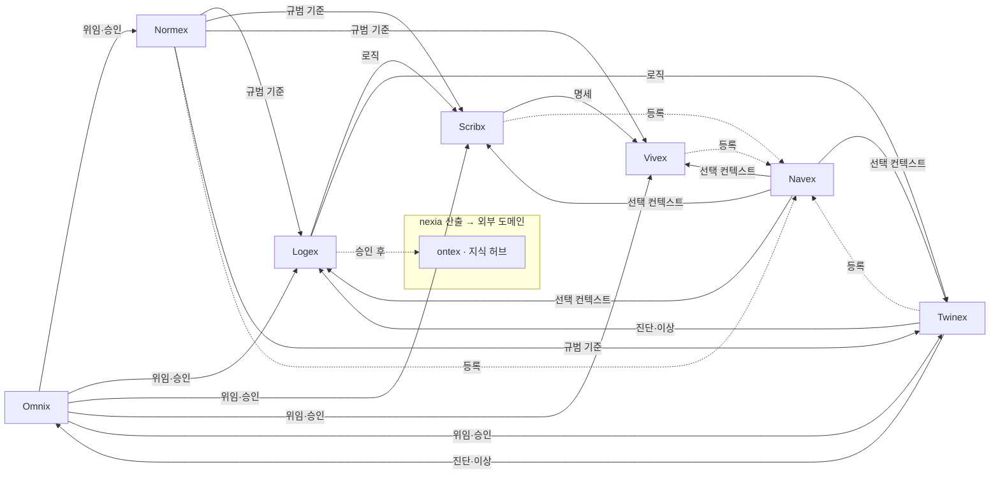

# NEXIA · 7 탭 범위 확정 v1.0

> **한 줄:** `domainKey: nexia` 셸의 **7 개 `tabId` 역할·경계·MVP 범위**를 확정한다. 탭 규정·스택·파이프라인 상세는 [`TDD-010`](./08_TDD_NEXIA_구조기술스택운영방침.md) · UI 슬롯은 [`UIX-004`](../07_UIUX/07_UIUX_NEXIA_MainShell_레이아웃_v1.0.md) · 컴포넌트 뼈대는 [`UIX-008`](../07_UIUX/07_UIUX_NEXIA_컴포넌트트리뼈대.md) 를 따른다.

**확정일:** 2026-06-12
**적용 대상:** `apps/web/src/domains/nexia/` · `config/nexiaTabs.ts` · PRD·UI 구현 판단의 **1 차 SSOT**

---

## 1. 문서 목적

| 항목 | 내용 |
| :--- | :--- |
| **정의** | 7 탭 각각 **무엇을 담당하고 무엇을 담지 않는지** — 구현·기획 분쟁 시 **최종 판단표** |
| **상위 Normative** | [`TDD-010`](./08_TDD_NEXIA_구조기술스택운영방침.md) §3 — `tabId`·기술·`.nx*`·파이프라인 |
| **본 문서가 추가로 고정하는 것** | 탭별 **In/Out** · **MVP(P0~P2)** · **타 `domainKey` 경계** · **Logex↔Nexaon** 분리 |
| **제외** | Ontex `subRoute` 상세 · ERP·nexabo 전체 — [`TDD-002`](../NEXAOS/08_TDD_NEXAOS_도메인레지스트리명세.md) |

---

## 2. nexia 도메인 경계

### 2.1 nexia 가 담당하는 것

- **7 탭 셸** — `tabId` 전환 · L/R Drawer · Header · StatusBar **탭별 패널 스왑**
- **인간·AI·장치 조율 허브** — Omnix 오케스트레이션 · 승인 게이트 진입점
- **생산·실행 작업면** — Normex·Logex·Scribx·Vivex·Twinex·Navex 에서 **산출물 생성·편집·릴레이**
- **NEXA-CELL** — Twinex 탭 내 ESPHome·펌웨어·OTA (**산업 1 단계** SSOT)
- **Nexaon(ontology)** — Logex **`ontology` 서브모드** (`modules/nexaon/`) — IoT 온톨로지 디지털 트윈 **편집·Run·승인 UI**

### 2.2 nexia 가 담지 않는 것

| 대상 | 소유 `domainKey` | 비고 |
| :--- | :--- | :--- |
| 장기 온톨로지·Graph RAG·아카이브 허브 | **ontex** | Nexion 캔버스 = `ontex/canvas` · nexia Logex/Nexaon 은 **초안·Run** |
| IoT 관제·Telemetry 대시보드 | **nexabo** | Twinex 는 **디바이스·트윈 작업면**만 |
| SW·HW 마켓 유통 | **nexet** | 설치·라이선스·Capability |
| ERP·부품·재고 | **erp** | Normex 규범 **참조**만 |
| 전역 MainShell·`domainLayoutRegistry` | **NEXAOS / frame** | nexia 는 registry **한 슬롯** |

### 2.3 명칭 (혼동 방지)

| 이름 | 정체 |
| :--- | :--- |
| **nexia** | UI `domainKey` · 7 탭 플랫폼 셸 |
| **Nexaon** | Logex `ontology` **서브모드** 모듈 (`modules/nexaon/`) — 별도 `tabId` **아님** |
| **Nexion** | **ontex** `canvas` subRoute **표시명** — nexia 와 분리 |
| **NEXAON** | AXON 프로토콜 계층 용어 — UI 도메인명 **아님** |

---

## 3. 7 탭 확정 목록 (`tabId` SSOT)

코드·문서·라우트·`.nx*`·Envelope 에 사용하는 **`tabId` 는 아래 7 개만** 허용한다.

|  #  | `tabId`  | 라벨 (UI) | 한 줄 역할              | 기본 라우트                    |
| :-: | :------- | :------ | :------------------ | :------------------------ |
|  1  | `omnix`  | Omnix   | 소통·허브·오케스트레이션       | `/nexia` · `/nexia/omnix` |
|  2  | `normex` | Normex  | Norm(규범)·정책·시방서     | `/nexia/normex`           |
|  3  | `logex`  | Logex   | 추론·관계·워크플로우         | `/nexia/logex`            |
|  4  | `scribx` | Scribx  | 코드·명세·스크립트          | `/nexia/scribx`           |
|  5  | `vivex`  | Vivex   | 미디어·시각·청각           | `/nexia/vivex`            |
|  6  | `twinex` | Twinex  | 디지털 트윈·엣지·NEXA-CELL | `/nexia/twinex`           |
|  7  | `navex`  | Navex   | 파일·자산·노드 탐색         | `/nexia/navex`            |

**설정 SSOT:** `domains/nexia/config/nexiaTabs.ts`
**금지:** 8 번째 탭을 nexia 에 추가하려면 **본 문서 + TDD-010 + TDD-002** 개정 절차를 거친다. (Extended 프로파일은 **기능 확장**이지 `tabId` 추가가 아님 — §8)

---

## 4. Logex · Nexaon(ontology) 경계

Logex 는 **두 층**으로 확정한다.

| 층 | 식별 | 범위 |
| :--- | :--- | :--- |
| **Logex 기본** | `logexSubMode: default` | 워크플로 **React Flow** · `.nxflow` · **LangGraph Run** |
| **Nexaon** | `logexSubMode: ontology` | IoT 온톨로지 `ontology:draft` · GraphCanvas · RunPanel · SHACL · ESPHome Deploy |

```text
/nexia/logex                      → Logex 기본 (FlowView)
/nexia/logex/ontology             → Nexaon 서브모드
/nexia/logex/ontology/{projectId} → 프로젝트 스코프 Nexaon
```

| 항목 | Logex 기본 | Nexaon(ontology) |
| :--- | :--- | :--- |
| **UI 루트** | `tabs/logex/LogexTab` | `modules/nexaon/NexaonShell` |
| **Left** | 프로젝트·그래프 목록 | `ExplorerTree` (Classes·Assets·PinMaps) |
| **Right** | Flow 속성 | Properties · Run Chat · Approvals · SHACL · Deploy |
| **Header** | 공통 | **Run · Export · 승인 · Deploy** |
| **백엔드** | Nest LangGraph 프록시 | `modules/nexaon` + `apps/agent-graph` SSE |
| **Ontex 와 관계** | 워크플로·로직 초안 | **Yjs 초안** → 승인 후 `ontex`/Neo4j·`specs/` |

> **MVP 1 순위:** 산업 단계 UI 는 **Nexaon(ontology)** 를 Logex 진입의 **핵심 작업면 (canonical home)** 으로 둔다 — [`PRD-001`](../05_PRD/05_PRD_NEXIA_UI기능명세_MVPPhaseUI_v1.0.md). **다른 surface·엣지 후보고에서의 진입** 은 §4.1.

### 4.1 Nexaon 진입 — canonical home · deep link · 엣지 후보고

> **SSOT 요약:** [`TDD-070` §3.4.1](../../용어집_NEXA전용_v2.0.md) · IoT 파이프라인 [TDD-068 · IoT 엣지…](./08_TDD_NEXIA_IoT엣지데이터파이프라인_HEXAGON_Nexaon연계_v1.0.md) §1.6.5

**원칙**

- **Nexaon ≠ 8 번째 `tabId`** — `modules/nexaon/` 모듈은 **어디서 mount 해도 동일** (`NexaonShell` · Yjs room · Run graph).
- **Logex/ontology URL** = UI **집 주소 (canonical home)** — 북마크·SSR·`projectId` SSOT.
- **탭 소속 ≠ 유일한 문** — Twinex·nexabo·Omnix·Navex 및 **엣지 후보고** 는 **deep link · 데이터 진입** 허용 — **Logex 라우트 선행 ✗** (데이터 축).

| 축 | 출발 | Nexaon 연결 | UI 동작 |
| :--- | :--- | :--- | :--- |
| **① 엣지 후보고** | Sentinel · `candidate:true` Envelope | Nest → **`nexaon_ingest`** | nexabo/Nixie 알림 → **「정재 열기」** (canonical URL normalize) |
| **② nexabo** | Live Feed · 알람 | ingest 큐 · correlate graph | 알람 행 → Nexaon (`trace_id` · `device_id` 프리로드) |
| **③ Twinex** | `.nxdev` · 진단 | `device_id` → class/asset/pin | **「온톨로지 정재」** → ExplorerTree jump |
| **④ Logex** | `logexSubMode: ontology` | **canonical home** | `/nexia/logex/ontology/{projectId}` |
| **⑤ Omnix** | 승인 · `graph_diff` | Run 완료 · DiffOverlay | GraphCanvas accept · RunPanel |
| **⑥ Navex** | 자산·프로젝트 선택 | ExplorerTree 컨텍스트 | class/asset 노드 expand |

**Deep link (Normative 예시)**

```text
/nexia/logex/ontology/{projectId}?from=twinex&device_id={id}
/nexia/logex/ontology/{projectId}?from=nexabo&trace_id={id}
```

- `from` — 진입 surface (analytics·UI breadcrumb) · **Run·room 분기 ✗**
- mount 후 **canonical URL 로 normalize** 권장 (새로고침·공유 SSOT)

**엣지 후보고 → Nexaon ingest 모드**

| 모드 | 조건 | 동작 |
| :--- | :--- | :--- |
| **Auto** | MQTT `critical` · STUCK · 정책 매칭 | **Omnix/Nest router** → `nexaon_ingest` |
| **Queue** | Normal 후보고 | staging 큐 → Human **Nexaon 정재** |
| **Buffer** | 고빈도 TICK | nexabo Live Feed 만 · Run **배치/임계치** |

**금지:** 후보고·알람이 **Logex 탭 전환 없이는 Nexaon Run 불가** 로 구현 ✗ — 데이터 축은 **Nest 큐·router** 로 직접 ingest.

---

## 5. 탭별 범위 확정

범례: **●** MVP P0 · **◐** MVP P1 · **○** Phase 2 · **—** 범위 외

### 5.1 Omnix (`omnix`)

| 구분 | 확정 내용 |
| :--- | :--- |
| **역할** | 모든 탭의 **진입·라우팅·승인 게이트** · HEXAGON(5W1H) 분류 · 대화 허브 |
| **범위 내** | 멀티모달 채팅 (텍스트·이미지·음성→텍스트) ● · 의도 분류·탭 위임 ◐ · Run/승인 요청 중계 ● · Global Flow(대화 이벤트 시간순) ◐ · NIXIE 상태 표시 ○ · **Discover intent** → **`navex_search` tool** (NISE) ◐ P0 |
| **범위 외** | 탭 본문 편집 (각 전문 탭) · **자산 hybrid ranking** (**NISE** · [`PRD-014` §2.3.1](../../05_PRD/NEXIA/05_PRD_NEXIA_Navex이중탐색모드지능형탐색_v1.0.md)) · Graph RAG 검색 (**ontex**) · ERP 트랜잭션 |
| **엔진** | `apps/agent-graph` (Chat·Stream·SSE) · Nest 프록시 · Yjs 채팅 룸 |
| **산출물** | `.nxchat` → Navex 등록 |
| **Left / Right** | 요청 큐·최근 Run ● / Agent · Time Axis ● |
| **연계 PRD/TDD** | PRD-003(ASK/VOID) · TDD-041(GOVERN) · PRD-001 · TDD-038 |

### 5.2 Normex (`normex`)

| 구분 | 확정 내용 |
| :--- | :--- |
| **역할** | **Norm(규범)** · 정책·가드레일·인터랙티브 시방서 |
| **범위 내** | Tiptap 협업 편집 ● · 용어집·MOC 트리 ● · Normex 블록 (링크·트리거) ◐ · 버전·승인 이력 ◐ · wikilink ↔ Logex/Nexaon SpecsPreview 연동 ◐ |
| **범위 외** | 온톨로지 그래프 편집 (**Nexaon**) · 코드 실행 (**Scribx**) · 장기 아카이브 UI(**ontex/archive**) |
| **엔진** | TipTap + Yjs · `@engines/tiptap` |
| **산출물** | `.nxpol` |
| **Left / Right** | TermTree · MOC ● / SpecInspector ● |
| **연계** | UIX-001(Tiptap 옵션) · TDD-041(GOVERN) |

### 5.3 Logex (`logex`)

| 구분 | 확정 내용 |
| :--- | :--- |
| **역할** | 추론·관계·워크플로우 **로직 생성물** |
| **범위 내** | **Nexaon(ontology)** 전체 ●(MVP 핵심) · Logex FlowView(일반 워크플로) ○ · LangGraph subgraph 시각화 ○ · `.nxflow` 저장 ● · Navex 컨텍스트 수신 ● |
| **범위 외** | Nexion 지식 데스크 전체 (**ontex/canvas**) · IoT 관제 패널 (**nexabo**) |
| **엔진** | React Flow · Yjs · (Logex) `.nxflow` · (Nexaon) LangGraph SSE |
| **산출물** | `.nxflow` · (Nexaon) `ontology:draft` |
| **Left / Right** | ProjectList / **ExplorerTree**(ontology) ● / FlowProps 또는 **NexaonRightTabs** ● |
| **연계** | PRD-001 · LangGraph TDD-007~009 |

### 5.4 Scribx (`scribx`)

| 구분 | 확정 내용 |
| :--- | :--- |
| **역할** | Logex 로직의 **실행 가능 코드·명세** |
| **범위 내** | Monaco 협업 편집 ● · 문서 트리 ● · Lint/Formatter 체인 ◐ · Logex→코드 변환 릴레이 ○ · 배포 승인 요청 (Omnix) ◐ |
| **범위 외** | ESPHome YAML 편집 (**Twinex/NEXA-CELL**) · 미디어 렌더 (**Vivex**) |
| **엔진** | Monaco + Yjs |
| **산출물** | `.nxcode` |
| **Left / Right** | DocTree ● / Outline · Lint ● |

### 5.5 Vivex (`vivex`)

| 구분 | 확정 내용 |
| :--- | :--- |
| **역할** | Scribx·Normex 명세의 **미디어 결과물** |
| **범위 내** | 미디어 스테이지 (뷰어) ● · 에셋 라이브러리 ◐ · STT/음성 파이프라인 연동 ● · ComfyUI 큐 연동 ○ · 파라미터 Yjs 동기화 ◐ |
| **범위 외** | 3D 트윈 (**Twinex**) · 파일 시스템 탐색기 전체 (**Navex** + GlobalFileExplorer 는 **공통 패널**) |
| **엔진** | ComfyUI · agent-graph · 미디어 파이프라인 |
| **산출물** | `.nxmedia` |
| **Left / Right** | MediaLibrary ◐ / Transcribe · Export ● |
| **연계** | PRD-007 · TDD-020~021 |

### 5.6 Twinex (`twinex`)

| 구분               | 확정 내용                                                                                                                    |
| :--------------- | :----------------------------------------------------------------------------------------------------------------------- |
| **역할**           | 디지털 트윈 · **NEXA-CELL** · 엣지·진단                                                                                           |
| **범위 내**         | 디바이스·셀 목록 ● · 트윈 뷰포트 (3D) ◐ · ESPHome YAML 미리보기 ● · Web Serial·OTA ○ · MQTT/실시간 상태 스트립 ◐ · `.nxproj`·`.nxdev`·`.nxgrp` ● |
| **범위 외**         | 공장 전체 관제 대시보드 (**nexabo**) · 온톨로지 클래스 편집 (**Nexaon**)                                                                    |
| **엔진**           | Three.js/Babylon · ESPHome · MQTT · WebSocket                                                                            |
| **산출물**          | `.nxproj` · `.nxgrp` · `.nxdev` · `.nxdiag`                                                                              |
| **Left / Right** | CellList ● / OTA · Serial ○                                                                                              |
| **연계**           | PRD-004 · TDD-024(NEXA-CELL)                                                                                             |
|                  |                                                                                                                          |

### 5.7 Navex (`navex`) · Global Navex

| 구분               | 확정 내용                                                                                                               |
| :--------------- | :------------------------------------------------------------------------------------------------------------------ |
| **역할**           | **플랫폼 전역 Global Asset Index** · 전 탭·전 `domainKey` 자산 **탐색·검색** · 선택 컨텍스트 **릴레이**                                              |
| **범위 내**         | InfraTree ● · **전 `domainKey` DB 등록 파일** ● · code/config(yaml·json 등) P0 ● · **edge ingest** ● · docs internal/external ● · `.nx*` ● · 필터·검색 ● · GlobalFileExplorer ● · OPFS/IndexedDB ○ · **nexet 설치본** ○ P1 |
| **범위 외**         | Graph RAG 전용 UI(**ontex/explore**) · ERP **마스터 편집** · MQTT **실시간 스트림**(파일 아님) · **Left Drawer 프로젝트 탐색** UI(별도 SSOT)              |
| **엔진**           | GlobalFileExplorer · facet 필터 · 서버 검색/페이지네이션 · InfraTree · IndexedDB · OPFS · (선택) S3/MinIO                                          |
| **산출물**          | 확장자 생성 없음 — **전체 인덱싱**                                                                                              |
| **Left / Right** | InfraTree ● / ConnectionLog ◐                                                                                       |
| **연계**           | PRD-008 · UIX-002 · PRD-001 §3.9 · UIX-004 §4.5 · [`TDD-070` §3.6.4](../../용어집_NEXA전용_v2.0.md) · [`TDD-065`](./08_TDD_NEXIA_Navex탐색APIFacet계약_v1.0.md)                                     |

#### 5.7.1 탐색 범위 (Normative)

> **한 줄:** Navex 는 **`domainKey=nexia` 산출물만 ✗** — **전 `domainKey`** 에서 **생성·업로드·DB 등록**(`files` / `file_references`) 된 자산을 **기본 탐색 대상**으로 한다.

| 원칙 | 내용 |
| :--- | :--- |
| **플랫폼 전역** | `uploads/{domain}/...` — nexia·archive·parts·erp 등 **domain 미지정 시 전 도메인** |
| **≠ 미디어 탭** | Vivex Left **`useNexiaAssets`**(`domain=nexia`) 는 **프로젝트 작업면** — Navex 와 **별도** |
| **≠ 프로젝트 탐색** | Left Drawer **Project Explorer** — `project_id` **고정** 스코프 · Navex 는 **고정 없음**(필터로만 좁힘) |
| **동일 SSOT** | 두 표면 모두 `files` / `file_references` — **뷰·프리셋만** 다름 |

#### 5.7.2 P0 탐색 대상 · category

| `navexCategory` | 포함 예 | P0 |
| :--- | :--- | :---: |
| **nx-*** | `.nxchat` … `.nxdiag` ([`TDD-010` §3.3](./08_TDD_NEXIA_구조기술스택운영방침.md)) | ● |
| **documents** | `.md` `.pdf` `.txt` … | ● |
| **code** | `.js` `.ts` `.py` `.sh` … | ● |
| **config** | `.yaml` `.json` `.cfg` … | ● |
| **media** | images · audio · video | ● |
| **edge-ingest** | ESP32/RPi 업로드 log·config·dump (`source='edge'`) | ● |
| **firmware** | `.bin` 등 (목록·다운로드, 미리보기 △) | ○ |

P0 수준: **탐색·목록·텍스트/미디어 미리보기**. 실행·플래시·Run·ERP 편집은 **소유 탭·domainKey**.

#### 5.7.3 `asset-origin` (출처 축)

| `asset-origin` | 의미 | Phase |
| :--- | :--- | :--- |
| `upload` | 일반 업로드 · `files.source='upload'` | P0 |
| `edge` | 엣지 디바이스 ingest · `metadata.device_id` | P0 |
| `docs` | 문서 루트 (external/internal) | P0 |
| `generated` | 파이프라인·`.nx*` 산출 | P0 |
| `web` · `memo` | 웹자료·메모 ([`PRD-010`](../../05_PRD/NEXIA/05_PRD_NEXIA_워크스페이스웹서치자원전략.md)) | P1 |
| `market` | **nexet 설치된** 패키지·템플릿 번들 | P1 |
| `market-remote` | 미설치 원격 catalog — **검색 결과만**, 트리 leaf 폭발 방지 | P2 |

**엣지 (Normative):** MQTT live telemetry 는 **파일 ✗** → nexabo/Twinex. 파일로 persist·ingest 된 것만 Navex.

#### 5.7.4 필터 · 검색 · InfraTree

범위가 넓을수록 **단일 깊은 트리 ✗** — **facet + 검색 + 프리셋** 우선 ([`UIX-002` §1.4](../07_UIUX/07_UIUX_NEXIA_탐색기UI전략.md)).

| 필터 축 | 값 예 |
| :--- | :--- |
| **origin** | upload · edge · docs · market … |
| **domainKey** | nexia · erp · parts · ontex … |
| **category** | §5.7.2 |
| **registration** | internal · external ([`PRD-008` §4.0](../../05_PRD/NEXIA/05_PRD_NEXIA_웹탐색기문서폴더연동.md)) |
| **projectId** | (선택) Project Explorer 연동 |
| **tabAffinity** | logex · scribx · twinex … (릴레이 힌트) |

**InfraTree 기본 축:** **`origin` → `domainKey` → (edge 시) device** — domain-only 트리는 보조 뷰.

**검색 P0:** 파일명 · path · tag · AI metadata · `device_id` · (P1) `cap.id`.

**UI 프리셋 (초기):** 전체 · NEXIA 산출 (`.nx*`) · Code & Config · Edge · Docs · Market(설치됨).

#### 5.7.5 마켓 (nexet) · 복잡도 경계

| 단계 | Navex | 액션 소유 |
| :--- | :--- | :--- |
| **P1** | **설치된** nexet 자산 — read-only 목록·미리보기 | 설치·구독 → **`nexet`** |
| **P2** | 원격 catalog — 통합 **검색** 결과 + badge `Remote` | nexet |

Navex 는 마켓 **유통 UI ✗** — **조회·릴레이**만.

#### 5.7.6 탐색 UX · 이중 모드

| 모드 | SSOT | Phase |
| :--- | :--- | :---: |
| **Intelligent-Explorer** (기본) | [`PRD-014`](../../05_PRD/NEXIA/05_PRD_NEXIA_Navex이중탐색모드지능형탐색_v1.0.md) — **Navex Search Engine** · **Personalization Profile** | P0~ |
| **Infra-Explorer** | [`UIX-002`](../../07_UIUX/07_UIUX_NEXIA_탐색기UI전략.md) · [`TDD-065`](./08_TDD_NEXIA_Navex탐색APIFacet계약_v1.0.md) | P0 |

설정: `settings.nexia.navexExploreMode`: `'intelligent'` (기본) \| `'infra'`.

**배치 전략 (Normative)**

| 표면 | 명칭 | 위치 | Phase |
| :--- | :--- | :--- | :--- |
| **탭** | **Navex** | `TabWorkspace` · `tabId=navex` | P0 기본 |
| **플러그인** | **Global Navex** | Right Drawer 탐색 플러그인 (`GlobalNavexPlugin`) | P1 옵션 |

| # | 규칙 |
| :-: | :--- |
| 1 | `settings.nexia.navexPlacement`: `'tab'` (기본) \| `'right-drawer-plugin'` |
| 2 | Global Navex 는 **동일** `GlobalFileExplorer` / `useGlobalFileExplorer` SSOT 공유 |
| 3 | **viewport ≥1280px** — 플러그인 활성 허용 · **<1280px** — 강제 `tab` (L1 탭 구조) |
| 4 | 릴레이 대상·페이로드는 Navex 탭과 **동일** — `activeTabId` 기준 |

---

## 6. MVP Phase 확정 (UI v1.0)

[`PRD-001`](../05_PRD/05_PRD_NEXIA_UI기능명세_MVPPhaseUI_v1.0.md) · [`UIX-008`](../07_UIUX/07_UIUX_NEXIA_컴포넌트트리뼈대.md) 와 정합.

### 6.1 Phase 요약

| Phase | 범위 | 탭 |
| :--- | :--- | :--- |
| **P0** | 셸·탭 전환·Nexaon 핵심 루프 | MainShell · 7 탭 TabBar ● · **Logex/Nexaon** GraphCanvas·Run·ExplorerTree ● · Omnix 채팅 ● · Normex/Scribx 기본 편집 ● |
| **P1** | 승인·검증·미디어·트윈·탐색 | SHACL 패널 ◐ · Approvals A/B ◐ · Twinex YAML·디바이스 목록 ● · Vivex STT ● · Navex 릴레이 ● · **Global Navex** Right 플러그인 ● |
| **P2** | 고급·원격·관제 연동 | Deploy·OTA · Logex FlowView · ComfyUI 큐 · 3D 트윈 완성 · 멀티윈도우 팝아웃 |

### 6.2 탭별 MVP 체크리스트

| `tabId` | P0 (출시 차단) | P1 | P2 |
| :--- | :--- | :--- | :--- |
| omnix | TabBar·채팅·SSE 스트림 | 의도 분류·승인 요청 UI | NIXIE·Global Flow 고도화 |
| normex | Tiptap 편집·용어 트리 | 블록 실행·버전 이력 | Normex↔Twinex 트리거 |
| logex | **NexaonShell** 전체 루프 | Logex FlowView | React Flow GraphCanvas |
| scribx | Monaco·문서 트리 | Lint 체인 | Logex 자동 코드 생성 |
| vivex | 미디어 뷰·STT 입력 | 라이브러리·Export | ComfyUI 파이프라인 |
| twinex | 셀 목록·YAML 미리보기 | 실시간 상태 스트립 | 3D 트윈·OTA·Serial |
| navex | InfraTree · **전 domain** 탐색 · code/config · edge · 필터·검색 · 릴레이 | nexet 설치본 · Global Navex | market-remote · OPFS |

---

## 7. 탭 간 릴레이 · 데이터 경계

### 7.1 허용 릴레이 (확정)



### 7.2 금지 패턴

| 금지 | 이유 |
| :--- | :--- |
| nexia 탭이 **ontex 전용 Graph RAG UI**를 풀기능으로 중복 구현 | `domainKey` 분리 |
| Navex 가 **ERP 부품 마스터**를 직접 편집 | `erp` 소유 |
| Omnix 가 탭 본문을 **대체 편집** | 전문 탭 역할 침범 |
| Nexaon 없이 Logex 에서 **SHACL·Neo4j promoted** 직접 쓰기 | 승인·게이트 우회 |
| 브라우저 → Ollama **직접** 호출 | Nest → agent-graph 경유만 |

---

## 8. 프로파일 · 탭 수 변경 규칙

[`TDD-010`](./08_TDD_NEXIA_구조기술스택운영방침.md) §2.3 — 탭 수는 **고정 7 이 기본 (Standard)** 이다.

| 프로파일 | `tabId` | 설명 |
| :--- | :--- | :--- |
| **Lite** | 7 유지 · UI 노출 축소 | 산업 MVP — Logex·Omnix·Twinex 중심 |
| **Standard** | **7 전부** | 본 문서 확정 범위 |
| **Extended** | 7 + **기능 플래그** | 탭 추가가 아니라 탭 **내부 capability** 확장 (`timeSeries`, `streamView` 등) |

**8 번째 `tabId` 추가** 시: BRD 영향 검토 → TDD-002 registry → 본 문서 개정 → `nexiaTabs.ts` migration.

---

## 9. 구현 추적

| 산출물 | 경로 |
| :--- | :--- |
| 탭 설정 | `domains/nexia/config/nexiaTabs.ts` |
| 탭 상태 | `store/useNexiaTabStore.ts` (`activeTabId`, `logexSubMode`) |
| 라우트 | `app/(shell)/nexia/[tabId]/page.tsx` |
| Nexaon | `domains/nexia/modules/nexaon/` |
| registry | `frame/registry/domainLayoutRegistry.ts` → `nexia` |

---

## 10. 변경 이력

| 날짜 | 버전 | 내용 |
| :--- | :--- | :--- |
| 2026-06-12 | v1.0 | 7 탭 In/Out · MVP Phase · Nexaon 경계 최초 확정 |
| 2026-06-10 | v1.1 | §4.1 Nexaon 진입 — canonical · deep link · 엣지 후보고 |

---

## 관련 문서

| 관계 | 문서 |
| :--- | :--- |
| 상위 Normative | [NEXIA 구조 · 기술 스택 운영 방침 (TDD-010)](./08_TDD_NEXIA_구조기술스택운영방침.md) |
| 구현 PRD | [NEXIA UI 기능 명세 — MVP Phase UI v1.0 (PRD-001)](../05_PRD/05_PRD_NEXIA_UI기능명세_MVPPhaseUI_v1.0.md) |
| UI 레이아웃 | [NEXIA MainShell · 레이아웃 v1.0 (UIX-004)](../07_UIUX/07_UIUX_NEXIA_MainShell_레이아웃_v1.0.md) |
| 컴포넌트 트리 | [NEXIA · 컴포넌트 트리 뼈대 (UIX-008)](../07_UIUX/07_UIUX_NEXIA_컴포넌트트리뼈대.md) |
| 도메인 레지스트리 | [NEXA OS · 도메인 구조 (TDD-002)](../NEXAOS/08_TDD_NEXAOS_도메인레지스트리명세.md) |
| 구현 파일 | [NEXIA · 구현 파일 구조 뼈대 (TDD-055)](./08_TDD_NEXIA_구현파일구조뼈대.md) |
| 오케스트레이션 | [LangGraph · 오케스트레이션 설계 (TDD-058)](../LangGraph/08_TDD_LangGraph_오케스트레이션설계_v1.0.md) |
| 도메인 맵 | [NEXA OS · 도메인 마스터 맵 (TDD-059)](../NEXAOS/08_TDD_NEXAOS_도메인마스터맵_v1.0.md) |
