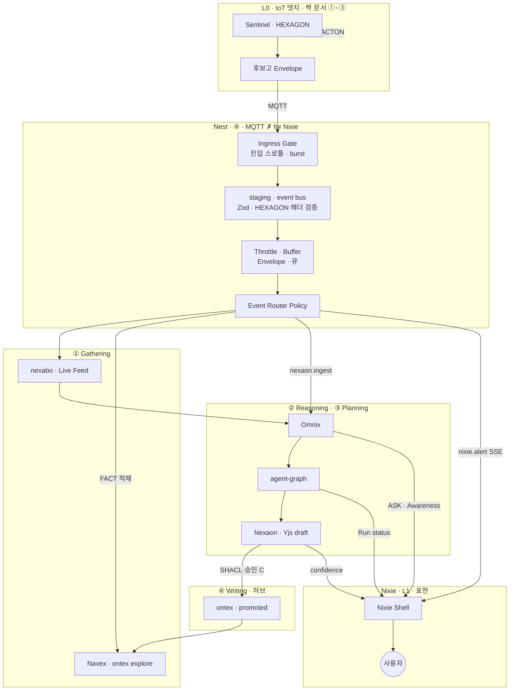
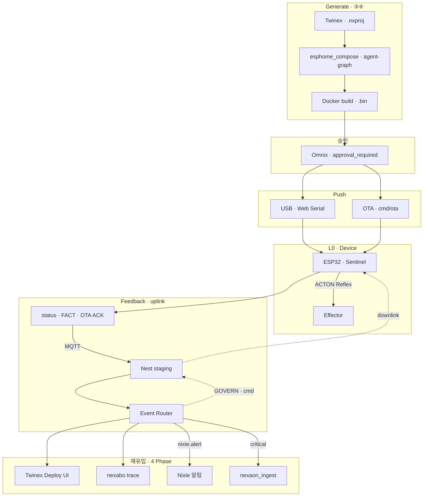
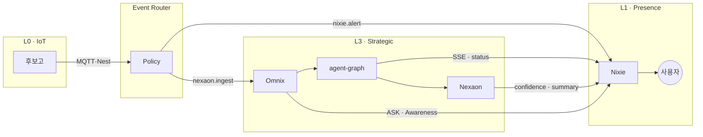
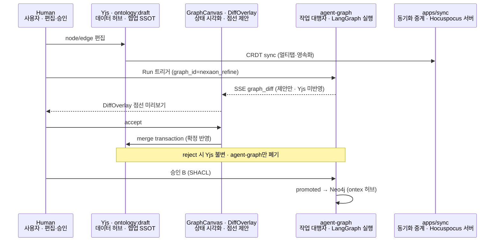
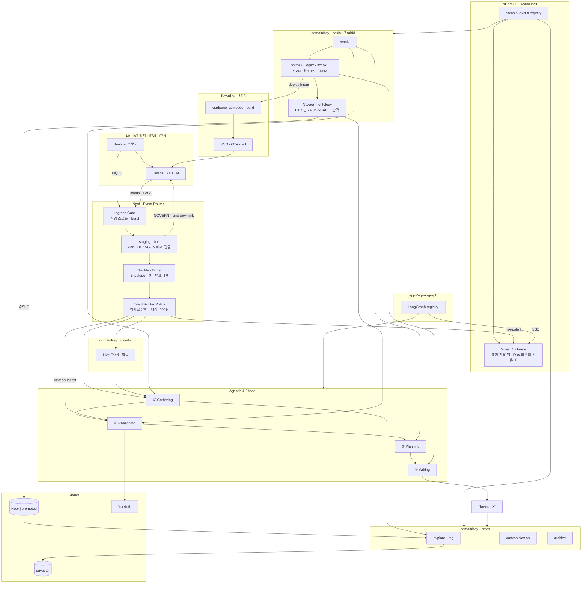

# 에이전틱 AI 파이프라인 · NEXIA 7 탭 · 플랫폼·Yjs 연계 v1.0

> **doc_id:** TDD-067 · **상태:** published — 4 단계 파이프라인 · **nexia 7 탭** · **ontex** · **Yjs Human·LLM** · NEXA OS 연계.
> **짝 문서 (엣지 상류·하향):** [TDD-068 · IoT 엣지…](./08_TDD_NEXIA_IoT엣지데이터파이프라인_HEXAGON_Nexaon연계_v1.0.md) — uplink · **downlink** · HEXAGON · **Event Router** · **Nexaon(L3) · Nixie(L1)** · §7.5 · **§7.6**
> **NEXA AIS:** 6 종 **정본 승격 완료** — [08_TDD/AI/README](../AI/README.md) · TDD-033~041

---

## 에이전틱 AI 아키텍처 (Agentic AI Architecture) 및 LLM 추론 파이프라인 4 단계

사용자의 복잡한 질문 (User Query) 을 받아 정보를 수집하고, 깊게 추론 및 계획하여 최종 답변이나 보고서 (Answer/Report) 를 뽑아내기까지의 **에이전틱 AI 아키텍처 및 LLM 추론 파이프라인**을 시각화한 구조도입니다.


---

## 🗺️ 단계별 핵심 프로세스 분석

## ① Gathering Phase (정보 수집 단계)

- 목적: 사용자가 던진 원본 질문 (User Query) 을 확장하고 관련 지식을 긁어모으는 단계입니다.
- 흐름:
    
    - 원본 질문을 그대로 쓰지 않고, 더 풍부한 검색을 위해 여러 개의 하위 질문 (Sub-Query) 으로 쪼개는 Query Expansion(질문 확장) 을 거칩니다.
    - 이 데이터와 검색 엔진 구조인 Hybrid RAG(키워드 검색과 의미 검색을 결합한 지식 검색 기술) 를 연동하여 시스템이 지원 가능한 풍부한 원천 정보 (Supported Query Generation) 를 확보합니다.
    

## ② Reasoning Phase (깊은 추론 단계)

- 목적: 수집된 정보를 바탕으로 AI 가 내부적으로 생각을 거듭하며 정답의 논리를 다지는 단계입니다.
- 흐름:
    
    - 확장된 질문들을 결합하여 최적의 프롬프트를 조립 (Prompt Synthesis) 합니다.
    - AI 가 내부적으로 생각 (Think) 을 시작하고, 그 생각이 올바른지 검증 (Validation) 하며, 정보가 충분한지 충실도 (Completeness) 를 칼같이 셀프 체크합니다.
    - 이 정교한 생각을 거쳐 최종 요약본 (Thinking Summary) 과 최적의 맥락 (Context Selection) 을 추출해 냅니다.
    

## ③ Planning Phase (실행 계획 단계)

- 목적: 도출된 추론 결과를 바탕으로, 외부 도구를 어떻게 사용할지 구체적인 실행 계획을 수립하는 단계입니다.
- 흐름:
    
    - 앞 단계의 추론 요약본을 기반으로 다시 한번 프롬프트를 정돈하여 계획을 짭니다.
    - 이 과정에서 MCP Servers(Model Context Protocol - Anthropic 사가 제안한 AI 와 외부 데이터·도구를 연결하는 최신 표준 프로토콜 서버) 및 외부 도구/오픈 API 와 통신하며 실질적인 행동 지침 (Planning Results) 을 생성합니다.
    

## ④ Writing Phase (최종 문서 작성 단계)

- 목적: 수립된 계획과 데이터를 종합하여 사용자가 읽을 수 있는 고품질의 최종 결과물로 가공하는 단계입니다.
- 흐름:
    
    - 채널별 확장 질문들 (Ch-1 ~ Ch-N Query) 과 또 한 번의 Hybrid RAG 정제 과정을 거쳐 최종 집필용 프롬프트를 구성합니다.
    - 작성 전용 AI 모델 (Writing LLM) 이 마지막으로 최종 검토와 생각 (Think) 을 마친 뒤, 사용자가 요청한 최종 답변 및 보고서 (Answer / Report) 를 포맷에 맞춰 출력합니다.
    

---

## 💡 NEXA · NEXIA 7 개 탭과 연결

> **읽는 법:** 상단 4 단계는 **에이전트 추론 파이프라인**(개념). NEXA 에서는 **UI·Run·저장소**가 `domainKey` · `tabId` · `graph_id` 로 **분산**되어 있다. 한 탭이 한 단계만 담당하지 않으며, **Omnix**가 L1 오케스트레이션으로 단계를 **연결**한다.

### 7.1 4 단계 ↔ 플랫폼 레이어 (요약)

| 파이프라인 단계 | NEXA 역할 (한 줄) | 주 담당 | 보조·소비 |
| :--- | :--- | :--- | :--- |
| **① Gathering** | 질문 확장 · Hybrid RAG · 원천 정보 수집 | **ontex** `explore` · `rag_retrieve` | **Navex** · **Nexaon** ExplorerTree · **Omnix** User Query · **엣지 후보고** _(짝 문서 §7.5)_ |
| **② Reasoning** | 추론 · 검증 · 맥락 선택 · SHACL/완전성 | **Logex / Nexaon** · `agent-graph` | **Normex** 가드레일 · Yjs `ontology:draft` |
| **③ Planning** | 도구·MCP·실행 계획 · 탭 위임 | **Omnix** · `nexia_tab_route` / `delegate` | **Logex** `.nxflow` · **Twinex** · **Scribx** |
| **④ Writing** | 최종 산출물·보고서·`.nx*` 생성 | **Normex** · **Scribx** · **Vivex** | **Omnix** 답변 스트림 · **Navex** 등록 |

```text
User Query (Omnix)              엣지 후보고 (Sentinel · MQTT)
    │                                    │
    ▼                                    ▼
① Gathering ◄── Event Router ◄── TB ◄── bus ◄── ST ◄── IG ◄── MQTT
    │              (§7.5)
    ▼
② Reasoning ──► Nexaon GraphCanvas · LangGraph · SHACL
    │
    ▼
③ Planning  ──► nexia_tab_delegate · MCP · Rivet/Flow
    │
    ▼
④ Writing   ──► .nxpol · .nxcode · .nxmedia · Answer/Report
    │
    └──► Navex 등록 ──► ontex ingest (장기 허브)

Nixie (L1): Router nixie.alert + Run SSE ──► TTS · Jitter (표현만)

Downlink (§7.6): ③ Planning ──► esphome_compose · 빌드 ──► USB/OTA ──► 엣지
      ▲                                              │
      └──────── status · OTA 결과 · FACT 피드백 ─────┘
```

### 7.2 7 개 `tabId` × 4 단계 매트릭스

범례: **●** 주역 · **◐** 보조 · **—** 직접 담당 아님 (SSOT: [`TDD-056` §5](./08_TDD_NEXIA_7탭범위확정_v1.0.md))

| `tabId` | ① Gathering | ② Reasoning | ③ Planning | ④ Writing | 대표 산출물 |
| :--- | :---: | :---: | :---: | :---: | :--- |
| **omnix** | ● User Query · 의도 분류 | ◐ Crew/Solo 조율 | ● `nexia_tab_route` · 승인 게이트 | ● Answer/Report 스트림 | `.nxchat` |
| **normex** | ◐ 용어·MOC · 규범 스니펫 | ● Norm·가드레일 기준 | ◐ 정책 블록→트리거 | ● Tiptap 규범 문서 | `.nxpol` |
| **logex** | ◐ 그래프·프로젝트 목록 | ● **Nexaon** GraphCanvas · Run | ● `.nxflow` · Rivet subgraph | ◐ SpecsPreview · export | `.nxflow` · draft |
| **scribx** | ◐ Navex 선택 컨텍스트 | ◐ Lint·코드 추론 | ● Logex→실행 가능 코드 계획 | ● Monaco 코드·명세 | `.nxcode` |
| **vivex** | ◐ 미디어·에셋 메타 | ◐ 파라미터·품질 게이트 | ● ComfyUI·렌더 큐 | ● 미디어 결과물 | `.nxmedia` |
| **twinex** | ● `.nxdev` · MQTT 상태 | ● 진단·시뮬 결과 | ● ESPHome·OTA·배포 계획 | ◐ YAML preview | `.nxproj` … |
| **navex** | ● **전 자산 인덱스** · Hybrid RAG 입력 | ◐ 선택→릴레이 컨텍스트 | ◐ 탐색→타 탭 handoff | — | (인덱싱 only) |
| **Nixie** _(frame)_ | ◐ **엣지 FACT** · Router `nixie.alert` 알림 | — | — | ◐ TTS·요약 **표현** | _(`.nx*` ✗)_ |
| **nexabo** _(domainKey)_ | ● Live Feed · **엣지 후보고** 미러 | ◐ 알람 correlate UI | ◐ Event Router 규칙 편집 | — | 관제 trace |

**Nixie** — `tabId` **✗** · MainShell **L1 Presence** · IoT uplink **MQTT 직결 ✗** — [`짝 문서 §1.6`](./08_TDD_NEXIA_IoT엣지데이터파이프라인_HEXAGON_Nexaon연계_v1.0.md) · **§7.5**

**Nexaon(ontology)** — 별도 `tabId` 가 아니라 **`logex` + `logexSubMode: ontology`** (`modules/nexaon/`). ② Reasoning · ③ Planning · ④ Writing 의 **IoT 온톨로지** 핵심면.

### 7.3 LangGraph `graph_id` 연결 (Run 계층)

UI 는 Run 을 트리거만 하고, 4 단계 로직은 **`apps/agent-graph`** StateGraph 가 수행한다. — [`TDD-058` §4~5](../LangGraph/08_TDD_LangGraph_오케스트레이션설계_v1.0.md)

| 파이프라인 | `graph_id` (예) | `domainKey` | UI 소비 |
| :--- | :--- | :--- | :--- |
| ① Gathering | `rag_retrieve` · `ontex_ingest` | ontex · nexia | ontex **explore** · Navex |
| ① Gathering _(IoT)_ | _(Router)_ → `nexaon_ingest` 큐 | nexia · nexabo | **엣지 후보고** · Twinex · §7.5 |
| ①→② | `nexia_intent_classify` | nexia | Omnix |
| ② Reasoning | `nexaon_ingest` · `nexaon_refine` | nexia (Nexaon) | RunPanel · GraphCanvas |
| ③ Planning | `nexia_tab_route` · `nexia_tab_delegate` | nexia | Omnix · 승인 배너 |
| ③ 고위험 | `nexaon_export` · `esphome_compose` | nexia | Deploy · Twinex |
| ④ Writing | (탭별 micro-graph · chat stream) | nexia | Normex/Scribx/Vivex · SSE `token` |

**Omnix 3 계층 ↔ 그래프:** L1 `nexia_intent_classify` → L2 (Normex gate 노드) → L3 `nexia_tab_delegate` → 탭별 sub-run.

### 7.4 온톨로지 데이터 4 단계 (저장소) 와의 관계

에이전트 **추론 4 단계**와 혼동 금지 — [`TDD-008` §2.4](../LangGraph/08_TDD_LangGraph_인간LLM협업형IoT온톨로지플랫폼_v1.0.md) **저장소 격리 4 단계**:

| 저장 단계 | 저장소 | 4 단계 파이프라인에서의 위치 |
| :--- | :--- | :--- |
| ① 실시간 | Yjs CRDT · `project_yjs_updates` | ② Reasoning 중 Human·AI 공편집 |
| ② Draft | PostgreSQL JSONB | ②→③ LangGraph Extract 초안 |
| ③ Audit | PostgreSQL · `run_id` | ③ Planning 후 승인 A/B |
| ④ Promoted | **Neo4j** | ④ Writing 완료 · SHACL PASS → **ontex** explore/canvas |

```text
[Nexaon ② Reasoning]  Yjs ontology:draft
         │
         ▼ Run + SHACL
[Nexaon ③ Planning]   승인 interrupt (Omnix)
         │
         ▼ promoted sync
[ontex ① Gathering+]  Neo4j + pgvector + explore Graph RAG
```

> Yjs·Human·LLM 협업 상세 → **§9**

### 7.5 IoT 엣지 upstream · Event Router · Nixie — 4 단계 연계

> **SSOT:** [짝 문서 · IoT 파이프라인](./08_TDD_NEXIA_IoT엣지데이터파이프라인_HEXAGON_Nexaon연계_v1.0.md) §1.4 · §1.6 · §1.6.6 · [TDD-070 §3.4.1](../../용어집_NEXA전용_v2.0.md)

본 절은 **클라우드 4 단계 에이전트 파이프라인**과 **IoT 엣지 상류 (Sentinel · 후보고)** · **Nixie(L1)** · **Event Router Policy** 의 접점을 정의한다.

**원칙**

| 주체 | 4 단계 파이프라인에서 | 금지 |
| :--- | :--- | :--- |
| **Sentinel (L0)** | ① Gathering **입력 원천** — FACT·후보고 uplink | 플랫폼 Run · Yjs **✗** |
| **Event Router** | staging → **match·refine·route** (Normex·GOVERN·사용자 규칙) | MQTT downlink · promoted **직접 ✗** |
| **Throttle · Buffer** | bus **→ Router** — Envelope 큐·집계 | 라우팅·Run **소유 ✗** · **§8.2.1 ②** |
| **Ingress Gate** | **Broker → validate** — burst 진입 차단 | 장기 버퍼·Router **✗** · **§8.2.1 ①** |
| **Nexaon / agent-graph (L3)** | ② Reasoning · ③ Planning · ④ Writing (IoT 온톨로지) | — |
| **Nixie (L1)** | Router **`nixie.alert`** · Run SSE · Awareness **표현** | Run·Router·MQTT **소유 ✗** |
| **Omnix (L3)** | ③ Planning · 승인 · `nexia_tab_delegate` | — |

#### 7.5.1 엣지 6 단계 ↔ Agentic 4 Phase

| IoT (짝 문서) | Agentic 4 Phase | 주 담당 | Nixie |
| :--- | :--- | :--- | :--- |
| ①~③ 발생·선처리·후보고 | **① Gathering** (upstream) | Sentinel · MQTT | — |
| ④ Nest · **Event Router** | **① Gathering** (라우팅) | Nest Policy · nexabo | `nixie.alert` |
| ④a **Ingress Gate** | **① Gathering** (ingress) | Nest · Broker 직후 | burst **진입 차단** · **§8.2.1 ①** |
| ④b **Throttle · Buffer** | **① Gathering** (전처리) | Nest · bus→Router | Envelope **큐** · **§8.2.1 ②** |
| ⑤ Nexaon 정재 · Run | **② Reasoning** · **③ Planning** | Nexaon · agent-graph · Omnix | 진행 **상태 표현** |
| ⑥ promoted → ontex | **① Gathering+** · **④ Writing** (허브) | ontex · Neo4j | 요약·Jitter |

#### 7.5.2 End-to-End (엣지 · 4 Phase · Nixie)

```text
[L0 Sentinel] 후보고 (candidate:true)
      │ MQTT
[Broker]
      │
      ▼
[Ingress Gate]  진입 스로틀 · burst  ← §8.2.1 ①
      │
      ▼
[Nest] validate · staging · event bus
      │
      ▼
[Throttle · Buffer]  Envelope · RxJS · BullMQ  ← §8.2.1 ②
      │
      ▼
[Event Router Policy]  ← nexabo · admin · Omnix · Normex · GOVERN
      │
      ├──────── nexabo.live ────────► ① Gathering (Live Feed · FACT)
      ├──────── nexia.twinex ───────► Twinex → ②/③ 컨텍스트
      ├──────── nexaon.queue/ingest ► ② Reasoning (nexaon_ingest)
      ├──────── agent-graph.critical ► ② Reasoning (Zenith 1차)
      └──────── nixie.alert ──────────► Nixie L1 (TTS · Jitter) — MQTT ✗
                │
                ▼ Omnix · Run
         ② Reasoning → ③ Planning → ④ Writing
                │
                ▼ promoted
              ontex (Graph RAG · ①+)
```



#### 7.5.3 User Query vs 엣지 후보고 (합류)

| 입력 | 진입 | 4 Phase 첫 관문 |
| :--- | :--- | :--- |
| **User Query** (Omnix 채팅) | `omnix` · L1 rail | `nexia_intent_classify` → ① |
| **엣지 후보고** | MQTT → Nest → **Event Router** | `nexaon.queue` / `nexaon.ingest` → ② _(Logex UI 선행 ✗)_ |
| **Navex 선택** | `navex` · Global Navex | Run **컨텍스트** → ①② |

두 입력은 **Omnix · agent-graph** 에서 **동일 Nexaon room · ontex RAG** 로 합류할 수 있다 — Yjs·promoted 경계는 **§9** · 짝 문서 §6.

#### 7.5.4 Nixie × 4 Phase (Normative)

| Phase | Nixie 동작 | 소스 |
| :--- | :--- | :--- |
| ① Gathering | 엣지 알람 **TTS** · FACT 요약 | Router `nixie.alert` |
| ② Reasoning | Run **`thinking`** · `graph_diff` **미리보기 힌트** | SSE · Awareness |
| ③ Planning | **ASK** · 승인 배너 companion | Omnix escalate |
| ④ Writing | promoted **요약** · confidence → **Jitter/Lumina** | Nexaon 결과 메타 |

**금지:** Nixie 가 ②~④ **Run 트리거** · Yjs merge · **MQTT 구독** — [`짝 문서 §1.6.3`](./08_TDD_NEXIA_IoT엣지데이터파이프라인_HEXAGON_Nexaon연계_v1.0.md)

> **하향·배포·제어·피드백:** uplink 는 본 절 (§7.5) · **펌웨어 생성 · USB/OTA · cmd · GOVERN · 피드백 루프** → **§7.6**

### 7.6 Downlink · 펌웨어 생성 · 배포 (USB/OTA) · 제어 · 피드백

> **SSOT:** [짝 문서 §1.6.3 downlink](./08_TDD_NEXIA_IoT엣지데이터파이프라인_HEXAGON_Nexaon연계_v1.0.md) · [PRD-004 NEXA-CELL](../../05_PRD/NEXIA/05_PRD_NEXIA_CELL_ESPHomeYAML제너레이터웹펌웨어.md) · [TDD-058 §5.2 `deploy`/`flash`](../LangGraph/08_TDD_LangGraph_오케스트레이션설계_v1.0.md) · [TDD MQTT OTA](./08_TDD_NEXIA_MQTT토픽데이터라우팅.md) §4

본 절은 **§7.5 uplink(후보고)** 와 짝을 이루는 **플랫폼→엣지 하향 루프**를 정의한다. 에이전트 4 Phase 관점에서 **③ Planning · ④ Writing** 이 산출한 `.nxproj`·온톨로지가 **펌웨어·파라미터·명령**으로 내려가고, 엣지 **상태·배포 결과·센서 FACT** 가 다시 **① Gathering** 으로 올라온다.

#### 7.6.1 양방향 루프 (개요)

| 방향 | 경로 | Agentic Phase | 주 담당 |
| :--- | :--- | :--- | :--- |
| **Uplink** _(§7.5)_ | Sentinel → MQTT → Nest → Event Router | ① Gathering → ②③④ | nexabo · Nexaon · Nixie(표현) |
| **Generate** | Twinex/Logex → YAML·Lambda → `.bin` | ③ Planning → ④ Writing | **Twinex** · `esphome_compose` |
| **Push** | USB(Web Serial) · OTA(MQTT `cmd/ota`) | ③ Planning _(고위험)_ | Twinex · Nest `esphome/` |
| **Control** | `cmd/*` · GOVERN · Reflex ACTON | ③ Planning _(승인)_ · L0 즉시 | Omnix · Nest · **Sentinel** |
| **Feedback** | `…/status` · OTA ACK · 배포 trace | ① Gathering _(재유입)_ | Event Router → Twinex · nexabo |

```text
                    ┌─── Generate ─── esphome_compose · Docker build ───┐
                    │                                                  ▼
[Human/Omnix] ──③④──► Twinex (.nxproj) ──Push──► [USB | OTA MQTT] ──► [L0 Device]
       ▲                    ▲                           │                  │
       │                    │                           │                  │ ACTON Reflex
       │                    └──── Feedback (status/FACT) ◄─────────────────┘
       │                              │
       └── Nixie (배포 확인 UX) ◄──── Event Router ◄── Nest ◄── MQTT uplink
```

#### 7.6.2 펌웨어 생성 — 4 Phase × Twinex

| Phase | Twinex · agent-graph | 산출물 |
| :--- | :--- | :--- |
| **② Reasoning** | `.nxdev` 토폴로지 · 진단·시뮬 · Nexaon promoted 참조 | 설계 컨텍스트 · pinmap |
| **③ Planning** | `esphome_compose` · `nexia_tab_delegate` → twinex | ESPHome **YAML** · **Lambda(C++)** · 배포 계획 |
| **④ Writing** | Docker ESPHome **빌드** · 바이너리 · 버전 태그 | `.bin` · checksum · `project_devices` 기록 |
| **승인** | Omnix **`approval_required`** — `deploy`/`flash` = **high** ([TDD-058](../LangGraph/08_TDD_LangGraph_오케스트레이션설계_v1.0.md)) | Human confirm |

**생성 체인 (Normative)**

```text
Logex/Nexaon promoted (Neo4j) ──► esphome_compose (agent-graph)
         │
Twinex React Flow canvas (.nxproj) ──► YAML + Lambda
         │
         ▼
apps/esphome (Nest) ──► Docker build ──► firmware binary + manifest
         │
         ▼
Navex 등록 (버전·체크섬·대상 device_group) ──► ontex trace (선택)
```

- **AI 협업:** Twinex 캔버스·YAML·Lambda 는 **Yjs** 공편집 + Run **`graph_diff`** — §9.4 twinex 행.
- **Nexaon 연계:** promoted 그래프의 **class·pin·ACTON 규칙** 이 YAML/Lambda 생성 **입력 SSOT** — uplink FACT 와 **양방향 정합**.

#### 7.6.3 배포 채널 — USB vs OTA

| 시나리오 | 채널 | 조건 | Phase · UI | 피드백 |
| :--- | :--- | :--- | :--- | :--- |
| **1 · 최초·복구** | **USB** (Web Serial · ESP Web Tools) | OTA **없음** 또는 펌웨어 **손상** | ③④ · Twinex Deploy 패널 | 시리얼 로그 · 수동 확인 |
| **2-1 · 맞춤 빌드** | **OTA** (MQTT `cmd/ota` 또는 HTTP POST) | 네트워크 · OTA **활성** | ③ · Omnix 승인 후 일괄/단일 | `…/status` 신버전 보고 |
| **2-2 · 카탈로그** | **OTA** (사전 빌드 `.bin`) | 템플릿·스냅샷 즉시 적용 | ③ · 배치 그룹 | 그룹별 성공/실패 trace |
| **롤백** | OTA (이전 빌드 ID) | 배치 실패·운영자 선택 | ③ · nexabo 관제 | 스냅샷 ↔ `project_devices` |

**OTA Downlink (MQTT — [TDD MQTT §4](./08_TDD_NEXIA_MQTT토픽데이터라우팅.md))**

```text
Omnix 승인 → Nest downlink API → publish
  {group}/{location}/{device_id}/cmd/ota
  payload: { cmd, version, firmware_url, checksum }
```

- **와일드카드 일괄:** `{group}/{location}/+/cmd/ota` — nexabo **배치 OTA** UI.
- **Nixie:** 배포 **진행·완료 알림 UX** 만 — MQTT publish·OTA **소유 ✗**.

#### 7.6.4 제어 관계 — Reflex · GOVERN · cmd · Twinex

| 계층 | 주체 | 지연 | Agentic Phase | Event Router |
| :--- | :--- | :--- | :--- | :--- |
| **L0 Reflex** | Sentinel **ACTON** | ms | _(플랫폼 **이전**)_ | uplink **후보고 병행** |
| **L0~L1 GOVERN** | Nest → MQTT 파라미터 | 주기 | ③ Planning → ④ (규범 `.nxpol`) | **match** 후 downlink 큐 |
| **L2 명령** | `cmd/*` (OTA·릴레이·setpoint) | s | ③ **Omnix 승인** 필수 | Router **직접 cmd ✗** |
| **L2 UI** | Twinex 디바이스 패널 | 스로틀 | ②③ 컨텍스트 | MQTT **고주파 Yjs ✗** — §9.6 |

**제어 vs uplink 분리 (Normative)**

```text
[위험·STUCK]  Sentinel ACTON (로컬) ──► Effector     ← Omnix/Nixie 이전
[운영 명령]   Human ──Omnix──► Nest downlink ──MQTT cmd/*──► Device
[행동 지침]   Normex GOVERN ──승인 C──► Nest ──► GOVERN topic ──► Sentinel 캐시
[Twinex UI]   승인된 setpoint ──► Nest API ──► cmd (브라우저→MQTT 직결 ✗)
```

- **Event Router:** uplink **fan-out** 전용 — **downlink·promoted·Neo4j write 직접 ✗** ([짝 문서 §1.6.6](./08_TDD_NEXIA_IoT엣지데이터파이프라인_HEXAGON_Nexaon연계_v1.0.md)).
- **Nixie:** 제어 **확인·ASK·긴급 companion** — cmd publish **✗**.

#### 7.6.5 피드백 루프 — 배포·상태 → 4 Phase 재유입

| 피드백 유형 | MQTT / 채널 | Event Router → | 4 Phase |
| :--- | :--- | :--- | :--- |
| **OTA 결과** | `…/status` · `version` | nexabo trace · Twinex Deploy | ① Gathering (디바이스 메타) |
| **배포 실패** | `error` · timeout | nexabo 알람 · **Nixie** TTS | ③ Planning (재시도·롤백) |
| **운영 FACT** | 후보고 Envelope _(§7.5)_ | nexaon.ingest · Live Feed | ①→② Reasoning |
| **Reflex 사후 보고** | FACT `"이미 조치함"` | nexaon · nexabo correlate | ② Reasoning · 감사 |



#### 7.6.6 Nixie × Downlink (표현만)

| 구간 | Nixie | 금지 |
| :--- | :--- | :--- |
| 배포 **시작 전** | Omnix **ASK** · high-risk companion | Run·빌드 **트리거 ✗** |
| **Push 중** | 진행률·그룹 상태 **요약** (Router SSE) | USB/OTA **직접 ✗** |
| **피드백** | 성공/실패 **TTS** · confidence Jitter | cmd 재시도 **소유 ✗** |
| **제어 확인** | STUCK·긴급 **Escalate → Omnix** | ACTON **대체 ✗** |

---


## 🤝 §9 Human · LLM 협업에서 Yjs 역할

> **한 줄:** LLM 은 **`apps/agent-graph` 에서 추론·Run**하고, Human 과 **공유하는 편집 상태 SSOT**는 **Yjs `Y.Doc`**. SSE·Diff 는 **제안·스트림**, Yjs merge 는 **확정 반영**. — SSOT: [`TDD-038`](../AI/08_TDD_AI_YjsHocuspocus협업SSOT.md) · [`TDD-010` §3.2](./08_TDD_NEXIA_구조기술스택운영방침.md)

### 9.1 세 계층 분리 (혼동 방지)

| 계층 | 기술 | Human·LLM 에서 하는 일 |
| :--- | :--- | :--- |
| **협업 상태 (SSOT)** | **Yjs CRDT** + `apps/sync` Hocuspocus | 그래프·문서·코드 **동시 편집 본문** · 새로고침·멀티탭 복구 |
| **추론·도구 (일시)** | **LangGraph** (`apps/agent-graph`) | Gathering→Reasoning→Planning→Writing **판단·검증·계획** |
| **가시화·스트림 (관측)** | **SSE** (`token` · `graph_diff` · `step`) | RunPanel·Omnix 채팅 **진행 상황** — Yjs **대체 ✗** |

```text
Human ──편집──► Y.Doc (Yjs) ◄──merge── DiffOverlay (승인 후)
                    ▲
                    │ read snapshot (Run 입력)
LLM ──Run──► agent-graph ──SSE──► UI (제안·토큰만)
```

- LLM 은 브라우저에 **직접 Yjs write ✗** — Nest/agent-graph **어댑터**가 Awareness 가상 사용자로 merge.
- **Zustand** (`useLayoutStore` 등) = 드로어·레이아웃·포커스만. **산출물 본문 = Yjs**.

### 9.2 협업 강도 — LLM 은 항상 참여자

[`TDD-010` §3.2](./08_TDD_NEXIA_구조기술스택운영방침.md): **Solo(인간 단독) 없음** · 최소 단위 **Duo = Human 1 + LLM**.

| 강도 | 구성 | Yjs 동작 |
| :--- | :--- | :--- |
| **Duo** | 사람 1 + LLM | LLM = Awareness `type: llm` · 제안은 Diff → accept 시 merge |
| **Collab** | 사람 N + LLM | 동일 room · CRDT 자동 병합 · LLM 구간 Awareness 잠금 (Phase 3) |
| **Review** | 사람 N + LLM | 편집은 Yjs 허용 · **Omnix 승인** 후 promoted/배포 |

**LLM Awareness (Normative 예시)**

```typescript
awareness: {
  clientId: 'ollama-nexia',  // 또는 agent-graph run_id 기반
  type: 'llm',
  name: 'NEXIA',
  focus: string | null,      // 편집 중 nodeId · selection
  intent: string | null,
  status: 'idle' | 'thinking' | 'writing' | 'waiting',
}
```

NIXIE·StatusBar 는 Awareness `status` 와 동기화 — [`UIX-004` §4.6](../../07_UIUX/07_UIUX_NEXIA_MainShell_레이아웃_v1.0.md).

### 9.2.1 Nexaon(L3) · Nixie(L1) · Event Router — 지능 vs 표현

> **엣지·IoT · 4 Phase · downlink:** **§7.5** · **§7.6** · [짝 문서 §1.4 · §1.6.3 · §1.6.6](./08_TDD_NEXIA_IoT엣지데이터파이프라인_HEXAGON_Nexaon연계_v1.0.md) · [TDD-045 §5](../Knowledge/08_TDD_Knowledge_디렉토리책임및기획자원경로.md)

| 주체 | 층 | 본 파이프라인 (4 단계) 에서 |
| :--- | :---: | :--- |
| **Event Router** | Nest Policy | ① Gathering **fan-out** — match·refine·route (Normex·GOVERN·사용자) |
| **Nexaon** · **agent-graph** | L3 | ② Reasoning · ③ Planning · ④ Writing — Run · `graph_diff` · SHACL · promoted |
| **Omnix** | L3 | Run 큐 · 승인 · 탭 위임 |
| **Nixie (NIXIE)** | L1 | Run·Router·MQTT **소유 ✗** — `nixie.alert` · SSE · Awareness · Jitter/Lumina |



**Normative:** LLM Run·Yjs merge·promoted = **Nexaon/agent-graph** · fan-out = **Event Router** · Nixie = **체감 Shell** ([TDD-070 · NIXIE](../../용어집_NEXA전용_v2.0.md) §3.4.1).

### 9.3 4 단계 파이프라인 × Yjs

| 파이프라인 | Human (Yjs) | LLM (Run/SSE) | 연결점 |
| :--- | :--- | :--- | :--- |
| **① Gathering** | Navex **선택·트리** 상태 Yjs(선택) · ontex 는 **읽기** | `rag_retrieve` · Sub-Query 생성 | Run **입력** = Yjs 스냅샷 + Navex selection |
| **② Reasoning** | **Nexaon** `ontology:draft` 공편집 · Normex 규범 Y.Text | `nexaon_ingest/refine` · SHACL | `graph_diff` → **DiffOverlay** (Yjs **미반영**) |
| **③ Planning** | Logex `.nxflow` · Twinex Awareness(의도·시선) | `nexia_tab_delegate` · MCP 계획 | 승인 interrupt — Omnix 배너 |
| **④ Writing** | Normex Tiptap · Scribx Monaco · Vivex params | `token` 스트림 → Tiptap **y-prosemirror** | 스트림은 **Y.Text insert** 경유 (직접 DOM ✗) |

**온톨로지 room (Nexaon MVP 핵심)**

| 항목 | 값 |
| :--- | :--- |
| Hocuspocus room | `project:{projectId}:ontology:draft` |
| Yjs Map key | `ontology:draft` |
| 바인딩 | React Flow GraphCanvas ↔ Yjs `Y.Array` / Map |
| ontex `canvas` room | `ontex:canvas:{graphId}` — **Nexaon draft 와 분리** · 승격 API 로만 동기화 |

### 9.4 7 탭별 Yjs 적용 (Human · LLM 공동)

| `tabId`            | Yjs shared type / 범위                | LLM 협업 방식                                       |
| :----------------- | :---------------------------------- | :---------------------------------------------- |
| **omnix**          | 채팅 transcript · 이벤트 로그 (Y.Text/Map) | SSE `token` → 채팅 버블 · Crew/Solo 라우팅             |
| **normex**         | Tiptap `Y.XmlFragment` · `.nxpol`   | 스트리밍 초안 insert · Norm **가드레일**은 Run 컨텍스트        |
| **logex / Nexaon** | Graph **nodes/edges** CRDT          | `graph_diff` → DiffOverlay → accept → Yjs merge |
| **scribx**         | Monaco `Y.Text` · `.nxcode`         | 코드 생성 스트림 · Lint 결과는 메타 (비 -Yjs)                  |
| **vivex**          | 파라미터 Map · `.nxmedia` 메타            | ComfyUI 큐 — 고비용 Run 은 승인 후                      |
| **twinex**         | 트윈 토폴로지 · **Awareness**(시선·의도)      | MQTT **고주파 ✗** — Device-only Region / 스로틀       |
| **navex**          | 탐색 선택·필터 상태                         | LLM 은 **읽기** — 선택 컨텍스트를 Run 에 전달                |

### 9.5 AI 제안 → Human 확정 (Diff 경로)

NEXA 에서 LLM 출력이 **즉시 정본이 되면 안 되는** 구간은 공통 패턴:

```text
1. LangGraph 노드 완료 → SSE `graph_diff` | `token`
2. UI DiffOverlay / 스트리밍 미리보기 (점선· provisional)
3. Human accept / reject (또는 Review 모드 → Omnix 승인)
4. accept → Yjs transaction merge (가상 Awareness clientId)
5. (Nexaon) SHACL PASS + 승인 C → PostgreSQL Draft → Neo4j promoted
```

| 이벤트 | UI | Yjs |
| :--- | :--- | :--- |
| `token` | Run Chat · Tiptap 스트림 | 점진 insert (Y.Text) |
| `graph_diff` | DiffOverlay 점선 node/edge | accept 후 merge |
| `shacl_violation` | canvas red outline | violation 플래그 on node data |
| `approval_required` | Omnix/Header 배너 | **쓰기 freeze** (Review) |

### 9.6 인프라 · 영속화

```text
[Tiptap | Monaco | React Flow]
           ↕
      Y.Doc (client)
           ↕ WebSocket
   apps/sync (Hocuspocus)
           ↕
 PostgreSQL project_yjs_updates (+ yjs_state 스냅샷)
```

| 규칙 | 내용 |
| :--- | :--- |
| **D1** | Yjs **먼저** 안정화 → 그 위에 agent-graph ([`TDD-038` D1](../AI/08_TDD_AI_YjsHocuspocus협업SSOT.md)) |
| **D3** | `project_yjs_updates` — 단일 `yjs_update` 덮어쓰기 **금지** |
| **D4** | 동일 사용자 멀티탭 = **SharedWorker** + 동일 Y.Doc |
| **IoT** | 센서 초고주파 → Yjs 전체 반영 **금지** · Twinex 별 채널 + 임계치 커밋 |

### 9.7 협업 흐름 (② Reasoning · Nexaon 예시)

| 노드 | 역할 (한 줄) |
| :--- | :--- |
| **Human** | 사용자 · node/edge **직접 편집** · Diff **accept/reject** · SHACL 승인 B |
| **Yjs · ontology:draft** | **데이터 허브** · Human·LLM **공유 SSOT** · merge 확정본 |
| **GraphCanvas · DiffOverlay** | **상태 시각화** · SSE `graph_diff` **점선 제안** · accept 시 merge 트리거 |
| **agent-graph** | **작업 대행자** · LangGraph Run · 추론·검증·**promoted** 실행 |
| **apps/sync** | **동기화 중계** · Hocuspocus · CRDT → PostgreSQL 영속화 |



---

## 🌐 NEXA 전체 구조와 연결

### 8.1 플랫폼 3 층 (domainKey)

| 층 | `domainKey` | 4 단계 파이프라인에서의 역할 |
| :--- | :--- | :--- |
| **실행·생산** | **nexia** (7 탭) | ②③④ **주 무대** — 편집·Run·`.nx*` 산출 |
| **지식·온톨로지 허브** | **ontex** | ① **Gathering** SSOT — Hybrid RAG · ingest · promoted 그래프 |
| **관제·유통·ERP** | **nexabo** · **nexet** · **erp** | ① Gathering **데이터 소스** · **Event Router** 규칙 UI → ontex ingest |
| **Nest · 수신** | **Ingress Gate** · **Throttle·Buffer** | **§8.2.1** 2 단 — IG(Broker→ST) · TB(bus→Router) |
| **Presence (frame)** | **Nixie** _(MainShell)_ | ①~④ **표현·알림** · 배포 UX — Run·Router **✗** · **§7.5 · §7.6** |

상세 맵: [`TDD-059` 도메인 마스터 맵](../NEXAOS/08_TDD_NEXAOS_도메인마스터맵_v1.0.md) · 레지스트리: [`TDD-002`](../NEXAOS/08_TDD_NEXAOS_도메인레지스트리명세.md)

### 8.2 전체 구조도 (개념)

> **보조설명 시범:** 아래 3 노드만 `<br/>` 2 줄 — **Event Router · Nexaon · Nixie** (판단 후 유지/확대/제거)



#### 8.2.1 Ingress Gate · Throttle · Buffer — 트래픽 2 단 (개념 · MVP)

> **상세 TDD:** _(별도 문서 예정)_ — 본 절은 **개념·스택·위치** 만. **IG ≠ TB** 혼동 금지.

```text
Broker → [① Ingress Gate] → validate · staging → event bus
              → [② Throttle · Buffer] → Event Router → consumers
```

| 층 | 위치 | 입력 | 역할 |
| :--- | :--- | :--- | :--- |
| **① Ingress Gate (`IG`)** | **Broker → validate** | raw MQTT burst | Nest **진입 한도** · burst cap _(얇게·선택)_ |
| **② Semantic Buffer (`TB`)** | **bus → Router** | **검증 Envelope** | dedupe · TICK 윈도우 · BullMQ · critical 우선 |

| 금지 | |
| :--- | :--- |
| **IG** | 미검증 **장기 버퍼 ✗** · Router match **✗** |
| **TB** | raw MQTT **✗** · 라우팅·promoted **✗** |

**MVP (Nest):** ① 가벼운 ingress limit · ② **RxJS** + **BullMQ** · HTTP **NestJS Throttler**
**차후:** RabbitMQ · Kafka _(별도 TDD)_

```text
MQTT → Broker → IG → Nest validate · staging → bus
         │
         ▼
       TB  (RxJS · BullMQ)
         │
         ▼
   Event Router Policy → nexabo · Nexaon · Nixie · agent-graph
```

### 8.3 nexia 생산 파이프라인과의 정합

[`TDD-010` §3.4](./08_TDD_NEXIA_구조기술스택운영방침.md) **탭 파이프라인**은 **④ Writing·③ Planning** 의 **산출물 흐름** SSOT:

| TDD-010 흐름 | 4 단계 대응 |
| :--- | :--- |
| Normex → Logex/Scribx/Vivex **규범 기준** | ② Reasoning 입력 · ③ Planning 제약 |
| Logex → Scribx → Vivex **생성 체인** | ③ Planning → ④ Writing |
| Twinex ↔ Logex **진단·시뮬** | ② Reasoning ↔ ③ Planning |
| Twinex **펌웨어·USB/OTA** | ③ Planning → ④ Writing → **§7.6 피드백** |
| 전 탭 → **Navex** 등록 | ④ Writing 산출물 → ① Gathering 코퍼스 |
| Navex → 타 탭 **릴레이** | ① Gathering 컨텍스트 주입 |

### 8.4 명칭 경계 (혼동 방지)

| 이름 | 정체 | 4 단계에서 |
| :--- | :--- | :--- |
| **nexia** | UI `domainKey` · 7 탭 | 실행·생산 셸 |
| **Nexaon** | Logex `ontology` 모듈 | ②③④ IoT 온톨로지 |
| **ontex** | 지식 허브 `domainKey` | ① + promoted 탐색 |
| **Nexion** | ontex `canvas` **표시명** | 장기 그래프 UI |
| **Nixie** | MainShell **L1 Presence** | ①~④ **표현** · MQTT **✗** · **§7.5** |
| **Event Router** | Nest **Policy** 모듈 | ① Gathering fan-out · ingest 트리거 · **downlink ✗** |
| **Ingress Gate** | Nest **Broker 직후** | burst **진입 차단** · **§8.2.1 ①** |
| **Throttle · Buffer** | **bus → Router** | Envelope **큐·집계** · **§8.2.1 ②** |
| **Twinex / NEXA-CELL** | 펌웨어·트윈 `tabId` | ③④ Generate · Push · **§7.6** |
| **ontology** (일반) | 개념·RDF/OWL/SHACL | 전 단계 cross-cutting |

— [`TDD-056` §2.3](./08_TDD_NEXIA_7탭범위확정_v1.0.md) · [`TDD-070` 용어집 §3.3](../../용어집_NEXA전용_v2.0.md)

### 8.5 구 UI 라벨 (사용 금지)

Cockpit→**Omnix** · Ethos→**Normex** · Synapse→**Logex** · Glos→**Scribx** · Physis→**Vivex** · Sense→**Twinex** · Navis→**Navex** — [`TDD-010` 부록 B](./08_TDD_NEXIA_구조기술스택운영방침.md)

---

## 관련 문서 (SSOT)

| 주제                           | 문서                                                                                    |
| :--------------------------- | :------------------------------------------------------------------------------------ |
| NEXIA 7 탭 범위                 | [TDD-056 · 7탭 범위 확정](./08_TDD_NEXIA_7탭범위확정_v1.0.md)                     |
| nexia 스택·파이프라인               | [TDD-010 · 구조·기술스택](./08_TDD_NEXIA_구조기술스택운영방침.md)                       |
| LangGraph 오케스트레이션            | [TDD-058](../LangGraph/08_TDD_LangGraph_오케스트레이션설계_v1.0.md)                     |
| Nexaon·저장 4 단계               | [TDD-008](../LangGraph/08_TDD_LangGraph_인간LLM협업형IoT온톨로지플랫폼_v1.0.md)            |
| Ontex·Graph RAG              | [TDD-057](../Ontex/08_TDD_Ontex_기술스택운영방침_v1.0.md)                              |
| 도메인 전체 맵                     | [TDD-059](../NEXAOS/08_TDD_NEXAOS_도메인마스터맵_v1.0.md)                             |
| nexia UI                     | [UIX-004 MainShell](../../07_UIUX/07_UIUX_NEXIA_MainShell_레이아웃_v1.0.md)                  |
| Yjs · Hocuspocus             | [TDD-038 · Yjs 협업 SSOT](../AI/08_TDD_AI_YjsHocuspocus협업SSOT.md)                |
| **짝 문서 (엣지·Nixie·downlink)** | [TDD-068 · IoT 엣지… §1.6.7 · §7.5 · §7.6 상호](./08_TDD_NEXIA_IoT엣지데이터파이프라인_HEXAGON_Nexaon연계_v1.0.md) |
| **Throttle · Buffer · Ingress** _(상세 TDD 예정)_ | **§8.2.1** · [IoT §1.6.7](./08_TDD_NEXIA_IoT엣지데이터파이프라인_HEXAGON_Nexaon연계_v1.0.md) — **IG ① · TB ②** |
| NEXA-CELL · USB/OTA          | [PRD-004 · CELL](../../05_PRD/NEXIA/05_PRD_NEXIA_CELL_ESPHomeYAML제너레이터웹펌웨어.md)           |
| MQTT OTA downlink            | [TDD · MQTT 토픽](./08_TDD_NEXIA_MQTT토픽데이터라우팅.md) §4                      |
| AIS 레거시 매핑                   | [08_TDD/AI/README](../AI/README.md)                                            |
| AI 멀티에디터                     | [TDD-042 · 협업형 멀티에디터](../AI/08_TDD_AI_협업형멀티에디터플랫폼.md)                          |
| 용어집                          | [TDD-070](../../용어집_NEXA전용_v2.0.md)                                 |
