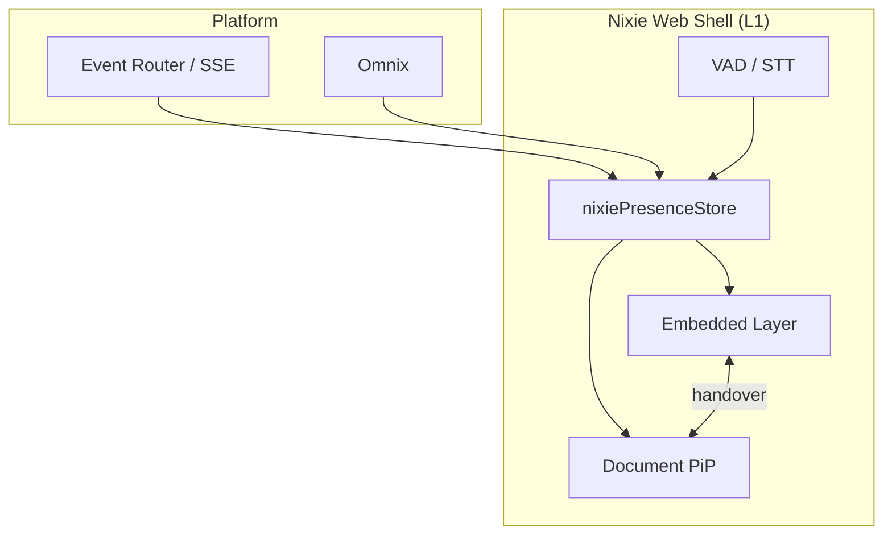

---
implements_doc:
doc_id: TDD-061
title: "NIXIE · Web Shell v1.0"
category: "08_TDD"
domain: NEXIA
status: published
created: 2026-06-10
updated: 2026-06-12
parent_doc: TDD-010
see_also: [TDD-070, TDD-014, TDD-020, UIX-004, UIX-003]
terms_standard: ["next-js", "document-pip", "webrtc", "vad", "sse", "websocket"]
terms_nexa: ["NIXIE", "Nixie", "NixieWebShell", "PiP", "Presence-Shell", "Omnix", "Envelope"]
tags: ["doc/cat/08-tdd", "doc/domain/nexia", "std/next-js", "std/document-pip", "std/webrtc", "std/vad", "std/sse", "std/websocket", "nexa/NIXIE", "nexa/Nixie", "nexa/NixieWebShell", "nexa/PiP", "nexa/Presence-Shell", "nexa/Omnix", "nexa/Envelope"]
---

# NIXIE · Web Shell v1.0

> **한 줄:** nexia **브라우저** MainShell **L1 frame** — **NIXIE Web Shell** (Embedded ↔ PiP). **NEXU Canvas · BAX · 전 domain** 신호 **Express** · Canvas/BAX **대체 ✗** · Run **소유 ✗**.

**플랫폼 3층:** NEXU Canvas(시맨틱) · BAX(레이아웃) · NIXIE(Express) — [`TDD-070` §3.6.3](../../../용어집_NEXA전용_v2.0.md#363-플랫폼-ui-3층--nexu-canvas--bax--nixie)

**채널 ID (Normative):** `channel_id: nixie-web`

**상위:** [`TDD-070` §3.6.1~3.6.2](../../../용어집_NEXA전용_v2.0.md) · [`TDD-010`](../08_TDD_NEXIA_구조기술스택운영방침.md)

---

## 1. 역할 · 경계

| 항목        | Web Shell                                                        | 금지                            |
| :---------- | :--------------------------------------------------------------- | :------------------------------ |
| **레이어**  | **L1 Presence** — `domainKey` **무관** · 탭 밖 **항상 -on** 목표 | L3 Run · SHACL · promoted **✗** |
| **UI 위치** | MainShell **frame** (Omnix 레일·7 탭 **위** 시각화 층)           | NexaonShell·7 탭 **대체 ✗**     |
| **입력**    | 마이크·VAD · Omnix 채팅 위임 · 큐 알림 SSE                       | Event Router fan-out **✗**      |
| **출력**    | P5/Rive · TTS · Jitter/Lumina · GlobalFlow 상태                  | MQTT publish **✗**              |

**PiP** 는 **별도 채널 ✗** — Web Shell **표현 모드** 하나 ([§4](#4-표현-모드--embedded--pip)).

---

## 2. 아키텍처

| 구성               | 경로 (예상)                                        | 책임                                                             |
| :----------------- | :------------------------------------------------- | :--------------------------------------------------------------- |
| **Presence store** | `domains/nexia/nixie/stores/nixiePresenceStore.ts` | `mode` · `confidence` · `channel_id` · Reflex triage 상태        |
| **Embedded frame** | `domains/nexia/nixie/NixieFrame.tsx`               | L1 overlay · Rive/P5 mount                                       |
| **PiP controller** | `domains/nexia/nixie/useNixiePiP.ts`               | Document PiP open/close · master handover                        |
| **Voice layer**    | 음성 TDD 연동                                      | STT/VAD — [`TDD-020`](../08_TDD_NEXIA_음성인풋브라우저레이어.md) |

---

## 3. 플랫폼 계약

### 3.1 세션 등록

Web Shell 은 연결 시 Nest **`POST /api/v1/nixie/sessions`** (또는 WS handshake) 로 등록한다.

| 필드                   | 타입                  | 설명                                                |
| :--------------------- | :-------------------- | :-------------------------------------------------- |
| `channel_id`           | `"nixie-web"`         | 고정                                                |
| `presentation`         | `"embedded" \| "pip"` | 현재 표현 모드                                      |
| `effective_project_id` | `string`              | Self·족보 동기화                                    |
| `capabilities`         | `string[]`            | `tts`, `stt`, `rive`, `p5`, `jitter`, `nexu-canvas` |

### 3.2 구독 · Express

| 방향              | 전송                            | payload                                                                                                         |
| :---------------- | :------------------------------ | :-------------------------------------------------------------------------------------------------------------- |
| **Downlink**      | SSE `nixie/{sessionId}` 또는 WS | **Envelope** — `actor: router \| omnix \| nexabo` · `payload.kind: alert \| summary \| run_state \| confidence` |
| **Uplink (입력)** | HTTPS / Omnix Envelope          | STT 텍스트 · 제어어 · **Run 트리거 ✗** (Omnix 위임만)                                                           |

### 3.3 Reflex triage (L1)

| 단계        | 동작                                          |
| :---------- | :-------------------------------------------- |
| **Observe** | Envelope · confidence · `nexa_self_*` 스냅샷  |
| **Triage**  | 긴급도 · Embedded vs PiP · TTS vs Jitter only |
| **Express** | UI/TTS/알림 — **ingest·Run ✗**                |

---

## 4. 표현 모드 — Embedded · PiP

| 모드         | UI                                                                                                            | 전환                  |
| :----------- | :------------------------------------------------------------------------------------------------------------ | :-------------------- |
| **Embedded** | MainShell L1 · Omnix [`UIX-004` §4.6](../../../07_UIUX/07_UIUX_NEXIA_MainShell_레이아웃_v1.0.md) NIXIE 시각화 | 기본                  |
| **PiP**      | Document Picture-in-Picture · 탭 밖 floating                                                                  | Embedded ↔ PiP 양방향 |

**Master–Slave handover (Normative)** — [`TDD-020` §7](../08_TDD_NEXIA_음성인풋브라우저레이어.md) · [`TDD-014`](../08_TDD_NEXIA_멀티윈도우DocumentPiP.md):

| 이벤트        | 동작                                                       |
| :------------ | :--------------------------------------------------------- |
| PiP **open**  | `voiceState.master = 'PIP'` · 메인 VAD/STT **Pause**       |
| PiP **close** | PiP 루프 종료 · 메인 **Resume** · `presentation: embedded` |

---

## 5. UI 층 (Normative)

| 층              | 기술                                               | SSOT                                                                                              |
| :-------------- | :------------------------------------------------- | :------------------------------------------------------------------------------------------------ |
| **고정 바**     | 200×70 플로팅 · VAD 파형 · IDLE/LISTENING/THINKING | [`TDD-020` §5.1](../08_TDD_NEXIA_음성인풋브라우저레이어.md)                                       |
| **가변 캐릭터** | P5.js · `amplitude` · mode 연동                    | [`TDD-020` §5.2](../08_TDD_NEXIA_음성인풋브라우저레이어.md)                                       |
| **NEXU Canvas** | 디지털 쉘 **내부** Why Chain 표면                  | [`TDD-045` §6](../../Knowledge/08_TDD_Knowledge_디렉토리책임및기획자원경로.md) — **Shell 전체 ✗** |
| **성능**        | COLD/WARM/HOT 프로필 · 닉시관 연출                 | [`TDD-006`](../../NEXAOS/08_TDD_NEXAOS_하드웨어프로파일러동적성능엔진.md)                         |

---

## 6. MVP 범위

| Phase  | In                                                                  | Out                        |
| :----- | :------------------------------------------------------------------ | :------------------------- |
| **P0** | Embedded frame · SSE 알림 · confidence→Jitter · Omnix Run 상태 표시 | NEXU Canvas 풀             |
| **P1** | Document PiP · voice handover · Queue 알림 deep link                | Desktop/Mobile 채널 동기화 |
| **P2** | Rive 캐릭터 · TTS Response-to-Listen                                | M2P uplink                 |

---

## 7. 금지 · 혼동 방지

- **Nexaon GraphCanvas** 와 **동일 mount ✗** — Web Shell 은 **frame** 전용.
- **7 탭 Content** 를 Nixie 로 명명 **✗**.
- PiP 를 **5 번째 Shell 채널** 로 문서화 **✗**.

---

## 관련 문서

| 관계                        | 문서                                                                                                                                                   |
| :-------------------------- | :----------------------------------------------------------------------------------------------------------------------------------------------------- |
| 용어 · 4 채널               | [`TDD-070` §3.6.2](../../../용어집_NEXA전용_v2.0.md)                                                                                                            |
| MainShell                   | [`UIX-004`](../../../07_UIUX/07_UIUX_NEXIA_MainShell_레이아웃_v1.0.md)                                                                                 |
| PiP · 멀티윈도우            | [`TDD-014`](../08_TDD_NEXIA_멀티윈도우DocumentPiP.md)                                                                                                  |
| 음성 · VAD                  | [`TDD-020`](../08_TDD_NEXIA_음성인풋브라우저레이어.md)                                                                                                 |
| Envelope                    | [`TDD-023`](../08_TDD_NEXIA_NEXNAP시스템인터페이스표준규약.md)                                                                                         |
| Desktop · Mobile · Physical | [`TDD-062`](./08_TDD_NIXIE_DesktopShell_v1.0.md) · [`TDD-063`](./08_TDD_NIXIE_MobileShell_v1.0.md) · [`TDD-064`](./08_TDD_NIXIE_PhysicalShell_v1.0.md) |
