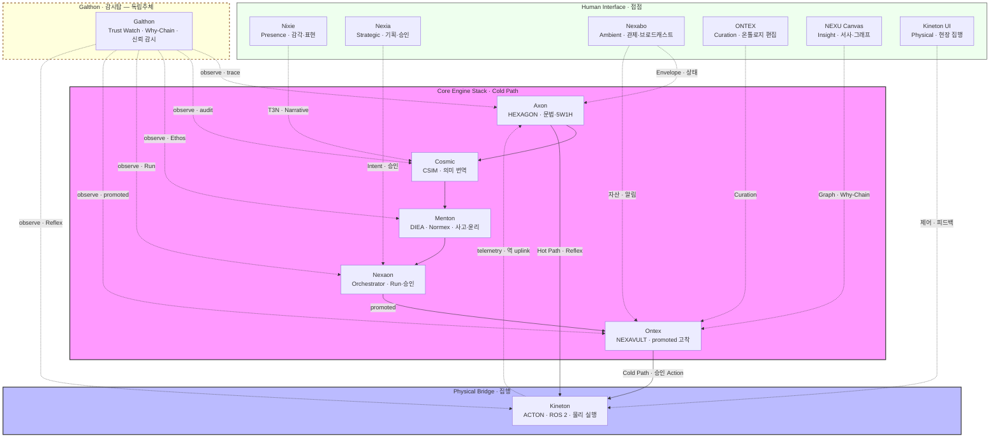

# NEXA 전역 아키텍처 표준 (Global Architecture Standard)

> **목적:** 기획 및 개발 단계의 인지 부하를 줄이기 위한 6대 핵심 개념 규격화.  
> **상태:** v1.0 (개념 정립 단계)  
> **본문 표기:** 아래 **6대 핵심 레이어** 및 **Galthon** 테이블에 **기술 ID** 를 둔다. **Galthon** 은 **독립주체** — 6대 핵심 레이어와 **분리** _(기술 ID `GL`)_. 그 이후 본문은 **순수 기술명** (`Axon` · `Cosmic` · `Menton` · `Nexaon` · `Ontex` · `Kineton` · `Galthon`) 만 사용 — **「Layer」 접미 ✗**. 문장 속 기술명은 백틱으로 감싼다 _(제목 제외)_.


## 6대 핵심 레이어 (Core Layers)

물리 현장에서 발생하거나 직접 기획을 통해 데이터가 태어나 지식으로 고착되기까지의 전 과정입니다.

| 기술명 (Technical Name) | 기술 ID  | 역할                      | 비유           | 설명                                       | SSOT       |
| :------------------- | :----- | :---------------------- | :----------- | :--------------------------------------- | :--------- |
| Axon (엑숀)            | **AL** | Axon (통신/문법)            | 데이터의 옷 (규격)  | `HEXAGON`이 5W1H 문법으로 데이터 포장.             | TDD-043    |
| Cosmic (코믹)          | **CL** | Cosmic (의미/번역)          | 데이터의 언어 (통역) | `CSIM`이 2×2 매트릭스(추상화)를 거쳐 맥락 동기화 단계로 번역. | TDD-044    |
| **Menton** (맨톤)      | **ML** | Menton (지능/사고)          | 사고의 깊이 (판단)  | 지능 엔진이 전략적 가치 판단.                        | TDD-070    |
| Nexaon (넥사온)         | **NL** | Nexaon (전략/집행)          | 두뇌 (최종 결정)   | 인간과 AI가 협업하여 지식으로 승인.                    | TDD-073    |
| Ontex (온텍스)          | **OL** | Ontex (영구/기억)           | 성전 (영구 기억)   | 최종 승인본을 온톨로지에 영구 저장.                     | TDD-057    |
| Kineton (키네톤)        | **KL** | Physical Bridge (물리 가교) | 근육 (실제 동작)   | 시스템의 추상적 의도를 `ROS 2` 메시지로 구체화 및 집행.      | TDD-072    |


## Galthon — 감시탑 (Trust Watch · 독립주체)

6대 핵심 레이어 **외부** 에 위치하는 **독립주체**. 데이터·지식 **흐름 축이 아니며** Cold/Hot Path 에 **직접 관여하지 않는다**. 기술 ID **`GL`** _(6대 핵심 레이어와 분리)_.

| 기술명 (Technical Name) | 기술 ID  | 역할                  | 비유               | 설명                                                                                                | SSOT           |
| :------------------- | :----- | :------------------ | :--------------- | :------------------------------------------------------------------------------------------------ | :------------- |
| **Galthon** (갈톤)     | **GL** | Trust Watch (신뢰 감시) | 감시탑 (Watchtower) | **NEXA** 시스템 전체 **신뢰성** 담보 **독립 감시 주체**. Why-Chain · trace · Ethos·SHACL **횡단 관측** — **흐름 개입 ✗**. | TDD-070 §3.1.1 |


## 각 기술별 SSOT 인벤토리 (Phase 0 · **확정** 2026-06-13)

> **워크플로우:** ~~Phase 0~~ ✓ · ~~**Phase 1** 기존 TDD·draft 흡수·경계 정리~~ ✓ → **Phase 2** Core Engine Stack 분산 이관·archive → **Phase 3** 본 섹션 축소
>
> **상태:** ✅ SSOT 존재·published · ⚠️ 분산·draft·예약 · ❌ SSOT 공백  
> **doc_id 예약:** [TDD-072](../doc_id_레지스트리.md#예약-global-architecture-phase-0--2026-06-13) (Kineton) · [TDD-073](../doc_id_레지스트리.md#예약-global-architecture-phase-0--2026-06-13) (Nexaon)

### SSOT 확정표 (6+1)

| 기술명 | ID | SSOT (Normative) | 상태 | Phase 1 |
| :--- | :---: | :--- | :---: | :--- |
| **Axon** | AL | **TDD-043** | ✅ | 역인용·중복 제거 |
| **Cosmic** | CL | **TDD-044** _(parent: 043)_ | ✅ | 역인용·중복 제거 |
| **Menton** | ML | **TDD-070** §3.2.1 + **TDD-040** §배치 | ⚠️ | 070↔040 분담 명문화 |
| **Nexaon** | NL | **TDD-073** | ⚠️ draft | — |
| **Ontex** | OL | **TDD-057** | ✅ | 링크 정리 |
| **Kineton** | KL | **TDD-072** | ⚠️ draft | — |
| **Galthon** | GL | **TDD-070** §3.1.1 + 본 문서 §Galthon | ⚠️ | 유지·강화 |

### 산재 문서·역할 분담

| doc_id / 문서 | 역할 (Phase 0 확정) | 대상 기술 | 병합·폐기 |
| :--- | :--- | :--- | :--- |
| **TDD-043** | Axon · `HEXAGON` · `APEX` · `ACTON` 프로토콜 정본 | AL · KL _(ACTON)_ | **유지** — KL은 072에서 **집행·ROS 2** 만 분리 |
| **TDD-044** | Cosmic · `CSIM` · 전역 데이터 아키텍처 | CL | **유지** — 043 **하위** · 병합 ✗ |
| **TDD-057** | Ontex · 허브·Graph RAG·promoted | OL | **유지** |
| **TDD-068** | IoT 엣지 uplink · HEXAGON·Nexaon **연계** _(엣지 파이프라인)_ | AL · NL · KL | **유지** — 파일명=doc_id 동일 · **병합 ✗** |
| **TDD-008** | LangGraph · 온톨로지 플랫폼 _(NL parent 예정)_ | NL | **유지** — 073이 **Nexaon 전용** 규격 |
| **TDD-040** | 피지컬 티어 PT-0~3 · **어디서** 연산 | ML _(배치)_ | **유지** — Menton **층 ≠ 배치** |
| **TDD-070** | 용어·ML0–ML3 · Galthon §3.1.1 | ML · GL | **유지** — Menton/Galthon **허브** |
| **TDD-023** | NEXNAP · Envelope 인터페이스 | AL · KL | **유지** — 072에서 참조 |
| [_inbox/Nexaon.md_](<./Nexaon.md>) | NL 개념·관계 **draft** | NL | **TDD-073** 흡수 후 archive _(Phase 2)_ |
| [_inbox/CES_](<./NEXA_핵심엔진_(Core_Engine_Stack).md>) | 7기술 **중복 허브** | 전체 | Phase 2 **이관 후 archive** |

> **약어:** CES = [NEXA_핵심엔진_(Core_Engine_Stack)](<./NEXA_핵심엔진_(Core_Engine_Stack).md>)

### CES → SSOT 이관 매핑 (Phase 2 입력)

| 기술 | CES 이관 출처 | 흡수 대상 SSOT | 비고 |
| :--- | :--- | :--- | :--- |
| **Axon** | §0.1–0.2 · §3 `HEXAGON` · §2 uplink | **TDD-043** §4·§11 | PT 매핑 요약 → 043 부록 또는 040 역인용 |
| **Cosmic** | §3 `CSIM` · Tier 표 · §2 T1–T3 | **TDD-043** §13 · **TDD-044** §2 | CES 서술성 문단 **삭제** |
| **Menton** | §0.3 ML0–ML3 · §3 `DIEA` · `Normex` | **TDD-070** §3.2.1 · **TDD-056** · **TDD-071** §4 | DIEA Facet = 056 SSOT |
| **Nexaon** | §3 `Nexaon` · §5 부담 분리 | **TDD-073** _(신규)_ · **TDD-068** §6 | 068=엣지 ingest · 073=오케스트레이터 규격 |
| **Ontex** | §3 `Ontex` · subRoute 표 | **TDD-057** §1 | 중복 최소 |
| **Kineton** | §4 Hot/Fast · §0.2 ACTON Reflex | **TDD-072** _(신규)_ · **TDD-043** ACTON · **TDD-068** §3·§7 | **집행·ROS 2·Hot Path** = 072 |
| **Galthon** | §7 Why Chain _(관측 맥락)_ | **TDD-070** §3.1.1 · 본 문서 | 흐름 비참여 — CES §7 일부만 참고 |
| **공통** | §1 Pipeline · §4 Cold/Hot · §5 표 | **본 문서** Why-Chain·Contracts | CES 폐기 후 **본 문서가 개념 허브** |

### Phase별 작업 체크리스트

| Phase | 작업                     | 완료 조건                            |        상태        |
| :---: | :--------------------- | :------------------------------- | :--------------: |
| **0** | 인벤토리·SSOT ID·doc_id 예약 | SSOT 확정표 · 이관 매핑 · 분담 결정         | **✓ 2026-06-13** |
| **1** | 기존 TDD·draft 흡수·경계 정리  | TDD-072·073 초안 · 043/044/057 역인용 | **✓ 2026-06-13** |
| **2** | CES → 기술별 SSOT 이관      | CES 관련문서 열 **전 기술 제거** 가능        |        대기        |
| **3** | 본 섹션 축소                | SSOT 링크 표만 유지                    |        대기        |

### 작성·병합 우선순위 (Phase 1+)

1. **Kineton (TDD-072)** — SSOT 공백 ❌ · doc_id 예약 완료
2. **Nexaon (TDD-073)** — `Nexaon.md` 승격 ⚠️ · doc_id 예약 완료
3. **Menton** — TDD-070 §3.2.1 ↔ TDD-040 역할 분담 명문화 ⚠️
4. **Axon · Cosmic · Ontex** — TDD-043·044·057 보강·역인용 ✅
5. **Galthon** — TDD-070 §3.1.1 + 본 문서 유지 ⚠️
6. **CES** — Phase 2 완료 후 **archive**

### 문서 정리 결정 (Phase 0 확정)

1. **CES** — **archive 대상** (Phase 2). 7기술 중복 허브 → 위 **이관 매핑** 따름.
2. **TDD-043 / TDD-044** — **병합 ✗.** 044 = 043 `parent_doc`. AL/CL 경계 유지.
3. **TDD-068** — doc_id와 파일 **동일 문서**. 표기 `TDD-068` 통일 · 병합 ✗.
4. **TDD-070 · Galthon** — Menton §3.2.1 · Galthon §3.1.1 **분리 유지**. 전용 Galthon TDD = Phase 1 **후순위**.
5. **TDD-072 / TDD-073** — [초안 발급](../08_TDD/NEXIA/Kineton/08_TDD_Kineton_PhysicalBridge_ACTON_ROS2_v1.0.md) · [초안 발급](../08_TDD/NEXIA/Nexaon/08_TDD_Nexaon_Distillation오케스트레이터_v1.0.md) `status: draft` — Phase 2 CES 이관·`published` 승격.


## 시스템 아키텍처 시각화 (Architecture Visual)



### 다이어그램 보완 설명

1. **수직 흐름 (Cold Path):** `Axon` → `Cosmic` → `Menton` → `Nexaon` → `Ontex` — 데이터가 지식으로 **promoted** 고착되는 정교한 추론 과정.
2. **우회 흐름 (Hot Path):** `Axon` → `Kineton` 직결 — `Menton`·`Nexaon`·`Ontex` **우회** · Local Reflex · PT-0~2.
3. **승인 집행 (Cold → Physical):** `Ontex` **promoted** 지식 기반 Action → `Kineton` — Hot Path 와 **경로 분리**.
4. **역 uplink:** `Kineton` → `Axon` 점선 — 물리 피드백·telemetry · Inverse `CSIM` · 디지털 트윈 정합.
5. **접점 매핑:** 실선 = 데이터·집행 흐름 · 점선 = 인간 UI·도메인이 **소비·통제**하는 기술. 노드 보조 라벨 = 대표 **엔진·역할** _(기술 ID ✗)_.
6. **`Galthon` 감시탑:** 6대 핵심 축 **외부** · Cold/Hot Path **비참여** — 전 구간 **횡단 관측·Why-Chain 감사** _(독립주체 · [용어집 §3.1.1](../용어집_NEXA전용_v2.0.md))_.


**읽기 순서 (수직 흐름)**

```text
현장·기획 ─► `Axon` (문법 포장)
         ─► `Cosmic` (의미 번역)
         ─► `Menton` (가치·추론)
         ─► Nexaon (정재·승인)
         ─► Ontex (영구 고착)
         ─► Kineton (물리 집행) ─► 현장
```

**배치·엔진과의 관계 (오해 방지)**

- **피지컬 티어** (PT-0~3) = **어디서** 연산하나 — 6대 레이어와 **1:1 ✗**
- **`Menton`** (ML0~ML3) = **소프트웨어상** 사고·표현 역할 — 본 표의 **Menton** 행과 연계하되 **동의어 ✗**
- **Core Engine Stack** (`HEXAGON` · `CSIM` · `DIEA` · `Normex` · `Nexaon` · `Ontex`) = **무엇이** Cold Path 를 실행하나 — 각 기술의 **구현 주체**
- **Hub-and-Spoke:** PT-3 허브에 엔진 집결 · PT-0~2·`Nixie` 에 **경량 샤드** — 말단도 **동일 `Axon` · HEXAGON 규격** 유지

| 기술명 | 주 Core Engine | 주 Menton 층 | 주 피지컬 티어 |
| :--- | :--- | :--- | :---: |
| **`Axon`** | `HEXAGON` | ML0 (Reflex) | PT-0 ~ PT-3 Gate |
| **`Cosmic`** | `CSIM` | ML0 T1 · Gate T2 · ML3 T3 | PT-0 ~ PT-3 |
| **`Menton`** | `DIEA` · `Normex` | ML2 · ML3 | PT-3 |
| **Nexaon** | `Nexaon` | ML3 (Strategic) | PT-3 |
| **Ontex** | `Ontex` · `NEXAVULT` | 허브·탐색 | PT-3 |
| **Kineton** | `ACTON` · ROS 2 Bridge | ML0 Reflex _(Hot Path)_ | PT-0 ~ PT-2 |


## 인간과 접점 (Human Interface)

인간은 6대 레이어를 **직접 건드리지 않고**, 아래 **도메인·제품 접점**을 통해 의도를 넣고 결과를 확인한다. 접점 = **UI·워크플로우·권한 경계**이며, 레이어 자체 **✗**.

### NIXIE — 감각·표현 접점 (Presence)

인간과 시스템이 실시간으로 대화하고 데이터를 가시적으로 확인하는 접점이다.

- **경로:** `Cosmic` 맥락 동기화(`CSIM`) → 지능 표현 층(Presence) → `Nixie` (Interface)
- **역할:** 시스템의 추론 결과(Design)를 인간이 인지할 수 있는 감각적 형태로 변환 및 투영.
- **표현 채널:** 4 Shell (Physical · Cognitive · Ambient · Social) · PiP · TTS · 알람·trace — **지능 판단 소유 ✗**
- **Menton 층:** ML1 (Presence) — **CSIM T3N** Narrative·ECHO 만 소비 · raw ingest **✗**
- **경계:** Cold Path **Run · promoted** **✗** — 결과 **Express** 전용. 엣지 Reflex triage 와 연동.

### NEXIA — 전략·집행 접점 (Strategic Orchestration)

인간이 시스템의 논리 구조를 설계하고 최종 승인하는 집행 접점이다.

- **경로:** User (Intent) → `NEXIA` (Domain) → `Nexaon` (Orchestrator) → `DIEA` (7 Facets)
- **역할:**
    - **인간:** 의도(Intent) 기획 및 최종 승인.
    - **시스템:** 기획에 따른 논리 설계(Design) 및 패싯별 실행 결과 도출.
    - **기획 도구:** `NEXIA` > `DIEA` 7대 패싯 (`omnix`, `normex`, `logex`, `scribx`, `vivex`, `twinex`, `navex`)
- **Menton 층:** ML2 (Domain 작업면) · ML3 (Strategic Run) — `stateBus` · `agent-graph` 허브
- **경계:** `CSIM` **번역만** 수신 — 레지스터·GPIO raw **✗**. 승인 후 `Ontex` **promoted** 로 이관.

### NEXABO — 상황·브로드캐스트 접점 (Ambient Awareness)

시스템의 전역 상태 및 자산 현황을 비동기적으로 전파하고 시각화하는 접점이다.

- **경로:** `Axon`·`Ontex` 상태 신호 → `Nexabo` (Broadcaster) → User (Awareness)
- **역할:**
    - **모니터링:** `Axon`(문법·규격) 가동 상태 및 데이터 유입 현황 가시화.
    - **상태 전파:** `Ontex`(영구 기억)에 고착된 지식 자산의 변경 사항 및 시스템 알림 브로드캐스팅.
    - **가이드:** 현재 인간이 개입해야 할 우선순위 지점(Issue/Task)의 정적 대시보드 제공.
- **도메인:** `nexabo` — IoT 관제·텔레메트리 · 디지털 트윈 대시보드
- **경계:** 실시간 제어·Run **✗** — **Awareness·브로드캐스트** 전용. Hot Path 는 `Kineton`·`ACTON` 경로.

### ONTEX — 근간·온톨로지 접점 (Foundation)

시스템의 영구 기억이자 전역 온톨로지에 직접 접근하여 지식의 정합성을 최종 관리하는 접점이다.

- **경로:** User (Curation) → `ONTEX` (Domain) → `Ontex` (Knowledge Base)
- **역할:**
    - **지식 큐레이션:** 분산된 데이터가 지식으로 정제되어 `Ontex`에 안착하기 전 최종 검증 및 편집.
    - **스키마 설계:** 시스템 전역에서 통용되는 핵심 온톨로지 구조 및 분류 체계의 기획.
    - **영구 자산 관리:** 휘발되지 않는 시스템의 근간 지식 자산에 대한 직접적인 조회 및 권한 관리.
- **저장 축:** Neo4j 그래프 · pgvector (`NEXAVULT` 연계) · `domainKey` 허브
- **경계:** `Nexaon` **Run UI ✗** — 승인·탐색·보존 SSOT. **promoted** 만 영구 자산.

### NEXU Canvas — 지식·통찰 접점 (Narrative Insight)

온톨로지 데이터 페브릭을 시각화하여 데이터 간의 인과관계와 지식의 흐름을 서사적으로 통찰하는 접점이다.

- **경로:** `Ontex` (Knowledge Base) → `NEXU Canvas` (Narrative View) → User (Insight)
- **역할:**
    - **지식 시각화:** 복잡하게 얽힌 온톨로지 노드와 `Why Chain`의 연결 상태를 심미적 그래픽으로 구현.
    - **컨텍스트 탐험:** 데이터의 발생 원인과 결과의 연쇄를 추적하여 시스템의 '서사'를 파악.
    - **상태 체감:** 시스템 전역의 지식 밀도와 정합성 수준을 직관적인 패턴으로 인지.
- **연계:** BAX 미학 레이어 · Graph RAG 탐색 · `Why Chain` 서사
- **경계:** 편집·승인 **✗** — **읽기·탐색·통찰** 전용. 큐레이션은 `ONTEX` 도메인.

### Kineton — 물리·실행 접점 (Physical Bridge)

현장 장비·로봇에 **물리적 의도**를 전달하고 피드백을 받는 접점이다.

- **경로:** User (Interface) → `Kineton` → `ROS 2` (Middleware) → Device (Hardware)
- **역할:**
    - **전략 번역:** 시스템의 추상적 의도(Intent)를 `ROS 2`의 구체적인 실행 메시지(Topic/Service/Action)로 번역.
    - **미들웨어 브릿지:** 고유 논리 체계와 오픈소스 로봇 프레임워크(`ROS 2`) 간의 상호운용성 보장.
    - **상태 동기화:** 하드웨어의 물리적 피드백을 시스템이 이해할 수 있는 상태 데이터로 `Axon`(문법) 또는 `Ontex`(기억) 쪽으로 역전송하여 디지털 트윈 정합성 유지.
- **Axon 연계:** `ACTON` Synapse · `ACTON-GM` _(CNC·로봇 등 선택)_ — 승인된 Action 만 하향
- **경계:** Cold Path **우회 Hot Path** — 허브·`Ontex` 없이 **Local Reflex** 가능 (PT-0~2).


## Galthon — 감시탑 (Trust Watch · 독립주체)

**NEXA** 시스템 전체의 **신뢰성** 을 담보하는 **독립 감시 주체**. 6대 핵심 축·Human Interface 접점 **외부** 에 위치하며, Cold/Hot Path 에 **직접 관여하지 않는다**.

- **역할:**
    - **추론 투명성:** `Nexaon` Run · `Normex` Ethos · `CSIM` 토큰의 논리적 근거(Why) **관측·기록**.
    - **무결성 감시:** `HEXAGON` Envelope · Ethos 게이트 · SHACL diff **정합성** 횡단 점검.
    - **What-if 시뮬레이션:** 조건 변경 시 판단 변화 **추적** — 데이터 **변조·우회 ✗**.
- **관측 대상:** `Axon` · `Cosmic` · `Menton` · `Nexaon` · `Ontex` · `Kineton` — **흐름 개입 ✗**
- **경계:** 브랜드 **NEXA** ≠ `Galthon` — **NEXA** = 사업·플랫폼 · **`Galthon`** = **신뢰 감시** **독립주체** _(6대 핵심 축 ✗ · 기술 ID `GL` · [용어집 §3.1.1](../용어집_NEXA전용_v2.0.md))_.


---


## 데이터 생애주기 및 인과관계 체인 (The Why-Chain)

데이터가 `Axon`에서 태어나 어떻게 `Ontex`에 고착되고 `Kineton`으로 집행되는지, 그 **수직적 흐름**을 명시한다. 모든 단계는 **역추적 가능**해야 하며, 이것이 **Why-Chain** 의 전제이다.

### 핵심 구동 메커니즘 (Core Mechanism)

**Cold Path (지식 정제)** 와 **Hot Path (현장 집행)** 는 분기한다. Cold Path = 허브(PT-3) 집약 · Hot Path = 말단 Reflex · `Kineton` 직행.

```text
[Cold Path · Distillation]
  Fact/Intent → HEXAGON Envelope → CSIM T1→T2 → DIEA → Normex → Nexaon Run
            → 승인 → Ontex promoted → Graph RAG

[Hot Path · Reflex]
  WILL/FACT → HEXAGON → ACTON / Kineton → ROS 2 → Device
            (Ontex 우회 가능 · 동일 `Axon` 규격 유지)
```

#### 데이터 상태 전이도 (State Transition)

시스템 내 데이터는 다음 **5단계**를 거쳐 '지식'에서 '행동'으로 진화한다.

1. **Raw (`Axon`):** 센서·기획 입력이 `HEXAGON` 5W1H **Envelope** 로 포장된 원시·구조화 신호.
2. **Context (`Cosmic`):** `CSIM` **T1·T2** — Matrix 공용어화 → 맥락·Ethos 정렬된 **의미 토큰** (raw uplink **✗**).
3. **Logic (`Menton`):** `DIEA` · `Normex` · `Nexaon` — 가치 판단·정재·Run 초안. **promoted 전** 단계.
4. **Knowledge (Ontex):** Human·`Omnix` 승인 후 **promoted** — 온톨로지·벡터 코퍼스에 **영구 고착**.
5. **Action (Kineton):** 승인·정렬된 Action → `ACTON` · `ROS 2` — 물리 세계에 투영된 운동.

#### 인과관계 추적 (Why-Chain)

모든 `Action`은 역으로 `Knowledge` → `Logic` → `Context` → `Raw` 까지 추적 가능해야 하며, 각 홉에 **Who · Why · When** (`HEXAGON` 6축) 이 남아야 한다.

| 역추적 홉 | 질문 | 담당 접점·엔진 |
| :--- | :--- | :--- |
| Action → Knowledge | 무엇이 승인되어 실행되었나 | `Kineton` · `Ontex` promoted |
| Knowledge → Logic | 누가·어떤 Run 으로 정재했나 | `Nexaon` · `DIEA` · SHACL diff |
| Logic → Context | 어떤 맥락·Ethos 로 정렬되었나 | `CSIM` T2 · `Normex` |
| Context → Raw | 원천 Fact·Envelope 는 무엇이었나 | `HEXAGON` · ML0 Sentinel |

**`Galthon`** 이 이 역추적·감사 **관측** 을 담당한다 _(흐름 비참여 · 감시탑)_. **NEXU Canvas** 는 동일 체인을 **서사·그래프**로 시각화한다.


---
## 핵심 기술 컴포넌트 (Black-box Specification)

각 기술의 '설명'에 그치지 않고, 실질적으로 돌리는 **기술적 실체(Engine)** 를 명시한다. 상세 규격은 SSOT 열 문서를 따른다.

#### 핵심 기술 엔진 (Technical Components)

- **`Axon`:** `HEXAGON` Grammar Engine — 5W1H **6축 Envelope** · Zod 선검증 · 이기종 uplink **공통 문법**. (`APEX` Matrix · `ACTON` 은 `Axon` 스택 내 인접 층)
- **`Cosmic`:** `CSIM` (Cosmic Semantic Interface Matrix) — WILL/FACT ↔ Matrix **양방향 번역** · Tier **T1 공용어화 → T2 맥락 동기화 → T3 구체화**. **판단·Run ✗**
- **`Menton`:** `DIEA` (7 Facet 작업면) · `Normex` (Ethos·RULE) — ML2 Domain · ML3 Strategic **사고·윤리 정렬**. 단일 모놀리식 엔진 **✗**
- **Nexaon:** `Nexaon` Orchestrator · `apps/agent-graph` — ingest → Run · SHACL · Human 승인 · **promoted** 전 단계 **소유**
- **Ontex:** `Ontex` Foundation Hub — Neo4j · pgvector · `NEXAVULT` — **promoted** 고착 · Graph RAG · explore/trace
- **Kineton:** `ACTON` Synapse · `ROS 2` Bridge — PWM · MQTT · Topic/Service/Action 매핑 · **Hot Path** 물리 집행


## 기술 간 인터페이스 규격 (Contracts)

기술과 기술이 만나는 지점에서 주고받는 **Input / Output** 을 명시한다. 모든 계약은 `HEXAGON` Envelope 또는 그에서 파생된 **의미 토큰** 을 최소 단위로 한다.

| 인접 계약                            | Output (상향·하향)               | Input (수신 측)                 | 검증·게이트               |
| :------------------------------- | :--------------------------- | :--------------------------- | :------------------- |
| **현장 → `Axon`**              | raw Fact · GPIO · 센서 벡터      | `HEXAGON` Envelope (5W1H)    | Zod · 스키마 선검증        |
| **`Axon` → `Cosmic`**    | HEXAGON Envelope · APEX Body | `CSIM` **T1** Matrix 투영      | raw uplink **✗**     |
| **`Cosmic` → `Menton`**  | T2 **의미 토큰** · Ethos PASS    | `DIEA` `stateBus` · Facet 맥락 | `Normex` RULE 대조     |
| **`Menton` → Nexaon**        | Facet 산출 · NQ · draft        | `Nexaon` Run 입력 · **T3R** 정렬 | CSIM **「사고 토대」✗**    |
| **Nexaon → Ontex**               | 승인본 · graph_diff · triple    | `promoted` · ontology patch  | SHACL · Human accept |
| **Ontex → Kineton**              | Action intent · programRef   | `ACTON` · ROS 2 메시지          | 승인·VOID·안전 장치        |
| **Kineton → `Axon`** _(역방향)_ | 물리 피드백 · telemetry           | Inverse `CSIM` T1 · Envelope | 디지털 트윈 정합            |

**공통 계약 원칙**

- **의미 토큰 only:** PT-3 LLM·`Nexaon` 은 **레지스터 raw ✗** — `CSIM` 번역 결과만 ingest.
- **Ethos 선행:** T2 게이트 **FAIL** 시 하위 단계로 **전파 ✗** — Envelope 폐기.
- **승인 분리:** `CSIM` T3 **번역** ≠ **Run** — Run·promoted 는 **Nexaon** 전용.
- **Hot/Cold 분기:** `Kineton` 은 Cold Path 완료 **없이** Reflex 실행 가능 — 단, **`Axon` 규격** 은 동일.

---

_관련 SSOT:_ [용어집 TDD-070](../용어집_NEXA전용_v2.0.md) · [TDD-072](../08_TDD/NEXIA/Kineton/08_TDD_Kineton_PhysicalBridge_ACTON_ROS2_v1.0.md) · [TDD-073](../08_TDD/NEXIA/Nexaon/08_TDD_Nexaon_Distillation오케스트레이터_v1.0.md) · [TDD-043](../08_TDD/Cosmic/08_TDD_CSIM_AXON프로토콜_정본.md) · [TDD-044](../08_TDD/Cosmic/08_TDD_CosmicLanguage_전역데이터아키텍처.md) · [TDD-057](../08_TDD/Ontex/08_TDD_Ontex_기술스택운영방침_v1.0.md) · [TDD-068](../08_TDD/NEXIA/08_TDD_NEXIA_IoT엣지데이터파이프라인_HEXAGON_Nexaon연계_v1.0.md)
