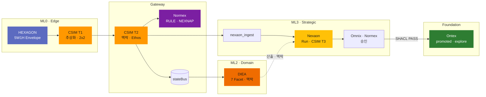

---
doc_id:
title: "NEXA 핵심엔진 (Core Engine Stack)"
category: ""
domain: NEXAOS
status: draft
created: 2026-06-13
updated: 2026-06-13
parent_doc:
implements_doc:
see_also: [TDD-040, TDD-043, TDD-044, TDD-056, TDD-057, TDD-068, TDD-070, TDD-071, TDD-033]
terms_standard: ["zod", "shacl", "langgraph", "pgvector", "neo4j"]
terms_nexa: [Core-Engine-Stack, Physical-Tier, Physical-Centric-Hierarchy, HEXAGON, CSIM, DIEA, Normex, Nexaon, Ontex, AXON, ML0, ML1, ML2, ML3, Menton-Layer, stateBus, promoted, NEXAVULT]
tags: []
---

# NEXA 핵심엔진 (Core Engine Stack)

> **한 줄:** NEXA OS **Distillation Cold Path** 를 구성하는 **런타임 엔진 스택** — ML0 물리 **Fact** 가 ML3 **promoted** 지식으로 **고착**되기까지 **문법 → 의미 → 맥락 → 윤리 → 판단 → 기억** 순의 **확장 가능** 파이프라인.
>
> **Menton** (Intelligence Stack) — [TDD-070 §3.2.1](../용어집_NEXA전용_v2.0.md) · **≠** TDD-033 추상 레이어 · **≠** `Axon` · **≠** NISE-L*
>
> **3축 정렬:** **피지컬 티어** (배치 · [TDD-040](../08_TDD/AI/08_TDD_AI_지능위계및하드웨어사양.md)) · **ML** (논리 계층) · **본 문서** (기능 엔진). **1:1 대응 가정 ✗**. **배치:** Hub-and-Spoke — PT-3 허브 · PT-0~2·Nixie 샤드 ([§0.4](#04-hub-and-spoke-배치-원칙-normative)).

| **초안 성격:** Obsidian 개념 노트 · Core Engine Stack 관계·경계 정리. Normative SSOT 는 아래 **관련 문서** 를 따른다.
>
> **Phase 0 (2026-06-13):** 본 문서 = **archive 대상** (Phase 2). 이관 매핑 = [Global Architecture Standard §CES→SSOT](Draft-NEXA%20전역%20아키텍처%20표준%20(Global%20Architecture%20Standard).md#ces--ssot-이관-매핑-phase-2-입력).

> **구성 원칙 (Normative):** Core Engine Stack 의 **멤버 개수는 고정하지 않는다**. §2·§4 표는 **현재 v0 스냅샷** (2026-06). 엔진 **추가·분할·흡수·퇴출** 시 본 문서·[용어집](../용어집_NEXA전용_v2.0.md) 을 **선행** 갱신한다. 문서·대화 SSOT 호칭 = **Core Engine Stack** · **핵심엔진 스택** — **「N대」 숫자 접두 ✗**.

---

## 0. NEXA 통합 아키텍처 위계 (Physical-Centric Hierarchy)

> **읽기 순서:** **① 피지컬 티어** (어디서) → **② ML** (논리 역할) → **③ Core Engine** (무엇이). 배치 SSOT = [TDD-040](../08_TDD/AI/08_TDD_AI_지능위계및하드웨어사양.md).

### 0.1 세 축 (혼동 방지)

| 축 | 호칭 (한·영) | 질문 | 개수 | SSOT |
| :--- | :--- | :--- | :---: | :--- |
| **① 피지컬 티어** | 피지컬 티어 · Physical Placement Tier | **어디서** 연산하나 | **4** (PT-0~3) | [TDD-040](../08_TDD/AI/08_TDD_AI_지능위계및하드웨어사양.md) |
| **② 논리 계층** | **Menton** (Intelligence Stack) | **소프트웨어상** 어떤 역할 층인가 | **4** (ML0–ML3) | [용어집 §3.2.1](../용어집_NEXA전용_v2.0.md) · [TDD-068 §1.4](../08_TDD/NEXIA/08_TDD_NEXIA_IoT엣지데이터파이프라인_HEXAGON_Nexaon연계_v1.0.md) |
| **③ 핵심 엔진** | Core Engine Stack · 핵심엔진 스택 | **무엇이** 기능을 수행하나 | **6** _(가변)_ | **본 문서** |

| 개념 | 본 문서 | SSOT |
| :--- | :--- | :--- |
| **Core Engine Stack** | Distillation Cold Path **런타임 엔진** 집합 _(가변)_ | **본 문서 §2** |
| **피지컬 티어 · 지능 위계** | PT-0~3 · Nano/Micro/Kinetic/Zenith **주체** | [TDD-040](../08_TDD/AI/08_TDD_AI_지능위계및하드웨어사양.md) |
| **TDD-033 추상 레이어** | 5W1H · Nature-Tag · Atom … **데이터 프로토콜** | [TDD-033](../08_TDD/AI/08_TDD_AI_5W1H_6대추상레이어규격.md) |
| **`Axon`** | APEX · HEXAGON · Coil … **신호·의미 7층 스택** | [TDD-043 §4](../08_TDD/Cosmic/08_TDD_CSIM_AXON프로토콜_정본.md) |
| **`Cosmic`** | CSIM · T1–T3 **번역 개념** 단계 — **배치 Tier ✗** | [TDD-043 §13.0.1](../08_TDD/Cosmic/08_TDD_CSIM_AXON프로토콜_정본.md) · [TDD-044 §2.3](../08_TDD/Cosmic/08_TDD_CosmicLanguage_전역데이터아키텍처.md) |

> **금지 혼동:** `지능 계층` **deprecated** → **피지컬 티어**. **6엔진** **≠** **4피지컬 티어** **≠** **4 Menton 층(ML0–ML3)과 1:1 ✗**. **지능 위계** = TDD-040 **주체 명** — Menton **층 번호 동의어 ✗**.

### 0.2 피지컬 티어 중심 매핑 (다대다)

**원칙:** 엔진·Menton 층(ML) 은 티어를 **횡단**할 수 있다. 아래는 **주 배치**만 표기. **Hub-and-Spoke** 상세: [§0.4](#04-hub-and-spoke-배치-원칙-normative).

| 피지컬 티어 | HW | 지능 위계 (주체) | 주 ML | 주요 Core Engine (해당 티어) | 횡단·비고 |
| :---: | :---: | :--- | :--- | :--- | :--- |
| **PT-0** | COLD | **Nano Sentinel** | **ML0** Reflexive | **HEXAGON** · **CSIM T1** | ACTON Reflex · raw uplink **✗** |
| **PT-1** | WARM | **Micro Sentinel** _(선택)_ | **ML0** 보조 | SLM·YOLO · **HEXAGON** 1차 요약 | 비식별 게이트 · **Nixie ✗** |
| **PT-2** | WARM | **Kinetic Controller** _(선택)_ | **ML0** 현장 Decision | SLM·TensorRT · JSON 제어 | Fast Path · DIEA **✗** |
| **PT-3** | HOT | **Zenith Indicator** | **ML2** · **ML3** | **CSIM T2** · **DIEA** · **Normex** · **Nexaon** · **Ontex** | Gateway · agent-graph · RAG |

### 0.3 Menton 층 · 엔진 횡단 (논리 축)

| ML | 별칭 | 주체 | Core Engine (주) | 주 피지컬 티어 |
| :--- | :--- | :--- | :--- | :---: |
| **ML0** | Reflexive · Edge | Sentinel · Physical Shell **입력** | **HEXAGON** · **CSIM T1** | PT-0 ~ PT-2 |
| **—** | Transport | Nest Gateway | **HEXAGON** · **CSIM T2** · **Normex** Ethos | **PT-3** |
| **ML1** | Presence | **Nixie** | **CSIM T3N** _(번역만 · Stack 멤버 ✗)_ | **횡단** (표현면) |
| **ML2** | Tactical · Domain | nexabo · nexia · **DIEA** | **DIEA** · **Normex** _(편집)_ | **PT-3** |
| **ML3** | Strategic | **Nexaon** · Omnix | **Nexaon** · **CSIM T3R** · **Normex** _(승인)_ | **PT-3** |
| **허브** | Foundation | **Ontex** | **Ontex** · NEXAVULT | PT-3 _(저장·탐색)_ |

### 0.4 Hub-and-Spoke 배치 원칙 (Normative)

> **한 줄:** **PT-3** = Cold Path **통합 허브** · **PT-0~2·Nixie** = **경량 실장** + **Local Reflex**. [TDD-040 §0.1](../08_TDD/AI/08_TDD_AI_지능위계및하드웨어사양.md) · [용어집 §3.2.0](../용어집_NEXA전용_v2.0.md)

**PT-3 (Zenith Indicator)** 에서 Core Engine Stack **통합 허브**—**CSIM T2/T3R** · **DIEA** · **Normex** · **Nexaon** · **Ontex**—가 **풀스택 웹 플랫폼(Full-Stack Web Platform)** 으로 집결되어 **전역 최적화(Global Optimization)** 와 **장기 지식 고착(Long-term Memory)** 을 보장한다.

**PT-0~2** 및 **Nixie**(브라우저·클라이언트·Physical Shell)에는 해당 티어·Menton 층에 최적화된 **경량 실장**이 분산되어 **네트워크 우회 Local Reflex** 와 **실시간 상호작용**을 실현한다.

```text
[Shard · PT-0~2]  HEXAGON · CSIM T1 · Sentinel SLM ──경량 uplink──►
[Presence · ML1]  Nixie · CSIM T3N ◄──ECHO────────────────────────┐
[Hub · PT-3]      CSIM T2 · DIEA · Normex · Nexaon · Ontex ◄──────┘
                  Global Optimization · promoted · Graph RAG
```

| 엔진 | 허브 (PT-3) | 샤드 (PT-0~2 · ML1) |
| :--- | :---: | :---: |
| **HEXAGON** | Ingress Gate **재검증** | **ML0 말단** 선처리 |
| **CSIM** | **T2** Gateway · **T3R** Nexaon | **T1** Inverse · **T3N** Nixie |
| **DIEA · Normex · Nexaon · Ontex** | **주 배치** | — _(Run·promoted ✗)_ |
| **Micro/Kinetic SLM** | uplink 소비 | **PT-1~2 자체 연산** |

> **오해 방지:** 6엔진 **전부 PT-3에만 존재 ✗** — **HEXAGON·CSIM T1** 은 말단 **이중 실장**. **Fast/Hot Path** 는 허브·Ontex **우회** ([§4](#4-cold-path-vs-hot-path)).

---

## 1. 엔진 하이어라키 (Pipeline)

**Cold Path (Normative)** — 엣지·Human 입력이 **검증된 지식**으로 승격되는 **단방향** 체인:

```text
HEXAGON (Grammar)   → 5W1H · Envelope · Zod        — 신뢰의 시작
    ↓
CSIM (Semantic)     → Matrix 양방향 번역 · T1/T2/T3      — 번역의 시작
    ↓
DIEA (Context)      → 7 Facet · stateBus · 산출     — 이해의 시작
    ↓
Normex (Ethos)      → RULE · MUST/SHOULD · NEXNAP   — 윤리의 시작
    ↓
Nexaon (Logic)      → ingest · Run · 승인 · SHACL  — 판단의 핵심
    ↓
Ontex (Foundation)  → promoted · Graph RAG · archive — 기억의 핵심
```

**현재 v0 멤버 (Cold Path 순)**

| 순서         | 태그         | 엔진          | 역할 (한 줄)                                           | 주 배치 (ML)                         | 주 피지컬 티어 | Axon (층)       |
| :--------- | :--------- | :---------- | :------------------------------------------------- | :-------------------------------- | :-------- | :------------------- |
| Grammar    | Grammar    | **HEXAGON** | raw → **5W1H Envelope** · 스키마 선검증                  | **ML0** · Ingress Gate            | PT-0 · PT-3 Gate | **AXON-AL2**          |
| Semantic   | Semantic   | **CSIM**    | WILL/FACT ↔ **Matrix** · **양방향 번역** · 경량 전송 _(수단)_ | **ML0** T1 · Gate T2 · **ML3** T3 | PT-0 T1 · **PT-3** T2/T3R | **AXON-AL1** APEX · 의미 번역 |
| Context    | Context    | **DIEA**    | Facet **작업면·맥락·산출** · `stateBus` 수신                | **ML2** · **nexia**               | **PT-3** | —                    |
| Ethos      | Ethos      | **Normex**  | **규범·Ethos** · RULE 대조 · `.nxpol`                  | **ML2** Facet · T2·승인 게이트         | **PT-3** | NEXNAP 매트릭스          |
| Logic      | Logic      | **Nexaon**  | **정재 오케스트레이션** · Run · promoted 전 단계               | **ML3** · Logex `ontology`        | **PT-3** | —                    |
| Foundation | Foundation | **Ontex**   | **promoted 고착** · explore · trace · archive        | **domainKey** 허브                  | **PT-3** | Graph RAG            |

> **Ontex** 는 **엔진**이자 **`domainKey`** — Nexaon **Run UI ✗** · 승인 후 **허브·탐색·보존** SSOT ([TDD-057 §1](../08_TDD/Ontex/08_TDD_Ontex_기술스택운영방침_v1.0.md)).

---

## 2. 엔진 간 인터페이스 (ML0 → ML3)

### 2.1 배치 × 엔진 매트릭스

| ML | 별칭 | 주 피지컬 티어 | 활성 엔진 (주) | 부가 주체 |
| :--- | :--- | :---: | :--- | :--- |
| **ML0** | Reflexive · Edge | PT-0 ~ PT-2 | **HEXAGON** · **CSIM T1** | Sentinel · Nixie Physical **입력** · ACTON Reflex |
| **—** | Transport | **PT-3** | **HEXAGON** · **CSIM T2** · **Normex** Ethos | MQTT · Nest Ingress · Zod · Event Router |
| **ML1** | Presence | **횡단** | _(Stack 멤버 ✗)_ · **CSIM T3N** | **Nixie** — 결과 **Express** · ingest payload **✗** |
| **ML2** | Tactical · Domain | **PT-3** | **DIEA** · **Normex** (편집·참조) | nexabo · Twinex · NexaonShell UI |
| **ML3** | Strategic | **PT-3** | **Nexaon** · **CSIM T3R** · **Normex** (승인) | Omnix · agent-graph · SHACL |
| **허브** | Foundation | **PT-3** | **Ontex** · NEXAVULT | Neo4j promoted · pgvector · `explore` |

### 2.2 단계별 핸드오ff (Normative)

| 단계 | 구간 | 입력 → 출력 | 담당 엔진 |
| :-: | :--- | :--- | :--- |
| **①-a** | ML0 말단 | raw · GPIO → **FACT/WILL Envelope** | **HEXAGON** |
| **①-b** | ML0 압축 | Envelope → **2×2 Matrix** · raw uplink **✗** _(전송 수단)_ | **CSIM T1** |
| **②** | 상행 | 경량 Envelope → Broker payload | **HEXAGON** shell 유지 |
| **③** | 게이트 | Matrix **맥락 정렬** · **Ethos PASS** · `stateBus` | **CSIM T2** + **HEXAGON** + **Normex** |
| **④** | 분기 | bus → nexabo · DIEA · NQ · Nixie | Event Router |
| **⑤** | 맥락 | `stateBus` · Human → Facet 산출·초안 | **DIEA** |
| **⑥** | 정재 | NQ · Matrix 토큰 → draft · `graph_diff` | **Nexaon** _(CSIM T3 정렬 포함)_ |
| **⑦** | 윤리·승인 | Run → Diff accept · ASK/VOID | **Normex** + **Omnix** |
| **⑧** | 검증 | 승인본 → **promoted** 후보 | SHACL (Nexaon 루프) |
| **⑨–⑩** | 저장 | PASS → Neo4j · pgvector embed | Nexaon → stores |
| **⑪** | 고착 | promoted · 벡터 → 탐색·아카이브 | **Ontex** |

### 2.3 Macro 파이프라인

**CSIM 방향 (요약):** **상향** FACT → Inverse CSIM → ECHO · **하향** WILL → CSIM → HEXAGON → ACTON ([TDD-043 §13](../08_TDD/Cosmic/08_TDD_CSIM_AXON프로토콜_정본.md)).



---

## 3. 엔진별 정의 (현재 v0 멤버)

### HEXAGON (Grammar Engine)

> **한 줄:** **AXON-AL2** — 데이터를 **사건(Event)** 으로 규정하는 **5W1H 6축** 전송·문법 층.

| 항목 | 내용 |
| :--- | :--- |
| **입력** | raw 센서 · WILL/APEX · 후보고 스트림 |
| **출력** | **Envelope** (Who/What/Where/When/How/Why) · Zod PASS/FAIL |
| **배치** | **ML0** 선처리 · Nest Ingress **재검증** |
| **다음 엔진** | **CSIM** — Envelope **껍질** 유지한 채 좌표 투영 |

**금지:** LLM 추론 **소유 ✗** · ontology 판단 **✗** · Run **✗**

**SSOT:** [TDD-043 §11](../08_TDD/Cosmic/08_TDD_CSIM_AXON프로토콜_정본.md) · [TDD-044 §2.2](../08_TDD/Cosmic/08_TDD_CosmicLanguage_전역데이터아키텍처.md)

---

### [[CSIM]] (Semantic Engine · Cosmic)

> **한 줄:** **`Cosmic`** 구현체 — **Cosmic Semantic Interface Matrix (CSIM)** — **WILL ↔ FACT** 를 **Matrix 규격**으로 주고받는 **양방향 의미 번역기**. 경량 패킷은 **수단**, **의미 동기화·순도(Purity)** 가 목적 — **판단·Run·promoted** 는 **[[Nexaon]]** ([TDD-043 §2.3 · §13.0](../08_TDD/Cosmic/08_TDD_CSIM_AXON프로토콜_정본.md)).
- **[[CSIM]]**은 복잡한 세상을 **'우주언어'**라는 핵심 좌표로 단순화하여 지능([[Nexaon]])이 오판 없이 세상을 읽게 합니다.
- 우주언어는 기계와 인간, 그리고 AI가 같은 층위에서 대화할 수 있게 만드는 **최소 단위의 시맨틱 매개체**입니다.
- **지능의 번역가** — 추상적 **우주언어(Matrix)**와 구체적 **인간의 언어/팩트** 사이를 잇는 상호 번역 인터페이스.
#### 개념 Tier (Normative · [TDD-043 §13.0.1](../08_TDD/Cosmic/08_TDD_CSIM_AXON프로토콜_정본.md))

|  Tier  | 단계      | 역할                                      | 변환 방향                 |
| :----: | :------ | :-------------------------------------- | :-------------------- |
| **T1** | **추상화** | 거친 물리 신호를 **2×2(3*3) 우주언어(Matrix)**로 응축 | **Sensor(센서)** ➔ 우주언어 |
| **T2** | **맥락화** | 우주언어에 **[[DIEA]] 맥락**을 주입하여 의미를 정렬      | 우주언어 + 맥락(Context)    |
| **T3** | **구체화** | 정제된 우주언어를 **구체적인 언어와 Narrative**로 번역    | 우주언어 ➔ 인간의 언어/실행      |

|  Tier  | 단계 (EN)                            | Normative 정의                                                                                        |
| :----: | :--------------------------------- | :-------------------------------------------------------------------------------------------------- |
| **T1** | **Abstraction** · **추상화** 우주언어     | 거친 **WILL/FACT/Sensor** → **Matrix** **시스템 공용어(우주언어)** · **양방향** 1차 투영                              |
| **T2** | **Contextualization** · **맥락 동기화** | Matrix + **Domain · HEXAGON · `stateBus`** → **오해 없는 의미** 토큰 · **Ethos** 정렬                         |
| **T3** | **Concretization** · **구체화**       | 의미 토큰 → **Narrative** \| **Action** — CSIM **번역** · Run/표현 = **[[Nexaon]]** · **[[Nixie]]** · ACTON |

|  Tier  | 변환 (요약)            | T3 분기                                              |
| :----: | :----------------- | :------------------------------------------------- |
| **T1** | FACT/WILL → Matrix | —                                                  |
| **T2** | Matrix ↔ Context   | —                                                  |
| **T3** | Matrix → 실행·표현     | **상향** Narrative/ECHO · **하향** ACTON · **동시 필수 ✗** |

#### 운영 배치 (Stack × Menton)

| Tier | 배치 | CSIM 역할 | 연동 |
| :---: | :--- | :--- | :--- |
| **T1** | **ML0** · Nixie Physical | **Inverse CSIM** · 1차 APEX · **2×2** | raw uplink **✗** |
| **T2** | **Nest Ingress** | Matrix **정렬** · **Ethos** (Normex) · Zod | `stateBus` |
| **T3** | **Nexaon 내부** | LLM·embed **입력 정렬** · **3×3** semantic | Run **전** |

> **T2 맥락 공급:** **[[DIEA]]** · Ontology · Domain Profile · 전후 이벤트 — CSIM **내부 Facet ✗**, 번역 시 **참조하는 맥락**.

| 방향 | 프로세스 ([TDD-043 §13](../08_TDD/Cosmic/08_TDD_CSIM_AXON프로토콜_정본.md)) |
| :--- | :--- |
| **상향** | FACT → **Inverse CSIM** → ECHO → Nixie/UI Narrative |
| **하향** | WILL → CSIM → HEXAGON → ACTON |
| **플랫폼** | LLM·Nexaon 은 **레지스터 raw ✗** — **CSIM 번역 토큰**만 |

**아키텍처 포인트:**

- **[[CSIM]]** 은 **「사고 토대」✗** — **번역·정렬·토큰화**만. **0/1 판단 · Run · SHACL** = **[[Nexaon]]** (NEXAON, §2.3).
- **순도(Purity):** 환각·오판을 줄이기 위해 **의미층**을 Nexaon·**[[Nixie]]** 앞에 고정 ([TDD-044 §2.3](../08_TDD/Cosmic/08_TDD_CosmicLanguage_전역데이터아키텍처.md)).
- **압축:** 말단 **2×2** 는 **트래픽·편의**용 **포맷** — CSIM의 **유일한 목적 ✗**.

**금지:** T1·T2 에서 Run · promoted **✗** · raw 레지스터를 Nexaon 에 **직접** ingest **✗**

**SSOT:** [TDD-043 §2.3 · §5–8 · §13 · §13.0.1](../08_TDD/Cosmic/08_TDD_CSIM_AXON프로토콜_정본.md) · [TDD-044 §2.3](../08_TDD/Cosmic/08_TDD_CosmicLanguage_전역데이터아키텍처.md)


---

### DIEA (Context Engine)

> **한 줄:** **Distillation Intelligence Engine Array** — `nexia` 의 **7 Facet 작업면** · `stateBus` 런타임에 **도메인 맥락·산출** 을 주입.

| Facet (`tabId`) | 역할 | 대표 산출 |
| :--- | :--- | :--- |
| `omnix` | 허브·승인·오케스트레이션 | `.nxchat` |
| `normex` | 규범·시방서 _(→ Normex)_ | `.nxpol` |
| `logex` | 추론·워크플로 · **Nexaon** 호스트 | `.nxflow` · ontology |
| `scribx` | 코드·명세 | `.nxcode` |
| `vivex` | 미디어 | `.nxmedia` |
| `twinex` | 디지털 트윈 · ESPHome | `.nxdev` … |
| `navex` | 전역 자산 탐색 | 인덱싱 |

| 항목 | 내용 |
| :--- | :--- |
| **Nexaon 과 관계** | **Nexaon ∈ DIEA Facet ✗** — Facet 산출을 **정재 루프**로 묶는 **오케스트레이션** 은 Nexaon |
| **Hot Path** | Normex·Logex 등 → `erp` **직주입** (Cold **우회**) |
| **Cold Path** | Facet 산출 → Nexaon Run → SHACL → **Ontex** (**never 직접 promoted**) |

**SSOT:** [TDD-070 §3.3](../용어집_NEXA전용_v2.0.md) · [TDD-056](../08_TDD/NEXIA/08_TDD_NEXIA_7탭범위확정_v1.0.md) · [TDD-071 §4](../08_TDD/NEXAOS/08_TDD_NEXAOS_도메인구조통합_v1.0.md)

---

### Normex (Ethos Engine)

> **한 줄:** **Norm(규범)·정책·Ethos** — CSIM T2 **Ethos 게이트** 와 Human **승인 게이트** 에서 **RULE·MUST/SHOULD** 를 대조.

| 접점 | 역할 |
| :--- | :--- |
| **CSIM T2** | Envelope **Ethos PASS/FAIL** · 스키마 위반 **조기 폐기** |
| **Event Router** | Normex · GOVERN · 사용자 규칙 → **match·route** |
| **Nexaon ⑦** | Run 결과 vs **`.nxpol`** · ASK/VOID · Omnix strip |
| **Hot Path** | Normex 산출 → `erp` 실행 축 _(Ontex 우회)_ |

**What 축 (TDD-068):** 엣지 **FACT** = 관측 · 플랫폼 **RULE** = Normex · GOVERN

**금지:** LangGraph Run **단독 소유 ✗** (Omnix·Nexaon 과 **협업**) · promoted **직접 쓰기 ✗**

**SSOT:** [TDD-056 §5.2](../08_TDD/NEXIA/08_TDD_NEXIA_7탭범위확정_v1.0.md) · [TDD-068 §1.6.6](../08_TDD/NEXIA/08_TDD_NEXIA_IoT엣지데이터파이프라인_HEXAGON_Nexaon연계_v1.0.md)

---

### Nexaon (Logic Engine)

> **한 줄:** **ML3 Distillation 오케스트레이터** — ingest · LangGraph Run · `graph_diff` · Omnix 승인 · SHACL → **promoted** 전 단계.

| 항목 | 내용 |
| :--- | :--- |
| **정체** | Logex **`ontology` 서브모드** · `modules/nexaon/` · **8번째 tabId ✗** |
| **입력** | `nexaon_ingest` · `stateBus` · Human · DIEA correlate |
| **출력** | Yjs draft · promoted **후보** → Neo4j · Ontex |
| **CSIM T3** | **기능** = CSIM 구체화 · **실행 위치** = Nexaon 내부 · **판단·Run 소유** = Nexaon |

**ingest 모드:** Auto · Queue · Buffer ([Nexaon.md §6](./Nexaon.md))

**금지:** Hot Path ERP 주입 **✗** · Nixie payload 직접 ingest **✗** · Facet **대체 ✗**

**SSOT:** [Nexaon.md](./Nexaon.md) · [TDD-068 §6](../08_TDD/NEXIA/08_TDD_NEXIA_IoT엣지데이터파이프라인_HEXAGON_Nexaon연계_v1.0.md) · [TDD-008](../08_TDD/LangGraph/08_TDD_LangGraph_인간LLM협업형IoT온톨로지플랫폼_v1.0.md)

---

### Ontex (Foundation Engine)

> **한 줄:** **promoted 지식 허브** — Graph RAG · explore · trace · archive · NEXAVULT 벡터 코퍼스.

| subRoute | UI | 역할 |
| :--- | :--- | :--- |
| `explore` | Explore | Graph RAG · 온톨로지·벡터 **탐색** |
| `canvas` | Nexion | 장기 지식 그래프 **편집·시각화** |
| `trace` | Trace | 데이터 **계보·흐름** |
| `archive` | Archive | Tiptap·Hub·VOID **보존** |

| 저장 | 역할 | SSOT 여부 |
| :--- | :--- | :---: |
| **Neo4j** | promoted 온톨로지 · traverser | 미러 (승인 후) |
| **NEXAVULT** | pgvector · FACT embed | 코퍼스 (≠ 트리플 SSOT) |
| **Git `docs/specs/`** | Normex·설계 정본 | **✓** 선행 |
| **Ontex UI** | 고착·탐색면 | 허브 |

**금지:** 온톨로지 **초안·Run UI ✗** (Nexaon) · 미검증 JSON **직접 explore ✗**

**SSOT:** [TDD-057](../08_TDD/Ontex/08_TDD_Ontex_기술스택운영방침_v1.0.md) · [TDD-071 §2.1.2](../08_TDD/NEXAOS/08_TDD_NEXAOS_도메인구조통합_v1.0.md)

---

## 4. Cold Path vs Hot Path

> **Hub-and-Spoke:** **Cold Path** 는 PT-3 허브에서 **완결** ([§0.4](#04-hub-and-spoke-배치-원칙-normative)). **Fast · Hot** 은 허브·Ontex **우회** — 엣지 **Local Reflex** · 현장 실행.

| Path | 경로 | Stack 관여 | DB·Ontex |
| :--- | :--- | :--- | :--- |
| **Cold · Distillation** | stateBus → DIEA → **Nexaon** → Normex/Omnix → SHACL | **Cold Path 전체** | **⑨–⑪ 필수** · never raw write |
| **Hot Path** | DIEA **Normex·Logex** → `erp` → 현장 | **DIEA** · **Normex** (참조) | Neo4j/pgvector **우회** |
| **Fast · Reflex** | ML0 ACTON | **HEXAGON** shell · 후보고 **병행** | DB **우회** |

```text
Cold:  HEXAGON → CSIM → DIEA ──► Nexaon → Normex/Omnix → Ontex
Hot:   DIEA (Normex·Logex) ──────────────────────────────► erp
Fast:  ML0 ACTON ──► (물리)          후보고만 ──► Cold Path 합류
```

---

## 5. 엔진 부담 분리 (요약 · v0)

| 엔진 | 담당 | Nexaon·Ontex 가 **안 받는 것** |
| :--- | :--- | :--- |
| **HEXAGON** | Envelope · Zod | — _(ML0·게이트에서 완료)_ |
| **CSIM** | T1·T2·T3 **양방향 번역** · 순도 정렬 | raw · 레지스터 · Run/promoted **소유 ✗** |
| **DIEA** | Facet 맥락·산출 | promoted 직접 쓰기 |
| **Normex** | Ethos · RULE | Run 단독 종결 |
| **Nexaon** | Run · SHACL · T3 | Nixie ML1 payload · Hot Path |
| **Ontex** | promoted · RAG | 초안 · 미검증 ingest |

---

## 6. Stack 외부 협력 주체

Stack **멤버 ✗** · 파이프라인 **필수** 인접 주체:

| 주체 | ML | Stack 과의 관계 |
| :--- | :---: | :--- |
| **Nixie** | ML1 | Run·ingest **소유 ✗** · 요약·TTS · 「정재 열기」 UI |
| **Omnix** | ML3 | Nexaon Run **승인 게이트** · DIEA Facet |
| **Event Router** | — | fan-out **Policy** · Nixie vs NQ vs nexabo |
| **agent-graph** | ML3 | LangGraph Run **실행** · Nexaon **orchestration** |
| **NEXAVULT** | — | Ontex **벡터 코퍼스** · embed SSOT 아님 |

---

## 7. Why Chain — 엔진별 「왜」

사용자·운영자가 **「왜 거절·왜 위험」** 을 물을 때 ([BRD-001](../01_BRD/01_BRD_AI혁신의물결_NEXA포지셔닝.md)):

| 질문 유형 | 답하는 엔진 | 근거 |
| :--- | :--- | :--- |
| 왜 Envelope 폐기? | **HEXAGON** + Zod | 5W1H 헤더 · 스키마 위반 |
| 왜 uplink 거부? | **CSIM T2** + **Normex** | Ethos FAIL · RULE 불일치 |
| 왜 Run 보류? | **DIEA** + **Nexaon** | Facet 맥락 · ASK/VOID |
| 왜 승인 거절? | **Normex** + Omnix | `.nxpol` · graph_diff |
| 왜 promoted ✗? | **Nexaon** + SHACL | 검증 FAIL 로그 |
| 왜 explore 불가? | **Ontex** | promoted **미존재** · trace |

---

## 8. 승격·초안 메모

| 항목 | 제안 |
| :--- | :--- |
| **승격 후보** | `08_TDD/NEXAOS/08_TDD_NEXAOS_CoreEngineStack_v1.0.md` 또는 TDD-071 §4 부록 |
| **짝 문서** | [TDD-040 · 피지컬 티어](../08_TDD/AI/08_TDD_AI_지능위계및하드웨어사양.md) · [Nexaon.md](./Nexaon.md) · TDD-043 · TDD-068 · TDD-070 §3.2.1 |
| **중복 정책** | 본 초안 = **Core Engine Stack 개념 맵** — Facet MVP·API 상세는 TDD-056 유지 |
| **멤버 변경 시** | §1·§2 표 · §3 절 **추가/개정** · 용어집 `Core-Engine-Stack` 항목 등재 |

---

## 관련 문서

| 관계 | 문서 |
| :--- | :--- |
| **피지컬 티어 · 배치** | [TDD-040 · 피지컬 티어 · 지능 위계](../08_TDD/AI/08_TDD_AI_지능위계및하드웨어사양.md) |
| **용어 · ML*** | [용어집 (TDD-070) §3.2.1 · §3.3 · §3.4](../용어집_NEXA전용_v2.0.md) |
| **HEXAGON · Cosmic · Axon** | [TDD-043](../08_TDD/Cosmic/08_TDD_CSIM_AXON프로토콜_정본.md) · [TDD-044](../08_TDD/Cosmic/08_TDD_CosmicLanguage_전역데이터아키텍처.md) |
| **IoT · Menton 배치** | [TDD-068 §1.4 · §6](../08_TDD/NEXIA/08_TDD_NEXIA_IoT엣지데이터파이프라인_HEXAGON_Nexaon연계_v1.0.md) |
| **Distillation · domainKey** | [TDD-071 §2.1 · §4](../08_TDD/NEXAOS/08_TDD_NEXAOS_도메인구조통합_v1.0.md) |
| **Nexaon 오케스트레이션** | [Nexaon.md](./Nexaon.md) |
| **Ontex 고착** | [TDD-057](../08_TDD/Ontex/08_TDD_Ontex_기술스택운영방침_v1.0.md) |
| **5W1H 프로토콜 (≠ Core Stack)** | [TDD-033](../08_TDD/AI/08_TDD_AI_5W1H_6대추상레이어규격.md) |
